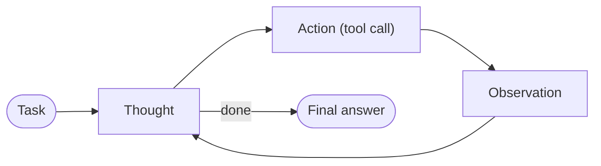
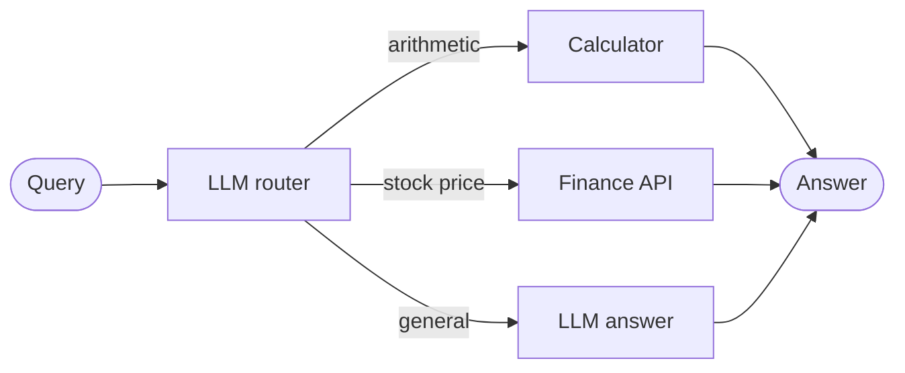
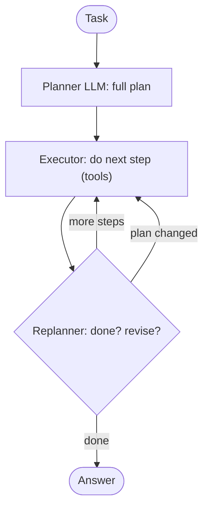
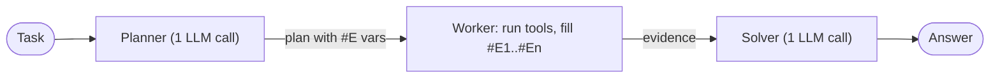
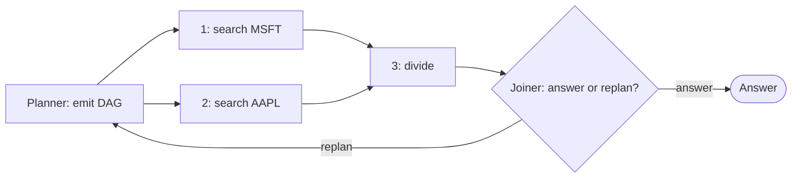
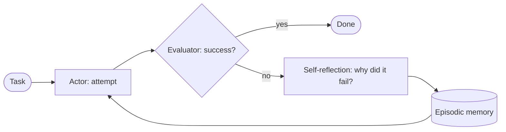
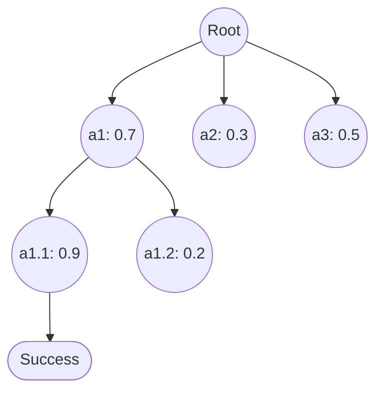
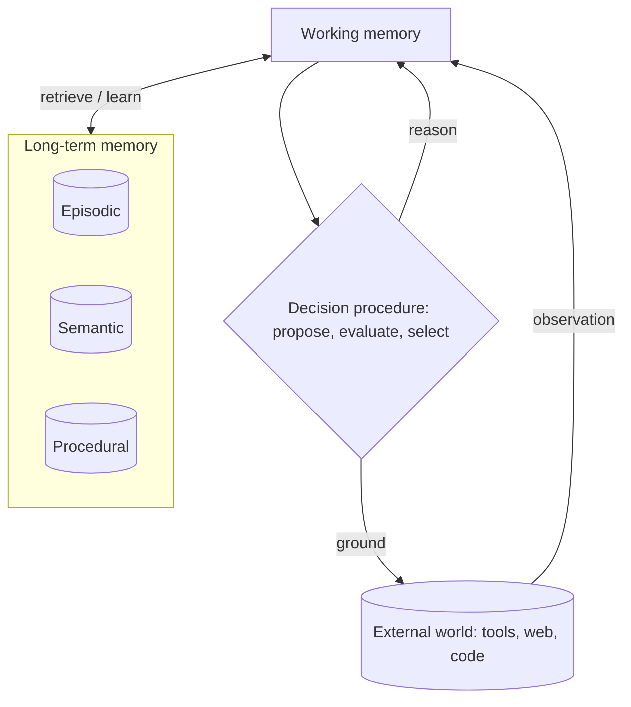
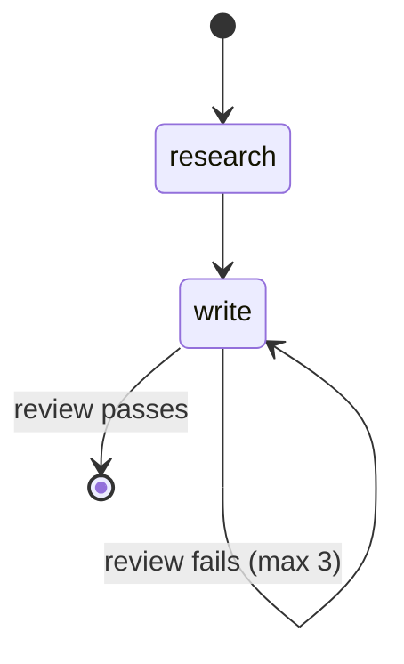
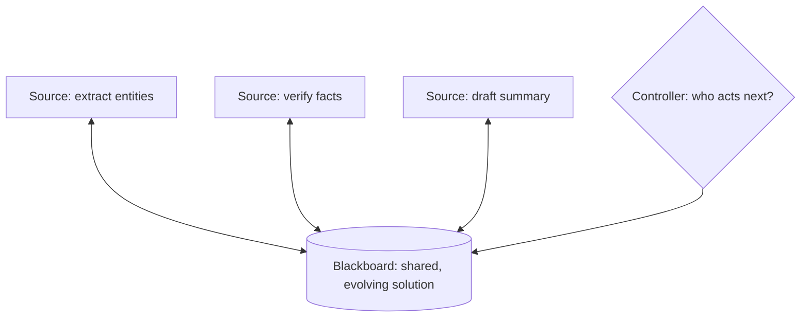

Two agents can share the same model, the same tools and the same task and still behave completely differently, because of how they are **architected**: when they think, when they act, whether they plan up front, whether they look back at their mistakes, whether they explore alternatives. Since 2022 researchers and practitioners have produced a zoo of named architectures (ReAct, MRKL, ReWOO, Reflexion, LATS, and more), each a different answer to the question "how should a language model interleave reasoning and acting?"

This lesson is a field guide to that zoo for a **single agent**: one decision-making locus, possibly with many tools. (Systems of multiple cooperating agents get their own lesson, [Multi-Agent Systems](multi-agent-systems.html).) For each architecture you will see the core idea, a diagram or trace, what it is good at and what it costs. Then we zoom out to a unifying framework (CoALA), look at how production systems actually implement agents as **state machines**, and end with the most important and least glamorous conclusion: a capable model in a simple loop with well-designed tools is the right default.

> [!NOTE] Research architectures vs. modern models
> Many of these architectures were invented in 2022–2023, when models needed elaborate scaffolding to reason reliably. Today's models think natively (extended or adaptive thinking), call tools in parallel, and can plan without being prompted to. Some ideas below are now absorbed *into the model*; others remain essential *harness* design. We will flag which is which.

## ReAct: Reason + Act

**ReAct** (Yao et al., 2022) is the ancestor of almost every modern agent. The idea: interleave **reasoning traces** ("Thought") with **actions** (tool calls) and **observations** (tool results) in a single growing context. Reasoning helps the model plan and handle exceptions; actions ground the reasoning in real information, reducing hallucination.

```text
Question: Which is older, the Eiffel Tower or the Statue of Liberty's dedication?
Thought: I need the completion date of the Eiffel Tower and the dedication date of the statue.
Action: search("Eiffel Tower completed")
Observation: The Eiffel Tower was completed in March 1889.
Thought: Now the Statue of Liberty.
Action: search("Statue of Liberty dedication date")
Observation: The statue was dedicated on October 28, 1886.
Thought: 1886 is earlier than 1889, so the statue's dedication came first.
Action: finish("The Statue of Liberty's dedication (1886) predates the Eiffel Tower (1889).")
```



**Strengths:** adapts every step to what it just learned; simple; robust to surprises. **Weaknesses:** one LLM call per step (latency and cost scale with steps), the context grows with every observation, and it is **greedy**: it commits to one path and can wander or loop.

Today ReAct is not so much an architecture as the default shape of the [agent loop](the-agent-loop.html). With native tool calling, the "Thought" lives in the model's thinking blocks and the "Action" is a structured `tool_use` block rather than parsed text, but the cycle is identical.

## MRKL: Routing to Expert Modules

**MRKL** (Modular Reasoning, Knowledge and Language, pronounced "miracle"; Karpas et al., 2022, AI21 Labs) predates ReAct's popularity and contributed a different idea: a **neuro-symbolic** system where an LLM acts as a **router** over a set of **expert modules**, some neural (other models) and some symbolic (a calculator, a database, a weather API). The LLM's job is to recognize which expert can handle a query and extract the arguments for it.



MRKL's lasting contribution is the principle that **LLMs should not do what deterministic tools do better**: exact arithmetic, lookups, date math. Its paper showed that extracting arguments reliably for even a calculator was nontrivial, an early glimpse of why tool design matters ([Designing Tools](designing-tools.html)). In modern terms, a MRKL system is a single-step tool-calling agent, or a router workflow ([Workflow Patterns](workflow-patterns.html#routing)).

## Self-Ask: Decomposing Into Follow-Up Questions

**Self-Ask** (Press et al., 2022) targets **compositional questions**, ones that require combining facts the model may know individually but fails to compose. The model is prompted to explicitly ask itself **follow-up questions**, answer each (optionally via a search engine), and only then answer the original.

```text
Question: Who was president of the U.S. when superconductivity was discovered?
Are follow up questions needed here: Yes.
Follow up: When was superconductivity discovered?
Intermediate answer: Superconductivity was discovered in 1911.
Follow up: Who was president of the U.S. in 1911?
Intermediate answer: William Howard Taft.
So the final answer is: William Howard Taft.
```

The paper named the failure it addressed the **compositionality gap**: models could often answer both sub-questions correctly but not the composed question. Making decomposition explicit closed much of that gap, and plugging a search engine into the "Intermediate answer" slot made it a simple agent. Self-Ask is a specialization of ReAct where every action is a question; its spirit lives on in how [research agents](research-agents.html) decompose queries.

## Plan-and-Execute

ReAct decides one step at a time. **Plan-and-Execute** (inspired by Plan-and-Solve prompting, Wang et al., 2023, and the BabyAGI line of projects) separates **planning** from **execution**: a planner produces a multi-step plan up front; an executor (often a ReAct agent with tools) carries out each step; and a **replanner** revises the remaining plan after each step based on results.



**Why it helps:**

- **Long-horizon coherence.** An explicit plan keeps the agent oriented on step 14 of 20, where a pure ReAct agent tends to drift.
- **Cost.** The planner can be a strong model while step execution uses a cheaper one.
- **Transparency.** A plan can be shown to a human before anything happens ([Human-in-the-Loop](human-in-the-loop.html)).

**Why it hurts:** plans made before seeing any data are often wrong, so replanning is essential, and a rigid plan can be worse than no plan. In modern coding agents you see a lightweight version: the agent writes a **to-do list** into its context (or a file) and updates it as it goes. The plan is just another piece of state the model maintains, not a separate component.

## ReWOO: Plan Once, No Observations in the Loop

**ReWOO** (Reasoning WithOut Observation; Xu et al., 2023) pushes the separation further. In ReAct, every tool result is appended to the context and the whole growing prompt is re-sent to the model for the next step, which is redundant and expensive. ReWOO splits the agent into three roles:

1. **Planner**: produces the entire plan in one call, with **placeholder variables** (`#E1`, `#E2`, ...) for evidence not yet gathered. Later steps can reference earlier placeholders.
2. **Worker**: executes the tool calls in order, substituting earlier results into later inputs. *No LLM reasoning happens here.*
3. **Solver**: one final LLM call that receives the plan plus all evidence and writes the answer.

```text
Plan: Find who directed the film that won Best Picture in 2020.
#E1 = search["Best Picture winner 2020 Academy Awards"]
Plan: Find the director of that film.
#E2 = llm["Who directed the film named in: #E1"]
Plan: Find the director's other notable films.
#E3 = search["#E2 filmography"]
```



The LLM never sees an observation until the solver step, so total LLM calls are roughly two regardless of the number of tool calls. The authors reported large token savings relative to ReAct on multi-hop QA with comparable or better accuracy, and that the decoupling allowed the planner's skill to be distilled into a smaller model. The catch is obvious: **the plan cannot adapt to surprises**. If `#E1` comes back empty or ambiguous, the worker blindly proceeds.

Here is a compact ReWOO with the Anthropic SDK. The planner emits a structured plan; the worker is pure Python:

```python
import re
import anthropic
from pydantic import BaseModel

client = anthropic.Anthropic()
MODEL = "claude-opus-5-5"

class Step(BaseModel):
    var: str        # e.g. "E1"
    tool: str       # "search" or "calculate"
    input: str      # may reference earlier vars like "#E1"

class Plan(BaseModel):
    steps: list[Step]

TOOLS = {
    "search": lambda q: f"(search results for {q!r})",          # stub: plug in a real search API
    "calculate": lambda expr: str(eval(expr, {"__builtins__": {}})),  # demo only; never eval untrusted input in production
}

def rewoo(task: str) -> str:
    plan = client.messages.parse(
        model=MODEL, max_tokens=16000,
        system="Plan tool calls to solve the task. Tools: search, calculate. "
               "Reference earlier results as #E1, #E2. Do not answer the task yourself.",
        messages=[{"role": "user", "content": task}],
        output_format=Plan,
    ).parsed_output

    evidence: dict[str, str] = {}
    for step in plan.steps:                       # worker: no LLM in this loop
        arg = re.sub(r"#(E\d+)", lambda m: evidence.get(m.group(1), ""), step.input)
        evidence[step.var] = TOOLS[step.tool](arg)

    trail = "\n".join(f"#{s.var} = {s.tool}[{s.input}] -> {evidence[s.var]}" for s in plan.steps)
    solved = client.messages.create(
        model=MODEL, max_tokens=16000,
        messages=[{"role": "user", "content": f"Task: {task}\n\nEvidence:\n{trail}\n\nAnswer the task."}],
    )
    return "".join(b.text for b in solved.content if b.type == "text")
```

## LLMCompiler: A DAG of Parallel Calls

**LLMCompiler** (Kim et al., 2023) observes that many tool calls in a plan are **independent** and could run at the same time. Borrowing from compilers, it has a **planner** that emits a **directed acyclic graph (DAG)** of tasks with explicit dependencies, a **task-fetching unit** that dispatches any task whose dependencies are satisfied, and an **executor** that runs them in parallel. A **joiner** then decides whether to answer or replan.

```text
1. search("Microsoft market cap")             deps: []
2. search("Apple market cap")                 deps: []
3. calculate($1 / $2)                         deps: [1, 2]
4. join()                                     deps: [3]
```



Tasks 1 and 2 run concurrently; task 3 waits for both. The paper reported meaningful latency and cost reductions versus sequential ReAct on parallelizable workloads, and unlike ReWOO it keeps a replanning loop.

> [!NOTE] Parallel tool calls are now native
> Modern APIs let the model emit **several tool calls in one turn**, and the harness can run them concurrently. That captures much of LLMCompiler's benefit for free whenever the independent calls are visible at the same step. Explicit DAG planning still pays off when dependency chains are deep, or when you want the whole plan up front for approval or scheduling. A related modern technique, **programmatic tool calling**, lets the model write a short script that calls tools in loops and branches, so intermediate results never enter the context at all.

## Reflexion: Learning From Failure in Words

**Reflexion** (Shinn et al., 2023) adds a learning loop without touching model weights. After a trial fails (a test fails, an environment signals failure, a heuristic detects a loop), a **self-reflection** step asks the model to diagnose *why* in natural language. The reflection is stored in an **episodic memory buffer** and prepended to the next attempt. The authors called this **verbal reinforcement learning**: the "gradient" is a paragraph of advice to oneself.



```text
Trial 1: wrote is_palindrome(s) -> s == s[::-1]
Tests: FAIL  is_palindrome("A man, a plan, a canal: Panama") expected True
Reflection: I compared the raw string. The tests expect case-insensitive comparison
            ignoring non-alphanumeric characters. Next time, normalize first.
Trial 2: normalize with s.lower() and filter str.isalnum, then compare -> PASS
```

Reflexion reported strong gains on coding benchmarks (HumanEval at the time) and on sequential decision-making tasks. Its key dependency is a **good evaluator signal**: unit tests, environment rewards or exact-match checks. With a weak or LLM-only evaluator, reflections can confidently "learn" the wrong lesson. Reflexion is a close cousin of the evaluator-optimizer workflow, plus persistent memory across attempts; it also underpins much of [Self-Improving Agents](self-improving-agents.html).

## LATS: Tree Search Over Actions

**LATS** (Language Agent Tree Search; Zhou et al., 2023) addresses ReAct's greediness by applying **Monte Carlo Tree Search (MCTS)** to agent trajectories. Each node is a state (the trajectory so far). LATS repeatedly:

1. **Selects** a promising node (balancing exploitation and exploration, as in UCT).
2. **Expands** it by sampling several candidate actions.
3. **Evaluates** new nodes with an LLM-generated value score (and self-consistency).
4. **Simulates** forward to a terminal state, getting environment feedback.
5. **Backpropagates** the result up the tree; on failure it also generates a Reflexion-style reflection stored for future attempts.



LATS unifies reasoning, acting and planning and reported top results on programming and web-navigation benchmarks of its time. The costs are severe: dozens to hundreds of LLM calls per task, and it requires an environment where you can **revert to an earlier state** to try another branch. That is easy in QA or code (re-run from scratch) and hard or impossible in the real world (you cannot un-send an email). Search-based agents remain an active research area ([Reasoning & Planning](reasoning-and-planning.html)), and the related idea of sampling many attempts and selecting with a verifier ("best-of-N") is widely used in coding agents.

## The Cognitive Architecture View: CoALA

With so many named architectures, we need a common vocabulary. **CoALA** (Cognitive Architectures for Language Agents; Sumers, Yao, Narasimhan and Griffiths, 2023) draws on decades of cognitive-architecture research (Soar, ACT-R) to describe any language agent along three dimensions:

**1. Memory**

- **Working memory**: the current context: active goals, recent observations, intermediate results.
- **Episodic memory**: records of past experiences (previous trajectories, Reflexion's reflections).
- **Semantic memory**: facts about the world (a knowledge base, retrieved documents).
- **Procedural memory**: how to do things, both *implicit* (the model's weights) and *explicit* (the agent's code, prompts, skill files).

**2. Action space**

- **External actions** (grounding): tools, APIs, robots, web browsers: anything affecting the outside world.
- **Internal actions**: **reasoning** (updating working memory), **retrieval** (reading long-term memory), **learning** (writing long-term memory).

**3. Decision procedure**

A loop that, in each cycle, proposes candidate actions via reasoning and retrieval, evaluates them, selects one, and executes it.



The power of CoALA is diagnostic. Describe your agent in these terms and gaps become visible:

| Architecture | Memory | Internal actions | Decision procedure |
|---|---|---|---|
| ReAct | Working only | Reasoning | Greedy, one action per cycle |
| Reflexion | + Episodic (reflections) | Reasoning, learning | Greedy within a trial, retry across trials |
| ReWOO | Working (plan + evidence) | Reasoning once | Plan up front, no feedback |
| LATS | + Episodic, tree of states | Reasoning, evaluation | Search (MCTS) |
| Coding agent (2026) | Working + files + memory notes | Reasoning, retrieval, learning | Greedy with to-do plan and tests |

The [Memory](memory.html) lesson builds on the same taxonomy.

## Graph and State-Machine Agents

Research architectures describe *how the model thinks*. Production engineering asks a different question: **how do I make this controllable, debuggable and resumable?** The dominant answer is to model the agent as an explicit **state machine** or **graph**:

- **State**: a typed object holding everything the agent knows (messages, plan, intermediate results, flags).
- **Nodes**: functions that read the state and return an update. A node may call an LLM, run a tool, or be pure code.
- **Edges**: transitions between nodes. **Conditional edges** use a function (often of LLM output) to choose the next node.
- **Checkpointing**: the state is persisted after each node, enabling pause, resume, human approval, time travel and crash recovery.

LangGraph popularized this style; the Claude Agent SDK, OpenAI Agents SDK and others offer related primitives ([Agent Frameworks](agent-frameworks.html)). Here is a research-then-write agent with an explicit review loop, in LangGraph's documented `StateGraph` shape (check current docs; APIs evolve):

```python
from typing import TypedDict, Literal
from langgraph.graph import StateGraph, START, END

class State(TypedDict):
    question: str
    notes: str
    draft: str
    revisions: int

def research(state: State) -> dict:
    return {"notes": run_research_agent(state["question"])}   # a ReAct agent as one node

def write(state: State) -> dict:
    return {"draft": write_report(state["question"], state["notes"]),
            "revisions": state.get("revisions", 0) + 1}

def review(state: State) -> Literal["write", "__end__"]:
    if state["revisions"] >= 3 or passes_review(state["draft"]):  # bounded loop
        return END
    return "write"

builder = StateGraph(State)
builder.add_node("research", research)
builder.add_node("write", write)
builder.add_edge(START, "research")
builder.add_edge("research", "write")
builder.add_conditional_edges("write", review)
graph = builder.compile()

result = graph.invoke({"question": "How do heat pumps perform below -20C?", "revisions": 0})
```



**Why graphs win in production:**

- **Explicit states make illegal transitions impossible.** A refund agent cannot reach `issue_refund` without passing through `verify_identity`, because there is no edge that skips it. In a free loop, that guarantee is only a prompt instruction.
- **Each node is testable** with fixed inputs.
- **Checkpoints** give you resume-after-crash and human approval gates.
- **Mix freely**: some nodes are full autonomous agents, others are deterministic code.

**The cost:** you are hard-coding control flow, which is precisely what agents were supposed to free you from. Over-specified graphs become brittle flowcharts that break on inputs the designer did not anticipate. A good heuristic: put **hard constraints** (compliance steps, approvals, irreversible actions) in the graph, and let the model handle the open-ended parts *inside* nodes.

## Router Agents and the Blackboard

Two more classic shapes complete the picture.

### Router agents

A **router agent** is an LLM whose main decision is *which capability to hand the task to*: a specialized prompt, a sub-graph, a tool set or a model. It is the agentic version of the routing workflow, and the MRKL idea applied at a higher level. Routers keep each downstream component's context small and focused, and they are how many assistants scale to hundreds of capabilities: route first, then load only the relevant tools. The failure mode is the same as for routing workflows: misroutes are silent, so measure the router as a classifier. When the "capabilities" become separate agents with their own loops, you have crossed into [multi-agent](multi-agent-systems.html) territory.

### Blackboard architecture

The **blackboard architecture** comes from 1970s–80s AI (the Hearsay-II speech-understanding system). A shared data structure, the **blackboard**, holds the current state of the solution. Independent **knowledge sources** watch the blackboard and contribute when they can add something; a **controller** decides which contribution to apply next.



In an LLM setting the blackboard might be a structured document or database, the knowledge sources might be prompts or tools, and the controller might be an LLM choosing which to invoke. Its appeal is **opportunistic, non-linear problem solving**: no fixed pipeline, contributors added or removed freely. Its cost is coordination: someone has to decide what happens next and when the solution is done. Blackboards reappear as "shared state" communication in multi-agent systems, and a coding agent's working directory and to-do file are, in effect, a blackboard.

## One Agent With Good Tools: The Default

After touring a dozen architectures, here is the conclusion most experienced builders reach: **for most tasks, start with a single capable model in a simple tool-use loop**, essentially ReAct with native tool calling, and invest your effort in:

1. **Tools**: few, well-named, well-documented, returning concise high-signal results with actionable errors ([Designing Tools](designing-tools.html)).
2. **Context**: the right instructions, examples and retrieved knowledge, and compaction or memory for long runs ([Context Engineering](context-engineering.html)).
3. **Verification**: give the agent ways to check its own work (tests, linters, re-reading sources).
4. **Guardrails**: budgets, permissions, approval gates.

Why does the simple loop win so often now? Because the model has absorbed much of what elaborate scaffolds once provided. It plans when planning helps, emits parallel tool calls, reflects after an error, and reasons in its thinking blocks, *adaptively*, rather than following a rigid script that is wrong for half the tasks. The scaffolds of 2023 were partly compensating for model weaknesses; as models improve, scaffolding that constrains them can start to hurt.

> [!KEY] Architecture is a means, not a goal
> Add structure where you have **evidence** that it helps: an explicit plan for long tasks that drift; a reflection step where failures recur; parallel fan-out where latency matters; a state graph where compliance demands guaranteed ordering. Each addition should earn its place in an evaluation ([Evaluating Agents](evaluating-agents.html)).

## Comparing the Architectures

Relative characteristics, assuming the same model and tools. Real numbers depend heavily on task and implementation.

| Architecture | Latency | Cost (LLM calls) | Adaptivity | Reliability profile | Best for |
|---|---|---|---|---|---|
| ReAct / tool loop | Medium; grows with steps | One per step; context grows | High, every step | Greedy; can loop or drift | Default for most agentic tasks |
| MRKL / router | Low | 1–2 | Low | Depends on routing accuracy | Many specialized tools or experts |
| Self-Ask | Medium | One per sub-question | Medium | Good on multi-hop facts | Compositional QA |
| Plan-and-Execute | Medium–high | Plan + steps + replans | Medium (via replanning) | Coherent on long tasks | Long, multi-stage tasks; plan approval |
| ReWOO | Low | ~2 + tool calls | None mid-run | Brittle to surprises | Predictable tool chains; cost-sensitive |
| LLMCompiler | Lowest for parallel work | Plan + joins | Medium (replan) | Good if dependencies are right | Many independent lookups |
| Reflexion | High (multiple trials) | Per trial + reflections | High across trials | Strong with good evaluators | Tasks with tests or rewards |
| LATS | Very high | Many (tree search) | Very high | Best search quality; needs reversibility | Offline, high-value, resettable tasks |
| State graph | Varies by node | Varies | Designed in | Most predictable and auditable | Production flows with hard constraints |
| Blackboard | Varies | Varies | High | Coordination-dependent | Opportunistic, multi-source synthesis |

## Key Takeaways

- **ReAct** (thought, action, observation) is the shape of the modern agent loop; most other architectures modify when the model plans, observes, reflects or explores.
- **Plan-and-Execute** and **ReWOO** plan up front for coherence and lower cost; ReWOO trades away all mid-run adaptivity. **LLMCompiler** turns plans into DAGs of parallel calls.
- **Reflexion** learns across attempts through verbal self-reflection stored in memory, and is only as good as its evaluator signal. **LATS** searches a tree of trajectories, which requires a resettable environment and lots of calls.
- **CoALA** gives a common vocabulary: memory (working, episodic, semantic, procedural), action space (internal and external), decision procedure.
- **State-machine graphs** make agents controllable, testable and resumable. Put hard constraints in edges; leave open-ended work inside nodes.
- **Router** and **blackboard** architectures handle many capabilities and opportunistic collaboration respectively.
- Default to **one capable model with good tools** in a simple loop; add architectural structure only where evaluations show it helps.

## Exercises

1. **Trace translation.** Take the ReAct trace about the Eiffel Tower and rewrite it as (a) a ReWOO plan with `#E` variables and (b) an LLMCompiler DAG. Which calls can run in parallel? What happens in each version if the first search returns nothing useful?
2. **Run ReWOO.** Replace the stub `search` in the ReWOO example with a real search API (or the web search server tool inside a small helper call), run it on five multi-hop questions, and count LLM calls and input tokens. Compare against a plain tool-runner agent on the same questions.
3. **Add reflection.** Wrap a code-writing agent in a Reflexion loop: run provided unit tests, and on failure ask the model for a two-sentence reflection that is prepended to the next attempt. Cap at three trials. Log the reflections: are they accurate diagnoses?
4. **CoALA audit.** Pick an agent you use (a coding agent, a research assistant). Describe its memory types, internal and external actions, and decision procedure using CoALA. Identify one missing component and argue whether adding it would help.
5. **Graph design.** Design a state graph for an expense-reimbursement agent that must always check policy before approving and must get human sign-off above $500. Implement it in plain Python or LangGraph, and write a test proving no path reaches `approve` without `check_policy`.

## Check Your Understanding

```quiz
Q: What distinguishes ReWOO from ReAct?
- [ ] ReWOO uses tools; ReAct does not
- [x] ReWOO plans all tool calls up front with placeholders and only shows observations to a final solver, so the LLM does not reason between tool calls
- [ ] ReWOO runs tool calls in parallel as a DAG
- [ ] ReWOO uses tree search over trajectories
E: ReWOO's planner, worker and solver separation removes observations from the reasoning loop, cutting tokens and calls, at the cost of being unable to adapt mid-run. The DAG idea is LLMCompiler; tree search is LATS.

Q: Reflexion improved results on coding tasks. What is its most critical dependency?
- [ ] A very long context window
- [ ] Fine-tuning the model on its reflections
- [x] A reliable evaluator signal (such as unit tests) that tells it when and how it failed
- [ ] Parallel tool calls
E: Reflexion learns verbally from failure. Without a trustworthy success/failure signal, reflections can diagnose the wrong problem and reinforce bad strategies.

Q: Why is LATS hard to apply to an agent that sends emails and makes purchases?
- [ ] LATS cannot call external tools
- [x] Tree search requires reverting to earlier states to explore alternative branches, and real-world side effects cannot be undone
- [ ] LATS only works with small models
- [ ] MCTS requires a numerical reward from the user
E: Exploring multiple branches means trying actions and backing up. In environments with irreversible effects, that is unsafe or impossible.

Q: In CoALA terms, a coding agent's CLAUDE.md or AGENTS.md instruction file is best described as:
- [ ] Episodic memory
- [ ] Working memory
- [x] Explicit procedural memory
- [ ] An external grounding action
E: Procedural memory is knowledge of how to do things. CoALA distinguishes implicit procedural memory (weights) from explicit procedural memory (code, prompts, instruction files).

Q: A compliance rule says a refund must never be issued before identity verification. Which design gives the strongest guarantee?
- [ ] A system prompt saying "always verify identity first"
- [ ] A Reflexion loop that learns the rule from failures
- [x] A state graph with no edge from the start state to the refund node that bypasses verification
- [ ] Running three voters on whether to refund
E: Graph structure makes the illegal transition impossible. Prompt instructions are probabilistic; learning from failure means failures happen first.

Q: Modern APIs let models emit several tool calls in one turn. Which architecture's main benefit does this partly absorb?
- [ ] Reflexion
- [ ] Self-Ask
- [x] LLMCompiler
- [ ] Blackboard
E: LLMCompiler's core contribution was parallel execution of independent calls. Native parallel tool calls capture much of that when independent calls are visible at the same step, though explicit DAGs still help for deep dependency chains.

Q: Why do many practitioners now default to "one capable model with good tools in a simple loop"?
- [ ] Complex architectures are impossible to implement with current APIs
- [x] Strong models now plan, reflect and parallelize adaptively, so rigid scaffolds often add cost and constrain them without improving results
- [ ] Simple loops never fail
- [ ] Single agents are always cheaper than workflows
E: Much elaborate scaffolding compensated for weaker models. With capable models, structure should be added only where evaluations show it helps.
```

## Further Reading

- [ReAct: Synergizing Reasoning and Acting in Language Models (Yao et al., 2022)](https://arxiv.org/abs/2210.03629) — the foundational paper for interleaved reasoning and tool use.
- [MRKL Systems (Karpas et al., 2022)](https://arxiv.org/abs/2205.00445) — the modular, neuro-symbolic router architecture.
- [Measuring and Narrowing the Compositionality Gap (Press et al., 2022)](https://arxiv.org/abs/2210.03350) — introduces Self-Ask.
- [ReWOO: Decoupling Reasoning from Observations (Xu et al., 2023)](https://arxiv.org/abs/2305.18323) — planner, worker, solver without observations in the loop.
- [An LLM Compiler for Parallel Function Calling (Kim et al., 2023)](https://arxiv.org/abs/2312.04511) — DAG planning and parallel execution of tool calls.
- [Reflexion: Language Agents with Verbal Reinforcement Learning (Shinn et al., 2023)](https://arxiv.org/abs/2303.11366) — learning from failure through self-reflection.
- [Language Agent Tree Search (Zhou et al., 2023)](https://arxiv.org/abs/2310.04406) — MCTS over agent trajectories.
- [Cognitive Architectures for Language Agents (Sumers et al., 2023)](https://arxiv.org/abs/2309.02427) — the CoALA framework; the best single map of the design space.
- [Building Effective Agents (Anthropic)](https://www.anthropic.com/engineering/building-effective-agents) — the practitioner's case for simple loops and good tools.
