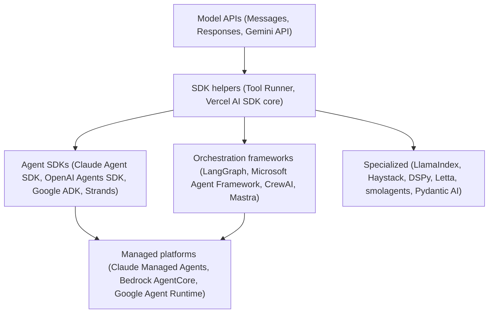
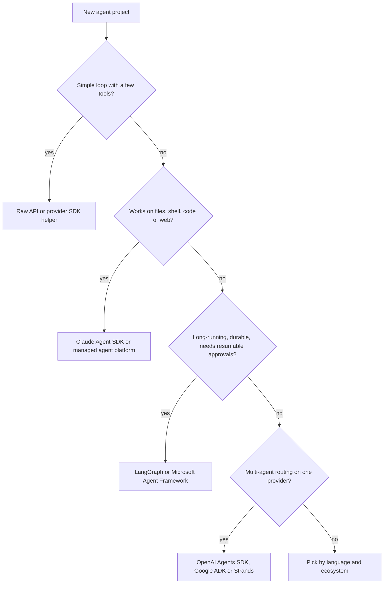

Ask ten teams which agent framework they use and you may get ten answers, plus a few who proudly use none. The landscape is crowded because "agent framework" covers very different things: thin helpers over one model API, opinionated multi-agent toolkits, durable workflow engines, data frameworks with agents bolted on, and fully managed cloud runtimes.

This lesson gives you a map. First the honest question of whether you need a framework at all. Then a tour of the major options as of late 2026, each with its philosophy, core abstractions, strengths, weaknesses and best fit. Then a big comparison table, selection criteria, and advice for migrating when (not if) you outgrow your first choice. Code stays minimal here; for side-by-side implementations see [Hands-On with Agent SDKs](sdk-hands-on.html).

> [!WARNING] A fast-moving landscape
> Projects in this space rename, merge, deprecate and re-version constantly. Several changed significantly during 2025 and 2026 alone. Facts here are checked as of November 2026; treat versions and product names as perishable and the *trade-offs* as the durable lesson.

## Framework or No Framework?

You already know that an agent is a loop around a model call ([the agent loop](the-agent-loop.html)) and that a capable one fits in about 300 lines ([Build an Agent From Scratch](build-agent-from-scratch.html)). So what does a framework buy you?

**What frameworks give you:**

- **Plumbing you would otherwise write**: tool-schema generation, the loop, retries, streaming, structured output parsing.
- **Hard features**: durable execution (survive crashes mid-run), checkpoints, resumable human approvals, parallel branches, memory stores.
- **Integrations**: hundreds of model providers, vector stores, document loaders and tools.
- **Observability**: tracing and evaluation hooks, often with a hosted dashboard.
- **Shared vocabulary** for a team: everyone knows what a "node" or a "handoff" is.

**What they cost you, the abstraction tax:**

- **Hidden prompts and behavior.** Some frameworks inject system prompts, tool descriptions or retry logic you never see, which makes failures hard to diagnose.
- **Debugging through layers.** A stack trace through three abstraction layers is harder to read than your own 40-line loop.
- **Churn.** Fast-moving APIs mean upgrades that break code. Several major frameworks went through full rewrites between 2024 and 2026.
- **Lag behind the model API.** New model features (new tool types, caching controls, thinking modes) arrive in the provider's SDK first and in frameworks later, sometimes imperfectly.
- **Lock-in.** Your state format, prompts and control flow get shaped by the framework's abstractions.

> [!KEY] Start thin, add layers for specific needs
> Anthropic's widely cited guidance, from [Building effective agents](https://www.anthropic.com/engineering/building-effective-agents), is to start with the model API directly, since many patterns take only a few lines, and if you adopt a framework, make sure you understand the code underneath. Reach for a framework when it solves a problem you actually have (durability, approvals that wait days, multi-agent coordination, a team that needs conventions), not for the loop itself.

The options sit at different layers:



## The Landscape: General-Purpose Frameworks

### LangChain and LangGraph

**Philosophy.** LangChain began (2022) as a library of composable LLM building blocks and integrations. **LangGraph** is its lower-level orchestration layer: agents as explicit, stateful graphs. With the 1.0 releases in late 2025, LangChain was refocused on a standard agent (`create_agent`, extensible through middleware) that runs on the LangGraph runtime.

**Core abstractions.** LangGraph: `StateGraph`, nodes, edges and conditional edges, typed state with reducers, **checkpointers** (per-thread persistence), `interrupt()` for human-in-the-loop, subgraphs, streaming. LangChain: chat models, tools, `create_agent`, middleware.

**Strengths.** The most mature durable-execution and human-in-the-loop story among open-source frameworks; explicit control over every transition; huge integration ecosystem; Python and JavaScript; strong tracing and evaluation through LangSmith.

**Weaknesses.** Verbose for simple agents; a history of API churn (for example, the prebuilt `create_react_agent` was deprecated in favor of `create_agent`); layered abstractions can be hard to debug.

**Best for.** Long-running, branching, resumable workflows; production systems where state and approvals must survive restarts.

### Microsoft Agent Framework (and AutoGen, AG2)

**Lineage.** **AutoGen** (Microsoft Research) popularized multi-agent *conversations*, where agents talk to each other to solve tasks; its v0.4 rewrite moved to an event-driven, actor-style core. In late 2024 some of AutoGen's original creators forked the earlier line as the community project **AG2**. Microsoft then merged AutoGen's multi-agent ideas with **Semantic Kernel**'s enterprise features into the **Microsoft Agent Framework**, which reached 1.0 general availability in April 2026 for .NET and Python. AutoGen and Semantic Kernel are now in maintenance mode (bug and security fixes, no new features), with migration guides to the new framework.

**Core abstractions.** Agents with tools and threads; graph-based **workflows** with type-safe routing, checkpointing and human-in-the-loop; multi-agent orchestration patterns (sequential, concurrent, handoff, group chat, and others); MCP and A2A support; OpenTelemetry tracing.

**Strengths.** First-class .NET support, enterprise integration with Azure AI Foundry, and Microsoft's long-term commitment. **Weaknesses.** Young as a unified product; ecosystem and docs are still consolidating; most natural on Azure. **Best for.** .NET and Microsoft-centric enterprises, and AutoGen or Semantic Kernel users planning their migration.

### CrewAI

**Philosophy.** Model a team of specialists. You define **agents** by role, goal and backstory, give them **tasks**, and assemble a **crew** that runs them in a sequential or hierarchical (manager-led) process. **Flows** add event-driven, deterministic orchestration around crews for production control. CrewAI is standalone (not built on LangChain).

**Strengths.** Fast to prototype; the role/task metaphor is intuitive for non-specialists; good fit for content and research pipelines. **Weaknesses.** Role-play prompting adds tokens and hidden prompt text; less fine-grained control over the loop than graph frameworks; multi-agent by default even when one agent would do. **Best for.** Quick multi-role pipelines and teams that think in roles; use Flows when you need determinism.

### OpenAI Agents SDK

**Philosophy.** A small set of primitives, production-ready successor to OpenAI's experimental Swarm: **Agent** (instructions, tools, output type), **handoffs** (delegate control to another agent), **guardrails** (input, output and tool validation), **sessions** (memory) and built-in **tracing**. Python and TypeScript.

**Strengths.** Minimal and readable; handoffs make multi-agent routing trivial; tool approvals pause a run into a serializable state; tracing works with zero setup. **Weaknesses.** Best experience on OpenAI models and the Responses API; other providers go through adapters with feature gaps; tracing defaults to OpenAI's dashboard. **Best for.** Lightweight multi-agent apps, especially on OpenAI models.

### Claude Agent SDK

**Philosophy.** Give developers the same harness that powers Claude Code. Formerly the Claude Code SDK, it runs Claude Code's agent loop (as a bundled CLI subprocess) from Python or TypeScript, with its context management, built-in tools for files, shell, search and web, plus **permissions**, **hooks**, **subagents**, **sessions**, skills and MCP.

**Strengths.** The richest out-of-the-box toolset for agents that work on a computer; battle-tested tools and context compaction; deterministic hooks for policy; cost and turn caps. **Weaknesses.** Claude models only; heavier runtime (a CLI process per session); less control over loop internals than a hand-written loop. **Best for.** Coding agents, repository and file automation, research agents, and anything that needs a sandboxed computer.

### Google Agent Development Kit (ADK)

**Philosophy.** Make agent development feel like ordinary software development: an open-source, code-first toolkit, optimized for Gemini but model-agnostic, available in Python, Java, Go and TypeScript.

**Core abstractions.** `LlmAgent`; **workflow agents** (`SequentialAgent`, `ParallelAgent`, `LoopAgent`) for deterministic orchestration; hierarchical multi-agent systems; session, state, memory and artifact services; built-in evaluation; a local dev UI; first-class support for the A2A protocol, which Google originated.

**Strengths.** Clean separation of deterministic workflow and LLM-driven agents; evaluation built in; smooth path to Google Cloud deployment. **Weaknesses.** Best integrated on Google Cloud; fewer third-party integrations than LangChain. **Best for.** Teams on Google Cloud or Gemini, and multi-agent systems that interoperate over A2A.

### AWS Strands Agents

**Philosophy.** **Model-driven** rather than workflow-driven: give a capable model a prompt and tools and let it plan, with minimal scaffolding. Open-sourced by AWS, in Python and TypeScript.

**Strengths.** Very little code for a working agent; MCP-native; provider-agnostic (Amazon Bedrock, Anthropic, OpenAI and others); multi-agent patterns such as agents-as-tools, swarms and graphs; natural deployment to Bedrock AgentCore and other AWS compute. **Weaknesses.** Leans on model capability rather than explicit control; smaller ecosystem outside AWS. **Best for.** AWS shops that want simple, model-driven agents.

## The Landscape: Specialized Frameworks

### LlamaIndex

A **data framework** first: ingestion, parsing, indexing and retrieval for [RAG](rag-and-retrieval.html), with agents layered on top (`FunctionAgent`, `ReActAgent`, `AgentWorkflow`) and event-driven **Workflows** for orchestration. Python and TypeScript; commercial document parsing through LlamaCloud. **Strength:** best-in-class retrieval over messy documents. **Weakness:** general orchestration is less central than in LangGraph. **Best for:** document-heavy agents (knowledge assistants, report generation).

### Haystack

deepset's open-source framework for production **pipelines**: directed graphs of typed components (retrievers, rankers, generators, routers), with an `Agent` component for tool use. **Strength:** explicit, inspectable, serializable pipelines with a strong RAG and search heritage. **Weakness:** smaller agent ecosystem; pipeline-centric thinking can feel heavy for open-ended agents. **Best for:** search and RAG systems in production, especially in enterprises that want explicit pipelines.

### Pydantic AI

From the Pydantic team: an agent framework that feels like FastAPI. Agents are typed by their **dependencies** and **output type**; tools receive a typed run context through **dependency injection**; outputs are validated (and retried on validation failure). Model-agnostic; OpenTelemetry tracing (with Pydantic Logfire); graph support and integrations with durable-execution engines. **Strength:** type safety and testability. **Weakness:** fewer batteries for multi-agent orchestration than LangGraph. **Best for:** Python teams that value typed, testable code and [structured outputs](structured-outputs.html).

### DSPy

Stanford's "programming, not prompting" framework. You declare **signatures** (`question -> answer`), compose **modules** (`Predict`, `ChainOfThought`, `ReAct`), define a metric, and let **optimizers** (such as MIPROv2 or GEPA) search for better instructions and few-shot examples automatically. **Strength:** systematic prompt optimization against an evaluation set. **Weakness:** a different mental model; less focused on long-running, stateful agents. **Best for:** pipelines whose quality you can measure and want to optimize; see [evaluating agents](evaluating-agents.html).

### Hugging Face smolagents

A deliberately small library whose flagship `CodeAgent` writes its actions as **Python code** rather than JSON tool calls, following research showing that code actions can compose tools, loops and variables more efficiently ([Executable Code Actions](https://arxiv.org/abs/2402.01030)). A `ToolCallingAgent` covers the classic style. Supports many model backends and sandboxed execution (remote sandboxes or containers). **Strength:** simplicity, hackability, code-as-action. **Weakness:** executing model-written code demands a real sandbox ([guardrails and sandboxing](guardrails-and-sandboxing.html)). **Best for:** research, open models, and tasks where code composes tools naturally.

### Letta

Formerly **MemGPT** ([Packer et al., 2023](https://arxiv.org/abs/2310.08560)): **stateful agents** with self-editing, tiered memory (in-context memory blocks plus archival and recall storage), run as a server with a REST API so agents persist across sessions and restarts. **Strength:** long-term [memory](memory.html) as a first-class, inspectable feature. **Weakness:** a server to operate; opinionated memory model. **Best for:** companions, assistants and agents that must remember users over months.

### Mastra and the Vercel AI SDK (TypeScript)

**Vercel AI SDK** is a provider-agnostic TypeScript toolkit: one interface for many model providers (`generateText`, `streamText`, tools, structured output), UI hooks for streaming chat in React and other frameworks, and, since AI SDK 6, a `ToolLoopAgent` abstraction with configurable stop conditions. **Mastra** (1.0 in January 2026) is a batteries-included TypeScript agent framework: agents, tools, graph-based workflows, memory, RAG, evals and a local Studio UI. **Strength:** first-class TypeScript and web integration. **Weakness:** smaller Python-centric research ecosystem. **Best for:** full-stack web teams; the AI SDK for UI and model plumbing, Mastra when you also want workflows, memory and evals in one package.

## Managed Agent Platforms

Frameworks run in *your* process. Managed platforms run the agent (or its infrastructure) for you: sandboxes, session state, scaling, identity and observability.

| Platform | What it manages | Notes (as of Nov 2026) |
|---|---|---|
| **Claude Managed Agents** (Anthropic, beta) | The agent loop and a per-session container where tools run | You create a versioned **agent** config (model, system prompt, tools, MCP servers, skills), then start **sessions** that stream events; self-hosted sandboxes are an option |
| **OpenAI Responses API + AgentKit** | Model calls with built-in tools (web search, file search, code interpreter, computer use, remote MCP) and conversation state | The Assistants API was shut down in August 2026 in favor of Responses. AgentKit (2025) added ChatKit and a visual Agent Builder; In 2026 OpenAI announced it is winding down Agent Builder and its Evals product, pointing builders to the Agents SDK |
| **Amazon Bedrock AgentCore** | Modular services: Runtime (isolated sessions), Memory, Gateway (APIs and Lambda functions as MCP tools), Identity, Code Interpreter, Browser, Observability, plus later policy and evaluation features | Framework- and model-agnostic: host Strands, LangGraph, CrewAI or your own loop |
| **Google Agent Runtime** (formerly Vertex AI Agent Engine) | Managed runtime for ADK, LangGraph and other agents, with sessions, memory and evaluation | In April 2026 Google announced the Gemini Enterprise Agent Platform as Vertex AI's successor; Agent Engine was renamed Agent Runtime there |

Managed platforms trade control and portability for operations you do not have to build: sandbox isolation, long-running sessions, credentials vaulting and scaling. They matter most when agents run unattended, for many users, with real permissions. See [deployment](deployment.html).

## The Big Comparison Table

| Option | Language(s) | Core abstraction | Multi-agent | State and durability | Model-agnostic? | Best for |
|---|---|---|---|---|---|---|
| Raw API + Tool Runner | Many SDK languages | Your loop | DIY | DIY | One provider | Full control, learning, simple agents |
| LangGraph / LangChain | Python, JS | Stateful graph; `create_agent` | Subgraphs, supervisors | Checkpointers, interrupts, time travel | Yes | Durable, branching, resumable workflows |
| Microsoft Agent Framework | .NET, Python | Agents + typed workflows | Orchestration patterns | Checkpointing, HITL | Yes (Azure-first) | Microsoft and .NET enterprises |
| CrewAI | Python | Role-based crews; Flows | Core concept | Flow state | Yes | Fast multi-role pipelines |
| OpenAI Agents SDK | Python, TS | Agents, handoffs, guardrails | Handoffs, agents-as-tools | Sessions, resumable run state | Via adapters | Lightweight multi-agent on OpenAI |
| Claude Agent SDK | Python, TS | Claude Code harness | Subagents | Sessions (resume, fork) | Claude only | Agents that use a computer |
| Google ADK | Python, Java, Go, TS | LLM + workflow agents | Hierarchies, A2A | Session and memory services | Yes (Gemini-first) | Google Cloud, A2A systems |
| AWS Strands | Python, TS | Model-driven agent | Swarm, graph, agents-as-tools | Session managers | Yes | AWS-native agents |
| LlamaIndex | Python, TS | Data + agent workflows | AgentWorkflow | Workflow context | Yes | Document-heavy agents |
| Haystack | Python | Component pipelines | Limited | Serializable pipelines | Yes | Production RAG and search |
| Pydantic AI | Python | Typed agent + DI | Delegation, graphs | Durable-execution integrations | Yes | Typed, testable Python |
| DSPy | Python | Signatures + optimizers | Composition | Minimal | Yes | Metric-driven optimization |
| smolagents | Python | Code-writing agent | Managed agents | Minimal | Yes | Research, code-as-action |
| Letta | Python, TS clients | Stateful agent server | Multi-agent tools | Persistent memory server | Yes | Long-term memory |
| Mastra | TypeScript | Agents + workflows | Agent networks | Workflow and memory storage | Yes | Full-stack TS products |
| Vercel AI SDK | TypeScript | Model interface + `ToolLoopAgent` | DIY | DIY | Yes | Streaming UIs, model plumbing |

Cells summarize headline capabilities, not exhaustive feature lists; almost every project adds features monthly.

## Selection Criteria

Work through these in order; early answers eliminate most options.

| Criterion | Questions to ask | Leans toward |
|---|---|---|
| **Language** | Python, TypeScript, .NET, Java, Go? | TS: Mastra, Vercel AI SDK, OpenAI/Claude SDKs. .NET: Microsoft Agent Framework. Java/Go: ADK |
| **Control vs. convenience** | Do you need to own every transition, or ship fast? | Control: raw API, LangGraph, Pydantic AI. Convenience: Claude Agent SDK, CrewAI, Strands |
| **Multi-agent** | Do you truly need several agents? ([Multi-agent systems](multi-agent-systems.html)) | Handoffs: OpenAI SDK. Hierarchies: ADK. Roles: CrewAI. Subagents: Claude Agent SDK |
| **State and durability** | Must runs survive crashes or wait days for approval? | LangGraph, Microsoft Agent Framework, durable-execution integrations, managed platforms |
| **Observability** | What tracing and evals do you need, and where must data live? | Built-in: OpenAI SDK, LangSmith, Logfire. Portable: OpenTelemetry-based options |
| **Vendor lock-in** | How costly is switching model or cloud later? | Model-agnostic frameworks; keep tools in MCP servers |
| **Maturity** | Release history, breaking changes, maintainers, community, docs | Prefer 1.0+ with a clear deprecation policy for production |
| **Where it runs** | Your servers, a customer's VPC, a managed cloud? | Self-host: libraries. Managed: AgentCore, Google Agent Runtime, Claude Managed Agents |



The flowchart is a starting heuristic, not a rule. Two cross-cutting tests matter more: can you **read the code path** from user input to model call when something goes wrong, and can you **run your evaluation suite** against it? If either answer is no, keep looking.

## Migration Advice

You will likely switch at least once: a framework stalls, a better one appears, or requirements change. Make that cheap from day one.

**1. Keep tool logic framework-free.** Write tools as plain, typed, documented functions (or behind an MCP server) and wrap them per framework. Most frameworks derive schemas from the same type hints and docstrings:

```python
# tools.py: framework-free tool logic, the part you keep when you switch
def get_order_status(order_id: str) -> str:
    """Look up the shipping status of an order. Call this when the user asks where an order is.

    Args:
        order_id: The order identifier, e.g. 'A-1042'.
    """
    return f"Order {order_id}: shipped"


# adapters: one line per framework (APIs as of late 2026; check current docs)
from anthropic import beta_tool                   # Anthropic Tool Runner
from agents import function_tool                  # OpenAI Agents SDK
from langchain_core.tools import tool as lc_tool  # LangChain / LangGraph

anthropic_tool = beta_tool(get_order_status)
openai_tool = function_tool(get_order_status)
langchain_tool = lc_tool(get_order_status, parse_docstring=True)
```

**2. Own your prompts and evals.** Keep system prompts and tool descriptions in version-controlled files, and keep an evaluation suite that runs against any implementation. The eval suite is what tells you a migration succeeded.

**3. Isolate state.** Store conversation history and business state in your own schema, or export it, so you are not hostage to a checkpoint format.

**4. Migrate incrementally.** Run old and new side by side on the same eval set, then shift traffic gradually. Expect behavior differences even with identical prompts: frameworks add their own instructions, tool-calling conventions and retry policies.

**5. Watch for planned migrations.** Several are live right now: AutoGen and Semantic Kernel to Microsoft Agent Framework; OpenAI's Assistants API to the Responses API; LangGraph's `create_react_agent` to LangChain's `create_agent`; and, if you built on OpenAI's Agent Builder, to the Agents SDK. Vendors publish migration guides; read them before your deadline, not after.

## Key Takeaways

- A framework is worth it when it solves a specific hard problem (durability, resumable approvals, multi-agent coordination, integrations, team conventions), not to avoid writing a 40-line loop.
- The landscape has layers: model APIs, SDK helpers, agent SDKs, orchestration frameworks, specialized frameworks and managed platforms.
- LangGraph leads on explicit, durable, resumable control; the Claude Agent SDK on ready-made computer-use tooling; the OpenAI Agents SDK on minimal multi-agent primitives; Google ADK and Strands on their clouds; LlamaIndex and Haystack on retrieval; DSPy on optimization; Letta on memory; Mastra and the Vercel AI SDK on TypeScript.
- Managed platforms (Claude Managed Agents, Bedrock AgentCore, Google Agent Runtime, OpenAI's Responses stack) trade control for operated sandboxes, sessions, identity and scale.
- Choose by language, control needs, durability, observability, lock-in and maturity, and confirm with your own evaluation suite.
- Keep tools, prompts, evals and state framework-independent so migration stays cheap.

## Exercises

1. **Inventory.** For an agent you have built or plan to build, list the features you need (durability, approvals, multi-agent, tracing, language). Use the selection table to shortlist two options and justify the choice in a paragraph.
2. **Find the hidden prompt.** Pick one framework, run a simple agent with request logging enabled (or a proxy), and capture the exact system prompt and tool definitions sent to the model. What did the framework add?
3. **Adapter drill.** Take the `get_order_status` example, add a second tool, and run the same two-tool agent in two frameworks. Compare the generated schemas and note any differences.
4. **Migration plan.** You have a production AutoGen 0.4 multi-agent system. Write a one-page migration plan to Microsoft Agent Framework, including how you would use an eval suite to decide when to cut over.
5. **Build vs. buy.** Estimate what you would have to build to match a managed platform's sandboxing, session persistence and identity features for an internal coding agent. When would you still choose to self-host?

<details class="solutions">
<summary>Hints and solution sketches</summary>

1. **Hint:** Work through the selection table in order (language first, then control, multi-agent, durability, observability, lock-in, maturity, where it runs), because early answers eliminate most options. **Sketch:** A strong answer separates must-haves from nice-to-haves, says honestly whether a raw API loop plus the Tool Runner would already do, and compares the two shortlisted options on the criteria that actually differ between them (for example LangGraph's checkpointers and `interrupt()` versus the Claude Agent SDK's built-in file and shell tools). It ends with how you would confirm the choice: run your own eval suite on a small prototype in each, and check whether you can read the code path from user input to model call.
2. **Hint:** You need to see the raw HTTP request body, not the framework's own logs. Point the framework at a logging proxy through its base-URL setting, turn on the provider SDK's debug logging (`ANTHROPIC_LOG=debug` or `OPENAI_LOG=debug`), or, when you can pass in a client, attach an `httpx` request hook. **Sketch:** Run a trivial one-tool agent, capture the `system`, `tools` and `messages` fields, and diff them against what you wrote. Things frameworks commonly add: role, goal and backstory text or formatting instructions in the system prompt, reworded or reformatted tool descriptions, schemas generated differently from your docstring, extra instructions for structured output or final answers, and retries that resend the conversation. Each addition is a hidden prompt you now have to test against.

    ```python
    import json

    import anthropic
    import httpx

    def log_request(request: httpx.Request) -> None:
        body = json.loads(request.content or b"{}")
        print(json.dumps({k: body.get(k) for k in ("system", "tools")}, indent=2))

    client = anthropic.Anthropic(http_client=httpx.Client(event_hooks={"request": [log_request]}))
    ```
3. **Hint:** Write the second tool in the same framework-free style (typed arguments, a docstring with an `Args:` section), and compare the schemas each framework actually sends to the model, captured as in exercise 2, rather than its in-memory objects. **Sketch:** Add something like `cancel_order(order_id: str, reason: str) -> str` to `tools.py`, wrap both functions with each adapter, and run the same prompt ("Where is A-1042? If it hasn't shipped, cancel it") in both frameworks. Compare the tool names, whether the docstring summary and per-argument `Args:` descriptions survived, `required` lists, `additionalProperties`, and how optional or defaulted parameters are rendered. Differences in descriptions are behavioral differences, so run your eval cases on both versions, not just a schema diff.
4. **Hint:** Treat it as three separate moves: extract what should be framework-free (tools, prompts, state), rebuild the orchestration in the new framework, and decide cut-over with evidence from the same eval suite run against both systems. **Sketch:** (1) Inventory the agents, tools, team patterns (for example AutoGen 0.4's round-robin or selector group chats) and termination conditions, and map each to Agent Framework's agents, workflows and orchestration patterns using Microsoft's migration guide. (2) Move tool logic into plain functions or MCP servers, and prompts into version-controlled files. (3) Build an eval suite from production traces: task success, policy or safety cases, cost, latency and turn counts, with several runs per case to measure variance. (4) Run the new system in shadow mode on mirrored traffic, then canary it (for example 5%, then 25%, then 100%) with a rollback switch. (5) Cut over only when task success matches the old system within noise, no safety case regresses, and cost and latency are within agreed bounds. Also plan for in-flight sessions (drain or convert them) and for the timeline: AutoGen is in maintenance mode, so this is about access to new features, not an emergency.
5. **Hint:** Break each feature into the components you would have to build and operate yourself, and remember the ongoing costs (on-call, security reviews, upgrades), not just the first build. **Sketch:** *Sandboxing:* a container or microVM per session with strong isolation, network egress controls, CPU, memory and time limits, image management, cleanup and abuse monitoring. *Session persistence:* an event log, resumable streams, file-system snapshots or volumes, idle timeouts and long-running sessions that survive deploys. *Identity:* per-user credentials kept out of the sandbox, a secrets vault, OAuth for MCP servers, scoped short-lived tokens and audit logs. Together that is typically a sizeable platform project plus ongoing operations. Still self-host when data residency, air-gapped or regulatory requirements rule out a vendor runtime, when you need models the platform does not support, when you already run a hardened sandbox platform, when costs at your scale favor it, or when you need control the platform does not expose (Claude Managed Agents is still in beta, for example).

</details>

## Check Your Understanding

```quiz
Q: Which is the strongest reason to adopt an agent framework?
- [ ] Writing the agent loop yourself is error-prone and slow to get right
- [x] You need durable runs whose approvals can wait days without losing state
- [ ] Frameworks get better answers out of the model than raw API calls do
- [ ] Frameworks ship evaluation tooling, so you can skip writing your own evals
E: The loop is a few dozen lines, and a framework doesn't make the model smarter. Frameworks earn their abstraction tax with genuinely hard features such as durable execution, checkpointing and resumable human-in-the-loop; built-in eval tooling still needs your own task suite.

Q: Your team runs a large AutoGen-based system and Semantic Kernel plugins in .NET. What is the most forward-looking plan?
- [ ] Stay on AutoGen, since its v0.4 rewrite is where new features now land
- [x] Plan a migration to Microsoft Agent Framework, their 1.0 successor
- [ ] Move to AG2, since it is Microsoft's official continuation of AutoGen
- [ ] Move to OpenAI's Assistants API, which hosts threads and tools for you
E: Microsoft Agent Framework (1.0 in April 2026) merges AutoGen and Semantic Kernel, which are now in maintenance mode. AG2 is a community fork by some original AutoGen creators, not Microsoft's successor, and the Assistants API was shut down in August 2026.

Q: Which framework's flagship agent writes its actions as Python code instead of JSON tool calls?
- [ ] Stanford's DSPy
- [ ] deepset's Haystack
- [x] Hugging Face smolagents
- [ ] the Pydantic team's Pydantic AI
E: smolagents' CodeAgent emits Python snippets that call tools, which composes actions efficiently but requires a real sandbox. DSPy is tempting because it is "programming, not prompting", but that refers to how you build the pipeline, not to the agent's action format.

Q: You need an agent that edits files, runs shell commands and searches the web, and you want production-grade tools and permissions without writing them. Which is the most direct fit?
- [ ] DSPy
- [x] Claude Agent SDK
- [ ] LlamaIndex
- [ ] Vercel AI SDK core functions
E: The Claude Agent SDK ships Claude Code's built-in file, shell, search and web tools with permissions, hooks and sessions. The Vercel AI SDK can run a tool loop, but you would still write and secure every tool yourself.

Q: What is the most effective way to keep a future framework migration cheap?
- [ ] Hide the framework behind your own generic "agent" abstraction layer
- [ ] Pick the framework with the most integrations, so you never outgrow it
- [x] Keep tools, prompts, evals and state independent of the framework
- [ ] Defer writing evals until the framework choice has fully settled down
E: Plain tool functions (or MCP servers) with thin adapters, version-controlled prompts, an implementation-independent eval suite and your own state schema carry over. A do-everything wrapper over frameworks tends to leak and become a framework of its own, and the eval suite is what tells you a migration worked, so it should come first.

Q: How do managed agent platforms such as Bedrock AgentCore or Claude Managed Agents differ from frameworks such as LangGraph?
- [ ] They run your tools only on the vendor's servers, never in your network
- [ ] Each one supports only its own vendor's models and agent framework
- [x] They operate sandboxes, sessions, identity and scaling as a service
- [ ] They replace code with a visual, no-code editor for agent workflows
E: Frameworks run in your process; managed platforms run the agent or its infrastructure for you, trading some control and portability. AgentCore hosts Strands, LangGraph, CrewAI or your own loop, and Claude Managed Agents can use self-hosted sandboxes; visual builders are a separate product category.
```

## Further Reading

- [Building effective agents (Anthropic)](https://www.anthropic.com/engineering/building-effective-agents): when frameworks help, when they hurt, and the simple patterns underneath.
- [LangGraph documentation](https://docs.langchain.com/oss/python/langgraph/overview): durable execution, persistence and human-in-the-loop.
- [Claude Agent SDK overview](https://code.claude.com/docs/en/agent-sdk/overview): how the SDK relates to the CLI, the client SDKs and Managed Agents.
- [OpenAI Agents SDK](https://openai.github.io/openai-agents-python/): agents, handoffs, guardrails, sessions and tracing.
- [Google Agent Development Kit](https://google.github.io/adk-docs/): workflow agents, multi-agent hierarchies, evaluation and deployment.
- [Introducing Microsoft Agent Framework](https://azure.microsoft.com/en-us/blog/introducing-microsoft-agent-framework/): the rationale for unifying AutoGen and Semantic Kernel.
- [DSPy](https://dspy.ai/): signatures, modules and optimizers for programming rather than prompting.
- [Executable Code Actions Elicit Better LLM Agents (CodeAct)](https://arxiv.org/abs/2402.01030): the research behind code-as-action agents like smolagents.
- [MemGPT: Towards LLMs as Operating Systems](https://arxiv.org/abs/2310.08560): the paper behind Letta's memory architecture.
