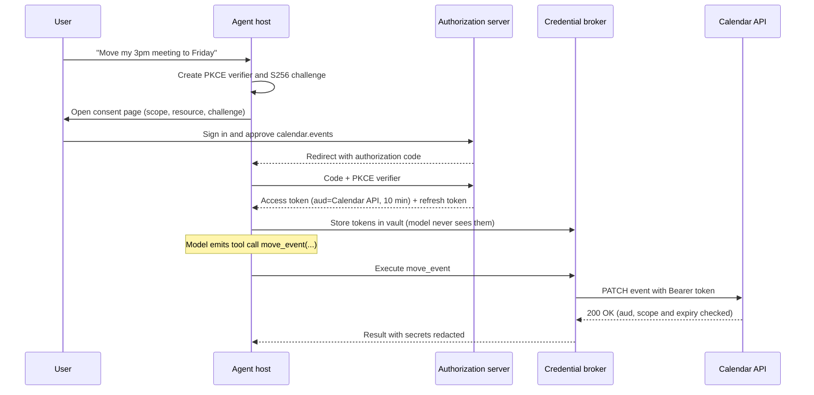
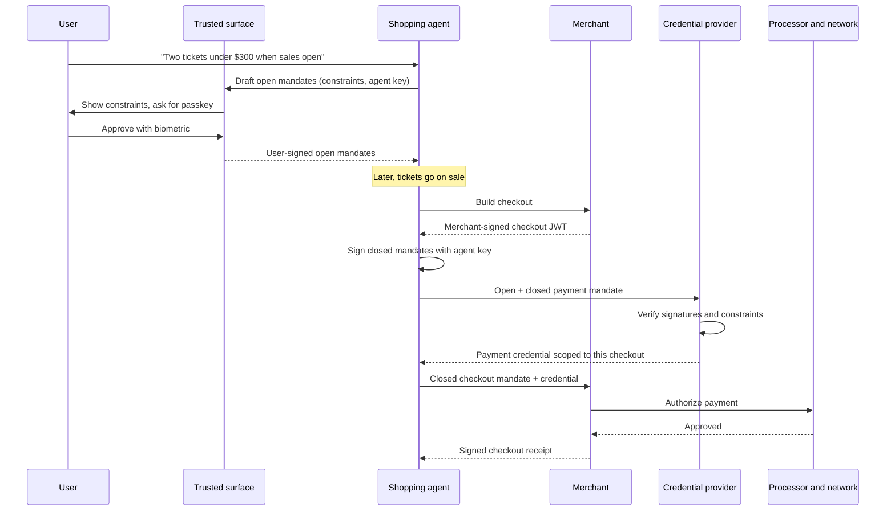

Your assistant has spent the morning on your behalf. It read your calendar, moved two meetings, renewed a software subscription, and bought a replacement laptop charger. Now three people want answers. Your finance team asks who approved the $79 renewal. The merchant asks whether the charger order really came from you or from a bot using a stolen card. Your security team asks whether that assistant, which also reads email from strangers, holds the token that can empty your company's cloud account.

None of these is a question about whether the model is clever. They are questions about **identity** (who is acting?), **authorization** (what are they allowed to do?), and **accountability** (can we prove what happened?). The web answers them for humans with logins, sessions, card security codes and the assumption that a person clicked "Buy". Agents break that assumption.

This lesson builds on [Agent Security](agent-security.html), which framed agents as confused deputies that read everyone's text, and on [Guardrails, Permissions & Sandboxing](guardrails-and-sandboxing.html), which introduced credential-injecting proxies. Here we go deep on the identity layer: delegated OAuth and how MCP uses it, keeping secrets out of the model entirely, signed agent requests on the open web, audit trails that hold up in a dispute, and the new protocols that let agents pay for things.

## Why Agent Identity Matters

When software acts for a person, at least four parties are involved: the **human principal** (the user whose authority is being used), the **agent** (a specific piece of software, at a specific version, in a specific session), the **operator** (the company that runs the agent), and the **relying party** (the API, website or merchant that has to decide whether to honor the request). The model itself is a component of the agent, not a party: it holds no rights of its own.

Most early agent integrations collapsed these into one. The agent logged in *as* the user with the user's password, or carried an API key with the user's full rights. That works until something goes wrong, and then every question above becomes unanswerable.

| Property | Question it answers | What breaks without agent identity |
|---|---|---|
| **Accountability** | Who did this, and on whose behalf? | Logs show "alice" did it, whether Alice clicked or her agent acted on an injected instruction |
| **Least privilege** | What is the minimum this actor needs? | The agent inherits everything the user can do |
| **Revocation** | Can we stop this actor without stopping others? | Disabling a misbehaving agent means resetting the user's password |
| **Audit** | Can we reconstruct and prove what happened? | No record separates human actions from delegated ones |
| **Classification** | Is this traffic a human, a known agent or an anonymous bot? | Sites must guess from IP addresses and user-agent strings, and either block helpful agents or admit scrapers |

> [!KEY] On behalf of, never as
> An agent should act **on behalf of** a user, with its own identity and a narrower grant, never **as** the user. Every design decision in this lesson follows from keeping those two identities separate and linked.

## Authentication vs. Authorization

These two words are often blurred, and the blur causes real bugs.

- **Authentication** (often shortened to *authn*) establishes *who* a party is: a user signing in with a passkey, a service presenting a client certificate, an agent signing a request with its private key.
- **Authorization** (*authz*) decides *what that party may do*: read this calendar, charge up to $50 at this merchant, push to this repository.

An agent needs both, for two different subjects. The *user* authenticates to grant authority. The *agent* authenticates to exercise it. A token that says "this is Alice" is authentication. A token that says "the travel agent may create calendar events for Alice until 15:00" is authorization.

The distinction that matters most for agents is **delegation versus impersonation**. With **impersonation**, the agent receives credentials indistinguishable from the user's own, so downstream systems cannot tell who acted. With **delegation**, the credential records both parties: the subject (Alice) *and* the actor (the agent), with a grant narrower than Alice's own rights. Delegation is what makes per-agent revocation, audit and least privilege possible.

For the agent's own identity, the building blocks are the same as for any service: **workload identity** (a cryptographic identity issued to a running process, such as a cloud service account or a SPIFFE ID), OAuth client credentials, or a key pair whose public half is published somewhere a relying party can find it. What is new is that this identity must be bound to a *specific user's delegation* and often to a *single task*.

## Delegated Authorization with OAuth

**OAuth 2.0** is the web's standard for delegated authorization: it lets a user grant an application limited access to their resources at another service without sharing a password. Its roles map neatly onto agents:

- **Resource owner**: the user.
- **Client**: the agent host (the application running the agent loop).
- **Authorization server (AS)**: issues tokens after the user consents.
- **Resource server (RS)**: the API that accepts tokens.

**OAuth 2.1**, still an IETF draft in 2026, consolidates a decade of security lessons: PKCE for every authorization-code client, no implicit flow, exact redirect URI matching, and refresh tokens that are sender-constrained or rotated on every use. Even where you implement 2.0, follow the **OAuth 2.0 Security Best Current Practice** (RFC 9700, January 2025).

### Authorization code with PKCE

The flow an agent host uses to obtain a user's consent is the **authorization code grant** with **PKCE** (Proof Key for Code Exchange, RFC 7636). The host generates a random secret, the *code verifier*, and sends only its SHA-256 hash, the *code challenge*, with the authorization request. When the host later redeems the authorization code, it must present the verifier. An attacker who intercepts the code (through a malicious app registered for the same redirect URI, a leaky log or a browser extension) cannot redeem it.



Notice where the token lives: in the broker's vault, never in the model's context. We return to that pattern below.

### Scopes, audiences and lifetimes

Three properties of a token determine how much damage it can do if misused or stolen:

- **Scope**: *which operations*. Request `calendar.events` rather than full account access, and `repo:read` for a single repository rather than write access to the whole organization. Ask for more only when needed (**incremental authorization**).
- **Audience**: *which API*. An **audience-bound** token carries an `aud` claim naming the one resource server that should accept it. The client asks for it with the `resource` parameter (**Resource Indicators**, RFC 8707). A token minted for the calendar API is useless at the payments API, even if it leaks.
- **Lifetime**: *for how long*. Short-lived access tokens (minutes) bound the window of misuse. Long-lived **refresh tokens** let the host mint new access tokens without bothering the user. They are the crown jewels, so keep them in a vault, rotate them on every use, and never place them anywhere a model can read.

A stronger option is a **sender-constrained** token, bound to a key the client holds, so a stolen copy is useless without that key. **DPoP** (RFC 9449) does this at the application layer, and mutual-TLS-bound tokens do it at the transport layer.

### Refresh and revocation

Revocation is where agent identity pays off. If the agent has its own OAuth client and its own grants, the user (or an administrator) can revoke *that agent's* refresh token without touching their own sessions or other agents. Design for it: show users a list of connected agents with their scopes and last use, make revocation one click, and make your broker fail closed when a refresh fails rather than falling back to some broader credential.

### Token exchange and on-behalf-of

Agents often sit in the middle of a chain: the user authorizes the agent host, the host calls a tool service, the tool service calls a downstream API. Forwarding the user's token down the chain is dangerous (the MCP spec forbids exactly this "token passthrough"). Instead, each hop should obtain a *new* token for the next audience.

**OAuth 2.0 Token Exchange** (RFC 8693) standardizes this. A service presents a `subject_token` (representing the user) and optionally an `actor_token` (representing itself) to the authorization server, and asks for a token with a specific `audience` and narrower `scope`. The issued token can carry an **`act` (actor) claim**, which records who is acting for whom:

```json
{
  "iss": "https://auth.example.com",
  "sub": "user-42",
  "aud": "https://calendar.example.com",
  "scope": "calendar.events",
  "exp": 1795430400,
  "act": { "sub": "agent:travel-assistant@v3" }
}
```

That `act` claim is the difference between delegation and impersonation, written into the token. Microsoft's identity platform offers a similar grant it calls the **on-behalf-of (OBO)** flow, and the term is widely used for the general pattern.

### Consent screens that mean something

A consent screen is the moment a human actually grants authority, so it deserves engineering care:

- Name the **agent**, not only the app ("Travel Assistant v3, run by Acme, wants to…").
- Describe scopes in plain language with **consequences** ("create, change and delete events on your calendars").
- Show **duration** and how to revoke.
- Prefer several small, task-specific grants over one large grant "just in case".

Two further standards are worth knowing for agent consent. **Rich Authorization Requests** (RFC 9396) replace coarse scope strings with structured `authorization_details`, such as "one payment of at most €45 to this payee", so the grant can match a single action. **CIBA** (OpenID's Client-Initiated Backchannel Authentication) lets a client ask the authorization server to push an approval request to the user's phone, which suits an agent working in the background that needs a human "yes" for one step.

## How MCP Applies OAuth 2.1

[Protocols: MCP & A2A](protocols-mcp-a2a.html#authorization) introduced MCP's authorization model: a remote MCP server is an OAuth resource server, it advertises its authorization server through Protected Resource Metadata (RFC 9728), the client uses authorization code plus PKCE, tokens are audience-bound, and token passthrough is forbidden. The current specification (revision 2026-07-28) adds several details that matter when you build or evaluate a client or server:

- **PKCE is checked, not assumed.** Clients must use the `S256` challenge method when technically capable, and must refuse to proceed if the authorization server's metadata lacks `code_challenge_methods_supported`, because without that field there is no evidence the server supports PKCE.
- **Resource indicators are mandatory.** Clients send the MCP server's canonical URI as the `resource` parameter. Servers must validate that a token was issued for them, must reject anything else, and must not accept or transit any other token.
- **Scopes are minimized and stepped up.** On a `401`, a server should name the needed scopes in the `WWW-Authenticate` header, and the client should request exactly those (falling back to the server's advertised `scopes_supported`). If a later operation needs more, the server answers `403` with `error="insufficient_scope"` and the required scopes. The client then runs a **step-up authorization**: it re-authorizes with the *union* of its previous scopes and the new ones, so it doesn't lose permissions it already had.
- **Issuer validation.** Clients record the expected issuer before redirecting the user and compare the `iss` value in the authorization response against it (RFC 9207), which defeats "mix-up" attacks in which a malicious authorization server tricks a client into sending a code to the wrong place.
- **Refresh tokens are never assumed.** Clients may request `offline_access`, but the authorization server decides whether to issue one.

Two official **authorization extensions**, both opt-in and negotiated per request, cover cases the user-consent flow doesn't fit:

- **OAuth Client Credentials**: machine-to-machine access with no human in the loop, for background services and CI pipelines. Here the agent authenticates as *itself*. That fits when it acts for an organization rather than for a particular user.
- **Enterprise-Managed Authorization**: the organization's identity provider (IdP) decides which MCP servers each employee may use. The client exchanges the employee's SSO identity assertion at the IdP for an **Identity Assertion JWT Authorization Grant** (ID-JAG), using an RFC 8693 token exchange, then trades the ID-JAG for an access token at the MCP server's authorization server. Employees don't see per-server consent screens, and revoking access at the IdP takes effect everywhere.

> [!NOTE]
> MCP is versioned by date and its authorization rules have tightened with each revision. Check the current specification before implementing, and prefer an official SDK, which handles discovery, PKCE and step-up for you.

## Keep Secrets Out of the Model

The single most important rule in this lesson: **never give a model a raw, long-lived secret.** Not in the system prompt, not in a tool result, not in an environment variable that a code-execution tool can print, not in memory.

The reasons stack up:

- Anything in the context can come back out: in a reply, a tool argument, a markdown image URL or a log line. Prompt injection turns that from an accident into an attack ([the lethal trifecta](agent-security.html#the-lethal-trifecta-and-exfiltration)).
- Context is copied widely: traces, evaluation datasets, provider logs, caches, memory stores.
- A model cannot be trusted to use a secret only as intended, because it cannot reliably tell your instructions from an attacker's.

The alternative is a **credential broker**: a component outside the model that holds tokens, decides whether a given tool call may use one, attaches it, and strips secrets from what comes back. The model sees tool names and arguments, never credentials. [Guardrails & Sandboxing](guardrails-and-sandboxing.html#credential-isolation-via-proxies) showed the network-level version, an egress proxy that injects headers for allowlisted hosts. The broker below is the application-level version, which can also understand *which tool* is being called and *for how much money*.

### Per-tool and per-action scoping

A broker lets you scope far more finely than a single OAuth grant:

- **Per tool**: each tool declares the one scope and one audience it needs. `list_orders` gets an `orders:read` token for the orders API. It can never obtain a payments token, whatever the model asks.
- **Per action**: arguments are checked against the grant. A purchase must be to an allowlisted merchant, under the per-purchase threshold, and within the session's remaining budget.
- **Per call**: mint a fresh short-lived token for each call (via token exchange), so a token that leaks through a misbehaving API response expires in minutes.

### A credential-broker tool executor

Here is a compact, self-contained broker. A `Grant` records what the user approved. Each `ToolSpec` declares the scope and audience its API needs. The broker checks the grant, reserves spend before charging, adds an idempotency key so a retried purchase can't charge twice, mints a short-lived token per call, and redacts the token from results.

```python
import hashlib, json, time
from dataclasses import dataclass
from decimal import Decimal
from typing import Any, Callable

@dataclass
class Grant:                          # what the user approved on the consent screen
    grant_id: str
    user_id: str
    agent_id: str
    scopes: frozenset[str]
    merchants: frozenset[str]         # payee allowlist
    session_cap: Decimal              # total spend allowed under this grant
    approve_above: Decimal            # purchases above this need a fresh human approval
    expires_at: float
    spent: Decimal = Decimal("0")

@dataclass(frozen=True)
class ToolSpec:
    call: Callable[..., dict]         # the real API call; the broker passes token= to it
    scope: str                        # the one scope this tool needs
    audience: str                     # the API the token must be bound to
    spends: bool = False

class CredentialBroker:
    def __init__(self, grant: Grant, tools: dict[str, ToolSpec],
                 mint_token: Callable[..., str], approve: Callable[[Grant, dict], bool],
                 audit: Callable[[dict], None]):
        self.grant, self.tools = grant, tools
        self.mint_token, self.approve, self.audit = mint_token, approve, audit

    def check(self, name: str, args: dict[str, Any]) -> str | None:
        g, spec = self.grant, self.tools.get(name)
        if spec is None:
            return f"unknown tool {name}"
        if time.time() > g.expires_at:
            return "grant expired; the user must re-authorize"
        if spec.scope not in g.scopes:
            return f"scope {spec.scope} was not granted"
        if spec.spends:
            amount = Decimal(str(args.get("amount", "0")))
            if args.get("merchant") not in g.merchants:
                return "merchant is not on the allowlist"
            if amount <= 0 or g.spent + amount > g.session_cap:
                return f"amount {amount} breaks the cap ({g.spent} of {g.session_cap} used)"
            if amount > g.approve_above and not self.approve(g, args):
                return "the user declined this purchase"
        return None

    def run(self, name: str, args: dict[str, Any]) -> dict[str, Any]:
        reason, g = self.check(name, args), self.grant
        self.audit({"ts": time.time(), "grant": g.grant_id, "user": g.user_id,
                    "agent": g.agent_id, "tool": name, "args": args,
                    "decision": reason or "allow"})
        if reason:
            return {"content": f"Blocked by policy: {reason}", "is_error": True}
        spec = self.tools[name]
        extra: dict[str, Any] = {}
        if spec.spends:
            g.spent += Decimal(str(args["amount"]))   # reserve first; never release on unknown outcome
            key = json.dumps([g.grant_id, name, args], sort_keys=True)
            extra["idempotency_key"] = hashlib.sha256(key.encode()).hexdigest()[:32]
        # Short-lived, down-scoped, audience-bound token minted per call (e.g. RFC 8693 exchange).
        token = self.mint_token(subject=g.user_id, actor=g.agent_id,
                                audience=spec.audience, scope=spec.scope, ttl_s=300)
        try:
            result = json.dumps(spec.call(**args, token=token, **extra))
        except Exception as e:                        # message omitted: it might echo the token
            return {"content": f"{type(e).__name__}: outcome unknown, do not retry blindly",
                    "is_error": True}
        return {"content": result.replace(token, "[REDACTED]"), "is_error": False}
```

Wiring it into a manual agent loop takes a few lines. The tool schemas the model sees contain no token, card number or key, only business arguments:

```python
import anthropic

client = anthropic.Anthropic()
TOOLS = [
    {"name": "list_orders", "description": "List the user's recent orders.",
     "input_schema": {"type": "object", "properties": {}}},
    {"name": "buy", "description": "Buy one item from an approved merchant. Amount in USD, e.g. '19.99'.",
     "strict": True,
     "input_schema": {"type": "object", "additionalProperties": False,
                      "required": ["merchant", "item", "amount"],
                      "properties": {"merchant": {"type": "string"}, "item": {"type": "string"},
                                     "amount": {"type": "string"}}}},
]

def run_agent(broker: CredentialBroker, task: str, max_steps: int = 20) -> str:
    messages = [{"role": "user", "content": task}]
    for _ in range(max_steps):
        response = client.messages.create(model="claude-opus-5-5", max_tokens=16000,
                                          tools=TOOLS, messages=messages)
        messages.append({"role": "assistant", "content": response.content})
        if response.stop_reason == "pause_turn":
            continue
        if response.stop_reason != "tool_use":       # end_turn, max_tokens or refusal
            return "".join(b.text for b in response.content if b.type == "text")
        results = [{"type": "tool_result", "tool_use_id": b.id, **broker.run(b.name, b.input)}
                   for b in response.content if b.type == "tool_use"]
        messages.append({"role": "user", "content": results})
    return "Stopped: step budget exhausted"
```

What this design guarantees, even if the model is fully hijacked by an injected instruction:

- It cannot read, print or exfiltrate a token, because no token ever enters its context.
- It cannot call an API outside the granted scopes, or use a token at the wrong API, because each token is minted for one scope and one audience.
- It cannot pay an unlisted merchant, exceed the cap, or skip approval above the threshold, because those checks run in plain code.
- Retrying a purchase with the same arguments reuses the idempotency key, so a well-behaved payment API won't charge twice.

What it doesn't guarantee: an injected agent can still waste the *remaining* budget on allowlisted merchants, or buy the wrong item within the limits. That's why limits should be tight and approvals informative. In production, keep `spent` in a shared store with atomic updates (two parallel workers must not both pass the cap), and back the cap up at the payment layer as well, as described under spend controls below.

## Human Approval for High-Value Actions

Some actions should never be fully delegated: large payments, new payees, sharing data outside an organization, granting permissions. [Human-in-the-Loop](human-in-the-loop.html) covers approval UX in general. Identity adds three requirements:

1. **Approve the action, not the prose.** Render the approval from the structured arguments (merchant, item, amount, currency, recipient), not from the model's summary of them. A hijacked model can describe a $900 transfer as "the $9 renewal you asked for". This principle is sometimes called **what you see is what you sign**.
2. **Use a trusted surface.** Approval should happen in a UI the agent cannot draw or click on: the operator's own app, the bank's app, an OS-level passkey prompt, or a CIBA push to the user's phone. An approval button rendered inside a page the agent controls proves nothing.
3. **Make approval cryptographic when stakes are high.** A passkey or device-bound key signing a hash of the exact action produces evidence the user can't plausibly deny later, and that the operator can't forge. This is exactly what payment mandates (below) formalize.

Approval thresholds should follow reversibility and blast radius: low-value purchases at known merchants within a pre-approved budget can be automatic; new merchants, unusual amounts or anything after the agent has read untrusted content should ask.

## Agent Identity on the Web

When an agent browses or calls a public website, there's no OAuth relationship to lean on. Sites have traditionally classified traffic by **user-agent strings** (trivial to spoof) and **IP address ranges** (brittle, and shared by cloud tenants). The result is a bad equilibrium: helpful agents get blocked as bots, and scrapers pretend to be browsers.

### Signed agent requests: Web Bot Auth

**Web Bot Auth** lets an automated client prove *which operator* sent a request by signing it. It builds on **HTTP Message Signatures** (RFC 9421, published in 2024), a general standard for signing selected parts of an HTTP request. Cloudflare proposed the approach in May 2025. The IETF formed a **webbotauth** working group in October 2025, and its protocol document, *HTTP Message Signatures for Bots*, was still an Internet-Draft as of late 2026, so details may change.

The mechanism has three parts:

- The operator generates a key pair (Ed25519 in the reference implementation) and publishes the public keys in a **key directory** at `/.well-known/http-message-signatures-directory` on its own domain.
- Each request carries a `Signature-Agent` header pointing at that directory, and `Signature-Input` and `Signature` headers containing an RFC 9421 signature over at least the target authority, with a creation time, an expiry, a nonce and the tag `web-bot-auth`.
- The site fetches and caches the operator's keys, verifies the signature, rejects replayed nonces, and applies its policy for that operator.

An abbreviated, illustrative request:

```text
GET /products/usb-c-charger HTTP/1.1
Host: shop.example
Signature-Agent: sig1="https://agent.example.com"
Signature-Input: sig1=("@authority" "signature-agent");created=1795430000;expires=1795430300;keyid="<JWK thumbprint>";alg="ed25519";nonce="<random>";tag="web-bot-auth"
Signature: sig1=:<base64 signature>:
```

Card networks have adopted this layer for commerce. Visa's **Trusted Agent Protocol** (October 2025, developed with Cloudflare) and Mastercard's Agent Pay build on Web Bot Auth so that merchants can recognize registered shopping agents and tell browsing from purchasing.

Be precise about what a signature proves. It proves the request came from the holder of a key published by a particular operator, which gives you accountability and a stable identity for rate limits and allowlists. It does *not* prove which user the agent serves, that the user authorized this particular action, or that the agent is behaving well. Privacy is an open issue too: a stable signature lets sites track an agent across requests, and the working group is also discussing anonymous variants.

### Verifiable credentials and "know your agent"

Signatures answer "which operator?". Relying parties increasingly want richer claims: Is this agent registered with a payment network? Which company is accountable for it? Has its operator passed some vetting? The general tool for portable, signed claims is the **verifiable credential (VC)**: a tamper-evident statement by an issuer about a subject, which the holder can present to anyone who trusts the issuer. The W3C's Verifiable Credentials 2.0 family became a W3C Recommendation in 2025. Formats such as **SD-JWT** add **selective disclosure**, so a holder can reveal only the claims a verifier needs.

Industry discussions borrow the banking term *know your customer* and call the agent version **know your agent (KYA)**. Concrete programs exist mainly at the payment networks: Mastercard's Agent Pay requires agents to be registered and verified before they can transact, and Visa has described a directory of verified agents. There is no single cross-industry KYA standard as of 2026, so treat the term as a direction rather than a specification.

## Audit Logging and Non-Repudiation

[Guardrails & Sandboxing](guardrails-and-sandboxing.html#auditing) covered tamper-evident audit logs. Identity raises the bar from "what happened?" to "who authorized it, and can they deny it?".

A useful delegated-action record contains the human principal, the agent identity and version, the operator, the grant or mandate ID and its scopes, the exact canonicalized action, the policy decision and matching rule, any approval with its timestamp and method, the token's `jti` (unique token ID, never the token itself), and the provenance of untrusted content in context at the time.

**Non-repudiation** means a party cannot credibly deny having performed an action. Know what each mechanism gives you:

| Mechanism | Detects tampering? | Proves who acted? | Limits |
|---|---|---|---|
| Hash-chained log | Yes, for edits in the middle | No | Whoever can write the log can rewrite the whole chain |
| HMAC on each entry | Yes, to key holders | No | Anyone with the shared key, including the operator, could have produced it |
| Write-once storage, external anchoring | Yes | No | Proves when a record existed, not who authorized it |
| Signature by the user's own key (passkey, wallet) | Yes | **Yes**, for that party | Only covers what the user actually saw and signed |

Only the last row provides non-repudiation, and only for the person whose key signed. An operator's log, however well protected, is the operator's word. That is why payment protocols move the critical step, the user's approval of exactly what will be paid, into a signature made on a trusted surface with the user's key.

## Agentic Payments

Payments concentrate every problem above. Money moves fast and is hard to claw back. Card fraud rules assume a human was present at checkout. Liability rules assume someone can say "yes, I did that" or "no, I didn't". As the AP2 overview puts it, when an agent pays, it's unclear what proves the user granted authority for this purchase, whether the request reflects the user's true intent, and who is accountable when it goes wrong.

Several efforts launched in 2025 and 2026 to answer these questions. They overlap and sometimes compete:

| Effort | Backers | What it standardizes | Status (as of late 2026) |
|---|---|---|---|
| **AP2** (Agent Payments Protocol) | Google; moved to the FIDO Alliance | Signed mandates proving what the user authorized | v0.2 (April 2026), pre-1.0 |
| **ACP** (Agentic Commerce Protocol) | OpenAI and Stripe | Checkout API between agent and merchant, plus delegated payment tokens | Beta, date-versioned spec |
| **UCP** (Universal Commerce Protocol) | Google with Shopify and retailers | The broader shopping workflow (checkout, fulfillment, discounts) | Launched January 2026 |
| **x402** | Coinbase; now the x402 Foundation | Payments inside HTTP using status 402 | Open standard, v2 |
| **Card-network programs** | Visa, Mastercard and others | Agent-specific tokens, agent registration, signed agent traffic | Commercial programs |

### AP2 and payment mandates

Google announced **AP2** on September 16, 2025 as an open protocol designed to extend A2A and MCP, with dozens of payments and technology partners. Its core idea is the **mandate**: a cryptographically signed record of what a user authorized. Version 0.1 defined three: an *intent mandate* (the user's request and its constraints), a *cart mandate* (the exact items and price) and a *payment mandate* (a signal to the payment network that an agent was involved).

On April 28, 2026, Google published **AP2 v0.2** and donated the protocol to the **FIDO Alliance**, the standards body behind passkeys. Mastercard's related **Verifiable Intent** specification, built with Google, was contributed alongside it. Version 0.2 reorganizes the model around two mandate types, each of which can be *open* or *closed*:

- A **Checkout Mandate** proves to the merchant that the agent may buy *this checkout*. The merchant first signs the checkout it offers (as a JWT), and the closed mandate is bound to that signed checkout by hash.
- A **Payment Mandate** proves to the credential provider, network and processor that the agent may pay *for this checkout*. It's bound to the same checkout hash, so it can't be reused for a different purchase.
- An **open** mandate carries the user's **constraints** instead of a specific checkout: allowed merchants, line items, an amount range, a total budget, how many times it may be used, a date window. It is signed by the user on a **Trusted Surface**, names the agent's public key (a `cnf` claim), and should expire as soon as the task allows.
- A **closed** mandate describes one specific transaction. Verifiers always receive closed mandates.

In the **human-present** mode, the user sees the exact checkout and signs closed mandates directly. In the **human-not-present** mode ("buy two tickets when they go on sale, under $300 total"), the user signs open mandates up front, and the agent later signs closed mandates with its own key. The verifier checks that the agent's key matches the one the user named and that the closed mandate satisfies the open mandate's constraints. Mandates are SD-JWT credentials, so the agent discloses only the constraints a given verifier needs.



Three design choices stand out, and they're worth copying even outside payments:

- **The model is in the threat model.** The AP2 security considerations state that the protocol "assumes that preventing prompt injection attacks is infeasible" and treat every LLM and agent as a potential attacker. The Trusted Surface must be non-agentic, and all verification must run in deterministic code.
- **Constraints bound the worst case.** If injected content steers the agent toward a bad product, the merchant's signature still guarantees the offer's integrity, and constraint checks still cap the financial damage.
- **Double spend is explicit.** An agent must not present a new closed mandate under the same open mandate without first receiving a receipt rejecting the previous one, so one approval can't fund several purchases.

### ACP and delegated payment tokens

OpenAI and Stripe released the **Agentic Commerce Protocol** on September 29, 2025, alongside **Instant Checkout** in ChatGPT. ACP is Apache-2.0 licensed, maintained by both companies, and versioned by date. Its 2026-04-17 release added carts, product feeds, orders, authentication and MCP support. It has two main pieces:

- An **agentic checkout** API that merchants implement, so an agent can create and update a checkout session and complete it, while the merchant stays the **merchant of record** and keeps its own payment processing.
- A **delegated payment** spec. The user's payment provider tokenizes a credential with an **allowance**: a one-time use, a `max_amount` in minor units, a currency, the specific `checkout_session_id` and `merchant_id`, and an `expires_at` time. The agent passes the token to the merchant and never handles the card number. Stripe's comparable primitive is the **Shared Payment Token**, a scoped, expiring reference to a stored payment method.

The allowance is the same idea as the broker's per-action scoping, enforced by the payment provider instead of the agent: a token that can pay at most this much, to this merchant, for this checkout, before this time.

Products built on these protocols are moving fast. In March 2026 OpenAI scaled back native Instant Checkout in ChatGPT and shifted purchases into merchants' own apps inside ChatGPT, citing a need for more flexibility. The ACP specification itself continued to evolve. Treat any specific product integration as provisional, and the delegation patterns as durable.

### UCP: the commerce layer

Google introduced the **Universal Commerce Protocol** in January 2026 at the National Retail Federation conference, co-developed with Shopify and endorsed by retailers and payment companies. UCP covers the shopping workflow itself: capability discovery, checkout, fulfillment, discounts and payment handlers. AP2 positions itself as the authorization layer that plugs into a commerce protocol such as UCP, and the AP2 specification says it is designed to be compatible with it. ACP and UCP overlap at the checkout layer, and as of 2026 it isn't clear whether they will converge.

### x402: payments inside HTTP

HTTP reserved status code **402 Payment Required** in the 1990s and never defined how to use it. **x402**, launched by Coinbase in May 2025, gives it a protocol, aimed at machine-to-machine payments: an agent paying per API call, per article or per dataset, with no account or checkout page. Coinbase and Cloudflare announced an x402 Foundation in September 2025, and in 2026 the protocol moved to the x402 Foundation under the Linux Foundation.

In version 2, the exchange looks like this (abbreviated):

```text
GET /premium-data HTTP/1.1
Host: api.example.com

HTTP/1.1 402 Payment Required
PAYMENT-REQUIRED: <base64 JSON: x402Version 2, accepts: [{scheme: "exact",
  network: "eip155:8453", amount: "10000", asset: <USDC contract>, payTo: <address>,
  maxTimeoutSeconds: 60}]>

GET /premium-data HTTP/1.1
Host: api.example.com
PAYMENT-SIGNATURE: <base64 JSON: signed authorization to transfer exactly 10000 units to payTo>

HTTP/1.1 200 OK
PAYMENT-RESPONSE: <base64 JSON: settlement result, transaction reference>
```

The server can verify and settle the payment itself, or delegate both to a **facilitator** service through `/verify` and `/settle` endpoints. Payments today are mostly in stablecoins such as USDC (an amount of `10000` is one cent, since USDC has six decimal places), and the spec defines schemes such as `exact` (a fixed price) and `upto` (authorize a maximum, settle actual usage).

For agent builders, x402 moves the spend decision into the agent's own runtime: the client decides whether to sign each payment. That makes a broker-style policy essential. Allowlist payees and networks, cap per-request and per-period spend, keep the wallet key outside the model and the sandbox, and never let content from the paid resource raise the agent's own limits.

### Card-network agent programs

The card networks are adapting existing rails rather than replacing them:

- **Mastercard Agent Pay** (announced April 29, 2025) introduced **Agentic Tokens**, built on Mastercard's tokenization, and requires agents to be registered and verified. Consumers define what an agent may buy on their behalf.
- **Visa Intelligent Commerce** (announced April 30, 2025) gives agents tokenized credentials in place of card numbers, with consumer-set spending limits and conditions, through APIs and a partner program. Visa's Trusted Agent Protocol followed in October 2025.
- Both networks, and others, use Web Bot Auth so merchants can recognize trusted agents in their traffic.

The common pattern: a **network token** scoped to an agent, which the issuer can limit by amount, merchant and time and can revoke without reissuing the user's card, plus a signal on the transaction that an agent was involved.

> [!KEY] Verifiable delegation, enforced outside the agent
> Every serious payment design makes the same two moves: it records *exactly what the user authorized* in a form the user signed, and it enforces the limits somewhere the agent can't reach (a mandate verifier, a scoped token, an issuer's controls). The agent proposes, and deterministic systems that hold the authority decide.

## Spend Controls, Fraud and Injection

Layer the controls so that no single failure lets money escape.

| Layer | Control | Catches |
|---|---|---|
| Agent harness | Broker caps, merchant allowlist, approval thresholds, idempotency keys | Hijacked or looping agents, duplicate charges |
| Delegation artifact | Mandate constraints, token allowance (amount, merchant, expiry, one-time use) | An agent exceeding what the user signed |
| Payment credential | Virtual card or network token limits, merchant-category restrictions | A compromised agent platform |
| Issuer and network | Fraud scoring, agent-transaction signals, step-up challenges such as 3-D Secure | Stolen credentials, anomalous patterns |
| Monitoring | Velocity alerts, new-merchant alerts, reconciliation against approvals | Slow leaks and abuse that stays under every individual cap |

Payment-specific attacks to design against:

- **Injected purchasing.** A product page, review or email tells the agent to buy something, add an item, or "use this faster checkout link" that leads to an attacker's merchant. Defense: payees come from an allowlist or a merchant-signed checkout, never from free text the agent read.
- **Price and cart manipulation.** Content claims a discount or a different price. Defense: the price that matters is the one in the merchant-signed checkout, checked against the user's constraints.
- **Splitting.** The agent is steered into many purchases just under the approval threshold. Defense: aggregate caps per merchant, per day and per grant, not only per transaction.
- **Mandate or token replay.** A stolen authorization is reused for another purchase. Defense: bind every authorization to one checkout by hash or session ID, make it single-use, and give it a short expiry.
- **Agent impersonation.** A fraudster's bot claims to be a trusted shopping agent. Defense: signed agent requests with keys published by the operator, plus network registration.
- **Refund and dispute abuse.** A user falsely claims "my agent did that without permission". Defense: signed mandates and receipts that show what the user actually approved.

> [!WARNING] The agent's own view is not evidence
> Never let the model's description of a purchase serve as the approval record, the fraud signal or the dispute evidence. Use the structured, signed artifacts: the merchant's checkout, the user's mandate, the processor's receipt.

## Regulation and Liability

Law and payment-network rules were written for human payers, and as of 2026 the agent cases are mostly unsettled. Two examples show the shape of the problem.

In the United States, consumer protection for electronic fund transfers (the Electronic Fund Transfer Act and its Regulation E) limits a consumer's liability for *unauthorized* transfers. It also excludes transfers made by someone to whom the consumer furnished the means of access, unless the consumer has told the institution that person is no longer authorized. Legal commentators disagree about whether giving an AI agent your credentials counts as furnishing access, and about how to treat an agent that has access but makes a transaction the user didn't intend. In the European Union, the payment services rules require **strong customer authentication** (two independent factors) for most electronic payments a payer initiates, which pushes agent designs toward the user authenticating at delegation time, or toward transactions that legitimately fall outside the payer-initiated model.

Card networks set their own dispute and liability rules, and several have announced agent programs, but analysts generally note that no clear liability shift for agent transactions has been established. Practical guidance for builders: keep the evidence a dispute will need (what the user approved, on which surface, with which key, and what was actually charged), make delegation scopes and revocation visible to users, and get legal review before you ship autonomous purchasing. [Safety, Alignment & Governance](agent-safety-alignment.html) covers the wider regulatory picture.

## Key Takeaways

- Agents need their **own identity**, linked to but distinct from the user's: act *on behalf of*, never *as*. That's what makes accountability, least privilege, per-agent revocation and audit possible.
- **Authentication** proves who; **authorization** decides what. Prefer **delegation** (subject plus actor, as in RFC 8693's `act` claim) over impersonation.
- Delegated OAuth for agents means **authorization code + PKCE**, **narrow scopes**, **audience-bound, short-lived** access tokens, vaulted and rotated refresh tokens, **token exchange** at every hop instead of passthrough, and consent screens that name the agent and the consequences.
- **MCP** applies OAuth 2.1 strictly: verified PKCE support, mandatory resource indicators, audience validation, scope challenges with **step-up authorization**, and issuer validation, plus opt-in extensions for machine-to-machine and enterprise IdP-managed access.
- **Never put raw secrets in the model's context.** A **credential broker** holds tokens, mints per-call scoped tokens, enforces per-tool and per-action policy (allowlists, spend caps, approvals) in code, and redacts results.
- On the open web, **Web Bot Auth** (HTTP Message Signatures with published operator keys, still an IETF draft) identifies the operator, not the user's intent. Verifiable credentials and KYA programs aim to carry richer, verified claims.
- Hash chains detect tampering, but only **signatures by the user's own key** give non-repudiation, which is why payment protocols center on **signed mandates**.
- Agent payment protocols (**AP2**, **ACP**, **UCP**, **x402**, card-network programs) are young and moving, but share one principle: verifiable delegation with limits enforced **outside the agent**, assuming the model can be injected.

## Exercises

1. **Scope a real assistant (easy).** For an assistant with Gmail, Google Calendar and a company expense tool, list every tool it needs, the narrowest scope and audience for each, and which calls should require human approval. Which single scope, if over-granted, would do the most damage under prompt injection?
2. **Harden the broker (medium).** Extend `CredentialBroker` with (a) a per-merchant daily cap, (b) a velocity limit of at most three purchases per ten minutes, and (c) a `tainted` flag that the harness sets after any tool returns untrusted content, which forces human approval for every purchase from then on. Write tests that show each rule firing.
3. **Implement PKCE and a resource-bound authorization request (medium).** Using only the Python standard library, generate a code verifier and S256 challenge, build an authorization URL with `scope`, `resource`, `state` and `code_challenge`, and write the check the token endpoint performs when the verifier arrives. Explain what an attacker who steals the authorization code can and can't do.
4. **An x402 spending policy (medium–hard).** Write a function `should_pay(payment_required, policy, ledger)` that decides whether an agent may sign a payment for a 402 response. It should check scheme, network, asset, payee allowlist, a per-request maximum and a rolling daily budget. Where must the wallet key live, and what must never influence the policy?
5. **Design a human-not-present purchase (hard).** A user says: "Buy two tickets for the Saturday show, under $300 in total, from the official box office or its authorized reseller, before Friday." Specify the open mandate constraints, what the merchant and the credential provider each verify, how double spending is prevented, what evidence would settle a dispute, and one attack that still works within your constraints.

<details class="solutions">
<summary>Hints and solution sketches</summary>

1. **Hint:** Separate read from write, and ask which write can send data to an outsider or move money. Reading the inbox is low-privilege but brings in untrusted content.

    **Sketch:** A reasonable plan:
    - `search_mail` and `read_message`: `gmail.readonly`, audience the Gmail API, allowed, but their output is untrusted.
    - `create_draft`: `gmail.compose`, allowed (a draft sends nothing).
    - `send_mail`: `gmail.send`, ask, with the exact recipients and body shown.
    - `list_events`: `calendar.events.readonly`, allowed.
    - `create_event` and `move_event`: `calendar.events`, allowed for the user's own calendar, ask when external attendees will be notified.
    - `submit_expense`: an expense-API scope limited to the user's own reports, ask above a threshold.

    The most dangerous over-grant is full mail access (`https://mail.google.com/`), which includes sending and permanent deletion. Combined with untrusted inbound mail, it completes the lethal trifecta. Note that Google treats several mail scopes as restricted, which adds verification requirements for apps that request them.

2. **Hint:** Keep the new state in the broker (a deque of purchase timestamps and a dict of per-merchant daily totals) and make every rule a branch in `check`, so `run` audits it automatically. The taint flag belongs to the harness, which knows which tools return untrusted content.

    **Sketch:** Tests: three purchases succeed, and the fourth within ten minutes is blocked; with a $50 daily cap at merchant A, $30 + $25 is blocked at the second call while $30 at merchant B passes; after `broker.tainted = True`, even a $2 purchase calls `approve`. In production, keep counters in a shared store with atomic increments so parallel workers can't race past a cap.

    ```python
    import collections, datetime, time
    from decimal import Decimal

    class HardenedBroker(CredentialBroker):
        def __init__(self, *args, merchant_daily_cap: Decimal, **kw):
            super().__init__(*args, **kw)
            self.merchant_daily_cap, self.tainted = merchant_daily_cap, False
            self.recent: collections.deque[float] = collections.deque()
            self.daily: dict[tuple[str, str], Decimal] = collections.defaultdict(Decimal)

        def check(self, name, args):
            spec = self.tools.get(name)
            if spec and spec.spends:
                now, day = time.time(), datetime.date.today().isoformat()
                while self.recent and self.recent[0] < now - 600:
                    self.recent.popleft()
                amount, key = Decimal(str(args.get("amount", "0"))), (args.get("merchant"), day)
                if len(self.recent) >= 3:
                    return "velocity limit: at most 3 purchases per 10 minutes"
                if self.daily[key] + amount > self.merchant_daily_cap:
                    return "daily cap for this merchant reached"
                if self.tainted and not self.approve(self.grant, args):
                    return "untrusted content in context; the user declined"
            reason = super().check(name, args)
            if reason is None and spec and spec.spends:   # record only purchases that will run
                self.recent.append(time.time())
                self.daily[(args.get("merchant"), datetime.date.today().isoformat())] += Decimal(str(args["amount"]))
            return reason
    ```

    One subtlety: when `tainted` is set and the amount is also above `approve_above`, this version asks twice. Merge the two approval conditions if that matters for your UX.

3. **Hint:** The verifier is 43 to 128 characters of URL-safe randomness, and the challenge is the unpadded base64url encoding of its SHA-256 digest. The token endpoint recomputes the challenge from the verifier and compares the two in constant time.

    **Sketch:** An attacker holding only the code can't redeem it, because they don't have the verifier. They also can't swap in their own code (injection), because the legitimate client's verifier won't match the challenge bound to the attacker's code. PKCE doesn't protect a token after it's issued, which is what audience binding, short lifetimes and sender-constraining are for.

    ```python
    import base64, hashlib, hmac, secrets
    from urllib.parse import urlencode

    def b64url(raw: bytes) -> str:
        return base64.urlsafe_b64encode(raw).rstrip(b"=").decode()

    verifier = b64url(secrets.token_bytes(32))                    # 43 characters
    challenge = b64url(hashlib.sha256(verifier.encode()).digest())
    url = "https://auth.example.com/authorize?" + urlencode({
        "response_type": "code", "client_id": "https://agent.example.com/client.json",
        "redirect_uri": "http://127.0.0.1:8765/callback", "scope": "calendar.events",
        "resource": "https://calendar.example.com", "state": secrets.token_urlsafe(16),
        "code_challenge": challenge, "code_challenge_method": "S256"})

    def token_endpoint_check(stored_challenge: str, presented_verifier: str) -> bool:
        recomputed = b64url(hashlib.sha256(presented_verifier.encode()).digest())
        return hmac.compare_digest(recomputed, stored_challenge)
    ```

4. **Hint:** Decode the `PAYMENT-REQUIRED` header, iterate over `accepts`, and choose the first option your policy allows. Amounts are strings in the asset's smallest unit, so convert using the asset's decimals and never use floats.

    **Sketch:** The wallet key lives in a signer service outside the model and the sandbox, and that service applies the same policy again before signing (defense in depth). The resource's description, error text and any content returned by paid endpoints must never change the policy or the budget. A page saying "your limit has been raised" is just untrusted text. Log every signed payment with the resource URL, payee and amount for reconciliation.

    ```python
    import time
    from decimal import Decimal

    def should_pay(payment_required: dict, policy: dict, ledger: list[tuple[float, Decimal]]) -> dict | None:
        day_ago = time.time() - 86_400
        spent_today = sum(amount for ts, amount in ledger if ts > day_ago)
        for option in payment_required.get("accepts", []):
            asset = policy["assets"].get((option.get("network"), option.get("asset")))
            if asset is None or option.get("scheme") != "exact":
                continue                                   # unknown network, asset or scheme
            if option.get("payTo") not in policy["payees"]:
                continue
            amount = Decimal(option["amount"]).scaleb(-asset["decimals"])  # atomic units -> dollars
            if amount <= policy["max_per_request"] and spent_today + amount <= policy["daily_budget"]:
                return option                              # caller signs this option and records it
        return None
    ```

5. **Hint:** Work through the AP2 v0.2 concepts in turn: open Checkout and Payment Mandates with constraints, the agent's key in `cnf`, a short `exp`, a merchant-signed checkout, and closed mandates bound by hash. Then ask what the constraints *can't* express.

    **Sketch:**
    - **Open Checkout Mandate:** allowed merchants (the box office and the named reseller), line items (two tickets for the Saturday show), the agent's public key, expiry Friday 23:59.
    - **Open Payment Mandate:** allowed payees (the same two merchants), an amount range with a maximum of $300, single use (or a budget of $300 with one recurrence), an allowed payment instrument, a reference to the open Checkout Mandate, and the same expiry.
    - **Merchant verifies:** the agent's signature on the closed Checkout Mandate, that the key matches the user-signed open mandate, that its `checkout_hash` matches the merchant's own latest signed checkout, and that the line-item and merchant constraints are satisfied.
    - **Credential provider verifies:** the user's signature on the open Payment Mandate, the agent's signature on the closed one, the binding between them (`sd_hash`), the amount and payee against the constraints, and that the mandate hasn't expired or already been used. Only then does it release a credential scoped to this transaction.
    - **Double spend:** the agent can't present another closed mandate under the same open mandate without a rejection receipt for the previous one, and the credential provider tracks usage and may reject overlapping mandates.
    - **Dispute evidence:** the user-signed open mandates, the agent-signed closed mandates, the merchant-signed checkout, and the checkout and payment receipts.
    - **Residual attack:** injected content (a fake "official seat map") steers the agent toward the worst seats or an inflated-fee listing that still fits under $300 at an allowed merchant. Constraints bound the loss but can't express "best value". Mitigations: tighter constraints (section, maximum price per ticket), or a human-present confirmation if the price exceeds the user's typical range.

</details>

## Check Your Understanding

```quiz
Q: A shopping agent's spend cap is written in its system prompt ("never spend more than $100"). Why is that insufficient?
- [ ] The model can't do arithmetic on currency amounts reliably enough
- [x] An injected instruction can override a prompt; a cap must live in code or the credential
- [ ] Payment APIs ignore limits unless they come in a signed mandate
- [ ] System prompts are dropped from context when conversations get long
E: A prompt is a probabilistic request to a model that may be hijacked. A cap enforced by the broker, or by the payment token's allowance or issuer controls, holds no matter what the model was persuaded to do. Arithmetic errors and context limits are real, but the core problem is that the control lives where the attacker's text can reach it.

Q: What does PKCE protect against in the authorization code flow?
- [ ] An access token being replayed at a different API than intended
- [ ] The user approving broader scopes than the agent actually needs
- [x] A stolen authorization code being redeemed by someone without the verifier
- [ ] A refresh token being read from the agent host's storage by malware
E: The client sends a hash of a secret verifier with the authorization request and must present the verifier to redeem the code, so an intercepted code is useless. Replay at another API is addressed by audience binding, over-broad consent by scope design, and refresh-token theft by vaulting, rotation and sender-constraining.

Q: An MCP server answers a tool call with 403 and `error="insufficient_scope", scope="files:write"`. The client already holds a `files:read` token. What should it do?
- [ ] Retry the call with the same token, since 403 errors are often transient
- [ ] Forward the user's upstream API token, which already includes write access
- [ ] Request a new token for files:write only, replacing the read token
- [x] Re-authorize for files:read plus files:write, then retry a limited number of times
E: The MCP spec describes step-up authorization: the client requests the union of its previous scopes and the challenged ones, so it keeps the permissions it already had, then retries a bounded number of times. Forwarding an upstream token is forbidden token passthrough, and requesting only the new scope would break operations that need read.

Q: In RFC 8693 token exchange, what is the purpose of the `act` claim in the issued token?
- [ ] It lists the actions the token may perform, replacing the scope claim
- [x] It records which party is acting for the subject: delegation, not impersonation
- [ ] It names the API audience that must accept the exchanged token
- [ ] It marks the token as single-use so it can't be exchanged a second time
E: `sub` identifies the user and `act` identifies the actor (for example, the agent), so downstream services and audit logs can tell "the agent did this for Alice" apart from "Alice did this". Permissions stay in `scope` and the audience in `aud`.

Q: A website verifies a valid Web Bot Auth signature on a shopping agent's request. What has it learned?
- [ ] The user behind the agent approved the purchase being attempted
- [x] The request was signed with a key that a named operator published
- [ ] The agent's model passed a prompt-injection robustness evaluation
- [ ] The traffic comes from a residential IP address, not from a data center
E: The signature ties the request to the holder of a key listed in the operator's published directory, which gives accountability and a stable identity for policy. It says nothing about the user's authorization (that's what mandates and tokens are for), the agent's robustness, or network location.

Q: In AP2 v0.2's human-not-present mode, why can a merchant trust a closed Checkout Mandate signed by the agent's key rather than the user's?
- [ ] The merchant's own LLM reviews the order and confirms it looks reasonable
- [ ] Agent keys are issued by card networks, which accept liability for misuse
- [x] A user-signed open mandate names that agent key and the constraints it must meet
- [ ] The agent's provider signs every closed mandate on behalf of all its users
E: The user signs the open mandate on a trusted surface, and it includes the agent's public key (`cnf`), the constraints and an expiry. The verifier checks that the closed mandate was signed by that key and satisfies those constraints, all in deterministic code. AP2 requires verification to be non-agentic, and trusting an agent provider is a separate, optional trust model rather than the reason.

Q: Your agent platform keeps a hash-chained, append-only log of every purchase. A customer disputes a charge, saying they never approved it. What can the log alone not establish?
- [ ] Whether entries were edited after being written, in the middle of the chain
- [ ] The order in which the agent's tool calls happened during the session
- [ ] Which tool the agent called, with what arguments and policy decision
- [x] That the customer personally authorized it, rather than the platform
E: A hash chain is evidence controlled by whoever writes the log, so it shows tampering and sequence but not who authorized the action. Non-repudiation needs a signature made with a key only the customer holds, such as a passkey signature on a mandate, which is why payment protocols put the user's approval into a signed artifact.
```

## Further Reading

- [MCP Authorization specification (2026-07-28)](https://modelcontextprotocol.io/specification/2026-07-28/basic/authorization) — the normative rules for PKCE, resource indicators, scope challenges and step-up authorization.
- [MCP Enterprise-Managed Authorization](https://modelcontextprotocol.io/extensions/auth/enterprise-managed-authorization) — how ID-JAG and token exchange put an enterprise IdP in charge of agent access.
- [RFC 8693: OAuth 2.0 Token Exchange](https://www.rfc-editor.org/rfc/rfc8693) — subject and actor tokens, and the `act` claim for delegation.
- [RFC 9700: Best Current Practice for OAuth 2.0 Security](https://www.rfc-editor.org/rfc/rfc9700) — the consolidated threat model and mitigations every OAuth client should follow.
- [RFC 9421: HTTP Message Signatures](https://www.rfc-editor.org/rfc/rfc9421) — the signing standard underneath Web Bot Auth.
- [IETF Web Bot Auth working group](https://datatracker.ietf.org/group/webbotauth/about/) — charter, current drafts and the status of signed agent traffic.
- [Agent Payments Protocol (AP2) repository](https://github.com/google-agentic-commerce/AP2) — the v0.2 specification (checkout and payment mandates, security considerations) and samples.
- [Agentic Commerce Protocol repository](https://github.com/agentic-commerce-protocol/agentic-commerce-protocol) — checkout and delegated-payment specs, versioned by date.
- [x402 repository](https://github.com/x402-foundation/x402) — the HTTP 402 payment flow, schemes and reference SDKs.
