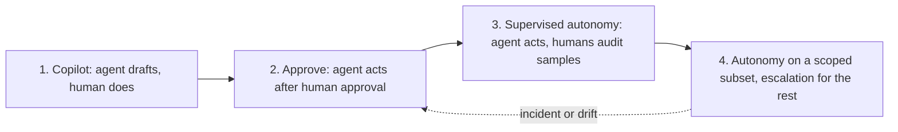

"Where should we use agents?" is the question every team eventually asks, and the answers in press releases are rarely useful. Vendor demos show the best run of a hundred; skeptics point to the worst. The truth is uneven: in some domains agents are already doing a large share of real work every day, in others they are promising pilots, and in a few they remain research projects.

This lesson is a map. We tour the major domains where agents are being deployed and, for each, look at what agents actually do today, *why* it works or doesn't, how mature it is, and what can go wrong. Then we distill the pattern into a framework for spotting good opportunities, measuring return on investment, and rolling agents out safely. No coding is required. Builders will find it useful for choosing what to build; leaders, for deciding where to invest.

> [!NOTE]
> Maturity labels in this lesson are qualitative judgments as of late 2026, not survey statistics. The field moves quickly; use the *reasons* behind each rating to re-assess as models and tools improve.

## A Lens for Every Domain

Before the tour, a lens. Four properties explain most of the variation between domains, and they recur throughout this lesson (they build on [when to use agents](when-to-use-agents.html)):

1. **Verifiability.** Can the agent, or a cheap check, tell whether the work is right? Tests in software, end states in databases, reconciled totals in accounting.
2. **Tool access.** Can the agent reach the systems it needs, through APIs, [MCP](protocols-mcp-a2a.html), or at worst a GUI?
3. **Error tolerance.** What does a mistake cost, and is it reversible? A bad draft email is cheap; a wrong drug dose or wire transfer is not.
4. **Volume and repetition.** Are there many similar tasks, so the investment in building, evaluating and supervising pays off?

Keep these four in mind as we go.

## Software Engineering

**Today:** Agents fix bugs, implement features from issues, write tests, perform migrations across hundreds of files, review pull requests, and explain unfamiliar code. Developers work with them synchronously in IDEs and terminals or delegate tickets to background agents that return pull requests.

**Why it works:** Code is text, verification is built in (compilers, tests, CI), version control makes mistakes reversible, and developer tools are scriptable. Models have also been trained heavily on agentic coding.

**Maturity: Established.** The most mature agent domain by a wide margin, with broad daily use.

**Key risks:** Subtle bugs that pass tests, test tampering, security vulnerabilities, over-engineered diffs, and skills atrophy for developers who stop reading code. Full details in [coding agents](coding-agents.html).

## Customer Service

**Today:** Chat and voice agents answer questions from knowledge bases, look up orders, process returns and refunds within policy, rebook travel, troubleshoot products, and hand off to humans with summaries. Agents also assist human staff by drafting replies and summarizing cases.

**Why it works:** Very high volume of repetitive contacts, clear policies, and systems with APIs (CRM, orders, billing). Outcomes are checkable against policy.

**Why it's hard:** Customers are unpredictable and sometimes adversarial; policies are ambiguous; voice requires sub-second responses; consistency matters across millions of conversations.

**Maturity: Scaling.** Widely deployed for routine contacts, with hybrid human-AI models for complex cases.

**Key risks:** Policy violations with financial or legal consequences, poor escalation that traps customers, and brand damage from off-script responses. See [customer-facing and voice agents](conversational-voice-agents.html).

## Sales and Marketing

**Today:** Agents research prospects and accounts, enrich CRM records, draft personalized outreach, qualify inbound leads in chat, schedule meetings, summarize sales calls, update pipeline data, and generate and adapt marketing content and campaign variants.

**Why it works:** Lots of research-and-write work that is tedious for humans and tolerant of imperfection. Drafts can be reviewed before sending.

**Why it's hard:** Success (a closed deal) is far removed from any single action, so it is hard to verify that the agent helped. Mass-personalized outreach is easy to generate and easy for recipients to ignore.

**Maturity: Scaling for research, drafting and CRM hygiene; emerging for autonomous outbound.**

**Key risks:** Spam and deliverability damage, hallucinated "personalization" (praising a prospect for an achievement that never happened), brand inconsistency, and regulation of commercial messaging and data use (for example, consent and privacy rules).

## Finance and Back-Office Operations

**Today:** Agents extract data from invoices and receipts, match invoices to purchase orders, reconcile accounts, flag anomalous expenses, prepare first drafts of financial analyses and models, gather documents for know-your-customer (KYC) reviews, and answer internal policy questions.

**Why it works:** High-volume, rules-based document work, with natural checks: totals must reconcile, invoice amounts must match purchase orders.

**Why it's hard:** Messy, inconsistent documents; legacy systems without APIs (often a case for [computer-use agents](computer-use-agents.html)); strict internal controls and audit requirements; and errors that become very expensive.

**Maturity: Scaling for document processing and reconciliation with human approval; emerging for analysis.**

**Key risks:** Numerical errors that look plausible, unauthorized payments, control failures, and lack of audit trails. Design principle: agents prepare and propose; humans approve money movement.

## Legal

**Today:** Agents review contracts against playbooks, flag non-standard clauses, summarize documents in due diligence, draft first versions of routine documents, and perform legal research across case law and regulations. Specialist products (such as Harvey and Thomson Reuters' CoCounsel) target law firms and legal departments.

**Why it works:** Law is text-heavy, and much of it is pattern-matching against standards (a clause playbook, a checklist). Reviewing many documents for specific issues is a strong fit.

**Why it's hard:** Correctness depends on jurisdiction, recency and subtle interpretation; verification requires expert time.

**Maturity: Scaling for review and summarization; emerging for research and drafting, always with lawyer review.**

**Key risks:** **Hallucinated citations.** In *Mata v. Avianca* (2023), lawyers were sanctioned for filing a brief containing nonexistent cases produced by a chatbot, and similar incidents have recurred since. Other risks are confidentiality and privilege, and professional responsibility: lawyers remain accountable for every filing.

## Healthcare

**Today:** The most widespread clinical use is **ambient documentation**: AI scribes listen to clinician-patient conversations (with consent) and draft clinical notes for the clinician to review and sign. Agents also help with prior-authorization paperwork, medical coding and billing, inbox triage, drafting replies to patient messages, and scheduling.

**Why it works:** Administrative burden is enormous and documentation is text; clinicians review and sign, providing a natural checkpoint.

**Why it's hard:** Patient safety, privacy regulation (such as HIPAA in the US), medical-device regulation for clinical decision tools, integration with electronic health records, and bias across patient populations.

**Maturity: Scaling for documentation and administration; experimental for autonomous clinical decisions.**

**Key risks:** Errors in notes that slip past busy reviewers, inappropriate clinical advice, privacy breaches, and automation bias (clinicians over-trusting outputs).

## Scientific Research

**Today:** Agents search and synthesize literature ([deep research agents](research-agents.html)), write and run analysis code, generate hypotheses, and in some labs, design and run experiments through lab automation. Notable examples:

- **Coscientist** (Boiko et al., *Nature*, 2023) used an LLM-driven system to plan and execute chemistry experiments on automated lab hardware.
- Google's **AI co-scientist** (2025) is a multi-agent system built on Gemini that generates, debates, ranks and refines research hypotheses in a tournament-like process, with collaborators reporting early laboratory validation of some hypotheses.
- **The AI Scientist** (Sakana AI, 2024) attempted end-to-end automated machine-learning research, from idea to experiment to written paper, illustrating both the promise and the quality problems.
- **Self-driving labs** combine robotics with models that choose the next experiment, especially in materials science and chemistry.

**Why it works:** Literature volume overwhelms humans; computational experiments are verifiable; hypothesis generation benefits from breadth.

**Why it's hard:** Real novelty is hard to judge, wet-lab validation is slow and expensive, and plausible-sounding but wrong science is easy to generate.

**Maturity: Scaling for literature review and analysis code; emerging for hypothesis generation; experimental for autonomous discovery.**

**Key risks:** Unverified or irreproducible claims, citation errors, a flood of low-quality papers, and **dual-use** concerns in biology and chemistry (see [agent safety and alignment](agent-safety-alignment.html)).

## Data Analysis and Business Intelligence

**Today:** Agents answer business questions by writing and running SQL ("text-to-SQL") or Python, exploring datasets, building charts, explaining anomalies, and producing reports. They operate in notebooks, BI tools and chat interfaces connected to data warehouses.

**Why it works:** Code execution gives grounded answers, and results can be inspected. Benchmarks such as BIRD and Spider 2.0 have pushed text-to-SQL capability on realistic, messy databases.

**Why it's hard:** The hardest part is semantic, not syntactic: knowing that "revenue" means net of refunds, which table is authoritative, or that one region reports in a different currency. A query can run perfectly and still answer the wrong question.

**Maturity: Scaling, especially where a curated semantic layer (defined metrics and documented tables) exists.**

**Key risks:** Silent semantic errors (wrong joins, double counting) presented confidently, and decisions made on them. Mitigations: semantic layers, showing the query alongside the answer, and sanity checks against known figures.

## IT Operations and SRE

**Today:** Agents triage incidents by querying logs, metrics and traces; correlate alerts with recent deployments; propose root-cause hypotheses; draft incident timelines and postmortems; answer internal IT tickets (password resets, access requests); and execute well-defined runbooks.

**Why it works:** Investigation is tool-heavy and time-critical, and observability systems have APIs. Many IT tickets are repetitive.

**Why it's hard:** Production systems are complex and interdependent; actions such as restarts, rollbacks or config changes can make outages worse.

**Maturity: Scaling for investigation and IT helpdesk; emerging for autonomous remediation, which is generally limited to pre-approved, reversible runbook steps.**

**Key risks:** An agent taking a destructive production action, credential exposure, and prompt injection via log content. Keep write actions behind approvals (see [human-in-the-loop](human-in-the-loop.html)).

## Cybersecurity

**Today:** In security operations centers (SOCs), agents triage alerts: enriching them with threat intelligence, checking related activity, classifying likely false positives, and drafting investigation summaries for analysts. Agents also analyze phishing emails, review code for vulnerabilities, and assist penetration testers. In vulnerability research, Google's **Big Sleep** agent found a previously unknown exploitable bug in SQLite in 2024, and DARPA's AI Cyber Challenge (concluding in 2025) showcased autonomous systems that find and patch vulnerabilities.

**Why it works:** SOC analysts face overwhelming alert volumes, most of them benign, and triage follows repeatable investigation steps.

**Why it's hard:** Attackers adapt; missing a true positive is costly; and the data agents read (logs, emails, files) can be attacker-controlled.

**Maturity: Scaling for triage and enrichment; emerging for vulnerability discovery and autonomous response.**

**Key risks:** False negatives, prompt injection planted in logs or emails, and **dual use**: the same capabilities help attackers (see [agent security](agent-security.html)).

## Education and Tutoring

**Today:** AI tutors guide students through problems Socratically instead of giving answers (Khan Academy's Khanmigo is a well-known example, and major assistants added study or learning modes in 2025). Agents also generate practice questions, give feedback on writing, help teachers draft lesson plans and grade, and support language learning through conversation.

**Why it works:** One-to-one tutoring is highly effective and scarce; language models are patient, available, and adaptive.

**Why it's hard:** Learning requires productive struggle, and an assistant that simply answers can undermine it. Measuring learning outcomes takes time.

**Maturity: Scaling for teacher support and practice; emerging for tutoring with proven learning gains.**

**Key risks:** Over-reliance and academic dishonesty, factual errors taught confidently, and child safety and student privacy.

## Personal Assistants

**Today:** General assistants with agent modes can research and plan trips, compare products, fill forms, manage email and calendars, and complete multi-step web tasks. They increasingly connect to personal data (email, documents, calendars) through connectors and operate browsers on the user's behalf.

**Why it works:** Huge demand for delegating life admin; broad tool access through browsers and connectors.

**Why it's hard:** Tasks are diverse and the long tail is endless; personal preferences are implicit; many actions (booking, buying, sending) are irreversible; and these agents combine **private data, untrusted content and the ability to act**, the riskiest combination for prompt injection.

**Maturity: Emerging.** Useful for research and drafting; end-to-end autonomous transactions still need confirmation and supervision.

**Key risks:** Data exfiltration via prompt injection, unwanted purchases or messages, and privacy. Confirmation gates for consequential actions are essential.

## Embodied Agents and Robotics

**Today:** **Vision-language-action (VLA) models** extend language models to output robot actions: Google DeepMind's RT-2 (2023) showed web knowledge transferring to robot control; open models such as OpenVLA (2024) and Physical Intelligence's π0 (2024) pushed general-purpose manipulation; and Gemini Robotics (2025) brought frontier multimodal models into robot control. Language models also serve as high-level planners that break instructions into skills a robot can execute.

**Why it's hard:** The physical world is unforgiving: actions are irreversible, data is scarce and expensive to collect, environments vary endlessly, and safety around people is paramount.

**Maturity: Experimental to early pilots**, mainly in controlled settings such as warehouses and labs.

**Key risks:** Physical safety, unpredictable behavior in novel situations, and difficulty verifying reliability before deployment (see [future of agents](future-of-agents.html)).

## Maturity at a Glance

| Domain | Representative tasks | Maturity (late 2026, qualitative) | Verifiability | Main risk |
|---|---|---|---|---|
| Software engineering | Bug fixes, features, reviews, migrations | Established | High (tests, CI) | Subtle bugs, security, test tampering |
| Customer service | Answers, refunds, troubleshooting, handoff | Scaling | Medium (policy, end state) | Policy violations, poor escalation |
| Data analysis / BI | Text-to-SQL, analysis, reports | Scaling | Medium (inspectable queries) | Silent semantic errors |
| IT ops / SRE | Incident triage, helpdesk, runbooks | Scaling (investigation) | Medium | Destructive production actions |
| Cybersecurity | Alert triage, phishing analysis | Scaling (triage) | Medium | False negatives, injection, dual use |
| Finance / back office | Invoices, reconciliation, KYC prep | Scaling (with approval) | Medium-high (reconciliation) | Plausible numeric errors, control failures |
| Legal | Contract review, research, drafting | Scaling (review) | Low-medium (expert review) | Hallucinated citations, confidentiality |
| Healthcare | Ambient notes, admin, coding | Scaling (admin) | Low-medium (clinician sign-off) | Patient safety, privacy |
| Sales and marketing | Prospect research, drafting, CRM | Scaling (research, drafting) | Low (outcomes distant) | Spam, fabricated personalization |
| Education | Tutoring, practice, teacher support | Emerging to scaling | Low (learning is slow to measure) | Over-reliance, errors |
| Scientific research | Literature, hypotheses, lab automation | Emerging | Varies (computation high, wet lab slow) | Irreproducible claims, dual use |
| Personal assistants | Travel, shopping, email, forms | Emerging | Low | Prompt injection, irreversible actions |
| Robotics (VLA) | Manipulation, navigation | Experimental | Physical testing only | Physical safety |

Notice the pattern: maturity tracks **verifiability and error tolerance** more than how impressive the demo is.

## A Framework for Spotting Good Opportunities

Turn the four-property lens into a scoring exercise. For a candidate use case, rate each factor from 1 (poor) to 3 (strong):

| Factor | 1 (poor fit) | 3 (strong fit) |
|---|---|---|
| **Volume** | A few times a month | Hundreds or thousands of times a day |
| **Verifiability** | Only an expert can judge quality, slowly | Automated checks or quick human review |
| **Tool access** | Data trapped in PDFs, phone calls, legacy GUIs | Clean APIs or MCP servers |
| **Error tolerance** | Irreversible, high-cost errors | Cheap, reversible, caught before harm |
| **Process clarity** | Tacit judgment nobody has written down | Documented policies and examples |
| **Value per task** | Saves seconds | Saves hours or unlocks new capacity |

A high total suggests a good candidate. A **1 in error tolerance** does not rule a use case out, but it means humans must approve consequential actions. A **1 in verifiability** is the biggest warning sign: if you cannot tell whether the agent is right, you cannot evaluate it, improve it, or trust it.

> [!EXAMPLE] Scoring two candidates
> **Invoice-to-PO matching** at a company processing 2,000 invoices a week: volume 3, verifiability 3 (amounts must match), tool access 2 (ERP has an API, some invoices are scanned PDFs), error tolerance 2 (payments need approval anyway), process clarity 3, value 2. Strong candidate.
>
> **Autonomous negotiation of supplier contracts**: volume 1, verifiability 1, tool access 2, error tolerance 1, process clarity 1, value 3. Poor candidate for autonomy; possibly a good one for a research-and-drafting copilot.

Also ask the question from [when to use agents](when-to-use-agents.html): does the task need an agent at all? Many "agent" opportunities are better served by a fixed workflow with one or two model calls, which is cheaper and more predictable (see [workflow patterns](workflow-patterns.html)).

## Measuring ROI

Agent ROI is easy to overstate. A credible estimate counts both sides:

**Benefits**
- Labor time saved (hours × loaded cost), *measured*, not assumed
- Speed: faster resolution, shorter cycle times, 24/7 availability
- Capacity: work that previously did not get done (every alert triaged, every contract reviewed)
- Quality: fewer errors, more consistency, where demonstrated

**Costs**
- Model and infrastructure costs per task (see [cost and latency](cost-and-latency.html))
- **Human review time**, often the largest hidden cost
- Cost of errors that slip through (refunds, rework, incidents, reputation)
- Build, integration, [evaluation](evaluating-agents.html) and ongoing maintenance as models, policies and systems change
- Change management and training

In rough terms: *net value ≈ tasks × (human cost avoided + value of speed) − (run cost + review cost + error cost) − build and maintenance*.

> [!EXAMPLE] A hypothetical calculation
> A support team handles 10,000 password and account-access tickets a month at an assumed loaded cost of $6 each. An agent resolves 60% fully in a pilot (measured, with resolution verified by repeat-contact rates), at an assumed $0.40 per conversation including all model calls, applied to every ticket. Escalated tickets still need human handling. Monthly gross saving: 6,000 × $6 = $36,000. Agent cost: 10,000 × $0.40 = $4,000. Before build and maintenance costs, net is about $32,000 a month. But if a quality audit shows 2% of "resolved" tickets were wrong and each costs $50 to remediate, subtract 6,000 × 0.02 × $50 = $6,000. *All numbers here are illustrative; plug in your own measurements.*

Good ROI practice: establish a **baseline** before deployment, run a **controlled pilot** (some traffic to the agent, some to the existing process), measure outcomes rather than activity (resolution rather than containment), and include quality audits.

## Adoption Patterns: From Copilot to Autonomy

Successful organizations rarely jump straight to full autonomy. The common path moves along the autonomy spectrum (see [what is an agent](what-is-an-agent.html)) as trust is earned with evidence:



1. **Copilot.** The agent suggests: drafted replies, proposed code, summarized cases. Humans decide and act. Low risk; builds familiarity and generates evaluation data (how often are drafts accepted unchanged?).
2. **Approve.** The agent prepares the action and a human clicks approve: the refund, the PR merge, the remediation step. Approval rates and edit rates show where it is reliable.
3. **Supervised autonomy.** For categories with consistently high approval rates, the agent acts directly; humans audit a sample and handle exceptions.
4. **Scoped autonomy.** Full autonomy for well-defined, low-risk, high-volume categories, with clear escalation for everything else.

The arrow back matters: when an incident occurs or quality drifts (a model update, a policy change), step back to approval mode until confidence is restored. Treat autonomy as a dial, not a switch (see [human-in-the-loop](human-in-the-loop.html)).

Other adoption lessons that recur across domains:

- **Start internal.** Internal users (employees) are more forgiving and give better feedback than customers. Many organizations deploy agents for internal IT, HR and analytics before customer-facing use.
- **Pick boring, high-volume work first.** The best first projects are unglamorous: ticket triage, document extraction, report drafting.
- **Fix the data and tools.** Agent projects often stall on access to systems and data quality, not on model capability. Investments in APIs, MCP servers and documentation pay off for every later agent.
- **Redesign the process, not just the task.** The largest gains come from rethinking workflows around what agents do well (for example, review every contract instead of sampling), not from substituting an agent into a human-shaped process step.
- **Bring people along.** Involve the people whose work changes; their tacit knowledge becomes the agent's policies and evaluation cases.

> [!KEY] The pattern behind the map
> Agents succeed first where work is **high-volume, verifiable, tool-accessible and error-tolerant**, and they move into harder domains as verification improves, through better tests, checks, human review workflows and evaluation. If you want agents to work in your domain, invest in verification.

## Key Takeaways

- Agent maturity varies widely by domain: **established** in software engineering; **scaling** in customer service, data analysis, IT ops, security triage, back-office, legal review and healthcare administration; **emerging** in personal assistants, education and scientific discovery; **experimental** in robotics.
- Maturity tracks **verifiability, tool access, error tolerance and volume** more than demo quality.
- Every domain has a signature risk: hallucinated citations in law, plausible numeric errors in finance, patient safety in healthcare, prompt injection in personal assistants, dual use in security and science.
- Score opportunities on volume, verifiability, tool access, error tolerance, process clarity and value; low verifiability is the biggest red flag.
- Credible ROI counts review time, error costs and maintenance, and is measured against a baseline in a controlled pilot.
- Adopt along a path from **copilot to approval to supervised and scoped autonomy**, stepping back when quality drifts.

## Exercises

1. **Score your own candidates.** List three tasks in your organization (or a familiar one) that might suit agents. Score each on the six factors, choose one, and write a paragraph justifying the choice and naming its main risk.
2. **Find the verifier.** For each of legal contract review, sales outreach and incident triage, propose one concrete, cheap verification mechanism that would make an agent safer and easier to evaluate.
3. **ROI model.** Build a spreadsheet for the hypothetical support example, adding build cost, monthly maintenance and an assumed review time for escalated cases. At what resolution rate does the project break even in 12 months? How sensitive is the answer to the error rate?
4. **Adoption plan.** For an IT helpdesk agent, write a staged rollout plan from copilot to scoped autonomy. For each stage, define the metric and threshold that must be met to advance, and the trigger that sends you back a stage.
5. **Domain deep dive.** Pick one domain rated "emerging" or "experimental". Research one recent deployment or paper, and argue whether its maturity rating should change, using the four-property lens.

## Check Your Understanding

```quiz
Q: Which property best explains why software engineering is more mature for agents than legal research?
- [ ] Developers adopted AI tools earlier, so the products have had longer to mature
- [x] Code is checked cheaply by tests and compilers; legal work needs expert review
- [ ] Legal documents are longer than most codebases and overflow context windows
- [ ] Law firms restrict data access, so agents cannot reach the right documents
E: Verifiability is the strongest predictor of agent maturity: automated checks enable self-correction, evaluation and trust. Earlier adoption is partly a *consequence* of that verifiability, and context length or data access are solvable engineering problems rather than the root difference.

Q: A data-analysis agent writes a SQL query that runs without errors and returns a revenue figure. What is the main residual risk?
- [ ] The query may time out on very large warehouse tables
- [x] It may answer the wrong question, e.g. by double counting
- [ ] The figure may be stale because the agent cached old results
- [ ] The query may hide a syntax error the database silently tolerated
E: Silent semantic errors (wrong joins, the wrong definition of revenue) are the core risk in BI agents. A query that ran and returned a value has already passed the syntax and timeout hurdles. Semantic layers, showing queries and sanity checks against known figures reduce the risk.

Q: Why are personal assistant agents considered especially risky for prompt injection?
- [ ] They run on mobile devices, which lack the sandboxing of servers
- [ ] Their tasks are so diverse that no evaluation suite can cover them
- [x] They mix private data, untrusted content and the ability to act
- [ ] They read web pages, which can hide text that only models notice
E: This combination lets injected instructions in an email or web page exfiltrate data or trigger actions. Hidden text is one delivery route, but research agents read the same pages; what makes assistants riskier is the private data and actions available to a hijacked agent. Confirmation gates and least privilege are essential.

Q: When scoring a use case, which single factor rated "poor" is the biggest warning sign?
- [ ] Error tolerance
- [ ] Value per task
- [x] Verifiability
- [ ] Tool access
E: If you cannot tell whether the agent is right, you cannot evaluate, improve or trust it. Poor error tolerance is the tempting answer, but it can be managed by keeping a human approval step; poor tool access can be fixed with integrations or a GUI agent.

Q: A company's support agent reaches 90% approval of its drafted refunds over three months. What is a sensible next step in the adoption path?
- [ ] Grant full autonomy for all refund types, since 90% is a high approval rate
- [x] Let it act on the consistently approved categories and audit a sample
- [ ] Keep approval mode until the rate reaches 100% across every category
- [ ] Move back to copilot mode, since 10% of refunds were still rejected
E: Autonomy should expand category by category as evidence accumulates, with sampling audits and a path back to approval if quality drifts. An overall 90% can hide weak categories, and demanding 100% everywhere means autonomy never arrives.

Q: Which item is most often missing from overly optimistic agent ROI estimates?
- [ ] Per-task model and infrastructure costs
- [x] Human review time and errors that slip through
- [ ] The total number of tasks eligible for the agent
- [ ] The loaded labor cost of the human baseline
E: Token and infrastructure costs are visible and usually small, and task volume and labor cost are the inputs every estimate starts from. Review time, remediation of errors and maintenance are larger and often ignored.
```

## Further Reading

- [Building effective agents (Anthropic, 2024)](https://www.anthropic.com/engineering/building-effective-agents) — when agents are worth their cost, with customer support and coding as canonical use cases.
- [Towards an AI co-scientist (Gottweis et al., 2025)](https://arxiv.org/abs/2502.18864) — Google's multi-agent system for generating and refining scientific hypotheses.
- [Autonomous chemical research with large language models (Boiko et al., Nature 2023)](https://www.nature.com/articles/s41586-023-06792-0) — Coscientist planning and executing real lab experiments.
- [The AI Scientist: Towards Fully Automated Open-Ended Scientific Discovery (Lu et al., 2024)](https://arxiv.org/abs/2408.06292) — an end-to-end attempt at automated research, with candid limitations.
- [RT-2: Vision-Language-Action Models Transfer Web Knowledge to Robotic Control (Brohan et al., 2023)](https://arxiv.org/abs/2307.15818) — the paper that popularized VLA models.
- [π0: A Vision-Language-Action Flow Model for General Robot Control (Black et al., 2024)](https://arxiv.org/abs/2410.24164) — a general-purpose robot foundation model.
- [τ-bench (Yao et al., 2024)](https://arxiv.org/abs/2406.12045) — how to evaluate customer-facing agents for policy adherence and consistency.
- [From Naptime to Big Sleep (Google Project Zero, 2024)](https://projectzero.google/2024/10/from-naptime-to-big-sleep.html) — an AI agent finding a real-world vulnerability in SQLite.
