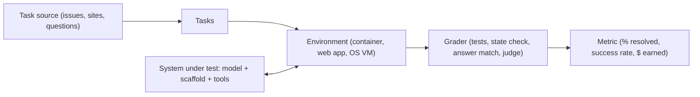

Every model launch now comes with a table of numbers: SWE-bench Verified, Terminal-Bench, OSWorld, τ²-bench, Humanity's Last Exam, BrowseComp. Investors quote them, engineers argue about them, and procurement teams pick vendors by them. But what does "72% on SWE-bench Verified" actually mean? What did the agent do, in what environment, graded how, with what scaffolding, at what cost — and does any of it predict whether the agent will work on *your* codebase?

A **benchmark** is a standardized, public eval suite: a fixed set of tasks, an environment, a grading procedure and a metric, shared so that different systems can be compared on equal terms. Benchmarks are how the field measures progress, and agent benchmarks have driven enormous progress — SWE-bench alone reshaped how coding agents are built. They're also routinely misread, gamed and outgrown.

This lesson is a field guide: what benchmarks are for, the important agent benchmarks by category, the recurring ways their numbers mislead, and how to read leaderboards and build an internal benchmark that predicts what matters to you. It builds on the vocabulary from [evaluating agents](evaluating-agents.html).

## What benchmarks are for

Benchmarks do several jobs: **tracking the frontier** (trends over years that demos can't show), **comparing systems** under fixed conditions, **driving research** (many coding-agent ideas, from repository navigation tools to test-driven loops, were validated against SWE-bench), and **measuring dangerous capabilities** such as cyber offense, which inform deployment decisions ([safety and alignment](agent-safety-alignment.html)).

What benchmarks are **not**: a guarantee of performance on your task. Public benchmarks sample a narrow distribution (often popular open-source Python repos, or a handful of self-hosted websites), use a particular scaffold, and grade with automated checks that capture only part of what "done well" means.

> [!KEY] The big idea
> A benchmark score is a measurement of *a system* (model + scaffold + tools + budget) on *a task distribution* under *a grading procedure*. Change any of the three and the number changes. Read every score with all three in mind.

### Anatomy of an agent benchmark

Every agent benchmark answers the same five questions. When you meet a new one, find these first:

| Question | Example (SWE-bench Verified) |
|---|---|
| **Tasks**: where do they come from? | Real GitHub issues from popular Python repositories, human-screened |
| **Environment**: what can the agent touch? | A Docker container with the repo checked out at the pre-fix commit |
| **Action space**: how does it act? | Whatever the scaffold provides: typically shell + file editing |
| **Grader**: how is success decided? | Hidden unit tests: the ones the real fix made pass, plus tests that must keep passing |
| **Metric**: what's reported? | % of tasks resolved (usually pass@1) |



## Coding and ML engineering

Coding is the best-benchmarked agent domain, because code has a natural automatic grader: tests. See [coding agents](coding-agents.html) for how the agents themselves work.

**HumanEval** (OpenAI, 2021) is the ancestor: 164 hand-written Python functions with unit tests. It's single-function code generation, not an agent benchmark, and it's saturated — but it introduced the pass@k estimator.

**SWE-bench** (Jimenez et al., 2023) changed the game. Each task is a real GitHub issue from one of 12 popular Python repositories (Django, scikit-learn, sympy and others). The agent gets the issue text and the repository at the commit before the fix, and must produce a patch. Grading runs the tests that the real fix made pass (**FAIL_TO_PASS**) plus existing tests that must not break (**PASS_TO_PASS**). The full set has 2,294 tasks; **SWE-bench Lite** is a 300-task subset. When it launched, the best model resolved only a few percent of issues.

**SWE-bench Verified** (OpenAI with the SWE-bench authors, August 2024) is the human-validated 500-task subset. OpenAI had 93 professional developers screen 1,699 SWE-bench tasks and found many were problematic: underspecified issues, or tests so specific that a correct fix would fail them (e.g., tests that check an exact error message the issue never mentioned). Verified became the standard coding-agent number. Scores on SWE-bench-family benchmarks went from low single digits in late 2023 to well above 70% on Verified by 2025. That success brought problems: by 2026 the benchmark was widely considered near-saturated. In February 2026 OpenAI announced it would stop reporting SWE-bench Verified scores, citing contamination (frontier models could reproduce some original fixes from memory) and an audit of frequently failed tasks that found many with tests rejecting functionally correct fixes, and it recommended SWE-bench Pro instead.

**SWE-bench Multimodal** (2024) extends the idea to JavaScript repositories with visual components, where issues include screenshots — testing whether agents can work on front-end bugs they need to *see*.

**SWE-bench Pro** (Scale AI, September 2025) was designed to resist contamination and be harder: 1,865 tasks from 41 repositories, split into a public set (from repositories under strong copyleft licenses, which discourages their inclusion in training data), a private held-out set, and a commercial set from proprietary startup codebases. Tasks are long-horizon and frequently require multi-file changes. Scores at launch were far below those on Verified. Pro has not escaped the life cycle either: in mid-2026 OpenAI published an audit estimating that roughly 30% of SWE-bench Pro's public tasks were broken (overly strict or low-coverage tests, misleading task statements) and retracted its recommendation to adopt it. Even a benchmark built to fix a predecessor's flaws needs independent auditing.

**Terminal-Bench** (Stanford and the Laude Institute, 2025) tests agents in a sandboxed command-line environment: compile a codebase, configure a server, train a small model, fix a broken environment. Each task ships with a Docker container and a test script that checks the final state. **Terminal-Bench 2.0** (November 2025) contains 89 hard tasks, each manually validated, and is run through the Harbor harness, which can plug in agents such as Claude Code or Codex CLI as well as bare models — making it useful for comparing *agent products*, not just models.

**SWE-Lancer** (OpenAI, February 2025) grounds coding evaluation in money: over 1,400 real freelance software tasks from Upwork, worth about $1 million in actual payouts. Implementation tasks are graded by engineer-written end-to-end tests; "manager" tasks ask the model to pick the best submitted proposal, graded against the original hiring manager's choice. The headline metric is dollars earned.

**MLE-bench** (OpenAI, October 2024) asks agents to do end-to-end ML engineering on 75 Kaggle competitions, reporting the fraction of competitions where the agent would have earned a medal on the real human leaderboard.

**RE-Bench** (METR, November 2024) has seven open-ended ML research-engineering environments (e.g., optimize a GPU kernel) and compares agents with human experts at equal time budgets. Agents did well relative to humans at short budgets of a couple of hours, while experts pulled ahead as the budget grew — a recurring long-horizon theme.

**PaperBench** (OpenAI, April 2025) asks agents to replicate 20 ICML 2024 papers from scratch. Each paper has a detailed hierarchical rubric co-developed with its authors, and an LLM judge (validated against human grading) scores submissions — model-based grading at scale.

## General assistants and tool use

These benchmarks test whether an agent can use tools, APIs and reasoning to complete assistant-style tasks. See [tool use](tool-use.html) and [designing tools](designing-tools.html).

**GAIA** (Mialon et al., 2023) contains 466 real-world questions that are conceptually simple for people but require multi-step tool use: web browsing, reading files, handling images and spreadsheets, and reasoning. Answers are short and unambiguous, so grading is exact match. Questions come in three difficulty levels. At launch, human respondents scored 92% while GPT-4 with plugins scored 15% — a gap that made GAIA a popular target for general agent frameworks.

**AgentBench** (Liu et al., 2023) was an early broad benchmark spanning eight environments (OS shell, databases, knowledge graphs, games, household tasks, web shopping and browsing); its headline finding was a large gap between top commercial and open-weight models at acting as agents.

**ToolBench / ToolLLM** (Qin et al., 2023) collected over 16,000 real REST APIs from RapidAPI and evaluates multi-tool instruction following with LLM-judged pass and win rates. Because live APIs change and fail, results drifted, prompting follow-ups like StableToolBench that cache or simulate responses — a lesson in freezing environments.

**BFCL** (the Berkeley Function Calling Leaderboard, from the Gorilla project, 2024) measures function-calling accuracy directly: does the model produce correct calls — right function, right arguments — for simple, multiple, parallel and multi-turn cases, and does it correctly *decline* to call a function when none is relevant? It grades mostly by comparing the call's abstract syntax tree against allowed answers and by executing calls. Later versions added multi-turn and more agentic scenarios such as web search and memory. It's essentially a large public per-step eval.

**τ-bench** (Sierra, 2024) simulates customer-service work in retail and airline domains. An LLM plays the user with a hidden goal; the agent must follow a written policy and use domain APIs to modify a database. Grading compares the final database state to the expected state. τ-bench introduced **pass^k** to measure consistency, and showed agents' reliability falling sharply across repeated trials. **τ²-bench** (2025) added a telecom troubleshooting domain with **dual control**: the simulated user also has tools and must perform actions on their own device under the agent's guidance — and agents perform notably worse when they must coordinate a user rather than act alone.

**AppWorld** (Trivedi et al., 2024) builds a simulated world of nine everyday apps (email, music, payments, shopping, notes and more) with hundreds of APIs and a population of simulated people. Agents write code that calls the APIs to complete tasks like "split the cost of last night's dinner with my roommates on the payment app." Grading uses state-based unit tests that check not only that the right changes happened but that **no collateral damage** occurred — a design worth copying for internal evals.

## Web and computer use

These benchmarks put agents in front of browsers and desktops. See [computer-use agents](computer-use-agents.html).

**MiniWoB++** (2017–2018) is a suite of over 100 small synthetic web tasks (click a button, fill a form) built for reinforcement learning research — now effectively saturated.

**WebShop** (Yao et al., 2022) simulates an e-commerce site with over a million real products; agents follow shopping instructions and are rewarded by how well the purchase matches the requested attributes.

**WebArena** (Zhou et al., 2023) runs realistic, self-hosted web apps — an e-commerce store, a Reddit-style forum, a GitLab instance, a content-management admin panel, plus map and wiki tools — and poses 812 long-horizon tasks ("find the customer with the most cancelled orders and message them"). Grading checks functional correctness: database state, page content or returned answers. At launch the best GPT-4 agent succeeded on about 14% of tasks versus about 78% for humans. Self-hosting is the key design choice: the environment is reproducible and actions have real effects.

**VisualWebArena** (Koh et al., 2024) adds 910 tasks that require visual understanding — images in listings, "find a red bicycle like this one" — on similar self-hosted sites.

**Mind2Web** (Deng et al., 2023) has over 2,000 tasks across 137 real websites, recorded as human action sequences on cached pages. It's mostly evaluated **offline** — predict the next action, scored per step — which is cheap and reproducible but never tests recovery from mistakes.

**WebVoyager** (He et al., 2024) evaluates agents end-to-end on 15 live websites with a multimodal model as judge — realistic, but hard to reproduce as pages and inventory change.

**OSWorld** (Xie et al., 2024) gives agents a full virtual machine (mainly Ubuntu, with some Windows tasks) and 369 tasks spanning real applications — spreadsheets, browsers, image editors, the file system, multi-app workflows. Each task has a custom execution-based checker that inspects the resulting files or app state. At launch, humans completed about 72% of tasks and the best model about 12%. Scores rose dramatically as computer-use models matured through 2025, and **OSWorld-Verified** fixed problematic tasks and standardized the evaluation infrastructure.

**BrowseComp** (OpenAI, 2025) contains 1,266 questions whose answers are hard to *find* but easy to *verify*: short facts buried under many constraints ("a paper published between 2018 and 2022 whose third author...") that require persistent, creative browsing. It measures the search persistence at the heart of [research agents](research-agents.html), graded by short-answer matching.

## Long-horizon and economic value

As agents get more capable, the interesting question shifts from "can it do the task?" to "how long and how valuable a task can it do?"

**METR's time-horizon measurements** (2025) estimate, for each model, the length of tasks — measured by how long they take skilled humans — that the model completes with 50% reliability. Across software and research tasks, METR found this **50% time horizon** grew exponentially from 2019 to 2025, doubling roughly every seven months, with signs of faster growth more recently. The 80%-reliability horizon is several times shorter, another echo of the pass@1-vs-pass^k gap. METR is careful to note the caveats: the task suite is mostly software, "messier" real-world tasks are harder, and extrapolation is uncertain. It's a trend measurement, not a leaderboard.

**GDPval** (OpenAI, September 2025) measures performance on economically valuable knowledge work: 1,320 tasks across 44 occupations in the sectors contributing most to US GDP, written by professionals averaging over a decade of experience (a 220-task gold subset is public). Tasks produce real deliverables — a legal memo, a spreadsheet model, a slide deck — and expert graders blindly compare the model's deliverable against a human expert's. At launch the best models were judged as good as or better than the expert's work in a little under half of comparisons. Limitations: tasks are one-shot, with full context provided, unlike real jobs that involve gathering context and iterating.

**Vending-Bench** (Andon Labs, 2025) tests long-term coherence by having an agent run a simulated vending-machine business over a long period: find suppliers, order inventory by email, set prices, pay daily fees. The metric is money at the end. Its key finding was **variance**: even strong models sometimes derailed spectacularly — misreading their own state, spiraling into confusion — over runs spanning millions of tokens. Vending-Bench 2 and real-world experiments such as Anthropic's "Project Vend" extended the idea.

## Reasoning benchmarks (briefly)

Two reasoning benchmarks appear in nearly every model announcement and are relevant to agents because reasoning is the engine of planning ([reasoning and planning](reasoning-and-planning.html)):

- **Humanity's Last Exam (HLE)** (Center for AI Safety and Scale AI, 2025): about 2,500 expert-written, closed-ended questions across a very wide range of academic subjects, designed to be at the frontier of human knowledge. Frontier models scored in single digits at launch; scores have risen substantially since, especially with tools enabled — so always check whether a reported HLE score used search or code tools.
- **ARC-AGI** (François Chollet, 2019 onward): abstract grid puzzles that require inferring a transformation rule from a few examples, designed to measure skill acquisition rather than memorized knowledge. ARC-AGI-2 (2025) raised the difficulty; **ARC-AGI-3** (launched March 2026) is interactive — agents must explore turn-based game environments with no instructions or stated goals, which makes it explicitly an agent benchmark. At launch, humans could solve all environments while frontier AI systems scored below 1%.

## Safety and security

Agents that act can cause harm, so a growing set of benchmarks measures attack resistance and misuse. See [agent security](agent-security.html) and [guardrails and sandboxing](guardrails-and-sandboxing.html).

- **AgentDojo** (Debenedetti et al., 2024): a dynamic environment for **prompt-injection** attacks on tool-using agents, across workspace, Slack, travel and banking suites — 97 user tasks and 629 security test cases. It reports two numbers that must be read together: **utility** (does the agent still complete tasks?) and **attack success rate** (do injected instructions hijack it?). A defense that blocks all attacks by breaking all tasks is useless.
- **Cybench** (Zhang et al., 2024): 40 professional-level capture-the-flag (CTF) cybersecurity tasks from real competitions, with subtasks for partial credit and the human teams' **first-solve time** as a difficulty measure. Used in dangerous-capability evaluations of offensive cyber skill.
- **AgentHarm** (Andriushchenko et al., 2024; Gray Swan AI and the UK AI Security Institute): 110 explicitly malicious agentic tasks (440 with augmentations) across 11 harm categories such as fraud and harassment. It measures whether agents refuse harmful multi-step tasks — and whether a jailbroken agent retains the capability to carry them out coherently.

## Summary table

| Benchmark | Category | Environment | What it measures | Metric |
|---|---|---|---|---|
| HumanEval | Coding | None (function completion) | Single-function code generation | pass@k |
| SWE-bench / Verified | Coding | Docker repo snapshot | Resolving real GitHub issues | % resolved |
| SWE-bench Pro | Coding | Docker repo snapshot | Harder, contamination-resistant issue resolution | % resolved |
| Terminal-Bench 2.0 | Coding / ops | Docker terminal | Hard command-line tasks | % tasks passed |
| SWE-Lancer | Coding | Repo + E2E tests | Real freelance tasks | $ earned, % solved |
| MLE-bench | ML engineering | Kaggle competitions | End-to-end ML work | Medal rate |
| RE-Bench | ML research | GPU environments | Open-ended research engineering vs humans | Normalized score |
| PaperBench | ML research | Sandbox with GPU | Replicating papers | Rubric score (LLM-judged) |
| GAIA | General assistant | Web, files, tools | Multi-step tool use | Exact-match accuracy |
| AgentBench | General | 8 environments | Broad agent ability | Per-environment success |
| ToolBench | Tool use | Real APIs | Multi-API instruction following | Pass rate, win rate |
| BFCL | Tool use | Function specs | Function-call correctness and relevance | Accuracy |
| τ-bench / τ²-bench | Conversational | Simulated user + DB | Policy-following service tasks | pass^k |
| AppWorld | Tool use / coding | 9 simulated apps | API-driven tasks without collateral damage | Goal completion |
| MiniWoB++ | Web | Synthetic widgets | Basic web interaction | Success rate |
| WebShop | Web | Simulated store | Product search and purchase | Score, success rate |
| WebArena / VisualWebArena | Web | Self-hosted sites | Long-horizon web tasks | Success rate |
| Mind2Web | Web | Cached real pages | Next-action prediction | Step / task success |
| WebVoyager | Web | Live websites | End-to-end web tasks | Success (model-judged) |
| OSWorld | Computer use | Full OS VM | Desktop app tasks | Success rate |
| BrowseComp | Research / browsing | Open web | Hard-to-find facts | Accuracy |
| METR time horizon | Long-horizon | Software/research tasks | Task length doable at 50% | Minutes/hours |
| GDPval | Economic | Deliverables | Expert-level knowledge work | Win/tie rate vs experts |
| Vending-Bench | Long-horizon | Simulated business | Long-term coherence | Final net worth |
| HLE | Reasoning | Q&A | Frontier expert knowledge | Accuracy |
| ARC-AGI-3 | Reasoning / agentic | Interactive games | Skill acquisition, exploration | Levels completed |
| AgentDojo | Security | Tool-use suites | Prompt-injection robustness | Utility, attack success |
| Cybench | Security | CTF environments | Offensive cyber capability | Tasks solved |
| AgentHarm | Safety | Synthetic tools | Harmful task refusal | Harm score, refusal rate |

## How benchmark numbers mislead

### Saturation

When top systems score near the ceiling, a benchmark stops discriminating. The last few percent are often dominated by mislabeled or ambiguous tasks, so "93% vs 95%" may mean nothing. HumanEval, MiniWoB++ and, increasingly, SWE-bench Verified illustrate the life cycle: a benchmark launches with low scores, drives progress, saturates, and is replaced by a harder successor.

### Contamination

**Contamination** means benchmark tasks — or their solutions — appeared in the model's training data. SWE-bench fixes are public on GitHub, so a contaminated model can score by recall rather than skill. Countermeasures include private held-out sets (SWE-bench Pro), post-cutoff tasks, copyleft or proprietary sources, and canary strings that let crawlers exclude the data. Contamination, together with flawed tests, is why OpenAI stopped reporting SWE-bench Verified in 2026.

### Harness and scaffold sensitivity

An agent's score depends on far more than the model: system prompt, tools, context management, retries, step limits, attempts, and whether a verifier selects among candidates. A leaderboard mixing "model X with a minimal bash tool" and "product Y with a multi-agent pipeline and 10 attempts" compares systems, not models. Look for whether results use a **standardized harness** (as Terminal-Bench's Harbor or SWE-bench Pro's unified scaffold aim to provide).

### Cost and compute not reported

A system that tries 50 times and picks the best answer, or burns $40 of tokens per task, can top a leaderboard while being useless in production. Kapoor et al.'s *AI Agents That Matter* (2024) argued that agent results should be reported as **cost–accuracy Pareto frontiers**, and showed that simple baselines often match complex agents at a fraction of the cost. Princeton's Holistic Agent Leaderboard (HAL) reports cost alongside accuracy for this reason. See [cost and latency](cost-and-latency.html).

### Noisy and broken tasks

Benchmarks are software, and they have bugs — hence SWE-bench Verified and OSWorld-Verified, and the 2026 audits that found broken tasks in both SWE-bench Verified and SWE-bench Pro. A 2025 audit (Zhu et al., *Establishing Best Practices for Building Rigorous Agentic Benchmarks*) found issues across popular agent benchmarks — for example, insufficient test coverage in SWE-bench Verified and a τ-bench grading flaw that counted empty responses as successes on some tasks — and estimated such issues can distort measured performance by up to 100% in relative terms. The authors proposed an **Agentic Benchmark Checklist** for builders.

### Variance

Many agent benchmarks are small (a few hundred tasks) and agents are non-deterministic. A single run on 500 tasks has a 95% confidence interval of several percentage points ([evaluating agents](evaluating-agents.html) explains why). Leaderboard gaps of one or two points are usually not meaningful unless results are averaged over multiple runs with reported error bars.

### Goodhart's law

"When a measure becomes a target, it ceases to be a good measure." Once a benchmark matters commercially, systems get tuned to it — sometimes legitimately, sometimes by exploiting quirks or training on near-duplicates — and its correlation with real-world usefulness quietly decays.

> [!WARNING]
> No public benchmark measures *your* workload. A model that leads SWE-bench may still be worse on your monorepo's proprietary build system, your language, or your code review standards. Public benchmarks shortlist candidates; internal evals choose.

## Reading a leaderboard critically

Before believing a benchmark claim, ask:

1. **Which variant and split?** SWE-bench Full, Lite, Verified and Pro are different benchmarks.
2. **What system?** Model alone, or with a specific scaffold and tools — the same as the comparison rows?
3. **How many attempts?** pass@1, or best-of-k with a verifier?
4. **What budget?** Step, token and time limits, effort settings; is cost per task reported?
5. **Who ran it?** Self-reported or independently reproduced? Transcripts published?
6. **How many runs?** Averaged, with error bars?
7. **Is it still discriminative?** Near the ceiling, contaminated, known broken tasks?
8. **Does it resemble my work?** Language, domain, task length, interaction style.

> [!EXAMPLE] Reading two claims
> Claim A: "Our agent scores 78% on SWE-bench Verified." Claim B: "Model X scores 71% on SWE-bench Verified, pass@1, averaged over 5 runs, using a bash and file-edit tool scaffold with a 200-step limit; transcripts published." Claim B sounds less impressive but is far more informative; Claim A might be best-of-10 with a custom verifier and no cost disclosed. You can't compare them.

## Building internal benchmarks

The most valuable benchmark for your organization is one you build yourself. It's an eval suite (see [evaluating agents](evaluating-agents.html)) with the discipline of a public benchmark: fixed, versioned, reproducible, and comparable over time.

1. **Source tasks from real work** — resolved tickets, merged PRs, past conversations. Tasks from your own past PRs form a private SWE-bench that can't be in anyone's training data.
2. **Make every task verifiable** with tests, state checks or a calibrated rubric. If two experts would disagree on a pass, rewrite the task.
3. **Freeze the environment** — containers, DB snapshots, mocked APIs, pinned dependencies, fixed dates.
4. **Stratify** by difficulty, type and business importance, and report per-stratum scores; an average hides that you ace easy tickets and fail the ones that matter.
5. **Hold some out** — a private split used only for final decisions, your defense against overfitting.
6. **Report the full picture** — success with confidence intervals, pass^k, cost, latency, steps.
7. **Refresh and version** — add tasks from recent failures, retire saturated ones into a regression suite.

Internal benchmarks let you answer "should we switch to the new model?" in a day instead of a month ([deployment](deployment.html)). Frameworks like Inspect AI, promptfoo or Harbor can host them alongside public benchmark implementations.

## Key Takeaways

- A benchmark score measures a **system** (model + scaffold + tools + budget) on a **task distribution** with a **grader**. Changing any of these changes the number.
- Coding benchmarks grade with tests or rubrics; tool-use benchmarks with answers or environment state; web and computer-use benchmarks with functional checks in self-hosted or live environments.
- Long-horizon measures (METR time horizons, Vending-Bench, GDPval) shift the question from "can it do the task?" to "how long, how valuable and how consistently?"
- Safety benchmarks report paired numbers — AgentDojo's utility and attack success rate must be read together.
- Benchmarks mislead through **saturation, contamination, scaffold sensitivity, unreported cost, broken tasks, variance** and **Goodhart's law**. SWE-bench Verified's creation and later retirement by some labs (and the broken tasks later found in its successor, SWE-bench Pro) illustrate the whole life cycle.
- Read leaderboards by asking: which variant, which system, how many attempts, what budget, who ran it, how much variance, and does it resemble my work?
- Public benchmarks shortlist; **internal benchmarks built from your own real tasks** decide.

## Exercises

1. **Anatomy drill.** Pick three benchmarks from the summary table in different categories. For each, write down the five anatomy answers (tasks, environment, action space, grader, metric) and one way the grader could be fooled or could reject a correct solution.
2. **Leaderboard audit.** Find a current public leaderboard for an agent benchmark. For the top five entries, record which of the eight critical-reading questions you can answer from the published information. Which entries are actually comparable?
3. **Run a public benchmark.** Use Inspect AI's community evals or Harbor to run a small slice (10–20 tasks) of a public agent benchmark against one model, twice. How much does the score change between runs? Read three failed transcripts: are any failures caused by the task or grader rather than the agent?
4. **Design a private SWE-bench.** For a repository you know, write a plan to turn 30 past merged bug-fix PRs into benchmark tasks: how you'll extract the issue text, the pre-fix commit, the FAIL_TO_PASS and PASS_TO_PASS tests, and how you'll screen out underspecified tasks. What contamination risk remains?
5. **Cost-aware comparison (harder).** Given two agent configurations — one scoring 68% at $0.40 per task, one scoring 74% at $3.10 per task, each on 300 tasks — compute 95% confidence intervals for each score and decide under what business conditions each is the better choice. Sketch the cost–accuracy Pareto frontier.

<details class="solutions">
<summary>Hints and solution sketches</summary>

1. **Hint:** Use the anatomy table from the lesson as a template, and for the "fooled or rejects" part look at the grader: what does it actually check, and what does it ignore? **Sketch:** Three examples. *WebArena:* tasks written on templates for self-hosted sites; environment of an e-commerce store, forum, GitLab and CMS; action space of browser actions; grader of functional checks on database state, page content or a returned answer; metric is success rate. A string-matched answer can reject a correct but differently phrased answer, and a state check can pass when the right state arises as a side effect. *GAIA:* human-written questions; web and files; whatever tools the scaffold provides; exact match on a normalized short answer; accuracy. It rejects correct answers in an unexpected format (units, rounding), and it can be fooled by answers that are memorized or found published online. *τ-bench:* scenarios with a hidden user goal; a simulated user plus a domain database; tool calls plus messages; comparison of the final database state with the expected one; pass^k. It rejects a different but policy-compliant end state, and it can be fooled through grading flaws such as the one Zhu et al. found, where empty responses counted as successes on some tasks.
2. **Hint:** Make a grid of the top five entries against the eight questions, and fill each cell only from published information: model card, leaderboard metadata, paper, transcripts. Leave it blank if you would have to guess. **Sketch:** Typical findings: the variant and split are usually stated, but the scaffold, attempt count and step or token budget often are not; cost is rarely reported; most entries are self-reported, few publish transcripts, and almost none report multiple runs with error bars. Two entries are comparable only if they share the benchmark version, harness (ideally a standardized one), attempt policy and budget. In practice that often leaves only two or three of the five comparable with each other, and the gaps between them are frequently within run-to-run noise.
3. **Hint:** Fix the model, harness, task slice and settings, and change only the run. With Inspect AI, for example, `inspect eval inspect_evals/gaia --model anthropic/claude-sonnet-5-5 --limit 20` runs a 20-task slice. **Sketch:** Expect visible run-to-run movement: at around 50% success, 20 tasks give a standard error of about √(0.25/20) ≈ 11 points, so a swing of a few tasks between runs is normal, and only tasks that flip between runs reveal the agent's non-determinism. When reading failures, separate agent errors (wrong reasoning, gave up early, tool misuse) from task or grader problems: a correct answer rejected for formatting, a live website that changed, an environment or container error, or an ambiguous question. Even one grader-caused failure in three shows how much noise a small slice contains.
4. **Hint:** Follow SWE-bench's own construction: issue text, base commit, gold patch split into code and tests, then tests classified by running them before and after the fix. **Sketch:** Select merged PRs that fix a bug and change tests. Take the issue text from the linked issue (or rewrite the PR description so it describes the bug, not the fix). The base commit is the PR's parent. Split the diff into a test patch and a code patch, apply the test patch to the base, and run the suite with and without the code patch. FAIL_TO_PASS are tests that fail before and pass after; PASS_TO_PASS are tests that pass in both; run several times to drop flaky tests. Screen each task with two engineers: is the issue enough to know what to fix, and would a different correct fix pass these tests (for example, tests that assert an exact error message)? Package each task in a pinned container and strip any git history after the base commit. Remaining contamination risk: if the repository is public, or its code ever reached a provider's training data, the fixes may be memorized; the agent can also find the fix in other branches, forks or newer versions of the package pulled in as dependencies.
5. **Hint:** Use SE = √(p(1−p)/n) for each score, then compare the extra cost per extra success with what a solved task is worth to you (or what a failure costs to fix by hand). **Sketch:** 68% on 300: SE = √(0.68 × 0.32 / 300) ≈ 0.027, so 95% CI ≈ 68 ± 5.3% (62.7% to 73.3%). 74% on 300: SE = √(0.74 × 0.26 / 300) ≈ 0.025, so 95% CI ≈ 74 ± 5.0% (69.0% to 79.0%). The intervals overlap, and an unpaired difference of 6 ± 7.2 points includes zero, so a paired comparison on the same tasks is needed before trusting the gap. Cost per success: $0.40 / 0.68 ≈ $0.59 versus $3.10 / 0.74 ≈ $4.19. Each extra success from the expensive configuration costs ($3.10 − $0.40) / (0.74 − 0.68) = $45. If failures go to a human at cost H per task, total cost is 0.40 + 0.32H versus 3.10 + 0.26H, which break even at H = $45. So the cheap configuration wins for high-volume, low-value tasks or cheap failures; the expensive one wins when a failure costs more than about $45 (and the gap holds up under the paired test). On a chart with cost on the x-axis and accuracy on the y-axis, both points are on the Pareto frontier because neither dominates the other; add error bars and any other configurations (such as the cheap one with a retry), and the frontier is the upper-left envelope.

</details>

## Check Your Understanding

```quiz
Q: Why was SWE-bench Verified created?
- [ ] To add JavaScript repositories and screenshot-based front-end issues to SWE-bench
- [x] Many original tasks were underspecified or had tests that rejected valid fixes
- [ ] The original tasks had leaked into training data, so fresh issues were collected
- [ ] The full 2,294-task set was too expensive to run, so a random 500 were sampled
E: OpenAI and the SWE-bench authors had professional developers screen tasks for clear issue text and fair tests; the 500-task Verified subset removed problems that made the original underestimate agents. It was a quality fix, not a contamination fix (that motivation came later, with SWE-bench Pro), and the 500 tasks were selected by screening, not sampled for cost.

Q: Two leaderboard entries use the same model. One scores 15 points higher. What should you check first?
- [ ] Whether the higher entry trained on the test set, since 15 points implies contamination
- [ ] Whether both ran on the same day, since run-to-run noise often reaches 15 points
- [x] Whether the scaffolds, tools, attempt counts or step budgets differ between entries
- [ ] Whether the grader changed version, since benchmark updates often shift scores a lot
E: A benchmark score measures the whole system. Tools, prompting, retries, best-of-k selection and step limits routinely move agent scores by large amounts. Run-to-run noise on a few hundred tasks is a few points, not 15, and contamination is a serious accusation you can't infer from a gap alone.

Q: An agent defense reduces AgentDojo attack success rate to nearly zero. What else must you check before calling it a success?
- [ ] Its success on adaptive attacks written after the defense was designed
- [x] Its utility: whether the agent still completes the benign user tasks
- [ ] Its false-positive rate on the injection detector's labeled test set
- [ ] Whether attack success stays low across all four AgentDojo task suites
E: A defense that blocks injections by making the agent refuse or fail everything has no practical value, so AgentDojo reports utility and attack success together. Adaptive attacks and per-suite breakdowns are worthwhile follow-ups, but they don't catch the "blocks everything by breaking everything" failure.

Q: What distinguishes τ²-bench's telecom domain from the original τ-bench domains?
- [ ] The agent faces real customers on a live support line rather than an LLM user
- [ ] The agent has no written policy and must infer the rules from past conversations
- [x] The simulated user has tools too, so the agent must guide them to act on a device
- [ ] Grading checks the agent's final message text rather than the final database state
E: In τ²-bench's dual-control setting both parties act on shared state, and agents do notably worse when they must coordinate a user. The user is still an LLM simulation, the policy is still provided, and grading is still state-based.

Q: METR reports that models' 50% time horizon has been doubling roughly every seven months. What is the best interpretation?
- [ ] Models' success rate on METR's fixed task suite has doubled every seven months
- [x] The human-time length of tasks models finish half the time has grown exponentially
- [ ] Models can now work autonomously for twice as long before needing a human restart
- [ ] The time a model needs to finish a fixed task has halved every seven months or so
E: The time horizon is the length of task (measured by how long skilled humans take) that a model completes with 50% reliability. It is not a success rate, an autonomous run time, or the model's own speed. METR stresses the suite is mostly software and that extrapolation is uncertain.

Q: You need to choose a coding model for your company's large private TypeScript monorepo. What's the best approach?
- [ ] Pick the leader on SWE-bench Pro, since its held-out split resists contamination
- [ ] Average each model's rank across many public benchmarks to cancel out their biases
- [x] Shortlist with public benchmarks, then compare finalists on tasks from your own PRs
- [ ] Pick the leader on SWE-bench Multimodal, since it is the JavaScript-ecosystem variant
E: Public benchmarks sample distributions that may not match yours, and averaging ranks just mixes several mismatched distributions. An internal benchmark built from your own past PRs and tickets is uncontaminated and predicts performance on your workload.

Q: Which practice best protects a benchmark from contamination?
- [ ] Publishing all tasks and reference solutions openly so anyone can audit them
- [x] Keeping a private held-out split and using tasks made after models' cutoffs
- [ ] Grading with an LLM judge so memorized patches can't match the hidden tests
- [ ] Rotating the order of tasks and renaming variables in each benchmark release
E: Private held-out sets (like SWE-bench Pro's) and post-cutoff or proprietary sources reduce the chance a model memorized tasks or solutions. Open publication aids auditing but feeds training data; an LLM judge doesn't stop recall; cosmetic rewrites leave the underlying problem recognizable.
```

## Further Reading

- [SWE-bench: Can Language Models Resolve Real-World GitHub Issues? (Jimenez et al., 2023)](https://arxiv.org/abs/2310.06770) — the paper that defined repository-level coding agent evaluation.
- [Introducing SWE-bench Verified (OpenAI)](https://openai.com/index/introducing-swe-bench-verified/) — a case study in how benchmark tasks go wrong and how human screening fixes them.
- [SWE-Bench Pro (Scale AI, 2025)](https://arxiv.org/abs/2509.16941) — contamination-resistant design with public, held-out and commercial splits.
- [τ-bench (Yao et al., 2024)](https://arxiv.org/abs/2406.12045) and [τ²-bench (Barres et al., 2025)](https://arxiv.org/abs/2506.07982) — simulated users, policy-following, pass^k and dual control.
- [OSWorld (Xie et al., 2024)](https://arxiv.org/abs/2404.07972) — the reference benchmark for computer-use agents on real operating systems.
- [Measuring AI Ability to Complete Long Tasks (METR, 2025)](https://arxiv.org/abs/2503.14499) — the time-horizon methodology and its caveats.
- [AI Agents That Matter (Kapoor et al., 2024)](https://arxiv.org/abs/2407.01502) — why agent results need cost reporting, reproducibility and holdouts.
- [Establishing Best Practices for Building Rigorous Agentic Benchmarks (Zhu et al., 2025)](https://arxiv.org/abs/2507.02825) — an audit of benchmark flaws and the Agentic Benchmark Checklist.
- [AgentDojo (Debenedetti et al., 2024)](https://arxiv.org/abs/2406.13352) — measuring prompt-injection robustness and utility together.
