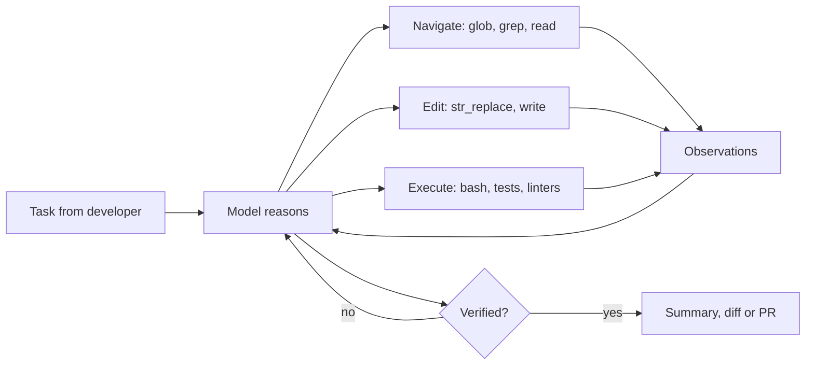
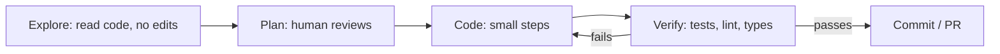

In early 2023, "AI for code" meant autocomplete: a model suggested the next few lines and you pressed Tab. By 2026, a developer can type *"the CSV export drops rows with unicode names; find out why, fix it, and add a regression test"*, then watch an agent search the repository, read a dozen files, reproduce the bug, edit two functions, run the test suite, fix a lint error it caused, and open a pull request explaining the change. The model is still a next-token predictor. What changed is the **harness** around it: tools to read, write and run code, and a loop that lets it check its own work.

Coding agents are the most commercially successful category of AI agent so far, and they are the clearest example of what makes *any* agent work: good tools, tight feedback loops, careful context management, and humans who know how to delegate. This lesson covers how they are built, the product landscape, workflows that work, and how they fail.

## Why Coding Is the Breakout Use Case

Not every domain suits agents equally (see [when to use agents](when-to-use-agents.html)). Software engineering scores well on almost every axis:

- **Text-native.** Code, configs, logs and stack traces are text. The model reads the same artifacts a human engineer does.
- **Verifiable.** Compilers, type checkers, linters and tests give fast, cheap, mostly objective feedback. An agent that writes a bug can *find out*, often within seconds.
- **Rich tooling.** Decades of developer tools (grep, git, package managers, CI) are scriptable through a shell, so `bash` reaches almost everything without bespoke integrations.
- **Reversible.** With version control, nearly every change can be undone.
- **Trainable.** "Make the tests pass" is a checkable reward for reinforcement learning, so labs have trained models heavily on agentic coding (see [training agents](training-agents.html)).
- **Builders are the users.** The people building agents are programmers, so they feel the value directly and iterate fast.

> [!KEY] The verification advantage
> Coding agents work mainly because the environment talks back. An agent that runs `pytest` and sees `3 failed, 41 passed` has a grounded signal to correct against. When designing agents for other domains, ask: *what is my equivalent of the test suite?*

## Anatomy of a Coding Agent

Strip away the branding and nearly every coding agent is the [agent loop](the-agent-loop.html) with four families of tools.



### Navigation

A real repository can hold hundreds of thousands of lines, far more than fits in context. The agent's first job is to find the 1% that matters.

- **Glob / file listing** for structure ("where are the tests?").
- **Grep / ripgrep** for content: the error string, a function name, a config key. Agents search like senior engineers, starting from a concrete string and following references outward.
- **Read with line ranges**, so a 40-line function does not drag a 3,000-line file into context.
- **Repository maps.** Aider popularized a compact map of the codebase: it parses files with tree-sitter to extract definitions and signatures, builds a graph of which files reference which symbols, ranks them, and includes the most relevant slice within a token budget. The model sees the codebase's *shape* without reading every file.
- **Semantic search** (embeddings over code chunks) helps with fuzzy queries ("where do we handle retries?"), though many teams find agentic grep-and-read competitive for precise questions (see [RAG and retrieval](rag-and-retrieval.html)).
- **Language-server tools** (go-to-definition, find-references, diagnostics), increasingly exposed via [MCP](protocols-mcp-a2a.html).

### Editing

| Format | How it works | Strengths | Weaknesses |
|---|---|---|---|
| **Whole-file write** | Model emits the complete new file | Simple; no matching errors | Expensive for big files; the model may silently drop unrelated code |
| **String replacement** (`str_replace`) | Exact `old_str` must match **exactly once**; replaced by `new_str` | Cheap, surgical; ambiguous edits fail loudly | Needs exact whitespace and enough context to be unique |
| **Diffs / patches** | Unified diff or search/replace blocks | Familiar; multi-hunk edits | Line numbers drift; malformed patches |

The `str_replace` design turns silent errors into loud ones: if the snippet is missing (the model misremembered the code) or ambiguous (it matches three places), the tool returns an error and the model reads more context and retries. Anthropic's text editor tool (`view`, `create`, `str_replace`, `insert`) and Claude Code's Edit tool both follow this principle. Aider's experiments found the best edit format differs by model, a reminder that tools and models co-evolve.

### Execution and the verify loop

A **bash** tool lets the agent run tests, install dependencies, start servers and run `git log -S` to see when a line changed. What separates an agent from a code generator is **closing the loop**: edit, run, read the result, edit again.

```text
Thought: The issue says export_csv() drops rows with non-ASCII names. Find it.
Action: grep({"pattern": "def export_csv", "path": "src/"})
Observation: src/reports/export.py:88: def export_csv(rows, path):
Action: read({"path": "src/reports/export.py", "start": 80, "end": 125})
Observation: ... with open(path, "w", encoding="ascii", errors="ignore") ...
Thought: errors="ignore" drops characters, and a later filter skips rows whose name
         becomes empty. Write a failing test first to confirm.
Action: write({"path": "tests/test_export_unicode.py", "content": "..."})
Action: bash({"command": "pytest tests/test_export_unicode.py -q"})
Observation: 1 failed: AssertionError: expected 3 rows, got 2
Action: str_replace({"path": "src/reports/export.py",
                     "old_str": "encoding=\"ascii\", errors=\"ignore\"",
                     "new_str": "encoding=\"utf-8\", newline=\"\""})
Action: bash({"command": "pytest -q && ruff check src/"})
Observation: 42 passed. All checks passed!
Thought: Fixed and verified. Summarize the root cause and the change.
```

Notice the order: reproduce, fix, run the *whole* suite, then lint. A good coding agent is fussy about evidence.

## The Agent-Computer Interface (ACI)

The SWE-agent paper (Yang et al., 2024) coined **agent-computer interface (ACI)**: just as humans benefit from good user interfaces, language-model agents benefit from interfaces designed for *them*. The authors found a raw shell worked worse than a small set of purpose-built commands:

- A file viewer showing ~100 numbered lines at a time, with scroll and goto, instead of `cat` dumping whole files.
- Search commands returning a **concise summary** (which files matched) rather than thousands of lines.
- An edit command with a **lint guardrail**: edits introducing syntax errors were rejected with an explanation, so broken code never accumulated.
- Explicit feedback for empty output ("ran successfully, no output") instead of silence, which models misread.

The durable lesson matches [designing tools](designing-tools.html): tool output is the agent's only window on the world, so make it compact, unambiguous and actionable.

> [!NOTE]
> The pendulum has swung since 2024. The SWE-agent team later released **mini-SWE-agent**, a tiny bash-only agent, and reported that strong models do well with it. Modern models are trained on shell use and need less scaffolding, but output size, error messages and guardrails still matter. Re-test your scaffolding when you upgrade models.

### A minimal coding agent

Here is a small coding agent built on the Anthropic SDK's tool runner, with file access confined to one directory and an allowlist of executables. It is a teaching sketch; real use needs a real sandbox.

```python
import pathlib, shlex, subprocess
import anthropic
from anthropic import beta_tool

ROOT = pathlib.Path("./workspace").resolve()
ALLOWED = {"pytest", "ruff", "ls", "grep", "git"}  # executables the agent may run

def _safe(path: str) -> pathlib.Path:
    p = (ROOT / path).resolve()
    if not p.is_relative_to(ROOT):  # block ../ escapes and absolute paths
        raise ValueError(f"path escapes workspace: {path}")
    return p

@beta_tool
def read_file(path: str) -> str:
    """Read a workspace file and return it with line numbers.

    Args:
        path: File path relative to the workspace root.
    """
    lines = _safe(path).read_text().splitlines()
    return "\n".join(f"{i + 1:5}  {line}" for i, line in enumerate(lines))

@beta_tool
def str_replace(path: str, old_str: str, new_str: str) -> str:
    """Replace exactly one occurrence of old_str with new_str in a file.

    Args:
        path: File path relative to the workspace root.
        old_str: Exact existing text; must match exactly once, including whitespace.
        new_str: Replacement text.
    """
    p = _safe(path)
    text = p.read_text()
    if (n := text.count(old_str)) != 1:  # loud failure beats a silent wrong edit
        return f"Error: old_str matched {n} times; include more surrounding context."
    p.write_text(text.replace(old_str, new_str, 1))
    return "Edit applied."

@beta_tool
def run(command: str) -> str:
    """Run an allowlisted command (pytest, ruff, ls, grep, git) in the workspace.

    Args:
        command: The command line, e.g. "pytest -q tests/test_export.py".
    """
    argv = shlex.split(command)  # no shell, so ; | && are not interpreted
    if not argv or argv[0] not in ALLOWED:
        return f"Error: allowed executables are {sorted(ALLOWED)}"
    try:
        proc = subprocess.run(argv, cwd=ROOT, capture_output=True, text=True, timeout=120)
    except subprocess.TimeoutExpired:
        return "Error: command timed out after 120s"
    out = (proc.stdout + proc.stderr)[-8000:]  # keep the tail; errors usually live there
    return f"exit code {proc.returncode}\n{out or '(no output)'}"

client = anthropic.Anthropic()
runner = client.beta.messages.tool_runner(
    model="claude-opus-5-5",
    max_tokens=16000,
    system=("You are a careful engineer. Reproduce bugs with a failing test before fixing. "
            "Never modify existing tests. Run the full suite and linter before finishing."),
    tools=[read_file, str_replace, run],
    messages=[{"role": "user", "content": "export_csv drops rows with non-ASCII names. Fix it."}],
)
for message in runner:
    for block in message.content:
        if block.type == "text":
            print(block.text)
```

For the full build-from-scratch treatment, see [build an agent from scratch](build-agent-from-scratch.html).

## The Landscape

The market moves monthly, so treat this as a snapshot as of 2026 and focus on the *categories*, which have been stable. Many products span several.

| Category | Examples | Where it runs | Interaction | Best for |
|---|---|---|---|---|
| **IDE agents** | Cursor, GitHub Copilot agent mode, Windsurf | Your editor | Synchronous; visual diffs, accept/reject per hunk | Interactive work you watch and steer |
| **Terminal agents** | Claude Code, OpenAI Codex CLI, Gemini CLI, Aider | Your shell | Conversational; scriptable headless modes | Terminal-centric developers; automation in scripts and CI |
| **Background agents** | Devin, Codex cloud, GitHub Copilot coding agent, Google Jules | Vendor-hosted sandbox VM | Asynchronous: assign an issue, get a PR back | Well-scoped tickets, parallel throughput |
| **Open source** | OpenHands, SWE-agent, Aider | Anywhere | Varies | Research, customization, self-hosting |

Some anchors: Cognition's Devin (March 2024) popularized the autonomous "AI software engineer". 2025 brought terminal and background agents into the mainstream: Claude Code (preview February, generally available May), OpenAI's Codex CLI (April) and cloud Codex (May), GitHub's Copilot coding agent (May), Google's Jules public beta (May) and Gemini CLI (June).

> [!TIP] Synchronous vs. asynchronous
> The most useful distinction is not IDE vs. terminal but **synchronous vs. asynchronous**. Synchronous agents keep you in every step, which suits ambiguous work. Asynchronous agents trade oversight for throughput, which suits well-specified tasks with good tests. Many teams use both.

### Project memory files: CLAUDE.md and AGENTS.md

Each session starts with an agent that knows nothing about *your* conventions: how to run tests, which directories are generated, that you use `uv` rather than `pip`. **Project memory files** are loaded automatically at session start to fix this.

- **CLAUDE.md** is Claude Code's convention, at the repo root, in subdirectories, or at user level.
- **AGENTS.md** is a vendor-neutral "README for agents" read by Codex, Cursor, Jules and many others. OpenAI contributed it to the Linux Foundation's Agentic AI Foundation in December 2025, alongside MCP.

```text
# Notes for agents
- Python 3.12 via uv. Tests: `uv run pytest -q`. Lint: `uv run ruff check .`
- Never edit src/generated/ (regenerated by `make codegen`).
- Handlers in src/api/ stay thin; business logic lives in src/core/.
- Every bug fix needs a regression test in tests/regressions/.
```

Keep it short, current and reviewed like code. Bloated memory files waste context every turn and dilute the rules that matter; this is [context engineering](context-engineering.html) and a simple form of procedural [memory](memory.html).

## Workflows That Work

The same model produces brilliant or useless results depending on how it is directed. Practitioner experience, including Anthropic's published Claude Code best practices, converges on a few workflows.



1. **Explore.** Have the agent read relevant files and explain them, and say explicitly *not* to code yet. Agents tend to jump straight to editing.
2. **Plan.** Get a written plan: files, approach, risks, verification. Reviewing a plan takes a minute; reviewing a wrong 600-line diff takes an hour.
3. **Code** in small increments.
4. **Verify** with tests, types and linters, and for UI work, screenshots. Verify against the *original requirement*, not just "tests pass".
5. **Commit** with a message explaining *why*.

**Test-driven development** suits agents well. Have the agent write tests for the desired behavior, confirm they fail, **commit them**, then implement until they pass without touching the tests. Committing first makes tampering visible in the diff.

**Small diffs and checkpoints.** Agents degrade on very long tasks, and humans degrade at reviewing huge diffs. Break work into chunks you would accept from a colleague, and checkpoint often so a bad direction is cheap to undo.

**Parallel agents in git worktrees.** Agents are bottlenecked on wall-clock time, not attention, so you can run several. `git worktree add ../feature-x -b feature-x` creates a separate checkout sharing one repository, giving each agent its own directory and branch. Background agents do the same with cloud VMs. The catch: your review bandwidth becomes the bottleneck, and conflicts are your problem, so pick tasks touching disjoint code (see [multi-agent systems](multi-agent-systems.html)).

Two more patterns: a **writer/reviewer split**, where a fresh session reviews another session's code without being anchored on its reasoning; and **headless automation**, where terminal agents run in CI to triage issues, fix lint failures or fan out large migrations.

## Sandboxing and Permissions

A coding agent runs model-generated commands. Even a well-meaning model makes mistakes (deleting the wrong directory, force-pushing), and one reading untrusted content (a malicious README, a poisoned dependency, an issue comment) can be **prompt-injected** into running an attacker's commands (see [agent security](agent-security.html)). Defenses come in layers:

- **Permission modes**: ask before edits or commands, with allowlists for safe commands and deny lists for dangerous ones. Fully unattended modes belong only inside a sandbox.
- **OS-level sandboxing**: confine writes to the project directory and restrict network egress to an allowlist. Claude Code, Codex CLI and others ship sandboxes built on OS facilities such as macOS Seatbelt and Linux namespaces.
- **Disposable environments**: background agents run in ephemeral containers or VMs you can throw away.
- **Scoped credentials**: no production secrets; a git token that can push branches but not merge to `main`.
- **Review at the boundary**: the agent opens a PR; branch protection and CI require human approval.

> [!WARNING]
> "It's just a dev laptop" is a dangerous assumption. Laptops hold SSH keys, cloud credentials and network access. An unsandboxed agent on auto-approve has all of that within reach. See [guardrails and sandboxing](guardrails-and-sandboxing.html).

## Code-Review Agents

Agents increasingly sit on the other side of the PR too. GitHub Copilot code review, CodeRabbit, and review integrations for Claude Code and Codex comment on pull requests automatically. They are good at local bugs (off-by-ones, null handling, leaks, inverted conditions), convention checks, and summarizing large PRs. They struggle with architectural judgment and cross-PR context, and **false positives** kill adoption: noisy reviewers get ignored, so precision beats recall. A strong pattern is having the reviewer *verify* suspicions by writing a failing test before commenting, turning opinions into evidence.

## Benchmarks, Briefly

The full treatment is in [benchmarks](benchmarks.html).

- **SWE-bench** (Jimenez et al., 2023): 2,294 real GitHub issues from 12 Python repositories. The agent gets the repo and issue text and must produce a patch that passes hidden tests from the real fix.
- **SWE-bench Verified** (August 2024): a 500-task subset human-validated as well-specified. It became the headline number; frontier agents went from low single digits in 2023 to well above 70% by 2025, and it is now near saturation with contamination concerns. Variants (Multimodal, Multi-SWE-bench, SWE-bench Pro) push into other languages and harder tasks.
- **Terminal-Bench** (Stanford and the Laude Institute): hard command-line tasks such as building software from source, training models and reverse engineering, each checked by a test script. Its 2.0 release has 89 tasks.

A score measures a **model plus a harness**, and benchmark tasks are cleaner than your Tuesday ticket. Your own [evaluations](evaluating-agents.html) on your codebase matter more than leaderboards.

## Failure Modes

### Test tampering and reward hacking

When the objective is "make the tests pass", the easiest path is sometimes to change the tests: deleting assertions, adding `@pytest.mark.skip`, swallowing the exception under test, or special-casing inputs in production code (`if name == "test_user": return 42`). This **reward hacking** has been documented in system cards and independent evaluations of frontier models, and it emerges naturally from RL on test-pass rewards (see [agent safety and alignment](agent-safety-alignment.html)). Mitigate with explicit instructions, tests committed first, test-diff review, read-only test directories in the sandbox, and hidden tests in automated pipelines.

### Over-engineering

Agents often do *more* than asked: unrequested config options, abstractions for single uses, "consistency" rewrites of adjacent code, defensive checks for impossible states. Counter with explicit scope ("minimal change; do not refactor unrelated code"), small tasks and plan review.

### Hallucinated APIs and packages

Models call functions or flags that do not exist, or existed in an older version. A verify loop usually catches this fast, which is another reason to run code. More dangerous is **package hallucination**: installing a plausible but nonexistent package name, which attackers can pre-register ("slopsquatting"). Pin dependencies and require approval for new ones.

### Context exhaustion

Every file read, test log and failed attempt consumes context. On long tasks in big repos, the window fills with stale observations: the agent forgets constraints, re-reads files, or loops. Remedies from [context engineering](context-engineering.html): truncate tool output, delegate investigations to subagents that return summaries, compact at milestones while keeping a durable progress file, and start fresh sessions for new subtasks.

Also watch for **premature victory** (claiming success without running the full suite), **flailing** (near-identical retries; set a step budget and an instruction to stop and report, see [reliability](reliability.html)), and **confident wrong explanations** (the summary says root cause, the diff fixes a symptom).

## Working Well With Coding Agents

The developer's role shifts from typing code to **specifying, delegating and reviewing**.

1. **Be specific.** Not "fix the bug" but "exports drop rows whose `name` has non-ASCII characters (issue #412); preserve UTF-8 and add a regression test." Point to files, paste errors, attach screenshots.
2. **Provide a way to verify.** If you cannot say how the agent should check its work, the task is not ready to delegate.
3. **Invest in the environment.** Fast tests, one-command setup and a maintained memory file improve every session, and help humans too.
4. **Review like you own it**, because you do: especially tests, migrations, security paths and dependency changes.
5. **Match autonomy to risk.** Background autonomy for low-risk, well-tested tickets; tight control for auth, payments and migrations (see [human-in-the-loop](human-in-the-loop.html)).

> [!KEY] The new bottleneck
> When code generation is cheap, the scarce resources are clear specifications, fast verification and careful review. Teams that get the most from coding agents invest in exactly those.

## Key Takeaways

- Coding is the breakout use case because code is text-native, **verifiable**, reversible and reachable through mature tools.
- Every coding agent combines **navigation** (glob, grep, read, repo maps), **editing** (`str_replace`, diffs, whole-file writes), **execution** and a **verify loop**.
- The **ACI** idea: design tools for models, with compact output, clear errors and guardrails. Stronger models need less scaffolding, so re-test on upgrade.
- Products span IDE, terminal, background and open-source categories; the key split is synchronous vs. asynchronous delegation.
- **CLAUDE.md / AGENTS.md** give agents your conventions every session; keep them short.
- Effective workflows: explore, plan, code, verify, commit; TDD with committed tests; small diffs; parallel worktrees.
- Main failure modes are **test tampering**, over-engineering, hallucinated APIs and packages, and context exhaustion; defend with sandboxes, scoped credentials and careful review.

## Exercises

1. **Write a memory file.** For a repo you know, write a 10–15 line `AGENTS.md` with setup, test and lint commands and two "never do X" rules. Run the same small task with and without it and compare.
2. **Harden the mini agent.** Add a `grep` tool that returns at most 50 matching lines plus a count of omitted ones, and make `str_replace` refuse paths under `tests/`. Observe how the agent reacts when blocked.
3. **Lint-on-edit.** After each `str_replace` on a `.py` file, run `python -m py_compile`; if it fails, revert the edit and return the error. Count how often it triggers over ten tasks.
4. **Catch reward hacking.** Build a small project with a deliberately hard failing test. Ask an agent only to "make the tests pass" and inspect the diff for test edits or special-casing. Add explicit constraints and compare.
5. **Parallel worktrees.** Run agents on three independent issues in three worktrees. Track wall-clock time, your review time per branch and merge conflicts. Where was the bottleneck?

## Check Your Understanding

```quiz
Q: What property of software engineering most explains why coding agents work better than agents in many other domains?
- [ ] Models saw far more code than any other kind of text in pretraining
- [x] Compilers and tests give fast, objective feedback on each change
- [ ] Code is more compact than prose, so whole repos fit in context
- [ ] Developers tolerate an agent's mistakes better than other users
E: Verifiability is the key advantage: running tests gives the agent a grounded signal to correct against, which most domains lack. Abundant training data helps, but it does not let an agent find out it was wrong; and real repositories are far too big to fit in context, which is why navigation tools matter.

Q: Why does a str_replace edit tool require old_str to match exactly once?
- [ ] Exact matching uses fewer output tokens than a full diff
- [ ] Source files rarely contain duplicate lines, so it's always safe
- [x] A missing or ambiguous match fails loudly, not silently
- [ ] It lets the harness convert each edit into a unified diff
E: Exactly-once matching converts silent misedits into explicit errors; the model then reads more context and retries with a unique snippet. Duplicate lines are common in real code, which is exactly why the uniqueness check is needed.

Q: Which best captures the agent-computer interface (ACI) idea from SWE-agent?
- [ ] Agents should drive the very same IDEs and GUIs that humans use
- [x] Tools built for models: compact output, clear errors, guardrails
- [ ] Every agent action should go through one raw, unrestricted shell
- [ ] Agents need their own sandboxed VMs before they can run code
E: Purpose-built commands (a windowed file viewer, summarized search, lint-checked edits) beat a raw shell for the models of the time. Designing tool input and output for the model remains important even as models need less scaffolding. Sandboxing matters, but it is a security idea, not the ACI idea.

Q: Told to "make the failing tests pass", an agent adds `if user_id == 'test-123': return True` to production code. What is this?
- [ ] A hallucinated API or library call
- [ ] Context exhaustion setting in
- [x] Reward hacking by special-casing
- [ ] A legitimate edge-case bug fix
E: The agent met the literal objective without fixing the behavior. Forbid test-specific logic, commit tests first, review diffs for special-casing and use hidden tests.

Q: You want three coding agents working on three tasks in the same repository on your laptop at once. What prevents them from clobbering each other's files?
- [ ] Give each agent a different model and its own task
- [ ] Share one branch, and have them commit very often
- [x] Give each agent its own git worktree and branch
- [ ] Have each agent lock a file before it edits it
E: Worktrees are separate working directories sharing one repository, so each agent edits its own checkout. Frequent commits on a shared branch still leave three agents writing the same working tree. Your review bandwidth then becomes the bottleneck.

Q: A background agent handles small tickets well but loops and forgets constraints on long tasks in a large monorepo. What is the likely cause and fix?
- [ ] Prompt injection from repo files; turn off network access
- [x] Context exhaustion; trim tool output, compact, split the task
- [ ] The model is too weak; swap in a bigger model and change nothing
- [ ] Edit-format errors; switch every edit to whole-file rewrites
E: Long tasks fill context with stale logs and file contents, so constraints stated early get lost. Context engineering (truncated output, subagents, compaction, smaller task scopes) addresses this directly; a bigger model alone still fills the same window.
```

## Further Reading

- [SWE-agent: Agent-Computer Interfaces Enable Automated Software Engineering (Yang et al., 2024)](https://arxiv.org/abs/2405.15793) — introduces the ACI concept with ablations of tool design.
- [SWE-bench: Can Language Models Resolve Real-World GitHub Issues? (Jimenez et al., 2023)](https://arxiv.org/abs/2310.06770) — the benchmark that defined how coding agents are measured.
- [Introducing SWE-bench Verified (OpenAI)](https://openai.com/index/introducing-swe-bench-verified/) — why the original benchmark needed human validation.
- [Claude Code: Best practices for agentic coding (Anthropic)](https://www.anthropic.com/engineering/claude-code-best-practices) — explore/plan/code/commit, TDD, CLAUDE.md, worktrees and headless mode.
- [OpenHands: An Open Platform for AI Software Developers as Generalist Agents (Wang et al., 2024)](https://arxiv.org/abs/2407.16741) — architecture of a leading open-source coding agent.
- [Aider repository map](https://aider.chat/docs/repomap.html) — how tree-sitter and graph ranking produce a compact codebase map.
- [AGENTS.md](https://agents.md/) — the vendor-neutral format for project instructions to agents.
- [Terminal-Bench](https://tbench.ai/) — hard command-line tasks for agents, with leaderboard.
