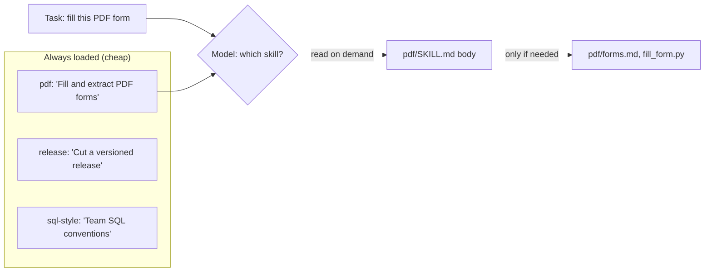
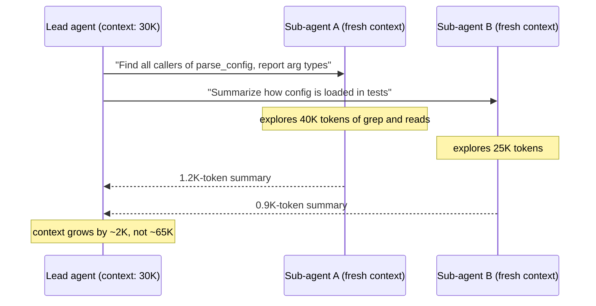

Watch a capable agent fail on a long task and the cause is rarely "the model isn't smart enough." More often the model is smart enough but is looking at the wrong things. The original goal is buried under 80,000 tokens of old grep output. Three near-identical tool descriptions blur together. A stale plan from an hour ago contradicts the current one. The one critical constraint sits in the middle of a giant system prompt where attention is weakest.

**Context engineering** is the discipline of deciding what goes into the model's context window at each step of an agent's run, and just as importantly what stays out. Anthropic's framing is that the job is to find *the smallest possible set of high-signal tokens that maximize the likelihood of the desired outcome*. For a chatbot that's mostly prompt writing. For an agent that loops through dozens or hundreds of model calls, each assembling a fresh context from instructions, tools, history, tool results, memory and retrieved documents, it's a systems design problem, and it largely decides whether long tasks succeed and what they cost.

This lesson covers why context is a scarce resource, what goes into it, and the toolkit practitioners use to keep it sharp: right-altitude prompts, just-in-time loading, compaction, context editing, external notes, sub-agents, and designing for the KV cache.

## From prompt engineering to context engineering

**Prompt engineering** focused on wording a single instruction well: clear task, good examples, the right format. It still matters (see [prompting for agents](prompting-for-agents.html)), but agents changed the problem in three ways:

1. **The context is assembled, not written.** Most tokens in an agent's context come from tool results, retrieved documents and history, not from anything a human typed.
2. **The context evolves.** Every turn appends more. Something you didn't think about at design time (a 30K-token log file, a looping error) will eventually dominate.
3. **It's iterated many times.** A small inefficiency in context assembly is paid on every one of 50–500 calls per task, in cost, latency and quality.

During 2025 the industry converged on "context engineering" as the name for this broader job. Practitioners like Andrej Karpathy and Shopify's Tobi Lütke popularized the term, and Anthropic, Manus, LangChain and others published guides. The shift is from *"what's the perfect wording?"* to *"what configuration of context, at each step, most reliably produces the behavior I want?"*

> [!KEY] The big idea
> The context window is the model's entire world at decision time. Context engineering treats it as a **finite budget** to be spent deliberately on every call, not a bucket to fill.

## Context is a finite attention budget

Why not just use the whole million-token window? Because more context is not free, even when it fits.

- **Attention is spread thin.** In a transformer every token attends to every other token, so n tokens create n² pairwise relationships. As context grows, the model's capacity to track any particular relationship is stretched. Models also see far fewer very long sequences during training than short ones.
- **Lost in the middle.** Liu et al. (2023) showed that models use information at the *beginning* and *end* of a long context much better than information in the *middle*, a U-shaped curve.
- **Context rot.** Chroma's 2025 study of 18 models found that performance degrades as input length grows, **even on simple tasks** and well before the window is full. Distractors (content similar to the answer but wrong) hurt more as context grows, and the structure of the surrounding text changes results.
- **Effective vs. advertised length.** Benchmarks like RULER found that many models' *effective* context, where performance stays strong, is far shorter than their advertised maximum. Frontier models have improved a lot, but the degradation hasn't disappeared.
- **Cost and latency.** Input tokens are billed on every call, and prefill time grows with context length. An agent re-sending 150K tokens 100 times processes 15M input tokens per task (caching changes the price, not the attention problem).

The consequence: **every token you add should earn its place**. Irrelevant tokens aren't neutral. They're distractors that consume attention and money.

## Anatomy of an agent's context

A typical request in an agent loop contains:

| Component | Typical size | Changes | Notes |
|---|---|---|---|
| **System prompt** | 1–10K tokens | Rarely | Role, rules, workflow guidance, output conventions |
| **Tool definitions** | 0.5–30K+ | Rarely (ideally never mid-session) | Names, descriptions, schemas; grows fast with MCP servers |
| **Examples** | 0–5K | Rarely | A few canonical demonstrations |
| **Project/user memory** | 0.5–5K | Per session | CLAUDE.md, user profile, retrieved memories |
| **Conversation history** | Grows | Every turn | User messages, assistant messages, thinking |
| **Tool calls and results** | Grows fast | Every step | Usually the **largest** and most compressible part |
| **Retrieved documents** | 0–100K | Per query | RAG results, file contents |
| **Current instruction / state** | Small | Every turn | The latest request; reminders; todo list |

Try it yourself: watch how the window fills over a long agent run, and what each technique below does to it.

<div class="widget" data-widget="context-window"></div>

In most real agents, **tool results dominate** after a few dozen steps. That's why so many of the techniques below target them.

## The system prompt at the right altitude

Anthropic describes a "Goldilocks zone" for system prompts, between two failure modes:

- **Too low (brittle):** hard-coded if-else logic in prose. "If the user mentions billing and the account is older than 30 days and they say 'refund', then…" It's fragile, hard to maintain, and breaks on the first case you didn't anticipate.
- **Too high (vague):** "You are a helpful support agent. Be accurate." It assumes shared context the model doesn't have and gives no concrete signals.
- **Right altitude:** specific enough to guide behavior, flexible enough to let the model use judgment. Explain the *why* behind rules so the model can generalize.

```text
Too low:   "If the ticket contains 'refund' AND plan == 'annual' AND days > 30, reply with template R7."
Too high:  "Handle refunds appropriately."
Right:     "Refund rules: monthly plans are refundable within 14 days, annual within 30. After that,
            offer a prorated credit; we do this because annual customers often churn over a lost
            refund but accept credits. Enterprise contracts follow their order form, so look it up
            with get_contract before answering. When rules don't clearly cover a case, escalate
            rather than improvise."
```

Practical guidance:

- **Structure it.** Use clear sections (`<background>`, `<tools_guidance>`, `<output_format>`, or Markdown headings). Structure helps both the model and future maintainers.
- **Start minimal, then add based on observed failures.** Test the bare prompt with your best model, then add instructions that fix specific failures seen in [evals](evaluating-agents.html). Minimal doesn't mean short. It means nothing that isn't pulling its weight.
- **Don't keep stale instructions.** Prompts accrete rules for problems that no longer exist, and every rule competes for attention.

## Tools and examples are context too

**Tool definitions** are often the second-largest fixed cost, and a major source of confusion.

- **Minimal, non-overlapping tool set.** Anthropic's test: *if a human engineer can't say definitively which tool should be used in a given situation, an agent can't be expected to do better.* Three tools that all "search" invite wrong choices.
- **Token-efficient results.** Tools should return what the agent needs, not raw dumps: paginate, truncate with a note ("showing 50 of 2,314 lines; use offset to see more"), and offer a `response_format: "concise" | "detailed"` option. See [designing tools](designing-tools.html).
- **Scale with discovery, not preloading.** With dozens of MCP servers, tool definitions alone can consume tens of thousands of tokens. **Tool search** (the model searches a tool catalog and loads only matching definitions) keeps the fixed cost small.
- **Keep bulky intermediate data out.** **Programmatic tool calling** lets the model write a script that calls tools and filters their outputs in a sandbox, so only the final result enters context, not every intermediate row.

**Examples** are powerful and easy to overdo. Rather than stuffing in every edge case, curate a few **diverse, canonical** examples that show the expected behavior. Manus adds a warning from production: **don't get few-shotted by your own history**. When the context is full of near-identical action-observation pairs (reviewing resume 1, resume 2, resume 3...), the model starts imitating the pattern, drifting and over-generalizing. Introducing small structured variation (different phrasing and ordering in serialized results) breaks the rut.

## Just-in-time loading and progressive disclosure

The traditional approach preloads everything possibly relevant: embed the codebase, retrieve the top 20 chunks, put them all up front. The agentic alternative is **just-in-time context**. The agent keeps lightweight **references** (file paths, URLs, query names, IDs) and loads the content behind them only when it decides it needs it, using tools.

This mirrors how people work. You don't memorize a codebase; you know where things are and open files as needed. Metadata carries signal too: a file at `tests/integration/test_billing.py` tells you something before you open it, and so do file sizes, names and timestamps.

Claude Code takes a **hybrid** approach. CLAUDE.md files are loaded up front (small, always relevant), while `glob`, `grep` and ranged file reads pull in everything else on demand. The model can `head` a huge log file instead of loading it whole. The trade-off is speed: runtime exploration takes more steps than having the data preloaded, so preload what is small and almost always needed, and let the agent fetch the rest.

### Progressive disclosure with Agent Skills

**Agent Skills** apply this idea to *instructions and procedures*. A skill is a folder containing a `SKILL.md` (and optionally scripts and reference files). Disclosure happens in layers:

1. **Always in context:** just each skill's name and one-line description, a few dozen tokens per skill.
2. **Loaded when relevant:** the full `SKILL.md` body, when the model decides the task calls for it.
3. **Loaded as needed:** extra files the skill references (a forms guide, a schema, a script to run rather than read).



The result is that an agent can have hundreds of skills "installed" while paying context for only the few it uses.

## Long-horizon techniques

Some tasks run far longer than any context window: a multi-hour refactor, a research report across hundreds of sources. Three families of techniques keep these going, and production agents use all of them.

### Compaction

**Compaction** summarizes the conversation when it nears the limit and continues in a fresh context seeded with the summary. Done well, it preserves what matters (the goal, architectural decisions, unresolved bugs, current state, next steps) and discards what doesn't (redundant tool output, superseded attempts). Claude Code, for example, compacts by having the model summarize the history and then continues with that summary plus the most recently accessed files.

The art is choosing what to keep. **Over-aggressive compaction loses subtle details whose importance only becomes clear later.** Tune your compaction prompt for recall first (capture everything that might matter), then trim.

The Claude API offers server-side compaction as a beta:

```python
import anthropic

client = anthropic.Anthropic()
messages = []

def agent_turn(user_message: str) -> str:
    messages.append({"role": "user", "content": user_message})
    response = client.beta.messages.create(
        betas=["compact-2026-01-12"],
        model="claude-opus-5-5",
        max_tokens=16000,
        messages=messages,
        context_management={"edits": [{"type": "compact_20260112"}]},  # summarizes past a token threshold
    )
    # Append the FULL content: it may contain a compaction block that must be sent back.
    messages.append({"role": "assistant", "content": response.content})
    return next((b.text for b in response.content if b.type == "text"), "")
```

### Context editing: clearing old tool results

The lightest-touch form of compaction is **tool result clearing**. Once a tool was called long ago and its output has been acted on, the agent rarely needs the raw output again. Clearing old results (replacing them with a short placeholder) keeps the transcript's *structure* (what was done, in what order) while removing the bulk.

```python
response = client.beta.messages.create(
    betas=["context-management-2025-06-27"],
    model="claude-opus-5-5",
    max_tokens=16000,
    tools=tools,
    messages=messages,
    context_management={"edits": [{
        "type": "clear_tool_uses_20250919",
        "trigger": {"type": "input_tokens", "value": 60000},   # start clearing past 60K input tokens
        "keep": {"type": "tool_uses", "value": 5},             # always keep the 5 most recent results
        "clear_at_least": {"type": "input_tokens", "value": 10000},  # don't break the cache for a tiny gain
        "exclude_tools": ["memory"],                           # never clear memory reads
    }]},
)
```

Note `clear_at_least`. Every clearing edit changes the prefix and so **invalidates the prompt cache** from that point on. Clear in large, infrequent batches rather than a little on every turn.

> [!TIP] Rule of thumb
> Prefer **restorable** compression. If a tool result can be re-fetched from a path or URL, you can drop its content and keep the reference, so nothing is truly lost. Manus applies this deliberately: drop a web page's content but keep its URL; drop a file's contents but keep its path.

### Structured note-taking and recitation

**Structured note-taking** (sometimes called agentic memory) means the agent regularly writes notes to storage *outside* the context window (a `NOTES.md`, a progress file, a todo list, the memory tool) and reads them back later. Notes survive compaction, context resets and even new sessions.

- Anthropic gave an example of Claude playing Pokémon: across thousands of game steps it kept precise running notes, such as tallies of training progress, maps of explored regions, and which strategies worked against which opponents, which let it continue coherently after context resets.
- Anthropic's guidance on long-running coding harnesses uses an initializer session to create a progress file and a feature checklist, then has each later session read them first, work on one feature, commit to git and update the progress file.
- **Recitation**: Manus observed that its agent, over a typical task of around 50 tool calls, would rewrite a `todo.md` file as it worked, checking off items. Rewriting the plan pushes the global goal into the most recent part of the context, where attention is strongest, countering lost-in-the-middle drift. Todo-list tools in coding agents do the same (see [reasoning and planning](reasoning-and-planning.html)).

See [memory](memory.html) for the cross-session side of this. Within a long task, notes are *external working memory*.

### Sub-agent context isolation

A **sub-agent** gets a fresh, clean context window for a focused subtask: "search the codebase for every caller of `parse_config` and report which pass a path vs. a dict." It might burn 40K tokens exploring, then return a condensed summary of perhaps 1–2K tokens. The lead agent's context only ever sees the summary.



This **separation of concerns** keeps the lead's context clean for synthesis and lets exploration run in parallel. Anthropic's multi-agent research system relies on it heavily. The cost: total tokens go *up* (each sub-agent pays its own context), and information can be lost at the hand-off. Cognition's "Don't Build Multi-Agents" argues that for tightly coupled work like coding, sub-agents that don't share full context make conflicting decisions. A common resolution is to use sub-agents for **read-heavy, separable** work (search, research, review) and keep **write-heavy, coupled** work in one context. [Multi-agent systems](multi-agent-systems.html) covers the trade-offs.

| Technique | What it removes | Lossy? | Cache impact | Best for |
|---|---|---|---|---|
| Tool result clearing | Old tool outputs | Restorable if re-fetchable | Invalidates from edit point (batch it) | Tool-heavy loops |
| Compaction | Most of the history | Yes | New prefix after compaction | Very long conversations |
| Note-taking | Nothing (adds a durable copy) | No | Notes appended or read on demand | Multi-hour and multi-session work |
| Sub-agents | Exploration noise | Summary is lossy | Separate caches per sub-agent | Parallel research, search |
| Just-in-time loading | Never loads the irrelevant | No | Append-only | Large corpora, codebases |

## Designing for the KV cache

When a model processes a prompt, it computes key/value tensors for every token (the **KV cache**). If the next request starts with **exactly the same prefix**, a provider can reuse that work: **prompt caching**. For agents this matters enormously, because each step re-sends everything before it with a little appended.

Manus called KV-cache hit rate *the single most important metric* for a production agent. They reported input-to-output token ratios around 100:1, and noted that on Claude, cached input tokens cost about a tenth of uncached ones. Exact prices vary by model and change over time (on current Claude models in 2026, a cache read costs about 5% of the base input price, and a 5-minute cache write 1.25×), but cache reads are consistently a small fraction of the uncached input price, with a modest premium on writes. Caching also cuts time-to-first-token.

Caching is a **prefix match**: change one byte early and everything after it is recomputed. Render order is tools, then system, then messages. That gives a set of design rules:

1. **Keep the prefix stable.** No timestamps, request IDs or per-user fields at the top of the system prompt. A line like `Current time: 14:03:27` invalidates the cache on every call. If you need the date, put it later, at day granularity.
2. **Make history append-only.** Don't rewrite earlier turns, reorder messages or re-summarize old tool results on every turn. Edits invalidate everything after them, which is why clearing and compaction should be rare, batched events.
3. **Serialize deterministically.** `json.dumps(obj)` without `sort_keys=True`, iteration over sets, or a tool list built from an unordered registry all produce byte-different prompts for identical content.
4. **Mask tools, don't remove them.** It's tempting to show the agent only the tools relevant to the current step. But tools render at the very front, so adding or removing them invalidates the cache, and earlier turns now reference tools that no longer exist, which confuses the model. Manus keeps the tool list fixed and instead **constrains which tools may be chosen** (masking token logits during decoding, helped by consistent name prefixes like `browser_` and `shell_`). On hosted APIs without logit access, you can get similar effects with instructions, by returning "not available in this mode" errors from the harness, or with API features built for this (tool search appends definitions instead of swapping them; some APIs support cache-preserving mid-conversation tool additions and removals).
5. **Inject dynamic instructions late.** Mode switches ("plan mode on"), reminders and state updates belong at the end of the context, not in an edited system prompt. On Claude models that support it, a `{"role": "system", ...}` message appended to `messages` carries operator authority without touching the cached prefix.
6. **Don't switch models mid-session.** Caches are per model. Use a sub-agent if you need a cheaper model for a subtask.

```python
import json
import anthropic

client = anthropic.Anthropic()

SYSTEM = open("system_prompt.md").read()          # frozen: no timestamps or user IDs inside
TOOLS = sorted(load_tool_definitions(), key=lambda t: t["name"])  # your registry; deterministic order

def render_result(obj: dict) -> str:
    return json.dumps(obj, sort_keys=True, ensure_ascii=False)    # byte-stable serialization

def call_model(messages: list[dict]):
    response = client.messages.create(
        model="claude-opus-5-5",
        max_tokens=16000,
        tools=TOOLS,
        system=[{"type": "text", "text": SYSTEM, "cache_control": {"type": "ephemeral"}}],  # static prefix
        cache_control={"type": "ephemeral"},  # automatic breakpoint that follows the growing history
        messages=messages,                     # append-only: never rewrite earlier turns
    )
    u = response.usage
    print(f"cache read={u.cache_read_input_tokens} write={u.cache_creation_input_tokens} uncached={u.input_tokens}")
    return response

# A mid-session mode switch goes at the END, leaving the cached prefix intact:
# messages.append({"role": "system", "content": "Plan mode: propose changes, do not edit files."})
```

In a healthy loop, `cache_read_input_tokens` grows turn over turn and covers nearly the whole prompt, while writes stay small. If reads collapse to zero, diff two consecutive request payloads to find the invalidator. [Cost and latency](cost-and-latency.html) goes deeper on caching economics.

## Keep the errors in

A natural instinct is to tidy the transcript: delete the failed tool call, retry silently, hide the stack trace. Manus argues the opposite: **leave the wrong turns in the context.** When the model sees a failed action and its error, it implicitly updates its beliefs and becomes less likely to repeat the mistake. Erasing failures removes the evidence it needs to adapt, and it rewrites history, which also breaks the cache.

Practical version:

- Return errors as tool results with `is_error: true` and an **actionable message** ("File not found: src/confg.py. Did you mean src/config.py?") rather than raising exceptions that kill the loop.
- Keep the failed attempt and the correction visible, at least until the error is resolved.
- If errors accumulate (the same failure ten times), that's a signal to intervene, for example by injecting a reminder or replanning, not to silently delete them.

Error recovery is a sign of genuinely agentic behavior. Context that hides errors trains the model, within the session, to repeat them.

## Putting it together: a context budget

Here's an illustrative budget for a coding agent on a 200K-token window. The numbers are an example, not a standard:

```text
Fixed prefix (cached)                       ~18K
  System prompt (right altitude)              4K
  Tool definitions (12 tools, concise)        6K
  Skill descriptions (40 skills)              2K
  CLAUDE.md project memory                    3K
  Few-shot examples (3 canonical)             3K
Rolling history                          target < 100K
  Recent tool results (last ~5 kept)        ~20–40K
  Older tool calls (results cleared)        structure only
  Assistant reasoning + messages             ~20K
State and recitation                         ~2K
  Todo list / progress (re-written)
Headroom for retrieval and output         remaining
Triggers: clear tool results at 100K input tokens (≥20K at a time);
          compact at 150K; write NOTES.md before compaction.
```

The process matters more than the specific numbers: **measure** what fills your context (log token counts per component), **set budgets**, **choose triggers** for clearing and compaction, and **evaluate** whether changes improve task success, not just token counts.

> [!WARNING]
> Context engineering optimizations can silently hurt quality. Clearing tool results the model still needed, or compaction that drops a constraint, shows up as subtle failures 50 steps later. Every change to context assembly deserves an eval run, and a check of cache hit rate.

## Key Takeaways

- **Context engineering** is choosing, at every step, the smallest set of high-signal tokens for the model. For agents it has largely replaced "prompt engineering" as the core discipline.
- Context is a **finite attention budget**. Lost-in-the-middle and **context rot** mean that more tokens can mean worse answers, well before the window is full.
- Write system prompts at the **right altitude**: concrete guidance with reasons, not brittle if-else rules or vague platitudes. Keep tool sets minimal and unambiguous.
- Prefer **just-in-time loading** and **progressive disclosure** (references, search tools, Agent Skills) over preloading everything.
- For long horizons, combine **tool result clearing**, **compaction**, **structured notes and recitation**, and **sub-agent isolation**.
- **Design for the KV cache**: stable prefix, append-only history, deterministic serialization, mask rather than remove tools, inject dynamic content late.
- **Keep errors in context** so the model can learn from them within the session. Measure, budget and evaluate every context change.

## Exercises

1. **Context audit.** Instrument an agent you've built (or the one from [build an agent from scratch](build-agent-from-scratch.html)) to log token counts per component (system, tools, history, tool results) on every call. Run a long task and identify the biggest consumer by the final step.
2. **Altitude rewrite.** Take a system prompt you've written and rewrite it at the right altitude: remove if-else rules, add the *why* behind the important constraints, and add section structure. Compare the two on 10 test tasks.
3. **Cache forensics.** Add `datetime.now()` to the top of a system prompt and run five consecutive agent steps, logging `cache_read_input_tokens`. Then move the timestamp to the latest user message (at day granularity) and repeat. Report the difference in cost per step.
4. **Clearing vs. compaction.** On a tool-heavy task (e.g., 40+ file reads), compare three configurations: no management, `clear_tool_uses_20250919` with `keep=5`, and server-side compaction. Measure success rate, total input tokens and cache hit rate.
5. **Sub-agent design (hard).** Build a `delegate(task: str) -> str` tool that runs a sub-agent in a fresh context with read-only tools and returns a summary under 300 words. Use it for codebase exploration, and compare the lead agent's context size and success rate against a single agent doing everything. Identify one task where delegation hurts, and explain why.

## Check Your Understanding

```quiz
Q: A team upgrades to a model with a 1M-token window and starts putting the entire codebase in every request. Quality on multi-step tasks drops. What's the most likely explanation?
- [ ] The prompt now exceeds the cache limit, so each call reprocesses everything
- [x] Irrelevant tokens act as distractors, and quality degrades as length grows
- [ ] The provider quietly truncates the middle of prompts beyond a set length
- [ ] Code is tokenized less efficiently, so it overflows the window in practice
E: Fitting in the window isn't the same as being used well: lost-in-the-middle and context-rot studies show degradation with length, especially with similar-but-irrelevant content. A cache miss would raise cost and latency, not lower quality.

Q: Which system prompt instruction is at the "right altitude"?
- [ ] "Act as a world-class retention specialist who puts the customer's needs first."
- [ ] "If message contains 'cancel', plan is 'pro' and tenure < 90 days, use template C3."
- [x] "Offer discounts only when price is why they're leaving; they rarely keep anyone else."
- [ ] "Follow the retention playbook carefully, and use your good judgment on any edge cases."
E: The right altitude gives concrete guidance plus the reason behind it, so the model can generalize to cases the author didn't anticipate. The template rule is too low (brittle if-else logic); the persona and "use good judgment" lines are too high, since they assume context the model doesn't have.

Q: How do Agent Skills implement progressive disclosure?
- [ ] Each skill's body is embedded, and the closest matches are retrieved per turn
- [x] Only names and descriptions stay in context; bodies and files load on demand
- [ ] All skill bodies load once, then get summarized to keep the prefix cached
- [ ] Each skill runs in its own sub-agent that returns a short result to the lead
E: Layered loading means hundreds of skills cost a few dozen tokens each until one is needed: the model itself reads the full SKILL.md, and any referenced files, when the task calls for it. That's model-directed loading, not embedding retrieval or summarization.

Q: Your agent's cache_read_input_tokens is zero on every request despite cache_control markers. Which of these is the most likely culprit?
- [ ] The newest tool result is appended to the end of the history each turn
- [ ] The tools array is sorted alphabetically by name before every request
- [x] The system prompt begins with "Current time: {now}" to the second
- [ ] A mode-switch reminder is appended as a system message at the very end
E: Caching is a prefix match, and render order is tools, then system, then messages. A per-request timestamp near the front changes early bytes on every call and invalidates everything after it. Appending at the end, and sorting deterministically, are exactly what keeps the prefix stable.

Q: Why does Manus recommend masking tools instead of removing them from the tool list as the agent's state changes?
- [ ] Fewer listed tools make selection noisier, since the model loses contrasts
- [ ] Masked tools are still billed, but at the cheaper cached-input token rate
- [x] Editing the list breaks the cache, and old turns cite tools that vanished
- [ ] Removal forces the provider to recompile the tool schemas on every turn
E: Tool definitions render at the very front, so changing them invalidates the KV cache, and earlier turns would reference tools that no longer exist, confusing the model. Constraining which tools may be selected gets the behavioral effect without those costs.

Q: When is a sub-agent most clearly the right context-engineering choice?
- [ ] When two parts of a feature need coordinated edits to the same set of files
- [x] When a read-heavy subtask can be handed off and only its summary is needed
- [ ] When you want to cut total token usage across the whole task's run
- [ ] When the lead agent's own context is still small and has lots of room
E: Sub-agents isolate exploration noise and return compact results. Cutting total tokens is the tempting wrong answer: each sub-agent pays for its own context, so totals usually go up. They're also risky for tightly coupled write work, where shared context matters.

Q: A teammate proposes deleting failed tool calls from the history so the transcript stays "clean." What's the strongest argument against it?
- [ ] Failed calls hold the tool_use IDs needed to match later tool results
- [x] The model learns from seen failures, and edits break the prompt cache
- [ ] Leaving failures in lets you skip is_error flags on later tool results
- [ ] Deleting turns makes the model re-plan from scratch on the next request
E: Errors are evidence: seeing a failed action and its message makes the model less likely to repeat it, and append-only history keeps caching effective. A deleted turn doesn't trigger a fresh plan; the model simply loses information it needed.

Q: Why does the context-editing config include clear_at_least?
- [ ] To make sure no tool result stays in context longer than a set token span
- [ ] To set how many of the most recent tool results are kept untouched
- [x] Each clear forces a cache rebuild, so tiny clears may not pay off
- [ ] To cap the context size, clearing whatever is needed to stay under it
E: Clearing trades a cache rebuild for a smaller context, so a minimum amount ensures each edit is worth that cost; batch it into large, infrequent clears. The number of recent results kept is the separate keep setting, and the trigger, not clear_at_least, decides when clearing starts.
```

## Further Reading

- [Effective context engineering for AI agents (Anthropic)](https://www.anthropic.com/engineering/effective-context-engineering-for-ai-agents): the attention budget, right-altitude prompts, just-in-time context, compaction, note-taking and sub-agents.
- [Context Engineering for AI Agents: Lessons from Building Manus](https://manus.im/blog/Context-Engineering-for-AI-Agents-Lessons-from-Building-Manus): KV-cache-first design, masking tools, the file system as context, recitation and keeping errors in.
- [Context Rot (Chroma Research, 2025)](https://research.trychroma.com/context-rot): how performance degrades with input length across 18 models, even on simple tasks.
- [Lost in the Middle: How Language Models Use Long Contexts (Liu et al., 2023)](https://arxiv.org/abs/2307.03172): the U-shaped position effect.
- [Equipping agents for the real world with Agent Skills (Anthropic)](https://www.anthropic.com/engineering/equipping-agents-for-the-real-world-with-agent-skills): progressive disclosure for instructions and procedures.
- [Effective harnesses for long-running agents (Anthropic)](https://www.anthropic.com/engineering/effective-harnesses-for-long-running-agents): progress files, feature lists and git as external memory across sessions.
- [How we built our multi-agent research system (Anthropic)](https://www.anthropic.com/engineering/multi-agent-research-system): sub-agent context isolation in practice, including its token costs.
- [Don't Build Multi-Agents (Cognition)](https://cognition.ai/blog/dont-build-multi-agents): the counterargument on context sharing.
- [Context editing (Claude docs)](https://platform.claude.com/docs/en/build-with-claude/context-editing): configuration for clearing tool results and thinking blocks.
- [Prompt caching (Claude docs)](https://platform.claude.com/docs/en/build-with-claude/prompt-caching): prefix matching, breakpoints and verifying cache hits.
