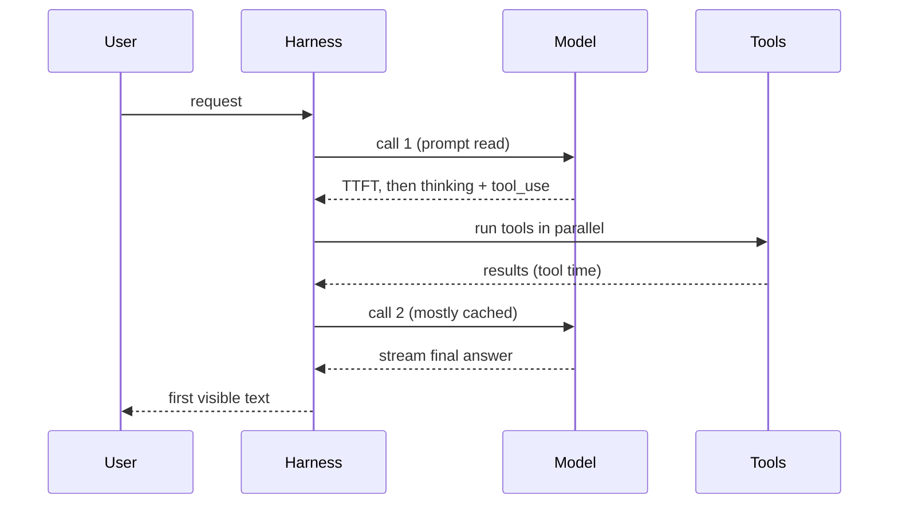

A team prototypes a support agent. In testing, a ticket costs about thirty cents and takes forty seconds. After launch, real conversations run three times longer than the test cases, the bill grows far faster than ticket volume, and users abandon chats while staring at a spinner. Nobody changed the model or the prompt. The team simply hadn't understood how an agent loop spends tokens and time.

This lesson takes apart where an agent's dollars and seconds go, then works through the levers that cut them, starting with the free wins (caching, hygiene, batching) and moving to the trade-offs (effort, model choice). The unit throughout is the one that matters to the business: **cost and time per completed task**, not per request.

## Token Economics

You pay per **token**, the sub-word unit models read and write, priced per million tokens (MTok). Three facts drive nearly every cost decision:

1. **Output costs much more than input.** On current Claude models, output is 5× the input price. **Thinking tokens bill as output**, whether or not you display them.
2. **The model is stateless.** Every call re-sends everything: system prompt, tool definitions, and the entire conversation so far.
3. **Agents make many calls.** A 30-step task is 30 requests, each one carrying all the history before it.

### Current pricing

Prices as of **November 2026**, in USD per million tokens:

| Model | Input | Output | Cache read | Cache write (5-min) | Batch input / output |
|---|---|---|---|---|---|
| Claude Fable 5.2 (`claude-fable-5-2`) | $8.00 | $40.00 | $0.20 | $10.00 | $4.00 / $20.00 |
| Claude Opus 5.5 (`claude-opus-5-5`) | $4.00 | $20.00 | $0.20 | $5.00 | $2.00 / $10.00 |
| Claude Sonnet 5.5 (`claude-sonnet-5-5`) | $2.00 | $10.00 | $0.10 | $2.50 | $1.00 / $5.00 |
| Claude Haiku 5.5 (`claude-haiku-5-5`), prompts ≤100K tokens | $0.10 | $0.50 | $0.01 | $0.125 | $0.05 / $0.25 |

Haiku 5.5 has a second rate card for prompts over 100K tokens ($0.50 / $2.50). A 1-hour cache write costs 2× the base input price.

> [!WARNING]
> Prices change often, sometimes several times a year, and differ by platform and region. Treat this table as an illustration of the *structure* (output > input, cache reads far cheaper than input, batch at half price) and check the official pricing page before you budget.

### Why cost grows quadratically

Turn *k* of a loop sends the base prompt plus everything the previous *k − 1* turns appended. Summed over *N* turns, total input is roughly `N × base + delta × N²/2`, so it grows with the **square** of the number of turns. Doubling the turn count roughly quadruples the history-driven part of the bill. That is why the prototype's test cost misled the team: their production conversations were three times longer, so they cost several times more per ticket, not three times more.

## A Worked Cost Example

Take a realistic research agent on Claude Opus 5.5:

- System prompt + tool definitions: **8,000 tokens**. Initial user message: **500 tokens**.
- Each turn the model writes ~**400 output tokens** (thinking + tool call), and the tool returns ~**1,500 tokens**. So each turn appends ~1,900 tokens of history.

**Without caching**, a 20-turn task sends 20 × 8,500 + 1,900 × (0 + 1 + … + 19) = **531,000 input tokens**, plus 8,000 output tokens:

- Input: 531,000 × $4/MTok = **$2.12**
- Output: 8,000 × $20/MTok = **$0.16**
- Total: **$2.28 per task**. Input is 93% of it, and almost all of that input is history the model has already seen.

**With prompt caching**, each turn reads the previous prefix from cache at $0.20/MTok and writes only the new ~1,900 tokens at $5/MTok:

- Cache reads: 486,400 tokens × $0.20 = $0.10
- Cache writes: 44,600 tokens × $5.00 = $0.22
- Output: $0.16
- Total: **$0.48 per task**, about **79% cheaper**.

| Turns | Uncached | Cached | Saving |
|---|---|---|---|
| 10 | $0.76 | $0.24 | 69% |
| 20 | $2.28 | $0.48 | 79% |
| 40 | $7.61 | $1.08 | 86% |

Two things stand out. Going from 20 to 40 turns makes the uncached task **3.3×** more expensive, which is the quadratic effect at work. And caching saves more the longer the task runs, because it reprices exactly the part that grows. At 10,000 tasks a day, the 20-turn numbers are the difference between roughly $22,800 and $4,800 a day.

Try it yourself: adjust turns, prompt size, tool-result size and model, and watch how caching changes the curve.

<div class="widget" data-widget="cost-calculator"></div>

## Prompt Caching in Depth

**Prompt caching** stores the model's processed state for a prompt prefix so later requests that start with the same bytes can skip re-processing them. It cuts both cost and time to first token on long prompts.

### The one invariant: prefix matching

> [!KEY] The big idea
> Caching is an exact **prefix match**. Any byte that changes invalidates the cache for everything after it. Design the prompt so stable content comes first and volatile content comes last.

The request renders in a fixed order: **tools → system → messages**. A timestamp in the system prompt therefore invalidates the system prompt *and the entire conversation*, every single turn. Classify every input by how often it changes, and order the prompt the same way:

| Stability | Examples | Where it goes |
|---|---|---|
| Never changes | Tool definitions, core instructions, few-shot examples | Start of prompt, before the first breakpoint |
| Per session | User profile, retrieved project docs | After the global prefix |
| Per turn | New user message, tool results | End of the conversation |
| Per request | Timestamps, request IDs | Nowhere near the prefix, or nowhere at all |

### Breakpoints and automatic caching

You mark cache points with `cache_control` on a content block, with up to **4 breakpoints** per request. The simplest option is **automatic caching**, a top-level `cache_control` that places a breakpoint on the last cacheable block and moves it forward as the conversation grows. A robust setup for agent loops is one explicit breakpoint at the end of the static system prompt, which many conversations share, plus automatic caching for the growing tail:

```python
import anthropic

client = anthropic.Anthropic()

response = client.messages.create(
    model="claude-opus-5-5",
    max_tokens=16000,
    cache_control={"type": "ephemeral"},     # automatic: caches the growing conversation
    system=[{
        "type": "text",
        "text": SYSTEM_PROMPT,               # frozen: no dates, names or flags interpolated
        "cache_control": {"type": "ephemeral"},  # explicit: shared prefix across all tasks
    }],
    tools=TOOLS,                             # deterministic order, identical every call
    messages=messages,
)

u = response.usage
read, wrote = u.cache_read_input_tokens or 0, u.cache_creation_input_tokens or 0
print(f"read {read}/{u.input_tokens + read + wrote} from cache; "
      f"wrote {wrote}; uncached {u.input_tokens}")
```

Note that `input_tokens` counts only the **uncached remainder**. The full prompt size is the sum of all three fields. In a healthy loop, `cache_read_input_tokens` grows each turn and dominates, `cache_creation_input_tokens` is about one turn's worth of new content, and `input_tokens` stays small.

### Pricing, TTL and break-even

- **Cache reads** are cheap: typically 0.1× the base input price, and lower still on the newest models (0.05× on Opus 5.5 and Sonnet 5.5, 0.025× on Fable 5.2).
- **Cache writes** cost *more* than normal input: 1.25× for the default 5-minute lifetime, 2× for the 1-hour option.
- **TTL** (time to live) is measured from the start of the last request that read or wrote the entry, and every hit refreshes it at no charge. Requests sharing a prefix less than 5 minutes apart keep the default cache warm indefinitely. Use the 1-hour TTL only when gaps really fall between 5 and 60 minutes, such as a user replying after a coffee break.
- **Break-even** is quick. With the 5-minute TTL, two requests already beat no caching (1.25 + 0.1 < 2). Don't cache prefixes that are unique per request, because you'd pay the write premium and never get a read.
- **Minimum size.** Current models won't cache prefixes shorter than 512 tokens (older models need more). Below that, the marker is silently ignored.

### Silent invalidators

The most expensive caching bug produces no error at all: requests keep succeeding and the bill just goes up. Check prompt-building code for these:

| Pattern | Why it breaks caching |
|---|---|
| `datetime.now()` or a request ID in the system prompt | Prefix differs on every request |
| `json.dumps(d)` without `sort_keys=True`; iterating a `set` | Non-deterministic bytes |
| Tool list built per user or per mode | Tools render first, so nothing downstream matches |
| Editing or deleting earlier messages | Everything after the edit re-processes |
| Switching model mid-conversation | Caches are per model |
| Changing `thinking` or `effort` settings between turns | Invalidates the cached messages |
| Parallel fan-out with an identical prefix | A cache entry becomes readable only once the first response starts streaming, so N simultaneous requests all pay to write |

For mid-conversation changes, prefer append-only forms. For example, send a new instruction as a `{"role": "system", ...}` message appended after the history (supported on current models) rather than editing the top-level `system`. And **verify after every prompt-assembly change**. A standing test that asserts a second identical request shows `cache_read_input_tokens > 0` catches regressions that code review misses.

## Choosing the Right Model and Effort

### Cost per completed task, not per token

A cheaper model that fails still bills you for its tokens, then for the retry, then for whatever the failure costs downstream. Here is a hypothetical comparison:

| Config | Cost per attempt | Success rate | Failures escalated to a human ($5 each) | Expected cost per task |
|---|---|---|---|---|
| A: larger model | $0.48 | 90% | 10% × $5 = $0.50 | **$0.98** |
| B: smaller model | $0.12 | 55% | 45% × $5 = $2.25 | **$2.37** |

On sticker price, B is 4× cheaper. Counted honestly, it costs 2.4× more. The reverse also happens: a smaller model that clears your eval bar is pure savings. Only measurement on *your* tasks can tell you which case you're in (see [evaluating agents](evaluating-agents.html)).

### Effort: the first dial to turn

Current Claude models think adaptively, and the **effort** parameter (`output_config={"effort": "low" | "medium" | "high" | "xhigh" | "max"}`) controls how many tokens they spend on thinking, text and tool calls. Lower effort means fewer output tokens and usually fewer turns. Sweep effort on your eval *before* switching models, since it changes cost without changing the model's capability ceiling. Published sweeps tend to show flat curves on research and knowledge work, where lower effort loses little, and real trade-offs on long-horizon coding. Set effort per route and keep it fixed within a conversation. Changing it mid-conversation invalidates the cached messages.

### Routing and cascades

- **Routing** sends each request to the cheapest adequate model, based on a classifier (often a small, fast model) or on known task types. Password resets go to Haiku; contract analysis goes to Opus.
- **Cascades** try the cheap model first, check the result with a validator (tests, schema, confidence), and escalate to a stronger model only on failure. This works well when you have a reliable, cheap check. A related trick is to run everything at low effort and re-run only the failures at high effort.
- **Cheaper models for subagents.** A frontier orchestrator delegates bounded subtasks (search, extraction, summarizing a file) to cheaper subagents, which absorb the bulky context and return a short result ([multi-agent systems](multi-agent-systems.html)). Each subagent starts a fresh, uncached prompt, so delegate only when there's real bulk.

Don't switch models *inside* a conversation to save money. The cold cache usually costs more than the switch saves.

## Doing Less Work

### Batch processing: 50% off for offline work

The **Message Batches API** processes requests asynchronously at **half price on every token**, and that discount stacks with caching. Most batches finish within an hour, and the hard limit is 24 hours. Use it for evaluation runs, backfills, nightly report generation, and any job nobody is waiting on:

```python
batch = client.messages.batches.create(requests=[
    {"custom_id": f"ticket-{t.id}",
     "params": {"model": "claude-sonnet-5-5", "max_tokens": 4000,
                "system": TRIAGE_PROMPT,
                "messages": [{"role": "user", "content": t.text}]}}
    for t in tickets
])
# Later: poll client.messages.batches.retrieve(batch.id) until processing_status == "ended",
# then iterate client.messages.batches.results(batch.id).
```

Batch requests are single-shot, with no tool loop inside. You can sometimes flatten an agent task into one request by pre-fetching its inputs, but that changes how the model reasons, so re-run your evals.

### Fewer round trips

- **Parallel tool calls.** When the model requests several independent tools in one turn, run them concurrently and return all results in one message. Five lookups then cost one round trip instead of five, which saves both latency and re-sent history.
- **Programmatic tool calling.** Instead of one model turn per tool call, the model writes a script that runs in a code-execution sandbox and calls your tools from there. Intermediate results flow through the script, not the context window, and only the final, filtered output comes back to the model. For chained or data-heavy tool use (loop over 200 records, filter, aggregate), this removes many turns and keeps large payloads out of the history the loop keeps re-sending.
- **Better tools.** One `get_order_summary` beats `get_order` + `get_items` + `get_shipping`. Give list tools `limit` and `fields` parameters. See [designing tools](designing-tools.html).

### Keep context lean

- **Trim at the source.** Truncate or summarize large tool outputs before they enter history. Downscale images. Load rarely used tools on demand (tool search) when schemas run to many thousands of tokens.
- **Compaction and context editing** keep long sessions inside the window by summarizing earlier turns or clearing old tool results. Treat them as **context-window tools rather than savings levers**. Every rewrite of history is a cache miss from that point onward, and on current Claude models, client-side edits to earlier turns also invalidate preserved thinking. Prefer the API's server-side compaction and context editing, trigger them infrequently, and clear in large batches. See [context engineering](context-engineering.html).

### Control output length

Output is the expensive side. `max_tokens` is a **backstop, not a tuning knob**: the model never sees it, and hitting it truncates a response mid-thought, which wastes the whole attempt. To get shorter output, specify the shape you want (with an example), use [structured outputs](structured-outputs.html), ask for no commentary between tool calls, and lower effort to reduce thinking.

## Latency Anatomy

An agent's wall-clock time breaks down, to first order, like this:

> **task time ≈ calls × TTFT + output tokens ÷ output speed + tool time + overhead**

- **TTFT (time to first token):** how long until the response starts streaming. It depends on the model and on how much of the prompt is *uncached*, so caching long prefixes cuts it.
- **Time to first visible output:** with thinking on, the first *useful* text arrives only after thinking finishes, which can be many seconds after TTFT.
- **Output speed (OTPS):** tokens per second while generating. At a fixed speed, fewer output tokens means proportionally less time.
- **Tool time:** API calls, database queries, test runs, sandbox startup.
- **Round trips:** every turn pays TTFT again plus network overhead.



Each term has its own lever:

| Term | Lever |
|---|---|
| Number of calls | Parallel tools, programmatic tool calling, better tools, prefetching known context |
| TTFT | Prompt caching for long prefixes; pre-warming the cache before traffic arrives |
| Output tokens | Lower effort, output shape, structured outputs |
| Output speed | Smaller model, or **fast mode** |
| Tool time | Concurrency, tool-side caching, timeouts, warm sandbox pools |
| Felt wait | Streaming, progress updates |

### Streaming: perceived latency

Streaming doesn't make the task finish sooner, but it changes how the wait *feels*. Users see text appear within seconds instead of a spinner for thirty. Measure TTFT on your own traffic:

```python
import time

start = time.perf_counter()
first = None
with client.messages.stream(
    model="claude-sonnet-5-5",
    max_tokens=16000,
    output_config={"effort": "low"},  # interactive route: favor speed
    messages=[{"role": "user", "content": question}],
) as stream:
    for text in stream.text_stream:
        if first is None:
            first = time.perf_counter() - start  # time to first visible text
        print(text, end="", flush=True)
    final = stream.get_final_message()
total = time.perf_counter() - start
print(f"\nfirst text {first or total:.2f}s, total {total:.2f}s, "  # first is None if no text streamed
      f"{final.usage.output_tokens / total:.0f} output tok/s overall")
```

For agent UIs, stream progress as well as the final answer ("Searching orders… Found 3 matches… Drafting reply…"). Users tolerate long tasks much better when they can see work happening. See [conversational and voice agents](conversational-voice-agents.html) for the extreme case, where every few hundred milliseconds counts.

### Fast mode

**Fast mode** runs the *same* model with substantially faster output, at a premium. As of November 2026 it's available on Claude Opus 5.5 (and a few other models) by setting `speed="fast"` on a request; on Opus 5.5 it costs 2× the standard price ($8 / $40 per MTok), and availability varies by platform. Because the model doesn't change, you buy speed with dollars instead of trading away capability. That makes it a good fit for latency-critical interactive paths where a smaller model would hurt quality. Pull the cheaper levers first (fewer output tokens, fewer turns), and check the docs for rate limits and whether fast and standard requests share cached prefixes.

### Message threads: stop re-uploading the transcript

Every turn of a plain agent loop re-sends the whole conversation, which the API must re-upload, validate and tokenize before generating. **Message threads** (beta as of late 2026) let the API keep the conversation for a few minutes: the first request creates the thread, and each later request sends only the new messages plus the previous response's ID. Requests stay small and time to first token stays lower and steadier as the transcript grows. Threads don't change pricing or rate limits and don't cache anything for you (keep your cache breakpoints), they are best-effort (a thread expires after a few minutes idle, so your code must be able to replay the full conversation), and `system`, `tools` and `model` are fixed for the thread's lifetime. The SDKs' thread helper and recent tool runners handle create, continue and replay for you. Check the docs for current availability.

### Tail latency

Users feel the p95, not the mean, and agent tails are long: one slow tool, one backed-off retry, one long reasoning step. Find out why the slow tasks are slow before tuning. Remedies include tool timeouts, **hedged requests** (after a deadline, send a duplicate and take the first reply, which costs money and is only safe on idempotent paths), and rate-limit headroom so 429 retries don't land on interactive traffic.

## Measuring What Matters

> [!KEY] Optimize cost and time per completed task
> Every lever either preserves quality (free wins) or trades it away (effort, model choice). Measure dollars, seconds and success rate together, per task, on a fixed eval set, and make one change at a time.

Instrument every model call and roll the numbers up per task:

```python
from dataclasses import dataclass

PRICES = {  # $/MTok as of Nov 2026: input, output, cache read, 5-min cache write
    "claude-opus-5-5": (4.00, 20.00, 0.20, 5.00),
    "claude-sonnet-5-5": (2.00, 10.00, 0.10, 2.50),
}

@dataclass
class TaskMeter:
    usd: float = 0.0
    calls: int = 0
    cached: int = 0
    prompt: int = 0

    def record(self, model: str, u) -> None:
        p_in, p_out, p_read, p_write = PRICES[model]
        read, wrote = u.cache_read_input_tokens or 0, u.cache_creation_input_tokens or 0
        self.usd += (u.input_tokens * p_in + u.output_tokens * p_out
                     + read * p_read + wrote * p_write) / 1e6
        self.calls += 1
        self.cached += read
        self.prompt += u.input_tokens + read + wrote

    @property
    def cache_hit_rate(self) -> float:
        return self.cached / self.prompt if self.prompt else 0.0
```

Emit `usd`, `calls`, `cache_hit_rate`, wall-clock time and the task's pass/fail to your [observability](observability.html) stack. Then report:

- **Cost per completed task** = total spend (including failed attempts, retries, verifier calls and subagents) ÷ tasks completed successfully. Add downstream costs such as human escalations when comparing configurations.
- **p50 / p95 task latency**, kept separate per traffic type (an interactive chat path and a nightly batch job shouldn't be blended into one number).
- **Cache hit rate**, with an alert when it drops. That is your early warning for silent invalidators.

Plot candidate configurations as success rate against cost per task and pick from the Pareto frontier. Work the levers in order: **free wins first** (caching, input and output hygiene, batching for offline work), then **trade-offs** (effort, then model tier), each validated on the eval before you keep it.

## Key Takeaways

- Output tokens cost about 5× input, thinking bills as output, and because every call re-sends the history, uncached agent cost grows roughly with the **square** of the turn count.
- Prompt caching is the biggest single lever. Keep stable content first, hunt silent invalidators, and verify with `cache_read_input_tokens`, since `input_tokens` is only the uncached remainder.
- Cache reads cost a small fraction of input (0.1× or less), writes cost 1.25× (5-min) or 2× (1-hour), and two requests already break even.
- Compare models and effort levels by **cost per completed task**, including failures and downstream costs, and sweep effort before switching models.
- Batch offline work for 50% off (it stacks with caching). Cut round trips with parallel and programmatic tool calls.
- Latency ≈ calls × TTFT + output tokens ÷ speed + tool time. Streaming improves felt latency, and fast mode buys output speed for money.
- Change one thing at a time, measure on a fixed eval, and treat compaction as a context tool rather than a cost tool.

## Exercises

1. **Recompute.** Redo the worked example on Sonnet 5.5 for 30 turns, with and without caching. What share of the cached cost is output?
2. **Find the invalidator.** A system prompt begins `f"Today is {date.today()}. User: {user.name}.\n" + INSTRUCTIONS`. Explain what this does to caching across turns and across users, and rewrite the prompt assembly so it caches.
3. **Instrument.** Add `TaskMeter` to an agent loop you've built (or the one from [build an agent from scratch](build-agent-from-scratch.html)). Run 10 tasks and report cost per task, calls per task and cache hit rate. Then add caching and compare.
4. **Effort sweep.** On a 20-task eval, run `low`, `medium` and `high` effort. Plot success rate against cost per task and against p50 latency, and say which setting you'd ship and why.
5. **Design.** A nightly job summarizes 50,000 support tickets and flags urgent ones, while an interactive assistant answers agents' questions about those tickets. Propose a model, effort, caching and batch strategy for each path, with a rough cost estimate.

<details class="solutions">
<summary>Hints and solution sketches</summary>

1. **Hint:** Keep the lesson's shape: turn *k* sends 8,500 + 1,900 × (k − 1) input tokens and writes 400 output tokens. With caching, the first turn writes all 8,500 tokens and every later turn writes only the 1,900 new ones; everything else is a cache read.

    **Sketch:** Sonnet 5.5 is $2 input, $10 output, $0.10 cache read and $2.50 cache write per MTok. Input over 30 turns = 30 × 8,500 + 1,900 × (0 + 1 + … + 29) = 255,000 + 1,900 × 435 = **1,081,500 tokens**; output = 30 × 400 = 12,000.
    - Uncached: 1,081,500 × $2 = $2.16, plus 12,000 × $10 = $0.12, total **≈ $2.28**.
    - Cached: writes = 8,500 + 29 × 1,900 = 63,600 × $2.50 = $0.16; reads = 1,081,500 − 63,600 = 1,017,900 × $0.10 = $0.10; output $0.12; total **≈ $0.38** (about 83% cheaper, with a 94% cache hit rate).
    - Output share of the cached cost: $0.12 / $0.38 ≈ **32%**. Once caching removes the history tax, output becomes a big lever, so effort and output shape matter more.

2. **Hint:** Work out how often each interpolated value changes, and remember that render order is tools → system → messages.

    **Sketch:** Within one user's conversation on one day, the prefix is stable, so turns do cache. But the date and name come *before* `INSTRUCTIONS`, so no two users ever share the instruction prefix: every new conversation pays a full cache write for the whole system prompt. At midnight the date changes and every open conversation's cache misses in full. (Only the tools, which render first, still hit.) Fix: put the frozen instructions first with their own breakpoint, and the per-session facts after it. Compute the date once when the session starts and store it, so a conversation that crosses midnight keeps its prefix.

    ```python
    from datetime import date

    session_date = session.get("date") or str(date.today())  # fixed for the life of the session
    system = [
        {"type": "text", "text": INSTRUCTIONS,               # identical for every user and day
         "cache_control": {"type": "ephemeral"}},            # shared across all conversations
        {"type": "text", "text": f"Today is {session_date}. User: {user.name}."},  # per session
    ]
    response = client.messages.create(model="claude-opus-5-5", max_tokens=16000,
                                      cache_control={"type": "ephemeral"},  # automatic tail caching
                                      system=system, tools=TOOLS, messages=messages)
    ```

3. **Hint:** Create one `TaskMeter` per task and call `meter.record(MODEL, response.usage)` after *every* model call, including retries and verifier calls. Add your model to `PRICES` if it isn't there.

    **Sketch:** Report cost per completed task as total `usd` across all ten tasks divided by tasks that passed, `calls / tasks`, and the aggregate `cached / prompt`. Before caching, the hit rate is 0%. After adding a system-prompt breakpoint plus automatic caching, multi-turn tasks should climb toward 90%+ (the 20-turn worked example reaches 486,400 / 531,000 ≈ 92%), and cost per task should fall in line with the worked example. Single-turn tasks and prefixes under 512 tokens barely change. If the hit rate stays low, look for a silent invalidator.

4. **Hint:** Twenty tasks is a small sample: one task is 5 points of success rate. Run each setting more than once if you can, keep everything except `output_config={"effort": ...}` fixed, and count failed attempts in the cost.

    **Sketch:** For each effort level, record pass/fail, `TaskMeter.usd` and wall-clock time per task. Compute success rate, cost per *completed* task (total spend ÷ passes) and median latency, then plot. Ship the cheapest, fastest setting whose success rate is within noise of the best. If `low` and `high` differ by one task, that's noise; a gap of 4+ tasks is real. Typical outcome: research-style tasks are flat (ship `low` or `medium`), while long-horizon coding shows a real gain at `high`. Effort can also be set per route.

    ```python
    import statistics
    import time

    results = {}
    for effort in ("low", "medium", "high"):
        passes, spend, seconds = 0, 0.0, []
        for task in EVAL_TASKS:
            meter, t0 = TaskMeter(), time.perf_counter()
            passed = run_task(task, effort=effort, meter=meter)  # passes output_config={"effort": effort}
            seconds.append(time.perf_counter() - t0)
            passes += passed
            spend += meter.usd
        results[effort] = {"success": passes / len(EVAL_TASKS),
                           "usd_per_completed": spend / max(passes, 1),
                           "p50_s": statistics.median(seconds)}
    ```

5. **Hint:** The two paths have opposite constraints. Nobody waits on the nightly job (batch, cheapest adequate model), while a person waits on every interactive answer (streaming, caching, enough capability).

    **Sketch:** A strong answer states its assumptions and validates on evals.
    - **Nightly path:** the Batch API (50% off, single-shot fits "summarize + flag"), Haiku 5.5 at low effort if it passes your urgent-ticket eval (otherwise Sonnet), structured outputs for `{summary, urgent, reason}`, and the shared triage instructions cached. Optionally cascade: re-check flagged or borderline tickets with Sonnet. Rough cost, assuming 3,000 input and 200 output tokens per ticket: 150M input × $0.05/MTok = $7.50 plus 10M output × $0.25/MTok = $2.50, so **≈ $10 a night** on Haiku batch (≈ $200 on Sonnet batch), before caching savings.
    - **Interactive path:** Sonnet 5.5 at low or medium effort (Opus for hard routes), streaming with progress updates, a frozen system prompt and tools behind a breakpoint plus automatic caching, and a retrieval tool over the *nightly summaries* so context stays small. Rough cost, assuming ~40K prompt tokens per question (85% cache reads) and 1,500 output tokens: 34K × $0.10 + 6K × $2.50 + 1.5K × $10 per MTok ≈ **$0.03 a question**, or about $65 a day at 2,000 questions.
    - Track cost per completed task and p95 latency separately for each path.

</details>

## Check Your Understanding

```quiz
Q: An uncached 20-turn agent task costs $2.28. Roughly what happens to cost if the same kind of task takes 40 turns?
- [ ] It roughly doubles, since there are twice as many calls at the same size
- [x] It more than triples, since each call re-sends an ever-longer history
- [ ] It roughly quadruples, since every input token's cost scales with N²
- [ ] It grows about 1.5×, since the fixed system prompt is most of each call
E: Total input is roughly base × N + delta × N²/2, so the history term grows quadratically. In the worked example 40 turns cost $7.61 against $2.28 for 20. It's not a full 4× because the base prompt and output grow only linearly, and the system prompt stops dominating once history piles up.

Q: A system prompt starts with the current timestamp, followed by 10,000 tokens of stable instructions. What's the effect on caching?
- [ ] Only the timestamp misses; the 10,000 instruction tokens after it still hit
- [x] The prefix changes every request, so nothing after the timestamp ever hits
- [ ] Tool definitions and the conversation still hit, since only system misses
- [ ] Caching still works, but entries expire on the 5-minute TTL more quickly
E: Caching is an exact prefix match in tools → system → messages order. A change at byte N invalidates everything after it, which includes the instructions and the whole conversation; tools, which render before system, are the only part that can still hit. Move dynamic values after the cached prefix.

Q: A response shows input_tokens=1,200, cache_read_input_tokens=48,000, cache_creation_input_tokens=1,900. How big was the prompt?
- [ ] 1,200 tokens
- [ ] 48,000 tokens
- [x] 51,100 tokens
- [ ] 49,200 tokens
E: input_tokens is only the uncached remainder, and cache writes are counted separately too, so the total prompt is the sum of all three fields (49,200 forgets the write). This is a healthy loop signature: mostly reads, a small write, a small uncached tail.

Q: Config A costs $0.48 per attempt with a 90% success rate; config B costs $0.12 with 55%. Failures go to a human at $5 each. Which is cheaper per task?
- [ ] B, since at 4× cheaper per attempt it can retry each failure and still win
- [x] A, since B's extra failures cost more in escalations than B saves in tokens
- [ ] B, since a $0.36 saving on every attempt outweighs the 35-point gap
- [ ] Neither; they come out about equal once escalation costs are included
E: Expected cost is A: 0.48 + 0.10 × 5 = $0.98, B: 0.12 + 0.45 × 5 = $2.37. Retrying B helps only if failures are independent and detectable, and each retry still fails 45% of the time. Price per token doesn't predict cost per completed task.

Q: Which workload fits the Batch API best?
- [ ] A coding agent's many tool-calling turns, run unattended while a developer is at lunch
- [x] A nightly job classifying yesterday's 50,000 tickets, one request per ticket
- [ ] A chat assistant's replies, queued so that heavy traffic waits instead of failing
- [ ] A research agent's parallel subagent searches, so they all run at half price
E: Batches are asynchronous (most finish within an hour, up to 24 hours) and single-shot, at half price. They suit independent, offline requests. A multi-turn tool loop can't run inside a batch, and anything a user is waiting on doesn't belong there.

Q: Users complain that your agent "feels slow," but total task time is acceptable. Which change most directly helps?
- [ ] Lowering effort so that every turn of the agent uses fewer thinking tokens
- [x] Streaming the answer and progress updates so text appears within seconds
- [ ] Switching the route to a smaller model with higher output tokens per second
- [ ] Caching the system prompt so time to first token drops on every model call
E: The complaint is about felt latency, not total time. Streaming and progress updates cut time to first visible output directly. The other levers shorten real time, at some cost or quality risk, and still leave the user staring at a spinner until the answer is done.

Q: Why is switching to a cheaper model midway through a long conversation often a false economy?
- [ ] The cheaper model must re-run every earlier tool call to rebuild its own state
- [x] Caches are per model, so the full history is re-billed at the uncached rate
- [ ] The API bills a model-switch surcharge equal to one turn's full input cost
- [ ] The cheaper model's smaller context window forces an immediate compaction
E: The cold cache on a long history can cost more than the switch saves, and earlier thinking may not carry over. No surcharge or tool re-run is involved. Route at task boundaries, or delegate bounded subtasks to a cheaper subagent instead.
```

## Further Reading

- [Anthropic pricing](https://platform.claude.com/docs/en/about-claude/pricing): current per-model rates, cache multipliers and batch pricing. Check it before budgeting.
- [Prompt caching (Claude docs)](https://platform.claude.com/docs/en/build-with-claude/prompt-caching): breakpoints, TTLs, minimums and what invalidates the cache.
- [Batch processing (Claude docs)](https://platform.claude.com/docs/en/build-with-claude/batch-processing): limits, result handling and how discounts stack.
- [Effort (Claude docs)](https://platform.claude.com/docs/en/build-with-claude/effort): what each level controls and how to choose.
- [Programmatic tool calling (Claude docs)](https://platform.claude.com/docs/en/agents-and-tools/tool-use/programmatic-tool-calling): keeping intermediate tool results out of context.
- [Fast mode (Claude docs)](https://platform.claude.com/docs/en/build-with-claude/fast-mode): supported models, pricing and constraints.
- [Reducing latency (Claude docs)](https://platform.claude.com/docs/en/test-and-evaluate/strengthen-guardrails/reduce-latency): practical latency techniques from the platform team.
- [FrugalGPT (arXiv)](https://arxiv.org/abs/2305.05176): the research paper that popularized LLM cascades for cutting cost while keeping quality.
