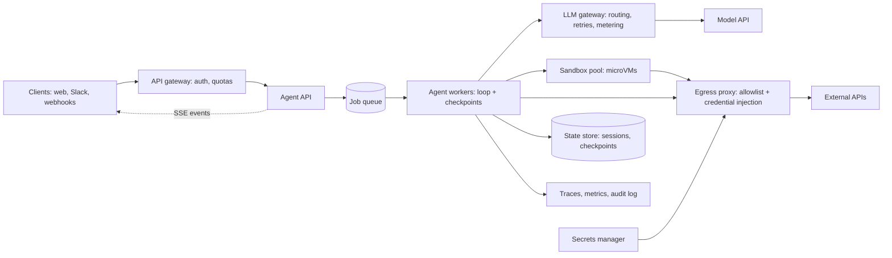

The agent works on your laptop: it reads tickets, queries the order database, runs a little Python to check refund math, and drafts replies your support leads love. Now it must serve two thousand concurrent users across forty customer organizations, execute model-written code safely, use credentials it must never see, survive a model upgrade, and page someone at 3 a.m. when it loops. None of that is in the prompt.

**Deploying** an agent means building the system around the loop: where it runs, how it's triggered, where its state lives, what it's allowed to touch, how new versions roll out, and how you find out it's broken. **Operating** it means keeping all of that healthy over time. This lesson covers both, ending with a production readiness checklist you can use for real launches.

## Deployment Shapes

How an agent is triggered and how results return shapes everything else. Six common shapes:

| Shape | How it works | Fits | Watch out for |
|---|---|---|---|
| **Synchronous request/response** | HTTP call blocks until the agent finishes | Short tasks (a few turns, seconds) | Load balancer and client timeouts; tying up connections |
| **Async job queue + workers** | API enqueues a job and returns an ID; workers run the loop; the client polls or subscribes | Anything over ~30 s; bursty load | Job state machine, retries, dead-letter queue |
| **Streaming (SSE / WebSockets)** | Server pushes tokens and progress events as they happen | Chat UIs, copilots | Reconnects, resuming a stream, proxies that buffer |
| **Event-driven / webhook** | A system event (new ticket, failed build, inbound email) triggers a run | Ops automation, triage | Duplicate deliveries; ordering; verifying webhook signatures |
| **Scheduled (cron)** | Runs on a timetable | Nightly reports, weekly audits | Overlapping runs; silent failures nobody notices |
| **Background agents that open PRs** | Agent works in a sandbox for minutes to hours, then delivers a reviewable artifact (pull request, document, ticket update) | Coding agents, data migrations | Long-lived sandboxes; a human review gate |

In practice these combine. A common production pattern is **async queue + streaming**: the API enqueues the run and immediately returns a stream URL, a worker executes the checkpointed loop from [reliability](reliability.html), and progress events flow back over **Server-Sent Events (SSE)**. If the browser disconnects, it reconnects with the last event ID and resumes. If the worker dies, another worker resumes the run from its checkpoint.

Webhook-triggered agents must **verify signatures** and **deduplicate by event ID**, since most senders deliver at least once. Background agents that open PRs are the most forgiving shape for risky work: their output is a *proposal* a human reviews, a natural [human-in-the-loop](human-in-the-loop.html) boundary (see [coding agents](coding-agents.html)).

Here's a minimal streaming endpoint for a short conversational agent. It uses FastAPI and the async Anthropic client, with POST plus a streamed response, the pattern most chat frontends use:

```python
import json

import anthropic
from fastapi import FastAPI
from fastapi.responses import StreamingResponse
from pydantic import BaseModel

app = FastAPI()
client = anthropic.AsyncAnthropic()  # key comes from the environment / secret store, never code

class Turn(BaseModel):
    session_id: str
    message: str

@app.post("/chat")
async def chat(turn: Turn):
    cfg = await load_agent_config(turn.session_id)  # version pinned when the session began
    history = await load_history(turn.session_id)   # external store: workers stay stateless
    history.append({"role": "user", "content": turn.message})

    async def sse():
        async with client.messages.stream(
            model=cfg.model, max_tokens=16000, system=cfg.system, messages=history,
        ) as stream:
            async for text in stream.text_stream:
                yield f"data: {json.dumps({'type': 'text', 'text': text})}\n\n"
            final = await stream.get_final_message()
        history.append({"role": "assistant",
                        "content": [b.model_dump(mode="json", exclude_none=True) for b in final.content]})
        await save_history(turn.session_id, history)
        yield f"data: {json.dumps({'type': 'done', 'stop_reason': final.stop_reason})}\n\n"

    return StreamingResponse(sse(), media_type="text/event-stream")
```

For multi-step tool-using agents, run the loop in a worker and stream its events, so a dropped connection doesn't kill the run.

## A Reference Architecture

Most production agent platforms end up with roughly the same components:



Two components are easy to overlook. An **LLM gateway** is an internal service every model call passes through, centralizing retries, fallbacks, per-tenant metering, spend caps and logging. An **egress proxy** is the only path to the outside world for workers and sandboxes. It enforces a host allowlist and injects credentials (see below).

## Sandboxing Tool Execution

Treat code your agent wrote or cloned as **untrusted**: prompt injection, a malicious dependency or plain model error can produce code that deletes files, mines cryptocurrency or exfiltrates data. The sandbox limits the damage (threat model: [guardrails and sandboxing](guardrails-and-sandboxing.html)). From weakest to strongest:

| Technology | Isolation mechanism | Trade-off |
|---|---|---|
| Plain process | Unix user, file permissions | Shares everything with the host; not a sandbox |
| **Containers** (Docker, containerd) | Linux namespaces + cgroups; **shared host kernel** | Fast and familiar, but a kernel exploit escapes it |
| **gVisor** | A user-space kernel intercepts the container's system calls | Much smaller kernel attack surface; some syscall overhead and compatibility gaps |
| **Firecracker microVMs** | Hardware virtualization (KVM) with a minimal device model | VM-grade isolation with fast boot and low overhead; built by AWS for Lambda and Fargate |
| Full VMs | Hypervisor with a full guest OS | Strongest, but slowest and heaviest |

For multi-tenant untrusted code, the norm as of 2026 is gVisor or microVMs, not plain containers. Hosted sandbox services spare you running this yourself: **E2B** (Firecracker-based sandboxes built for AI agents), **Modal** (serverless containers and sandboxes with gVisor isolation) and **Daytona** (fast-starting development environments for agent workloads). Compare isolation model, cold-start time, maximum session length, persistence and pricing against your workload.

Whatever you choose, configure it defensively:

- **Network egress denied by default.** Allow specific hosts through the egress proxy only.
- **Resource limits** on CPU, memory, disk, process count and wall-clock time.
- **Ephemeral by default.** One sandbox per task or session, destroyed afterward, and **never reused across tenants**.
- **Warm pools** of pre-booted sandboxes to hide cold-start latency for interactive agents.
- **No secrets inside.** Covered next.

## State, Secrets and Tenancy

### State and session storage

Keep workers **stateless** and put state in durable stores, so any worker can serve any session and a crash loses nothing:

- **Sessions / conversations** go in a database (often Postgres with JSONB), stored append-only and keyed by session ID, with the pinned agent version.
- **Checkpoints** for durable execution go in the same database or in your durable execution engine (Temporal, DBOS and similar; see [reliability](reliability.html)).
- **Large artifacts** (files, screenshots, tool outputs over a few KB) go in blob storage, with only a reference kept in history.
- **Long-term memory** goes in a store namespaced per user and per tenant (see [memory](memory.html)).

Give every store a **retention policy**: conversation logs are among the most sensitive data you hold.

### Secrets management

> [!KEY] Secrets never enter the model's context
> Anything in the context window can be echoed into a response, written into a log or trace, or exfiltrated by a prompt injection. An agent should be able to *use* a credential without ever *seeing* it.

Three practices make that possible:

1. **Keep credentials out of prompts, tool results and sandboxes.** Tools receive credentials from the harness at execution time. The model sees only `lookup_order(order_id)`, never an API key.
2. **Use scoped, short-lived credentials.** Issue per-task tokens with the narrowest scope that works (read-only where possible, one repository or tenant) that expire in minutes to hours: cloud workload identity and STS-style temporary credentials, GitHub App installation tokens (one-hour lifetime), minimal-scope OAuth tokens. A leaked short-lived scoped token is a contained incident; a leaked admin key is a disaster.
3. **Inject credentials at an egress proxy.** Sandbox code calls `https://api.github.com/...` with no credentials. The proxy checks the destination against an allowlist, attaches the right token from the secrets manager, and forwards the request. The secret never exists in the sandbox, and the allowlist blocks exfiltration to attacker hosts. Managed platforms increasingly build this in. Claude Managed Agents, for example, keeps credentials in **vaults** attached to sessions, not in agent definitions.

Store root secrets in a secrets manager (HashiCorp Vault, AWS Secrets Manager, Google Secret Manager), rotate them, and scan logs and outputs for anything that looks like a leaked key.

### Multi-tenancy and isolation

When one deployment serves many customers, a cross-tenant leak is the worst possible bug. Isolate at every layer:

- **Propagate a tenant ID** through every request, tool call, query, log line and trace. Enforce it in the data layer, for example with row-level security, rather than trusting the model or the tool code to filter correctly.
- **Scope tools per tenant.** The `search_docs` tool for tenant A physically cannot query tenant B's index.
- **Namespace memory and vector stores** per tenant, and test that retrieval can't cross the boundary.
- **Use fresh sandboxes per tenant**, never pooled across tenants after use.
- **Prevent noisy neighbors** with per-tenant concurrency limits, token quotas and spend caps, so one customer's runaway batch can't starve everyone else.
- **Separate API keys or workspaces** per environment, and optionally per large tenant, for clean spend attribution and blast-radius control.

## Rate Limits and Quotas

Model providers enforce rate limits per organization and model, typically as **requests per minute (RPM)**, **input tokens per minute (ITPM)** and **output tokens per minute (OTPM)**. Exceeding any of them returns a 429 with a `retry-after` header. On the Claude API, cache reads don't count toward input-token rate limits for most models, so good [prompt caching](cost-and-latency.html) raises your effective throughput as well as cutting cost.

One user action can trigger dozens of calls in a burst, so build your own controls in front of the provider's:

- **Admission control.** Cap concurrent runs globally and per tenant, and queue the rest. Backpressure beats a thundering herd of 429s.
- **Token-bucket quotas** per user and tenant, metered in tokens or dollars, not just requests.
- **Priority lanes.** Reserve headroom for interactive traffic; background work takes the rest (or uses the Batch API).
- **Daily spend caps** per tenant and agent, enforced in the LLM gateway, with alerts at 50% and 80%.
- **Headroom monitoring.** Watch the `x-ratelimit-remaining-*` headers, and request limit increases *before* launch.

## Versioning, Releases and Rollbacks

### What a version is

An agent's behavior depends on much more than its code. A **version** must capture everything that can change behavior: model ID and parameters (effort, `max_tokens`), system prompt, tool definitions *and* tool implementations, harness logic, retrieval configuration and budgets. Manage all of it as **config-as-code**, reviewed and versioned in git:

```yaml
# agents/support-triage/v14.yaml: every field is part of the version
agent: support-triage
version: 14
model: claude-sonnet-5-5          # explicit model ID; upgrades are deliberate changes
effort: medium
max_tokens: 16000
system_prompt: prompts/support-triage/system.v9.md
tools:
  - lookup_order@3
  - search_kb@5
  - issue_refund@2                # unsafe: human approval above $100
budgets: {max_steps: 30, max_usd: 1.50, max_seconds: 300}
rollout: {strategy: canary, stages: [1, 5, 25, 100]}
```

Stamp the resolved version (or a hash of the config) on every trace, so any behavior you see in production traces back to an exact configuration.

**Pin model IDs explicitly** and treat a model upgrade as a migration: re-run evals, re-tune prompts, check API behavior changes. A model that's better on average can still be worse on *your* hardest cases.

**Keep in-flight sessions on their original version.** Changing the system prompt or tool list in the middle of a conversation invalidates its prompt cache, and on current Claude models it also invalidates the model's preserved earlier reasoning. Make new versions apply to *new* sessions, and let existing sessions finish on the version they started with.

### Shadow, canary, rollback

- **Shadow deployment.** Run the new version on a copy of live traffic, hidden from users, and compare outcomes, cost and latency with production. Shadow agents need **stubbed or read-only side-effecting tools**, or every customer gets two emails. Shadows roughly double spend, so keep them short.
- **Canary release.** Route a small share of *new* sessions (1%, then 5%, 25%, 100%) to the new version. At each stage, compare success rate, escalation rate, cost per task, p95 latency and guardrail triggers against the baseline, and roll back automatically on regression.
- **Rollback** should be one command that points new sessions back at the previous config. That only works if old prompts and tool versions stay deployable, and if tool and schema changes stay backward-compatible for at least one release.

### CI/CD with eval gates

Traditional tests check that code runs. Agents also need checks that *behavior* holds. Gate merges and deploys on your [evaluation suite](evaluating-agents.html):

```yaml
# .github/workflows/agent-eval-gate.yml
name: agent-eval-gate
on: pull_request
jobs:
  eval:
    runs-on: ubuntu-latest
    steps:
      - uses: actions/checkout@v4
      - uses: actions/setup-python@v5
        with: {python-version: "3.12"}
      - run: pip install -r requirements.txt
      - run: pytest tests/harness            # recorded fixtures, no live API calls
      - run: python -m evals.run --suite regression --agent agents/support-triage/v14.yaml --out results.json
        env:
          ANTHROPIC_API_KEY: ${{ secrets.ANTHROPIC_EVAL_KEY }}   # separate, spend-capped eval key
      - run: python -m evals.gate results.json --baseline main --min-success 0.92 --max-cost-per-task 1.50 --max-p95-seconds 120
```

(`evals.run` and `evals.gate` stand in for your own tooling.) Gate on **quality, cost and latency together**, against the main branch's baseline, and include a safety suite (prompt-injection attempts, out-of-scope requests). Agent evals are noisy, so use enough cases and repeats that the gate isn't a coin flip, and run the full, expensive suite nightly rather than per commit.

## Monitoring and Incident Response

### What to watch

[Observability](observability.html) gives you traces. Operations turns them into signals and alerts:

| Signal | Example alert |
|---|---|
| Task success rate (from automatic checks or user feedback) | Drops 5 points below the 7-day baseline |
| Escalation / handoff rate | Doubles within an hour |
| API errors by type (429, 529, 5xx) | 529 rate > 5% for 10 min |
| p50 / p95 task latency, TTFT | p95 over the SLO for 15 min |
| Cost per task, spend per tenant | Hourly spend over 2× forecast |
| Cache hit rate | Falls below 70% after a deploy |
| Steps per task, budget-exhaustion rate | p95 steps doubles |
| Tool error rates | Any tool > 10% errors |
| Guardrail / injection-detector triggers | Spike from one tenant |

### Incident playbooks

Agent incidents have recognizable shapes. Write the playbooks before you need them:

| Symptom | First actions |
|---|---|
| Spend spike | Check steps per task and cache hit rate; tighten budgets; find the tenant or agent version responsible; trip the per-tenant spend cap |
| Provider overload (529 storm) | Confirm on the provider status page; shed or queue background work; enable the fallback model for *new* tasks; tell users about degraded mode |
| Quality regression after deploy | Roll back to the previous version; pull failing traces into the eval set; investigate offline |
| Tool outage | Trip the tool's circuit breaker / feature flag; switch the agent to degraded mode (drafts only, read-only) |
| Suspected prompt injection or data exposure | Disable the affected tools or agent with a kill switch; preserve audit logs; follow the security incident process; review every action taken in the affected sessions |
| Runaway or looping agents | Kill the runs; lower the step budget; add the trace to the eval set |

Every agent needs **kill switches** (global, per agent, per tool, per tenant) that flip in seconds without a deploy. After each incident, hold a blameless postmortem and turn the failing traces into **regression evals** so the fix stays fixed.

## Managed Platforms

Building all of the above is a significant platform investment. Managed services handle parts of it. As of late 2026, the main options include:

| Platform | What it manages |
|---|---|
| **Claude Managed Agents** (Anthropic) | Runs the agent loop on Anthropic's infrastructure with a container per session. Agent configs are versioned objects that sessions pin to, and credentials live in vaults. Also offers scheduled deployments, webhooks, and an option to run tool execution in your own sandboxes |
| **Amazon Bedrock AgentCore** (AWS) | Modular services for running agents built with any framework: runtime, memory, gateway for tools, identity, and observability |
| **Vertex AI Agent Engine** (Google Cloud) | Managed runtime for agents built with Google's ADK, LangGraph and other frameworks, with sessions, memory and evaluation integrations |
| **OpenAI AgentKit** (OpenAI) | Agent Builder (a visual workflow canvas), ChatKit for embedding agent UIs, a connector registry and evaluation tooling |

These products change fast, so check current docs. Build-vs-buy turns on how much control you need over the loop, sandbox and data location, how portable you must be across model providers, and where you'd rather spend engineering time. Many teams start managed and pull pieces in-house later, or keep the loop in their own code and buy only the sandbox (see [agent frameworks](agent-frameworks.html)).

## Compliance

Agents touch customer data, take actions and make decisions, so the usual rules apply, plus a few new ones.

- **Data retention.** Know how long your provider retains prompts and outputs, and what zero-data-retention (ZDR) arrangements are available. Requirements can vary by model. For example, as of 2026 Anthropic's Fable-tier models require 30-day retention, and organizations set to zero retention get errors when calling them, so check before you pick a model. Set retention on your *own* logs, traces and memory stores too, since those usually hold more than the provider does.
- **Data residency.** Customers or regulators may require specific regions. Regional cloud deployments (Bedrock, Google Cloud, Azure) help, but residency also covers your traces, vector stores and sandboxes.
- **Audit logs.** Keep an immutable record per run: trigger, agent version, every tool call with arguments and results, every human approval, data accessed. When someone asks why the agent issued a refund, this is your answer.
- **PII handling.** Redact sensitive fields in traces, restrict access to raw transcripts, and propagate deletion requests to conversation stores, memory and backups.
- **Frameworks.** Map your controls to the frameworks you're subject to (SOC 2, ISO 27001, HIPAA, GDPR, and AI-specific regulation such as the EU AI Act) early on. Retrofitting audit trails is painful.

## Production Readiness Checklist

Use this as a launch review. Each item should have an owner and evidence.

**Execution**
- Deployment shape matches task duration; long tasks run in workers, not request threads
- Checkpointing or durable execution in place; resume after a worker kill is tested
- Step, token, time and dollar budgets enforced per run

**Safety and isolation**
- Untrusted code runs in gVisor- or microVM-class sandboxes, with egress denied by default
- No secrets in prompts, context, sandboxes or logs; short-lived scoped credentials; egress proxy injection
- Tenant ID enforced in the data layer; per-tenant sandboxes, memory and quotas
- Unsafe tools are idempotent and gated by approval where stakes are high

**Release**
- Agent config versioned as code; model IDs pinned; version stamped on every trace
- CI eval gate on quality, cost and latency, plus a safety suite
- Canary rollout with automatic rollback; in-flight sessions keep their original version
- One-command rollback, rehearsed

**Operations**
- Dashboards and alerts for success, errors, latency, cost, cache hit rate and steps per task
- Kill switches (global, per agent, per tool, per tenant) tested
- Incident playbooks written; on-call rotation knows them
- Provider rate limits sized for peak plus headroom; per-tenant spend caps set

**Compliance**
- Retention and residency documented for provider, logs, traces and memory
- Immutable audit log of runs, tool calls and approvals
- PII redaction and deletion workflows verified

## Key Takeaways

- Match the deployment shape to task duration and trigger: synchronous only for short tasks, queues and workers for long ones, streaming for perceived speed, PR-style delivery for risky autonomous work.
- Treat model-written code as untrusted. Run it in gVisor or microVM sandboxes with default-deny egress, one per task, never shared across tenants.
- Secrets never enter the context window. Use scoped short-lived credentials, injected at an egress proxy.
- Enforce tenant isolation in infrastructure and data layers, not in prompts, and add per-tenant quotas and spend caps.
- An agent version is model + prompt + tools + harness + config. Version it as code, pin model IDs, and keep in-flight sessions on their original version.
- Ship through eval-gated CI, shadow runs with stubbed side effects, and canaries with automatic rollback.
- Monitor success, cost, latency, cache hit rate and steps per task. Keep kill switches and incident playbooks ready, and turn every incident into a regression eval.

## Exercises

1. **Pick the shape.** For each agent, choose a deployment shape and justify it: (a) an FAQ bot answering in under 5 seconds; (b) a nightly agent that reconciles invoices; (c) an agent that fixes failing CI builds; (d) a research agent that takes 10–20 minutes per report.
2. **Secret audit.** Take an agent you've built and list every credential it uses. For each one, record where it lives, whether it ever enters the context or the sandbox, its scope and its lifetime. Redesign anything that fails the "never in context, short-lived, least privilege" test.
3. **Config as code.** Write a versioned YAML config for an agent and a loader that hashes the resolved config, prompt file contents included. Stamp the hash on every trace and confirm that a one-word prompt change alters it.
4. **Eval gate.** Build a CI job that runs 20 eval cases against the PR branch and against main, and fails if success drops by more than one case or mean cost per task rises by more than 15%. Run it twice on the same commit and discuss what the noise means for your thresholds.
5. **Game day.** Simulate a "spend spike from one tenant" incident in staging. Practice detection (which alert fires?), mitigation (which kill switch?) and recovery, then write the postmortem and regression eval.

## Check Your Understanding

```quiz
Q: An agent's tasks take 2–15 minutes and users watch progress in a web UI. Which deployment shape fits best?
- [ ] A synchronous HTTP endpoint with a 20-minute timeout
- [x] An async job queue with workers, streaming progress events to the client over SSE
- [ ] A cron job that runs every 15 minutes
- [ ] A batch API submission per user request
E: Long tasks belong in workers that survive disconnects and can resume from checkpoints, with progress streamed for perceived latency. Long synchronous requests break on timeouts and tie up connections.

Q: Why are plain Docker containers generally considered insufficient for running untrusted, model-written code from many tenants?
- [ ] Containers can't limit CPU or memory
- [x] Containers share the host kernel, so a kernel exploit can escape; gVisor or microVMs add a much stronger boundary
- [ ] Containers can't run Python
- [ ] Containers are too slow to start
E: Namespaces and cgroups share one kernel. gVisor shrinks the kernel attack surface; microVMs add hardware virtualization.

Q: What's the main advantage of injecting credentials at an egress proxy instead of passing them into the sandbox?
- [ ] It makes API calls faster
- [x] The secret never exists where model-influenced code can read or leak it, and the allowlist blocks exfiltration to unknown hosts
- [ ] It removes the need for credential rotation
- [ ] It lets the model choose which credential to use
E: Code in the sandbox makes unauthenticated requests, and the proxy attaches credentials only for allowlisted destinations. Prompt-injected code has no key to steal.

Q: You deploy a new system prompt. Why should conversations already in progress keep the old version?
- [ ] The API rejects system prompt changes mid-conversation
- [x] Changing the prompt mid-conversation invalidates the prompt cache and, on current models, the model's preserved earlier reasoning, and it makes behavior hard to attribute to one version
- [ ] New prompts only take effect after 24 hours
- [ ] Old conversations can't be stored with the new version
E: Apply new versions to new sessions to keep costs predictable, reasoning continuous and traces attributable.

Q: When shadow-testing a new agent version on live traffic, what must you do with side-effecting tools?
- [ ] Nothing; shadow runs are read-only by definition
- [x] Stub them or make them read-only, or the shadow will take real actions such as sending duplicate emails
- [ ] Run them twice to compare results
- [ ] Route them through the Batch API
E: A shadow processes real inputs. Unless its tools are stubbed, it will act on the world alongside production.

Q: A deploy makes cost per task jump 3× with no change in success rate. Which signal most likely localizes the cause fastest?
- [ ] Provider status page
- [ ] User feedback scores
- [x] Cache hit rate and steps per task, compared across agent versions
- [ ] Number of tools defined
E: A cost jump with unchanged quality usually means a cache-breaking change in prompt assembly or a looping/verbosity change. Both show up in cache hit rate and steps per task by version.
```

## Further Reading

- [Firecracker](https://firecracker-microvm.github.io/): the microVM technology behind AWS Lambda, with design docs on its isolation model.
- [gVisor](https://gvisor.dev/): the user-space application kernel for container sandboxing; its architecture guide explains the security model.
- [Claude Managed Agents overview](https://platform.claude.com/docs/en/managed-agents/overview): Anthropic's managed runtime, covering versioned agents, sessions, containers and vaults.
- [Amazon Bedrock AgentCore](https://aws.amazon.com/bedrock/agentcore/): AWS's managed services for running and operating agents.
- [Vertex AI Agent Engine](https://cloud.google.com/vertex-ai/generative-ai/docs/agent-engine/overview): Google Cloud's managed agent runtime.
- [Introducing AgentKit (OpenAI)](https://openai.com/index/introducing-agentkit/): OpenAI's agent building and deployment toolkit.
- [Google SRE Book](https://sre.google/sre-book/table-of-contents/): SLOs, alerting, incident response and postmortems, all of which apply directly to agents.
- [Claude API rate limits](https://platform.claude.com/docs/en/api/rate-limits): how RPM, ITPM and OTPM limits work and which headers report them.
