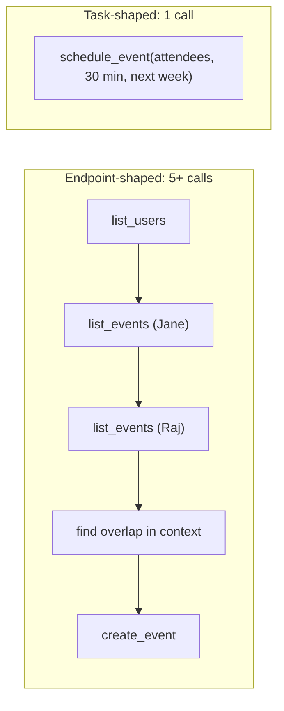
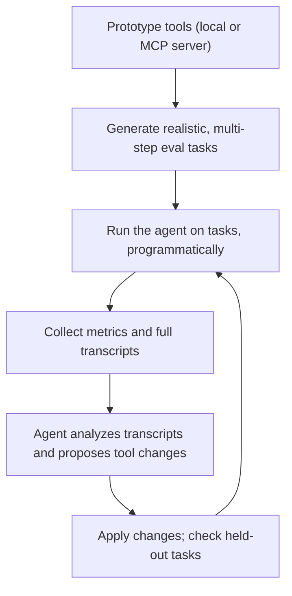

An agent at a sales company keeps failing a simple task: "Email the account owner of Globex about their renewal." The team tries prompt tweaks for a week. Then someone reads the transcripts. The agent's `list_contacts` tool returns 5,000 contacts as raw JSON, each with a UUID and fifteen fields. The agent pages through the first 100, burns most of its context, never finds Globex, and finally sends an email to a UUID it half-remembered — one that belongs to someone else. The fix wasn't a better prompt. It was a `search_contacts(query)` tool that returns five names, titles and companies.

This lesson is about that kind of fix. A tool is not just an API wrapper. It is the interface through which a non-deterministic reasoner with a limited attention budget perceives and changes the world. Designing that interface well — the names, descriptions, parameters, responses and errors — is one of the highest-leverage things you can do for an agent's reliability.

You'll learn the principles behind the **agent–computer interface**, concrete patterns for each part of a tool, how to handle safety and scale, and how to use agents themselves to evaluate and improve your tools. The mechanics of tool calling are covered in [tool use](tool-use.html); here we focus on design.

## The Agent–Computer Interface

We spend enormous effort on **human–computer interfaces**: layouts, affordances, error messages, undo. In the 2024 SWE-agent paper, researchers at Princeton argued that language-model agents deserve the same care, and named the idea the **agent–computer interface (ACI)**: the set of commands an agent can use and the format of the feedback it gets back.

SWE-agent gave a model a purpose-built interface for working in code repositories instead of a raw shell. Among its design choices:

- A **file viewer** that shows a window of about 100 lines with line numbers, instead of dumping whole files.
- **Search commands** that return a concise summary of matches and refuse to flood the context when there are too many.
- An **editor** that runs a linter on each edit and rejects syntactically invalid changes with an explanation, so mistakes are caught immediately rather than three steps later.
- **Concise, informative feedback** for every command — including an explicit message when a command succeeds with no output, so the agent isn't left guessing.

The paper found that these interface choices substantially improved the agent's ability to resolve real GitHub issues compared with the same model using a plain shell. Anthropic's "Building effective agents" guidance makes the same point from production experience: invest as much effort in the ACI as you would in a human interface. One of their examples: while building a coding agent, they noticed the model made mistakes with relative file paths after changing directories. Changing the tool to require absolute paths eliminated the problem.

Why do agents need different interfaces than developers?

| A developer calling an API | An agent calling a tool |
|---|---|
| Reads the docs once, writes deterministic code | Re-reads the description every turn and decides fresh each time |
| Can handle 10 MB of JSON in a loop | Every returned token consumes limited context and attention |
| Can read your source code to debug | Knows only the description, the schema and what you return |
| Ignores irrelevant fields for free | Irrelevant fields distract it and cost money |
| Rarely invents identifiers | Can confuse or misremember long opaque IDs |

> [!KEY] The big idea
> Design tools for the agent's actual constraints: limited context, no access to your code, and judgment that depends entirely on what you write in descriptions and return in results. When an agent misuses a tool, first ask what about the interface made the mistake easy.

## Tool Descriptions Are Prompts

The tool description, parameter names and parameter descriptions are loaded into the model's context and drive both *whether* the agent calls a tool and *how*. They are prompts, and they deserve the same care as the system prompt (see [prompt engineering for agents](prompting-for-agents.html)). Anthropic has reported that precise refinements to tool descriptions alone produced large gains on coding benchmarks.

A useful frame is a good man page. A strong description covers:

1. **What it does**, in one sentence.
2. **When to use it — and when not to**, especially relative to similar tools.
3. **What each parameter means**, with formats and examples (`"ISO date, e.g. 2026-11-22"`).
4. **What it returns**, and what it notably *doesn't* return.
5. **Limits and caveats**: coverage, default page size, rate limits, side effects.

Before:

```json
{
  "name": "search",
  "description": "Searches tickets.",
  "input_schema": {
    "type": "object",
    "properties": {"q": {"type": "string"}, "user": {"type": "string"}},
    "required": ["q"]
  }
}
```

After:

```json
{
  "name": "tickets_search",
  "description": "Search support tickets by keyword and filters. Use this to find tickets when you don't have a ticket number; if you do, use tickets_get instead. Covers tickets from the last 24 months. Returns up to `limit` matches, newest first, each with ticket number, title, status, customer name and last-update date (not the full conversation; use tickets_get for that).",
  "input_schema": {
    "type": "object",
    "properties": {
      "query": {"type": "string", "description": "Keywords matched against title and body, e.g. 'refund damaged tent'"},
      "customer_email": {"type": "string", "description": "Optional. Restrict to one customer's tickets."},
      "status": {"type": "string", "enum": ["open", "pending", "closed", "any"], "description": "Defaults to 'any'."},
      "limit": {"type": "integer", "description": "Max results, 1-50. Defaults to 10."}
    },
    "required": ["query"]
  }
}
```

The improved version disambiguates against a neighboring tool, names parameters unambiguously (`customer_email`, not `user` — is that a name, an ID, an email?), states coverage limits, and tells the agent what it will and won't get back.

> [!WARNING] Contract, not steering
> Descriptions should state the tool's contract precisely. Avoid smuggling behavioral instructions into them ("ALWAYS call this first!", "After showing results, recommend our premium plan"). Capitalized boosters tend to make modern models over-call a tool, and conversational rules belong in the system prompt. The common failure is *under*-description, not length — a four-sentence description is normal.

## Choose Few, Well-Scoped Tools

The instinct when connecting an agent to a system is to wrap every API endpoint as a tool. Resist it. APIs are designed for programs that can call 30 endpoints cheaply; agents pay for every call in latency, tokens and chances to go wrong.

Design tools around the **tasks the agent will actually perform**, consolidating multi-step chores into one call:

| Endpoint-shaped (avoid) | Task-shaped (prefer) |
|---|---|
| `list_users`, `list_events`, `create_event` | `schedule_event(attendees, duration, window)` that finds free slots and books |
| `read_logs` (returns everything) | `search_logs(query, since, service)` that returns matching lines with context |
| `get_customer`, `list_transactions`, `list_notes` | `get_customer_context(customer)` that returns a compiled summary |
| `list_files`, `read_file` × N to find a function | `search_code(pattern)` returning file:line matches |



The task-shaped tool moves deterministic work (computing calendar overlap) into code, where it's fast, cheap and correct, and leaves the agent the judgment it's good at (who should attend, which slot to pick if several work).

Don't overshoot into a single god-tool, though. `do_action(action: str, params: object)` hides everything from the model's schema and from your harness, which can no longer gate or audit specific actions. A good tool set is a small number of tools with **clear, non-overlapping purposes**. If you have two tools and *you* can't say in one sentence when to use which, the agent can't either.

### Namespacing

Agents increasingly combine tools from many sources — your own, several [MCP](protocols-mcp-a2a.html) servers, built-ins. Name collisions and near-duplicates multiply. **Namespacing** groups related tools with a common prefix by service and resource:

- `asana_projects_search`, `asana_tasks_create`
- `jira_issues_search`, `jira_issues_comment`

Namespacing helps the model pick the right family and makes boundaries obvious. Anthropic's tool-writing guide notes that prefix- versus suffix-based naming schemes can have measurably different effects depending on the model, so treat the scheme as something to evaluate, not a fixed rule.

## Return High-Signal Results

Whatever a tool returns goes straight into the agent's context. Every irrelevant field is noise the agent must read, pay for, and potentially be misled by. Optimize for **signal per token**.

**Prefer meaningful identifiers over opaque ones.** Agents handle names, slugs and short IDs far more reliably than 36-character UUIDs, which they can confuse or reproduce incorrectly. Return `"owner": "Priya Raman (priya@globex.com)"` rather than `"owner_id": "4f1c9a2e-..."`. If you need technical IDs for follow-up calls, include them alongside a human-readable label, or map them to short, stable handles.

**Drop low-level fields.** MIME types, internal flags, thumbnail URLs at four sizes, audit timestamps — if the agent wouldn't use it to decide its next step, leave it out.

**Offer a verbosity control.** Sometimes the agent needs IDs for a follow-up action; often it just needs to read. A `response_format` parameter lets it choose:

```python
from enum import Enum

class ResponseFormat(str, Enum):
    CONCISE = "concise"    # names and key facts: for reading and deciding
    DETAILED = "detailed"  # adds IDs and fields needed for follow-up calls

def format_ticket(t: dict, fmt: ResponseFormat) -> str:
    line = f"#{t['number']} [{t['status']}] {t['title']} - {t['customer_name']}, updated {t['updated'][:10]}"
    if fmt is ResponseFormat.DETAILED:
        line += f"\n  id={t['id']} channel={t['channel']} assignee={t['assignee']}"
    return line
```

**Pick a format the model reads well.** JSON, Markdown and plain text all work; the right choice depends on the task and the model, so test it. Compact, line-oriented text is often more token-efficient than deeply nested JSON for lists.

## Pagination, Filtering and Truncation

Some queries legitimately match thousands of results. Never return them all. Design for it:

- **Filter parameters** (`since`, `status`, `owner`) so the agent can ask precise questions instead of reading everything.
- **Sensible default limits** (10–50 items) with a `limit` parameter and a cursor or page token.
- **A hard cap on output size**, enforced in code. Claude Code, for instance, caps tool responses at around 25,000 tokens by default.
- **Truncation with hints.** When you cut output, say so, and tell the agent how to get what it needs.

Here's a search tool implementation that puts these together (`db` stands in for your data layer, and `format_ticket` is from the previous section):

```python
MAX_CHARS = 8_000  # hard cap on what goes into the agent's context

def tickets_search(query: str, status: str = "any", limit: int = 10,
                   cursor: str | None = None,
                   response_format: ResponseFormat = ResponseFormat.CONCISE) -> str:
    if not 1 <= limit <= 50:
        return "Error: limit must be between 1 and 50."  # sent back with is_error=True
    page = db.search_tickets(query=query, status=status, limit=limit, cursor=cursor)
    if page.total == 0:
        return (f"No tickets match '{query}' with status={status}. Try fewer or "
                "broader keywords, or status='any'.")
    lines = [format_ticket(t, response_format) for t in page.items]
    body = "\n".join(lines)
    if len(body) > MAX_CHARS:
        body = body[:MAX_CHARS] + "\n[...output truncated]"
    footer = f"\nShowing {len(page.items)} of {page.total} matches."
    if page.next_cursor:
        footer += (f" For more, call again with cursor='{page.next_cursor}', or "
                   "narrow the search with status or more specific keywords.")
    return body + footer
```

The empty-result message and the footer are small touches with large effects. "No results" leaves the agent guessing whether the tool failed; an explanation plus a suggestion steers it toward a productive next call. Hints that encourage **narrow, targeted queries** ("narrow the search with…") tend to work better than hints that encourage paging through everything.

## Errors That Teach

Every error message is an instruction to the agent about what to do next. Compare:

```text
Bad:   Error 422
Bad:   Traceback (most recent call last): File "/srv/app/handlers.py", line 88, in ...
       KeyError: 'start'
Good:  Invalid 'start_date': "next Tuesday". Use ISO format YYYY-MM-DD, e.g. "2026-11-24".
Good:  Customer "Globex" is ambiguous: matches "Globex Corp" (globex.com) and
       "Globex Logistics" (globexlog.com). Call again with customer_domain.
Good:  Permission denied: you can view invoices but not void them. Ask a human
       agent to void invoice INV-2291 via the escalate tool.
```

A teaching error message:

1. Says **what** was wrong, specifically (which parameter, which value).
2. Says **why**, if it's not obvious.
3. Says **what would work**: the valid format, the allowed values, the alternative tool, or that a human is needed.

Return these as tool results with `is_error: true` (see [tool use](tool-use.html)) rather than raising. Stack traces are almost never useful to the model; they leak internals and waste tokens. Log them for yourself in your [observability](observability.html) system instead.

## Poka-Yoke: Make Mistakes Hard

**Poka-yoke** is a Japanese manufacturing term for mistake-proofing: designing a part so it physically can't be installed the wrong way. Applied to tools, it means changing the interface so the common mistakes become impossible or immediately visible.

| Mistake | Poka-yoke fix |
|---|---|
| Relative paths resolved from the wrong directory | Require absolute paths; reject relative ones with a clear error |
| Invalid category strings ("Hi", "urgent!!") | `enum` of allowed values |
| Unit confusion (seconds vs milliseconds) | Put the unit in the name: `timeout_seconds` |
| Ambiguous dates ("03/04") | Require ISO 8601; reject anything else with an example |
| Edit applied to the wrong occurrence | Require an exact, unique `old_str` match (as the text editor tool does) and error on 0 or 2+ matches |
| Overwriting a file changed since the agent read it | Reject writes when the file's hash differs from the last read |
| Malformed arguments | `strict: true` for schema-guaranteed inputs |
| Huge accidental operations | Required `limit`; `dry_run` mode that previews impact |

Each of these is cheap to implement and removes a whole category of failure from your transcripts — usually far more reliably than a sentence in the prompt asking the agent to be careful.

## Side Effects, Idempotency and Safety

Read-only tools are forgiving: a wrong call wastes a step. Tools with **side effects** — sending, paying, deleting, deploying — need more design.

- **Separate reads from writes.** `orders_get` and `orders_cancel`, not `orders(action=...)`. It makes gating and auditing simple and lets you run reads in parallel safely.
- **Make writes idempotent.** Agents retry: a call times out, the agent doesn't know if it succeeded, and it calls again. Accept an **idempotency key** (or derive one from the arguments and conversation) so a repeated `charge_card` doesn't double-charge.
- **Preview before commit.** For high-impact actions, a `dry_run=true` mode (or a separate `preview_` tool) lets the agent — and a human — see the effect before it happens.
- **Enforce policy in code, not prose.** If refunds over $200 need approval, the refund tool must check it. A prompt is guidance; the tool is the control. Gate irreversible actions behind [human approval](human-in-the-loop.html).
- **Label risk.** The MCP specification lets servers annotate tools with hints such as read-only, destructive or idempotent, so hosts can decide what to auto-approve. Treat such hints from untrusted servers as advisory, not as security guarantees.

Tool *results* are also an attack surface: a fetched web page or an email body can contain instructions aimed at the agent. Mark untrusted content clearly in results and limit what a single agent with untrusted inputs is allowed to do (see [agent security](agent-security.html)).

## Bash vs Dedicated Tools

A shell is the ultimate general-purpose tool. With `bash`, an agent can grep, run tests, call APIs with `curl`, and do nearly anything a developer can. Many strong coding agents lean on it heavily. So why build dedicated tools at all?

Because a bash call gives your harness only an **opaque command string** — the same shape for every action. A dedicated tool gives it **typed, action-specific arguments** it can reason about. Promote an action to a dedicated tool when you need to:

| Need | Why bash falls short | Dedicated tool example |
|---|---|---|
| **Gate** it | Hard to reliably detect "sends an email" inside arbitrary shell | `send_email(to, subject, body)` behind an approval prompt |
| **Render** it | A command string can't drive custom UI | An `ask_user(question, options)` tool shown as a dialog |
| **Audit** it | Logs show strings, not structured intents | `deploy(service, version)` with a structured audit record |
| **Parallelize** it | Harness can't tell a safe `grep` from an unsafe `git push` | Read-only `search_code` marked safe to run concurrently |
| **Enforce invariants** | Bash can't check the file is unchanged since last read | `edit_file` with staleness checks |

**Rule of thumb:** start with bash for breadth, then promote actions to dedicated tools when you need to gate, render, audit or parallelize them.

## Large Tool Sets: Search and Deferred Loading

Every tool definition costs context on every request. With a handful of tools that's negligible. Connect five MCP servers and you may have a hundred tools whose definitions consume a large slice of the context window before the user says anything — and selection accuracy tends to drop as near-duplicate options multiply.

Strategies, roughly in order of preference:

1. **Fewer, better tools.** Consolidation (above) is the first fix.
2. **Scope tools per agent.** A billing subagent doesn't need deployment tools (see [multi-agent systems](multi-agent-systems.html)).
3. **Tool search with deferred loading.** Declare the full catalog, but mark most tools as deferred so their definitions aren't loaded up front. The model gets a search tool, finds what it needs ("calendar availability"), and only the matching definitions are added to context. With Claude's API, tools are marked with `"defer_loading": true` and the provider's tool search tool is declared alongside them; discovered schemas are *appended* rather than swapped in, which preserves the prompt cache.

```json
{
  "name": "calendar_find_free_slots",
  "description": "Find time slots when all given attendees are free...",
  "input_schema": {"type": "object", "properties": {}, "required": []},
  "defer_loading": true
}
```

4. **Progressive disclosure for instructions.** Packaged "skills" put a short description in context and load the full instructions only when relevant — the same idea applied to know-how rather than tools.
5. **Programmatic tool calling.** For long chains of calls with large intermediate results, the model can write a script that calls tools in a sandbox and returns only the final output, so intermediate data never enters its context.

These are context-management techniques at heart; [context engineering](context-engineering.html) covers the broader picture.

## Evaluating and Improving Tools with Agents

You can't design good tools by intuition alone. Agents misuse tools in ways their designers don't predict, and the only reliable way to find out is to watch them. Anthropic's guide to writing tools describes a loop that uses agents at every stage:



**1. Generate realistic tasks.** Good eval tasks resemble real work and require several calls. Weak: "Find the ticket for jane@globex.com." Strong: "Jane from Globex says her replacement tent never arrived and she was charged twice. Find out what happened, fix what you're allowed to fix, and draft a reply." Pair each with a verifiable outcome (the correct refund issued, the right ticket updated), and avoid over-specifying the expected tool sequence — there's often more than one valid path.

**2. Run and measure.** Run each task several times (agents are stochastic) and collect:

| Metric | What it reveals |
|---|---|
| Task success rate | Whether the tools enable the job at all |
| Number of tool calls | Missing consolidation, poor search, pagination thrash |
| Tool error rate per tool | Confusing parameters or descriptions |
| Tokens per task (and per result) | Bloated responses |
| Runtime | Slow tools, unnecessary round trips |

**3. Read transcripts — with an agent's help.** Look for the moments where the agent hesitated, retried, called the wrong tool, or misread a result. Its reasoning (thinking blocks or visible commentary) often says exactly what confused it: "The results don't include the customer's email, so I'll search again by name." That sentence is a tool-design bug report.

**4. Let an agent refactor the tools.** Paste a batch of transcripts, the tool definitions and the implementations into a coding agent and ask it to find patterns and propose improvements — clearer descriptions, better defaults, consolidated tools, more useful errors. Anthropic reports that tools optimized this way outperformed their hand-written expert versions on held-out tests.

**5. Guard against overfitting** with a held-out task set that the improvement loop never sees. A tool description tuned to pass ten specific tasks can get worse on the eleventh.

This connects directly to the broader practice of [evaluating agents](evaluating-agents.html).

## Before and After: A Full Redesign

A customer-support agent for a subscription business started with tools wrapped one-to-one from the internal API:

```text
BEFORE (7 tools)
get_user(user_id)                 -> 40-field JSON with UUIDs
list_subscriptions(user_id)       -> all subscriptions ever, no paging
get_subscription(subscription_id)
list_invoices(user_id)            -> every invoice since 2017
update_subscription(subscription_id, payload)   -> free-form JSON payload
refund(invoice_id, amount)        -> returns "OK" or HTTP status code
search(q)                         -> searches users, invoices and docs together
```

Transcripts showed the agent averaging many calls per ticket, hallucinating subscription IDs, sending malformed `payload` objects, and occasionally refunding the wrong invoice.

```text
AFTER (5 tools)
customers_find(query)                   -> up to 5 matches: name, email, plan, status
customers_get_context(customer_email, response_format="concise"|"detailed")
    -> plan, renewal date, last 5 invoices, open tickets, in one readable summary
subscriptions_change_plan(customer_email, new_plan: enum, effective: "now"|"next_renewal",
                          dry_run: bool) -> shows proration before committing
invoices_refund(invoice_number, amount_usd, reason: enum, idempotency_key)
    -> confirmation with new balance; errors explain limits and next steps
help_center_search(query, limit=5)      -> article titles, snippets and URLs
```

What changed: task-shaped consolidation (`customers_get_context`), human-readable identifiers (email, invoice number), enums and a dry-run instead of a free-form payload, an idempotency key on the money-moving action, namespaced names, and a separate docs search instead of an everything-search. The system prompt barely changed.

## Tool Design Checklist

Use this when reviewing any tool an agent will call:

- [ ] **Purpose:** Can you state in one sentence when to use this tool rather than its neighbors?
- [ ] **Scope:** Is it shaped around a task the agent performs, not an endpoint?
- [ ] **Name:** Specific and namespaced (`service_resource_action`)?
- [ ] **Description:** What it does, when to use and not use it, returns, limits, side effects?
- [ ] **Parameters:** Unambiguous names, described formats, enums for fixed sets, units in names?
- [ ] **Poka-yoke:** Absolute paths, ISO dates, unique-match edits, `strict` where inputs must be exact?
- [ ] **Response:** Only high-signal fields, readable identifiers, a verbosity option where useful?
- [ ] **Volume:** Default limits, filters, pagination, hard size cap, truncation hints?
- [ ] **Errors:** Specific, actionable, returned as `is_error` results, no stack traces?
- [ ] **Side effects:** Reads separated from writes, idempotency keys, dry-run, approvals enforced in code?
- [ ] **Scale:** Is the total tool set small enough, or are rarely used tools deferred?
- [ ] **Evidence:** Have you watched agents use it on realistic tasks and read the transcripts?

## Key Takeaways

- The agent–computer interface deserves the same design care as a human interface; tool changes often beat prompt changes.
- Tool names, descriptions and parameter descriptions are prompts: state the contract precisely, including when not to use the tool and what it doesn't return.
- Prefer a few task-shaped, consolidated, namespaced tools over one-tool-per-endpoint; move deterministic work into code.
- Return high-signal, human-readable results with sensible limits, pagination, hard caps and truncation hints; let the agent choose verbosity.
- Write errors that say what was wrong, why, and what would work; mistake-proof interfaces with enums, absolute paths, ISO dates and strict schemas.
- Separate reads from writes, make writes idempotent, offer dry runs, and enforce policy in the tool itself.
- Start with bash for breadth; promote actions to dedicated tools to gate, render, audit or parallelize them. Use tool search and deferred loading for large catalogs.
- Evaluate tools with realistic multi-step tasks, read transcripts, let agents propose improvements, and check against held-out tasks.

## Exercises

1. **Rewrite a description.** Pick any tool from a public MCP server or API wrapper. Rewrite its description and parameter descriptions using the man-page structure from this lesson. Note every ambiguity you resolved.
2. **Teaching errors.** Take the `tickets_search` implementation above and list five ways the agent could call it wrongly. For each, write the exact error message it should return, following the what/why/what-would-work pattern.
3. **Consolidate.** Given tools `list_flights(origin, dest, date)`, `get_flight(flight_id)`, `get_seat_map(flight_id)`, `list_passengers(booking_id)` and `create_booking(flight_id, passengers)`, design a smaller task-shaped tool set for an agent that books trips for employees. Justify each merge and each tool you kept separate.
4. **Measure a change.** Build a small eval (5–10 multi-step tasks) for an agent with a deliberately poor tool (UUIDs, no pagination, vague errors). Record success rate, calls per task and tokens. Apply the improvements from this lesson one at a time and chart which change mattered most.
5. **Agent as tool critic.** Feed ten transcripts from exercise 4 plus your tool definitions to a capable model and ask it to identify tool-design problems and propose changes. Compare its suggestions with your own. Which did it catch that you missed, and which of its suggestions would overfit?

## Check Your Understanding

```quiz
Q: An agent frequently calls the wrong record after a list tool returns 36-character UUIDs. Which change most directly addresses the cause?
- [ ] Add a system-prompt rule telling the agent to copy IDs character by character
- [x] Return readable handles such as names or emails alongside the UUIDs
- [ ] Return more fields per record so the agent can cross-check each match
- [ ] Turn on strict mode so the ID parameter must match the UUID format
E: Long opaque identifiers are easy for models to confuse or misreproduce, so readable handles fix the error at its source. Strict mode is tempting but only checks the format: a well-formed UUID that belongs to the wrong record still passes. A prompt rule and extra fields leave the confusing interface in place.

Q: Which tool set best follows the "few, well-scoped tools" principle for a scheduling agent?
- [ ] list_users, list_events, create_event, update_event and get_room, mirroring the API
- [x] schedule_event (finds common free time and books), reschedule_event, cancel_event
- [ ] One calendar(action, params) tool so the model has a single obvious choice
- [ ] A bash tool with curl access, so any calendar endpoint is reachable
E: Task-shaped tools move deterministic work (finding overlap) into code and leave the agent the judgment calls. The single calendar(action, params) tool looks minimal, but it hides every action from the schema and from the harness, which can no longer gate or audit specific operations. Endpoint mirrors force many calls; raw curl is hard to gate.

Q: A search tool finds 4,000 matches. What should it return?
- [ ] All 4,000 in compact one-line form so that nothing relevant is missed
- [ ] An error asking the agent to narrow the query before retrying
- [x] A first page of ~20 plus the total and how to filter or page further
- [ ] A count of matches only, so the agent decides what to fetch next
E: Default limits with truncation hints keep context lean while telling the agent how to get what it needs, ideally by narrowing the query. An error discards useful results, and a bare count forces an extra round trip; even compact, 4,000 lines would flood the context.

Q: An agent edits the wrong line because the same snippet appears twice in a file. Which is a poka-yoke fix?
- [ ] Add a prompt rule to re-read the file and double-check before every edit
- [x] Require the replaced text to match exactly once, else error with the count
- [ ] Have the edit tool replace every occurrence so that no copy is left stale
- [ ] Have the edit tool pick the occurrence closest to the last viewed line
E: Mistake-proofing changes the interface so the error can't happen silently: a unique-match requirement turns an ambiguous edit into an immediate, explanatory error. Picking the "closest" occurrence sounds smart but still guesses silently, and a prompt rule is guidance the model may skip.

Q: Why promote "send an email" from a bash command to a dedicated send_email tool?
- [ ] Models write malformed sendmail and curl commands more often than JSON
- [ ] Dedicated tools run faster because they skip spawning a new shell process
- [x] Typed arguments let the harness require approval, preview and audit it
- [ ] Bash output can't report whether the message was actually delivered
E: Bash gives the harness only an opaque command string. A dedicated tool exposes structured intent, which is what you need to gate, render, audit or parallelize an action. Speed and command syntax are minor; the control point is the real reason.

Q: A payment tool times out and the agent retries. What design prevents a double charge?
- [ ] Tell the agent in the tool description not to retry payment calls
- [x] Accept an idempotency key so repeat calls with that key run at most once
- [ ] Return is_error true on timeouts so the agent knows the charge failed
- [ ] Lengthen the tool's timeout so the first call always gets a response
E: Agents retry when outcomes are uncertain, so make retries safe: an idempotency key guarantees the side effect happens at most once per key. Flagging a timeout as an error is tempting but wrong: the charge may in fact have gone through, so the error misleads the agent. Longer timeouts only make the problem rarer.

Q: You connected six MCP servers and now have 150 tools; tool selection got worse and every request is expensive. What is the best next step?
- [ ] Shorten every description to one line so all 150 definitions fit cheaply
- [x] Consolidate overlaps, scope tools per agent, and defer rarely used ones
- [ ] Prompt-cache the tool definitions so the large catalog becomes cheap
- [ ] Move the tool list into the system prompt as a categorized index
E: Large catalogs cost context and create near-duplicate choices. Fewer tools, per-agent scoping and deferred loading fix both. Caching is tempting because it lowers cost, but it does nothing for selection accuracy; shorter descriptions make selection even worse.
```

## Further Reading

- [Anthropic: Writing effective tools for agents — with agents](https://www.anthropic.com/engineering/writing-tools-for-agents) — the primary source for the principles and agent-driven evaluation loop in this lesson.
- [Yang et al., SWE-agent: Agent-Computer Interfaces Enable Automated Software Engineering](https://arxiv.org/abs/2405.15793) — the paper that introduced the ACI concept, with ablations of interface design choices.
- [Anthropic: Building effective agents](https://www.anthropic.com/research/building-effective-agents) — includes an appendix on prompt-engineering tools and the absolute-path poka-yoke example.
- [Anthropic: Advanced tool use](https://www.anthropic.com/engineering/advanced-tool-use) — tool search with deferred loading, programmatic tool calling and tool-use examples for large tool sets.
- [Anthropic: Tool use documentation](https://platform.claude.com/docs/en/agents-and-tools/tool-use/overview) — reference for tool definitions, strict mode, and Anthropic-defined tools like the text editor.
- [Model Context Protocol specification](https://modelcontextprotocol.io/) — how tools are served to agents, including tool annotations for read-only and destructive hints.
- [Anthropic: Effective context engineering for AI agents](https://www.anthropic.com/engineering/effective-context-engineering-for-ai-agents) — why token-efficient tools matter for long-running agents.
