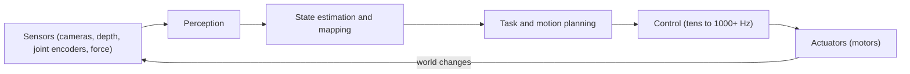
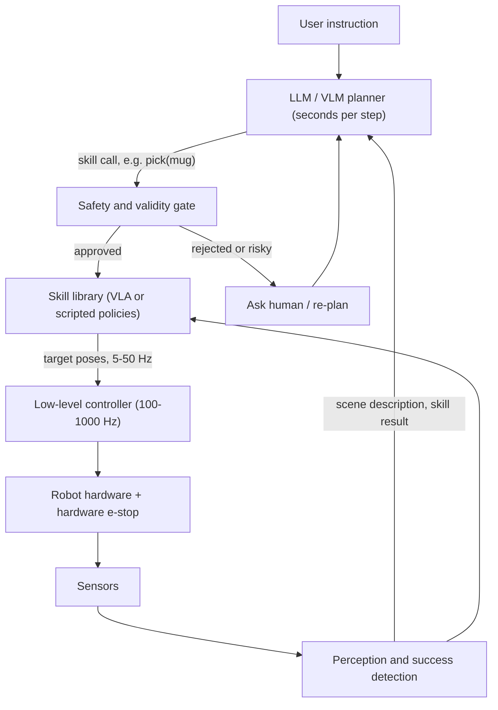

Ask a chatbot to "clear the table" and it writes you a cheerful list of steps. Ask a robot and it has to find the mug in a cluttered image, decide where to grasp a handle it can only half see, lift without spilling, avoid the person reaching for the salt, and notice when the mug slips. Nothing in that sequence can be undone with a retry button. The plate that hits the floor stays broken.

An **embodied agent** is an agent whose observations come from sensors in the physical world (or a simulated one) and whose actions move a body: a robot arm, a mobile base, a humanoid, a drone, or a character in a 3D game. Everything you learned about [the agent loop](the-agent-loop.html) still applies: observe, decide, act, repeat. What changes is that the "tools" are motors, the observations are noisy and incomplete, the loop must run in real time, and mistakes can hurt people.

This lesson covers what physical action adds to the agent problem, the classical robotics stack and where learned models fit, how large language models became high-level robot planners, the rise of **vision-language-action (VLA)** models, where robot training data comes from, world models, evaluation, safety, game agents as a bridge, and an honest look at where things stand in late 2026.

## What Changes When Actions Are Physical

A software agent that writes a bad SQL query gets an error message and tries again. A [computer-use agent](computer-use-agents.html) that misclicks can often click "Back". Physical agents lose most of these comforts.

| Property | Software agent | Embodied agent |
|---|---|---|
| **Reversibility** | Many actions can be undone, sandboxed or rolled back | Broken objects, spills and collisions are permanent |
| **Timing** | The world waits while the model thinks | The world keeps moving; control loops run tens to hundreds of times per second |
| **Observability** | Tool results are exact text | Cameras and sensors are noisy, occluded and partial |
| **Action space** | Discrete calls with typed arguments | Continuous joint angles, velocities and forces |
| **Safety** | Harms are informational or financial | Harms include physical injury |
| **Data** | Trillions of tokens of web text | Robot experience is scarce, slow and expensive to collect |
| **Testing** | Spin up a sandbox, run thousands of trials | Real trials need hardware, resets and people; simulators differ from reality |

Five of these deserve a closer look.

**Irreversibility.** In software you can let an agent explore because the sandbox absorbs mistakes. A robot cannot explore freely around people or fragile objects. This pushes robotics toward learning from demonstrations rather than trial and error, and toward conservative action selection.

**Real-time control.** A large model that takes a second to respond is fine for choosing the next subtask, but a gripper closing on a sliding cup needs corrections every few milliseconds. The architecture has to split decisions by timescale, which is why nearly every serious system is hierarchical.

**Partial observability.** The robot never sees the whole state of the world. The cup's handle may face away, the drawer's contents are hidden, and a camera cannot measure how slippery a surface is. The agent must maintain a **belief** (its best estimate of the state) and act to gather information, for example by moving the camera.

**Safety.** Physical harm raises the bar from "usually right" to "never catastrophically wrong". That cannot rest on a model's judgment alone; it needs independent layers, covered later in this lesson.

**The sim-to-real gap.** Simulators let you run millions of trials cheaply, but simulated friction, contact, lighting, sensor noise and object deformation never quite match reality. A policy that is perfect in simulation can fail on the first real attempt. This **sim-to-real gap** is one of the oldest problems in robot learning.

> [!KEY] The big idea
> Embodiment turns an agent's decisions into physics. Decisions must be split across timescales, made from partial and noisy observations, and fenced by safety layers that do not depend on the model being right.

## The Classical Robotics Stack

Before foundation models, robots were built as a pipeline of specialized modules. That stack still exists in almost every deployed robot, and learned models are best understood as replacing or augmenting pieces of it.



- **Perception** turns raw sensor data into meaningful quantities: object detections, segmentation masks, 6-DoF object poses (position plus orientation), point clouds.
- **State estimation** fuses perception with motion models over time to estimate where the robot and objects are. Kalman filters and **SLAM** (simultaneous localization and mapping) are the classic tools.
- **Planning** comes in two layers. **Task planning** decides *what* to do in what order (open drawer, pick sponge, close drawer), traditionally with symbolic planners. **Motion planning** decides *how* to move: a collision-free trajectory for the arm, found with sampling-based planners or trajectory optimization.
- **Control** tracks that trajectory by computing motor commands from moment to moment, often with PID loops, impedance control (behaving like a spring so contact is gentle) or **model predictive control** (MPC), which repeatedly optimizes a short horizon of future actions.

This modular stack is interpretable and reliable in structured settings such as factories, where parts are known and positions are fixed. It struggles in homes and other open environments, because every module assumes a model of the world (object categories, shapes, task rules) that someone has to hand-engineer.

### Where learned models fit

Learning entered the stack piece by piece, then started swallowing whole layers:

1. **Learned perception** (deep detectors and segmenters) was the first and least controversial replacement.
2. **Learned policies** map observations directly to actions for a specific skill, trained by **imitation learning** (copying demonstrations) or **reinforcement learning** (trial, error and reward). These replace planning and part of control for that skill.
3. **Language models as task planners** replace the hand-written symbolic task planner with an LLM that knows how the world generally works.
4. **Vision-language-action models** collapse perception, task reasoning and action generation into a single network that outputs motor commands.

Even in the most end-to-end systems, a low-level controller and hardware safety layer remain underneath. A VLA usually outputs target positions or velocities, and a classical controller turns those into motor currents.

## LLMs as High-Level Planners

In 2022 a group of papers showed that a language model's general world knowledge could drive a robot if you connected it to a library of pre-trained **skills** (also called **primitives**): short, reliable behaviors like `pick(sponge)` or `go_to(kitchen)`, each implemented by a learned policy or classical controller. This is the same pattern as [tool use](tool-use.html), except each tool moves a body. Four ideas from this period remain the conceptual foundation of hierarchical embodied agents.

### SayCan: grounding language in affordances

An LLM asked "I spilled my drink, can you help?" may propose "find a vacuum cleaner", which is reasonable in general but useless for a robot that has no vacuum skill and no vacuum nearby. **SayCan** ("Do As I Can, Not As I Say", Ahn et al., Google, 2022) fixed this by combining two scores for each candidate skill:

- **Say**: the LLM's estimate of how useful the skill is as the next step toward the instruction.
- **Can**: an **affordance** score, a learned value function estimating the probability that the skill succeeds from the robot's *current* state.

The robot picks the skill with the highest product, executes it, appends it to the plan, and repeats. The LLM supplies task knowledge; the value functions supply physical grounding. On 101 instructions in a mock kitchen, the PaLM-based version chose a correct skill sequence 84% of the time and executed it successfully 74% of the time, and removing the affordance grounding substantially lowered planning success.

### Inner Monologue: closing the loop with feedback

SayCan planned open-loop: it did not check whether a skill actually worked. **Inner Monologue** (Huang et al., 2022) fed textual feedback back into the LLM's context after each step: success detection ("the grasp failed"), scene descriptions ("I see a coke can and an apple") and human answers to clarifying questions. With feedback, the planner could retry, re-plan or ask for help. This is exactly the ReAct-style observe-and-reason loop from [reasoning and planning](reasoning-and-planning.html), applied to a robot.

### Code as Policies: plans as programs

**Code as Policies** (Liang et al., 2022) had the LLM write Python that called perception and control APIs, rather than choosing from a fixed skill list. Code can express loops, conditionals and spatial arithmetic ("place the blocks in a line 5 cm apart"), and the LLM can define new helper functions on the fly. The trade-off is familiar from [coding agents](coding-agents.html): far more expressive, and far more ways to go wrong, so generated code needs a constrained API and checks before it runs.

### VoxPoser: language to 3D value maps

**VoxPoser** (Huang et al., 2023) went one level lower. An LLM writes code that queries a vision-language model for object locations and composes **3D value maps** over the robot's workspace: high value near the target ("the top drawer handle"), high cost near things to avoid ("stay away from the vase"). A motion planner then synthesizes end-effector trajectories through these maps, without any robot-specific training. It showed that language models can shape *how* a robot moves, not just which skill it calls.

### The hierarchical architecture

These ideas converge on a common architecture that remains the most practical way to build embodied agents with today's models:



Each layer runs at its own rate. The planner thinks in seconds and reasons about goals, the skill policy reacts to images many times per second, and the controller closes force and position loops fast enough to be smooth and safe. The gate between planner and skills is the same "separate deciding from doing" principle used for software agents (see [guardrails and sandboxing](guardrails-and-sandboxing.html)), and the hardware emergency stop sits outside the software entirely.

> [!NOTE]
> Modern versions of this pattern often replace the text-only LLM with a **VLM** (vision-language model) that sees camera images directly, and replace scripted skills with a VLA that accepts open-ended language commands. Google DeepMind's Gemini Robotics-ER plus Gemini Robotics, NVIDIA's GR00T "System 2 / System 1" split and Figure's Helix all follow this slow-planner, fast-actor shape.

### A sketch: an LLM planner calling robot skills

Here is a minimal hierarchical agent using the Anthropic Python SDK. The `RobotStub` class is a **hypothetical stand-in** for a real robot's skill server; nothing here talks to real hardware. The structure is the standard [tool-use loop](tool-use.html), plus a harness-side safety gate.

```python
import json
import anthropic

class RobotStub:
    """HYPOTHETICAL robot skill server. A real one would run learned or scripted
    policies and report success from perception, not from a dictionary."""
    def __init__(self):
        self.scene = {"mug": "table", "sponge": "sink", "knife": "table"}
        self.holding = None

    def look(self) -> str:
        return json.dumps({"objects": self.scene, "holding": self.holding})

    def pick(self, obj: str) -> str:
        if obj not in self.scene or self.holding:
            return f"FAILED: cannot pick {obj}"
        self.holding = obj
        self.scene.pop(obj)
        return f"OK: holding {obj}"

    def place(self, location: str) -> str:
        if not self.holding:
            return "FAILED: gripper empty"
        self.scene[self.holding], self.holding = location, None
        return f"OK: placed at {location}"

def skill(name, desc, props):
    return {"name": name, "description": desc, "strict": True,
            "input_schema": {"type": "object", "properties": props,
                             "required": list(props), "additionalProperties": False}}

TOOLS = [
    skill("look", "Describe visible objects and their locations.", {}),
    skill("pick", "Grasp one visible object. Fails if already holding something.",
          {"obj": {"type": "string"}}),
    skill("place", "Place the held object at a named location.",
          {"location": {"type": "string"}}),
]
NEEDS_HUMAN_OK = {"knife"}  # harness policy, not a prompt instruction

robot, client = RobotStub(), anthropic.Anthropic()
messages = [{"role": "user", "content": "Put the dishes from the table in the sink."}]
SYSTEM = "You control a kitchen robot through skills. Call look first, verify each step, and stop when done."

for step in range(20):  # skill budget
    resp = client.messages.create(model="claude-opus-5-5", max_tokens=16000,
                                  system=SYSTEM, tools=TOOLS, messages=messages)
    messages.append({"role": "assistant", "content": resp.content})
    if resp.stop_reason != "tool_use":
        break  # end_turn, refusal or max_tokens: report and stop
    results = []
    for b in (c for c in resp.content if c.type == "tool_use"):
        if b.name == "pick" and b.input["obj"] in NEEDS_HUMAN_OK:
            out, err = "BLOCKED: sharp object needs operator approval.", True
        else:
            out = getattr(robot, b.name)(**b.input)
            err = out.startswith("FAILED")
        results.append({"type": "tool_result", "tool_use_id": b.id,
                        "content": out, "is_error": err})
    messages.append({"role": "user", "content": results})
```

Three details matter more than they look. The skills return **success or failure**, which is the Inner Monologue lesson: a planner without feedback cannot recover. The **safety gate lives in the harness**, so a confused or manipulated model cannot talk its way past it. And the planner never sees joint angles: it works at the level of objects and places, which is where language models are strong.

A run might produce a trace like this:

```text
Instruction: Put the dishes from the table in the sink.
Thought: I should see what is on the table first.
Action: look({})
Observation: {"objects": {"mug": "table", "sponge": "sink", "knife": "table"}, "holding": null}
Thought: The mug is a dish. The knife is cutlery; it may count as a dish.
Action: pick({"obj": "mug"})
Observation: OK: holding mug
Action: place({"location": "sink"})
Observation: OK: placed at sink
Action: pick({"obj": "knife"})
Observation: BLOCKED: sharp object needs operator approval.  [is_error]
Thought: I cannot move the knife without approval. Everything else is done.
Final: I moved the mug to the sink. The knife is still on the table because
       handling sharp objects needs operator approval. Want me to request it?
```

On a real robot, `pick` would take several seconds and fail some of the time, so the planner would see more `FAILED` observations and retries. The [human-in-the-loop](human-in-the-loop.html) escalation at the end is the right behavior, not a failure.

## Vision-Language-Action Models

The hierarchical approach depends on having good skills, and each skill traditionally needed its own data and training. The next idea was to train *one* model that maps camera images and a language instruction directly to robot actions, across many tasks. These are **vision-language-action (VLA) models**.

### From RT-1 to RT-2

**RT-1** (Robotics Transformer 1, Google, December 2022) was trained on about 130,000 teleoperated episodes covering more than 700 instructions, collected over 17 months with a fleet of 13 mobile manipulators. It took images and an instruction and output discretized arm and base actions. It reached 97% success on the instructions it was trained on and generalized better than prior methods to new objects and scenes, but it knew only what was in its robot data.

**RT-2** (Google DeepMind, July 2023) introduced the term VLA and the key idea behind it. Start from a large **vision-language model** pretrained on web images and text, represent robot actions as text tokens (for example, a string of integers for discretized position and rotation changes), and **co-fine-tune** on robot data and web data together. The robot inherited semantic knowledge it never saw in demonstrations: it could follow commands like "move the banana to the sum of two plus one" or pick up an object that could serve as an improvised hammer. The lesson was that web-scale pretraining transfers to physical action.

### Cross-embodiment: Open X-Embodiment and RT-X

Every lab had its own robots and its own small dataset. The **Open X-Embodiment** collaboration (October 2023) pooled 60 existing datasets from 34 labs into more than one million real robot trajectories across 22 embodiments, from single arms to bimanual robots and quadrupeds. Models trained on the mixture (**RT-1-X** and **RT-2-X**) often did better on a given robot than models trained only on that robot's data. This **positive transfer** across embodiments suggested robotics might follow the same "more diverse data wins" scaling story as language.

### Open VLAs: Octo and OpenVLA

Two open models made VLAs accessible outside large labs in 2024:

- **Octo** (May 2024) is a transformer-based policy pretrained on 800,000 episodes from Open X-Embodiment, released in small sizes (27M and 93M parameters) with a **diffusion** action head that generates continuous actions. It was designed to be fine-tuned to new robots, sensors and action spaces.
- **OpenVLA** (June 2024) is a 7B-parameter VLA built on a Llama 2 backbone with pretrained vision encoders, trained on 970,000 episodes. Its authors reported a 16.5% absolute gain in task success over the 55B-parameter RT-2-X across 29 tasks, with about seven times fewer parameters, and released weights and fine-tuning code.

### Flow matching and π0

Tokenized actions have a resolution problem: a robot folding laundry needs smooth, high-frequency, continuous motion. **Physical Intelligence**, a startup founded in 2024, released **π0** (pi-zero) in October 2024. It pairs a pretrained VLM (PaliGemma) with a separate ~300M-parameter **action expert** that generates continuous **action chunks** (short sequences of future actions) via **flow matching**, a relative of diffusion, controlling robots at up to 50 Hz. Physical Intelligence open-sourced π0 weights in early 2025 through its openpi repository. Its successors moved in telling directions:

- **π0.5** (April 2025) focused on **open-world generalization**: cleaning kitchens and bedrooms in homes it had never seen.
- **π\*0.6** (November 2025) added **Recap**, a method for learning from the robot's own experience, including human corrections and autonomous practice, rather than demonstrations alone. The company reported large throughput gains on tasks such as making espresso drinks and assembling boxes.
- **π0.7** (April 2026) was presented as a "steerable" generalist that accepts richer prompts (language, subgoal images, metadata) and composes separately learned skills for new tasks.

### Frontier VLAs: Gemini Robotics and GR00T

- **Gemini Robotics** (Google DeepMind, March 2025) built a VLA on Gemini 2.0, alongside **Gemini Robotics-ER**, a VLM specialized for embodied reasoning (spatial understanding, pointing, grasp prediction). An on-device version followed in June 2025. **Gemini Robotics 1.5** (September 2025) added "thinking" before acting and **motion transfer** across embodiments, with ER 1.5 available to developers through the Gemini API. **Gemini Robotics 2** (July 2026) extended control to humanoid **whole-body** movement, and **Gemini Robotics 2.5** (November 2026) was announced as DeepMind's most capable VLA so far, rolling out to robotics partners.
- **NVIDIA Isaac GR00T N1** (March 2025) was released as an open foundation model for humanoids with an explicit dual-system design: a slower VLM-based reasoning module and a fast diffusion-based action module. It was trained on a mix of real teleoperation, synthetic data and human videos. Updates followed (N1.5 in mid-2025, then N1.6 using NVIDIA's Cosmos Reason VLM).

| Model | Org, date | Action representation | Open weights? |
|---|---|---|---|
| RT-1 | Google, Dec 2022 | Discretized action tokens | No |
| RT-2 | Google DeepMind, Jul 2023 | Actions as text tokens from a web VLM | No |
| RT-1-X / RT-2-X | Open X-Embodiment, Oct 2023 | As RT-1 / RT-2 | RT-1-X yes |
| Octo | Berkeley-led team, May 2024 | Diffusion head | Yes |
| OpenVLA | Stanford-led team, Jun 2024 | Discretized action tokens | Yes |
| π0 | Physical Intelligence, Oct 2024 | Flow-matching action chunks | Yes (2025) |
| Gemini Robotics family | Google DeepMind, 2025–2026 | VLA plus separate embodied-reasoning VLM | No (ER via API) |
| GR00T N1 family | NVIDIA, 2025– | Dual system, diffusion action module | Yes |

> [!WARNING] Reading robotics announcements
> Most frontier results are reported by the developers themselves, on their own robots and task sets, often with videos selected to show success. Treat claimed success rates as evidence of direction, not as numbers you can compare across labs.

## Where Robot Data Comes From

Language models feast on the web. Robots have no equivalent corpus of "what the motors did", and that **data bottleneck** shapes the entire field. The main sources, usually mixed together:

- **Teleoperation.** A human drives the robot (with a VR headset, a matching "leader" arm, or a handheld gripper with a camera) while sensors record observations and actions. This is the highest-quality data and the most expensive: it scales with human hours and hardware. Large collection efforts such as DROID and the in-house fleets of frontier labs follow this route.
- **Cross-embodiment datasets.** Pooling data from many robot types (Open X-Embodiment and successors) trades consistency for diversity. The challenge is that action spaces differ: a 7-joint arm and a humanoid hand do not share a common "language" of motion, so models need per-embodiment heads or normalized action representations.
- **Simulation.** Physics simulators (MuJoCo, NVIDIA Isaac Sim and Isaac Lab, and others) produce unlimited data and support reinforcement learning at enormous scale. Locomotion is the big success story: legged robots' walking controllers are now commonly trained in simulation and transferred to real hardware. **Domain randomization**, varying textures, lighting, masses and friction during training so the real world looks like just another variation, is the classic bridge across the sim-to-real gap. Contact-rich manipulation of deformable objects (cloth, cables, food) remains much harder to simulate faithfully.
- **Human video.** The internet holds vast amounts of video of people manipulating objects, but no action labels. Methods learn **latent actions** (inferred changes between frames), predict future frames or hand poses, or use video for representation learning before fine-tuning on robot data. GR00T N1, for example, used human videos alongside robot data.
- **The robot's own experience.** Deployed robots generate data, including failures and human corrections. Learning from this, as π\*0.6's Recap does, is how the data flywheel familiar from software products might eventually reach robotics (see [training agents](training-agents.html) and [self-improving agents](self-improving-agents.html)).

## World Models for Robotics

A **world model** predicts how the world will change given an action. Model-based control has always used hand-written physics models; the new idea is learning **world foundation models** from video at scale.

- **Genie** (Google DeepMind) learned controllable environments from unlabeled internet video in 2024. **Genie 2** (December 2024) generated playable 3D worlds from a prompt image, and **Genie 3** (August 2025) produced interactive worlds in real time that a user or an agent can move through.
- **NVIDIA Cosmos** (announced at CES in January 2025) is a family of open world foundation models aimed squarely at physical AI: **Cosmos Predict** generates future video from text, image or video inputs, **Cosmos Transfer** turns simulator output or structured inputs into varied photorealistic video for synthetic data, and **Cosmos Reason** is a VLM for physical reasoning.

World models serve robotics in three ways: **synthetic data** (generate many variations of a scene for training), **policy evaluation** (roll a policy out "in imagination" instead of on hardware), and **planning** (imagine the outcome of candidate actions before committing). The open question is fidelity. Generated video can look convincing while violating physics in small ways that matter enormously to a grasp, and errors compound over long rollouts. As of 2026, world models are valuable for data augmentation and coarse evaluation, but they do not replace real-world testing.

## Evaluating Embodied Agents

Evaluating robots is much harder than evaluating chatbots (see [evaluating agents](evaluating-agents.html) and [benchmarks](benchmarks.html)).

**Real-world success rates** are the ground truth: run the policy on physical hardware for a set of tasks and count successes. They are also slow, expensive, and hard to reproduce. Results depend on the exact robot, cameras, lighting, object set, initial positions and how strictly "success" is judged, and many papers report a few dozen trials per task. A 10-point difference between two papers using different setups tells you almost nothing.

**Simulation benchmarks** trade realism for reproducibility:

- **LIBERO** (2023) offers 130 simulated manipulation tasks in four suites (spatial layouts, object variety, goals, and a long-horizon set) with teleoperated demonstrations. It is widely used to compare VLA fine-tuning recipes; top models now score very high on its standard suites, so it is increasingly saturated.
- **SIMPLER** (2024) builds simulated replicas of real evaluation setups (Google's RT-series robot tasks and BridgeData V2 tasks), using real-image overlays and texture matching, and shows that rankings in simulation correlate with real-world rankings.
- **BEHAVIOR-1K** (Stanford) defines 1,000 everyday household activities in a high-fidelity simulator, aimed at long-horizon mobile manipulation.

**Game and virtual environments** (Minecraft, commercial 3D games) evaluate the high-level side: instruction following, exploration and long-horizon planning without contact physics.

Good practice borrowed from software agents applies here too: report the number of trials and confidence intervals, test on held-out objects, scenes and instructions, and measure more than success: time to completion, number of human interventions, and the rate of unsafe events.

## Safety in the Physical World

Software agents can leak data or spend money. Embodied agents can injure someone. Safety therefore comes in independent layers, and the most important ones do not involve the AI model at all.

1. **Hardware and low-level safeguards.** Emergency stop buttons wired to cut motor power, torque and speed limits, force sensing that stops on unexpected contact, and safety-rated monitoring around industrial robots. Standards such as ISO 10218 (industrial robots) and ISO/TS 15066 (collaborative robots working near people) codify limits on speed and contact force. These layers must work even if every line of AI code is wrong.
2. **Constraints in planning and control.** Workspace boundaries, keep-out zones around people, collision checking before execution, and **control barrier functions** or similar methods that mathematically filter commands to stay inside a safe set.
3. **Harness-level gates.** As in the code sketch above: validate each skill call, require approval for risky objects or actions, cap the number of steps, and log everything for review (see [observability](observability.html)).
4. **Human oversight and override.** A person who can pause, correct or take over the robot, and an agent that asks when uncertain rather than guessing.
5. **Semantic safety in the model.** The model itself should understand that a knife is handed over handle-first and that bleach does not go in the coffee machine. Google DeepMind's **ASIMOV** benchmark (introduced with Gemini Robotics in March 2025, alongside work on generating "robot constitutions") measures this kind of common-sense safety understanding, and later versions added scenarios drawn from real injury reports and, in 2026, agentic and jailbreak variants.

> [!WARNING] Language makes robots attackable
> A robot that takes natural-language instructions inherits the [prompt injection and jailbreak](agent-security.html) problems of LLM agents, now with physical consequences. Researchers have shown that LLM-controlled robots can be jailbroken into unsafe behavior. Text on a sign or a package is untrusted input, just like text on a web page. This is why layers 1 to 4 must not depend on the model's cooperation.

> [!KEY] Defense in depth, from silicon to steel
> Model judgment is the outermost and weakest layer. Physical safety rests on hardware stops and force limits, then on constraints the planner cannot override, then on harness gates and human oversight. The broader alignment questions are covered in [agent safety and alignment](agent-safety-alignment.html).

## Virtual Embodiment: Game Agents as a Bridge

3D games offer embodiment without broken dishes: agents see pixels, act through controls, and pursue long-horizon goals, while resets are free. Two lines of work show how ideas flow between virtual and physical agents.

**Voyager** (2023) was an LLM-powered agent in Minecraft built on GPT-4. It had three parts that map cleanly onto robotics: an **automatic curriculum** proposing progressively harder goals, a **skill library** of executable code that it wrote, verified and reused, and an **iterative prompting** loop that fed back game errors and execution results. It acted through a code API rather than raw keyboard and mouse, which is the Code as Policies idea in a game world. The skill library is a vivid example of agent [memory](memory.html): competence accumulated as reusable, verified programs.

**SIMA** (Google DeepMind, March 2024) went the other way: a single agent that followed natural-language instructions across many commercial 3D games using only screen pixels and keyboard-and-mouse output, like a human player. **SIMA 2** (November 2025) put a Gemini model at its core, so it could reason about goals, explain its plans and improve through self-generated practice in which Gemini proposed tasks and estimated rewards. DeepMind also tested it inside worlds generated by Genie 3, a glimpse of agents training in endless generated environments.

Game agents do not solve contact physics, but they are a proving ground for the high-level half of embodied agents: grounding language in perception, long-horizon planning, skill reuse and learning from experience.

## The State of the Field (Late 2026)

An honest summary, as of November 2026:

**What works.**
- Hierarchical systems in which a VLM plans and reliable skills execute, in constrained settings with a well-defined task set.
- Learned locomotion for quadrupeds and humanoids, trained largely in simulation.
- Dexterous demonstrations of tasks that were out of reach a few years ago: folding laundry, assembling boxes, making coffee, clearing tables in unfamiliar homes. Frontier VLAs from Google DeepMind, Physical Intelligence, NVIDIA and others now show genuine generalization to new objects and scenes.
- Industrial pilots, mostly structured tasks such as moving totes and parts, with humanoids from several companies.

**What remains hard.**
- **Reliability.** A demo that works 80% of the time is impressive research and an unusable product. Homes and workplaces need the long tail of rare situations handled, and per-step errors compound over long tasks exactly as they do for [software agents](when-to-use-agents.html).
- **Data.** Robot data remains orders of magnitude smaller than text or image data. Whether human video, simulation, world models and fleet experience can close the gap is the central bet of the field.
- **Evaluation.** There is still no agreed, reproducible way to compare generalist robot policies in the real world.
- **Dexterity and contact.** Fine manipulation, tactile sensing and deformable objects lag well behind visual understanding.
- **Latency and compute.** Large VLAs need serious onboard or nearby compute to run at control rates, which pushes toward smaller on-device models and the slow-planner, fast-actor split.
- **Safety assurance.** We can test safety but cannot yet certify that a learned policy will never do something dangerous in an unseen situation.
- **Cost and hardware.** Capable robots are still expensive, and hardware reliability (hands, actuators, batteries) is its own bottleneck.

> [!TIP] Rule of thumb for practitioners
> If you are building an embodied application today, start hierarchical: a VLM or LLM planner over a small set of skills you can test exhaustively, with hardware safety and a harness gate underneath. Add learned generalist policies where scripted skills break down, and measure interventions per hour, not just success rate.

For where this might go, see [the future of agents](future-of-agents.html).

## Key Takeaways

- Physical action makes agent mistakes **irreversible**, imposes **real-time** constraints, forces reasoning under **partial observability**, raises the stakes of **safety**, and introduces the **sim-to-real gap**.
- The classical robotics stack (perception, state estimation, planning, control) still sits underneath modern systems; learned models replaced perception first, then skills, then task planning.
- **Hierarchical agents** let an LLM or VLM plan at the level of objects and skills while learned or scripted policies and fast controllers execute. SayCan added **affordance grounding**, Inner Monologue added **feedback**, Code as Policies used **code as the plan**, and VoxPoser shaped **motion** with 3D value maps.
- **VLAs** map images and language directly to actions. RT-2 showed web pretraining transfers to robots; Open X-Embodiment showed **cross-embodiment** data helps; Octo, OpenVLA and π0 opened the field; Gemini Robotics and GR00T represent frontier and open industrial efforts.
- Data is the bottleneck: teleoperation, cross-embodiment pools, simulation with domain randomization, human video and the robot's own experience are all part of the mix. World models such as Genie and Cosmos add synthetic data and imagined rollouts, with fidelity limits.
- Evaluate with real-world trials plus simulation benchmarks such as **LIBERO** and **SIMPLER**, and report trials, interventions and unsafe events, not just headline success.
- Safety is layered from hardware e-stops and force limits up through constraints, harness gates and human override; model-level semantic safety (measured by benchmarks like **ASIMOV**) is the last layer, not the first.

## Exercises

1. **Timescales.** For the task "wipe a spill off the table", list the decisions made at three timescales (seconds, tenths of a second, milliseconds). Which component in the hierarchical diagram owns each, and what happens if the planner is slowed to 5 seconds per step?
2. **Add affordances.** Extend the `RobotStub` sketch with a `can_succeed(skill, obj)` method that returns a probability (for example, low for objects far from the robot). Expose it as a tool and change the system prompt so the planner checks affordances before acting, SayCan-style. What failure modes does this prevent, and what new ones appear?
3. **Feedback realism.** Modify `pick` to fail randomly 25% of the time. Run the agent and inspect how it recovers. Add a per-object retry limit in the harness and an escalation to the user after repeated failures.
4. **Safety design.** You are deploying a mobile manipulator in a hospital supply room shared with staff. Write a layered safety plan covering hardware, planning constraints, harness gates, human override and model-level checks. For each layer, describe one failure it catches that the others might miss.
5. **Evaluation protocol.** Design a real-world evaluation for comparing two VLAs on ten kitchen tasks with a budget of 300 trials. Decide how to allocate trials, randomize initial conditions, define success, and report uncertainty. How would you use SIMPLER-style simulation to decide which tasks deserve the most real trials?

## Check Your Understanding

```quiz
Q: Why did SayCan multiply the language model's score for a skill by a learned affordance score?
- [ ] To make the language model's output deterministic across repeated runs
- [x] The LLM judges usefulness; the value function judges feasibility right now
- [ ] To convert the language model's text output into joint-level motor commands
- [ ] Because the language model could not rank more than a few skills at once
E: The LLM knows what would help in general, but not what this robot can do from its current state. The affordance value function estimates the chance that a skill succeeds here and now, so the product favors steps that are both useful and achievable. Converting to motor commands is the job of the skills themselves.

Q: In a hierarchical embodied agent, why does the LLM planner not send motor commands directly?
- [ ] LLMs cannot output numbers precisely enough to describe joint angles at all
- [ ] Robot manufacturers do not permit language models to access joint controllers
- [x] It runs at seconds per step, far slower than the control loop needs
- [ ] Motor commands use far too many tokens to fit in the model's context window
E: Control loops correct motion tens to hundreds of times per second, while a large model takes on the order of a second or more per decision. So the planner works at the level of skills and objects, and faster policies and controllers handle motion. LLMs can emit numbers; the problem is timescale, not syntax.

Q: What was the key idea that RT-2 introduced?
- [ ] Training only in simulation, then transferring the policy to real robots
- [x] Treating actions as tokens and co-fine-tuning a web-pretrained VLM
- [ ] Pooling data from many robot types into one cross-embodiment dataset
- [ ] Generating smooth continuous action chunks using flow matching
E: RT-2 represented robot actions as text tokens and co-fine-tuned a vision-language model on web and robot data, so semantic knowledge from the web transferred to physical tasks. Pooling robot types describes Open X-Embodiment, and flow-matching action chunks describe π0.

Q: A grasping policy trained in simulation fails on the real robot because real lighting and friction differ. Which technique most directly targets this?
- [ ] Adding a larger language model as the high-level task planner
- [ ] Increasing the control frequency of the low-level joint controller
- [x] Domain randomization of textures, lighting, mass and friction
- [ ] Converting the policy's continuous actions into discrete tokens
E: Domain randomization trains across many variations of visual and physical parameters so the real world looks like one more variation. A bigger planner or faster controller does not change what the grasping policy learned about appearance and contact.

Q: Two papers report 72% and 81% real-world success for different VLAs. Why is that comparison weak evidence?
- [ ] Real-world success rates are always lower than simulation success rates
- [x] Robots, scenes, task sets, trial counts and success criteria differ
- [ ] Success rates only matter for humanoids, not for single-arm robots
- [ ] Higher-capacity models always perform better on any real robot task
E: Real-world results depend heavily on the hardware, objects, initial conditions, number of trials and how success is judged. Without a shared protocol and confidence intervals, a 9-point gap can be noise or setup differences. Shared simulation benchmarks like SIMPLER and LIBERO exist partly to address this.

Q: Where should the guarantee "the arm stops if it contacts a person unexpectedly" be implemented?
- [ ] In the planner's system prompt, as a rule it must always follow
- [ ] In a semantic safety benchmark that the VLA is evaluated against
- [x] In force sensing and stops below the AI, independent of any model
- [ ] In the VLA's training data, through many demonstrations of stopping
E: Physical safety guarantees must hold even if every AI component is wrong or manipulated. Prompts can be overridden, training only makes behavior more likely, and benchmarks measure rather than enforce. Hardware and low-level force limits act regardless of what the model decides.

Q: What did the Open X-Embodiment collaboration find when training RT-X models on pooled data?
- [x] A model trained on many robots often beat one trained on a single robot's data
- [ ] Mixing robot types always hurt performance because their action spaces differ
- [ ] Simulated data from many robots fully replaced the need for any real data
- [ ] Cross-embodiment training only helped once the model exceeded 100B params
E: The RT-X results showed positive transfer: diverse data from other robots improved performance on a given robot. Action-space differences are a real challenge, but they did not prevent the gains, and the dataset consisted of real robot trajectories, not simulation.
```

## Further Reading

- [Do As I Can, Not As I Say: Grounding Language in Robotic Affordances (Ahn et al., 2022)](https://arxiv.org/abs/2204.01691) — SayCan, the paper that combined LLM planning with learned affordances.
- [Inner Monologue: Embodied Reasoning through Planning with Language Models (Huang et al., 2022)](https://arxiv.org/abs/2207.05608) — closing the loop with success detection, scene descriptions and human feedback.
- [Code as Policies: Language Model Programs for Embodied Control (Liang et al., 2022)](https://arxiv.org/abs/2209.07753) — LLM-written programs as robot policies.
- [RT-2: Vision-Language-Action Models Transfer Web Knowledge to Robotic Control (Brohan et al., 2023)](https://arxiv.org/abs/2307.15818) — the paper that defined VLAs.
- [Open X-Embodiment: Robotic Learning Datasets and RT-X Models (2023)](https://arxiv.org/abs/2310.08864) — the cross-embodiment dataset and evidence of positive transfer.
- [OpenVLA: An Open-Source Vision-Language-Action Model (Kim et al., 2024)](https://arxiv.org/abs/2406.09246) — a readable, open VLA with weights and fine-tuning code.
- [π0: A Vision-Language-Action Flow Model for General Robot Control (Black et al., 2024)](https://arxiv.org/abs/2410.24164) — flow-matching action experts and action chunks.
- [Gemini Robotics 1.5 technical report (Google DeepMind, 2025)](https://arxiv.org/abs/2510.03342) — embodied reasoning, thinking before acting, motion transfer and layered safety.
- [Evaluating Real-World Robot Manipulation Policies in Simulation (SIMPLER, Li et al., 2024)](https://arxiv.org/abs/2405.05941) — how to make simulated evaluation track real-world performance.
- [Voyager: An Open-Ended Embodied Agent with Large Language Models (Wang et al., 2023)](https://arxiv.org/abs/2305.16291) — automatic curriculum and a code skill library in Minecraft.
