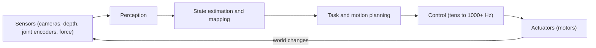
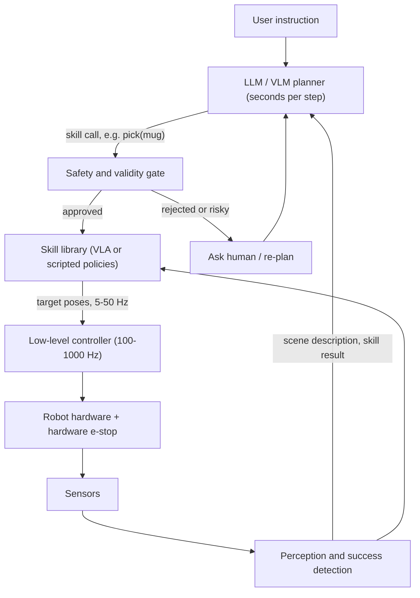

Ask a chatbot to "clear the table" and it writes you a cheerful list of steps. Ask a robot and it has to find the mug in a cluttered image, decide where to grasp a handle it can only half see, lift without spilling, avoid the person reaching for the salt, and notice when the mug slips. Nothing in that sequence can be undone with a retry button. The plate that hits the floor stays broken.

An **embodied agent** is an agent whose observations come from sensors in the physical world (or a simulated one) and whose actions move a body: a robot arm, a mobile base, a humanoid, a drone, or a character in a 3D game. Everything you learned about [the agent loop](the-agent-loop.html) still applies: observe, decide, act, repeat. What changes is that the "tools" are motors, the observations are noisy and incomplete, the loop must run in real time, and mistakes can hurt people.

This lesson covers the classical robotics stack, LLMs as high-level robot planners, **vision-language-action (VLA)** models, robot data, world models, evaluation, safety, game agents as a bridge, and an honest look at where things stand in late 2026.

## What Changes When Actions Are Physical

A software agent that writes a bad SQL query gets an error message and tries again. A [computer-use agent](computer-use-agents.html) that misclicks can often click "Back". Physical agents lose most of these comforts.

| Property | Software agent | Embodied agent |
|---|---|---|
| **Reversibility** | Many actions can be undone, sandboxed or rolled back | Broken objects, spills and collisions are permanent |
| **Timing** | The world waits while the model thinks | The world keeps moving; control loops run tens to hundreds of times per second |
| **Observability** | Tool results are exact text | Cameras and sensors are noisy, occluded and partial |
| **Action space** | Discrete calls with typed arguments | Continuous joint angles, velocities and forces |
| **Safety** | Harms are informational or financial | Harms include physical injury |
| **Data** | Trillions of tokens of web text | Robot experience is scarce, slow and expensive to collect |
| **Testing** | Spin up a sandbox, run thousands of trials | Real trials need hardware, resets and people; simulators differ from reality |

A few consequences shape everything that follows:

- **Irreversibility** means a robot cannot explore freely around people or fragile objects, which pushes robotics toward learning from demonstrations rather than trial and error.
- **Real-time control** means a model that takes a second to respond can choose the next subtask, but cannot correct a gripper closing on a sliding cup. Decisions must be split by timescale, which is why nearly every serious system is hierarchical.
- **Partial observability** means the robot never sees the whole state: the handle faces away, the drawer is closed, friction is invisible. The agent keeps a **belief** (its best estimate of the state) and sometimes acts just to gather information, such as moving the camera.
- **Safety** raises the bar from "usually right" to "never catastrophically wrong", which cannot rest on a model's judgment alone.
- The **sim-to-real gap**: simulators give millions of cheap trials, but simulated friction, contact, lighting and sensor noise never quite match reality, so a policy perfect in simulation can fail on its first real attempt.

> [!KEY] The big idea
> Embodiment turns an agent's decisions into physics. Decisions must be split across timescales, made from partial and noisy observations, and fenced by safety layers that do not depend on the model being right.

## The Classical Robotics Stack

Before foundation models, robots were built as a pipeline of specialized modules. That stack still exists in almost every deployed robot, and learned models are best understood as replacing or augmenting pieces of it.



- **Perception** turns raw sensor data into meaningful quantities: object detections, segmentation masks, 6-DoF object poses (position plus orientation), point clouds.
- **State estimation** fuses perception with motion models over time to estimate where the robot and objects are. Kalman filters and **SLAM** (simultaneous localization and mapping) are the classic tools.
- **Planning** comes in two layers. **Task planning** decides *what* to do in what order (open drawer, pick sponge, close drawer), traditionally with symbolic planners. **Motion planning** decides *how* to move: a collision-free trajectory for the arm, found with sampling-based planners or trajectory optimization.
- **Control** tracks that trajectory by computing motor commands from moment to moment, often with PID loops, impedance control (behaving like a spring so contact is gentle) or **model predictive control** (MPC), which repeatedly optimizes a short horizon of future actions.

This stack is interpretable and reliable in structured settings such as factories. It struggles in homes, because every module assumes a hand-engineered model of the world (object categories, shapes, task rules).

### Where learned models fit

Learning entered the stack piece by piece: first **learned perception** (deep detectors and segmenters); then **learned policies** for individual skills, trained by **imitation learning** (copying demonstrations) or **reinforcement learning** (trial, error and reward); then **LLMs as task planners**; and finally **VLA models** that collapse perception, reasoning and action generation into one network. Even then, a low-level controller and hardware safety layer remain underneath: a VLA usually outputs target positions or velocities, and a classical controller turns them into motor currents.

## LLMs as High-Level Planners

In 2022 a group of papers showed that an LLM's world knowledge could drive a robot if you connected it to a library of pre-trained **skills** (or **primitives**): short, reliable behaviors like `pick(sponge)` or `go_to(kitchen)`, each implemented by a learned policy or classical controller. This is [tool use](tool-use.html) where each tool moves a body. Four ideas from this period remain foundational.

### SayCan: grounding language in affordances

An LLM asked "I spilled my drink, can you help?" may propose "find a vacuum cleaner", which is sensible in general but useless for a robot with no vacuum skill. **SayCan** ("Do As I Can, Not As I Say", Ahn et al., Google, 2022) fixed this by combining two scores for each candidate skill:

- **Say**: the LLM's estimate of how useful the skill is as the next step toward the instruction.
- **Can**: an **affordance** score, a learned value function estimating the probability that the skill succeeds from the robot's *current* state.

The robot executes the skill with the highest product, appends it to the plan, and repeats. On 101 instructions in a mock kitchen, the PaLM-based version chose a correct skill sequence 84% of the time and executed it successfully 74% of the time, and removing the affordance grounding substantially lowered planning success.

### Inner Monologue: closing the loop with feedback

SayCan planned open-loop: it did not check whether a skill actually worked. **Inner Monologue** (Huang et al., 2022) fed textual feedback back into the LLM's context after each step: success detection ("the grasp failed"), scene descriptions ("I see a coke can and an apple") and human answers to clarifying questions. With feedback, the planner could retry, re-plan or ask for help. This is exactly the ReAct-style observe-and-reason loop from [reasoning and planning](reasoning-and-planning.html), applied to a robot.

### Code as Policies: plans as programs

**Code as Policies** (Liang et al., 2022) had the LLM write Python that called perception and control APIs, rather than choosing from a fixed skill list. Code can express loops, conditionals and spatial arithmetic ("place the blocks in a line 5 cm apart"), and the LLM can define new helper functions on the fly. The trade-off is familiar from [coding agents](coding-agents.html): far more expressive, and far more ways to go wrong, so generated code needs a constrained API and checks before it runs.

### VoxPoser: language to 3D value maps

**VoxPoser** (Huang et al., 2023) went one level lower. An LLM writes code that queries a vision-language model for object locations and composes **3D value maps** over the robot's workspace: high value near the target ("the top drawer handle"), high cost near things to avoid ("stay away from the vase"). A motion planner then synthesizes end-effector trajectories through these maps, without any robot-specific training. It showed that language models can shape *how* a robot moves, not just which skill it calls.

### The hierarchical architecture

These ideas converge on a common architecture that remains the most practical way to build embodied agents with today's models:



Each layer runs at its own rate: the planner thinks in seconds, the skill policy reacts to images many times per second, and the controller closes force and position loops fast enough to be smooth and safe. The gate applies the "separate deciding from doing" principle from [guardrails and sandboxing](guardrails-and-sandboxing.html), and the hardware e-stop sits outside the software entirely.

> [!NOTE]
> Modern versions swap the text-only LLM for a **VLM** (vision-language model) that sees camera images, and scripted skills for a VLA that accepts open-ended commands. Gemini Robotics-ER plus Gemini Robotics, NVIDIA GR00T's dual-system design and Figure's Helix all follow this slow-planner, fast-actor shape.

### A sketch: an LLM planner calling robot skills

Here is a minimal hierarchical agent using the Anthropic Python SDK. The `RobotStub` class is a **hypothetical stand-in** for a real robot's skill server; nothing here talks to real hardware. The structure is the standard [tool-use loop](tool-use.html), plus a harness-side safety gate.

```python
import json
import anthropic

class RobotStub:
    """HYPOTHETICAL robot skill server. A real one would run learned or scripted
    policies and report success from perception, not from a dictionary."""
    def __init__(self):
        self.scene = {"mug": "table", "sponge": "sink", "knife": "table"}
        self.holding = None

    def look(self) -> str:
        return json.dumps({"objects": self.scene, "holding": self.holding})

    def pick(self, obj: str) -> str:
        if obj not in self.scene or self.holding:
            return f"FAILED: cannot pick {obj}"
        self.holding = obj
        self.scene.pop(obj)
        return f"OK: holding {obj}"

    def place(self, location: str) -> str:
        if not self.holding:
            return "FAILED: gripper empty"
        self.scene[self.holding], self.holding = location, None
        return f"OK: placed at {location}"

def skill(name, desc, props):
    return {"name": name, "description": desc, "strict": True,
            "input_schema": {"type": "object", "properties": props,
                             "required": list(props), "additionalProperties": False}}

TOOLS = [
    skill("look", "Describe visible objects and their locations.", {}),
    skill("pick", "Grasp one visible object. Fails if already holding something.",
          {"obj": {"type": "string"}}),
    skill("place", "Place the held object at a named location.",
          {"location": {"type": "string"}}),
]
NEEDS_HUMAN_OK = {"knife"}  # harness policy, not a prompt instruction

robot, client = RobotStub(), anthropic.Anthropic()
messages = [{"role": "user", "content": "Put the dishes from the table in the sink."}]
SYSTEM = "You control a kitchen robot through skills. Call look first, verify each step, and stop when done."

for step in range(20):  # skill budget
    resp = client.messages.create(model="claude-opus-5-5", max_tokens=16000,
                                  system=SYSTEM, tools=TOOLS, messages=messages)
    messages.append({"role": "assistant", "content": resp.content})
    if resp.stop_reason != "tool_use":
        break  # end_turn, refusal or max_tokens: report and stop
    results = []
    for b in (c for c in resp.content if c.type == "tool_use"):
        if b.name == "pick" and b.input["obj"] in NEEDS_HUMAN_OK:
            out, err = "BLOCKED: sharp object needs operator approval.", True
        else:
            out = getattr(robot, b.name)(**b.input)
            err = out.startswith("FAILED")
        results.append({"type": "tool_result", "tool_use_id": b.id,
                        "content": out, "is_error": err})
    messages.append({"role": "user", "content": results})
```

Three details matter. Skills return **success or failure** (the Inner Monologue lesson: without feedback, no recovery). The **safety gate lives in the harness**, so a confused or manipulated model cannot talk its way past it. And the planner never sees joint angles; it reasons about objects and places, where language models are strong.

A run might produce a trace like this:

```text
Instruction: Put the dishes from the table in the sink.
Thought: I should see what is on the table first.
Action: look({})
Observation: {"objects": {"mug": "table", "sponge": "sink", "knife": "table"}, "holding": null}
Thought: The mug is a dish. The knife is cutlery; it may count as a dish.
Action: pick({"obj": "mug"})
Observation: OK: holding mug
Action: place({"location": "sink"})
Observation: OK: placed at sink
Action: pick({"obj": "knife"})
Observation: BLOCKED: sharp object needs operator approval.  [is_error]
Thought: I cannot move the knife without approval. Everything else is done.
Final: I moved the mug to the sink. The knife is still on the table because
       handling sharp objects needs operator approval. Want me to request it?
```

On a real robot, `pick` would take seconds and sometimes fail, so expect more retries. The [human-in-the-loop](human-in-the-loop.html) escalation at the end is the right behavior, not a failure.

## Vision-Language-Action Models

Hierarchical agents need good skills, and each skill traditionally needed its own data and training. The next idea was *one* model mapping camera images plus a language instruction directly to robot actions, across many tasks: a **vision-language-action (VLA) model**.

### From RT-1 to RT-2

**RT-1** (Robotics Transformer 1, Google, December 2022) was trained on about 130,000 teleoperated episodes covering more than 700 instructions, collected over 17 months with a fleet of 13 mobile manipulators. It output discretized arm and base actions and reached 97% success on its training instructions, but it knew only what was in its robot data.

**RT-2** (Google DeepMind, July 2023) introduced the term VLA and its key idea: take a **vision-language model** pretrained on web images and text, represent robot actions as text tokens (strings of integers for discretized position and rotation changes), and **co-fine-tune** on robot and web data together. The robot inherited semantic knowledge absent from its demonstrations, following commands like "move the banana to the sum of two plus one" or picking up an object usable as an improvised hammer. Web-scale pretraining transfers to physical action.

### Cross-embodiment: Open X-Embodiment and RT-X

Every lab had its own robots and small dataset. The **Open X-Embodiment** collaboration (October 2023) pooled 60 existing datasets from 34 labs into more than one million real robot trajectories across 22 embodiments, from single arms to bimanual robots and quadrupeds. Models trained on the mixture (**RT-1-X** and **RT-2-X**) often did better on a given robot than models trained only on that robot's data. This **positive transfer** suggested robotics might follow language's "more diverse data wins" story.

### Open VLAs: Octo and OpenVLA

- **Octo** (May 2024) is a transformer-based policy pretrained on 800,000 episodes from Open X-Embodiment, in small sizes (27M and 93M parameters), with a **diffusion** head generating continuous actions and a design aimed at fine-tuning to new robots.
- **OpenVLA** (June 2024) is a 7B-parameter VLA built on a Llama 2 backbone with pretrained vision encoders, trained on 970,000 episodes. Its authors reported a 16.5% absolute gain in task success over the 55B-parameter RT-2-X across 29 tasks, and released weights and fine-tuning code.

### Flow matching and π0

Tokenized actions are coarse, while folding laundry needs smooth, high-frequency motion. The startup **Physical Intelligence** released **π0** (pi-zero) in October 2024. It pairs a pretrained VLM (PaliGemma) with a separate ~300M-parameter **action expert** that generates continuous **action chunks** (short sequences of future actions) via **flow matching**, a relative of diffusion, controlling robots at up to 50 Hz. Its weights were open-sourced in early 2025 (the openpi repository). Successors moved in telling directions:

- **π0.5** (April 2025) focused on **open-world generalization**: cleaning kitchens and bedrooms in homes it had never seen.
- **π\*0.6** (November 2025) added **Recap**, learning from the robot's own experience (human corrections and autonomous practice), not just demonstrations, on tasks such as making espresso drinks and assembling boxes.
- **π0.7** (April 2026) was presented as a "steerable" generalist that accepts richer prompts (language, subgoal images, metadata) and composes separately learned skills for new tasks.

### Frontier VLAs: Gemini Robotics and GR00T

- **Gemini Robotics** (Google DeepMind, March 2025) built a VLA on Gemini 2.0, alongside **Gemini Robotics-ER**, a VLM for embodied reasoning (spatial understanding, pointing, grasp prediction); an on-device version followed in June 2025. **Gemini Robotics 1.5** (September 2025) added "thinking" before acting and **motion transfer** across embodiments, with ER 1.5 available to developers through the Gemini API. **Gemini Robotics 2** (July 2026) extended control to humanoid **whole-body** movement, and **Gemini Robotics 2.5** (November 2026) was announced as DeepMind's most capable VLA so far, rolling out to robotics partners.
- **NVIDIA Isaac GR00T N1** (March 2025) is an open humanoid foundation model with a dual-system design: a slower VLM reasoning module and a fast diffusion-based action module, trained on teleoperation, synthetic data and human videos. Updates followed (N1.5 in mid-2025, then N1.6, announced in late 2025, using a Cosmos Reason VLM for reasoning).

| Model | Org, date | Action representation | Open weights? |
|---|---|---|---|
| RT-1 | Google, Dec 2022 | Discretized action tokens | No |
| RT-2 | Google DeepMind, Jul 2023 | Actions as text tokens from a web VLM | No |
| RT-1-X / RT-2-X | Open X-Embodiment, Oct 2023 | As RT-1 / RT-2 | RT-1-X yes |
| Octo | Berkeley-led team, May 2024 | Diffusion head | Yes |
| OpenVLA | Stanford-led team, Jun 2024 | Discretized action tokens | Yes |
| π0 | Physical Intelligence, Oct 2024 | Flow-matching action chunks | Yes (2025) |
| Gemini Robotics family | Google DeepMind, 2025–2026 | VLA plus separate embodied-reasoning VLM | No (ER via API) |
| GR00T N1 family | NVIDIA, 2025– | Dual system, diffusion action module | Yes |

> [!WARNING] Reading robotics announcements
> Most frontier results are reported by the developers themselves, on their own robots and task sets, often with videos selected to show success. Treat claimed success rates as evidence of direction, not as numbers you can compare across labs.

## Where Robot Data Comes From

Robots have no web-scale corpus of "what the motors did", and this **data bottleneck** shapes the field. The main sources, usually mixed:

- **Teleoperation.** A human drives the robot (with a VR headset, a matching "leader" arm, or a handheld gripper with a camera) while sensors record observations and actions. Highest quality, most expensive: it scales with human hours and hardware (DROID and frontier labs' in-house fleets follow this route).
- **Cross-embodiment datasets.** Pooling many robot types trades consistency for diversity. Action spaces differ (a 7-joint arm versus a humanoid hand), so models need per-embodiment heads or normalized action representations.
- **Simulation.** Physics simulators (MuJoCo, NVIDIA Isaac Sim and Isaac Lab, and others) give unlimited data for reinforcement learning at scale. Locomotion is the big success: legged robots' walking controllers are now commonly trained in simulation. **Domain randomization**, varying textures, lighting, masses and friction during training so the real world looks like just another variation, is the classic bridge across the sim-to-real gap. Deformable objects (cloth, cables, food) remain hard to simulate faithfully.
- **Human video.** Abundant, but without action labels. Methods infer **latent actions** between frames, predict future frames or hand poses, or pretrain representations before fine-tuning on robot data (GR00T N1 used human videos this way).
- **The robot's own experience.** Deployed robots generate data, including failures and corrections. Learning from it, as Recap does, is how a software-style data flywheel might reach robotics (see [training agents](training-agents.html) and [self-improving agents](self-improving-agents.html)).

## World Models for Robotics

A **world model** predicts how the world will change given an action. Model-based control has always used hand-written physics models; the new idea is learning **world foundation models** from video at scale.

- **Genie** (Google DeepMind) learned controllable environments from unlabeled internet video in 2024. **Genie 2** (December 2024) generated playable 3D worlds from a prompt image, and **Genie 3** (August 2025) produced interactive worlds in real time that a user or an agent can move through.
- **NVIDIA Cosmos** (first announced at CES in January 2025 and expanded through the year) is a family of open world foundation models aimed squarely at physical AI: **Cosmos Predict** generates future video from text, image or video inputs, **Cosmos Transfer** turns simulator output or structured inputs into varied photorealistic video for synthetic data, and **Cosmos Reason** is a VLM for physical reasoning.

World models serve robotics in three ways: **synthetic data**, **policy evaluation** (rolling a policy out "in imagination" instead of on hardware), and **planning** (imagining outcomes before committing). The open question is fidelity: generated video can look convincing while violating physics in small ways that matter enormously to a grasp, and errors compound over long rollouts. As of 2026, they help with data augmentation and coarse evaluation but do not replace real-world testing.

## Evaluating Embodied Agents

Evaluating robots is much harder than evaluating chatbots (see [evaluating agents](evaluating-agents.html) and [benchmarks](benchmarks.html)).

**Real-world success rates** are the ground truth: run the policy on physical hardware for a set of tasks and count successes. They are also slow, expensive and hard to reproduce: results depend on the robot, cameras, lighting, objects, initial positions and how strictly "success" is judged, often over a few dozen trials per task. A 10-point gap between papers with different setups tells you almost nothing.

**Simulation benchmarks** trade realism for reproducibility:

- **LIBERO** (2023) offers 130 simulated manipulation tasks in four suites (spatial layouts, object variety, goals, and a long-horizon set) with teleoperated demonstrations. It is widely used to compare VLA fine-tuning recipes; top models now score very high on its standard suites, so it is increasingly saturated.
- **SIMPLER** (2024) builds simulated replicas of real setups (Google's RT-series tasks and BridgeData V2), using real-image overlays and texture matching, so that simulated rankings track real-world ones.
- **BEHAVIOR-1K** (Stanford) defines 1,000 everyday household activities in a high-fidelity simulator, aimed at long-horizon mobile manipulation.

**Game and virtual environments** (Minecraft, commercial 3D games) evaluate the high-level side: instruction following, exploration and long-horizon planning without contact physics.

Good practice: report trial counts and confidence intervals, test on held-out objects, scenes and instructions, and measure time to completion, human interventions and unsafe events, not just success.

## Safety in the Physical World

Embodied agents can injure someone, so safety comes in independent layers, and the most important ones do not involve the AI model at all.

1. **Hardware and low-level safeguards.** Emergency stops that cut motor power, torque and speed limits, and force sensing that stops on unexpected contact. Standards such as ISO 10218 (industrial robots) and ISO/TS 15066 (collaborative robots working near people) codify limits on speed and contact force. These layers must work even if every line of AI code is wrong.
2. **Constraints in planning and control.** Workspace boundaries, keep-out zones around people, collision checking before execution, and **control barrier functions** or similar methods that mathematically filter commands to stay inside a safe set.
3. **Harness-level gates.** As in the code sketch above: validate each skill call, require approval for risky objects or actions, cap the number of steps, and log everything for review (see [observability](observability.html)).
4. **Human oversight and override.** A person who can pause, correct or take over the robot, and an agent that asks when uncertain rather than guessing.
5. **Semantic safety in the model.** The model should know that a knife is handed over handle-first and bleach does not go in the coffee machine. Google DeepMind's **ASIMOV** benchmark (introduced with Gemini Robotics in March 2025, alongside work on generating "robot constitutions") measures this kind of common-sense safety understanding, and later versions added scenarios drawn from real injury reports and, in 2026, agentic and jailbreak variants.

> [!WARNING] Language makes robots attackable
> A robot that takes natural-language instructions inherits the [prompt injection and jailbreak](agent-security.html) problems of LLM agents, with physical consequences; researchers have jailbroken LLM-controlled robots into unsafe behavior. Text on a sign or package is untrusted input. Layers 1 to 4 must not depend on the model's cooperation.

> [!KEY] Defense in depth, from silicon to steel
> Model judgment is the outermost and weakest layer. Physical safety rests on hardware stops and force limits, then on constraints the planner cannot override, then on harness gates and human oversight. The broader alignment questions are covered in [agent safety and alignment](agent-safety-alignment.html).

## Virtual Embodiment: Game Agents as a Bridge

3D games offer embodiment without broken dishes: agents see pixels, act through controls and pursue long-horizon goals, with free resets.

**Voyager** (2023) was an LLM-powered agent in Minecraft built on GPT-4. It had three parts that map cleanly onto robotics: an **automatic curriculum** proposing progressively harder goals, a **skill library** of executable code that it wrote, verified and reused, and an **iterative prompting** loop that fed back game errors and execution results. It acted through a code API (Code as Policies in a game world), and its skill library is a vivid example of agent [memory](memory.html): competence stored as verified programs.

**SIMA** (Google DeepMind, March 2024) went the other way: a single agent that followed natural-language instructions across many commercial 3D games using only screen pixels and keyboard-and-mouse output, like a human player. **SIMA 2** (November 2025) put a Gemini model at its core, so it could reason about goals, explain its plans and improve through self-generated practice in which Gemini proposed tasks and estimated rewards. DeepMind also tested it in worlds generated by Genie 3.

Game agents do not solve contact physics, but they are a proving ground for the high-level half of embodied agents: grounding language in perception, long-horizon planning, skill reuse and learning from experience.

## The State of the Field (Late 2026)

An honest summary, as of November 2026:

**What works.**
- Hierarchical systems in which a VLM plans and reliable skills execute, in constrained settings with a well-defined task set.
- Learned locomotion for quadrupeds and humanoids, trained largely in simulation.
- Dexterous tasks out of reach a few years ago (folding laundry, assembling boxes, making coffee, tidying unfamiliar homes), with genuine generalization to new objects and scenes in frontier VLAs.
- Industrial pilots, mostly structured tasks such as moving totes and parts, with humanoids from several companies.

**What remains hard.**
- **Reliability.** A demo that works 80% of the time is impressive research and an unusable product. The long tail matters, and per-step errors compound exactly as for [software agents](when-to-use-agents.html).
- **Data.** Robot data remains orders of magnitude smaller than text or image data. Whether human video, simulation, world models and fleet experience can close the gap is the central bet of the field.
- **Evaluation.** There is still no agreed, reproducible way to compare generalist robot policies in the real world.
- **Dexterity and contact.** Fine manipulation, tactile sensing and deformable objects lag well behind visual understanding.
- **Latency and compute.** Large VLAs need serious compute to run at control rates, pushing toward on-device models and the slow-planner, fast-actor split.
- **Safety assurance.** We can test safety but cannot yet certify that a learned policy will never do something dangerous in an unseen situation.
- **Cost and hardware.** Capable robots are still expensive, and hardware reliability (hands, actuators, batteries) is its own bottleneck.

> [!TIP] Rule of thumb for practitioners
> If you are building an embodied application today, start hierarchical: a VLM or LLM planner over a small set of skills you can test exhaustively, with hardware safety and a harness gate underneath. Add learned generalist policies where scripted skills break down, and measure interventions per hour, not just success rate.

For where this might go, see [the future of agents](future-of-agents.html).

## Key Takeaways

- Physical action brings **irreversibility**, **real-time** constraints, **partial observability**, higher **safety** stakes and the **sim-to-real gap**.
- The classical stack (perception, state estimation, planning, control) still sits underneath; learning replaced perception, then skills, then task planning.
- **Hierarchical agents** let an LLM or VLM plan over objects and skills while policies and fast controllers execute. SayCan added **affordance grounding**, Inner Monologue added **feedback**, Code as Policies used **code as the plan**, and VoxPoser shaped **motion** with 3D value maps.
- **VLAs** map images and language directly to actions. RT-2 showed web pretraining transfers to robots; Open X-Embodiment showed **cross-embodiment** data helps; Octo, OpenVLA and π0 opened the field; Gemini Robotics and GR00T lead industrial efforts.
- Data is the bottleneck: teleoperation, cross-embodiment pools, simulation, human video and the robot's own experience. World models (Genie, Cosmos) add synthetic data and imagined rollouts, with fidelity limits.
- Evaluate with real-world trials plus simulation benchmarks (**LIBERO**, **SIMPLER**), reporting trials, interventions and unsafe events.
- Safety is layered from hardware e-stops and force limits through constraints, harness gates and human override; model-level semantic safety (**ASIMOV**) is the last layer, not the first.

## Exercises

1. **Timescales.** For the task "wipe a spill off the table", list decisions at three timescales (seconds, tenths of a second, milliseconds). Which component owns each? What happens if the planner slows to 5 seconds per step?
2. **Add affordances.** Extend the `RobotStub` sketch with a `can_succeed(skill, obj)` method returning a probability, expose it as a tool, and prompt the planner to check affordances before acting, SayCan-style. What failures does this prevent, and what new ones appear?
3. **Feedback realism.** Modify `pick` to fail randomly 25% of the time. Observe recovery, then add a per-object retry limit in the harness and escalate to the user after repeated failures.
4. **Safety design.** Write a layered safety plan for a mobile manipulator in a hospital supply room shared with staff. For each layer, name one failure it catches that the others might miss.
5. **Evaluation protocol.** Design a real-world comparison of two VLAs on ten kitchen tasks with 300 trials: allocation, randomized initial conditions, success criteria and uncertainty. How could SIMPLER-style simulation guide which tasks get the most real trials?

<details class="solutions">
<summary>Hints and solution sketches</summary>

1. **Hint:** Map the timescales onto the layers of the hierarchical architecture diagram: planner, skill policy, low-level controller. **Sketch:** Seconds (planner): find a sponge, pick it, wipe the spill region, check whether the table is clean, rinse the sponge. Tenths of a second (skill policy or VLA, 5 to 50 Hz): steer the gripper toward the sponge from camera images, adjust the wipe path as the spill spreads, notice the sponge slipping. Milliseconds (low-level controller, 100 to 1000 Hz): keep contact force against the table steady, track joint trajectories, stop on unexpected contact. If the planner slows to 5 seconds per step, the task takes longer and the robot idles between skills, but it stays safe and smooth because nothing reactive depends on the planner. That only holds if each skill runs to completion (or a safe stop) on its own; anything that needs a fast reaction, such as liquid heading for the table edge or a hand entering the workspace, must be owned by the lower layers.
2. **Hint:** Add the method to the stub (a subclass is fine), declare a matching tool with `skill(...)` so the harness's `getattr(robot, b.name)(**b.input)` dispatch still works, and tell the planner in `SYSTEM` to call it before each pick. **Sketch:** A real affordance is a learned value function over the current camera image; a toy rule is enough to see the behavior. It prevents attempts that cannot work from the current state (picking an object that is not visible, picking while already holding something, very low-probability grasps) and lets the planner choose a better alternative first. New failures: a miscalibrated estimate blocks feasible steps or blesses bad ones, the planner may skip the check or ignore a low score (computing the say-times-can product in the harness is more reliable than asking the model to do it), and every step costs an extra model turn.

    ```python
    class AffordanceRobot(RobotStub):
        def can_succeed(self, skill: str, obj: str) -> str:
            """Toy affordance: P(success) of skill(obj) from the current state."""
            if skill == "pick":
                ok = obj in self.scene and not self.holding
                p = 0.0 if not ok else (0.3 if obj == "knife" else 0.9)  # thin objects are hard
            elif skill == "place":
                p = 0.95 if self.holding else 0.0
            else:
                p = 0.0
            return json.dumps({"skill": skill, "obj": obj, "p_success": p})

    TOOLS.append(skill("can_succeed", "Estimate the probability (0-1) that a skill succeeds now.",
                       {"skill": {"type": "string", "enum": ["pick", "place"]},
                        "obj": {"type": "string"}}))
    robot = AffordanceRobot()  # use this in place of RobotStub() in the loop
    ```
3. **Hint:** Fail without changing state, so the object stays where it was, and keep the retry counter in the harness, not in the prompt, for the same reason the knife gate lives there. **Sketch:** With feedback the planner usually just retries `pick`, which is the Inner Monologue lesson in action. With a limit of three attempts, an object at 25% failure per attempt still gets stuck 0.25³ = 1/64 ≈ 1.6% of the time, so escalation will happen in practice. When it does, return a `BLOCKED` result that tells the planner to stop and report to the user, and in a real system notify an operator.

    ```python
    import random
    from collections import Counter

    MAX_TRIES, failures = 3, Counter()

    class FlakyRobot(RobotStub):
        def pick(self, obj: str) -> str:
            if obj in self.scene and not self.holding and random.random() < 0.25:
                return f"FAILED: grasp slipped on {obj}"  # state unchanged
            return super().pick(obj)

    def gated_pick(robot: FlakyRobot, obj: str) -> tuple[str, bool]:
        if failures[obj] >= MAX_TRIES:
            return f"BLOCKED: {MAX_TRIES} failed grasps on {obj}. Stop and tell the user.", True
        out = robot.pick(obj)
        failures[obj] += out.startswith("FAILED")
        return out, out.startswith("FAILED")
    ```
4. **Hint:** Use the lesson's five layers as the skeleton, and for each one think about which failure the layers above and below it would let through. **Sketch:** (1) Hardware: e-stops on the robot and at the door, speed and force limits per ISO/TS 15066, bumpers; catches a software crash or a planner bug that drives into someone, where nothing above reacts in time. (2) Planning and control constraints: keep-out zones at doorways and crash-cart areas, slowing down when a safety scanner sees a person, collision checking; catches a path through an occupied aisle before any contact happens, which force limits only catch after contact. (3) Harness gates: an allowlist of items, approval for controlled drugs and sharps containers, barcode check before handing anything over, step caps and logs; catches a manipulated or confused planner (for example, instructions written on a box label) picking a restricted or wrong item. (4) Human oversight: staff can pause or take over, and the robot asks when the requested item is missing or ambiguous; catches situations nobody anticipated, such as a substitution that looks reasonable but is clinically wrong. (5) Semantic safety in the model: carry sharps safely, never stack heavy boxes on fragile supplies; catches novel unsafe actions nobody wrote a rule for.
5. **Hint:** 300 trials over two models and ten tasks is only 15 trials per model per task, so think about pairing and about how wide the uncertainty is before deciding allocation. **Sketch:** Pre-generate randomized initial conditions (object positions, distractors, lighting) per task and run both models on the same conditions in random order, so the comparison is paired. Fix success criteria in advance (end state plus a time limit), have judges who do not know which model ran, and log interventions and unsafe events. With equal allocation, each model gets 150 trials; at 50% success the 95% interval is about ±1.96 × √(0.25/150) ≈ ±8 points per model, and about ±1.96 × √(0.25/15) ≈ ±25 points per model per task, so per-task claims are weak. Analyse pairs with a paired test (for example McNemar) or bootstrap intervals over conditions. Use SIMPLER-style simulation first: run both models on many simulated trials per task, then spend more real trials on tasks where the simulated gap is small (the real comparison is uncertain) or where simulation is known to be unfaithful (deformables, contact-rich tasks), and fewer where simulation shows a large, consistent gap.

</details>

## Check Your Understanding

```quiz
Q: Why did SayCan multiply the language model's score for a skill by a learned affordance score?
- [ ] To make the language model's output deterministic across repeated runs
- [x] The LLM judges usefulness; the value function judges feasibility right now
- [ ] To convert the language model's text output into joint-level motor commands
- [ ] Because the language model could not rank more than a few skills at once
E: The LLM knows what would help in general, but not what this robot can do from its current state. The affordance value function estimates the chance that a skill succeeds here and now, so the product favors steps that are both useful and achievable. Converting to motor commands is the job of the skills themselves.

Q: In a hierarchical embodied agent, why does the LLM planner not send motor commands directly?
- [ ] LLMs emit numbers too imprecisely to specify joint angles reliably
- [ ] Safety standards forbid neural networks from commanding joint motors
- [x] It runs at seconds per step, far slower than the control loop needs
- [ ] A full trajectory needs too many tokens to fit in the context window
E: Control loops correct motion tens to hundreds of times per second, while a large model takes on the order of a second or more per decision. So the planner works at the level of skills and objects, and faster policies and controllers handle motion. LLMs can emit numbers precisely, and VLAs do command motion through learned networks; the problem is timescale, not precision or permission.

Q: What was the key idea that RT-2 introduced?
- [ ] Training only in simulation, then transferring the policy to real robots
- [x] Treating actions as tokens and co-fine-tuning a web-pretrained VLM
- [ ] Pooling data from many robot types into one cross-embodiment dataset
- [ ] Generating smooth continuous action chunks using flow matching
E: RT-2 represented robot actions as text tokens and co-fine-tuned a vision-language model on web and robot data, so semantic knowledge from the web transferred to physical tasks. Pooling robot types describes Open X-Embodiment, and flow-matching action chunks describe π0.

Q: A grasping policy trained in simulation fails on the real robot because real lighting and friction differ. Which technique most directly targets this?
- [ ] Adding a larger language model as the high-level task planner
- [ ] Increasing the control frequency of the low-level joint controller
- [x] Domain randomization of textures, lighting, mass and friction
- [ ] Converting the policy's continuous actions into discrete tokens
E: Domain randomization trains across many variations of visual and physical parameters so the real world looks like one more variation. A bigger planner or faster controller does not change what the grasping policy learned about appearance and contact.

Q: Two papers report 72% and 81% real-world success for different VLAs. Why is that comparison weak evidence?
- [ ] Real-world rates can't be compared until replicated in simulation
- [x] Robots, scenes, task sets, trial counts and success criteria differ
- [ ] A 9-point gap is too small to matter for manipulation tasks
- [ ] Success should be reported per hour of operation, not per trial
E: Real-world results depend heavily on the hardware, objects, initial conditions, number of trials and how success is judged. Without a shared protocol and confidence intervals, a 9-point gap can be noise or setup differences; under a shared protocol with enough trials, the same gap could matter a lot. Simulation benchmarks like SIMPLER and LIBERO help, but they complement real trials rather than validate them, and time-based metrics are useful additions, not the reason the comparison fails.

Q: Where should the guarantee "the arm stops if it contacts a person unexpectedly" be implemented?
- [ ] In the planner's system prompt, stated as a non-negotiable rule
- [ ] In a semantic safety benchmark that the VLA is evaluated against
- [x] In force sensing and stops below the AI, independent of any model
- [ ] In the VLA's training data, through many demonstrations of stopping
E: Physical safety guarantees must hold even if every AI component is wrong or manipulated. Prompts can be overridden, training only makes behavior more likely, and benchmarks measure rather than enforce. Hardware and low-level force limits act regardless of what the model decides.

Q: What did the Open X-Embodiment collaboration find when training RT-X models on pooled data?
- [x] Pooled training often beat training on a single robot's own data
- [ ] Mixing robot types hurt results because their action spaces differ
- [ ] Simulated data from many robots could stand in for most real data
- [ ] Cross-embodiment gains required a model above 100B parameters
E: The RT-X results showed positive transfer: diverse data from other robots improved performance on a given robot. Action-space differences are a real challenge, but they did not prevent the gains; the dataset consisted of real robot trajectories, not simulation; and gains did not require a huge model: the much smaller RT-1-X beat the per-robot models on several small-data setups.
```

## Further Reading

- [Do As I Can, Not As I Say: Grounding Language in Robotic Affordances (Ahn et al., 2022)](https://arxiv.org/abs/2204.01691) — SayCan, the paper that combined LLM planning with learned affordances.
- [Inner Monologue: Embodied Reasoning through Planning with Language Models (Huang et al., 2022)](https://arxiv.org/abs/2207.05608) — closing the loop with success detection, scene descriptions and human feedback.
- [Code as Policies: Language Model Programs for Embodied Control (Liang et al., 2022)](https://arxiv.org/abs/2209.07753) — LLM-written programs as robot policies.
- [RT-2: Vision-Language-Action Models Transfer Web Knowledge to Robotic Control (Brohan et al., 2023)](https://arxiv.org/abs/2307.15818) — the paper that defined VLAs.
- [Open X-Embodiment: Robotic Learning Datasets and RT-X Models (2023)](https://arxiv.org/abs/2310.08864) — the cross-embodiment dataset and evidence of positive transfer.
- [OpenVLA: An Open-Source Vision-Language-Action Model (Kim et al., 2024)](https://arxiv.org/abs/2406.09246) — a readable, open VLA with weights and fine-tuning code.
- [π0: A Vision-Language-Action Flow Model for General Robot Control (Black et al., 2024)](https://arxiv.org/abs/2410.24164) — flow-matching action experts and action chunks.
- [Gemini Robotics 1.5 technical report (Google DeepMind, 2025)](https://arxiv.org/abs/2510.03342) — embodied reasoning, thinking before acting, motion transfer and layered safety.
- [Evaluating Real-World Robot Manipulation Policies in Simulation (SIMPLER, Li et al., 2024)](https://arxiv.org/abs/2405.05941) — how to make simulated evaluation track real-world performance.
- [Voyager: An Open-Ended Embodied Agent with Large Language Models (Wang et al., 2023)](https://arxiv.org/abs/2305.16291) — automatic curriculum and a code skill library in Minecraft.
