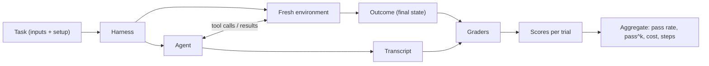
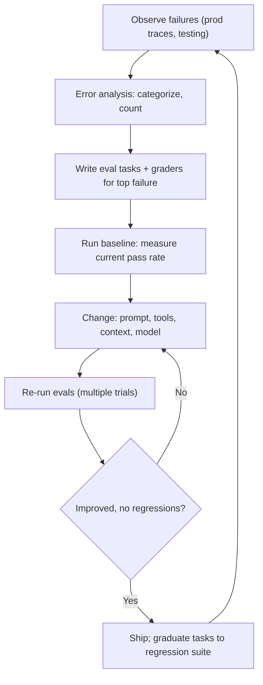

Imagine you've built a customer-support agent. You change one sentence in the system prompt, try five conversations by hand, and they all look better. You ship. Two days later, refunds are being issued twice for the same order, because the new wording made the agent retry a tool call it used to trust. Nobody noticed, because "try five conversations by hand" is not a measurement — it's a vibe.

**Evals** (evaluations) are how you replace vibes with evidence. For a plain LLM call, an eval can be as simple as "does the output match the expected label?" For an agent, which takes dozens of actions in a changing environment, chooses its own path, and behaves differently every time you run it, evaluation becomes its own engineering discipline. Teams that are good at agents are, almost without exception, teams that are good at evals: the eval suite is what lets them upgrade models, rewrite prompts and add tools without fear.

In this lesson you'll learn the vocabulary of agent evals, the main types of graders and their failure modes, how to build an eval set from real failures, how to reason about statistics and reliability (pass@k vs pass^k), and how to write a small but honest eval harness in Python.

## Why agent evals are hard

Classic software testing assumes determinism: same input, same output, one right answer. Agents violate every part of that.

- **Non-determinism.** Sampling, tool latency, retrieved content and even the model's own earlier phrasing differ between runs. The same task can pass on Monday and fail on Tuesday with no code change. A single run tells you little.
- **Long trajectories.** A coding agent might take 60 steps. A failure at step 7 (misreading a file) may only surface at step 55 (tests fail). Errors compound: if each step is 98% reliable, a 50-step task succeeds end-to-end only about 36% of the time (0.98⁵⁰ ≈ 0.36). See [when to use agents](when-to-use-agents.html) for the compounding-errors intuition.
- **Many valid paths.** There are a hundred correct ways to fix a bug or book a flight. An eval that demands one exact sequence of tool calls will punish creative but correct solutions — and sometimes the model's "unexpected" path is *better* than the one you imagined.
- **Environment state.** Agents act on the world: files, databases, browsers, APIs. Grading requires inspecting that world afterward, and every trial needs a clean, isolated copy of it, or trials contaminate each other.
- **Ambiguous success and cost.** "Write a helpful reply to this angry customer" has no exact-match answer, and 200 tasks × 5 trials × 40 steps is tens of thousands of model calls — budget pressure tempts you into samples too small to mean anything.

> [!KEY] The big idea
> An agent eval doesn't ask "did the output match?" — it asks "across many attempts in a realistic environment, how often does the agent reach a correct end state, by an acceptable path, at an acceptable cost?" Every design choice in this lesson serves one of those clauses.

## The vocabulary of agent evals

This vocabulary is widely used (Anthropic's engineering write-up on agent evals uses essentially these definitions):

| Term | Meaning | Example |
|---|---|---|
| **Task** | A single test case: inputs, environment setup and success criteria | "Refund order #1042 for the broken lamp; the customer has been charged $89." |
| **Trial** | One attempt by the agent at a task. You run several per task because results vary | Trial 3 of 5 for task `refund-broken-lamp` |
| **Transcript** (or **trajectory**) | The complete record of a trial: every message, model output, tool call, tool result and stop reason | The 14-message conversation including `get_order` and `issue_refund` calls |
| **Outcome** | The final state of the environment when the trial ends — not what the agent *says* happened | The refunds table contains exactly one $89 refund for #1042 |
| **Grader** (or **scorer**) | Logic that scores some aspect of the transcript or outcome | "Exactly one refund row exists" (code); "Reply is empathetic and accurate" (LLM judge) |
| **Eval suite** | A collection of tasks with a shared purpose, plus the harness that runs them | 120 support-ticket tasks used as a regression gate |
| **Harness** | The code that sets up environments, runs the agent, records transcripts, invokes graders and aggregates results | The ~80-line script later in this lesson |

The distinction between **transcript** and **outcome** is the single most important one. An agent can say "I've issued your refund!" while the refund API call actually failed — or succeed silently while claiming failure. Whenever an outcome is checkable, grade the outcome.



## Graders: code, models and humans

Graders come in three families. Good eval suites mix them, using the cheapest grader that is *valid* for each check.

### Code-based graders

**Code-based graders** are deterministic programs. They're fast, cheap, reproducible and impossible to sweet-talk. Common forms:

- **Unit or integration tests** — the backbone of coding evals. SWE-bench grades a patch by running the repository's tests (see [benchmarks](benchmarks.html)).
- **State checks** — query the environment after the trial: does the database row exist? Was the file created with the right contents? Was the email *not* sent? This is the gold standard for agents that act on systems.
- **String, regex and schema checks** — does the output parse as JSON? Does it contain the order ID? Does it avoid leaking the internal ticket number?
- **Tool-call assertions** — was `issue_refund` called at most once? Was `delete_account` never called?
- **Budget checks** — steps ≤ 25, cost ≤ $0.50, wall clock ≤ 3 minutes.

Their weakness is brittleness: exact match fails "$89.00" when expecting "89". Normalize aggressively and prefer checking *state* over checking *text*.

### Model-based graders (LLM-as-judge)

When quality can't be expressed as code — tone, helpfulness, faithfulness to sources, whether a research summary covers the key points — you use a **model-based grader**, commonly called **LLM-as-judge**: a separate model call that reads the transcript or output and returns a verdict.

Three common setups:

1. **Rubric-based (pointwise)** — the judge scores one output against explicit criteria: "PASS only if the reply (a) states the refund amount, (b) gives a timeline, (c) does not promise anything outside policy."
2. **Pairwise** — the judge sees two outputs (e.g., old prompt vs new prompt) and picks the better one. Humans and models are both more reliable at comparisons than absolute scores, which makes pairwise great for A/B decisions.
3. **Reference-based** — the judge compares the output to a known-good reference answer: "Does the candidate contain the same facts as the reference? Extra correct detail is fine; contradictions are failures."

Design rules that make judges far more reliable:

- **Binary or small-scale verdicts beat 1–10 scales.** "Pass/fail per criterion" is easier to calibrate and to act on than "7/10."
- **One criterion per judge call** when criteria are independent. A judge asked to check eight things at once misses some.
- **Reason before the verdict.** Ask for a short justification *then* the score, and use [structured outputs](structured-outputs.html) so the verdict is machine-readable.
- **Give the judge ground truth.** Pass the actual tool calls and environment state, not just the agent's claims, so the judge can catch "I've refunded you" when no refund happened.
- **Grade only what you specify.** Tell the judge explicitly what *not* to reward (length, formatting flourishes, politeness beyond the rubric).

### Known judge biases

LLM judges have systematic biases, documented in work such as Zheng et al.'s *Judging LLM-as-a-Judge* (2023):

| Bias | What happens | Mitigation |
|---|---|---|
| **Position bias** | In pairwise comparisons the judge favors the answer in a particular slot (often the first) | Run both orders; count a win only if it's consistent, otherwise call it a tie |
| **Verbosity bias** | Longer, more elaborate answers get higher scores even when not better | Rubrics that reward specific content, explicit "length is not a criterion" instructions, length-controlled comparisons |
| **Self-preference** (self-enhancement) | A model rates outputs from itself or its own family more favorably | Use a judge from a different model or family where feasible; validate against humans |
| **Leniency / sycophancy** | Judges lean toward "pass," especially when the output sounds confident | Binary criteria, require citing evidence, include known-bad examples in calibration |
| **Rubric drift** | The judge applies its own idea of quality instead of yours | Few-shot examples of pass and fail with explanations |

### Calibrating judges against humans

A judge is itself a model that needs evaluating. Before trusting it:

1. Have a domain expert hand-label 50–200 transcripts as pass/fail with a one-line reason, and run the judge on the same transcripts.
2. Measure agreement — not just accuracy. With imbalanced data (90% passes), a judge that always says "pass" is 90% accurate and useless. Report separately how many human-labeled failures the judge catches and how many human-labeled passes it accepts (its true negative and true positive rates, treating "pass" as positive), or use **Cohen's kappa**, which corrects for chance agreement.
3. Read every disagreement. Sometimes the judge is wrong (fix the rubric); sometimes the human was inconsistent (fix the labeling guideline). Shankar et al.'s *Who Validates the Validators?* (2024) found that people refine their criteria *while* grading — expect the rubric to evolve.
4. Hold out part of the labeled set and re-check agreement after rubric changes, so you don't overfit the judge prompt to the calibration set.

> [!TIP] Rule of thumb
> Use code graders wherever correctness is objectively checkable, LLM judges for the subjective remainder, and humans to calibrate the judges and to spot-check periodically. A suite that is 100% LLM-judged usually has untested assumptions hiding in it.

### Human review

**Human graders** remain the ground truth for subjective quality and for high-stakes expert domains (legal, medical, financial). They're slow, expensive and inconsistent with each other, so write a labeling guide, measure inter-annotator agreement, and spend human time where it has the most leverage: calibrating judges and doing error analysis.

## What to grade: outcome, trajectory, step

You can evaluate an agent at three granularities, and each catches different bugs.

**Outcome evals** check the end state: tests pass, the refund exists, the report answers the question. They're robust to the many-valid-paths problem and are the closest proxy for user value. Default to outcome evals.

**Trajectory evals** check *how* the agent got there:

- **Policy compliance**: did it verify identity before changing the account? Did it ask for confirmation before an irreversible action ([human-in-the-loop](human-in-the-loop.html))?
- **Efficiency**: number of steps, tokens, redundant tool calls, cost per task ([cost and latency](cost-and-latency.html)).
- **Safety**: did it ever touch files outside the workspace, or call a forbidden tool?

Trajectory checks should encode *constraints* ("never X," "Y before Z," "at most N calls"), not a single golden path. "The agent must call `search` then `read` then `answer`" is brittle; "the agent must not answer without reading at least one source" is robust.

**Per-step evals** (sometimes called **tool-call evals**) freeze a conversation prefix and test a single decision: given this history, does the model pick the right tool with the right arguments? They're cheap, fast and fairly deterministic, like unit tests for the agent's decision policy. They're excellent for [tool design](designing-tools.html) regressions ("after renaming the tool, does the model still pick it for date queries?"). Their limit: they don't capture how errors compound across steps, and a frozen prefix may not resemble what the current model would actually have produced.

```text
Per-step eval case: tool selection
History:  user: "What did I spend on flights last quarter?"
Expected: call  search_transactions
          args  category == "travel.air", date range covers Q3, no other filters
Grader:   code (assert tool name + argument predicates)
Result:   model called search_transactions({"query": "flights", "start": "2026-07-01", "end": "2026-09-30"})
          -> FAIL: used free-text query instead of category filter
```

## Capability evals vs regression evals

Eval suites serve two different purposes, and mixing them up causes confusion.

| | **Capability evals** | **Regression evals** |
|---|---|---|
| Question | "What can the agent do? How much better did we get?" | "Did we break anything that used to work?" |
| Expected pass rate | Low to medium — that's the point, it's a hill to climb | Near 100% |
| When run | During development, model upgrades, research | On every change, in CI, before deploy |
| What a drop means | Interesting signal | A blocking bug |
| Typical size | Larger, harder, more varied | Smaller, fast, curated |

Tasks graduate over time: when a capability task reliably passes (say, every trial over several weeks), move it into the regression suite so it stays solved. A capability suite that's at 95% has stopped telling you anything — add harder tasks.

## pass@k and pass^k

Because agents are non-deterministic, you run each task several times. How you aggregate those trials depends on what you care about.

- **pass@1**: the probability a single trial succeeds — the average success rate across trials.
- **pass@k**: the probability that *at least one* of k trials succeeds. Introduced for code generation (Chen et al., 2021, with HumanEval), it measures what an agent *can* do if you get to pick the best attempt — appropriate when you have a verifier (run the tests, keep the passing patch) or a human selects among drafts.
- **pass^k** ("pass hat k"): the probability that *all* k trials succeed. Popularized by τ-bench (2024) for customer-service agents, it measures **consistency** — appropriate when every user interaction must go right, because each customer only gets one try.

If a task's per-trial success probability is p, and trials are independent:

- pass@k = 1 − (1 − p)ᵏ — rises toward 1 as k grows
- pass^k = pᵏ — falls toward 0 as k grows

At p = 0.8: pass@5 ≈ 0.9997, but pass^5 ≈ 0.33. The same agent looks nearly perfect or unreliable depending on which question you ask. τ-bench showed exactly this pattern: agents with respectable pass@1 had pass^k that fell steeply as k increased.

Try it yourself — drag the per-trial success rate and k, and watch the two curves diverge:

<div class="widget" data-widget="pass-at-k"></div>

When you run n trials per task and observe c successes, use the unbiased estimators rather than plugging in p = c/n:

- pass@k ≈ 1 − C(n−c, k) / C(n, k)
- pass^k ≈ C(c, k) / C(n, k)

(where C is "n choose k"; requires n ≥ k). Compute per task, then average across tasks.

> [!KEY] Choose the metric that matches the product
> If a verifier or human picks the best of several attempts, pass@k is your number. If every attempt reaches a real user or touches real systems, pass^k is your number — and it's usually much lower than you'd like.

## Building eval sets from real failures

The best eval tasks don't come from brainstorming; they come from watching your agent fail.

### Start small and start now

You don't need 1,000 tasks to begin. Twenty to fifty tasks drawn from real usage, each with a clear success criterion, will catch more bugs than an elaborate synthetic suite built months later. Sources, roughly in order of value: **production failures** (bug reports, escalations, thumbs-down); **manual testing** (every hand check during development becomes a task); **domain edge cases** (partial refunds, ambiguous requests, adversarial inputs — see [agent security](agent-security.html)); and **synthetic variations** of real tasks, which you must review, since models produce plausible but unrealistic cases.

Make sure the suite includes **negative cases** — tasks where the right behavior is to refuse, ask a clarifying question, or do nothing. An agent tuned only on "do X" tasks learns to always do something.

### Error analysis: read the transcripts

**Error analysis** is the practice of systematically reading transcripts to find out *how* the agent fails before deciding *what* to measure. It's unglamorous and the highest-leverage activity in agent development. A widely taught method borrows from qualitative research:

1. **Sample** ~50–100 recent transcripts (biased toward failures and low-rated sessions, plus some random ones).
2. **Open coding**: read each one and write a free-form note on the *first* thing that went wrong. Don't use predefined categories yet. "Agent searched orders by customer name instead of email; got wrong customer."
3. **Axial coding**: group the notes into categories — "wrong lookup key," "hallucinated policy," "gave up after tool error," "ignored user correction."
4. **Count**: a frequency table tells you where to invest. Often two or three categories account for most failures.
5. **Write evals for the top categories** — each category becomes a set of tasks with graders specific to that failure.
6. **Repeat** until new transcripts stop revealing new failure categories.

Why the *first* error? Downstream errors are usually consequences of it.

> [!EXAMPLE] From transcripts to an eval
> A team reads 80 failed support conversations. Open coding yields notes like "refunded full amount for partial damage," "refunded shipping when policy excludes it," "promised refund before checking eligibility." Axial coding groups 31 of 80 into **refund-amount errors**. They write 25 tasks covering partial damage, shipping, discounts and multi-item orders, each graded by a state check on the refunds table. Baseline: 56% pass. After adding a `calculate_refund` tool that encodes the policy, 92% — and the tasks join the regression suite.

### Simulated users

Conversational agents need a counterpart. A **simulated user** is an LLM instructed to play a customer with a hidden goal and persona ("You want to change your flight to Friday but only if it's under $100 extra; you don't know your booking reference"). τ-bench and τ²-bench use this approach, grading by comparing the final database state against the expected one.

Simulators have failure modes of their own — too cooperative, leaking information a real user wouldn't volunteer, forgetting their goal — so validate them by reading their transcripts too. See [conversational and voice agents](conversational-voice-agents.html).

### Environment and sandbox-based evals

For agents that act — coding, computer use, data analysis — the most faithful eval runs the agent in a real but **isolated environment**: a container with the repository checked out, a seeded database, a self-hosted web app. Key practices:

- **Fresh state per trial**, so leftovers from trial 2 can't make trial 3 pass.
- **Hide the grader.** Visible, editable tests invite agents to edit the tests; copy grading tests in *after* the agent finishes.
- **Remove answer leaks** — e.g., a git history that contains the fix.
- **Pin everything** (images, dependencies, mock API responses, the clock) so a failure means the agent changed, not the world.

See [guardrails and sandboxing](guardrails-and-sandboxing.html) for the isolation technology itself.

## Online evals and A/B testing

**Offline evals** run your fixed suite before deploy. **Online evals** measure the agent on live traffic, catching what your suite didn't anticipate: run rubric judges asynchronously on a sample of production transcripts; track implicit signals (escalations, user rephrasings, abandonment, thumbs down); and **A/B test** new versions on a slice of traffic, comparing a primary metric (resolution rate) plus **guardrail metrics** that must not regress (cost per task, safety flags). Shadow mode and canaries reduce rollout risk ([deployment](deployment.html)). Capturing and querying those transcripts is the subject of [observability](observability.html) — and production failures feed straight back into error analysis and new offline tasks.

## Statistics: is that improvement real?

Your new prompt scores 74% versus the old 70% on 50 tasks. Ship it? Almost certainly you can't tell yet.

### Confidence intervals

An eval score is an estimate of a true success rate. For a pass rate p measured on n independent tasks, the **standard error** is approximately √(p(1−p)/n), and a 95% confidence interval is roughly p ± 1.96 × SE.

| Tasks (n) | Observed pass rate | Approx. 95% CI |
|---|---|---|
| 50 | 70% | ±13 points (57–83%) |
| 200 | 70% | ±6 points (64–76%) |
| 1,000 | 70% | ±3 points (67–73%) |

A 4-point difference on 50 tasks is well inside the noise. For small n or rates near 0% or 100%, use a Wilson interval instead of the normal approximation.

### Variance across trials and clustering

Running 5 trials per task doesn't give you 5× the independent data. Trials of the same task are correlated — a task that's hard is hard every time. Compute each task's mean score first, then compute the standard error *across tasks* (this is a **clustered standard error**). Extra trials reduce the within-task noise; extra tasks reduce the between-task uncertainty, which usually dominates. When forced to choose, more tasks usually beats more trials.

### Paired comparisons

Run both agent versions on the **same tasks** and analyze per-task *differences*: task difficulty cancels out, so a paired test is far more sensitive than comparing two averages. Also check the flip table — a "+2%" that's really 15 fixes and 13 new breakages deserves investigation.

> [!WARNING]
> Running 20 prompt variants and shipping the best one on a 50-task suite is a recipe for selecting noise. If you compare many variants, confirm the winner on a fresh held-out set or with more trials before trusting the margin.

## The eval-driven development loop

Mature teams develop agents the way good engineers do test-driven development:



Two habits make the loop work: **write the eval before the fix** (it should fail at baseline, proving it detects the problem), and **read transcripts after every run** — a jump from 60% to 85% might be a real improvement or a broken grader.

## Pitfalls

- **Grader hacking.** Agents optimize for whatever passes. Coding agents have been observed special-casing test inputs, deleting failing tests, or weakening assertions. LLM judges can be swayed by confident claims of success. Guard with hidden tests, state checks and judges that see ground truth. This is the eval-time cousin of reward hacking in RL ([training agents](training-agents.html)).
- **Ambiguous tasks.** If two experts would disagree on whether a transcript passes, the task is broken, not the agent. A good test: could a competent human, given only the task prompt, succeed and know they've succeeded? Ambiguous tasks put a ceiling on scores and add noise. SWE-bench Verified exists largely to remove underspecified tasks from SWE-bench (see [benchmarks](benchmarks.html)).
- **Overfitting to the eval.** Iterating against the same 50 tasks for months tunes your prompt to those tasks. Keep a held-out set you rarely look at, and refresh the suite with new production failures.
- **Contamination.** Public benchmark tasks (and solutions) may be in training data; internal evals built from your own data are far less exposed.
- **Stale suites and single metrics.** Version tasks alongside your code as policies change, and always report cost, latency and steps beside quality — 2% more accurate at 3× the cost may be worse.

## Tooling

You can build a harness from scratch (as below), and many teams do. Established tools add datasets, parallel execution, result storage and run-to-run diffing. As of 2026, common choices include **Inspect AI** (open source, from the UK AI Security Institute; tasks/solvers/scorers abstractions and sandboxed agent evals), **promptfoo** (open-source CLI with declarative YAML configs, assertions and red-teaming), **Braintrust** and **LangSmith** (hosted platforms that connect production traces, datasets and experiments), **OpenAI Evals** (open-source framework plus a hosted evals API), and **DeepEval** (pytest-style library with ready-made judge metrics). APIs evolve quickly — check current docs; the concepts here apply regardless of tool.

## Hands-on: a tiny eval harness

Let's build a minimal but honest harness for a refund agent. It:

1. Gives each trial a **fresh environment** (an in-memory orders database).
2. Runs the agent with a manual [agent loop](the-agent-loop.html).
3. Grades the **outcome** with a code grader (the refunds actually issued).
4. Grades the **reply** with an LLM judge that sees ground truth, using structured output.
5. Runs k trials per task and reports pass@1, pass@k and pass^k.

First, the environment and the agent loop:

```python
import json
import anthropic

client = anthropic.Anthropic()
AGENT_MODEL = "claude-sonnet-5-5"

SYSTEM = ("You are a support agent. Look up orders before acting. Refund only damaged items, "
          "at the item price (never shipping). Tell the customer exactly what you did.")

TOOLS = [
    {"name": "get_order", "description": "Look up an order by ID. Returns items, prices and shipping cost.",
     "input_schema": {"type": "object", "properties": {"order_id": {"type": "string"}},
                      "required": ["order_id"]}},
    {"name": "issue_refund", "description": "Refund an amount in USD for an order. Irreversible.",
     "input_schema": {"type": "object",
                      "properties": {"order_id": {"type": "string"}, "amount": {"type": "number"}},
                      "required": ["order_id", "amount"]}},
]

class Env:
    """Isolated world state; a new one is created for every trial."""
    def __init__(self, orders: dict):
        self.orders = json.loads(json.dumps(orders))  # deep copy so trials can't leak state
        self.refunds: list[tuple[str, float]] = []

    def call(self, name: str, args: dict) -> tuple[str, bool]:
        order = self.orders.get(args.get("order_id", ""))
        if order is None:
            return f"Order {args.get('order_id')} not found", True
        if name == "get_order":
            return json.dumps(order), False
        if name == "issue_refund":
            self.refunds.append((args["order_id"], round(float(args["amount"]), 2)))
            return "Refund issued", False
        return f"Unknown tool {name}", True

def run_agent(user_msg: str, env: Env, max_steps: int = 10) -> dict:
    messages = [{"role": "user", "content": user_msg}]
    for step in range(1, max_steps + 1):
        resp = client.messages.create(model=AGENT_MODEL, max_tokens=16000, system=SYSTEM,
                                      tools=TOOLS, messages=messages)
        messages.append({"role": "assistant", "content": resp.content})
        if resp.stop_reason != "tool_use":   # end_turn, max_tokens, refusal...: stop and record it
            break
        results = []
        for block in resp.content:
            if block.type == "tool_use":
                out, is_error = env.call(block.name, block.input)
                results.append({"type": "tool_result", "tool_use_id": block.id,
                                "content": out, "is_error": is_error})
        messages.append({"role": "user", "content": results})  # all results in ONE message
    final = "".join(b.text for b in resp.content if b.type == "text")
    return {"messages": messages, "final": final, "steps": step, "stop_reason": resp.stop_reason}
```

Next, the tasks and the two graders. The judge receives the **actual** refunds from the environment, so it can fail a reply that claims something that didn't happen:

```python
from dataclasses import dataclass
from typing import Literal
from pydantic import BaseModel

JUDGE_MODEL = "claude-opus-5-5"

@dataclass
class Task:
    id: str
    prompt: str
    orders: dict
    expected_refunds: list[tuple[str, float]]  # the exact end state we require
    rubric: str

def grade_outcome(task: Task, env: Env, trial: dict) -> bool:
    """Code grader: the world must be in exactly the expected state."""
    return trial["stop_reason"] == "end_turn" and sorted(env.refunds) == sorted(task.expected_refunds)

class Verdict(BaseModel):
    reasoning: str                  # judge explains first...
    verdict: Literal["pass", "fail"]  # ...then commits to a binary verdict

JUDGE_PROMPT = """Grade a support agent's final reply to a customer.
Rubric (all must hold for PASS):
{rubric}

Ground truth - refunds actually issued: {refunds}
<reply>{reply}</reply>

Judge only the rubric. Length, warmth and formatting are not criteria.
If the reply states or implies an action not in the ground truth, it FAILS."""

def grade_reply(task: Task, env: Env, trial: dict) -> Verdict:
    resp = client.messages.parse(
        model=JUDGE_MODEL, max_tokens=16000,
        messages=[{"role": "user", "content": JUDGE_PROMPT.format(
            rubric=task.rubric, refunds=env.refunds or "none", reply=trial["final"])}],
        output_format=Verdict,
    )
    return resp.parsed_output
```

Finally, the runner: k trials per task, per-trial records to JSONL for later reading, and the aggregate metrics using the unbiased estimators from earlier:

```python
from math import comb
from statistics import mean

def run_eval(tasks: list[Task], k: int = 5, out_path: str = "eval_results.jsonl") -> None:
    per_task: dict[str, list[bool]] = {}
    with open(out_path, "w") as f:
        for task in tasks:
            for i in range(k):
                env = Env(task.orders)                    # fresh state every trial
                trial = run_agent(task.prompt, env)
                outcome_ok = grade_outcome(task, env, trial)
                judged = grade_reply(task, env, trial)
                passed = outcome_ok and judged.verdict == "pass"
                per_task.setdefault(task.id, []).append(passed)
                f.write(json.dumps({"task": task.id, "trial": i, "passed": passed,
                                    "outcome_ok": outcome_ok, "judge": judged.verdict,
                                    "judge_reasoning": judged.reasoning, "steps": trial["steps"],
                                    "refunds": env.refunds, "reply": trial["final"]}) + "\n")

    n = k
    pass1 = mean(mean(r) for r in per_task.values())
    pass_at_k = mean(1 - comb(n - sum(r), k) / comb(n, k) for r in per_task.values())
    pass_hat_k = mean(comb(sum(r), k) / comb(n, k) for r in per_task.values())
    print(f"tasks={len(tasks)} trials/task={k}")
    print(f"pass@1={pass1:.2f}  pass@{k}={pass_at_k:.2f}  pass^{k}={pass_hat_k:.2f}")
    for tid, r in per_task.items():
        print(f"  {tid:<24} {''.join('✓' if x else '✗' for x in r)}")

tasks = [
    Task(id="partial-damage",
         prompt="Order A100 arrived and the lamp is broken. The rug is fine. Please refund what's fair.",
         orders={"A100": {"items": [{"name": "lamp", "price": 89.0}, {"name": "rug", "price": 120.0}],
                          "shipping": 15.0}},
         expected_refunds=[("A100", 89.0)],
         rubric="- States the refund amount ($89)\n- Says the rug and shipping are not refunded"),
    Task(id="no-damage-no-refund",
         prompt="Order B200 came. I just don't like the color. Refund me including shipping.",
         orders={"B200": {"items": [{"name": "mug", "price": 12.0}], "shipping": 5.0}},
         expected_refunds=[],   # negative case: correct behavior is NOT to refund
         rubric="- Does not claim any refund was issued\n- Explains that only damaged items are refunded"),
]

if __name__ == "__main__":
    run_eval(tasks, k=5)
```

This harness gets the essentials right: fresh state per trial, outcome graded from the environment, a negative task, a judge that sees ground truth, pass^k, and a JSONL log so you can *read* every failure. What it lacks — parallelism, retries, cost tracking, judge calibration — is what the tools above provide and the exercises ask you to add.

## Key Takeaways

- Agent evals are hard because agents are non-deterministic, take long multi-step paths with many valid routes, and change environment state. Run multiple **trials** per **task** and grade the **outcome**, not the agent's claims.
- Use **code graders** (tests, state checks, assertions) wherever correctness is objective; **LLM judges** for subjective qualities; **humans** to calibrate judges and do error analysis.
- LLM judges have known biases — position, verbosity, self-preference, leniency. Use binary rubric criteria, reason-then-verdict structured output, ground truth in the prompt, and measure agreement with human labels (TPR/TNR or kappa, not just accuracy).
- Grade at the right level: **outcome** by default, **trajectory** as constraints (not golden paths), **per-step** for cheap tool-choice regressions. Keep **capability** and **regression** suites separate.
- **pass@k** measures what an agent can do with best-of-k selection; **pass^k** measures consistency. Customer-facing agents live or die by pass^k.
- The best eval tasks come from **error analysis** of real transcripts: open coding, axial coding, count, then write tasks for the biggest categories.
- Eval scores have error bars. Small suites can't detect small improvements; use confidence intervals, clustered standard errors and paired comparisons.
- Beware grader hacking, ambiguous tasks, contamination and overfitting; always report cost and latency alongside quality.

## Exercises

1. **Compute by hand.** An agent has per-trial success p = 0.9 on a task. Compute pass@3 and pass^3. Now suppose you observed 7 successes in 10 trials: compute pass^3 with the unbiased estimator C(c,k)/C(n,k). Explain to a product manager why a "90% accurate" agent might still fail one in four customers who use it three times.
2. **Add budgets and cost.** Extend the harness to record `response.usage.input_tokens` and `output_tokens` for every model call in `run_agent`, compute cost per trial, and add a grader that fails any trial over 6 steps. Report mean cost and p95 steps per task.
3. **Fix the judge's blind spots.** Write three "adversarial" replies for the `partial-damage` task — one verbose and flattering but wrong, one terse but correct, one that claims a refund that wasn't issued — and check whether the judge grades them correctly. Adjust the rubric until it does.
4. **Calibrate a judge.** Generate 40 transcripts across both tasks, hand-label each pass/fail, and compute the judge's true positive rate, true negative rate and Cohen's kappa against your labels. Read every disagreement and categorize the cause.
5. **Paired comparison (harder).** Make a second version of the system prompt. Run both versions on 20+ tasks (write more), 5 trials each, and compute the per-task difference in pass rate, the mean difference, a 95% confidence interval for it (bootstrap over tasks), and the fail→pass / pass→fail flip counts. Would you ship?

<details class="solutions">
<summary>Hints and solution sketches</summary>

1. **Hint:** pass@k is "not all k fail", pass^k is "all k succeed", and for the estimator you only need two binomial coefficients. **Sketch:** pass@3 = 1 − (1 − 0.9)³ = 1 − 0.001 = 0.999. pass^3 = 0.9³ = 0.729. From 7 successes in 10 trials: pass^3 ≈ C(7,3) / C(10,3) = 35 / 120 ≈ 0.29 (lower than plugging in 0.7³ ≈ 0.34). For the product manager: "90% accurate" means each conversation succeeds 9 times in 10, but a customer who uses it three times needs all three to go right, which happens 72.9% of the time, so about 27%, roughly one in four of those customers, hit at least one failure.
2. **Hint:** Accumulate `resp.usage` inside the loop of `run_agent` and return it in the trial dict, then write cost and budget as ordinary functions with the same signature as `grade_outcome`. **Sketch:** Multiply tokens by the agent model's prices (from [cost and latency](cost-and-latency.html); add the cache fields if you turn on caching). Add `grade_budget` to the pass condition or report it separately as a guardrail metric. With only 5 trials per task, a "p95" is essentially the slowest trial, so use more trials or report the max honestly.

    ```python
    from statistics import mean, quantiles

    PRICE_IN, PRICE_OUT = 2.00, 10.00  # $/MTok, claude-sonnet-5-5 (Nov 2026; check current pricing)

    # In run_agent: usage = {"input": 0, "output": 0} before the loop; after each call,
    # usage["input"] += resp.usage.input_tokens; usage["output"] += resp.usage.output_tokens.
    # Return it in the trial dict as "usage".

    def trial_cost(trial: dict) -> float:
        u = trial["usage"]
        return (u["input"] * PRICE_IN + u["output"] * PRICE_OUT) / 1_000_000

    def grade_budget(task, env, trial: dict) -> bool:
        return trial["steps"] <= 6

    def summarize(costs: list[float], steps: list[int]) -> str:
        return f"mean cost ${mean(costs):.4f}, p95 steps {quantiles(steps, n=20, method='inclusive')[-1]:.1f}"
    ```
3. **Hint:** Test the judge directly: build an `Env`, set its `refunds` to the ground truth you want, and call `grade_reply` with a hand-written `{"final": ...}` dict, several times per case, since the judge is non-deterministic too. **Sketch:** Three cases with expected verdicts: (a) a long, warm apology that says $89 was refunded "and, as a courtesy, your $15 shipping too", with ground truth `[("A100", 89.0)]` → fail (it claims an action that did not happen); (b) "Refunded $89 for the broken lamp. The rug and shipping aren't refunded." with the same ground truth → pass; (c) the same correct-sounding text with ground truth `[]` → fail. If (a) passes, add a criterion that every amount mentioned must match the ground-truth refunds exactly. If (b) fails, the judge is rewarding warmth, so restate that brevity is acceptable. Keep the cases as a small judge regression suite.

    ```python
    cases = [  # (reply, refunds actually issued, expected verdict)
        ("We're so sorry! We've refunded $89 for the lamp and, as a courtesy, your $15 shipping.",
         [("A100", 89.0)], "fail"),
        ("Refunded $89 for the broken lamp. The rug and shipping aren't refunded.", [("A100", 89.0)], "pass"),
        ("Refunded $89 for the broken lamp. The rug and shipping aren't refunded.", [], "fail"),
    ]
    for reply, refunds, expected in cases:
        env = Env(tasks[0].orders)
        env.refunds = refunds
        got = grade_reply(tasks[0], env, {"final": reply}).verdict
        print(f"expected={expected} got={got} {'OK' if got == expected else 'MISMATCH'}")
    ```
4. **Hint:** Treat "pass" as the positive class: TPR is the share of human passes the judge accepts, TNR is the share of human failures it catches, and kappa compares observed agreement with the agreement expected by chance from each side's pass rate. **Sketch:** Worked example: humans label 28 pass and 12 fail; the judge accepts 26 of the 28 and catches 8 of the 12. TPR = 26/28 ≈ 0.93, TNR = 8/12 ≈ 0.67. Observed agreement = (26 + 8)/40 = 0.85. The judge says pass 30 times, so chance agreement = 0.70 × 0.75 + 0.30 × 0.25 = 0.60, and kappa = (0.85 − 0.60) / (1 − 0.60) ≈ 0.63. The weak spot is the TNR: the judge lets a third of real failures through. Categorize each disagreement (judge too lenient, rubric ambiguous, inconsistent human label, judge missing ground truth) and fix the rubric or the labeling guide accordingly, then re-check on held-out labels.

    ```python
    def judge_agreement(human: list[bool], judge: list[bool]) -> dict:
        n, hp, jp = len(human), sum(human), sum(judge)
        tp = sum(h and j for h, j in zip(human, judge))
        tn = sum(not h and not j for h, j in zip(human, judge))
        po = (tp + tn) / n
        pe = (hp / n) * (jp / n) + (1 - hp / n) * (1 - jp / n)
        return {"tpr": tp / hp, "tnr": tn / (n - hp), "kappa": (po - pe) / (1 - pe)}
    ```
5. **Hint:** Compute one difference per task (B's pass rate minus A's) and bootstrap by resampling *tasks*, not trials, because tasks are the independent unit. **Sketch:** Run both prompts on the same tasks with 5 trials each, then compute the per-task differences, their mean, a percentile bootstrap interval and the flip counts (classifying a task as passing when it passes in most trials). Ship only if the interval excludes zero, the flips do not hide a new class of failures (read every pass→fail task), and guardrail metrics such as cost, steps and negative-case behavior did not regress. With about 20 tasks the interval will usually be wide, so the honest answer is often "not yet: add tasks."

    ```python
    import random
    from statistics import mean

    def paired_bootstrap(a: dict[str, list[bool]], b: dict[str, list[bool]], iters: int = 10_000):
        diffs = [mean(b[t]) - mean(a[t]) for t in a]  # per-task difference in pass rate
        boots = sorted(mean(random.choices(diffs, k=len(diffs))) for _ in range(iters))
        ci = (boots[int(0.025 * iters)], boots[int(0.975 * iters)])
        flips = {"fail->pass": sum(mean(a[t]) < 0.5 <= mean(b[t]) for t in a),
                 "pass->fail": sum(mean(b[t]) < 0.5 <= mean(a[t]) for t in a)}
        return mean(diffs), ci, flips
    ```

</details>

## Check Your Understanding

```quiz
Q: A booking agent's final message says "Your flight is booked!" but the reservations table is empty. Which grading approach would have caught this most reliably?
- [ ] An LLM judge scoring the final message against a booking-confirmation rubric
- [x] A code grader that queries the reservations table after the trial ends
- [ ] A trajectory check that a booking tool was called before the final message
- [ ] A regex check that the final message contains a confirmation number
E: The outcome (environment state) is ground truth; the transcript is only the agent's account. A judge reading only the reply accepts a confident claim, a regex is fooled by an invented confirmation number, and a tool-call check passes even when the booking call returned an error.

Q: Your support agent has pass@1 = 0.85. Customers come back several times a month, and each conversation must go right. Which metric best reflects their experience?
- [ ] pass@k, since it shows how often the agent can solve each customer's task
- [x] pass^k, since it is the chance that all k of a customer's attempts succeed
- [ ] pass@1, since each conversation is independent and gets a single attempt
- [ ] Mean steps per task, since faster resolutions are what customers notice
E: pass@k assumes someone picks the best of k attempts, which customers can't. pass@1 describes one conversation but hides how quickly repeated interactions accumulate failures: pass^k falls fast as k grows (0.85^5 ≈ 0.44).

Q: In a pairwise LLM-judge comparison, response A wins when shown first but B wins when the order is swapped. What is the best interpretation and handling?
- [ ] Verbosity bias; truncate both responses to the same length and re-run once
- [ ] Judge randomness; re-run the original ordering a few times and take the majority
- [x] Position bias; run both orders and count inconsistent verdicts as a tie
- [ ] Self-preference; switch to a judge from a different model family and re-run
E: A verdict that flips with order is the signature of position bias. The standard mitigation is to evaluate both orderings and count a win only when it is consistent. Re-running one ordering just repeats the bias; a different judge family addresses self-preference, a different problem.

Q: Your judge agrees with human labels 92% of the time. 90% of the labeled transcripts are passes. What should you check next?
- [ ] Its agreement on a fresh labeled set, to make sure 92% wasn't a lucky sample
- [x] Its true negative rate: how many human-labeled failures it actually catches
- [ ] Its true positive rate: how many human-labeled passes it correctly accepts
- [ ] Whether a stronger judge model raises raw agreement above 95 percent
E: With 90% passes, a judge that always says "pass" scores 90% agreement and catches no failures. The rare class is where it can hide, so check the true negative rate (or Cohen's kappa). Its true positive rate is almost certainly high already; more raw agreement on the same skewed set proves little.

Q: Version B scores 76% vs version A's 72% on a 50-task suite. What's the most defensible conclusion?
- [ ] B is better; a 4-point gain is meaningful when both use the same 50 tasks
- [ ] A is better; a new version must clear a margin before replacing the baseline
- [x] It's within noise at n=50; use a paired comparison on more tasks first
- [ ] B is better if you rerun both with 5 trials per task and B still leads
E: At n=50 the 95% CI on each score is about ±12 points. Extra trials shrink within-task noise but not between-task uncertainty, which dominates; you need more tasks and a paired, per-task analysis to detect a 4-point difference.

Q: Which trajectory check is most robust to the "many valid paths" problem?
- [ ] The agent must call search, then read_page, then answer, in that order
- [ ] The agent's tool calls must match one of three recorded golden transcripts
- [x] The agent must never call issue_refund before get_order returns for that order
- [ ] The agent must finish in the same number of steps as the reference solution
E: Constraints ("never X before Y", "at most N calls") allow any valid path while catching policy violations. Even several golden transcripts still penalize a correct fourth strategy, and step-count matching punishes efficient or careful alternatives.

Q: Where do the highest-value new eval tasks usually come from?
- [ ] Public benchmarks in your domain, since experts have already validated them
- [ ] A team brainstorm of edge cases, since it covers failures not yet seen in prod
- [x] Error analysis of real transcripts: categorizing and counting actual failures
- [ ] Model-generated hard cases, since they scale cheaply to thousands of tasks
E: Error analysis grounds the suite in real failure modes, weighted by frequency. Brainstormed and synthetic cases are useful supplements, and public benchmarks help shortlist models, but none tells you how *your* agent actually fails.
```

## Further Reading

- [Demystifying evals for AI agents (Anthropic Engineering)](https://www.anthropic.com/engineering/demystifying-evals-for-ai-agents) — practical guide to tasks, trials, graders, and building agent eval suites.
- [Judging LLM-as-a-Judge with MT-Bench and Chatbot Arena (Zheng et al., 2023)](https://arxiv.org/abs/2306.05685) — the foundational study of LLM judges, including position, verbosity and self-enhancement biases.
- [τ-bench: A Benchmark for Tool-Agent-User Interaction (Yao et al., 2024)](https://arxiv.org/abs/2406.12045) — simulated users, state-based grading and the pass^k reliability metric.
- [Evaluating Large Language Models Trained on Code (Chen et al., 2021)](https://arxiv.org/abs/2107.03374) — introduces HumanEval and the unbiased pass@k estimator.
- [Adding Error Bars to Evals (Miller, 2024)](https://arxiv.org/abs/2411.00640) — a statistician's guide to confidence intervals, clustering and paired comparisons for model evals.
- [Who Validates the Validators? (Shankar et al., 2024)](https://arxiv.org/abs/2404.12272) — how to align LLM graders with human preferences, and why criteria drift while grading.
- [Your AI Product Needs Evals (Hamel Husain)](https://hamel.dev/blog/posts/evals/) — a practitioner's case for error analysis and iterative eval building.
- [Inspect AI documentation](https://inspect.aisi.org.uk/) — a well-designed open-source framework for agentic evals in sandboxes; worth reading for its abstractions alone.
