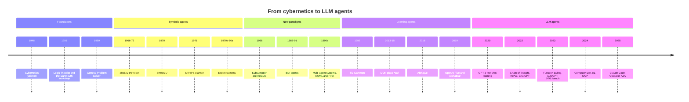

Today's AI agents can look as if they appeared from nowhere in 2023. They didn't. Almost every idea in a modern agent, including planning before acting, reacting quickly to surprises, keeping beliefs and goals separate, splitting work across specialized agents, and learning from reward, was invented, tried and argued over decades ago. What changed is the engine: large language models finally gave these old designs a general-purpose reasoner that works in any domain you can describe in words.

This lesson is a guided tour of roughly 75 years of agents. It isn't nostalgia. Each era solved a problem that modern builders still face, and each failed in a way that's worth knowing before you repeat it. We'll finish by mapping classical ideas directly onto the parts of a modern LLM agent.

## The Big Picture



## Foundations: Cybernetics and Early AI (1940s–1960s)

### Cybernetics

The agent idea predates the term "artificial intelligence." In 1948 Norbert Wiener published *Cybernetics: Or Control and Communication in the Animal and the Machine*. Its central concept was the **feedback loop**: a system measures the gap between its current state and a goal, acts to shrink the gap, measures again and repeats. A thermostat, an anti-aircraft predictor and a person reaching for a cup all fit.

Around the same time, W. Grey Walter built small electromechanical "tortoises" that wandered toward light and found their way back to a charging station. They were strikingly lifelike for machines with a couple of vacuum-tube "neurons."

**Lesson for today:** the [agent loop](the-agent-loop.html) is a feedback loop. An agent that acts without checking the result of its action, by running the tests or re-reading the page, has thrown away cybernetics' most important idea.

### Logic Theorist and the General Problem Solver

At the 1956 Dartmouth workshop, the event that named the field, Allen Newell, Herbert Simon and Cliff Shaw presented the **Logic Theorist**, a program that proved theorems from Whitehead and Russell's *Principia Mathematica* by searching through possible inference steps. Their follow-up, the **General Problem Solver (GPS)** (1957–59), introduced **means-ends analysis**: compare the current state to the goal, find the biggest difference, and pick an operator that reduces it, recursing into subgoals if that operator can't be applied yet.

GPS was "general" only in principle. Every problem had to be hand-encoded as states and operators, and the search exploded on anything realistic. Still, it established that intelligent behavior could be framed as **search through a problem space**, an idea that runs straight through to modern planning and tree-search methods like those in [reasoning and planning](reasoning-and-planning.html).

## Symbolic Agents in Small Worlds (1960s–1980s)

### SHRDLU

Terry Winograd's **SHRDLU** (MIT, around 1968–70) let a user converse in English with a program that manipulated a simulated "blocks world":

```text
User:    Pick up a big red block.
SHRDLU:  OK.
User:    Find a block which is taller than the one you are holding and put it into the box.
SHRDLU:  By "it", I assume you mean the block which is taller than the one I am holding. OK.
```

It parsed language, kept track of the world state, planned actions and explained its reasoning. It was dazzling, and it didn't scale. Every word, object and rule was hand-coded for a tiny world. Outside the blocks it understood nothing.

### Shakey and STRIPS

**Shakey** (SRI International, 1966–72) was the first mobile robot that reasoned about its own actions. It had a camera, a range finder and bump sensors, and it took commands like "push the block off the platform." Shakey's project produced three ideas still in use:

- **A\* search** (1968), the pathfinding algorithm used in games and route planners to this day.
- **STRIPS** (Fikes & Nilsson, 1971), a planning language in which each action has **preconditions**, an **add list** and a **delete list**. Planners chain actions so that one action's effects satisfy the next one's preconditions.
- A layered **sense–plan–act** architecture.

Shakey also exposed the weakness of pure deliberation. Planning took so long that the world could change before the robot moved, and a single wrong belief could derail a whole plan.

**Lesson for today:** STRIPS-style thinking ("what must be true before I call this tool, and what will be true after?") is exactly how you should write [tool descriptions](designing-tools.html). And Shakey's slowness is the ancestor of a modern question: how much should an agent plan up front versus re-plan after each observation?

### Expert systems

The 1970s and 80s brought **expert systems**: programs that encoded specialist knowledge as hundreds or thousands of if-then rules. **DENDRAL** inferred molecular structures, **MYCIN** recommended antibiotics for blood infections, and **XCON (R1)** configured computer orders at Digital Equipment Corporation and was a genuine commercial success.

Expert systems were mostly advisors, not agents, but their story matters. They hit the **knowledge acquisition bottleneck**: getting experts' knowledge into rules was slow and expensive, rules interacted in unexpected ways, and systems were **brittle**, failing badly just outside their designed scope. Inflated expectations and disappointing results contributed to the late-1980s collapse in funding known as an **AI winter**.

**Lesson for today:** LLMs sidestep the knowledge bottleneck by learning from text at scale. But brittleness at the edge of competence hasn't gone away; it just moved. And the hype-then-disappointment cycle is worth remembering whenever agent marketing gets ahead of results.

## New Paradigms: Reactive, BDI and Multi-Agent (1980s–1990s)

### Brooks and the reactive revolution

Rodney Brooks at MIT argued that the sense–model–plan–act pipeline was backwards. His **subsumption architecture** (1986) built robots from layers of simple behaviors ("avoid obstacles", "wander", "explore"), with higher layers able to suppress lower ones, and **no central world model at all**. In papers like "Intelligence without representation" (1991) and "Elephants Don't Play Chess" (1990) he argued that the world is its own best model: sense it constantly instead of reasoning about a stale copy.

Reactive robots were fast and robust in messy physical environments. Brooks' approach later reached millions of homes through iRobot's Roomba. But purely reactive agents struggle with anything that needs long-horizon reasoning.

The field's eventual answer was **hybrid architectures**: a fast reactive layer for immediate responses and a slower deliberative layer for planning.

**Lesson for today:** modern agents echo this split. A model reasons deliberately, but the agent loop keeps it reactive by putting fresh observations in front of it at every step. Re-reading a file before editing it is Brooks' "use the world as its own model."

### Beliefs, Desires, Intentions

Philosopher Michael Bratman's theory of practical reasoning (1987) argued that intentions, commitments to plans, are what let resource-bounded agents act coherently over time. Anand Rao and Michael Georgeff formalized this as the **BDI** architecture (early 1990s), and it was implemented in systems like the **Procedural Reasoning System (PRS)**:

- **Beliefs**: what the agent thinks is true about the world.
- **Desires**: the states it would like to bring about.
- **Intentions**: the desires it has *committed* to, with plans in progress.

A key BDI insight is **commitment with reconsideration**. An agent that never reconsiders its intentions plows ahead after the world has changed. One that reconsiders constantly never finishes anything.

**Lesson for today:** an LLM agent's to-do list or plan file is its set of intentions, its context is its beliefs, and the user's goal is its desire. The BDI reconsideration problem is alive and well: agents that rigidly follow an outdated plan and agents that thrash between approaches are two of the most common failure modes.

### Multi-agent systems and agent communication

Once you have one agent, you want several. Distributed AI research produced the **Contract Net Protocol** (Reid Smith, 1980), in which a manager announces a task, contractors bid and the manager awards it. That pattern is still used in task allocation.

The 1990s brought efforts to standardize how agents talk:

- **KQML** (Knowledge Query and Manipulation Language), from the DARPA Knowledge Sharing Effort in the early 1990s, defined message types ("performatives") such as `ask-if`, `tell` and `achieve`, based on speech-act theory.
- **FIPA** (the Foundation for Intelligent Physical Agents, founded 1996) produced the **FIPA-ACL** agent communication language and interaction protocols. Frameworks like JADE implemented them.

Wooldridge and Jennings' 1995 paper "Intelligent Agents: Theory and Practice" gave the properties of agency (autonomy, social ability, reactivity, pro-activeness) covered in [What Is an AI Agent?](what-is-an-agent.html).

These standards saw real but niche use. Agents built on them were hand-coded and had little to say to each other that wasn't anticipated by their designers.

**Lesson for today:** the problems KQML and FIPA tried to solve, namely discovery, capability description, task delegation and trust between agents, are exactly what **A2A** and **MCP** address today (see [protocols](protocols-mcp-a2a.html)). The difference is that LLM agents can interpret natural-language capability descriptions instead of needing rigid shared ontologies.

### Cognitive architectures

A parallel tradition tried to build complete models of the mind. **Soar** (Laird, Newell and Rosenbloom, 1980s) is built around a working memory, long-term production rules, and a mechanism called **chunking** that compiles solved subproblems into new rules. **ACT-R** (John Anderson; the ACT-R name dates to the early 1990s) models human cognition with separate declarative and procedural memory modules and has been used to predict human reaction times and errors.

**Lesson for today:** the memory distinctions these architectures introduced, between working memory and long-term memory and between episodic, semantic and procedural memory, are the same vocabulary used to design [LLM agent memory](memory.html). The 2023 paper *Cognitive Architectures for Language Agents* (CoALA) explicitly maps LLM agents onto this tradition.

## Learning Agents: Reinforcement Learning (1990s–2019)

Symbolic agents had knowledge but no learning. **Reinforcement learning (RL)** agents learn behavior from **reward**: try actions, observe outcomes, and adjust to get more reward over time. The theory (temporal-difference learning, Q-learning) matured in the late 1980s and 90s, and Sutton and Barto's textbook *Reinforcement Learning: An Introduction* (1998) consolidated it.

- **TD-Gammon** (Gerald Tesauro, IBM, early 1990s) learned backgammon by playing against itself with a small neural network and temporal-difference learning, reaching the level of top human players. It was an early demonstration that self-play plus neural networks could discover strong strategies.
- **DQN** (DeepMind; arXiv 2013, *Nature* 2015) learned to play dozens of Atari 2600 games from raw pixels and the score alone, reaching human-level performance on many. One algorithm and one architecture across many games was the breakthrough.
- **AlphaGo** (DeepMind) defeated Lee Sedol 4–1 in March 2016, combining deep networks with Monte Carlo tree search. Successors **AlphaGo Zero** and **AlphaZero** (2017) learned from self-play alone.
- **OpenAI Five** beat the reigning world-champion team at Dota 2 in April 2019, and DeepMind's **AlphaStar** reached Grandmaster level at StarCraft II the same year. Both games involve long horizons, partial observability, and (in Dota's case) teams of agents.

RL agents were superhuman in their domains and useless outside them. Each needed a simulator, a precise reward signal and huge amounts of experience. An Atari agent couldn't read a sentence, and nothing it learned transferred to booking a flight.

**Lesson for today:** RL never went away; it became the *training method* for LLM agents. Reasoning models and agentic coding models are trained with RL on tasks that have verifiable rewards (tests pass, answer correct). The ingredients of AlphaGo's success, namely a verifiable reward, lots of practice and search at decision time, are back in a new form (see [training agents](training-agents.html)).

## Early Web Agents (2017–2021)

Before LLMs, researchers already wanted agents to use the web. **World of Bits / MiniWoB** (OpenAI and Stanford, 2017) offered dozens of small web tasks, such as clicking buttons, filling forms and booking a flight on a toy site, for RL agents. Agents learned them slowly from pixels and DOM elements, and struggled to generalize.

**WebShop** (Princeton, 2022) offered a simulated e-commerce site with over a million real products and natural-language shopping instructions. **WebGPT** (OpenAI, December 2021) fine-tuned GPT-3 to answer questions by issuing search, click and quote commands in a text-based browser, collecting references along the way. It was an early, direct ancestor of today's [research agents](research-agents.html) and of tool use in general.

## The LLM Era Begins (2020–2022)

### GPT-3 and in-context learning

In May 2020, OpenAI's paper *Language Models are Few-Shot Learners* introduced **GPT-3** (175 billion parameters) and showed that a large enough language model could perform new tasks from a few examples in the prompt, with no retraining. This **in-context learning** meant one model could be steered toward many tasks just by writing text, which is the foundation every agent prompt stands on (see [LLM fundamentals](llm-fundamentals.html)).

### Chain-of-thought

In January 2022, Wei et al. showed that prompting models to write out intermediate reasoning steps, **chain-of-thought (CoT)** prompting, dramatically improved performance on multi-step problems. A few months later Kojima et al. found that simply adding "Let's think step by step" helped. Reasoning became something a model could *do in its output*, which an agent could later interleave with actions.

### MRKL and ReAct

Two 2022 papers set the template for LLM agents:

- **MRKL** (Modular Reasoning, Knowledge and Language; AI21 Labs, May 2022) proposed an LLM that routes sub-problems to external modules such as a calculator, a database or an API, which they called "neuro-symbolic" architecture.
- **ReAct** (Yao et al., October 2022) interleaved **Reasoning** traces and **Act**ions in one loop: *Thought → Action → Observation → Thought…* Reasoning helped the model plan and handle exceptions, and actions grounded the reasoning in real information, reducing hallucination.

ReAct's trace format, shown in [the agent loop](the-agent-loop.html), is the direct ancestor of how virtually every agent works today. LangChain, launched the same month, made the pattern easy to try, and ChatGPT's launch on November 30, 2022 put LLMs in front of hundreds of millions of people.

## The Agent Explosion (2023–2024)

### Tools become first-class

- **Toolformer** (Meta, February 2023) showed that a model could learn, in a self-supervised way, when to call APIs (calculator, search, calendar) and how to fold the results into its text.
- **ChatGPT plugins** (March 2023) let ChatGPT call third-party APIs described in an OpenAPI spec.
- **Function calling** in the OpenAI API (June 2023) let developers pass JSON Schema tool definitions and receive structured tool calls back. Anthropic's tool use API reached general availability in May 2024, and the pattern became universal (see [tool use](tool-use.html)).

### The AutoGPT moment

In spring 2023, **AutoGPT** and **BabyAGI** went viral. Give them a goal ("grow my business") and they would loop on their own: create tasks, execute them with GPT-4, store results, create more tasks. AutoGPT became one of the fastest-growing repositories in GitHub's history.

Mostly, they didn't work. They looped, lost track of goals, hallucinated progress and burned through API credits. But they demonstrated public appetite for autonomous agents and exposed the real problems: reliability over long horizons, context management, evaluation and cost. The lesson, "the loop is easy; making it reliable is the hard part," shaped everything that followed.

### Research milestones

- **Reflexion** (March 2023) had agents write verbal reflections on their failures and use them on the next attempt (see [self-improving agents](self-improving-agents.html)).
- **Generative Agents** (Park et al., Stanford and Google, April 2023) populated a small simulated town, "Smallville", with 25 LLM-driven characters. With a **memory stream**, **reflection** and **planning**, they formed relationships, spread news and organized a Valentine's Day party on their own. It became a reference design for agent [memory](memory.html).
- **Voyager** (NVIDIA and collaborators, May 2023) was a Minecraft agent that wrote code to perform skills, stored working skills in a growing **skill library** and set its own curriculum, continuing to discover new items and abilities over time.

### Benchmarks and coding agents

**SWE-bench** (Jimenez et al., October 2023) gave models real GitHub issues from popular Python repositories and checked whether their patches made the hidden tests pass. Early scores were in the low single digits. The benchmark became the field's yardstick for agentic coding; a human-validated subset, SWE-bench Verified, followed in 2024 (see [benchmarks](benchmarks.html)).

In 2024 the scores climbed quickly. **Devin** (Cognition, March 2024) was announced as an "AI software engineer" with its own shell, editor and browser. **SWE-agent** (Princeton, May 2024) showed that designing a good **agent-computer interface** (ACI), meaning tools shaped for how models read and act, mattered as much as the model itself. That insight underlies modern [tool design](designing-tools.html).

### Seeing screens, connecting tools, thinking longer

Three late-2024 releases defined the next phase:

- **Computer use** (Anthropic, October 2024) let Claude operate a desktop by viewing screenshots and issuing mouse and keyboard actions, so agents could use any software built for humans (see [computer-use agents](computer-use-agents.html)).
- **o1** (OpenAI, September 2024) was the first widely available **reasoning model**, trained with RL to think at length before answering. Spending more compute at inference time, **test-time compute**, became a new axis of improvement. **DeepSeek-R1** (January 2025) showed with openly released weights that this kind of reasoning could emerge from RL with verifiable rewards.
- **Model Context Protocol (MCP)** (Anthropic, November 2024) was an open standard for connecting models to tools and data sources, so a tool integration written once works with any MCP-compatible client.

In December 2024, Anthropic's essay *Building Effective Agents* crystallized the workflow-vs-agent distinction and argued for simple, composable patterns over heavy frameworks (see [when to use agents](when-to-use-agents.html)).

## Agents Go Mainstream (2025–2026)

2025 was the year agents became products used daily by millions:

- **Operator** (OpenAI, January 2025), a browser-using agent for web tasks, later folded into ChatGPT's agent mode.
- **Deep research** products from Google (December 2024), OpenAI (February 2025) and others, which search, read and synthesize for many minutes to produce cited reports.
- **Claude Code** (Anthropic, research preview February 2025, generally available May 2025), an agentic coding tool in the terminal, and OpenAI's **Codex** (CLI in April 2025, cloud agent in May 2025). Coding became the breakout agent use case.
- **MCP adoption** spread across the industry, including OpenAI, Google and Microsoft. In December 2025 Anthropic donated MCP to the newly formed **Agentic AI Foundation** under the Linux Foundation.
- **A2A** (Agent2Agent, announced by Google in April 2025 and later contributed to the Linux Foundation), a protocol for agents to discover each other and delegate tasks. It revisits the KQML/FIPA problem with LLM-era tools.

Through 2025 and into 2026, the length and complexity of tasks agents could finish kept growing. Agents moved from supervised, minute-long tasks toward hours-long background work, and agent SDKs, managed agent platforms and agent observability became standard parts of the software stack. The specific products change fast. The durable trend is longer horizons, more autonomy where it's earned, and standard protocols connecting everything (see [the future of agents](future-of-agents.html)).

## The Timeline at a Glance

| Year | Milestone | Why it mattered |
|---|---|---|
| 1948 | *Cybernetics* (Wiener) | The feedback loop as the basis of goal-directed behavior |
| 1956–59 | Logic Theorist, GPS | Intelligence as search; means-ends analysis |
| 1966–72 | Shakey, STRIPS, A* | Planning with preconditions and effects; sense–plan–act |
| ~1970 | SHRDLU | Language plus world state plus action, in a tiny world |
| 1970s–80s | Expert systems | Knowledge as rules; brittleness and the knowledge bottleneck |
| 1986 | Subsumption architecture | Reactive behavior without a central world model |
| 1987–91 | BDI, PRS | Beliefs, desires, intentions; commitment vs. reconsideration |
| 1990s | KQML, FIPA-ACL | Standard agent communication languages |
| 1980s–90s | Soar, ACT-R | Cognitive architectures; memory types |
| 1992 | TD-Gammon | Self-play plus neural networks |
| 2013–15 | DQN on Atari | Deep RL from pixels across many games |
| 2016 | AlphaGo beats Lee Sedol | Learning plus search at superhuman level |
| 2017 | World of Bits / MiniWoB | Web tasks for agents |
| 2019 | OpenAI Five, AlphaStar | Long-horizon, partially observable, multi-agent RL |
| 2020 | GPT-3 | In-context learning: steer one model with text |
| 2021 | WebGPT | An LLM browsing and citing |
| 2022 | Chain-of-thought, MRKL, ReAct, ChatGPT | Reasoning interleaved with actions; LLMs go mainstream |
| 2023 | Toolformer, function calling, AutoGPT, Generative Agents, Voyager, SWE-bench | Tools become first-class; hype meets reality |
| 2024 | Devin, SWE-agent, computer use, o1, MCP | Coding agents, GUI control, reasoning models, tool standard |
| 2025 | DeepSeek-R1, Operator, deep research, Claude Code, Codex, A2A | Agents become everyday products |

## What History Teaches Builders

> [!KEY] The big idea
> LLM agents didn't replace classical agent ideas. They gave those ideas a general-purpose engine. Nearly every component of a modern agent has a decades-old ancestor, and the ancestor's failure modes are a preview of yours.

| Classical idea | Modern LLM-agent counterpart |
|---|---|
| Cybernetic feedback loop | The agent loop: act, observe the tool result, adjust |
| Sensors and actuators | Read tools and write tools |
| Means-ends analysis, STRIPS planning | Task decomposition, to-do lists, plan-then-execute ([reasoning and planning](reasoning-and-planning.html)) |
| STRIPS preconditions and effects | Tool descriptions saying when to use a tool and what it changes |
| Subsumption, reactive layers | Re-observing the environment every step; fast guardrails around a slow planner |
| BDI beliefs, desires, intentions | Context and memory, the user goal, the active plan |
| Contract Net, KQML, FIPA-ACL | Orchestrator–worker multi-agent patterns, A2A, MCP |
| Soar and ACT-R memory modules | Working context, episodic logs, semantic stores, skill libraries |
| Expert systems' knowledge base | Retrieval-augmented generation and system prompts ([RAG](rag-and-retrieval.html)) |
| RL with reward and self-play | RL post-training of agentic models on verifiable tasks |
| AlphaGo's search at decision time | Test-time compute: thinking, sampling, verifying |

And four cautionary lessons that keep recurring:

1. **Small-world success doesn't transfer automatically.** SHRDLU, expert systems and Atari agents all excelled in narrow settings. Test agents on *your* real distribution of tasks, not demos.
2. **Brittleness lives at the edges.** Every generation of agents failed when the world stepped slightly outside its assumptions. Design for graceful failure: escalate to humans, ask clarifying questions, stop.
3. **Hype cycles are real.** AI winters followed overpromising. AutoGPT's 2023 hype outran its reliability. Calibrated claims and honest [evaluation](evaluating-agents.html) protect the field and your project.
4. **Interfaces matter as much as intelligence.** From STRIPS operators to SWE-agent's ACI to MCP, how an agent perceives and acts shapes what it can do. Tool design isn't an afterthought.

## Key Takeaways

- The core agent idea, a **feedback loop toward a goal**, dates to 1940s cybernetics.
- **Symbolic agents** (GPS, Shakey, SHRDLU, expert systems) could plan and reason but needed hand-built knowledge and were brittle outside small worlds.
- **Reactive** (Brooks), **BDI** and **multi-agent** research in the 1980s and 90s introduced fast reaction, explicit intentions and agent communication, all of which have direct modern counterparts.
- **Reinforcement learning** produced superhuman narrow agents (TD-Gammon, DQN, AlphaGo) and is now a key method for *training* LLM agents.
- **2022's ReAct and chain-of-thought**, 2023's **function calling**, and 2024's **computer use, reasoning models and MCP** made general-purpose LLM agents practical.
- In **2025**, agents became everyday products (Claude Code, Codex, Operator, deep research) and interoperability standards (MCP, A2A) moved to neutral foundations.
- Classical ideas map almost one-to-one onto modern agent components, and so do classical failure modes.

## Exercises

1. **Map an agent.** Pick a modern agent you know (Claude Code, a deep-research tool, a support bot). For each row of the "classical idea → modern counterpart" table, identify the concrete feature that plays that role, or note that it's missing.
2. **STRIPS your tools.** Take three tools from an agent you've built or imagined (e.g. `create_branch`, `run_tests`, `open_pr`). Write each as a STRIPS operator with preconditions, an add list and a delete list. Then rewrite the tool descriptions so they convey that information to a model.
3. **BDI failure modes.** Describe one realistic scenario in which an LLM agent fails by *over-committing* to a plan, and one where it fails by *over-reconsidering*. What harness or prompt change would mitigate each?
4. **AutoGPT post-mortem.** Using what you'll learn in [the agent loop](the-agent-loop.html) and [context engineering](context-engineering.html), list four specific reasons 2023-era autonomous agents looped and drifted, and the modern technique that addresses each.
5. **Stretch.** Read the ReAct paper and the WebGPT paper. Write a half-page comparison: how did each give a language model the ability to act, and which approach generalized better? Why?

## Check Your Understanding

```quiz
Q: Which classical idea most directly corresponds to the basic structure of the modern agent loop?
- [ ] Expert systems' if-then rules
- [x] The cybernetic feedback loop: act, measure the result, correct
- [ ] The A* search algorithm
- [ ] The Turing test
E: Cybernetics framed goal-directed behavior as a loop of acting and sensing the result. The agent loop of tool call, observation and next decision is that same feedback structure.

Q: What was the main reason expert systems proved brittle and hard to scale?
- [ ] Computers in the 1980s were too slow to evaluate rules
- [x] Knowledge had to be hand-encoded as rules, which was expensive and failed outside the designed scope
- [ ] They used neural networks that were hard to train
- [ ] They could not communicate with other systems
E: The knowledge-acquisition bottleneck and brittleness at the edges of the rule base limited expert systems. LLMs ease the bottleneck by learning from text, but edge-of-competence brittleness remains a concern.

Q: Rodney Brooks' subsumption architecture was a reaction against what?
- [ ] Reinforcement learning's need for reward
- [ ] Multi-agent communication standards
- [x] Slow sense–model–plan–act pipelines that depended on a central world model
- [ ] Neural networks
E: Brooks argued that robots should react to the world directly through layered behaviors instead of building and planning over an internal model that quickly went stale.

Q: In BDI terms, what does an LLM agent's written to-do list or plan file most closely correspond to?
- [ ] Beliefs
- [ ] Desires
- [x] Intentions
- [ ] Percepts
E: Intentions are the goals the agent has committed to pursuing via specific plans. A plan file records those commitments, and the classic BDI question of when to reconsider them applies directly.

Q: What did ReAct (2022) contribute that became the template for LLM agents?
- [ ] Training models from pixels with reinforcement learning
- [ ] A standard protocol for connecting tools to models
- [x] Interleaving reasoning traces with actions and observations in a single loop
- [ ] Letting models see screenshots and click
E: ReAct's Thought → Action → Observation cycle combined chain-of-thought reasoning with grounded tool use, and nearly every modern agent loop descends from it.

Q: Why did 2023's AutoGPT-style agents mostly fail despite huge excitement?
- [ ] They had no access to tools
- [ ] GPT-4 could not produce structured output at all
- [x] Long-horizon reliability, context management and cost weren't solved, so they looped, drifted and burned budget
- [ ] They were only available to researchers
E: Building the loop was easy. Keeping a model on task over many steps, managing context, and knowing when to stop were the unsolved problems, and much of the work since has targeted exactly those.

Q: How is reinforcement learning most important to LLM agents today?
- [ ] It replaced language models as the agent's policy
- [x] It's used to train models on tasks with verifiable rewards, improving reasoning and agentic skills
- [ ] It's only used for game-playing agents
- [ ] It's how MCP servers are discovered
E: Reasoning models and agentic coding models are post-trained with RL on tasks whose outcomes can be checked, carrying AlphaGo-era ideas into the LLM era.
```

## Further Reading

- [Artificial Intelligence: A Modern Approach (Russell & Norvig)](https://aima.cs.berkeley.edu/): the standard textbook; its historical notes trace most of the classical ideas in this lesson.
- [ReAct: Synergizing Reasoning and Acting in Language Models (Yao et al., 2022)](https://arxiv.org/abs/2210.03629): the paper that set the pattern for LLM agents.
- [MRKL Systems (Karpas et al., 2022)](https://arxiv.org/abs/2205.00445): an early, clear argument for LLMs routing work to external tools.
- [Toolformer (Schick et al., 2023)](https://arxiv.org/abs/2302.04761): models teaching themselves when to call APIs.
- [Generative Agents: Interactive Simulacra of Human Behavior (Park et al., 2023)](https://arxiv.org/abs/2304.03442): memory streams, reflection and planning in a simulated town.
- [Voyager: An Open-Ended Embodied Agent with Large Language Models (Wang et al., 2023)](https://arxiv.org/abs/2305.16291): skill libraries and automatic curricula in Minecraft.
- [SWE-bench (Jimenez et al., 2023)](https://arxiv.org/abs/2310.06770) and [SWE-agent (Yang et al., 2024)](https://arxiv.org/abs/2405.15793): the benchmark and the agent-computer-interface work that defined agentic coding.
- [Playing Atari with Deep Reinforcement Learning (Mnih et al., 2013)](https://arxiv.org/abs/1312.5602): the DQN paper that launched deep RL.
- [Cognitive Architectures for Language Agents (Sumers et al., 2023)](https://arxiv.org/abs/2309.02427): connects Soar and ACT-R-style thinking to LLM agents.
- [Building Effective Agents (Anthropic, 2024)](https://www.anthropic.com/engineering/building-effective-agents): the essay that crystallized modern practice.
