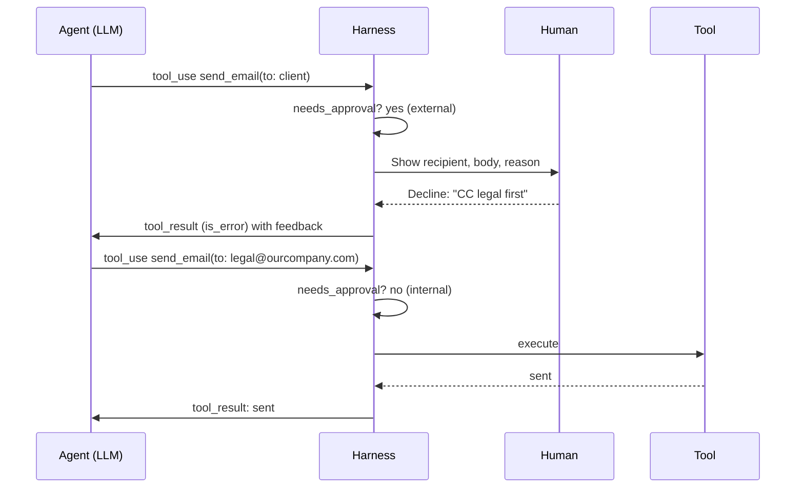
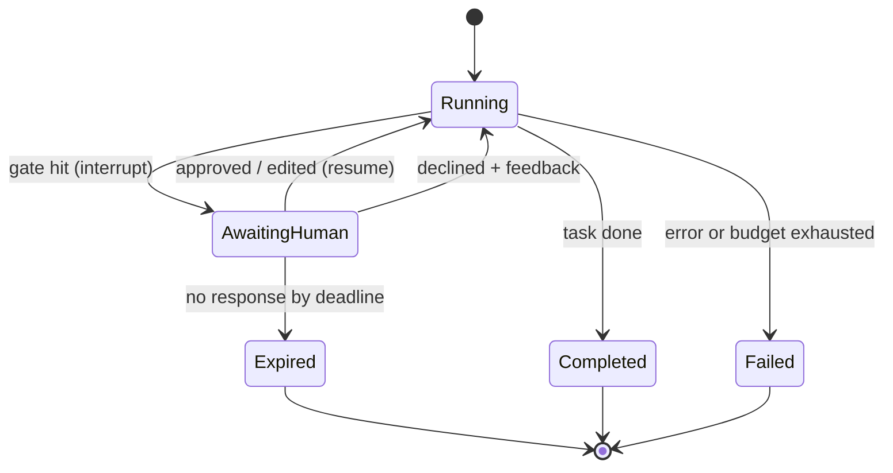

An agent is about to run `DROP TABLE customers` on what it believes is a staging database. Or email a draft contract to the client instead of the internal legal team. Or spend $4,000 on cloud GPUs to "speed up the tests." In each case the model is not malicious; it is confidently wrong in a way that a human would catch in two seconds, if a human were asked. The question this lesson answers is: **when should the human be asked, and how should the asking feel?**

Ask too rarely and the agent occasionally does something expensive and irreversible. Ask too often and people stop reading the prompts and click "approve" on everything, which is worse than not asking, because it creates the illusion of oversight. Good **human-in-the-loop (HITL)** design sits between these failures. It is part safety engineering, part interface design, and part human psychology.

We'll cover levels of oversight, approval gates and how to choose where they go, interrupts and resumable execution, clarifying questions and escalation, the UX of plans, progress, steering and undo, background agents, permission modes, trust calibration, efficient review, and feedback capture, with a working approval gate in an agent loop.

## Levels of Oversight

Human factors research has studied this for decades. Sheridan and Verplank (1978) proposed a ladder of **levels of automation**, from "the computer offers no assistance" to "the computer acts entirely autonomously, ignoring the human." Parasuraman, Sheridan and Wickens (2000) refined it: automation can be applied at different levels to different *stages* of a task (gathering information, analyzing it, deciding, acting). For agents, a practical simplification has three positions:

- **Human-in-the-loop**: the agent proposes; a human must approve before the action happens. Maximum control, maximum friction.
- **Human-on-the-loop**: the agent acts on its own while a human monitors and can intervene, pause or roll back. The human supervises rather than approves.
- **Human-out-of-the-loop**: the agent acts autonomously; humans review outcomes after the fact, if at all.

The most important idea from the human factors literature is that **this is not one setting for the whole agent**. A coding agent can read any file without asking (out of the loop), edit files while you watch (on the loop) and require approval to push to `main` (in the loop), all in the same session. Oversight should be set **per action**, based on what the action can do. See [What Is an AI Agent?](what-is-an-agent.html) for the broader autonomy spectrum.

## Approval Gates: Where to Put Them

An **approval gate** is a point where the agent's proposed action is paused until a human approves, edits or rejects it. The question is which actions deserve one. Two dimensions matter most:

- **Impact**: how bad is it if this action is wrong? (Money, data, reputation, safety, other people affected.)
- **Reversibility**: how easily can a wrong action be undone? (A file edit in git: trivially. A sent email, a wire transfer, a deleted production database without backups: not at all.)

| | **Easily reversible** | **Hard / impossible to reverse** |
|---|---|---|
| **Low impact** | Act autonomously. *Read files, search, edit in a sandbox, draft a message.* | Act, but log and notify. *Post to an internal channel, create a calendar hold.* |
| **High impact** | Act with monitoring and easy undo. *Bulk-edit a working branch, change staging config.* | **Require approval.** *Send external email, make payments, delete data, deploy to production, change permissions.* |

Additional factors push an action toward the gated corner:

- **External visibility**: anything other people see (emails, posts, PR comments, customer replies).
- **Spending money** or consuming scarce resources.
- **Security-relevant changes**: credentials, permissions, firewall rules.
- **Untrusted input in context**: if the agent has just read a web page or an inbound email, its next action might be the result of a **prompt injection** ([Agent Security](agent-security.html)). Gating consequential actions after untrusted input is a key defense.
- **Novelty**: the first time an agent does something in a new environment, a human should see it.

> [!KEY] Gate the action, not the agent
> Approval should attach to specific, typed actions with clear consequences. That is a strong reason to expose consequential operations as **dedicated tools** (`send_email`, `deploy`) rather than letting the agent do everything through a generic shell, where `curl -X POST` looks the same as `ls`. A dedicated tool gives the harness a hook to intercept, render and gate. See [Designing Tools](designing-tools.html).

### What a good approval request looks like

An approval prompt is a tiny interface, and its design decides whether people actually read it:

- **Say what will happen in plain language**, with the consequential details up front: "Send email to **alex@client.com** (external) with attachment `contract_v3.pdf`."
- **Show the exact payload** (the email body, the SQL, the diff), collapsed if long.
- **Explain why** the agent wants to do it: one sentence connecting it to the task.
- **Offer more than yes/no**: approve, reject, **edit** the arguments, or reject **with feedback** that goes back to the agent.
- **Offer scoped standing permission** where safe: "Allow `npm test` for this session."

## An Approval Gate in the Tool Loop

Here is a manual agent loop with a risk policy. Low-risk tools run automatically; consequential ones pause for a human. The policy is a **function of the tool and its arguments**, because risk often depends on the arguments (an email to a colleague versus a customer). When the human declines, the agent receives an error result with the human's feedback, so it can adapt rather than blindly retry.

```python
import json
import anthropic

client = anthropic.Anthropic()
MODEL = "claude-opus-5-5"

def needs_approval(name: str, args: dict) -> bool:
    """Risk policy: decide per call, using the arguments."""
    if name in {"search_docs", "read_file", "draft_email"}:
        return False                                          # read-only or draft-only
    if name == "send_email":
        return not args["to"].endswith("@ourcompany.com")    # external recipients need a human
    return True                                               # unknown tools: fail closed

def audit_log(name: str, args: dict, approved: bool, feedback: str) -> None:
    ...                                                       # append to your audit store

def ask_human(name: str, args: dict) -> tuple[bool, str]:
    print(f"\nThe agent wants to run {name}:\n{json.dumps(args, indent=2)}")
    reply = input("Approve? [y = yes / anything else = feedback for the agent]: ").strip()
    return (True, "") if reply.lower() == "y" else (False, reply or "No reason given.")

def run(task: str, tools: list[dict], execute, max_steps: int = 25) -> str:
    messages = [{"role": "user", "content": task}]
    for _ in range(max_steps):
        resp = client.messages.create(model=MODEL, max_tokens=16000, tools=tools, messages=messages)
        messages.append({"role": "assistant", "content": resp.content})
        if resp.stop_reason == "pause_turn":
            continue                                          # server tool paused; resend to resume
        if resp.stop_reason != "tool_use":                    # end_turn, max_tokens or refusal
            return "".join(b.text for b in resp.content if b.type == "text")

        results = []
        for call in (b for b in resp.content if b.type == "tool_use"):
            if needs_approval(call.name, call.input):
                approved, feedback = ask_human(call.name, call.input)
                audit_log(call.name, call.input, approved, feedback)
                if not approved:
                    results.append({"type": "tool_result", "tool_use_id": call.id, "is_error": True,
                        "content": f"The user declined this action. Feedback: {feedback} "
                                   "Do not retry it unchanged; revise your approach or ask the user."})
                    continue
            try:
                results.append({"type": "tool_result", "tool_use_id": call.id,
                                "content": execute(call.name, call.input)})
            except Exception as e:                            # tool failures go back to the model
                results.append({"type": "tool_result", "tool_use_id": call.id,
                                "content": f"Error: {e}", "is_error": True})
        messages.append({"role": "user", "content": results})  # all results in ONE user message
    return "Stopped: step budget exhausted."
```



Three details matter. **Fail closed**: unknown tools require approval by default. **Feedback flows back**: a decline is information the agent can use. **Audit everything**: who approved what, when, with what payload, which matters both for debugging and compliance ([Observability](observability.html)).

> [!NOTE] Using the SDK's tool runner instead
> You don't need a manual loop to gate actions. With the tool runner you can put the check inside the tool function itself (return a "user declined" message instead of executing), or inspect the pending tool calls on each yielded message before they run. The manual loop above just makes the mechanics visible.

## Interrupts, Checkpoints and Resume

The `input()` call above blocks a process while a human thinks. That works in a terminal, but not when approval comes from a phone notification three hours later, or when the server restarts in between. Production HITL needs **durable, resumable execution**:

- **Interrupt**: the agent reaches a gate and *stops*, emitting a pending request ("approval needed for X") rather than blocking a thread.
- **Checkpoint**: the full agent state (messages, plan, pending tool calls, variables) is persisted, typically after every step.
- **Resume**: when the human responds, possibly from a different device, hours later, the harness loads the checkpoint, injects the decision, and continues exactly where it stopped.



Because the Messages API is stateless (you send the full conversation each call), checkpointing is conceptually simple: persist the `messages` list plus the pending `tool_use` blocks, and to resume, append the `tool_result` that reflects the human's decision. Graph frameworks make this first-class. LangGraph, for example, pairs a **checkpointer** with an `interrupt()` primitive that pauses a node and a resume command that continues it. Durable-execution engines (Temporal and similar) are another common foundation ([Deployment](deployment.html), [Reliability](reliability.html)).

Design questions to settle up front: What happens if nobody responds (expire, escalate, or proceed with a safe default)? Can the world change while the agent waits (re-validate before executing, since the file may have been edited or the price may have moved)? Who is *allowed* to approve (role-based approvals for high-stakes actions)?

## Clarifying Questions and Elicitation

Many agent failures start before the first action: the task was ambiguous and the agent guessed. "Clean up the old branches" (merged ones? older than when? remote too?). Asking one good question up front is cheaper than undoing an hour of wrong work.

Practical patterns:

- **Give the agent an `ask_user` tool** with a schema for a question and optional multiple-choice options. Coding agents render this as a modal that blocks the loop until answered. Making it a tool means the harness can render it properly and the model knows it is an allowed action.
- **Instruct when to ask**: ask when an ambiguity would change the outcome materially *and* cannot be resolved by looking (reading the repo, checking the docs). Do not ask what you can find out.
- **Batch questions**: one message with three questions beats three interruptions.
- **Offer defaults**: "I'll assume remote branches merged more than 30 days ago unless you say otherwise." The human can just say "go."
- **Structured elicitation**: protocols now support it directly. The Model Context Protocol lets a server request structured input from the user mid-operation via **elicitation**, with a schema for the expected answer ([Protocols: MCP & A2A](protocols-mcp-a2a.html)).

There is a tension: for **background** tasks, every question stalls progress until the human returns. A good compromise is to ask early (during planning, while the human is present), then proceed autonomously with documented assumptions.

## Escalation and Handoff to Humans

Sometimes the right move is to stop being the agent. **Escalation** transfers the task, or the customer, to a human. Typical triggers:

- **Policy**: refunds above a threshold, legal threats, medical or safety issues, vulnerable users.
- **Explicit request**: the user asks for a human. Honor it promptly; making people fight the bot destroys trust.
- **Low confidence or repeated failure**: the same tool failing three times, or the agent going in circles.
- **Sentiment**: rising frustration in a support conversation.

A **warm handoff** passes context so the human does not start from zero: a summary of the issue, what has been tried, relevant account details, and the agent's best hypothesis. A cold handoff ("please hold for an agent") that makes the customer repeat everything is one of the most common complaints about AI support ([Conversational & Voice Agents](conversational-voice-agents.html)).

## Plans, Progress and Transparency

**Show the plan before executing.** For multi-step tasks, presenting a plan first ("I'll 1) add the column with a migration, 2) backfill in batches of 10k, 3) update the API, 4) run the tests") lets the human catch misunderstanding *before* any cost is incurred. It is the cheapest possible approval gate: one review covers many actions. Coding agents offer a **plan mode** in which the agent can read and investigate but not modify anything until the human approves the plan.

**Stream progress.** Long-running agents should show what they are doing as they do it: which file they are reading, which search they ran, which step of the plan they are on. Streaming serves three purposes: it reassures (the agent is working, not stuck), it enables early intervention (you see it heading the wrong way), and it builds an accurate mental model of the agent's competence.

**Make reasoning legible, but don't drown people.** A wall of raw tool output is not transparency. Summarize at the right altitude ("Searched 12 files; found 3 call sites of `charge()`"), with drill-down for those who want details.

> [!EXAMPLE] A good progress stream
> ```text
> Plan: 1) find all callers of charge()  2) add idempotency key  3) update tests
> [1/3] Searching for callers... found 3 (billing/api.py, jobs/retry.py, admin/refund.py)
> [2/3] Editing billing/api.py (+12 −3)
> [2/3] Editing jobs/retry.py (+8 −2)
> [2/3] admin/refund.py calls a legacy path. Leaving it unchanged; flagged below.
> [3/3] Running tests... 214 passed, 0 failed
> Done. 1 item needs your decision: admin/refund.py uses legacy_charge().
> ```

## Steering Mid-Task

**Steering** means changing the agent's direction while it is working, without starting over. Two mechanisms:

- **Interrupt and redirect**: the human stops the current turn ("stop, don't touch the migrations"), and the agent resumes with the new instruction in context.
- **Queued messages**: the human types a message while the agent works, and the harness injects it at the next safe point, typically between tool calls, so the agent incorporates it without losing work in progress.

To make steering work, the harness must checkpoint between steps (so stopping is safe), and the agent must treat new human messages as **higher priority** than its existing plan. Steering is one of the strongest arguments for streaming progress: you can only steer what you can see.

## Undo and Rollback

Reversibility changes the whole calculus of oversight: if an action can be cheaply undone, it rarely needs pre-approval. So **make more things reversible**:

- **Version control everything**: agents working in git branches or worktrees can always be reset. Some coding agents also take automatic **checkpoints** of files before edits so you can rewind a session.
- **Sandboxes and staging**: let the agent act freely in a copy of the environment, then promote results after review ([Guardrails & Sandboxing](guardrails-and-sandboxing.html)).
- **Dry runs**: tools that support `dry_run=True` let the agent (and human) see what would happen.
- **Soft deletes and delayed execution**: move to trash instead of deleting; queue emails with an "undo send" window.
- **Compensating actions**: for operations that cannot be literally undone (a payment), define and test the reverse operation (a refund) in advance.

Be honest in the UI about what can and cannot be undone. An "undo" button that silently fails to recall an already-sent email is worse than none.

## Background Agents and Notifications

As of 2026, many agents run **asynchronously**: you assign a task (fix this issue, research this market) and come back later. Cloud coding agents that work in a remote sandbox and open a pull request are the canonical example. This changes HITL design:

- **The review surface replaces the live stream.** The pull request (diff, description, test results) becomes the approval gate. The agent should produce artifacts designed for review.
- **Notifications must be meaningful.** Notify on completion, on blocking questions and on failures, not on every step. Each notification should say what is needed and how urgent it is.
- **Blocking questions are expensive.** An agent that stops to ask at minute 3 of a 2-hour task and waits all night has wasted the night. Prefer asking up front, proceeding on documented assumptions, and flagging them at review.
- **Permissions must be decided in advance**, since no one is watching. Background agents generally run in sandboxes with constrained credentials, precisely because live approval isn't available.

## Permission Modes

Products increasingly expose oversight as user-selectable **permission modes**. Coding agents illustrate the pattern well. As of 2026, Claude Code offers modes along these lines (names and details evolve, so check current docs):

| Mode | Behavior | When to use |
|---|---|---|
| **Default / Manual** | Reads run freely; prompts before most edits, shell commands and network requests, with "don't ask again" options | Unfamiliar codebases, important repos |
| **Accept edits** | File edits auto-approved; other risky actions still prompt | Iterating quickly while watching the diff |
| **Plan** | Explore and propose a plan without editing source files | Large or risky changes; aligning before acting |
| **Auto** | No routine prompts; a background **classifier** checks each consequential action against what you asked for | Long tasks where you trust the direction but want a safety net |
| **Don't ask** | Anything not pre-approved by rules is automatically *denied* instead of prompting | Unattended runs with a strict allowlist |
| **Bypass permissions** | Skips prompts almost entirely | Only inside isolated containers or VMs with nothing valuable to damage |

Two of these are worth dwelling on. **Auto mode** replaces the human approver for routine actions with a model-based reviewer, a sign of where the field is heading: oversight that scales because most of it is automated, with humans reserved for what the classifier cannot clear. **Don't-ask mode** shows that for unattended agents the safe default for an unanticipated action is *deny*, not *wait*.

Underneath the modes sit finer-grained **allow and deny rules** (always allow `npm test`, never allow `rm -rf` or reading `.env`), often configured per project and shareable with a team. The general lesson: give users a few understandable presets plus precise rules, and make the current mode always visible.

## Trust Calibration and Automation Bias

The goal of oversight is not maximum trust or minimum trust but **calibrated trust**: reliance that matches the agent's actual reliability for this kind of task (Lee and See, 2004). Two failure modes:

- **Overtrust (misuse)**: the human relies on the agent beyond its competence. Classic **automation bias** is the tendency to accept automated recommendations without scrutiny, and to miss problems the automation did not flag (Parasuraman and Riley, 1997, described misuse, disuse and abuse of automation).
- **Undertrust (disuse)**: the human ignores a reliable agent or redoes its work, wasting its value.

**Approval fatigue** is how overtrust develops in HITL systems. When 99 of 100 prompts are routine, people stop reading and approve reflexively, and the hundredth (the dangerous one) slips through. Countermeasures:

- **Gate less, but better.** Every unnecessary prompt degrades the necessary ones. Use the risk × reversibility matrix ruthlessly.
- **Make dangerous prompts look different**: highlight external recipients, production targets and irreversible operations.
- **Show evidence, not just conclusions**: test results, sources, diffs, so humans verify rather than trust.
- **Surface uncertainty**: an agent that says "I'm unsure about the timezone handling here" directs scrutiny where it is needed.
- **Track the agent's record**: per-task-type success rates help users (and policies) calibrate. Autonomy can be expanded as a track record accumulates.

> [!WARNING] A human in the loop is not automatically a safeguard
> A reviewer who approves 200 changes a day without reading them provides no safety, only liability. Design for the attention humans actually have: fewer, higher-signal decisions, with the information needed to decide well.

## Reviewing Agent Output Efficiently

Agents can produce work faster than humans can review it, so **review becomes the bottleneck**. Design outputs for fast, reliable review:

- **Diffs, not finished files.** Show exactly what changed. For documents, use tracked changes; for data, show before/after on affected rows.
- **Summaries with drill-down**: a three-line summary of what was done and why, linked to details.
- **Citations for every claim** in research or analysis, linked to the exact source passage, so the reviewer can spot-check rather than re-research ([Research Agents](research-agents.html)).
- **Evidence of verification**: "tests: 214 passed", "linked sources fetched and checked."
- **Flagged decisions and assumptions**: list the judgment calls made so the reviewer can focus there.
- **Risk-ranked review**: put the riskiest changes first; let trivial ones be skimmed.

## Capturing Feedback

Every human interaction with an agent is a data point. Capture it:

- **Explicit signals**: approve/decline rates per tool, thumbs up/down, free-text corrections.
- **Implicit signals**: edits humans make to agent drafts before sending (the diff between draft and sent is gold), tasks abandoned, escalation rates, time to approve.
- **Close the loop**: turn declined actions and corrected outputs into **evaluation cases** ([Evaluating Agents](evaluating-agents.html)), update prompts and tool descriptions, and adjust the risk policy (if a gated action is approved 500 times in a row with no edits, maybe it can be ungated; if an ungated action keeps causing rollbacks, gate it).
- **Persist preferences**: "always CC legal on client emails" should become memory or a rule, not a correction the human repeats daily ([Memory](memory.html)).

## Key Takeaways

- Set oversight **per action**, not per agent: in-the-loop for high-impact irreversible actions, on-the-loop for monitored reversible work, out-of-the-loop for safe reads.
- Use the **risk × reversibility** matrix to place approval gates; expose consequential operations as **dedicated tools** so they can be gated, and fail closed for unknown tools.
- Declines should carry **feedback back to the agent**; every approval should be **audited**.
- Production HITL needs **interrupts, checkpoints and resume**, with clear policies for timeouts and re-validation.
- Ask **clarifying questions early** and batched; **escalate** with a warm handoff when policy, the user or repeated failure demands it.
- **Plans, progress streams, steering and undo** let humans stay in control without approving every step; making actions reversible reduces the need for gates.
- Aim for **calibrated trust**: fight approval fatigue and automation bias by gating less but better, and design outputs (diffs, citations, flagged assumptions) for fast, real review.

## Exercises

1. **Classify actions.** Place these on the risk × reversibility matrix and decide autonomous / notify / monitor / approve: reading a CRM record, updating a CRM field, posting in a public Slack channel, issuing a $20 refund, issuing a $2,000 refund, rotating an API key, creating a draft PR.
2. **Approval with edits.** Extend `ask_human` so the human can choose "edit": they modify the JSON arguments, the edited call is executed, and the tool result tells the agent its arguments were changed and how.
3. **Make it resumable.** Change the loop so that instead of calling `input()`, it saves `messages` and the pending tool calls to a JSON file and exits. Write a `resume(decision)` function that loads the file, appends the right `tool_result` and continues. Test by approving in a separate process.
4. **Fight approval fatigue.** Log 50 approval decisions from a test run. Propose policy changes: which gates could be removed or turned into session-level permissions, and which ungated actions should become gated? Justify each with the data.
5. **Design challenge.** Design the HITL experience for a background agent that reconciles monthly invoices against payments and can email vendors about discrepancies. Specify: what it asks up front, what it does autonomously, what it gates, what it notifies on, what the review artifact looks like, and how feedback is captured.

<details class="solutions">
<summary>Hints and solution sketches</summary>

1. **Hint:** Score each action on the two axes separately (how bad if wrong? how hard to undo?), then add the push factors: external visibility, money, security. **Sketch:** *Reading a CRM record*: low impact, nothing to reverse, so autonomous (logged, since it touches customer data). *Updating a CRM field*: low to moderate impact and reversible through field history, so act and monitor. *Posting in a public Slack channel*: hard to reverse (people have read it), so act and notify if the channel is internal, approve if it includes customers or partners. *$20 refund*: low impact but money can't be recalled, so act and notify, with a cap enforced in the tool. *$2,000 refund*: high impact and irreversible, so approve. *Rotating an API key*: security-relevant and can break every service using the old key, so approve, ideally scheduled with whoever owns those services. *Creating a draft PR*: low impact and trivially reversible, so autonomous.
2. **Hint:** Return a three-way decision (approve, edit, decline) plus the final arguments, compute which keys changed, and say so in the tool result. Otherwise the agent believes its original call ran and may "correct" it back. **Sketch:** On "edit", parse the new JSON (re-prompt if it doesn't parse or fails the tool's `input_schema`), execute with the edited arguments, and make the tool result read `"Note: the user edited your arguments before running. Changed: {'to': ('alex@client.com', 'legal@ourcompany.com')}. Result: ..."`. Log both the original and the edited arguments; edits are some of the most valuable feedback you'll get.

    ```python
    def ask_human(name: str, args: dict) -> tuple[str, dict, str]:
        print(f"\nThe agent wants to run {name}:\n{json.dumps(args, indent=2)}")
        reply = input("[y] approve / [e] edit / anything else = feedback for the agent: ").strip()
        if reply.lower() == "y":
            return "approve", args, ""
        if reply.lower() == "e":
            return "edit", json.loads(input("New arguments (JSON): ")), ""
        return "decline", args, reply or "No reason given."

    def describe_edit(old: dict, new: dict) -> str:
        changed = {k: (old.get(k), new.get(k)) for k in old.keys() | new.keys() if old.get(k) != new.get(k)}
        return f"Note: the user edited your arguments before running. Changed (old, new): {changed}."
    ```

3. **Hint:** `resp.content` holds SDK objects, not dicts, so convert each block with `.to_dict()` before saving, or `json.dump` will fail. Also save the results of any non-gated calls from the same turn, since *all* results must go back in one user message. **Sketch:** In `run`, when a turn contains a gated call, execute the auto-approved calls, then write `{"messages", "pending", "results"}` to disk and exit with "awaiting approval". `resume` (below) loads the file, re-validates, appends one user message with every result, and re-enters the loop. That means refactoring `run` into `run_from(messages)`, which takes an existing list. Test it by running the agent in one process, then calling `resume({"approved": True, "feedback": ""})` from another.

    ```python
    def resume(decision: dict, path: str = "agent_state.json") -> str:
        with open(path) as f:
            state = json.load(f)
        results = state["results"]                     # results already produced this turn
        for call in state["pending"]:                  # saved earlier with block.to_dict()
            if decision["approved"]:                   # re-validate preconditions here first
                content, is_error = execute(call["name"], call["input"]), False
            else:
                content, is_error = f"The user declined this action. Feedback: {decision['feedback']}", True
            results.append({"type": "tool_result", "tool_use_id": call["id"],
                            "content": content, "is_error": is_error})
        state["messages"].append({"role": "user", "content": results})
        return run_from(state["messages"])
    ```

4. **Hint:** Group the 50 decisions by tool and argument pattern, then compute, for each group, the approval rate, the edit rate and the median time to approve. A long payload approved in two seconds wasn't read. **Sketch:** Use three kinds of rules. *Remove or convert to a session permission*: groups that are always approved, never edited, and low-impact (e.g. running the test suite). *Keep, and improve the agent*: groups with declines or edits; the feedback tells you what to fix in the prompt or tool. *Add a gate*: ungated actions that later caused rollbacks or corrections. Be careful with small samples: 30 approvals out of 30 doesn't mean the decline rate is zero. By the "rule of three", the 95% upper bound is about 3/30 = 10%, so ungate only where a 1-in-10 mistake would be cheap, and keep collecting data. A strong answer ties each change to a number in the log.
5. **Hint:** Walk through the run in time order (kickoff while the human is present, the unattended run, the review), and remember that invoices and vendor emails are *untrusted input*: an invoice saying "our bank details have changed" is a classic fraud and prompt-injection vector. **Sketch:** *Up front*: the period, data sources, the tolerance below which differences are ignored (rounding, FX), which vendors may be contacted, the sender identity and tone, and who reviews. *Autonomous*: reading invoices and payments, matching, computing discrepancies, drafting vendor emails. *Gated*: sending any vendor email, approved as one batch in a review queue; the agent has no payment or bank-detail tools at all. *Escalate, don't email*: suspected fraud, changed bank details, discrepancies above a set amount. *Notify*: on completion (one summary), on blockers (missing data access) and on escalations, not on every step. *Review artifact*: a reconciliation report with counts, a discrepancy table ranked by amount with links to the exact invoice line and payment record, the draft emails, and a list of assumptions made. *Feedback*: approve, edit or reject per draft; diff edits against the drafts to improve templates; turn rejections into eval cases; save per-vendor preferences as memory; adjust the tolerance and gates using approval statistics.

</details>

## Check Your Understanding

```quiz
Q: Which action most clearly warrants a mandatory approval gate?
- [ ] Bulk-editing 40 files on a working git branch
- [ ] Reading a production database's config file
- [x] Sending an email to an external customer
- [ ] Posting a status update to an internal channel
E: External emails are high-impact and irreversible once sent: the gated corner of the risk × reversibility matrix. A bulk edit sounds big, but on a branch it is trivially reverted; reading config is read-only; an internal post is low-impact (act, log and notify).

Q: Why should approval policies be functions of tool arguments, not just tool names?
- [ ] The harness sees only arguments, since tool names are model-chosen
- [x] One tool can be safe or risky depending on, say, the recipient
- [ ] Argument-level policies cut the tokens spent on approval prompts
- [ ] Gating by name alone would block every call to read-only tools
E: Risk often lives in the arguments: recipient, amount, environment, path. Name-only policies either over-gate safe calls (every email) or under-gate dangerous ones. The harness sees both name and arguments; the point is which one carries the risk.

Q: A user declines an agent's proposed action. What should the harness send back to the model?
- [ ] Nothing: end the run, since the user has rejected the plan
- [ ] A success result, so the agent carries on without derailing
- [x] An error tool_result saying it was declined, plus the feedback
- [ ] The same tool_use block, flagged so that the agent will rephrase it
E: A decline is information. Returning it as an error result with the user's feedback lets the agent revise its approach instead of retrying the same action or failing opaquely. A fake success result is the dangerous choice: the agent would believe the email was sent.

Q: What is approval fatigue, and why is it dangerous?
- [ ] Agents slowing down as approval history fills their context
- [x] People approving by reflex, so the rare risky request slips by
- [ ] Reviewers rejecting too much, so the agent stalls on safe work
- [ ] Models growing timid and refusing to act after several declines
E: Too many low-value prompts train humans to stop reading, so the hundredth (dangerous) request is approved like the other ninety-nine. Over-rejection is a real cost too, but fatigue is about attention eroding into rubber-stamping. Gating less but better keeps attention where it matters.

Q: An agent waiting for approval resumes six hours later. What should it do before executing the approved action?
- [ ] Execute right away, since the human has already approved it
- [x] Check the world still matches the approved snapshot, then act
- [ ] Ask the human to approve again, whatever has or hasn't changed
- [ ] Restart the task from scratch, as its earlier plan may be stale
E: Approvals are given against a snapshot: a file may have been edited or a price may have moved. Re-validating preconditions is cheap; unconditional re-approval feeds approval fatigue, and restarting throws away valid work.

Q: Why does making actions reversible reduce the need for approval gates?
- [ ] Reversible actions are by definition low-impact actions
- [x] Cheap undo lets monitoring replace approval before acting
- [ ] Reversible actions can't be triggered by a prompt injection
- [ ] An undo button removes the need for audit logs and alerts
E: Reversibility lowers the cost of errors, so oversight can shift from in-the-loop (approve first) to on-the-loop (monitor and roll back). It does not make an action low-impact (a bulk edit can be big) and does nothing to stop injection.

Q: For a background coding agent, what typically serves as the primary approval gate?
- [ ] A push notification asking to approve each file edit
- [x] The pull request: diff, description, tests, pre-merge
- [ ] A live chat session where the developer steers each step
- [ ] A classifier that approves every action, with no human
E: With no human watching live, the review artifact becomes the gate. The agent acts freely in a sandbox with constrained credentials, and humans approve the result before it merges. Per-edit prompts and live steering assume someone is watching.
```

## Further Reading

- [A Model for Types and Levels of Human Interaction with Automation (Parasuraman, Sheridan & Wickens, 2000)](https://doi.org/10.1109/3468.844354) — the classic framework for which stages of a task to automate, and how much.
- [Trust in Automation: Designing for Appropriate Reliance (Lee & See, 2004)](https://doi.org/10.1518/hfes.46.1.50_30392) — the foundational paper on calibrated trust.
- [Building Effective Agents (Anthropic)](https://www.anthropic.com/engineering/building-effective-agents) — on checkpoints, human feedback and stopping conditions in agent design.
- [Claude Code documentation](https://code.claude.com/docs/en/overview) — permission modes, allow/deny rules, plan mode and checkpoints in a production coding agent.
- [LangGraph](https://www.langchain.com/langgraph) — a widely used framework whose interrupts and checkpointers implement durable human-in-the-loop (APIs evolve; check current docs).
- [Model Context Protocol: elicitation](https://modelcontextprotocol.io/specification/latest) — the spec's standard mechanism for servers to request structured user input mid-task.
- [Guidelines for Human-AI Interaction (Amershi et al., CHI 2019)](https://doi.org/10.1145/3290605.3300233) — 18 research-backed guidelines for AI UX, many of which apply directly to agents.
