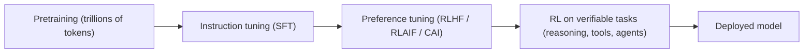

Every LLM agent, whether it fixes bugs, researches markets or answers customers, has the same thing at its center: a large language model deciding what to do next. The model is the agent's judgment. Its strengths become the agent's strengths, and its quirks become the agent's failure modes.

You don't need to know how to train an LLM to build great agents. You do need an accurate mental model of what it is and how it behaves. Why does the same prompt give different answers? Why does the agent confidently cite a file that doesn't exist? Why does a long task get worse after an hour? Why does a tool result in the middle of a huge context get ignored? Every one of those questions has an answer in this lesson.

We'll go from tokens up to reasoning models, then look at the API you'll actually call and the properties that matter most when an LLM is in a loop.

## Tokens: How Models See Text

LLMs don't read characters or words. They read **tokens**: chunks of text from a fixed vocabulary, typically tens of thousands to a few hundred thousand entries. Most vocabularies are built with variants of **byte-pair encoding (BPE)**, which starts from bytes and repeatedly merges the most frequent adjacent pairs. Common words become single tokens, rare words split into pieces, and any byte sequence can be represented.

```text
"The agent called get_weather(city='Oslo')"
→ ["The", " agent", " called", " get", "_weather", "(", "city", "='", "Os", "lo", "')"]
```

(Exact splits depend on the tokenizer; this one is illustrative.)

Why agent builders care:

- **Everything is billed and limited in tokens**: input, output, tool definitions, tool results, thinking. In English prose a token averages roughly three-quarters of a word, but code, JSON, non-English text and long numbers usually take more tokens per word.
- **Tokenizers differ between models**, even within one vendor. Anthropic notes, for example, that newer Claude tokenizers can count the same text as noticeably more tokens than older ones. Measure with the provider's token-counting endpoint rather than guessing.
- **Tokenization explains some odd weaknesses.** Counting letters in a word, reversing strings or doing digit-level arithmetic is awkward when the model sees "Oslo" as "Os" + "lo". For exact work, give the agent a tool (code execution) instead of trusting mental arithmetic.

## Next-Token Prediction

At its core, an LLM is a function that takes a sequence of tokens and outputs a **probability distribution over the next token**. To generate text, you pick a token from that distribution, append it, and repeat. This is **autoregressive generation**.

```text
Input:   "The capital of France is"
Model →  " Paris" 0.92 | " a" 0.03 | " the" 0.02 | ...
Pick " Paris", append, predict again...
```

That this simple objective produces something that can write code, plan multi-step tasks and call tools sounds implausible until you consider what predicting the next token *well* across trillions of tokens of text requires. To predict the next line of a proof, a function body or a doctor's note, a model has to build internal representations of logic, syntax and the world. Prediction at scale forces a great deal of compression and abstraction.

Two consequences matter for agents:

1. **A tool call is just text the model predicts.** When an agent "decides" to call `run_tests`, the model is generating tokens that form a structured tool-use block. The API parses them. The model never executes anything itself (see [tool use](tool-use.html)).
2. **The model produces output one token at a time with no backtracking.** It can't edit what it already wrote in this turn. That's one reason thinking before answering, and loops that let the model see results and revise, help so much.

## Transformers and Attention, Intuitively

Modern LLMs are **transformers**, the architecture introduced in *Attention Is All You Need* (Vaswani et al., 2017). The key mechanism is **self-attention**.

Intuition: as the model processes each token, it asks, "Which earlier tokens are relevant to understanding this one?" In "The agent read the file, then *it* summarized *it*", attention lets the first "it" connect to "the agent" and the second to "the file." Each token's representation is updated by mixing in information from the tokens it attends to, weighted by learned relevance scores. Stack dozens of these layers, each with many attention "heads" that specialize in different relationships, and you get rich contextual understanding.

What practitioners should take from this:

- **Attention lets any token look at any earlier token.** That's what makes long contexts usable. A tool result from 50 steps ago is still reachable.
- **Reachable isn't the same as reliably used.** Studies such as *Lost in the Middle* (Liu et al., 2023) found that models use information at the start and end of long contexts more reliably than information buried in the middle. Models have improved a lot since, but the advice stands: put critical instructions where they'll be seen and keep contexts lean.
- **Compute grows with context length.** Longer inputs cost more and take longer to process, which is why [context engineering](context-engineering.html) is a core agent skill.

## The Context Window

The **context window** is the maximum number of tokens the model can consider at once: system prompt, tool definitions, the full conversation, tool results, and the response it's generating. As of 2026, frontier models offer windows from a few hundred thousand up to about a million tokens (current Claude models have 1M-token windows), with separate limits on output length.

For agents, the context window is the **entire working memory**. The model has no memory between API calls. Each call, the harness sends the whole transcript again. So:

- Long agent runs grow the transcript at every step, raising cost and latency.
- When the transcript approaches the limit, something has to give: summarizing (compaction), clearing old tool results, or offloading state to files and memory stores (see [memory](memory.html)).
- More context isn't free even when it fits. Irrelevant material dilutes attention, a problem practitioners call **context rot**.

> [!KEY] The big idea
> An LLM is **stateless**. Everything an agent "knows" about its current task is whatever the harness put in the context window for this call. Agent engineering is largely the art of putting the right tokens in that window at each step.

## From Text Predictor to Assistant: How LLMs Are Trained

A raw pretrained model is an excellent autocomplete, not an assistant. Ask it a question and it might continue with five more questions. Assistant behavior comes from several training stages.



1. **Pretraining.** Next-token prediction over a vast corpus of web text, books, code and other data. This is where knowledge and general capability come from, and it's by far the most expensive stage. Its data stops at a date called the **knowledge cutoff**.
2. **Supervised fine-tuning (SFT), or instruction tuning.** Training on curated examples of instructions paired with good responses, including multi-turn chats and tool calls. The model learns the *format* and *role* of an assistant.
3. **Preference tuning.** Humans compare pairs of responses, a **reward model** learns their preferences, and the LLM is optimized with reinforcement learning to score well. This is **RLHF** (reinforcement learning from human feedback), popularized by OpenAI's InstructGPT work (2022). **RLAIF** replaces some human labels with AI-generated feedback. Anthropic's **Constitutional AI** (2022) has a model critique and revise outputs against a written set of principles, then uses AI preference labels for the RL stage. Methods like DPO optimize directly on preference pairs without a separate RL loop.
4. **RL on verifiable tasks.** Increasingly important since 2024: models are trained with RL on problems whose outcomes can be checked automatically, such as math answers, passing unit tests and completed agentic tasks in sandboxes. This is where much of the improvement in reasoning, tool use and long-horizon agent behavior now comes from (see [training agents](training-agents.html)).

The order matters for intuition. Knowledge comes mostly from pretraining. Behavior (following instructions, using tools well, knowing when to stop or ask) comes mostly from post-training. When a model is good at agentic work, it's because it was explicitly trained on agentic work.

## Sampling and Non-Determinism

At each step the model outputs a probability distribution, and something has to choose a token from it. **Sampling** picks randomly in proportion to the probabilities, usually reshaped by settings such as **temperature** (sharpen or flatten the distribution) and **top-p** (only consider the most likely tokens). Always picking the single most likely token is **greedy decoding**.

Consequences for agents:

- **The same input can produce different outputs.** One run picks `grep`, another picks `find`, and from there the trajectories diverge. Agents are path-dependent, so small early differences can lead to very different outcomes.
- **Even "deterministic" settings aren't perfectly deterministic** in practice. Floating-point arithmetic on parallel hardware and request batching can change results slightly.
- **Many current models no longer expose these knobs.** Current Claude models reject `temperature`, `top_p` and `top_k`. Sampling is tuned by the provider, and you steer behavior through instructions, structured outputs and effort settings instead.

> [!TIP] Rule of thumb
> Treat agent behavior as a **distribution**, not a single outcome. Evaluate by running each task several times and measuring success rates (see [evaluating agents](evaluating-agents.html)). One good demo run proves very little.

## Hallucination

A **hallucination** is fluent, confident output that's false: a nonexistent API method, an invented citation, a fabricated file path. It follows from the training objective. The model learned to produce *plausible* continuations, and plausible isn't the same as true. When the model lacks the information but the context strongly invites an answer, it may produce one anyway.

Post-training has made models much better at saying "I don't know," but hallucination isn't solved. In agents it shows up in particular ways:

- Calling tools with made-up arguments (an order ID that was never seen).
- Claiming an action succeeded without checking the tool result ("I've fixed the bug" when the tests never ran).
- Assuming facts about the environment instead of observing them.

The most powerful mitigation is **grounding**: make the agent look things up instead of recalling them, and verify instead of assuming. Tools that read files, search docs and run tests turn guesses into observations, which is a big part of why tool use emerged at all. Add instructions like "never state that tests pass unless you ran them in this session," and use harness-side checks for critical claims (see [reliability](reliability.html)).

## In-Context Learning

**In-context learning** is a model's ability to pick up a task from instructions and examples in the prompt, with no weight updates. GPT-3 (2020) made it famous with "few-shot" prompting. It's what makes agents possible without per-task training:

- The **system prompt** defines the role, rules and workflow.
- **Tool descriptions** teach what each tool does and when to use it.
- **Tool results** teach the agent about its environment as it goes.
- **Examples** demonstrate formats and edge cases.

In-context learning is powerful but limited: it lasts only as long as the context does, it competes with the model's trained habits, and long, contradictory prompts dilute it. See [prompting for agents](prompting-for-agents.html) for how to write instructions that hold up over many steps.

## Reasoning Models and Test-Time Compute

Chain-of-thought prompting (2022) showed that letting a model "think out loud" improves multi-step problem solving. **Reasoning models**, starting with OpenAI's o1 (September 2024) and followed by DeepSeek-R1 (January 2025), Claude's extended thinking and others, are *trained* with RL to produce long internal reasoning before answering: exploring approaches, checking work, and backtracking when something doesn't add up.

This adds a new dimension: **test-time compute**. Beyond making models bigger, you can make them think longer on a hard problem. More thinking tokens generally means better answers on hard tasks, at the cost of latency and money.

For agents, the most important variant is **interleaved thinking**: the model reasons *between* tool calls ("the test failed with a KeyError, so the config isn't loaded; check the loader next") rather than only at the start. That's where much of the gain in agent reliability comes from (see [the agent loop](the-agent-loop.html) and [reasoning and planning](reasoning-and-planning.html)).

On current Claude models, thinking is **adaptive**: the model decides how much to think at each step, and you control the overall depth with an **effort** setting (`low` through `max`). Lower effort means faster, cheaper, terser runs. Higher effort means more thorough reasoning for hard problems.

> [!NOTE]
> Thinking isn't free and isn't always better. For simple lookups and classification, extra reasoning mostly adds latency. Reserve high effort for genuinely hard steps, such as debugging, planning and ambiguous judgment calls, and measure the difference on your own tasks.

## Multimodality

Modern frontier models are **multimodal**: they accept images (and on some platforms audio or video) alongside text. For agents, vision unlocks reading screenshots, charts, scanned documents and UI mockups, and it's the basis of [computer-use agents](computer-use-agents.html) that operate software by looking at the screen. Images are converted into tokens too, so they consume context and cost like everything else.

## The Messages API: Roles and Content Blocks

Chat models are trained on conversations with **roles**. In the Anthropic Messages API:

- **`system`**: top-level instructions (role, rules, context), passed separately from the conversation.
- **`messages`**: an alternating list of `user` and `assistant` turns.
- **Content blocks**: each message holds typed blocks: `text`, `image`, `tool_use` (the model requesting a tool), `tool_result` (your harness returning the output), and `thinking`.

Here is a minimal call with the Anthropic Python SDK (`pip install anthropic`):

```python
import anthropic

client = anthropic.Anthropic()  # reads ANTHROPIC_API_KEY from the environment

response = client.messages.create(
    model="claude-opus-5-5",
    max_tokens=16000,                     # cap on output tokens (thinking included)
    system="You are a concise senior engineer. Answer in at most three sentences.",
    thinking={"type": "adaptive"},        # the model decides how much to think
    output_config={"effort": "medium"},   # low | medium | high | xhigh | max
    messages=[
        {"role": "user", "content": "Why do LLM agents need a maximum step limit?"}
    ],
)

# The response is a list of typed content blocks, not a single string.
for block in response.content:
    if block.type == "text":
        print(block.text)

print(response.stop_reason)                # e.g. "end_turn"
print(response.usage.input_tokens, response.usage.output_tokens)
```

Things to notice:

- **No sampling parameters.** Current models reject `temperature`, `top_p` and `top_k`. Steer with instructions and effort.
- **`stop_reason` tells you why generation stopped.** `end_turn` means the model finished. `tool_use` means it wants a tool run. `max_tokens` means it hit your cap mid-answer. `refusal` means it declined for safety reasons. Agent loops branch on this field.
- **`usage` reports tokens**, which is how you track cost.
- **Content is a list of blocks.** Always check `block.type`. A single response can contain thinking, text and several tool calls.

The [agent loop](the-agent-loop.html) lesson builds directly on this call.

## Model Tiers, Cost and Latency

Providers offer **tiers** that trade capability against cost and speed:

| Tier | Examples (as of late 2026) | Typical use in agents |
|---|---|---|
| Most capable | `claude-fable-5-2` | The hardest long-horizon tasks, where evals show the default tier falls short |
| Frontier default | `claude-opus-5-5` | Main agent loop for complex coding and knowledge work |
| Balanced | `claude-sonnet-5-5` | High-volume agents, sub-agents, cost-sensitive loops |
| Small and fast | `claude-haiku-5-5` | Routing, classification, extraction, summarizing tool output |
| Open-weight | Llama, Qwen, DeepSeek, Mistral families | Self-hosting, data-residency needs, fine-tuning, offline use |

**Pricing is per token**, with output tokens costing several times more than input tokens. As an illustration, Anthropic's list prices as of late 2026 are $4 per million input tokens and $20 per million output tokens for Claude Opus 5.5, and $0.10 / $0.50 for Claude Haiku 5.5 on prompts up to 100K tokens. Check the pricing page for current numbers. **Prompt caching** makes repeated prefixes much cheaper, which matters enormously for agents that resend a growing transcript every step (see [cost and latency](cost-and-latency.html)).

**Latency** has two parts: time to first token (grows with input length) and generation speed in tokens per second (output and thinking). An agent's wall-clock time is roughly the number of steps × (model latency + tool latency), which is why a 30-step agent can take minutes even when each call feels quick.

**Open-weight models** have improved rapidly and are a real option, especially for narrower agents, but as of 2026 the strongest long-horizon agentic performance generally still comes from frontier hosted models. Benchmark on your tasks, not leaderboards.

## Strengths and Weaknesses That Matter for Agents

| Strengths | Weaknesses |
|---|---|
| Broad world and domain knowledge | Knowledge frozen at the cutoff; unaware of recent changes unless told |
| Flexible reasoning in natural language | Hallucination: confident falsehoods when ungrounded |
| Reads and writes code fluently | Non-deterministic: same input, different trajectories |
| Follows complex instructions in context | Instructions can be diluted by long, noisy contexts |
| Adapts to tool outputs and errors | Stateless: no memory beyond the context window |
| Generalizes to unseen tasks | Weak at exact arithmetic and character-level operations without tools |
| Can judge, critique and summarize | Can be manipulated by instructions hidden in data (prompt injection) |

The last weakness deserves emphasis. An LLM can't reliably tell instructions from its developer apart from instructions embedded in a web page or email it reads. That's **prompt injection**, the central security problem for agents (see [agent security](agent-security.html)).

### Why tool use emerged

Look at the weaknesses column again: stale knowledge, hallucination, poor arithmetic, no persistent memory, no ability to affect the world. Nearly every one is fixed by the same move. **Let the model call tools** (search for fresh facts, run code for exact computation, read files to ground claims, write to memory for persistence, call APIs to act) and **feed the results back into its context**. LLMs are strong at deciding *what* to do and weak at doing some things *precisely*. Tools fill that gap, and a loop lets the model react to what the tools return. That's the agent.

> [!KEY] Why LLMs became agents
> Tool use isn't a bolt-on feature. It's the natural complement to how LLMs work: the model supplies judgment, tools supply facts, precision and action, and the loop connects them.

## Key Takeaways

- LLMs process **tokens** and generate by **predicting the next token**, one at a time. Tool calls are structured text the model predicts and the harness executes.
- **Transformers** use **attention** to relate every token to earlier ones, but very long contexts still dilute focus, so keep contexts lean.
- The **context window** is the agent's entire working memory. Models are **stateless** across calls.
- Capabilities come from **pretraining**. Assistant and agent behavior comes from **post-training**: SFT, RLHF/RLAIF/Constitutional AI, and RL on verifiable tasks.
- **Sampling** makes outputs non-deterministic, so evaluate agents over many runs. Current Claude models don't accept sampling parameters.
- **Hallucination** is a structural tendency. Grounding through tools and verification is the main defense.
- **Reasoning models** trade test-time compute for accuracy. Interleaved thinking between tool calls is especially valuable for agents.
- Choose **model tiers** by task difficulty, volume and latency needs, and remember that cost scales with tokens across *every* step of the loop.

## Exercises

1. **Count tokens.** Use your provider's token-counting endpoint (or the `usage` field) to compare the token counts of the same content as English prose, minified JSON, pretty-printed JSON, and Python code. What does this suggest about how to format tool results?
2. **Observe non-determinism.** Send the same open-ended prompt ("Suggest a name for a CLI tool that tidies Git branches") five times. Record how much the answers vary. Then make the request more specific and repeat. What changed?
3. **Ground a hallucination.** Ask a model, without tools, for the exact signature of a function in a small, obscure library. Then provide the library's source in the prompt and ask again. Describe the difference and relate it to why agents read before they write.
4. **Effort experiment.** Using the code above, ask a tricky multi-step logic puzzle at `effort` `"low"` and `"high"`. Compare correctness, `usage.output_tokens` and wall-clock time. When would you pay for the higher setting?
5. **Stretch: cost model.** An agent makes 25 calls per task. The transcript starts at 6,000 tokens and grows by 2,500 tokens per step, and each step outputs 400 tokens. Using the Opus 5.5 list prices above and assuming no caching, estimate the cost per task. Then estimate how prompt caching would change the input cost, and explain why.

## Check Your Understanding

```quiz
Q: An agent calls a function `run_tests`. What is the model itself actually doing?
- [ ] Running the test suite in a sandbox that the API attaches to the model
- [x] Generating tokens that the harness parses as a tool call and runs
- [ ] Sending an HTTP request to the test runner on the agent's behalf
- [ ] Predicting what the tests would print, based on its training data
E: Models only produce tokens. A tool call is structured output that the API surfaces as a tool_use block; your harness runs the tool and returns the result. The model doesn't make network requests or execute code itself, and if it merely predicted test output that would be a hallucination, not a tool call.

Q: Why does an agent's cost per step tend to grow during a long task?
- [ ] Providers charge a higher per-token rate for later turns in a chat
- [x] The model is stateless, so the whole growing transcript is resent
- [ ] Output gets longer each step as the model explains more context
- [ ] The model's internal memory of the task fills up and costs more
E: Each call resends the system prompt, tools and the full transcript, which grows with every tool result. Per-token prices don't change mid-conversation, and the model keeps no memory between calls. Prompt caching and context management exist largely to tame this.

Q: Which training stage contributes most of an LLM's broad world knowledge?
- [x] Pretraining on large text corpora
- [ ] Supervised instruction tuning on chats
- [ ] RLHF and preference tuning
- [ ] RL on verifiable agentic tasks
E: Knowledge comes mostly from pretraining. Post-training (SFT, preference tuning, RL on verifiable tasks) mainly shapes behavior, format and skills like tool use. RL on agentic tasks makes a model better at *using* tools, not more knowledgeable about the world.

Q: You run the same agent task five times and get three successes and two failures with different tool sequences. What is the most accurate interpretation?
- [ ] The environment must have changed between the runs you compared
- [ ] The two failed runs must have been routed to a different model
- [x] Sampling makes trajectories vary, so success is a rate across runs
- [ ] The prompt is ambiguous; a clearer one would make every run identical
E: Generation is stochastic and agents are path-dependent, so small early differences compound. A clearer prompt can raise the success rate but won't make runs identical. That's why agents are evaluated with repeated trials and success rates.

Q: What is the most effective general strategy against hallucination in agents?
- [ ] Tell the model in the system prompt to never make up any facts
- [ ] Use the largest context window so that more of the facts are in view
- [x] Have the agent look things up and verify results, not just recall
- [ ] Set a low temperature so the model picks its most likely answer
E: Hallucination comes from producing plausible text without the facts. Reading files, searching and running checks turn guesses into observations. Instructions help a little but don't supply missing facts, and the most likely continuation can still be false. (Current Claude models don't accept temperature anyway.)

Q: What is "interleaved thinking" and why does it matter for agents?
- [ ] Two models taking turns, one planning while the other acts
- [x] Reasoning between tool calls, to interpret each result first
- [ ] Thinking at length once, up front, to plan the whole task
- [ ] Running several reasoning threads in parallel, then voting
E: Reasoning between steps lets the agent react to surprising tool output, revise its plan and recover from errors. A single up-front plan can't adapt to what the tools return, which is where much of the reliability gain comes from.

Q: Why is tool use described as the natural complement to LLMs?
- [ ] Tools make the model generate its tokens faster on hard tasks
- [ ] Tools let the model skip reasoning by returning answers
- [x] Tools cover facts, precision and action, where LLMs are weak
- [ ] Tools let the model update its own weights as it works
E: LLMs bring judgment and language; their weaknesses (stale knowledge, hallucination, arithmetic, statelessness, no actuators) are covered by tools whose results flow back into context. The model still has to decide which tool to call and interpret the result, so tools don't replace its reasoning.
```

## Further Reading

- [Attention Is All You Need (Vaswani et al., 2017)](https://arxiv.org/abs/1706.03762): the transformer paper.
- [Language Models are Few-Shot Learners (Brown et al., 2020)](https://arxiv.org/abs/2005.14165): GPT-3 and the discovery of in-context learning at scale.
- [Chain-of-Thought Prompting Elicits Reasoning in Large Language Models (Wei et al., 2022)](https://arxiv.org/abs/2201.11903): the start of explicit reasoning in outputs.
- [Training language models to follow instructions with human feedback (Ouyang et al., 2022)](https://arxiv.org/abs/2203.02155): InstructGPT and RLHF for assistants.
- [Constitutional AI: Harmlessness from AI Feedback (Bai et al., 2022)](https://arxiv.org/abs/2212.08073): Anthropic's principle-guided approach and RLAIF.
- [DeepSeek-R1 (DeepSeek-AI, 2025)](https://arxiv.org/abs/2501.12948): an open account of training reasoning with RL on verifiable rewards.
- [Lost in the Middle (Liu et al., 2023)](https://arxiv.org/abs/2307.03172): how position in a long context affects what models use.
- [Neural Machine Translation of Rare Words with Subword Units (Sennrich et al., 2015)](https://arxiv.org/abs/1508.07909): the paper that brought BPE tokenization to NLP.
- [Claude models overview](https://platform.claude.com/docs/en/about-claude/models/overview) and [adaptive thinking docs](https://platform.claude.com/docs/en/build-with-claude/adaptive-thinking): current model tiers, context windows and thinking controls.
