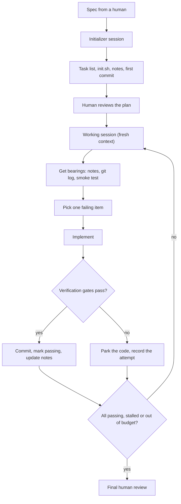

Suppose you hand an agent a 30-page spec for an internal invoicing app on Monday afternoon and ask it to build the whole thing. There are about two hundred user-visible features. Nobody, human or model, finishes that in one sitting, and no context window holds the whole job. The first session writes a few thousand lines of code, fills its context in the middle of the PDF-export feature and stops. The second session starts with a blank memory, looks at a repository full of plausible-looking code, and reports that the app is "complete and working." Half the buttons do nothing.

The model could handle every individual step. What failed was the **handoff between sessions**. A long-running agent is like a series of engineers on shifts, each arriving with no memory of the last. The work succeeds when every shift can quickly find out what's done, what's broken and what's next, and when nobody may say "done" without proof.

This lesson covers the failure modes of hours- and days-long work and the harness patterns that address them: an initializer phase, incremental working sessions, structured progress files, git as memory, verification gates, cross-session budgets and human checkpoints. It builds on [context engineering](context-engineering.html), [memory](memory.html) and [reliability](reliability.html) rather than repeating them.

## What Changes When Tasks Outlive a Context Window

Some definitions first. A **session** is one run of the agent loop with one context: it starts from an initial prompt and ends when the model stops, a budget runs out or the process dies. A **long-running task** needs more than one session, either because it consumes more tokens than one context window can usefully hold or because it takes longer than one process, or one human's attention span, should be trusted to last.

Those are two separate axes, and they cause different problems:

| Dimension | Minutes-long task | Hours-long task | Days-long task |
|---|---|---|---|
| Fits in one context? | Usually | Rarely, even with compaction | Never |
| Process lifetime | One request or worker | Must survive restarts and deploys | Must survive outages and model upgrades |
| Human attention | Someone is watching | Someone checks in occasionally | Async review at milestones |
| Cost of a wrong turn | Cents, seconds | Dollars, an hour of rework | A day of compounding drift |
| Where "memory" lives | The transcript | Transcript plus notes | Almost entirely the workspace |

The last row matters most. In a short task the conversation history *is* the working memory. In a multi-day task the transcript is compacted, reset or discarded at every session boundary, so anything that must persist has to live **in the environment**: code, tests, a task list, progress notes and git history.

> [!KEY] The big idea
> For long-running work, the transcript is disposable and the workspace is the memory. Design the harness so that a fresh session with an empty context can open the workspace and, within a few tool calls, know exactly what is done, what is broken and what to do next.

## How Long-Running Agents Fail

Most of these have short-task cousins, but they compound over many sessions, and several appear only at context boundaries.

| Failure | What it looks like | Root cause |
|---|---|---|
| **Trying to one-shot it** | The agent starts five features at once, runs out of context, and leaves all five half-built and undocumented | No unit of work smaller than "the whole project" |
| **Declaring victory early** | A later session sees lots of code and reports the project complete | No external definition of "done" |
| **False "done" on an item** | A feature is marked finished after a unit test or `curl` check, but it fails in the real UI | Verification weaker than the acceptance criterion |
| **Losing the thread** | After compaction the agent repeats an abandoned approach or forgets a constraint | Lossy summaries drop details that matter later |
| **Context anxiety** | The agent rushes to wrap up as it nears what it *believes* is its context limit | The model behaves as if its context were nearly used up |
| **Environment rot** | A session starts on a broken build left by the previous one and spends its budget on confusing errors | Nobody checks the baseline before new work |
| **Drift** | Conventions shift, scope creeps, notes contradict the code | Each session re-derives intent from partial evidence |
| **Runaway cost** | Sessions keep retrying an impossible item overnight | No budget or stall detection across sessions |

The first three come from Anthropic's November 2025 post on harnesses for long-running agents: even a frontier model looping with compaction fell short of building a production-quality web app from a high-level prompt, because it tried to do too much at once, and because later sessions saw existing progress and declared the job done. *Context anxiety* comes from Anthropic's March 2026 follow-up, where some models began "wrapping up work prematurely as they approach what they believe is their context limit." Early victory looks like this:

```text
[session 7, fresh context]
Thought: Let me see what's here.
Action: bash("ls src/ && git log --oneline | head -5")
Observation: api/ components/ pages/ ...  5 commits, last: "Add invoice PDF export"
Thought: The project has invoices, clients, payments and PDF export implemented.
        The application appears complete. I'll write a summary.
Final: "The invoicing app is fully implemented, with all core features working."
```

Session 7 had no list of what "all" meant and no requirement to check anything, so it took the shortest path to a plausible answer.

## The Two-Phase Harness: Initializer and Working Sessions

The pattern Anthropic described splits the work into two kinds of session that share model, tools and system prompt and differ only in their first instruction.

**The initializer session** runs once and turns a vague request into an environment later sessions can work in:

- **Expand the spec into a task list.** Anthropic's example, a clone of the claude.ai web app, ended up with over 200 features, each with a description and concrete test steps, and *all initially marked failing*. Starting with everything failing matters: no session can conclude "done" while items remain red.
- **Write an `init.sh`** (or `make dev`) that starts the app, so no later session spends time working out how to run it.
- **Create a progress file** for free-text notes.
- **Make an initial git commit**, so there is a known-good baseline to diff and revert against.

**Working sessions** run repeatedly. Each one follows the same ritual:

1. **Get its bearings.** Confirm the working directory, read the progress notes and the recent `git log`, and read the task list.
2. **Check the baseline.** Run `init.sh` and a basic end-to-end smoke test *before* touching anything, so that a bug left by the previous session gets fixed first instead of being buried under new work.
3. **Pick exactly one item**, the highest-priority failing one.
4. **Implement it**, then **verify it end to end**.
5. **Leave a clean state**: commit with a descriptive message, mark the item passing only if it verified, and update the progress notes. Anthropic's bar for "clean" was code you'd be comfortable merging to a main branch.



### Why one item per session

"One item" sounds like a waste of a big context window, but it makes the system manageable:

- **Bounded blast radius.** A bad session costs one item, and git gives an exact boundary to revert to.
- **A verifiable unit.** "Invoice totals render correctly" can be checked. "Made progress on invoicing" can't.
- **Context headroom.** One feature plus orientation usually fits comfortably, so the session rarely hits compaction.
- **Clean handoffs.** Every session boundary falls at a committed, verified state, not halfway through an edit.

As models improve, the right size for an item grows: it should be the largest piece of work the agent can *reliably* finish and verify in one session.

## Structured Progress: Task Lists and Notes

Long-running harnesses usually keep two kinds of progress artifact, because they do different jobs.

### The task list: structured, mostly immutable

The task list is the **contract** for what "done" means. Anthropic chose JSON over Markdown for it because the model was less likely to inappropriately rewrite or overwrite a JSON file, and the coding sessions were instructed to change only each feature's `passes` field. Removing or editing tests was explicitly forbidden, since that could hide missing or buggy functionality.

JSON has a second advantage: **the harness can read it**. Code can pick the next item, count progress, detect edits to frozen fields and refuse to accept a "passing" flag that verification didn't back up. A realistic task list for the invoicing app:

```json
{
  "project": "invoicing-app",
  "spec": "docs/spec.md",
  "features": [
    {
      "id": "INV-012",
      "category": "invoices",
      "priority": 1,
      "description": "User creates an invoice with line items and sees the computed total",
      "steps": [
        "Log in as demo@example.com",
        "Click 'New invoice'; add 3 x $40.00 and 1 x $15.50",
        "Total shows $135.50 and the invoice is listed as Draft"
      ],
      "check": "pytest -q tests/e2e/test_inv_012.py",
      "passes": true,
      "attempts": 1
    },
    {
      "id": "INV-013",
      "category": "invoices",
      "priority": 1,
      "description": "Sending an invoice emails a PDF to the client and marks it Sent",
      "steps": [
        "Open a Draft invoice for client Acme",
        "Click 'Send'; confirm the dialog",
        "Acme's inbox (SMTP stub) has a PDF; the invoice status is Sent"
      ],
      "check": "pytest -q tests/e2e/test_inv_013.py",
      "passes": false,
      "attempts": 2
    }
  ]
}
```

The `check` field links each item to an executable acceptance test that the initializer wrote and that working sessions may not edit. `attempts` lets the harness notice an item that keeps failing.

### The notes: free text, curated

Some things don't fit a schema: why a decision was made, a gotcha that cost an hour, what the last session tried and where it got stuck. That goes in a free-text progress file:

```markdown
# progress.md (rewrite to stay under ~150 lines; history lives in git)

## Current state (after session 23)
- 41/212 features passing. Smoke suite green at commit 9f3c2e1.
- Start everything with ./init.sh (API :8000, web :5173). Seed data: make seed.

## Decisions (don't revisit without a new reason)
- Money is integer cents everywhere, never floats. (session 4)
- PDFs render server-side with WeasyPrint; client-side rendering dropped over font issues. (session 17)

## Gotchas
- E2E tests need `make seed` first or login returns 401.
- A stale vite process sometimes holds :5173. Fix: pkill -f vite.

## Last session (23): INV-013 send invoice by email. NOT DONE
- Done: PDF attachment builds; the SMTP stub receives the message.
- Failing: step 3. Status stays Draft because the update runs in a background
  job the request doesn't wait for.
- Next: make the status update part of send_invoice() itself. Tests are frozen.

## Open questions for a human
- Spec says "net 30 by default"; sample data uses net 14. Assumed net 30. (session 19)
```

| Artifact | Holds | Who writes it | Format |
|---|---|---|---|
| Task list | What "done" means, and which items are done | Initializer; harness flips status | JSON, frozen fields |
| Progress notes | Decisions, gotchas, last attempt, next step | Each session (rewritten, not just appended) | Markdown |
| Git history | What changed, when and why | Each session, via commits | Commit messages, diffs |
| Project memory (CLAUDE.md, AGENTS.md) | Durable conventions and commands | Humans and agents, reviewed | Markdown |
| Test suite | Executable definition of correct behavior | Initializer and humans; frozen for workers | Code |

> [!WARNING] Notes rot
> Notes that only grow become their own context problem: stale "next steps" contradict the code and pull later sessions backward. Ask each session to **rewrite** the current-state section, keep a size cap, date-stamp decisions, and let git hold the history. The [memory](memory.html) lesson's failure modes (staleness, bloat, poisoning) all apply here, at higher stakes, because every future session trusts these notes.

## Git as Checkpoint and Memory

In [reliability](reliability.html) you checkpointed the agent loop after every step so a crashed worker could resume. Long-running work also needs a coarser checkpoint at the **task level**, and version control already provides one:

- **Checkpoint.** Every verified item is a commit. A bad session is discarded with `git reset --hard` or parked with `git stash` while the main line stays green.
- **Episodic memory.** `git log --oneline` is an accurate history, better than any model's recollection, and `git show` gives exact details. The last twenty commit messages often orient a fresh session better than a long summary.
- **Review surface.** Humans review progress as diffs and pull requests (see [human-in-the-loop](human-in-the-loop.html)).
- **Parallelism.** Branches or worktrees let sessions work on independent items, and merge conflicts surface real coupling.

Make commit messages descriptive (`feat(INV-012): line-item totals in cents; e2e passing`), because future sessions read them. Forbid force-pushes and history rewrites, and have the harness enforce protected paths such as tests and the task list rather than merely requesting it in the prompt.

## Compaction, Context Resets and Fresh Sessions

When a session's context fills, there are three ways to continue, and long-running harnesses often use all three at different scales.

| Approach | What happens | Continuity | Clean slate? | Orchestration cost |
|---|---|---|---|---|
| **Compaction** | The history is summarized in place and the same session continues | High, within the summary's limits | No | Low; can be server-side |
| **Context reset** | The session ends and a new one starts from a structured handoff artifact | Only what the handoff captures | Yes | Medium: you design the handoff |
| **Fresh session per item** | Each unit of work starts clean and orients from the workspace | Whatever the workspace records | Yes | The harness shown in this lesson |

Anthropic's March 2026 post puts the trade-off plainly: "While compaction preserves continuity, it doesn't give the agent a clean slate," whereas "a reset provides a clean slate" at the price of a handoff artifact plus extra orchestration, tokens and latency. Context anxiety in Claude Sonnet 4.5 made resets essential in that work. With Claude Opus 4.5 the behavior largely disappeared, and the harness switched to one continuous session with automatic compaction.

The broader lesson: **every harness component encodes an assumption about what the model can't do alone**, and those assumptions expire. Re-test them with each new model and remove scaffolding that is no longer load-bearing.

### Server-side compaction, briefly

The Claude API offers server-side compaction in two beta forms. **Threshold compaction** (header `compact-2026-01-12`) is a `compact_20260112` context-management edit that by default triggers at 150,000 input tokens and returns a `compaction` block you must send back, so always append the full `response.content`. **On-demand compaction** (header `compact-2026-09-04`) lets the harness decide when to summarize, can keep recent turns verbatim and can run in the background; the docs recommend it wherever it is available. Claude Managed Agents compacts automatically. Code is in [context engineering](context-engineering.html#compaction).

Whatever the mechanism, **write anything that must survive to durable storage before compaction, not after.** A summary keeps what the summarizer thought mattered; the progress file keeps what you decided matters.

### Writing a handoff that works

For a reset or the next fresh session, a good handoff answers five questions in the order a cold reader needs them: **the goal** (link the spec and task list), **the state** (last green commit, what passes, what's broken), **what was just tried** (including the exact error), **one concrete next action**, and **what must not change** (decisions, frozen files, open questions).

## Verification Gates Before "Done"

One of the most effective changes in Anthropic's harness work was about testing, not memory. Claude often marked features complete after only unit tests or `curl` checks. Prompting it to test as a human user would, driving a real browser through the Puppeteer MCP server, improved results dramatically, though it couldn't see browser-native alert dialogs that way, and features depending on them stayed buggier.

A practical gate ladder, from cheapest to strongest:

1. **Build, typecheck and lint.** These catch half-finished edits immediately.
2. **Unit tests.** Necessary but easy to satisfy without the feature actually working.
3. **The item's end-to-end acceptance check**, driving the real app through a browser (Playwright or Puppeteer) or real API calls, exactly as the task list's `steps` describe. See [computer-use agents](computer-use-agents.html).
4. **A regression smoke suite** over previously passing items, because long runs break old features as often as they fail to build new ones.
5. **An independent evaluator** for anything a test can't capture well (UX quality, design, writing). This is a separate agent with its own context and a skeptical prompt, grading against explicit criteria.

Two refinements from Anthropic's 2026 work are worth copying. **Agree on "done" before coding**: in "sprint contracts," the builder proposed what it would build and how success would be verified, and the evaluator reviewed that before any code was written. And **evaluators need tuning too**: out of the box, Claude sometimes identified real problems and then approved the work anyway, and the author found tuning a standalone skeptical evaluator more tractable than making a builder self-critical.

> [!WARNING] The agent must not grade itself on what it can edit
> If the agent can modify the tests, the task list or the verification script, then over enough sessions some session will "fix" a failure by weakening the check. The harness, not the agent, should run the gates and flip the `passes` flag, and it should reject any session that touched protected paths. See [agent safety](agent-safety-alignment.html) on specification gaming.

## A Minimal Multi-Session Harness

Here is a compact sketch of the outer loop. Each working session is a fresh `messages` list with a single `bash` tool. The harness picks the item, runs the gates itself, protects the task list and tests, commits or parks the result, and enforces budgets across sessions. `TaskMeter` is the cost meter from [cost and latency](cost-and-latency.html). The initializer session, the sandbox and retries (see [reliability](reliability.html)) are left out for brevity.

```python
import json
import subprocess
from pathlib import Path

import anthropic

client = anthropic.Anthropic()
MODEL = "claude-opus-5-5"
REPO = Path("workspace")
TASKS, NOTES = REPO / "features.json", REPO / "progress.md"
SYSTEM = ("You are one shift in a multi-session build. Your memory is the repo: progress.md, "
          "git log and features.json. Work on ONE feature, verify it in the browser, keep "
          "the build green, and leave clear notes for the next session.")
BASH = {"name": "bash", "description": "Run a shell command in the repo root; returns exit code and output tail.",
        "input_schema": {"type": "object", "properties": {"command": {"type": "string"}},
                         "required": ["command"], "additionalProperties": False}}

def sh(cmd: str | list[str], timeout: int = 900) -> tuple[int, str]:
    try:
        p = subprocess.run(cmd, shell=isinstance(cmd, str), cwd=REPO,
                           capture_output=True, text=True, timeout=timeout)
        return p.returncode, (p.stdout + p.stderr)[-8000:]
    except subprocess.TimeoutExpired:
        return 124, f"timed out after {timeout}s"

def run_session(feat: dict, meter, max_turns: int = 200) -> str:
    messages = [{"role": "user", "content":
        f"Read progress.md and the last 20 commits, run ./init.sh and the smoke tests, "
        f"then implement ONLY {feat['id']}: {feat['description']}\nAcceptance steps: "
        f"{feat['steps']}\nDo not edit features.json or tests/, and do not commit: the harness "
        f"does. Update progress.md before stopping."}]
    for _ in range(max_turns):
        with client.beta.messages.stream(
            model=MODEL, max_tokens=32000, system=SYSTEM, tools=[BASH], messages=messages,
            thinking={"type": "adaptive"}, betas=["task-budgets-2026-03-13"],
            output_config={"effort": "high", "task_budget": {"type": "tokens", "total": 400_000}},
        ) as stream:
            resp = stream.get_final_message()
        meter.record(MODEL, resp.usage)
        messages.append({"role": "assistant", "content": resp.content})
        if resp.stop_reason != "tool_use":
            return resp.stop_reason          # end_turn, max_tokens, refusal...
        results = []
        for b in resp.content:
            if b.type == "tool_use":
                code, out = sh(b.input["command"])
                results.append({"type": "tool_result", "tool_use_id": b.id,
                                "content": f"exit={code}\n{out}", "is_error": code != 0})
        messages.append({"role": "user", "content": results})
    return "max_turns"

def gates_pass(feat: dict) -> bool:
    protected = sh(["git", "status", "--porcelain", "--", "tests", "features.json"])[1]
    if protected.strip():
        return False                          # the agent touched the yardstick
    return all(sh(c)[0] == 0 for c in ("./init.sh", "pytest -q tests/unit",
                                       feat["check"], "pytest -q -m smoke tests/e2e"))

def main(meter, max_sessions: int = 80, max_usd: float = 400.0, max_stalls: int = 3):
    stalls = 0
    for n in range(max_sessions):
        snapshot = TASKS.read_text()
        tasks = json.loads(snapshot)
        todo = [f for f in tasks["features"] if not f["passes"] and f["attempts"] < 3]
        if not todo or meter.usd >= max_usd or stalls >= max_stalls:
            break                             # done, out of money, or stuck: hand to a human
        feat = min(todo, key=lambda f: f["priority"])
        base = sh(["git", "rev-parse", "HEAD"])[1].strip()
        stop = run_session(feat, meter)
        sh(["git", "reset", "--soft", base])  # fold any commits the agent made back into the diff
        ok = gates_pass(feat)                 # the harness decides, not the agent's claim
        TASKS.write_text(snapshot)            # undo any edits the agent made to the list
        feat["attempts"] += 1
        if ok:
            feat["passes"], stalls = True, 0
            TASKS.write_text(json.dumps(tasks, indent=2))
            sh(["git", "add", "-A"])
            sh(["git", "commit", "-qm", f"feat({feat['id']}): {feat['description'][:60]}"])
        else:
            notes = NOTES.read_text()         # keep what was learned, park the code
            sh(["git", "add", "-A"])
            sh(["git", "stash", "push", "-qm", f"failed {feat['id']} session {n}"])
            NOTES.write_text(notes + f"\n- Session {n}: {feat['id']} failed gates ({stop}); code stashed.\n")
            TASKS.write_text(json.dumps(tasks, indent=2))
            sh(["git", "add", "-A"])
            sh(["git", "commit", "-qm", f"chore: record failed attempt on {feat['id']}"])
            stalls += 1
```

What this sketch gets right, and what it leaves for you:

- **The model never self-certifies.** It can believe it's done, but only `gates_pass` flips `passes`, and edits to `tests/` or the task list fail the session outright. The harness also owns commits (unlike Anthropic's setup, where the agent committed): the soft reset folds any agent commits back into the working tree, so a committed test edit can't slip past the check.
- **Failure keeps the lessons and drops the code.** The stash preserves the attempt for a human, the notes preserve what was learned, and the main line stays green for the next session.
- **Three budgets apply at three scales.** `max_tokens` caps each response, the task budget paces each session, and dollars, sessions and stalls cap the whole project.
- **Left out:** retries and a checkpointed inner loop (from [reliability](reliability.html)), a sandbox ([guardrails and sandboxing](guardrails-and-sandboxing.html)), prompt caching, a stuck-baseline repair step, and a human review queue. Several of these are exercises below.

## Budgets Across Sessions

A runaway short task wastes a few dollars; a runaway overnight task wastes far more. For scale, Anthropic's March 2026 post reports a solo agent run of 20 minutes costing $9, against 6 hours and $200 for the full planner, generator and evaluator harness on the same prompt: far better output at over 20 times the price. Budget deliberately, at every level:

| Level | Control | Enforced by | Purpose |
|---|---|---|---|
| Response | `max_tokens` | API (hard) | Stop a single runaway generation |
| Session | Task budget, turn cap, wall-clock limit | Model (advisory) plus harness | Pace the work and wrap up gracefully |
| Item | Max attempts per item | Harness | Stop retrying the impossible |
| Project | Dollars, session count, deadline | Harness or platform | Bound total spend and time |
| Progress | Stall counter (N sessions with no new passing item) | Harness | Detect "busy but not progressing" |

**Task budgets** (beta, header `task-budgets-2026-03-13`) give the model an advisory token budget for a whole agentic loop via `output_config={"task_budget": {"type": "tokens", "total": N}}`. The server injects a running countdown the model uses to prioritize and finish gracefully; it counts thinking, tool calls, tool results and output across the loop's requests. From the docs:

- It is **advisory, not a hard cap**. Hard limits come from `max_tokens` and your harness.
- The minimum `total` is **20,000 tokens**, and a budget clearly too small for the work can cause **refusal-like behavior** (declining, scoping down aggressively, stopping early). Size it from measured usage.
- The value is part of the rendered prompt, so **changing it mid-task invalidates the cache**. Set it once per session.
- If *your* code compacts history, pass `remaining` so the countdown doesn't reset. Server-side compaction doesn't reset it.
- Anthropic's migration guidance recommends task budgets for **unattended** loops, not interactive sessions.

A per-session task budget fits one-item-per-session naturally: it tells the model how much effort one item deserves, while the harness owns project totals. Measure **cost per verified item**, counting failed sessions, evaluator calls and regressions (see [cost and latency](cost-and-latency.html)).

## Running for Hours: Async Execution and Human Checkpoints

A multi-hour agent shouldn't run inside an HTTP request or a laptop terminal. Run it as a **background job** with a queue, leased workers and durable state. The outer session loop maps neatly onto a [durable execution](reliability.html#durable-execution-engines) workflow: each working session is one activity, and if a worker dies mid-session, the retry starts from the last clean commit. Quotas, versioning and monitoring are covered in [deployment](deployment.html).

Anthropic's April 2026 post on scaling Managed Agents makes the same point architecturally. It separates the **session** ("the append-only log of everything that happened," stored outside both the context window and the harness), a disposable **harness** that calls the model, and the **sandbox** where tools run. Because the log is durable, "nothing in the harness needs to survive a crash."

**Human checkpoints** go where human judgment is cheapest and most valuable:

- **After the initializer.** A wrong task list costs minutes to fix on day 1 and days to discover on day 3.
- **At milestones.** A pull request every N items or per category keeps review digestible.
- **On escalations.** A stall, exhausted budget or item at its attempt limit should produce a clear request for help, not a silent stop.
- **Asynchronously by default.** Proceed on documented assumptions recorded under "Open questions" rather than blocking overnight (see [human-in-the-loop](human-in-the-loop.html#background-agents-and-notifications)).

Humans steer mostly by **editing artifacts**: reprioritizing the task list, adding a decision to the notes or a rule to `CLAUDE.md`, commenting on a PR. These channels are durable, so the next session picks them up automatically.

## Managed Options

As of late 2026, managed runtimes cover much of the plumbing. They change quickly, so check current docs.

- **Claude Managed Agents** (beta) runs the loop on Anthropic's infrastructure with a container per session, versioned agent configs and automatic compaction. A session can carry a hard dollar **session budget**: at the cap it pauses with `stop_reason: budget_reached`, keeping history and sandbox, and raising the budget resumes it. **Scheduled deployments** start sessions on a cron schedule.
- **Outcomes** make the verification gate a platform feature. You send a `user.define_outcome` event with a task and a **rubric**; a separate **grader** in its own context window scores each iteration and feeds back per-criterion gaps, and the agent revises until the result is `satisfied`, `max_iterations` is reached (default 3, maximum 20), or the outcome is interrupted or `failed`. Rubrics work best as independently gradable criteria ("CSV has a numeric `price` column"), not impressions.
- **The Claude Agent SDK** gives you Claude Code's harness as a library, with resumable and forkable sessions (see [agent frameworks](agent-frameworks.html)).
- **Durable workflow engines** (Temporal, DBOS, Inngest, LangGraph checkpointers) provide resumable outer loops for any model.

A platform gives you the runtime, session log and budgets. The task list, the definition of done and the notes are specific to your task and remain your job.

## Evaluating Long-Horizon Performance

How do you know whether a long-running agent is good, or getting better?

**Public trends.** METR's **time horizon** estimates the length of task, in skilled-human time, that a model completes with 50% reliability. It grew exponentially from 2019 to 2025, doubling roughly every seven months, and METR revised its task suite in January 2026 (Time Horizon 1.1). Read current figures on [METR's site](https://metr.org/time-horizons/), and note what the metric isn't: it measures task difficulty in human time, not how long an agent runs or how well a multi-session harness works. Benchmarks such as Vending-Bench add **variance over long runs** as a finding: strong models sometimes derail badly over millions of tokens. See [benchmarks](benchmarks.html).

**Your own metrics.** For your harness on your tasks, track:

- **The progress curve**: verified items over time and dollars. A curve that flattens while spending continues is a stall.
- **The false-done rate**: items marked passing that fail an independent re-check (hidden tests, a human spot-check, a fresh evaluator). This catches self-grading.
- **The regression rate**: passing items broken by later sessions.
- **Sessions and cost per verified item.**
- **A cold-start test**: give a fresh session only the workspace, ask for status and next step, and compare against ground truth. This tests your handoff artifacts directly.
- **Human intervention rate**: escalations and rejected PRs per 100 items.

Long runs vary a lot, so evaluate more than once (pass^k from [evaluating agents](evaluating-agents.html) applies), and **ablate** harness components when you change models. Anthropic dropped context resets, then sprint decomposition, as newer models made each unnecessary, but kept the planner because without it the builder under-scoped the work.

## Key Takeaways

- When a task spans many context windows and sessions, the transcript is disposable and the **workspace is the memory**: code, tests, a task list, progress notes and git history.
- The characteristic failures are trying to one-shot the work, declaring victory early, false "done" on individual items, losing the thread after compaction, context anxiety, environment rot, drift and runaway cost.
- A two-phase harness addresses most of them. An **initializer** expands the spec into a failing task list, an `init.sh` and notes. **Working sessions** orient, check the baseline, do one item, verify, commit and update notes.
- Keep the **task list structured and mostly frozen** (JSON the harness can read and enforce) and the **notes free-text but curated**. Git provides checkpoints, episodic memory and the review surface.
- Compaction preserves continuity, while resets and fresh sessions give a clean slate at the cost of a handoff. Every harness component encodes an assumption about the model's limits, so re-test it when models change.
- Verify the way a user would (end-to-end, in a browser where relevant) and with an independent evaluator for subjective quality. Only the harness should mark items done, and the tests must be outside the agent's write scope.
- Budget at every level: `max_tokens` per response, an advisory task budget per session, attempt limits per item, and dollars, deadlines and stall detection per project. Put humans at the plan, at milestones and on escalations.

## Exercises

1. **Write the task list.** Take a small project you know (a to-do app with auth, or a CLI that syncs two calendars) and write the initializer's output: 15–25 features in the JSON format above, each with concrete acceptance steps and a `check` command, plus the first version of `progress.md`. Which features were hardest to make verifiable?
2. **Cold-start test.** Using the `progress.md` example in this lesson, start a fresh model session with only that file and a `git log` excerpt you write, and ask: "What is the state of this project and what exactly should you do first?" Grade the answer. Then delete the "Last session" section and repeat. What did the model lose?
3. **Baseline repair.** Extend the harness so that if the smoke suite fails *before* a session starts, the next session works on a synthetic "fix the regression" item (with the failing output in its prompt) instead of a new feature, and so that two consecutive failed repairs escalate to a human.
4. **Stall and budget policy.** Your overnight run has a $300 cap and about 120 items. Design the budget table for it: the per-session task budget, max turns, max attempts per item, stall threshold and what happens at each limit. Explain how you would set each number from data rather than by guessing.
5. **Independent evaluator.** Add an evaluator session for items whose `category` is `"ux"`. It gets a fresh context, read-only access to the running app through a browser tool, and a rubric. It must return a structured verdict (`pass` or `fail`, with failed criteria). Only a `pass` from the evaluator *and* the automated gates may mark the item done. How do you stop the evaluator from simply approving everything?

<details class="solutions">
<summary>Hints and solution sketches</summary>

1. **Hint:** A feature is verifiable when its last step is an observable state ("the invoice is listed as Sent"), not an activity ("sending works"). **Sketch:** Group by user journey, order by dependency via `priority`, and give each feature 2–4 steps ending in an assertion plus a `check` pointing at one e2e test. The hardest are cross-cutting features ("errors are user-friendly"): split them into concrete checks ("on a 375px viewport the nav collapses to a menu button") or route them to an evaluator with a rubric. The first `progress.md` holds the run command, the initializer's stack decisions and assumptions about ambiguous spec points under "Open questions."

2. **Hint:** Write down the ground truth *before* running the test: 41/212 passing, smoke green at 9f3c2e1, first run `init.sh` and the smoke tests, then finish INV-013 by making the status update synchronous. **Sketch:** With the full file, a good answer names the item, the failing step and the fix, and checks the baseline first. Without "Last session," the model re-derives the situation, may not rediscover the background-job cause, and may retry an approach already ruled out. Score on correct state, correct next action and respect for constraints (no editing the frozen test).

3. **Hint:** Run the smoke suite in `main` before choosing an item, and represent the repair as an ordinary item so the rest of the loop is unchanged. **Sketch:**

    ```python
    code, out = sh("pytest -q -m smoke tests/e2e")
    if code != 0:
        feat = {"id": "REPAIR", "priority": 0, "attempts": repairs, "passes": False,
                "description": "The smoke suite is failing. Fix the regression without editing tests.",
                "steps": [out[-3000:]], "check": "pytest -q -m smoke tests/e2e"}
        repairs += 1
        if repairs > 2:
            escalate("baseline broken after two repair sessions", out)  # your notifier
            return
    else:
        repairs = 0
    ```

    Keep the synthetic item out of `features.json`. Commit a successful repair as `fix(regression): …` and note which commit broke the baseline (`git bisect` against the smoke suite finds it).

4. **Hint:** Run 10–20 representative items without limits first, record tokens, turns, dollars and outcomes, then set each limit from a percentile. **Sketch:** Task budget near the p90 of tokens per *successful* item (advisory, so err generous; too small causes early stops); max turns near the p99. Max attempts per item: 2–3 if your data shows third attempts rarely succeed, then mark it `blocked` and escalate. Three sessions without a new passing item pauses the run and notifies a human. Dollar cap $300, with an alert at 50% spend if the progress curve is behind plan. At the cap, start no new sessions, let the current one finish, and post a summary. Re-derive the numbers when the model or harness changes.

5. **Hint:** The evaluator's context and incentives should differ from the builder's: separate prompt, no access to the builder's reasoning, criteria scored one by one, calibration against known answers. **Sketch:** Run it as its own loop with a browser tool and structured output (`output_config={"format": {"type": "json_schema", "schema": ...}}`) returning `{"verdict": "pass" | "fail", "failed_criteria": [...], "evidence": [...]}`, and require evidence for every passed criterion. Calibrate on known-good and known-bad builds, track its false-pass rate, tell it that finding real defects is the job, and spot-check verdicts with a human early on. Feed failed criteria verbatim to the next builder session. On Claude Managed Agents, this is an outcome with a rubric.

</details>

## Check Your Understanding

```quiz
Q: A fresh working session opens a repo with lots of code and reports the project complete, although many features don't work. Which harness change most directly prevents this?
- [ ] Give the session a larger context window so it can read the whole repository first
- [x] Have an initializer write a task list where every item starts out failing
- [ ] Turn on server-side compaction so the session remembers what earlier ones did
- [ ] Ask the session to double-check its conclusion carefully before it replies
E: Early victory happens because "done" has no external definition. A task list that starts all-failing, and only flips after verification, makes "complete" checkable. More context or compaction doesn't help a session that has no memory of the earlier ones, and self-checking reuses the same judgment that made the mistake.

Q: Why did Anthropic store the feature list as JSON rather than Markdown?
- [ ] JSON files are smaller, so the list takes up fewer tokens in each session's context
- [ ] Markdown checklists can't record test steps or a priority for each feature
- [x] The model was less likely to inappropriately rewrite or overwrite a JSON file
- [ ] The Messages API only accepts JSON files as attachments to an agent session
E: The post reports the model was less prone to inappropriately change a JSON file, and sessions were told to change only the passes field. A structured file also lets the harness parse it, enforce frozen fields and pick the next item.

Q: Each working session in a long-running harness implements only one item. What is the main benefit?
- [ ] It minimizes the total number of tokens spent across the whole project
- [x] Every session ends at a verified commit that is cheap to roll back
- [ ] It lets the harness run each feature on a cheaper model tier than the last
- [ ] It removes the need for progress notes, since the git log covers everything
E: One item per session bounds the blast radius, gives a unit that can be verified, and puts every handoff at a clean commit. It usually adds orientation overhead rather than minimizing tokens, and notes still carry what git can't, such as why something failed.

Q: Compared with compaction, what does a context reset with a handoff artifact give you?
- [x] A clean slate for the model, at the cost of designing a state handoff
- [ ] Full continuity, since the reset keeps every earlier message in compressed form
- [ ] Lower cost, since the API bills reset sessions at a discounted input rate
- [ ] Automatic protection against tampering, since the new session cannot edit tests
E: Compaction summarizes in place and keeps continuity but not a clean slate. A reset starts fresh, which helped with context anxiety, at the cost of designing a handoff and extra orchestration, tokens and latency. Nothing about a reset protects the tests.

Q: A session builds a feature, its unit tests pass, and a curl request to the endpoint returns 200. What should the harness do before marking the item passing?
- [ ] Mark it passing, since unit tests plus a live endpoint check is sufficient proof
- [ ] Ask the same session to review its diff once more and confirm it is complete
- [ ] Mark it passing provisionally and leave the real check for the final human review
- [x] Run its end-to-end acceptance steps in the real UI, plus a smoke suite
E: Anthropic found agents often marked features done after unit tests or curl checks, and that browser-based end-to-end testing improved results dramatically. Self-review isn't independent, and deferring all checks to the end lets errors compound across sessions.

Q: You set output_config.task_budget to 400,000 tokens for each working session. Which statement is accurate?
- [ ] The API stops the session with an error once 400,000 tokens have been used
- [x] The model sees a countdown and paces itself, but it is advisory, not a hard cap
- [ ] The budget is per request, so each tool-use turn starts again at 400,000
- [ ] Raising it mid-session is free, since budgets are excluded from the cached prompt
E: Task budgets are a soft, model-visible budget for the whole agentic loop. max_tokens and the harness supply hard limits. The budget value is part of the rendered prompt, so changing it mid-task invalidates the cache.

Q: Your harness has run 5 sessions in a row without any new item passing, though each session reports progress. What's the best response?
- [ ] Raise the per-session task budget, since the sessions are likely being cut off early
- [ ] Switch to compaction so later sessions can see what earlier ones attempted
- [x] Treat it as a stall: pause the run, keep the attempts, and escalate to a human
- [ ] Let the agent edit the acceptance tests for the blocked item so work can continue
E: A flat progress curve with continued spending is the signature of a stall, whatever the sessions say. A stall threshold should pause the run and escalate with the parked attempts and notes. Bigger budgets just spend more, and letting the agent edit tests is the specification-gaming failure.
```

## Further Reading

- [Effective harnesses for long-running agents (Anthropic, Nov 2025)](https://www.anthropic.com/engineering/effective-harnesses-for-long-running-agents): the initializer and coding-agent pattern, JSON feature lists, `init.sh`, progress files and browser-based verification.
- [Harness design for long-running application development (Anthropic, Mar 2026)](https://www.anthropic.com/engineering/harness-design-long-running-apps): planner, generator and evaluator agents, context anxiety, resets vs. compaction, sprint contracts, and simplifying the harness as models improve.
- [Scaling Managed Agents: Decoupling the brain from the hands (Anthropic, Apr 2026)](https://www.anthropic.com/engineering/managed-agents): the session as a durable event log outside the context window, and why the harness can be disposable.
- [Effective context engineering for AI agents (Anthropic)](https://www.anthropic.com/engineering/effective-context-engineering-for-ai-agents): compaction, structured note-taking and sub-agents for long-horizon work.
- [Task budgets (Claude docs)](https://platform.claude.com/docs/en/build-with-claude/task-budgets): how the countdown counts tokens, choosing a budget, `remaining` across compaction, and its advisory nature.
- [Compaction (Claude docs)](https://platform.claude.com/docs/en/build-with-claude/compaction): threshold and on-demand server-side compaction, and how to choose between them.
- [Define outcomes (Claude Managed Agents docs)](https://platform.claude.com/docs/en/managed-agents/define-outcomes): rubric-graded iterate, grade and revise loops with an independent grader.
- [Measuring AI Ability to Complete Long Tasks (METR, 2025)](https://arxiv.org/abs/2503.14499) and [METR time horizons](https://metr.org/time-horizons/): the time-horizon metric, its caveats and current estimates.
