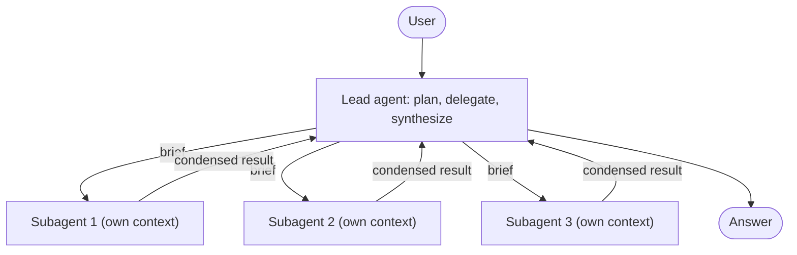
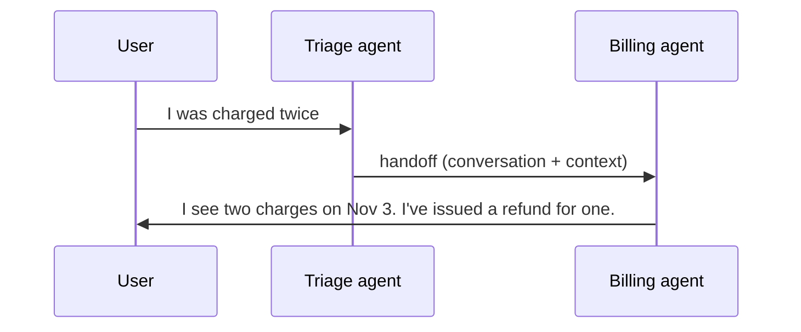

Picture asking an assistant to "map every company building solid-state batteries, their funding, and their manufacturing partners." A single agent works through it serially: search, read, note, search again, while its context window fills with dozens of web pages until the earliest findings blur. Now picture a lead agent that splits the job into eight angles, hands each to a separate **subagent** with its own fresh context, and lets them all search at once. Each subagent returns a few hundred tokens of distilled findings. The lead never sees the raw pages; it sees eight clean reports. That is the promise of **multi-agent systems**: more total thinking than any one context window can hold, done in parallel.

It is also a trap. The same architecture applied to "build me a web app" produces eight subagents making eight incompatible design decisions. Multi-agent systems burn tokens at a dramatic rate, fail in new and confusing ways, and are harder to debug than any single agent. In 2025 two respected teams published blog posts with nearly opposite titles: Cognition's "Don't Build Multi-Agents" and Anthropic's "How we built our multi-agent research system." Both were right, about different tasks.

This lesson teaches you to tell those tasks apart. We cover why to use multiple agents, what it costs, the main topologies, how agents communicate, how to delegate well, how these systems fail, and finally a working orchestrator-subagent system with the Anthropic SDK.

## What Counts as Multi-Agent?

A **multi-agent system (MAS)** is a system in which two or more LLM-driven agents, each with its own context, instructions and often its own tools, interact to accomplish a task. The key phrase is **its own context**. Two prompts in a fixed pipeline are a workflow ([Workflow Patterns](workflow-patterns.html)); they become agents when each runs its own loop and makes its own decisions about what to do next.

Two vocabulary notes:

- A **subagent** is an agent spawned by another agent to perform a delegated task, usually returning a result and then terminating. Claude Code, the Claude Agent SDK and most research agents use subagents.
- **Agent** here does not imply a different model. Many multi-agent systems run the same model with different system prompts, tools and context. Specialization comes mostly from *context*, not weights.

## Why Multiple Agents?

There are four genuine reasons to split work across agents. Notice that "it mirrors a human org chart" is not one of them.

**1. Context isolation (compression).** Every agent's context window is a scarce resource ([Context Engineering](context-engineering.html)). A subagent can read 50,000 tokens of documents and return a 500-token summary. The parent gets the signal without the noise. This is the single most important benefit. It lets a system effectively process far more information than one context window holds, and it keeps the lead agent's reasoning sharp because its context stays clean.

**2. Parallelism.** Independent subtasks can run simultaneously. For breadth-first work (survey ten sources, check five hypotheses, scan twenty files) wall-clock time drops toward the time of the slowest branch. Anthropic reported that parallelizing subagents (and tool calls within them) cut research time dramatically for complex queries.

**3. Specialization.** Different subtasks benefit from different system prompts, tools, models and permissions. A "security reviewer" subagent with read-only tools and a focused checklist behaves differently from the general agent. You can also route cheap subtasks to cheaper models.

**4. Separation of concerns.** Splitting roles can create useful independence: the agent that writes code is not the one that judges it, so the reviewer is not biased by the writer's reasoning. It also creates natural security boundaries: an agent that reads untrusted web content need not hold the credentials of the agent that sends email ([Agent Security](agent-security.html)).

## What It Costs

**The token multiplier.** Anthropic reported that in its data, agents typically used about 4× more tokens than chat interactions, and its multi-agent research system used about **15× more tokens than chat**. Every subagent has its own system prompt, its own tool definitions, its own reasoning and its own tool results. The same post found that token usage by itself explained most of the variance in performance on a browsing benchmark: multi-agent systems work partly *because* they spend more tokens. That means they only make economic sense for tasks valuable enough to pay for it ([Cost & Latency](cost-and-latency.html)).

**Coordination overhead.** Someone has to decompose the task, write briefs, wait for results, reconcile contradictions and decide when to stop. Each of those is an LLM decision that can go wrong.

**Information loss.** Every handoff is a lossy compression. The subagent does not know what the lead knows; the lead sees only what the subagent chose to report. Researchers call the resulting degradation a "game of telephone."

**Debuggability.** A failure might originate in the plan, a brief, a subagent's search, a summary, or the synthesis. Traces span multiple concurrent conversations ([Observability](observability.html)).

**Non-determinism compounds.** Small differences early (which subagents were spawned, which sources they found) cascade into very different final outputs, which makes evaluation harder ([Evaluating Agents](evaluating-agents.html)).

> [!KEY] The core trade
> Multi-agent systems trade tokens and coordination complexity for **context capacity and parallelism**. They pay off when a task is broad, decomposable into independent parts, and valuable. They hurt when parts are tightly coupled and must agree with each other.

## Topologies

The **topology** of a multi-agent system is who talks to whom and who decides what happens next.

### Orchestrator–subagents (supervisor)

A lead agent decomposes the task, spawns subagents with briefs, and synthesizes their results. Subagents do not talk to each other; all coordination flows through the lead. This is the agentic version of the orchestrator-workers workflow, and by far the most common production topology.



**Best for:** breadth-first research, parallel code search, any read-heavy fan-out.

### Hierarchical

Orchestrator–subagents, recursively: a top-level manager delegates to team leads, who delegate to workers. It scales to very large tasks in principle, but every level adds latency, cost and another lossy handoff. In practice deep hierarchies are rare; two levels is common, three is unusual.

### Sequential pipeline

Agents arranged in an assembly line: researcher → writer → editor → fact-checker. Each consumes the previous agent's output. This is prompt chaining where each stage is a full agent. It is easy to reason about, but errors propagate forward and later stages cannot easily send work back unless you add explicit feedback edges.

### Peer network (decentralized)

Agents communicate directly with each other, with no central controller, through messages or a shared space. Flexible and robust to any single agent failing, but hard to control: conversations can loop, drift or never terminate. Mostly seen in research and simulation rather than production.

### Debate and critic

Multiple agents propose answers, critique each other over several rounds, and converge. Du et al. (2023) showed that **multiagent debate** improved factuality and reasoning over single-model baselines on several tasks. A simpler production version is the **critic**: one agent produces, another reviews with a different prompt or model, much like the evaluator-optimizer workflow but with agentic reviewers that can run tools (execute tests, check sources).

### Handoffs (swarm)

Instead of a supervisor calling subagents and getting results back, control is **transferred**: the current agent decides another agent is better suited and hands the conversation over, and the new agent takes over talking to the user. OpenAI popularized this with **Swarm** (October 2024), an explicitly experimental, educational framework built around two primitives, *routines* and *handoffs*. Its ideas moved into the production **OpenAI Agents SDK** (2025), where a handoff is exposed to the model as a tool. A minimal sketch in the Agents SDK's documented style (APIs evolve; check current docs):

```python
from agents import Agent, Runner

billing = Agent(name="Billing", instructions="Resolve billing questions. You can issue credits up to $50.")
tech = Agent(name="Tech support", instructions="Debug technical problems step by step.")
triage = Agent(
    name="Triage",
    instructions="Figure out what the customer needs and hand off to the right specialist.",
    handoffs=[billing, tech],          # each becomes a transfer_to_... tool for the model
)

result = Runner.run_sync(triage, "I was charged twice for my subscription this month.")
print(result.final_output)
```



**Best for:** customer-facing assistants with distinct domains, where each specialist has its own tools and policies. The key design question is what context travels with the handoff: the full conversation, or a filtered summary.

### Role-playing societies

A line of research builds whole "societies" of role-playing agents:

- **CAMEL** (Li et al., 2023) introduced **role-playing** with **inception prompting**: an "AI user" agent instructs an "AI assistant" agent toward a task, with carefully designed prompts keeping both in role. It was used both to study cooperative behavior and to generate conversational datasets.
- **ChatDev** (Qian et al., 2023) simulates a software company. Agents in roles such as CEO, CTO, programmer, reviewer and tester move through waterfall-style phases (design, coding, testing, documentation) via structured "chat chains."
- **MetaGPT** (Hong et al., 2023) encodes **Standard Operating Procedures (SOPs)** into the agent team. Agents produce structured artifacts (requirements documents, design specs, interfaces) rather than free chat, and communicate through a shared publish-subscribe message pool. Its insight, that structured intermediate documents beat unstructured dialogue, generalizes well beyond software.
- **AutoGen** (Wu et al., 2023, Microsoft) provided a general framework for "conversable agents" and group chats, and became a common substrate for such experiments.

These systems demonstrated the paradigm and produced useful ideas (structured artifacts, explicit phases, role prompts), but their headline demos were small projects. Treat claims of "an AI company that builds software end-to-end" with care.

### Generative-agent simulations

**Generative Agents** (Park et al., 2023) populated a small virtual town with 25 agents, each with a **memory stream** of observations, periodic **reflection** that synthesized higher-level insights, and **planning** of daily schedules. Believable social behavior emerged; most famously, one agent's intention to host a Valentine's Day party spread through the town by conversation, and others showed up. The goal here is not task completion but **simulation**: modeling human behavior for social science, game NPCs, and testing products or policies. The memory-reflection-planning architecture has been hugely influential on [agent memory](memory.html) design.

## Communication: Shared State vs. Message Passing

Agents coordinate in two basic ways.

**Message passing.** Agents send each other explicit messages: a brief down, a report up, a handoff across. Each agent's context contains only what was sent to it. This gives strong isolation and makes data flow explicit and auditable, but anything not in the message is lost.

**Shared state (blackboard).** Agents read from and write to a common store: a document, a database, a file system, a task board. This is the **blackboard architecture** from [Single-Agent Architectures](agent-architectures.html#blackboard-architecture) applied across agents. Information is not lost in transit, and late-arriving agents can catch up, but you need conventions for structure, ownership and concurrent writes, or agents overwrite each other.

Many production systems blend the two: briefs and status by message, bulky artifacts in shared storage. Anthropic described having subagents write substantial outputs to a file system and pass lightweight references back to the coordinator, rather than routing every token through the lead's context.

### Structured handoff payloads

Whatever the channel, structure the payload. Free-text "here's what I found" invites omissions. A good **handoff payload** has a schema:

```json
{
  "task_id": "battery-landscape/funding",
  "status": "complete",
  "summary": "Identified 9 solid-state battery startups with disclosed funding over $50M.",
  "findings": [
    {"claim": "Company X raised a Series D in 2025", "source": "https://...", "confidence": "high"}
  ],
  "artifacts": ["files/funding_table.csv"],
  "open_questions": ["Two companies' 2026 rounds unconfirmed"],
  "decisions_made": ["Excluded companies focused only on semi-solid electrolytes"]
}
```

The `decisions_made` field matters more than it looks. It surfaces the **implicit choices** a subagent made, which, as we will see, are the root of many multi-agent failures. Enforce schemas with [structured outputs](structured-outputs.html) or strict tool definitions.

## Delegation: The Brief Is Everything

A subagent starts with **nothing**: no conversation history, no knowledge of the user, no idea what the other subagents are doing. Its entire understanding of the task is the brief you write. Short briefs are the most common cause of poor multi-agent results.

Anthropic reported that early versions of its research system had the lead agent issue short instructions like "research the semiconductor shortage." Subagents misinterpreted the task or duplicated each other's work; in the example Anthropic gave, one subagent explored the 2021 automotive chip crisis while two others duplicated each other's investigation of current supply chains, with no effective division of labor. The fix was teaching the orchestrator to write detailed briefs. Every brief should specify:

| Element | Question it answers | Example |
|---|---|---|
| **Objective** | What exactly should you find or produce, and why? | "Find disclosed funding rounds for solid-state battery startups since 2023, for an investor landscape map." |
| **Output format** | What shape should the result take? | "A table: company, round, amount, date, lead investor, source URL. Then up to 5 bullets of caveats." |
| **Tool and source guidance** | How should you go about it? | "Prefer company press releases and filings over aggregator sites. Use 5–15 searches." |
| **Boundaries** | What is out of scope? Who covers what? | "Do NOT research manufacturing partners; another agent covers that. Exclude semi-solid batteries." |
| **Effort and stopping** | How much is enough? | "Stop when you have 8+ companies or after 15 searches, whichever comes first." |

> [!TIP] Scale effort to complexity, explicitly
> Orchestrators are bad at judging how much work a task deserves; early systems reportedly spawned dozens of subagents for simple questions. Anthropic embedded scaling rules in its prompts: simple fact-finding needs one agent with a few tool calls, direct comparisons a few subagents, complex research many subagents with clearly divided responsibilities. Write your own rules for your domain.

## How Multi-Agent Systems Fail

In 2025, Cemri et al. published "Why Do Multi-Agent LLM Systems Fail?", analyzing execution traces from several popular open-source multi-agent frameworks. They built **MAST** (Multi-Agent System Failure Taxonomy), with 14 failure modes in three categories:

**1. Specification and system design issues**: failures rooted in how the system and tasks were defined.
- Disobeying the task specification; disobeying role specification (an agent doing another's job)
- Step repetition; loss of conversation history
- Being unaware of termination conditions

**2. Inter-agent misalignment**: failures in how agents interact.
- Conversation reset; failing to ask for clarification
- Task derailment; information withholding
- Ignoring other agents' input; mismatch between an agent's reasoning and its actions

**3. Task verification and termination**: failures in checking the result.
- Premature termination
- No or incomplete verification; incorrect verification

Two findings deserve emphasis. First, failures were spread across all three categories, not concentrated in one; there is no single fix. Second, the authors tried simple interventions, improving role prompts and changing the orchestration topology, and found they helped only modestly. Many failures stem from **system design**, not from the model being too weak, so better models alone will not eliminate them. Their recommendation echoes organizational theory: well-designed systems need clear roles, explicit protocols and robust verification, just as human organizations do.

> [!WARNING] The verification gap
> A striking share of MAST failures involve verification: agents declaring success without checking, or checking superficially (does the code compile?) rather than substantively (does it do what was asked?). If your multi-agent system has a "reviewer" agent, give it real tools (execute tests, open sources) and a concrete checklist, not just "review this."

## The Great Debate: Don't Build Multi-Agents?

In June 2025, Walden Yan of Cognition (makers of the Devin coding agent) published **"Don't Build Multi-Agents"**. Its argument rests on two principles:

1. **Share context, and share full agent traces, not just individual messages.** A subagent that receives only a task description lacks the reasoning and decisions that preceded it.
2. **Actions carry implicit decisions, and conflicting decisions carry bad results.** When two agents work in parallel, each makes countless small choices (style, assumptions, interfaces) the other does not see.

Its example: ask a system to build a Flappy Bird clone, split into "make the background" and "make the bird." One subagent builds a background in the style of a different game; the other builds a bird that matches neither the background nor the intended game. The combiner is left with incompatible parts. Cognition's recommendation: a **single-threaded linear agent** whose context is continuous, plus a context-compression step for very long tasks.

The same month, Anthropic published **"How we built our multi-agent research system"**, describing the orchestrator-subagent architecture behind Claude's Research feature. On its internal research evaluation, a multi-agent configuration (a stronger lead model with lighter subagents) substantially outperformed a single agent using the stronger model alone, with the biggest gains on **breadth-first queries** that involve pursuing many independent directions at once.

### Reconciling them

Both posts describe the same trade-off from different sides of it. The deciding variable is **how coupled the subtasks are**, particularly whether they **write** shared state or merely **read** the world.

| | Read-heavy, parallelizable tasks | Write-heavy, tightly coupled tasks |
|---|---|---|
| Examples | Research, search, code exploration, due diligence, data gathering | Building an app, editing one codebase, writing one coherent document |
| Do subtasks' decisions interact? | Rarely: findings from different sources can be merged | Constantly: every choice constrains the others |
| Cost of a handoff's information loss | Low: the subagent returns facts | High: lost decisions cause incompatibility |
| Benefit of context isolation | High: each subagent digests lots of raw material | Low: the work needs a shared, consistent picture |
| Verdict | Multi-agent often wins | Single agent (perhaps with read-only helpers) usually wins |

Notice that even Anthropic's architecture fits Cognition's principles where they matter: subagents gather information (read), and the **lead alone synthesizes and writes** the final report. Coding agents converged on a similar compromise: one main agent owns all edits, and it spawns subagents for **read-only** work such as searching the codebase, reading documentation or reviewing a diff, getting back compact summaries. Context isolation without conflicting writes.

> [!KEY] The rule that reconciles the debate
> **Parallelize reading; serialize writing.** Use subagents to explore, gather and verify. Keep decisions that must be mutually consistent in a single context, owned by one agent.

## Building an Orchestrator–Subagent System

Below is a compact research system with the Anthropic SDK. The lead agent has one tool, `delegate`, whose strict schema *forces* every brief to include objective, output format, tool guidance and boundaries. Subagents run concurrently with the server-side web search tool and return condensed findings.

```python
import asyncio
import anthropic

client = anthropic.AsyncAnthropic()
LEAD_MODEL, WORKER_MODEL = "claude-opus-5-5", "claude-sonnet-5-5"
WEB_SEARCH = {"type": "web_search_20260209", "name": "web_search"}

DELEGATE = {
    "name": "delegate",
    "description": "Assign a self-contained research subtask to a subagent with web search. "
                   "Call several times in one turn to run subagents in parallel.",
    "strict": True,
    "input_schema": {
        "type": "object",
        "properties": {
            "objective":     {"type": "string", "description": "What to find and why it matters"},
            "output_format": {"type": "string", "description": "Exact shape of the report"},
            "tool_guidance": {"type": "string", "description": "Preferred sources, search budget"},
            "boundaries":    {"type": "string", "description": "Out of scope; what other subagents cover"},
        },
        "required": ["objective", "output_format", "tool_guidance", "boundaries"],
        "additionalProperties": False,
    },
}

LEAD_SYSTEM = """You lead a research team. Plan the angles, then delegate.
Scale effort: simple facts -> 1 subagent; comparisons -> 2-4; broad surveys -> up to 6.
Give each subagent a distinct, non-overlapping angle. You write the final answer yourself,
citing sources from the reports. Never fabricate a source."""

async def run_subagent(brief: dict) -> str:
    prompt = "\n".join(f"{k.upper()}: {v}" for k, v in brief.items())
    messages = [{"role": "user", "content": prompt}]
    for _ in range(5):                                   # resume budget for paused server-tool turns
        resp = await client.messages.create(
            model=WORKER_MODEL, max_tokens=16000, tools=[WEB_SEARCH], messages=messages,
            system="You are a research subagent. Follow the brief exactly. Report only what "
                   "sources support, with URLs. End with 'Gaps:' listing what you could not verify.",
        )
        if resp.stop_reason != "pause_turn":
            break
        messages.append({"role": "assistant", "content": resp.content})  # let the server continue
    return "".join(b.text for b in resp.content if b.type == "text")

async def research(question: str, max_rounds: int = 4) -> str:
    messages = [{"role": "user", "content": question}]
    for _ in range(max_rounds):
        resp = await client.messages.create(
            model=LEAD_MODEL, max_tokens=16000, system=LEAD_SYSTEM,
            tools=[DELEGATE], messages=messages,
        )
        messages.append({"role": "assistant", "content": resp.content})
        if resp.stop_reason != "tool_use":               # end_turn (or max_tokens/refusal): stop here
            return "".join(b.text for b in resp.content if b.type == "text")

        calls = [b for b in resp.content if b.type == "tool_use"]
        reports = await asyncio.gather(*(run_subagent(c.input) for c in calls),
                                       return_exceptions=True)   # one failure must not sink the rest
        messages.append({"role": "user", "content": [
            {"type": "tool_result", "tool_use_id": c.id,
             "content": f"Subagent failed: {r}" if isinstance(r, Exception) else r,
             "is_error": isinstance(r, Exception)}
            for c, r in zip(calls, reports)
        ]})
    return "Stopped: round budget exhausted."

print(asyncio.run(research("Compare the funding and manufacturing partners of the top solid-state battery startups.")))
```

Design choices worth noticing:

- **The brief schema is the delegation policy.** Making `boundaries` required pushes the lead to divide work explicitly, attacking the duplication failure mode.
- **Parallel by construction.** The lead can emit several `delegate` calls in one turn; `asyncio.gather` runs them concurrently.
- **Failures are contained.** A crashed subagent becomes an `is_error` tool result the lead can react to (retry, re-scope), not an exception that kills the run.
- **Cheaper workers.** Subagents use a faster model; the lead, which plans and synthesizes, uses the strongest one.
- **Budgets at both levels**: rounds for the lead, resumes for each subagent. In production you would add token budgets and tracing per subagent.

To go further: have subagents write long outputs to storage and return references; add a citation-checking agent that verifies each claim against its source before the final answer; and log every brief, since brief quality is the first thing to inspect when results disappoint.

## Should You Go Multi-Agent?

Work through these questions in order:

1. **Does a single agent with good tools fail on this task?** If you have not measured it, start there ([Single-Agent Architectures](agent-architectures.html#one-agent-with-good-tools-the-default)).
2. **Is the failure about context capacity or speed?** If the agent drowns in information or takes too long on breadth-first work, multi-agent may help. If it fails on reasoning quality, more agents rarely fix that.
3. **Are the subtasks mostly independent and read-heavy?** If subtasks must make mutually consistent decisions or edit shared artifacts, keep those in one agent.
4. **Is the task valuable enough for a large token multiplier?** Estimate cost per task before building.
5. **Can you verify the output?** Multi-agent systems need stronger verification than single agents, not weaker.

If you answer yes to 2 through 5, start with the simplest topology, **orchestrator–subagents** with read-only workers, and add complexity only as evaluations justify it.

## Key Takeaways

- Multi-agent systems buy **context isolation, parallelism, specialization and separation of concerns**, at the price of a large **token multiplier** (Anthropic reported about 15× chat for its research system), coordination overhead and harder debugging.
- **Orchestrator–subagents** is the workhorse topology; handoffs suit customer-facing specialists; debate and critics improve verification; role-playing societies and generative-agent simulations are mostly research and simulation tools.
- Communicate through **structured payloads** (including decisions made and open questions), via messages, shared state, or both.
- Subagents know only their brief: specify **objective, output format, tool guidance, boundaries and effort**.
- The **MAST** taxonomy groups failures into specification/design, inter-agent misalignment and verification; many are design problems that better models alone will not fix.
- Reconcile Cognition and Anthropic with one rule: **parallelize reading, serialize writing.**

## Exercises

1. **Classify the task.** For each, decide single-agent or multi-agent and justify with the read/write coupling test: (a) competitive analysis of 12 SaaS products, (b) refactoring an authentication module, (c) triaging 200 bug reports, (d) writing a 30-page technical book chapter.
2. **Write the brief.** Rewrite the vague brief "look into EV battery recycling" into a full brief with all five elements. Then write the brief for a second, non-overlapping subagent.
3. **Instrument the orchestrator.** Extend the example to record, per subagent, the brief, number of searches, input and output tokens, and wall-clock time. Run three questions of different complexity. Does the lead scale the number of subagents appropriately?
4. **Add verification.** Add a `verify_citations` step after synthesis: a separate agent that fetches each cited URL (web fetch tool) and flags claims the source does not support. Measure how many claims get flagged.
5. **Failure hunt.** Deliberately induce three MAST failure modes in the example (for instance: remove `boundaries` from the schema, drop the subagent's "Gaps" instruction, raise `max_rounds` with no stopping guidance). Describe each failure as observed in traces and the design fix.

<details class="solutions">
<summary>Hints and solution sketches</summary>

1. **Hint:** For each task, ask two questions: do the parts mostly *read* the world or *write* a shared artifact, and would one part's small choices constrain another's? **Sketch:** (a) **Multi-agent**: 12 products are independent and read-heavy. One subagent per product (or per group of three), each filling the same comparison schema, and the lead writes the analysis. (b) **Single agent**: refactoring is write-heavy and tightly coupled (interfaces, call sites, tests must agree). At most, spawn read-only subagents to find callers or review the diff. (c) **Mostly parallel, and possibly just a workflow**: each report can be classified independently, so fan out in batches. But duplicate detection and priority across all 200 need one consolidated view, so a lead (or a plain code step) merges and dedupes. A fixed fan-out workflow may be cheaper than agents here. (d) **Single writer, with research helpers**: a chapter needs one voice, consistent terminology and a coherent argument. Parallel section-writers would produce Cognition's Flappy Bird problem. Subagents can gather sources and check facts.
2. **Hint:** Fill in the five rows of the lesson's brief table (objective with its *why*, output format, tool and source guidance, boundaries, effort and stopping), then make the second brief's boundaries the mirror image of the first's. **Sketch:** Brief 1: *Objective*: identify companies operating or building lithium-ion EV battery recycling plants in North America and Europe, their process (hydrometallurgical, pyrometallurgical, direct recycling), announced capacity and status, for an investor deciding whether to enter the market. *Output*: a table (company, region, process, announced capacity, status, source URL), then at most 5 caveat bullets; mark unverified figures. *Tools*: prefer company filings, press releases and government reports over aggregators; 8 to 15 searches. *Boundaries*: do NOT cover regulation, policy or market economics (another subagent does); exclude lead-acid and consumer-electronics batteries. *Stopping*: stop at 10 or more companies or 15 searches, and list gaps. Brief 2 covers what Brief 1 excludes: regulation (for example, the EU Battery Regulation's recycling and recycled-content requirements, and US incentives) and economics (feedstock supply, metal prices), with the boundary "do NOT list or profile individual companies; another subagent covers that."
3. **Hint:** Give `run_subagent` a shared list to append a record to, and accumulate usage across `pause_turn` continuations, since one subagent can make several API calls. `usage.server_tool_use.web_search_requests` counts searches. **Sketch:** With three questions (a single fact, a two-way comparison, a broad survey), `LEAD_SYSTEM`'s scaling rule predicts about 1, 2 to 4, and up to 6 subagents. Check the log against that; over-spawning on the simple question is the classic failure. Per round, wall-clock is roughly the *slowest* subagent's time, not the sum, which you can confirm from the `seconds` field. Also compare briefs within a round for overlap.

    ```python
    import time

    async def run_subagent(brief: dict, log: list[dict]) -> str:
        t0 = time.perf_counter()
        rec = {"brief": brief, "searches": 0, "input_tokens": 0, "output_tokens": 0}
        messages = [{"role": "user", "content": "\n".join(f"{k.upper()}: {v}" for k, v in brief.items())}]
        for _ in range(5):
            resp = await client.messages.create(model=WORKER_MODEL, max_tokens=16000, tools=[WEB_SEARCH],
                                                system=SUBAGENT_SYSTEM, messages=messages)
            rec["input_tokens"] += resp.usage.input_tokens
            rec["output_tokens"] += resp.usage.output_tokens
            if resp.usage.server_tool_use:
                rec["searches"] += resp.usage.server_tool_use.web_search_requests
            if resp.stop_reason != "pause_turn":
                break
            messages.append({"role": "assistant", "content": resp.content})
        rec["seconds"] = round(time.perf_counter() - t0, 1)
        log.append(rec)
        return "".join(b.text for b in resp.content if b.type == "text")
    ```

4. **Hint:** First turn the final answer into a list of (claim, URL) pairs with a structured-output call, then verify each pair independently and in parallel, so one verifier's context holds one page. **Sketch:** For each pair, a verifier call with the web fetch tool (`{"type": "web_fetch_20260209", "name": "web_fetch"}`) fetches the URL and returns a structured verdict: `supported`, `unsupported` or `unreachable`, plus the deciding quote from the page. Requiring a quote keeps the verifier grounded instead of offering an opinion. Report flagged claims as a fraction of all claims, and keep `unreachable` (paywalls, 404s) separate from `unsupported`, since they need different fixes. The verifier reads untrusted pages, so tell it to treat page content as data, and give it no other tools.
5. **Hint:** Change one thing at a time, run the same questions before and after, and read the logged briefs and per-round transcripts rather than only the final answer. **Sketch:** (1) *Without `boundaries`*: briefs overlap, two subagents cover the same angle and one angle is missing, and the answer is lopsided. In MAST terms that's a specification failure (repeated work, roles not followed). Fix: make boundaries required again and have the lead assign named, non-overlapping angles. (2) *Without "Gaps:"*: subagents present partial findings as complete, and the lead writes confident claims on thin evidence. That's information withholding plus incomplete verification. Fix: a required `open_questions` field in a structured payload, and a lead instruction to state uncertainty. (3) *`max_rounds` raised with no stopping guidance*: the lead keeps delegating near-duplicate follow-ups, cost climbs, and quality plateaus. That's unawareness of termination conditions plus step repetition. Fix: explicit "done when" criteria in `LEAD_SYSTEM`, and token and round budgets that the lead can see.

</details>

## Check Your Understanding

```quiz
Q: What is the most important benefit subagents provide in a research system?
- [ ] They cut total token usage by splitting the work into smaller calls
- [x] Each digests material in its own window and returns a short summary
- [ ] They can use a smarter model than the lead for the hard parts
- [ ] They let the lead skip planning, since each subagent plans its part
E: Subagents act as context compressors and can run in parallel. It is tempting to think splitting work saves tokens, but multi-agent systems usually use far more tokens in total; the benefit is effective context capacity and speed. In typical designs the lead uses the strongest model, not the subagents.

Q: Anthropic reported its multi-agent research system used roughly how many times the tokens of a chat interaction?
- [ ] About 1.5×
- [ ] About 4×
- [x] About 15×
- [ ] About 100×
E: Anthropic reported agents use about 4× chat tokens (the tempting answer, but that figure is for single agents) and its multi-agent system about 15×, which is why multi-agent designs need high-value tasks to be economical.

Q: In Cognition's Flappy Bird example, why did the parallel subagents produce incompatible parts?
- [ ] Their briefs had no output format, so results couldn't be merged
- [ ] The two subagents ran out of context before finishing their parts
- [x] Each made unseen style choices that conflicted with the other's
- [ ] The combiner agent was too weak a model to reconcile the parts
E: "Actions carry implicit decisions, and conflicting decisions carry bad results." A better output format would not help: the problem is the many small choices each subagent made in isolation. Tightly coupled creative or write tasks suffer when split across isolated contexts.

Q: Which rule best reconciles "Don't Build Multi-Agents" with Anthropic's multi-agent research system?
- [ ] Use multi-agent setups for coding and a single agent for research
- [x] Parallelize reading across subagents; keep writing in one agent
- [ ] Share every subagent's full trace with all the others in real time
- [ ] Prefer peer-to-peer topologies so no agent becomes a bottleneck
E: Research subtasks rarely conflict and benefit from isolation; coupled write tasks need one consistent context. Anthropic's lead agent, notably, does the synthesis itself. Sharing every trace with everyone would erase the context-isolation benefit that makes subagents worth it.

Q: A subagent returns a thorough report on exactly the same angle another subagent covered, while an important angle is missing. Which brief element was most likely missing?
- [ ] Output format and length
- [x] Boundaries and scope
- [ ] Tool and source guidance
- [ ] Effort and stopping rule
E: Without explicit boundaries (what is out of scope, what other subagents cover), subagents cannot know how work is divided, which leads to duplication and gaps. A stopping rule controls how much each does, not which angle.

Q: According to the MAST study, what happened when the authors applied simple fixes such as better role prompts and changed topologies?
- [ ] Most failures disappeared once roles were clearly specified
- [x] Gains were modest; many failures are rooted in system design
- [ ] Scores fell, because longer role prompts crowded the context
- [ ] Only failures from weaker underlying models remained afterward
E: Tactical fixes helped only somewhat. The authors argued that many failures stem from system design rather than model weakness, and called for structural changes: clear roles, explicit protocols and robust verification.

Q: What distinguishes a handoff topology from orchestrator–subagents?
- [ ] A handoff runs specialists in parallel and merges their answers
- [x] A handoff passes control of the conversation to the new agent
- [ ] A handoff needs a different model for each specialist agent
- [ ] A handoff shares no context at all with the receiving agent
E: Swarm-style handoffs move ownership of the interaction; supervisor-style delegation treats subagents like function calls that return results while the orchestrator keeps control. Handoffs usually carry context with them; what travels is a key design question.
```

## Further Reading

- [How we built our multi-agent research system (Anthropic)](https://www.anthropic.com/engineering/multi-agent-research-system) — the most detailed public account of a production orchestrator-subagent system, with lessons on prompting and evaluation.
- [Don't Build Multi-Agents (Cognition)](https://cognition.com/blog/dont-build-multi-agents) — the essential counterpoint on context sharing and conflicting decisions.
- [Why Do Multi-Agent LLM Systems Fail? (Cemri et al., 2025)](https://arxiv.org/abs/2503.13657) — the MAST failure taxonomy.
- [Improving Factuality and Reasoning through Multiagent Debate (Du et al., 2023)](https://arxiv.org/abs/2305.14325) — the debate topology and its benefits.
- [Generative Agents: Interactive Simulacra of Human Behavior (Park et al., 2023)](https://arxiv.org/abs/2304.03442) — memory, reflection and planning in a simulated town.
- [MetaGPT: Meta Programming for a Multi-Agent Collaborative Framework (Hong et al., 2023)](https://arxiv.org/abs/2308.00352) — SOPs and structured artifacts for agent teams.
- [CAMEL: Communicative Agents for "Mind" Exploration (Li et al., 2023)](https://arxiv.org/abs/2303.17760) — role-playing and inception prompting.
- [ChatDev: Communicative Agents for Software Development (Qian et al., 2023)](https://arxiv.org/abs/2307.07924) — a simulated software company.
- [AutoGen (Wu et al., 2023)](https://arxiv.org/abs/2308.08155) — a general framework for multi-agent conversations.
- [OpenAI Agents SDK documentation](https://openai.github.io/openai-agents-python/) — handoffs as a first-class primitive (successor to Swarm).
