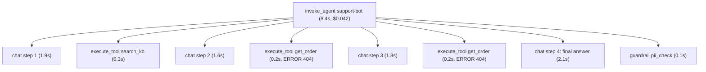
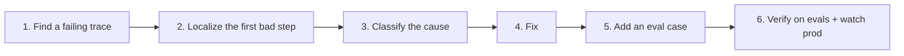

A user reports that your research agent "gave a confidently wrong answer about our Q3 revenue." Your application log has exactly one relevant line: `request completed in 94s, status=200`. The agent took 31 steps, made 12 tool calls and spent $1.90 — and you have no idea which of those steps went wrong. Was the search tool returning a stale document? Did the agent misread a table? Did the context get truncated at step 20, dropping the key fact? Without a record of what happened inside the run, debugging is guesswork.

**Observability** is the ability to answer arbitrary questions about what your system did, from the data it emits — without shipping new code to find out. For traditional services, that means logs, metrics and traces. For agents, the **trace** — a structured, step-by-step record of every model call, tool call and decision in a run — becomes the central artifact. It's what you debug from, what you build evals from, and what you monitor in production.

In this lesson you'll learn the data model (traces, spans, sessions), what to capture, the OpenTelemetry GenAI conventions that are becoming the industry standard, a repeatable debugging workflow, the metrics worth putting on a dashboard, and how to handle privacy. You'll also write a minimal tracer for an agent loop.

## Why agents need observability

Agents break the assumptions that make ordinary logging good enough:

- **Non-determinism.** The same input can take a different path each time. You often can't reproduce a failure by re-running it, so you need a record of the run that failed.
- **Long, branching executions.** A single request can involve dozens of model calls, tool calls, retrievals and sub-agents. A flat log of interleaved lines from concurrent runs is unreadable.
- **Silent failures.** Most agent failures don't throw exceptions. The agent calls the wrong tool, misreads a result, or confidently answers from a stale document, and returns HTTP 200. The "error" is semantic and visible only in the content.
- **Errors that surface far from their cause.** A bad retrieval at step 4 produces a wrong answer at step 30. You need the whole causal chain.
- **Cost and latency variance.** One request costs $0.03, another $3.00, depending on the path. Averages hide runaway loops.
- **Behavior lives in data, not code.** The prompt, the tool descriptions and the context *are* the program. If you don't record them, you can't know what program ran.

> [!KEY] The big idea
> For agents, the trace *is* the debugger, the test-case source and the monitoring feed. If a model call, tool call or piece of context isn't in the trace, then for debugging purposes it didn't happen.

## Traces, spans and sessions

Observability for agents borrows the data model of distributed tracing, pioneered for microservices (Google's Dapper paper, later standardized by OpenTelemetry).

- A **span** is one timed unit of work with a name, a start and end time, a status (ok/error), and key-value **attributes**. In an agent: one model call, one tool execution, one retrieval, one guardrail check.
- Spans nest: each span has a **parent**. The agent run is the root span; model calls and tool calls are its children; a sub-agent's run is a child span with its own children.
- A **trace** is the full tree of spans for one end-to-end operation — typically one agent run in response to one user request — linked by a shared **trace ID**.
- A **session** (also called a **thread** or **conversation**) groups multiple traces that belong together: every turn of a multi-turn chat, or all the runs of a long-lived task. Sessions let you see how context accumulated and where a conversation went sideways.

Here's the trace tree of one support-agent run, with the failure visible at a glance:



The two identical failing `get_order` calls tell the story before you read a single prompt: the agent retried the same bad argument instead of asking the user for a correct order ID. A flat log would have buried this; a tree makes it obvious.

### Common span types

| Span | Represents | Key attributes |
|---|---|---|
| Agent / workflow | One run of an agent or a [workflow](workflow-patterns.html) | Agent name and version, input, final output, total steps, total cost |
| LLM call | One model API request | Model, parameters, messages in/out, tokens, stop reason, latency |
| Tool call | One tool execution | Tool name, arguments, result, error flag, duration |
| Retrieval | A search/vector query ([RAG](rag-and-retrieval.html)) | Query, top-k results with IDs and scores |
| Guardrail | An input/output check | Check name, verdict, what was blocked |
| Sub-agent | A delegated agent run ([multi-agent systems](multi-agent-systems.html)) | Child agent name, task given, result returned |
| Human step | Waiting for approval ([human-in-the-loop](human-in-the-loop.html)) | Approver, decision, wait time |

## What to capture

The rule of thumb: capture enough to **reconstruct exactly what the model saw and did at every step**, plus enough metadata to **slice and aggregate** across runs.

| Category | What to record | Why |
|---|---|---|
| **Inputs to the model** | System prompt, full message list (or a reference to it), tool definitions | The model's behavior is a function of exactly this. "What did it see?" is the first debugging question |
| **Model parameters** | Model ID, `max_tokens`, effort/thinking settings, tool choice, structured-output schema | Behavior changes with these; misconfigurations hide here |
| **Model outputs** | Content blocks (text, tool calls, thinking summaries if available), `stop_reason` | `max_tokens` or `refusal` stops explain many weird outcomes |
| **Tool calls** | Tool name, arguments, result (or a truncated preview), `is_error`, duration | Most agent bugs are tool bugs or tool-misuse bugs |
| **Tokens** | Input, output, cache-read and cache-write tokens per call | Cost, context-growth and [caching](cost-and-latency.html) diagnostics |
| **Cost** | Computed per call and rolled up per run and per session | Find runaway runs and expensive paths |
| **Latency** | Per span; time-to-first-token for streamed calls; end-to-end | Find the slow step; set SLOs |
| **Errors** | Exceptions, API errors, retries, timeouts, tool errors | Distinguish infrastructure failures from reasoning failures |
| **Versions** | Prompt version, agent code version (git SHA), tool versions, model | Compare behavior before and after a change; essential for A/B tests |
| **Identity & context** | Session ID, (pseudonymized) user ID, tenant, environment, feature flags | Group, filter and segment |
| **Feedback** | Thumbs up/down, user corrections, escalations, downstream outcomes | Ground-truth quality signal to join with traces |
| **Request IDs** | The provider's request ID for each API call (e.g., `response._request_id` in the Anthropic SDK) | Needed when reporting issues to the provider |

> [!TIP] Version everything
> The single most common observability regret is not knowing which prompt version produced a bad trace. Put a prompt version (or content hash) and code version on every root span from day one.

Two practical notes. First, full prompts are large — a long-running agent can resend 100k+ tokens of context every step. Many systems store each message once and reference it, or record per-step *deltas*, rather than duplicating the full context on every span. Second, decide deliberately between **metadata-only** tracing (IDs, timings, tokens, names — cheap and low-risk) and **full-content** tracing (prompts and responses — essential for debugging, but expensive and sensitive). Many teams capture full content for a sample, or for internal and opted-in users, and metadata for everything. More on this under privacy.

## OpenTelemetry and the GenAI conventions

**OpenTelemetry** (OTel) is the open, vendor-neutral standard for traces, metrics and logs. Your code creates spans through the OTel API; an **exporter** sends them, usually via the **OTLP** protocol, to a **collector** or directly to any compatible backend. Instrument once, and you can switch backends — Jaeger, Grafana Tempo, Honeycomb, Datadog, Langfuse, Phoenix and others — without rewriting code. OTel also handles **context propagation**: passing the trace ID across process and network boundaries (via the W3C `traceparent` header), so a tool running in another service shows up as a child span in the same trace.

OTel's **GenAI semantic conventions** standardize the names of spans and attributes for model calls and agents, so different tools can understand the same data. Key elements (the conventions are still marked as in development, and attribute names have changed between versions — check the version your tools support):

| Convention | Example |
|---|---|
| Operation name attribute | `gen_ai.operation.name` = `chat`, `execute_tool`, `invoke_agent`, `create_agent` |
| Span names | `chat claude-sonnet-5-5`, `execute_tool get_order`, `invoke_agent support-bot` |
| Provider and model | `gen_ai.provider.name`, `gen_ai.request.model`, `gen_ai.response.model` |
| Usage | `gen_ai.usage.input_tokens`, `gen_ai.usage.output_tokens` |
| Outcome | `gen_ai.response.finish_reasons` |
| Tools | `gen_ai.tool.name`, `gen_ai.tool.call.id` |
| Agents and sessions | `gen_ai.agent.name`, `gen_ai.agent.id`, `gen_ai.conversation.id` |
| Content (opt-in) | `gen_ai.input.messages`, `gen_ai.output.messages`, `gen_ai.system_instructions` |

You rarely have to write all of this by hand. Instrumentation libraries (such as **OpenLLMetry** and **OpenInference**) patch popular SDKs and frameworks to emit spans automatically, and many agent frameworks have built-in tracing. Recent versions of the Anthropic SDKs also emit OpenTelemetry spans for each API request once you register a tracer provider, recording token usage and identifiers by default and prompts and responses only if you opt into a content mode. Your own agent and tool spans then nest those request spans underneath them. (If you use automatic instrumentation, don't also hand-create duplicate model-call spans.)

## Observability tools

The market moves fast; as of 2026 the commonly used options fall into a few groups:

| Tool | Type | Notable for |
|---|---|---|
| **LangSmith** | Hosted platform (LangChain) | Deep tracing for LangChain/LangGraph, datasets and evals from traces |
| **Langfuse** | Open source, self-hostable or cloud | Traces, sessions, prompt management, evals; OTel ingestion |
| **Arize Phoenix** | Open source | OpenInference instrumentation, trace analysis, evals, local-first |
| **Braintrust** | Hosted platform | Tight loop between production logs, datasets and eval experiments |
| **W&B Weave** | Hosted (Weights & Biases) | Tracing with decorators, evaluation, ML-experiment heritage |
| **Helicone** | Proxy/gateway-based | Logging by routing API calls through a proxy; minimal code change |
| **Datadog, Grafana, Honeycomb, New Relic** | General observability platforms | LLM/agent views on top of existing infra monitoring; OTel-native |

There are two integration styles. **SDK/decorator instrumentation** sees everything inside your process — tool calls, retrieval, your own logic. **Proxy/gateway logging** sits between your app and the model API; it's easy to add and captures every model call, but it can't see your tool executions or how calls relate to each other unless you pass trace headers. Most serious agent deployments use SDK-level instrumentation, ideally emitting OTel so the backend is swappable. Products change quickly; check current docs before committing.

## Hands-on: a minimal tracer

You don't need a platform to start. Here's a tiny tracer that writes spans as JSON lines. It uses `contextvars` so nested `with` blocks automatically become parent/child spans (and it stays correct under `asyncio`).

```python
import contextvars
import json
import re
import time
import uuid
from contextlib import contextmanager

_current_span = contextvars.ContextVar("current_span", default=None)

_REDACTIONS = [  # crude, illustrative PII/secret scrubbing; see the privacy section
    (re.compile(r"[\w.+-]+@[\w-]+\.[\w.]+"), "<EMAIL>"),
    (re.compile(r"\b(?:\d[ -]?){13,16}\b"), "<CARD_NUMBER>"),
    (re.compile(r"\b(?:sk|pk|api)[-_][A-Za-z0-9_-]{16,}\b"), "<SECRET>"),
]

def redact(text: str) -> str:
    for pattern, replacement in _REDACTIONS:
        text = pattern.sub(replacement, text)
    return text

class JsonlTracer:
    def __init__(self, path: str = "traces.jsonl"):
        self.path = path

    @contextmanager
    def span(self, name: str, **attributes):
        parent = _current_span.get()
        span = {
            "trace_id": parent["trace_id"] if parent else uuid.uuid4().hex,
            "span_id": uuid.uuid4().hex[:16],
            "parent_id": parent["span_id"] if parent else None,
            "name": name,
            "start": time.time(),
            "status": "ok",
            "attributes": dict(attributes),
        }
        token = _current_span.set(span)  # children created inside this block see us as parent
        try:
            yield span
        except Exception as exc:
            span["status"] = "error"
            span["attributes"]["error.type"] = type(exc).__name__
            span["attributes"]["error.message"] = redact(str(exc))[:500]
            raise
        finally:
            _current_span.reset(token)
            span["duration_ms"] = round((time.time() - span["start"]) * 1000, 1)
            with open(self.path, "a") as f:
                f.write(json.dumps(span, default=str) + "\n")

tracer = JsonlTracer()
```

Now instrument the [agent loop](the-agent-loop.html): one root span per run, one span per model call, one per tool call.

```python
import anthropic

client = anthropic.Anthropic()
MODEL = "claude-sonnet-5-5"
PRICE_PER_MTOK = {"input": 2.00, "output": 10.00}  # USD; check current pricing for your model
AGENT_VERSION = "support-bot@2026-11-03"          # bump when prompt/tools/code change

def run_agent(task: str, tools: list, tool_impls: dict, session_id: str, max_steps: int = 20) -> str:
    with tracer.span("invoke_agent", agent=AGENT_VERSION, session_id=session_id,
                     model=MODEL, input=redact(task)) as root:
        messages = [{"role": "user", "content": task}]
        total_cost = 0.0
        for step in range(1, max_steps + 1):
            with tracer.span("chat", step=step, model=MODEL) as s:
                resp = client.messages.create(model=MODEL, max_tokens=16000,
                                              tools=tools, messages=messages)
                u = resp.usage
                cost = (u.input_tokens * PRICE_PER_MTOK["input"]
                        + u.output_tokens * PRICE_PER_MTOK["output"]) / 1e6  # ignores cache pricing
                total_cost += cost
                s["attributes"].update(
                    input_tokens=u.input_tokens, output_tokens=u.output_tokens,
                    cache_read_tokens=u.cache_read_input_tokens or 0,
                    stop_reason=resp.stop_reason, cost_usd=round(cost, 6),
                    request_id=resp._request_id)
            messages.append({"role": "assistant", "content": resp.content})
            if resp.stop_reason != "tool_use":
                break
            results = []
            for block in resp.content:
                if block.type != "tool_use":
                    continue
                with tracer.span("execute_tool", tool=block.name, tool_call_id=block.id,
                                 arguments=redact(json.dumps(block.input))) as ts:
                    try:
                        output, is_error = str(tool_impls[block.name](**block.input)), False
                    except Exception as exc:  # report tool failures to the model, and mark the span
                        output, is_error = f"{type(exc).__name__}: {exc}", True
                        ts["status"] = "error"
                    ts["attributes"].update(is_error=is_error, result_preview=redact(output[:500]))
                results.append({"type": "tool_result", "tool_use_id": block.id,
                                "content": output, "is_error": is_error})
            messages.append({"role": "user", "content": results})
        final = "".join(b.text for b in resp.content if b.type == "text")
        root["attributes"].update(steps=step, final_stop_reason=resp.stop_reason,
                                  total_cost_usd=round(total_cost, 4), output=redact(final[:2000]))
        return final
```

A few lines turn the JSONL file back into a readable tree:

```python
from collections import defaultdict

def print_trace(path: str, trace_id: str) -> None:
    spans = [s for s in map(json.loads, open(path)) if s["trace_id"] == trace_id]
    children = defaultdict(list)
    for s in spans:
        children[s["parent_id"]].append(s)

    def walk(parent_id, depth):
        for s in sorted(children[parent_id], key=lambda s: s["start"]):
            a = s["attributes"]
            label = a.get("tool") or (f"step {a['step']}" if "step" in a else a.get("agent", ""))
            extra = f" stop={a['stop_reason']}" if "stop_reason" in a else ""
            flag = "  <-- ERROR" if s["status"] == "error" else ""
            print(f"{'  ' * depth}{s['name']} {label} {s['duration_ms']}ms{extra}{flag}")
            walk(s["span_id"], depth + 1)

    walk(None, 0)
```

This is genuinely useful for local development and small deployments. Its limits — no sampling, no cross-service propagation, no UI, files that grow forever — are what OpenTelemetry and the platforms solve.

### The same idea with OpenTelemetry

Here's a sketch of the equivalent with the OTel Python SDK (`pip install opentelemetry-sdk opentelemetry-exporter-otlp`), using GenAI attribute names. The exporter reads its endpoint from the standard `OTEL_EXPORTER_OTLP_ENDPOINT` environment variable.

```python
from opentelemetry import trace
from opentelemetry.sdk.resources import Resource
from opentelemetry.sdk.trace import TracerProvider
from opentelemetry.sdk.trace.export import BatchSpanProcessor
from opentelemetry.exporter.otlp.proto.http.trace_exporter import OTLPSpanExporter
from opentelemetry.trace import Status, StatusCode

provider = TracerProvider(resource=Resource.create({"service.name": "support-agent"}))
provider.add_span_processor(BatchSpanProcessor(OTLPSpanExporter()))  # batch in production
trace.set_tracer_provider(provider)  # register BEFORE the first traced call
otel = trace.get_tracer("support-agent")

def traced_tool_call(name: str, call_id: str, fn, args: dict) -> tuple[str, bool]:
    with otel.start_as_current_span(f"execute_tool {name}") as span:
        span.set_attribute("gen_ai.operation.name", "execute_tool")
        span.set_attribute("gen_ai.tool.name", name)
        span.set_attribute("gen_ai.tool.call.id", call_id)
        try:
            return str(fn(**args)), False
        except Exception as exc:
            span.record_exception(exc)
            span.set_status(Status(StatusCode.ERROR, type(exc).__name__))
            return f"{type(exc).__name__}: {exc}", True

with otel.start_as_current_span("invoke_agent support-bot") as agent_span:
    agent_span.set_attribute("gen_ai.operation.name", "invoke_agent")
    agent_span.set_attribute("gen_ai.agent.name", "support-bot")
    agent_span.set_attribute("gen_ai.conversation.id", "sess_8f2c")  # never put PII here
    # ...run the agent loop here: model calls made inside this block become child spans
    # (via the SDK's built-in instrumentation, or your own "chat <model>" spans),
    # and traced_tool_call(...) adds execute_tool spans as siblings.
```

## A debugging workflow

When something goes wrong, follow the same loop every time. It turns debugging from archaeology into a routine.



**1. Find a failing trace.** Entry points: a user complaint (look up by session or user ID), a thumbs-down, an online-eval failure, an alert, or a query like "runs with more than 25 steps" or "traces where `get_order` errored twice in a row." Good trace search is the most underrated feature of any observability tool.

**2. Localize the first bad step.** Read the trace from the start and find the *first* step where the agent's behavior diverged from what a competent human would do. Later errors are usually consequences. At each model-call span, ask: given exactly what was in context, was this a reasonable decision? That framing separates "the model reasoned badly" from "the model was given bad information."

**3. Classify the cause.** Almost every agent bug falls into one of four buckets:

| Class | Typical evidence in the trace | Typical fix |
|---|---|---|
| **Prompt / instructions** | The model did something reasonable but not what you wanted; instructions were ambiguous or missing | Clarify the [system prompt](prompting-for-agents.html), add an example, state the policy explicitly |
| **Tool** | Tool returned an error, wrong data or an unhelpful format; the model misused a confusing tool; the error message gave no hint how to recover | Fix the tool's bug, rewrite its description or schema, return actionable errors ([designing tools](designing-tools.html)) |
| **Context** | The needed fact wasn't in context, was truncated, was buried in noise, or was stale (bad retrieval) | Better retrieval, [context engineering](context-engineering.html), compaction, memory |
| **Model capability** | Everything needed was clearly present and well-specified, and the model still failed | Break the task down, add a verification step, use a stronger model or higher effort, or accept and route to a human |

Be suspicious of blaming the model. In practice, most failures traced carefully turn out to be tool, context or prompt problems — the cheaper ones to fix.

**4. Fix**, and **5. add an eval case** reproducing the failure ([evaluating agents](evaluating-agents.html)) — ideally before the fix, to confirm it fails. **6. Verify** the fix on your eval suite (did anything else regress?) and watch production metrics after deploy.

Here's a short real-world-style example. A user asked "Cancel my order from last Tuesday." The trace:

```text
[chat step 1]   -> tool_use search_orders({"customer_id": "c_481", "date": "2026-11-10"})
[execute_tool]  search_orders -> []   (0 results)
[chat step 2]   -> "I couldn't find any orders from last Tuesday. Could you share the order number?"
```

> [!EXAMPLE] Localizing the failure
> The final answer is wrong (the order exists), but the first bad step is step 1: the run happened on Monday, November 23, 2026, so "last Tuesday" was November 17, not November 10. The model-call span's inputs show the system prompt contained no current date — the model guessed. Classification: **context**. Fix: inject today's date into the system prompt. Eval: three relative-date tasks with frozen clocks.

### Replaying traces

Because runs are non-deterministic, the best way to test a fix for a specific failure is to **replay** it: reconstruct the exact state at the failing step and re-run from there.

- **Fork from step N.** Take the recorded message history up to the bad step, apply your change (new prompt, new tool description), and call the model again — several times, since one sample proves little. Many platforms offer this as a "playground from span" button; with your own tracer it's a short script if you recorded full content.
- **Mock tools from the trace.** For a full replay, stub each tool to return the recorded result for the recorded arguments. Calls with new arguments (because your fix changed behavior) need a live or simulated tool.
- **Stub side effects.** Never replay a trace against production systems with real write actions — use sandboxes ([guardrails and sandboxing](guardrails-and-sandboxing.html)).

Replay is also how traces become eval cases: a recorded prefix plus an assertion about the next step is a per-step eval; a recorded starting state plus an outcome check is an end-to-end eval.

## Dashboards and key metrics

Debugging is about single traces; monitoring is about aggregates. A useful agent dashboard answers "is it working, what does it cost, is it getting worse?" Core metrics:

| Metric | How to compute | What it catches |
|---|---|---|
| **Task success rate** | From online evals, explicit feedback or downstream outcomes (ticket resolved, PR merged) | Overall quality, regressions after deploys |
| **Steps per task** | Distribution (p50, p95) of model calls per root span | Loops, confusion, prompt regressions (often the earliest warning sign) |
| **Tool error rate** | Errored tool spans ÷ total, per tool | Broken integrations, schema mismatches, API outages |
| **Cost per task** | Sum of span costs per root span; mean and p95 | Runaway runs, cache misses, context bloat |
| **Latency** | p50/p95/p99 end-to-end; time-to-first-token; per-span breakdown | Slow tools, oversized contexts, provider slowdowns |
| **Stop-reason mix** | Share of `max_tokens`, `refusal`, step-limit hits | Truncation and refusal problems |
| **Token and cache stats** | Input/output tokens per task; cache-read share | Context growth; broken prompt caching ([cost and latency](cost-and-latency.html)) |
| **Escalation and feedback rates** | Handoffs to humans; thumbs-down rate | User-perceived quality |
| **Guardrail triggers** | Blocks per check per day | Attacks, abuse, over-blocking ([agent security](agent-security.html)) |

Always make these sliceable by **agent version, model, tenant and task type**. A flat success rate hides that the new prompt fixed billing questions and broke shipping questions. And watch tails, not just means: p95 cost and p95 steps reveal the pathological runs that averages smooth over.

> [!WARNING]
> "Success rate" from implicit signals is easy to misread. A drop in thumbs-down might mean users are happier — or that a UI change hid the button. Pair implicit signals with sampled LLM-judge scores and periodic human review.

## Online evaluation and alerting

**Online evaluation** applies graders to production traffic. Common patterns:

- **Sampled judging.** Asynchronously run [LLM-judge](evaluating-agents.html) rubrics on a sample of completed traces (for instance, a few percent, plus all traces with negative feedback), and chart pass rates by version.
- **Rule-based checks on every trace.** Cheap code checks: did the run hit the step limit? Did it call the same tool with identical arguments three times (a loop)? Did the final answer contain a forbidden pattern?
- **Annotation queues.** Route flagged traces to humans for review; their labels become calibration data for judges and new eval cases.

**Alerting** turns metrics into action. Alert on things that need a human soon: tool error rate spikes (an integration broke), cost per task or total spend anomalies (a loop or a cache regression), p95 latency SLO breaches, sharp drops in online-eval pass rate after a deploy, and safety-guardrail spikes (possible attack). Use anomaly-relative thresholds where traffic varies, and keep the alert list short — alert fatigue makes teams ignore the one that matters. Tie alerts to rollback procedures in your [deployment](deployment.html) and [reliability](reliability.html) playbooks.

## Privacy, PII and retention

Agent traces are among the most sensitive data you'll store. They contain everything users typed, everything tools returned (customer records, emails, documents, query results), and sometimes secrets that leaked into tool output. Treat the trace store like a production database of user data.

- **Redact at the source.** Scrub PII and secrets *before* spans leave the process — the collector or vendor should never see them. Combine pattern-based redaction (emails, card numbers, API-key formats) with entity-recognition tools for names and addresses. Regexes alone miss a lot; test your redaction on real samples.
- **Capture content deliberately.** Default to metadata-only where you can; enable full content for sampled traffic, internal users, or customers who've agreed. The Anthropic SDK's OpenTelemetry support, for example, defaults to metadata only and requires opting into content capture.
- **Pseudonymize identifiers.** Store a hashed or internal user ID, not an email address. Never put PII or secrets in IDs or attributes that are exported regardless of content settings (such as conversation IDs).
- **Retention tiers.** Keep full-content traces briefly (days to weeks, long enough to debug), aggregated metrics and metadata longer. Eval datasets built from traces need their own review and consent basis.
- **Support deletion.** Regulations like GDPR give users a right to erasure; you need to be able to find and delete one user's traces across your trace store and any datasets derived from it.
- **Control access.** Role-based access to trace content, audit logs of who viewed what, and care with third-party vendors (data residency, their retention, their sub-processors).
- **Remember traces can be hostile.** Tool results in traces may contain [prompt-injection](agent-security.html) payloads. If you feed traces into LLM judges or "auto-debug" agents, treat that content as untrusted.

## Key Takeaways

- Agents fail silently, non-deterministically and far from the cause, so the **trace** — a tree of spans for every model call, tool call and decision — is the essential debugging and monitoring artifact.
- Model runs as **traces** of nested **spans**, grouped into **sessions**. Capture inputs, parameters, outputs, tool calls and results, tokens, cost, latency, errors, versions and feedback.
- Use **OpenTelemetry** with the **GenAI semantic conventions** (`invoke_agent`, `chat`, `execute_tool`, `gen_ai.*` attributes) to stay vendor-neutral; the conventions are still evolving, so pin versions.
- Debug with a fixed loop: **find** a failing trace → **localize** the first bad step → **classify** (prompt, tool, context, model) → **fix** → **add an eval** → verify. Most failures aren't the model's fault.
- **Replay** traces by forking from a recorded step with mocked tools to test fixes on the exact failing state.
- Dashboard **success rate, steps per task, tool error rate, cost per task and p95 latency**, sliced by version, and alert on spikes and post-deploy drops.
- Traces are sensitive: **redact at the source**, capture content deliberately, pseudonymize IDs, set retention tiers and support deletion.

## Exercises

1. **Read a trace.** Use the JSONL tracer above with any small agent and two tools. Make one tool fail on certain inputs. Run ten tasks, then use `print_trace` to find a run where the agent retried a failing call. Which step was the *first* bad decision?
2. **Add loop detection.** Write a function that scans `traces.jsonl` and flags any trace where the same tool was called with identical arguments three or more times, or where steps exceeded 15. Print the offending trace IDs with their total cost.
3. **Build a mini dashboard.** From the JSONL file, compute per agent version: success rate (from an `outcome` attribute you add), p50/p95 steps, tool error rate per tool, mean and p95 cost, and p95 latency. Output a table; bonus: chart it.
4. **Port to OpenTelemetry.** Replace the JSONL tracer with OTel spans using GenAI attribute names, export to a local backend (e.g., run Jaeger or Phoenix in Docker), and confirm your agent, chat and tool spans nest correctly. Add a tool that runs in a separate HTTP service and propagate the trace context so its spans join the same trace.
5. **Replay a failure (harder).** Extend the tracer to record full message history on each `chat` span (redacted). Write a `replay(trace_id, step, new_system_prompt)` function that rebuilds the conversation up to that step, mocks tools from recorded results, and re-runs the model five times with the new prompt. Use it to test a fix for a failure you found in exercise 1, then turn it into an eval case.

## Check Your Understanding

```quiz
Q: Why is a flat application log usually insufficient for debugging agents?
- [ ] Logs can't store text longer than a few kilobytes
- [x] Agent runs are long, nested and non-deterministic, and failures are often semantic; you need the full causal tree of model and tool calls for the specific run that failed
- [ ] Agents never throw exceptions, so nothing gets logged
- [ ] Logs are not supported in Python async code
E: Traces preserve structure (parent/child spans), group everything for one run, and capture the content and context that explain silent, semantic failures.

Q: A trace shows the agent gave a wrong answer at step 18. Where should you focus first?
- [ ] Step 18, since that's where the wrong answer appeared
- [x] The first step where behavior diverged from what a competent human would do given the same context
- [ ] The slowest span in the trace
- [ ] The most expensive model call
E: Later errors are usually consequences of an earlier mistake, such as a bad retrieval or a misread tool result. Fixing the root cause often fixes the cascade.

Q: At the failing step, the model had all needed facts clearly in context, the instructions were unambiguous, the tools worked, and it still chose wrongly. How would you classify this?
- [ ] Prompt issue
- [ ] Tool issue
- [ ] Context issue
- [x] Model capability issue
E: When the inputs were complete and clear, the remaining explanation is the model's capability — fix by decomposing the task, adding verification, raising effort or using a stronger model.

Q: Which metric is often the earliest warning sign that a prompt change confused the agent, even before success rate visibly drops?
- [ ] Number of active users
- [x] A rising p95 of steps per task
- [ ] Average output tokens of the final answer
- [ ] The number of tools defined
E: A confused agent flails — more searches, repeated calls, retries — which shows up in step-count tails before aggregate success metrics move.

Q: What's the main advantage of emitting OpenTelemetry spans with GenAI semantic conventions rather than a vendor's proprietary format?
- [ ] OTel spans are automatically encrypted
- [ ] OTel makes model calls faster
- [x] Vendor neutrality and interoperability: any compatible backend can ingest and understand the spans, and context propagates across services
- [ ] OTel automatically redacts PII
E: OTel standardizes the data model and transport; GenAI conventions standardize attribute names so tools agree on what a model call or tool span is. Redaction is still your job.

Q: Where should PII redaction for traces happen?
- [ ] In the observability vendor's UI, when displaying traces
- [ ] Only in the data warehouse, during monthly cleanup
- [x] In your process, before spans are exported
- [ ] It isn't necessary if the vendor is SOC 2 certified
E: Redacting at the source means the sensitive data never leaves your boundary. Downstream redaction still leaves copies in transit, in collectors and in vendor storage.

Q: You want to test a prompt fix against the exact situation that caused a production failure. What's the best approach?
- [ ] Re-send the original user message to production and see if it fails again
- [x] Replay: rebuild the recorded history up to the failing step, mock tools with recorded results, and re-run the model several times with the new prompt
- [ ] Ask the model whether the new prompt would have helped
- [ ] Re-run the whole eval suite once
E: Non-determinism means a fresh run may take a different path. Forking from the recorded state isolates the decision you're fixing; multiple samples tell you whether the fix is reliable.
```

## Further Reading

- [OpenTelemetry semantic conventions for generative AI](https://opentelemetry.io/docs/specs/semconv/gen-ai/) — the emerging standard for span names and attributes for model, tool and agent operations.
- [OpenTelemetry documentation](https://opentelemetry.io/docs/) — core concepts (traces, spans, context propagation, collectors) and per-language SDK guides.
- [Dapper, a Large-Scale Distributed Systems Tracing Infrastructure (Google, 2010)](https://research.google/pubs/dapper-a-large-scale-distributed-systems-tracing-infrastructure/) — the paper that established the trace/span model agents now borrow.
- [Monitoring Distributed Systems (Google SRE Book)](https://sre.google/sre-book/monitoring-distributed-systems/) — the classic guide to choosing metrics and alerts that matter, and avoiding alert fatigue.
- [Langfuse documentation](https://langfuse.com/docs) — a good open-source reference for tracing, sessions and online evals for LLM apps.
- [Arize Phoenix](https://github.com/Arize-ai/phoenix) — open-source, OpenTelemetry-based tracing and evaluation you can run locally.
- [OpenInference](https://github.com/Arize-ai/openinference) — open instrumentation for LLM frameworks and SDKs built on OpenTelemetry.
- [LangSmith documentation](https://docs.smith.langchain.com/) — tracing, datasets and evaluators, especially for LangChain/LangGraph users.
