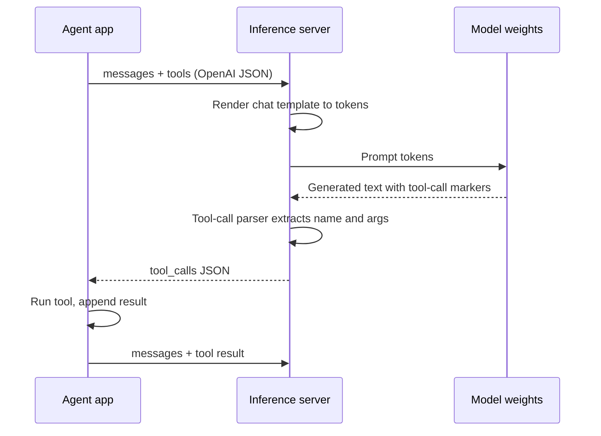
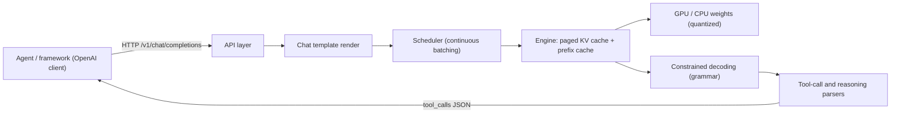
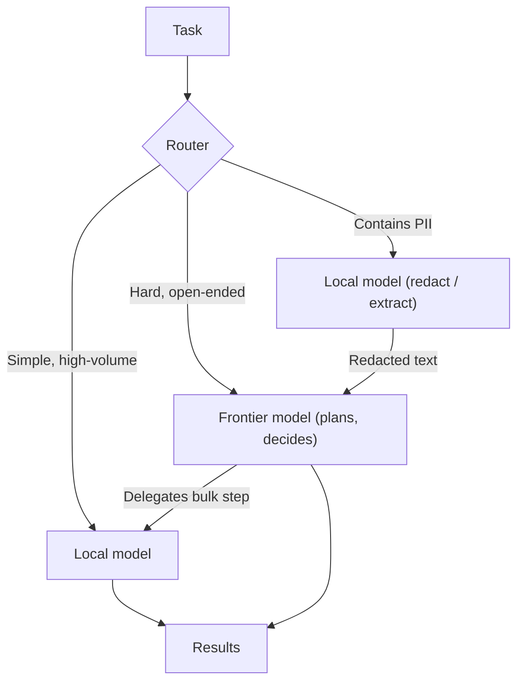

A hospital wants an agent that reads discharge notes, pulls lab values from an internal database and drafts follow-up tasks. Legal says patient text cannot leave the building. A logistics company wants to classify forty million shipping exceptions a month, and the per-token bill from a frontier API is larger than the team that would review them. A field-service app needs an assistant that works in a basement with no signal. All three end up in the same place: running an agent on a model whose weights they download and serve themselves.

That is a different job from calling a hosted API. You become responsible for things the provider used to hide: the **chat template** that turns messages into tokens, the parser that turns the model's text back into tool calls, the GPU memory budget, the quantization level, the throughput tuning, and the safety behavior of a model you didn't train. Each of these has quietly broken real agents.

This lesson covers why and when teams go open, what the landscape looks like in late 2026, how tool calling works under the hood for self-hosted models, the serving stacks people actually use, how to keep tool calls reliable, how to do the memory math, how to combine local and frontier models, and how to evaluate and secure the whole thing. It builds on [tool use](tool-use.html), [structured outputs](structured-outputs.html) and the from-scratch loop in [Build an Agent From Scratch](build-agent-from-scratch.html).

> [!WARNING] A fast-moving area
> Model releases, licenses, server flags and parser names change month to month. Everything here was checked as of November 2026. Treat specific model versions and CLI flags as perishable and verify them in current docs; the mechanisms (templates, parsers, KV cache, quantization trade-offs) are the durable part.

## Why Run Agents on Open Models?

First, vocabulary. An **open-weight model** is one whose trained parameters you can download and run. That is not the same as **open source** in the strict sense: most open-weight releases do not include training data or full training code, and many come with licenses that add use restrictions. "Open" in this lesson means "you can run it yourself."

The reasons teams choose this path:

- **Data control and privacy.** Prompts, tool results and documents never leave infrastructure you control. For regulated data (health, finance, defense, legal discovery), or contracts that forbid third-party processors, this can be the deciding factor. Note that hosted APIs also offer data-residency options and zero-retention agreements, so check whether those meet the requirement before taking on self-hosting.
- **Cost at scale.** API pricing is per token; your own GPUs are a fixed cost you can saturate. For high-volume, narrow steps (classification, extraction, routing, summarizing millions of records), a well-utilized small model can be much cheaper per task. At low or bursty volume the reverse is usually true, because idle GPUs still cost money.
- **Latency and locality.** A small model on a nearby GPU, with no network round trip and no shared queue, can return a short tool decision quickly and predictably. That matters for voice agents and tight inner loops.
- **Customization.** You can fine-tune the weights on your own tools and formats, change the chat template, constrain decoding with a grammar, or inspect logits. Hosted APIs expose only some of these.
- **Offline and edge.** Laptops, phones, factory floors, ships and air-gapped networks.
- **Control over change.** A hosted model can be updated or retired on the provider's schedule. Weights on your disk behave the same next year, which makes regression testing simpler.

And the honest costs:

| Trade-off | What it means in practice |
|---|---|
| **Capability gap on long-horizon tasks** | As of 2026, the strongest open models are competitive on many single-turn and short tool-use tasks, but frontier hosted models still generally lead on long, multi-step agentic work (large refactors, extended research, recovering from their own mistakes over dozens of steps). Small errors compound across steps, so a modest per-step gap becomes a large task-level gap ([when to use agents](when-to-use-agents.html)). |
| **Operations burden** | You own GPUs, drivers, autoscaling, upgrades, monitoring, and on-call for the inference server. |
| **Integration correctness** | Tool calling depends on templates and parsers you configure. Misconfigurations fail silently. |
| **Safety tuning is your job** | The provider's runtime safety systems are absent. You add guardrails, abuse monitoring and refusal behavior yourself ([guardrails and sandboxing](guardrails-and-sandboxing.html)). |
| **License diligence** | Licenses range from Apache 2.0 and MIT to custom terms with user-count or revenue thresholds and acceptable-use policies. |

> [!KEY] Open models are a deployment choice, not a capability shortcut
> Go open when control, cost at volume, locality or customization is the binding constraint, and only after measuring that a candidate model is good enough on *your* tasks. The most common successful pattern is not "replace the frontier model" but "move the high-volume, narrow or sensitive steps to a model you host."

## The Open-Weight Landscape (Late 2026)

The field moves too fast for a ranking to survive a quarter, so think in families. Each lab releases a range of sizes, usually instruction-tuned variants with tool calling built in, often in both dense and **mixture-of-experts (MoE)** form.

| Family | Developer | Notes as of November 2026 | Typical license (check each release) |
|---|---|---|---|
| **Qwen** | Alibaba | Very wide size range, from phone-sized to large MoE; Qwen3 (2025) and Qwen3.5 (2026) generations; among the most downloaded and fine-tuned bases | Mostly Apache 2.0 |
| **DeepSeek** | DeepSeek | Large MoE models; V3 and R1 (2025) made open reasoning models mainstream; the V4 generation followed in 2026 | Mostly MIT |
| **gpt-oss** | OpenAI | gpt-oss-120b and gpt-oss-20b (August 2025), reasoning MoE models trained for tool use, using the "harmony" response format | Apache 2.0 plus a usage policy |
| **Gemma** | Google DeepMind | Gemma 4 (April 2026) in sizes from on-device to a 31B dense model; the first Gemma generation under Apache 2.0 | Apache 2.0 (Gemma 4); earlier Gemma versions used custom Gemma terms |
| **Mistral** | Mistral AI | Small, medium and large models; the Mistral 3 family | Mostly Apache 2.0; some older models used research or non-production licenses |
| **Llama / Muse** | Meta | Llama 4 (April 2025) was the last Llama-branded release. Meta's 2026 flagship launched closed, but it released Muse Glimmer, a 30B open-weight agentic model, in August 2026 | Llama: custom community license with a large-user clause. Muse Glimmer: Apache 2.0 |
| **Kimi** | Moonshot AI | Large MoE models aimed at agentic coding and tool use | Kimi K2: modified MIT (attribution for very large deployments); later releases use their own terms |
| **GLM** | Zhipu AI (Z.ai) | Strong agentic and coding-oriented MoE models | Mostly MIT; some 2026 releases use custom terms |

Others worth knowing: **MiniMax**, NVIDIA's **Nemotron**, IBM's **Granite**, Microsoft's **Phi** small models, and Ai2's **OLMo**, which is notable for releasing training data and code as well as weights.

Three things to take from this table:

1. **Licenses differ per release, not per family.** Several labs have shipped one generation under MIT or Apache 2.0 and the next under custom terms with revenue or user-count thresholds. Your legal review attaches to an exact model, not a brand.
2. **MoE changes the arithmetic.** An MoE model with hundreds of billions of *total* parameters may activate only a few tens of billions per token. Memory is set by the total (all experts must be loaded); speed per token is closer to that of a dense model the size of the *active* parameters.
3. **Agentic post-training is what matters.** A model's general chat quality says little about whether it will call tools correctly for 30 steps. Recent releases from most of these labs advertise agentic and tool-use training explicitly; that is a necessary but not sufficient signal, which is why you evaluate (see [below](#evaluating-before-you-switch)).

## How Tool Calling Works Under the Hood

With a hosted API you send a JSON `tools` array and receive structured `tool_use` blocks. It feels like the model natively speaks JSON objects. It doesn't. A language model only ever reads and writes tokens. Self-hosting exposes the two translation layers the provider normally hides.

### Layer 1: the chat template

A **chat template** is a small program (usually Jinja2, shipped in the model's `tokenizer_config.json` or a separate template file) that turns a list of messages plus tool definitions into one flat string with **special tokens** marking roles and boundaries. During post-training, the model saw thousands of examples in exactly this format, including examples of calling tools.

Here is an illustrative rendering in the style many models use (ChatML-like role markers, with tool calls wrapped in tags, as in Qwen's templates):

```text
<|im_start|>system
You are a support agent.

# Tools
You may call one or more functions. Signatures:
<tools>
{"name": "get_order_status", "description": "Look up an order", "parameters": {...}}
</tools>
Return calls as: <tool_call>{"name": ..., "arguments": ...}</tool_call><|im_end|>
<|im_start|>user
Where is order A-1042?<|im_end|>
<|im_start|>assistant
<tool_call>
{"name": "get_order_status", "arguments": {"order_id": "A-1042"}}
</tool_call><|im_end|>
<|im_start|>user
<tool_response>
{"status": "shipped", "eta_days": 2}
</tool_response><|im_end|>
<|im_start|>assistant
```

Everything up to the final `assistant` marker is the prompt. The model then generates. If it decides to call a tool, it produces the `<tool_call>` text you see in the middle, token by token, exactly as it learned to.

Different families use different conventions. Llama 3.x emits JSON with its own header tokens; gpt-oss uses the **harmony** format, with separate channels for reasoning ("analysis") and final output; some coding models emit XML-like parameter blocks; others write Python-style calls like `get_order_status(order_id="A-1042")`.

### Layer 2: the tool-call parser

The inference server must turn the generated text back into the structured `tool_calls` field your client expects. That is the **tool-call parser**: model-specific code that recognizes the start marker, extracts the name and arguments, handles multiple calls, and (in streaming mode) does it incrementally. Reasoning models add a **reasoning parser** that separates thinking text from the final answer.



> [!KEY] Template and parser must match the model's training
> The model only calls tools reliably in the exact format it was trained on. The server must render that format going in and parse that format coming out. A mismatch on either side breaks tool use, often without an error.

### How mismatches break agents

These failures are common and confusing because the server returns HTTP 200:

- **Wrong or missing template.** A quantized re-upload ships without the tool section of the template, or an old template predates tool support. The model never sees the tools, answers in prose, and your agent "never calls tools."
- **Wrong parser.** The model emits a perfect `<tool_call>` block, but the server's parser expects a different format, so the call arrives as plain text in `content` and `tool_calls` is empty.
- **Tool results rendered wrong.** The template mislabels `tool` role messages, so the model doesn't recognize the observation and calls the same tool again, looping.
- **Lost reasoning.** For reasoning models, some templates expect prior reasoning to be dropped or kept in specific ways across turns. Getting it wrong degrades multi-turn tool use.
- **Parallel and streaming edge cases.** Parsers sometimes handle a single call correctly but mangle two calls in one turn, or break when arguments are streamed.

Debugging rule: log the **fully rendered prompt** and the **raw generated text** before parsing. If the raw text contains a well-formed call that the client didn't receive, the parser is wrong. If the raw text contains no call at all, look at the template first, then the model.

## Serving Stacks

You rarely load weights yourself in an agent. You run an **inference server** that exposes an **OpenAI-compatible** HTTP API (`/v1/chat/completions` with `tools` and `tool_calls`), so any OpenAI-style client or framework can talk to it by changing the base URL.



| Server | Best for | Tool-calling notes |
|---|---|---|
| **vLLM** | High-throughput GPU serving in production | `--enable-auto-tool-choice` plus a model-specific `--tool-call-parser` (for example `hermes` for Qwen-style tags, `openai` for gpt-oss, Llama and Mistral parsers); custom templates via `--chat-template` |
| **SGLang** | High-throughput serving, strong prefix reuse for agent and multi-call workloads | `--tool-call-parser` with names such as `qwen`, `llama3`, `deepseekv3`, `kimi_k2`, `gpt-oss`; separate `--reasoning-parser` |
| **llama.cpp** (`llama-server`) | CPU, Apple Silicon, consumer GPUs, GGUF files, edge devices | Start with `--jinja` to use the model's template and enable tool parsing; override with `--chat-template-file`; native handlers for some families and a generic fallback |
| **Ollama** | Developer laptops and simple local deployments | Wraps llama.cpp-style inference with a model registry; OpenAI-compatible API at `http://localhost:11434/v1`; tool support depends on the model's packaged template |
| **LM Studio** | Desktop GUI for trying models | Local OpenAI-compatible server (default port 1234) |
| **TGI** (Hugging Face) | Existing deployments | In maintenance mode since late 2025; Hugging Face points new deployments to engines like vLLM and SGLang |

Commercial and cloud options (NVIDIA's NIM and Dynamo, TensorRT-LLM, managed endpoints on the major clouds and inference providers) wrap similar engines. Many hosted inference providers also serve open-weight models, which gives you open-model economics and weight portability without running GPUs, though not the data-control benefit.

### Calling a local server with a tool

Start a server. With vLLM and a Qwen3 model, whose templates use the Hermes-style tags shown earlier:

```bash
# GPU server (vLLM)
vllm serve Qwen/Qwen3-8B --enable-auto-tool-choice --tool-call-parser hermes

# Or on a laptop (Ollama); the OpenAI-compatible API is at localhost:11434/v1
ollama pull qwen3:8b
```

The agent loop is the same shape as any [manual loop](the-agent-loop.html); only the wire format differs (OpenAI-style `tool_calls` and `role: "tool"` messages). APIs and flags evolve, so check the current docs for your server and client.

```python
import json
from openai import OpenAI

# vLLM default port is 8000; for Ollama use http://localhost:11434/v1
client = OpenAI(base_url="http://localhost:8000/v1", api_key="not-needed")
MODEL = "Qwen/Qwen3-8B"  # the name the server registered (Ollama: "qwen3:8b")

def get_order_status(order_id: str) -> dict:
    return {"order_id": order_id, "status": "shipped", "eta_days": 2}  # stub

TOOLS = [{
    "type": "function",
    "function": {
        "name": "get_order_status",
        "description": "Look up the shipping status of one order by its ID, e.g. A-1042.",
        "parameters": {
            "type": "object",
            "properties": {"order_id": {"type": "string"}},
            "required": ["order_id"],
        },
    },
}]

messages = [
    {"role": "system", "content": "You are a support agent. Use tools for facts."},
    {"role": "user", "content": "Where is order A-1042?"},
]

for _ in range(8):  # step limit: small models loop more often
    resp = client.chat.completions.create(
        model=MODEL, messages=messages, tools=TOOLS, tool_choice="auto"
    )
    msg = resp.choices[0].message
    if not msg.tool_calls:
        print(msg.content)
        break
    messages.append(msg.model_dump(exclude_none=True))
    for call in msg.tool_calls:
        try:  # small models produce malformed arguments more often
            result = get_order_status(**json.loads(call.function.arguments))
        except (json.JSONDecodeError, TypeError) as e:
            result = {"error": f"Invalid arguments: {e}. Retry with valid JSON."}
        messages.append(
            {"role": "tool", "tool_call_id": call.id, "content": json.dumps(result)}
        )
```

Because the endpoint is OpenAI-compatible, most frameworks from [Frameworks & SDKs Compared](agent-frameworks.html) can point at it with a base-URL setting. Feature parity is not guaranteed, though: parallel calls, streaming tool arguments and `tool_choice` options vary by server and parser.

## Making Tool Calls Reliable: Constrained Decoding

With `tool_choice="auto"`, the model generates freely, and nothing forces the arguments to be valid JSON or to match your schema. Frontier APIs largely hide this; small open models will hand you a trailing comma, a missing required field or an invented parameter some fraction of the time.

**Constrained decoding** (also called guided or grammar-based decoding) fixes the syntax problem at the source. At each step, the engine computes which next tokens are allowed by a grammar (derived from a JSON Schema, a regex or a context-free grammar) and masks out every other token's probability. The model *cannot* produce an invalid structure. The main engines:

- **Outlines**: constrained generation with JSON Schema, regex and grammars; usable as a library.
- **XGrammar** and **llguidance**: fast grammar engines that inference servers (vLLM and SGLang among them) use for structured outputs.
- **llama.cpp GBNF**: llama.cpp's grammar format. You can pass a grammar or a JSON Schema, and its tool-calling support can apply a grammar only once the model starts a tool call, so free text stays unconstrained.

Most servers expose this through the OpenAI-style `response_format` with a JSON Schema, and several apply it to tool arguments when a tool is marked strict or a specific tool is required. See [structured outputs](structured-outputs.html) for the general mechanics.

> [!WARNING] Valid is not correct
> A grammar guarantees well-formed JSON with the right fields. It does not guarantee the model chose the right tool, the right order ID, or a sensible plan. Overly tight grammars can also hurt quality, for example by forcing JSON before a reasoning model has finished thinking. Constrain the *structure*; validate the *semantics* in your tool code and return helpful errors the model can recover from.

Other reliability tactics that matter more for small models than for frontier ones:

- **Fewer, simpler tools.** Ten tools with overlapping descriptions confuse an 8B model far more than a frontier model. Merge or route ([designing tools](designing-tools.html)).
- **Flat schemas.** Prefer a few top-level fields with enums over deeply nested objects.
- **Retry with the error.** Return parse and validation errors as tool results; most models self-correct on the next step.
- **Short contexts.** Smaller models degrade faster as context grows; summarize aggressively ([context engineering](context-engineering.html)).
- **Workflows over autonomy.** A fixed pipeline with small, well-scoped model calls is more robust than an open-ended loop ([workflow patterns](workflow-patterns.html)).

## Quantization and Agent Reliability

**Quantization** stores weights (and sometimes activations or the KV cache) in fewer bits than the 16-bit format models are usually trained and released in. It trades a little quality for a lot of memory and speed.

| Format / method | What it is | Typical home |
|---|---|---|
| **BF16 / FP16** | Full 16-bit weights, the reference | Datacenter GPUs |
| **FP8 / INT8** | 8-bit weights (and sometimes activations); usually very close to 16-bit quality | vLLM, SGLang, TensorRT-LLM on recent GPUs |
| **GPTQ** | Post-training 4-bit (or 3/8-bit) weight quantization using approximate second-order information | GPU serving |
| **AWQ** | Activation-aware 4-bit weight quantization that protects the most important weight channels | GPU serving |
| **GGUF** | llama.cpp's single-file model format, with many quantization types (for example `Q8_0`, `Q5_K_M`, `Q4_K_M`) | llama.cpp, Ollama, LM Studio |
| **MXFP4 / NF4** | 4-bit floating-point formats; gpt-oss ships its MoE weights in MXFP4; NF4 is used by QLoRA | Specific models and fine-tuning |

Rules of thumb:

- **8-bit is usually safe.** Quality loss is typically small.
- **4-bit is the popular sweet spot** for fitting a larger model on smaller hardware, with measurable but often acceptable loss for chat.
- **Below 4 bits**, quality drops faster, and small models suffer more than large ones.
- **A bigger model at 4-bit often beats a smaller model at 16-bit** for the same memory, but measure on your tasks.

Why agents are more sensitive than chat: quantization error shows up as slightly noisier token choices. In prose, a slightly different word is harmless. In a tool call, a slightly different token can be a wrong digit in an ID, a dropped brace or a hallucinated parameter, and in a 30-step loop those small per-step error rates compound. Aggregate benchmarks of quantized models often look nearly identical while long agentic runs show a visibly lower success rate. Evaluate the quantized artifact you will deploy, not the original.

Also check *who* quantized it. Community GGUF and AWQ uploads are invaluable, but they vary in calibration data, template correctness and provenance (see [security](#security-and-the-model-supply-chain)).

## Memory Math: Weights and the KV Cache

GPU memory goes to three things: **weights**, the **KV cache**, and working overhead (activations, CUDA graphs, fragmentation). Agents are KV-hungry because they carry long histories of tool results.

**Weights** ≈ parameters × bytes per parameter. 16-bit is 2 bytes, 8-bit is 1, 4-bit is about 0.5 (plus a few percent for scales). For MoE, use *total* parameters.

The **KV cache** stores the attention keys and values for every token in every active sequence so they aren't recomputed each step:

```text
KV bytes per token = 2 (K and V) × layers × KV heads × head dim × bytes per element
KV total           = KV bytes per token × tokens across all concurrent sequences
```

Modern models use **grouped-query attention (GQA)**, where many query heads share a few KV heads, which shrinks this a lot. Read `num_hidden_layers`, `num_key_value_heads` and `head_dim` from the model's `config.json`. (Architectures like DeepSeek's multi-head latent attention compress the cache differently; use the engine's own estimate for those.)

> [!EXAMPLE] A worked VRAM estimate
> Take a 32B-parameter dense model with a typical GQA configuration: 64 layers, 8 KV heads, head dimension 128. You want to serve it on one 48 GB GPU for an agent whose sessions reach 32K tokens.
>
> **Weights at 4-bit:** 32B × ~0.5 bytes ≈ 16 GB, call it about 18 GB with quantization scales and unquantized layers. (At BF16 it would be about 64 GB and would not fit.)
>
> **KV per token at 16-bit:** 2 × 64 × 8 × 128 × 2 bytes = 262,144 bytes ≈ 0.26 MB.
>
> **One 32K-token session:** 32,768 × 0.26 MB ≈ 8.6 GB.
>
> **Budget:** 48 GB − 18 GB weights − ~4 GB overhead ≈ 26 GB for KV, so about **3 concurrent full-length sessions** (26 / 8.6). With an FP8 KV cache, that roughly doubles to 6. At a 128K context, a single session would need about 34 GB of KV at 16-bit and would not fit next to the weights at all.

Two lessons follow. First, **context length, not model size, often sets your concurrency** for agents. Second, advertised maximum context and *affordable* context are different numbers. Servers let you cap the context (`--max-model-len` in vLLM, `-c` in llama.cpp) and set how much GPU memory to pre-allocate; set them deliberately.

## Throughput vs Latency

Two metrics pull against each other:

- **Latency**: time to first token (TTFT) and time per output token for *one* request. This is what a single agent waiting on its next step feels.
- **Throughput**: total tokens per second across *all* requests. This is what your cost per task depends on.

The techniques that matter:

- **Continuous batching.** The scheduler adds and removes sequences from the running batch at every step instead of waiting for a whole batch to finish. GPU decoding is limited by memory bandwidth, so serving many sequences at once costs little extra per step, which raises throughput dramatically. The price is that each individual request runs a bit slower when the batch is full.
- **Paged KV cache.** vLLM's **PagedAttention** stores the KV cache in fixed-size blocks, like virtual memory pages, which removes most fragmentation and lets far more sequences fit.
- **Prefix caching.** Agent requests share long prefixes: the same system prompt and tool definitions every call, and each step re-sends the previous steps. Reusing the cached KV for a shared prefix skips recomputing it, cutting TTFT and compute. vLLM's automatic prefix caching and SGLang's RadixAttention both do this. It is the self-hosted cousin of API prompt caching ([cost and latency](cost-and-latency.html)), and the same discipline applies: keep stable content first and never put a timestamp at the top of the prompt.
- **Speculative decoding.** A cheap **draft** (a small model, extra prediction heads, or n-gram lookup from the prompt) proposes several tokens, and the large model verifies them in one forward pass, accepting the matching prefix. Output is identical in distribution to the large model alone; speed improves when drafts are often right. It helps single-request latency most and helps less when the GPU is already saturated by batching. Tool-call JSON that echoes IDs from the context is often easy to draft.
- **Parallelism.** Tensor parallelism splits a model across GPUs to fit it and to cut per-token latency; MoE models also use expert parallelism. Disaggregated serving separates prefill (prompt processing) from decode on different GPUs.

For agents, a practical tuning target is **cost per successful task at an acceptable p95 step latency**, not raw tokens per second.

## Hybrid Architectures

The most effective production designs are rarely "all local" or "all frontier." They route each step to the cheapest model that does it well enough.



Common patterns:

- **Planner-executor.** The frontier model plans, decides and handles exceptions; a local model executes many cheap, well-specified steps (labeling, extraction, summarizing pages, reformatting).
- **Local filter, frontier finisher.** A local model screens or triages a large input set and escalates only the hard or ambiguous items.
- **Privacy boundary.** A local model reads sensitive documents and extracts only the fields the task needs, or redacts PII, before anything reaches a hosted API.
- **Routing and cascades.** A classifier or a cheap model's confidence decides which model handles a request, with fallback to the frontier model on failure ([workflow patterns](workflow-patterns.html)).

Here is a sketch of the planner-executor pattern. A frontier Claude model drives the agent and has one tool, `bulk_classify`, whose implementation fans a batch of tickets out to a local model with a JSON Schema constraint. The frontier model never reads all ten thousand tickets; it reads the summary and the items the local model flagged.

```python
import json
import anthropic
from openai import OpenAI

claude = anthropic.Anthropic()  # reads ANTHROPIC_API_KEY
local = OpenAI(base_url="http://localhost:8000/v1", api_key="not-needed")
LOCAL_MODEL = "Qwen/Qwen3-8B"

LABEL_SCHEMA = {
    "type": "object",
    "properties": {
        "label": {"type": "string", "enum": ["billing", "bug", "how_to", "other"]},
        "confident": {"type": "boolean"},
    },
    "required": ["label", "confident"],
    "additionalProperties": False,
}

def bulk_classify(ticket_ids: list[str]) -> str:
    counts, unsure = {}, []
    for tid in ticket_ids:
        text = load_ticket(tid)  # your data access; text stays on-prem
        r = local.chat.completions.create(
            model=LOCAL_MODEL,
            messages=[{"role": "user", "content": f"Classify this ticket:\n{text}"}],
            response_format={"type": "json_schema",
                             "json_schema": {"name": "label", "schema": LABEL_SCHEMA}},
        )
        out = json.loads(r.choices[0].message.content)
        counts[out["label"]] = counts.get(out["label"], 0) + 1
        if not out["confident"]:
            unsure.append(tid)
    return json.dumps({"counts": counts, "unsure_ids": unsure[:50]})

TOOLS = [{
    "name": "bulk_classify",
    "description": "Classify many support tickets with a local model. Returns label "
                   "counts and up to 50 IDs the classifier was unsure about.",
    "input_schema": {
        "type": "object",
        "properties": {"ticket_ids": {"type": "array", "items": {"type": "string"}}},
        "required": ["ticket_ids"],
    },
}]

def run(task: str) -> str:
    messages = [{"role": "user", "content": task}]
    while True:
        resp = claude.messages.create(
            model="claude-opus-5-5", max_tokens=16000, tools=TOOLS, messages=messages
        )
        if resp.stop_reason != "tool_use":  # end_turn, max_tokens, refusal...
            return "".join(b.text for b in resp.content if b.type == "text")
        messages.append({"role": "assistant", "content": resp.content})
        results = []
        for block in resp.content:
            if block.type == "tool_use":
                try:
                    out, err = bulk_classify(**block.input), False
                except Exception as e:  # report failures to the model
                    out, err = f"bulk_classify failed: {e}", True
                results.append({"type": "tool_result", "tool_use_id": block.id,
                                "content": out, "is_error": err})
        messages.append({"role": "user", "content": results})
```

`load_ticket` is your own data-access function. A production version would batch the local calls concurrently (the server's continuous batching rewards this), add retries, and handle `pause_turn` and `refusal` explicitly as in [Build an Agent From Scratch](build-agent-from-scratch.html). Note the data boundary: in this design the ticket text reaches only the local model, and only labels and IDs reach the hosted API. If the frontier model later needs to read specific tickets, that is a deliberate, auditable decision rather than a side effect.

## Fine-Tuning Small Models for Your Tools

Open weights let you do something a hosted model rarely allows: train the model on your exact tools. A small fine-tuned model can match or beat a much larger general model on a *narrow*, well-defined agent task, while being faster and cheaper to serve.

The usual recipe:

1. **Collect trajectories.** Run your agent with a strong frontier model (the **teacher**) on realistic tasks, logging every step: prompt, tool calls, tool results, final answer.
2. **Filter.** Keep only successful trajectories, judged by your graders or by humans. Training on failures teaches failures.
3. **Format with the student's chat template.** Render tool definitions, calls and results in the exact format the student model's template uses, so training and serving agree (the template lesson again).
4. **Train with LoRA.** **LoRA** freezes the base weights and trains small low-rank adapter matrices, so fine-tuning fits on modest hardware; **QLoRA** does the same over a 4-bit base. Adapters can be merged into the weights or served separately (vLLM and others can serve multiple LoRA adapters on one base).
5. **Evaluate against the teacher and the base**, on held-out tasks, with the same harness.

This is **distillation** from the teacher's trajectories. Two cautions. Read your frontier provider's terms: several restrict using model outputs to build competing models, so check what your agreement permits. And fine-tuning narrows a model: it may get better at your tools and worse at things you didn't train, including following safety instructions, so re-run your safety and refusal evals afterwards.

For the deeper picture (SFT, preference optimization, reinforcement learning with verifiable rewards, and the open training tooling), see [Training Agentic Models](training-agents.html).

## Evaluating Before You Switch

Public leaderboards tell you which models are worth trying. They do not tell you whether a model will run *your* agent. Before moving any step to an open model, run it through your own eval suite ([evaluating agents](evaluating-agents.html)).

What to measure, per candidate (model × quantization × server configuration, since all three change behavior):

- **Task success rate** on a representative set of real tasks, with the same graders you use for the current model. Run each task several times; consistency (pass^k) matters for agents.
- **Tool-call validity**: the share of calls that parse, match the schema and name an existing tool. Measure it with constrained decoding on and off.
- **Tool selection accuracy** and **argument accuracy** on labeled steps.
- **Recovery**: given an injected tool error, does the model retry sensibly or loop?
- **Steps and tokens per success**: weaker models often take more steps, which eats the cost advantage.
- **Latency** at your expected concurrency (p50 and p95 per step), not on an idle server.
- **Cost per successful task**, including GPU amortization and idle time.
- **Safety and policy behavior**: refusals, prompt-injection resistance and adherence to your policies, because you no longer inherit the provider's safeguards ([agent security](agent-security.html)).

> [!TIP] Shadow before you switch
> Run the open model in **shadow mode**: send it the same production inputs as the current model, log both outputs, and compare offline. You get a realistic eval set without risking users. Then canary it on a small share of traffic with automatic rollback ([deployment](deployment.html)).

Also test the integration, not just the model: multi-turn conversations with tool results, parallel tool calls, streaming, long contexts near your cap, and non-English inputs. These are where template and parser bugs live.

## Security and the Model Supply Chain

Downloading weights from the internet and running them on your GPUs is a supply-chain decision, just like adding a dependency.

- **Pickle vs safetensors.** Older PyTorch checkpoints (`.bin`, `.pt`) use Python's **pickle** format, which can execute arbitrary code when loaded. **safetensors** is a format that stores only tensors and metadata and cannot execute code on load. Prefer safetensors (or GGUF for llama.cpp), and refuse pickle files from sources you don't fully trust.
- **`trust_remote_code`.** Some repositories ship custom Python modeling code. Loading them with `trust_remote_code=True` (in Hugging Face Transformers, and the equivalent flag in vLLM and others) runs that code on your machine. Avoid it when the architecture is already supported natively; when you must use it, read the code and pin an exact revision.
- **Provenance.** Popular models attract re-uploads under look-alike names, and many quantized variants come from third parties. Download from the publisher's official organization, or from quantizers you have vetted, and pin by commit hash rather than a moving `main` branch. Mirror approved artifacts to an internal registry and record checksums.
- **Templates are code too.** A chat template is a Jinja program inside the model repo. A modified template can silently change how system prompts or tools are presented.
- **Backdoors are possible.** Research such as *Sleeper Agents* showed that models can be trained to behave normally until a trigger appears, and that standard safety training may not remove the behavior. You cannot fully audit weights. Mitigate with trusted sources, your own evals, and an agent design that does not grant a model more authority than you would grant untrusted code: sandbox tools, least privilege, and human approval for consequential actions ([guardrails and sandboxing](guardrails-and-sandboxing.html)).
- **The server is an attack surface.** Inference servers parse complex file formats and accept network requests. Keep them updated, don't expose them to the internet without authentication, and isolate them from sensitive networks.
- **Licenses and acceptable-use policies** are part of compliance: record which license each deployed artifact carries.

> [!WARNING] Local is not automatically private
> Self-hosting keeps data away from a model provider, but your own logs, traces, prompt caches and fine-tuning datasets now hold that sensitive data. Apply the same retention and access controls you would demand of a vendor ([observability](observability.html)).

## Key Takeaways

- Open-weight models are a **deployment choice**: pick them for data control, cost at volume, latency, customization or offline use, and accept the ops burden and, for long-horizon tasks, a capability gap that is still real as of 2026.
- **Licenses vary per release**, from Apache 2.0 and MIT to custom terms with user or revenue thresholds; review the exact artifact you deploy.
- Tool calling on open models is **text generation plus parsing**: the chat template renders tools into tokens, the model emits tool-call markers, and the server's parser turns them into JSON. Template or parser mismatches fail silently.
- **Constrained decoding** (Outlines, XGrammar, llguidance, GBNF) guarantees well-formed tool JSON, but not correct choices; validate semantics in code.
- **Quantization** errors compound over agent steps; 8-bit is usually safe, 4-bit is the common trade-off, and you must evaluate the quantized artifact itself.
- **KV cache memory**, driven by context length and concurrency, often limits agent serving more than model size does. Do the arithmetic before buying GPUs.
- The strongest designs are often **hybrid**: a frontier model plans and handles hard cases, local models do bulk, narrow or PII-sensitive steps.
- Treat weights like dependencies: **safetensors over pickle**, avoid `trust_remote_code`, pin revisions, verify provenance, and sandbox the agent anyway.

## Exercises

1. **Serve and call.** Run a small instruction-tuned model with Ollama or vLLM and run the tool-calling example above. Then deliberately start the server without tool parsing enabled (or with a wrong parser) and observe what the response looks like. Write down how you would detect this failure in production.
2. **Do the memory math.** Pick an open model you're interested in, read its `config.json`, and compute the KV bytes per token. How many concurrent 16K-token sessions fit on a 24 GB GPU at 4-bit weights? At 8-bit? Compare with what the server reports at startup.
3. **Measure tool-call validity.** Build a set of 50 prompts that should trigger your tools. For one model, measure the share of valid, schema-conforming calls with and without constrained decoding, and at two quantization levels. Plot success against bits.
4. **Hybrid split.** Take an agent you've built in this course. Identify one step that is high-volume and narrow, move it to a local model behind a tool as in the hybrid sketch, and compare cost per successful task and end-to-end success rate against the all-frontier version.
5. **Design a supply-chain policy.** Write a one-page policy for your team covering where weights may be downloaded from, allowed file formats, `trust_remote_code`, revision pinning, license review, and the evals a model must pass before production. Which items could you enforce automatically in CI?

## Check Your Understanding

```quiz
Q: An agent on a self-hosted model never calls tools; it answers every question in prose. The server returns HTTP 200 and logs no errors. What should you check first?
- [ ] Whether the GPU has enough free memory to hold the tool schemas
- [x] Whether the rendered prompt and raw output show the expected tool format
- [ ] Whether the model's weights are stored in safetensors format
- [ ] Whether the client library supports streaming responses
E: Tool calling depends on the chat template rendering tools in the format the model was trained on, and a matching parser extracting calls from the output. Logging the rendered prompt and the raw generated text tells you whether the template or the parser is at fault. Memory problems cause errors or evictions, not silent prose.

Q: You serve a 4-bit model with grammar-constrained decoding for tool arguments. What does this guarantee?
- [ ] The model will pick the correct tool for each step
- [ ] Task success matches the unquantized model on agent tasks
- [x] Tool arguments will parse and conform to the schema
- [ ] The model will never call a tool when no tool is needed
E: Constrained decoding masks tokens that would violate the grammar, so the structure is always valid. It says nothing about whether the tool choice, IDs or plan are right, and it does not undo quantization loss. Validate semantics in your tool code.

Q: A model has 64 layers, 8 KV heads and head dimension 128, with a 16-bit KV cache. Roughly how much KV memory does one 32K-token session need?
- [ ] About 0.26 GB, the same as a single token at full precision
- [ ] About 64 GB, since every attention head stores its own cache
- [x] About 8.6 GB, at roughly 0.26 MB per token across all layers
- [ ] About 2 GB, because grouped-query attention stores only keys
E: 2 (K and V) × 64 layers × 8 KV heads × 128 × 2 bytes = 262,144 bytes per token, times 32,768 tokens ≈ 8.6 GB. GQA shrinks the cache by sharing KV heads among query heads, but both keys and values are still stored.

Q: A team wants to replace its frontier model with an open model to cut costs on a 30-step coding agent. Which evidence should most influence the decision?
- [ ] The open model's rank on a popular public chat leaderboard
- [ ] Single-turn tool-call accuracy on a public function-calling benchmark
- [x] Success rate and cost per success on their own tasks, with the quantized build
- [ ] The open model's advertised maximum context length and parameter count
E: Long-horizon agent success depends on compounding per-step reliability on your tools and tasks, and the deployed quantization and server config change behavior. Public leaderboards and single-turn benchmarks are useful for shortlisting, not deciding.

Q: Which design best keeps patient records away from a hosted frontier API while still using it for planning?
- [x] A local model extracts or redacts fields; only the result reaches the frontier model
- [ ] The frontier model reads records directly, under a zero-retention agreement
- [ ] Records are base64-encoded before being sent to the frontier model's context
- [ ] The frontier model is prompted to ignore any personal data it sees in records
E: A privacy boundary enforced by architecture is stronger than one enforced by instructions or encoding. Zero-retention agreements can be valid for some requirements, but they still send the data to a third party, which the requirement here rules out.

Q: Why is prefix caching especially valuable for agent workloads on a self-hosted server?
- [ ] It lets the server skip generating tool-call JSON that it has produced before
- [x] Every step re-sends the same system prompt, tools and prior steps as a prefix
- [ ] It stores each final answer, so repeated user questions skip the model entirely
- [ ] It compresses model weights, freeing GPU memory for more concurrent sessions
E: Agent calls share long, growing prefixes. Reusing their KV cache avoids recomputing them, cutting time to first token and compute. It caches attention state for input tokens, not outputs or answers, and has nothing to do with weight compression.

Q: A popular model's repository asks you to load it with trust_remote_code=True. What is the main risk?
- [ ] The weights may be quantized to fewer bits than the model card claims
- [ ] The license may be changed later without notice to downstream users
- [x] Python code from the repository runs on your machine when you load it
- [ ] The server will send prompts back to the publisher for usage analytics
E: trust_remote_code executes the repository's custom modeling code with your process's privileges. Prefer natively supported architectures, read the code when you must use it, and pin an exact revision so it cannot change under you.
```

## Further Reading

- [vLLM documentation](https://docs.vllm.ai/): serving, tool calling and parsers, structured outputs, quantization and prefix caching for the most widely used open-source inference engine.
- [Efficient Memory Management for LLM Serving with PagedAttention (Kwon et al., 2023)](https://arxiv.org/abs/2309.06180): the paper behind vLLM's paged KV cache, and a clear explanation of why KV memory limits throughput.
- [SGLang: Efficient Execution of Structured Language Model Programs (Zheng et al., 2023)](https://arxiv.org/abs/2312.07104): RadixAttention prefix reuse and fast structured generation.
- [llama.cpp on GitHub](https://github.com/ggml-org/llama.cpp): GGUF, quantization types, `llama-server`, grammars and the function-calling docs.
- [Chat templates (Hugging Face Transformers docs)](https://huggingface.co/docs/transformers/chat_templating): how templates turn messages and tools into tokens, and how to inspect them.
- [How to run gpt-oss with vLLM (OpenAI Cookbook)](https://developers.openai.com/cookbook/articles/gpt-oss/run-vllm): a concrete example of serving an open reasoning model with tool calling.
- [Fast Inference from Transformers via Speculative Decoding (Leviathan et al., 2022)](https://arxiv.org/abs/2211.17192): the core idea of draft-and-verify decoding.
- [AWQ (Lin et al., 2023)](https://arxiv.org/abs/2306.00978) and [GPTQ (Frantar et al., 2022)](https://arxiv.org/abs/2210.17323): the two most common 4-bit weight quantization methods for GPU serving.
- [Safetensors documentation](https://huggingface.co/docs/safetensors): why the format exists and how it avoids pickle's code-execution risk.
- [Sleeper Agents (Hubinger et al., 2024)](https://arxiv.org/abs/2401.05566): evidence that backdoored behavior can persist through safety training, and why provenance matters.
