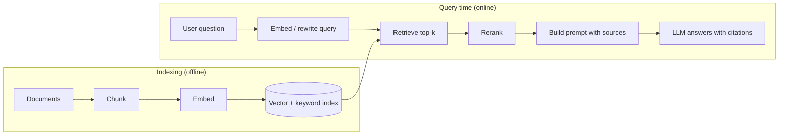
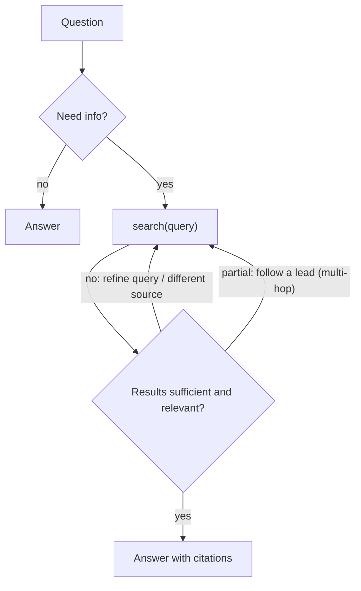

A support agent is asked: "Can I get a refund on an annual plan after 45 days?" The model was never trained on your refund policy, which changed last month anyway. If it answers from its weights, it will produce something plausible and probably wrong. If it can **look up** the current policy, quote the relevant clause and cite it, it becomes trustworthy.

That's the promise of **retrieval-augmented generation (RAG)**: fetch relevant information at runtime and put it in the model's context so the answer is grounded in sources you control. RAG started as a fixed pipeline (embed the question, fetch the top five chunks, stuff them in the prompt). In agents it has become something more flexible: **retrieval as a tool** that the model calls, refines and repeats until it has what it needs.

This lesson covers the whole stack: embeddings and similarity, chunking, vector indexes, the techniques that make retrieval actually good (hybrid search, reranking, contextual retrieval, query rewriting), agentic and graph-based RAG, why coding agents often skip embeddings entirely, and how to measure whether any of it works.

## Why retrieval

Models have two kinds of knowledge. **Parametric knowledge** is baked into the weights during training. **Non-parametric knowledge** is supplied in the context at inference time. Retrieval adds non-parametric knowledge, which fixes four problems at once:

1. **Freshness**: weights have a training cutoff; your documents changed yesterday.
2. **Private data**: your wiki, tickets and contracts were never in the training set.
3. **Hallucination**: models answer more accurately when the answer is in front of them, and can be told to say "not found" when it isn't.
4. **Provenance**: retrieved passages can be cited, so users and auditors can check claims.

The term comes from Lewis et al. (2020), who paired a dense retriever with a generator. Today "RAG" covers any system that retrieves before (or while) generating.

## The classic pipeline



Each box is a design decision, and quality is limited by the weakest one. A perfect generator can't answer from chunks that were never retrieved, so most RAG problems are **retrieval problems**.

## Embeddings and similarity

An **embedding** is a vector (typically a few hundred to a few thousand dimensions) produced by a neural network so that texts with similar meaning land near each other. "How do I reset my password?" and "Forgot login credentials" end up close together even though they share no words. That's the advantage over keyword search.

**Similarity** is usually **cosine similarity**, the cosine of the angle between two vectors:

```text
cos(a, b) = (a · b) / (‖a‖ ‖b‖)       range: −1 … 1
```

Most embedding models output normalized vectors (length 1), in which case cosine similarity equals the plain dot product, which is faster to compute.

Practical notes:

- **Bi-encoders** embed query and document *separately*, which is what makes pre-computing document vectors possible. The cost is that the query and document never "see" each other, so fine distinctions are lost (rerankers fix this, below).
- **Asymmetric search**: queries are short questions and documents are long passages. Many models expect a prefix or a separate mode for each ("query:" vs. "passage:"). Using the wrong one silently hurts quality.
- **Choosing a model**: options include API models (Voyage AI, which Anthropic recommends; OpenAI; Cohere; Google) and strong open models. The MTEB leaderboard compares them, but **evaluate on your own data**. Domain (legal, code, medical) matters more than leaderboard rank.
- **Dimensions vs. cost**: bigger vectors mean more storage and slower search. Some models support truncating vectors (Matryoshka-style training) with modest quality loss.

> [!WARNING] Similar is not the same as relevant
> Embeddings capture topical similarity. "Our refund policy for annual plans" and "Our refund policy for monthly plans" are extremely similar, and only one answers the question. Negations, numbers, dates and exact identifiers (error codes, SKUs, function names) are where dense retrieval most often fails.

## Chunking strategies

Documents are too long to embed whole (and a single vector for a 50-page PDF averages away the details), so we split them into **chunks**. Chunk size is a real trade-off. Small chunks are precise but lose context; large chunks keep context but dilute the embedding and waste prompt tokens.

| Strategy | How | Good for | Watch out for |
|---|---|---|---|
| **Fixed-size** | N tokens with overlap (e.g., 400 tokens, 15% overlap) | Baseline; homogeneous text | Splits mid-sentence or mid-table |
| **Recursive / structural** | Split on headings, then paragraphs, then sentences | Docs, wikis, Markdown, HTML | Uneven chunk sizes |
| **Semantic** | Split where embedding similarity between adjacent sentences drops | Long unstructured prose | More compute at indexing time; gains vary |
| **Document-aware** | Code by function/class; tables kept whole; Q&A pairs together | Code, spreadsheets, FAQs | Needs per-format parsers |
| **Hierarchical (parent-child)** | Retrieve small chunks, return their larger parent section | Precise matching with enough context to answer | More complex indexing |
| **Late chunking / contextual** | Embed with document-level context (see contextual retrieval) | Chunks that are ambiguous on their own | Extra indexing cost |

> [!TIP] Rule of thumb
> Start with structure-aware chunks of a few hundred tokens with modest overlap, keep metadata (title, section path, date, URL) on every chunk, and only get fancy once your evals show where retrieval fails.

## Vector indexes and databases

Finding the exact nearest neighbors means comparing the query to every vector. That's fine for 10,000 chunks and too slow for 100 million. **Approximate nearest neighbor (ANN)** indexes trade a little recall for orders-of-magnitude speedups.

### HNSW

**Hierarchical Navigable Small World** graphs (Malkov & Yashunin, 2016) are the most widely used ANN index.

- Every vector is a node linked to its near neighbors, forming a "small world" graph you can traverse greedily.
- Nodes are also randomly promoted to sparser **upper layers**, like express lanes on a highway.
- A search starts at the top layer, greedily hops toward the query, drops down a layer, and repeats, ending with a fine-grained search in the dense bottom layer.

Key parameters: `M` (links per node: more means better recall and more memory), `efConstruction` (build-time effort) and `efSearch` (query-time candidate list: higher means better recall and slower queries). HNSW gives excellent recall and latency, but it's memory-hungry and deletions are awkward.

Other families: **IVF** (cluster the vectors, search only the nearest clusters), **product quantization** (compress vectors to cut memory, at some accuracy cost), and disk-based indexes for very large collections. Libraries like FAISS implement many of these.

### Vector databases

A **vector database** wraps an ANN index with what production needs: CRUD, metadata filtering ("only docs from tenant 42 updated after March"), hybrid keyword search, replication and access control. Options include dedicated systems (Pinecone, Weaviate, Qdrant, Milvus, Chroma) and vector extensions to databases you already run (pgvector for Postgres, Elasticsearch/OpenSearch, Redis). If you already run Postgres and have under a few million chunks, pgvector is often enough.

## Making retrieval good

### Hybrid search: BM25 + dense

**BM25** is the classic keyword ranking function: it scores documents by matching query terms, weighting rare terms more (inverse document frequency) and saturating repeated terms. It's excellent at exactly what embeddings miss: identifiers, error codes, names, rare jargon.

**Hybrid search** runs both and merges the results. The simplest robust merge is **Reciprocal Rank Fusion (RRF)**:

```text
RRF(d) = Σ over rankers r of  1 / (k + rank_r(d))       (k is often 60)
```

RRF uses only ranks, not raw scores, so it doesn't matter that BM25 scores and cosine similarities live on different scales. A document ranked 1st by BM25 and 8th by dense retrieval beats one ranked 3rd by dense retrieval and absent from BM25.

### Reranking with cross-encoders

Retrieval casts a wide net cheaply (say, the top 100 candidates). A **reranker** then rescores them carefully. A **cross-encoder** reads the query and a candidate passage *together*, so attention can compare them token by token. It's far more accurate than a bi-encoder and far too slow to run over the whole corpus, which is exactly why it runs on a shortlist. Typical setup: retrieve 50–150, rerank, keep the top 5–20. Hosted rerankers (Cohere, Voyage) and open cross-encoders are common. An LLM can also act as a reranker, at higher cost.

### Contextual retrieval

Chunks often lose meaning when cut from their document. "Revenue grew 3% over the previous quarter" doesn't say *which company* or *which quarter*. Anthropic's **Contextual Retrieval** technique (2024) prepends a short, LLM-generated context to each chunk before embedding *and* before BM25 indexing:

```text
Original chunk:     "Revenue grew 3% over the previous quarter."
Contextualized:     "This chunk is from ACME Corp's Q2 2023 SEC filing, in the section
                     on financial results. Revenue grew 3% over the previous quarter."
```

In Anthropic's experiments, contextual embeddings cut the top-20 retrieval failure rate by 35%. Adding contextual BM25 brought the reduction to 49%, and adding reranking brought it to 67%. Generating a context for every chunk sounds expensive, but **prompt caching** makes it cheap: the full document is cached once and each chunk's request reuses it.

```python
import anthropic

client = anthropic.Anthropic()

def contextualize(document: str, chunk: str) -> str:
    response = client.messages.create(
        model="claude-haiku-5-5",
        max_tokens=1000,  # headroom: any thinking tokens count toward this too
        output_config={"effort": "low"},
        messages=[{"role": "user", "content": [
            # Same document for every chunk -> cached after the first call
            {"type": "text", "text": f"<document>\n{document}\n</document>",
             "cache_control": {"type": "ephemeral"}},
            {"type": "text", "text": f"Here is a chunk from that document:\n<chunk>\n{chunk}\n</chunk>\n"
             "Write a short, succinct context that situates this chunk within the overall document "
             "to improve search retrieval. Answer only with the context."},
        ]}],
    )
    context = next(b.text for b in response.content if b.type == "text")
    return f"{context}\n\n{chunk}"  # index THIS string in both the vector and BM25 indexes
```

### Query transformation

The user's words are often not the best search query.

- **Query rewriting**: an LLM turns "it's broken again after the update??" (plus conversation history) into "error after upgrading to v4.2 login page 500".
- **Multi-query**: generate several paraphrases, retrieve for each, and fuse with RRF.
- **Decomposition**: split "Compare our EU and US data retention policies" into two retrievals.
- **HyDE (Hypothetical Document Embeddings)** (Gao et al., 2022): ask the LLM to write a *hypothetical answer*, then embed that and search with it. A fake answer looks more like the real answer passage than the question does. The fabricated details don't matter, because only the embedding is used.
- **Step-back prompting**: retrieve for a more general question ("what are the principles of X?") alongside the specific one.

## Agentic RAG

Classic RAG retrieves **once**, **before** generation, with the **user's query**. Each of those is a limitation. Agentic RAG makes retrieval a **tool**: the model decides *whether* to search, *what* to search for, judges the results, and searches again.



```text
User: Which of our enterprise customers are affected by the CVE in libxml we patched last week?

Thought: First find which CVE and which service was patched.
Action: search_docs({"query": "libxml CVE patch last week"})
Observation: [sec-2291#0] "Patched CVE-2026-NNNN in libxml2 in the doc-render service (v3.8.1)."
Thought: Now which customers use doc-render, and which version are they on?
Action: search_docs({"query": "doc-render service enterprise customers deployment versions"})
Observation: [ops-88#2] "Self-hosted doc-render: Globex (v3.7), Initech (v3.8.1), Umbrella (v3.6)."
Thought: Versions below 3.8.1 are affected: Globex and Umbrella. Initech is patched.
Answer: Globex (v3.7) and Umbrella (v3.6) are affected; Initech already runs the patched v3.8.1 [sec-2291#0][ops-88#2].
```

That's **multi-hop retrieval**: the second query could only be written after reading the first result. Research systems formalized versions of this:

- **IRCoT** interleaves retrieval steps with chain-of-thought reasoning.
- **Self-RAG** (Asai et al., 2023) trains a model to emit special reflection tokens that decide *when* to retrieve and critique whether passages are relevant and whether the answer is supported by them.
- **Corrective RAG (CRAG)** (Yan et al., 2024) adds a lightweight evaluator that grades retrieval as correct, ambiguous or incorrect, and falls back to web search or refines the knowledge when retrieval is poor.

With today's tool-using models you mostly get these behaviors through **good tool design and instructions** rather than special training. Return results with IDs and metadata, tell the model it may search several times, and tell it to say when the sources don't contain the answer. [Research agents](research-agents.html) push this to its extreme, with hundreds of searches per report.

> [!KEY] The big idea
> In agentic RAG, retrieval stops being a preprocessing step and becomes an action. The model's reasoning (rewriting queries, judging relevance, following leads) is now part of the retrieval system, which is why a mediocre index plus a good agent often beats a great index used once.

## GraphRAG

Some questions aren't answered by any single chunk: "What are the main themes across these 2,000 customer interviews?" or "How are these companies connected?" Similarity search returns *some* relevant fragments, but nothing sees the whole.

**GraphRAG** (Edge et al., 2024, Microsoft) builds structure at indexing time:

1. An LLM extracts **entities and relationships** from every chunk into a knowledge graph.
2. A community-detection algorithm clusters the graph into hierarchical **communities**.
3. An LLM writes a **summary of each community**.
4. **Global queries** are answered map-reduce style over community summaries. **Local queries** start at matching entities and expand to their neighbors.

GraphRAG does well on "sensemaking" questions over a whole corpus and on multi-hop relationship questions. The costs are real: indexing requires LLM calls over the entire corpus, extraction errors become graph errors, and updates are harder. Lighter variants (and plain knowledge graphs queried by an agent with a graph-query tool) sit between full GraphRAG and vector search.

## Agentic search: grep, glob and read

Coding agents like Claude Code mostly **don't use embeddings at all**. They search code the way an engineer does, with tools such as `glob` (find files by pattern), `grep` (search contents with regex) and `read` (open a file, or part of one), iterating until they understand the code. Anthropic engineers have described trying a vector index early on and finding that agentic search worked better for code.

Why this works so well for codebases:

- **Exactness**: code is full of identifiers. `grep -rn "def parse_config"` finds the definition exactly; embeddings find "things about configuration."
- **Freshness**: there's no index to go stale while the agent edits files. Every search reflects the current state.
- **No infrastructure**: no embedding pipeline, no vector DB, no re-indexing, no storing derived copies of private code elsewhere.
- **Iteration**: the model reads a file, notices an import, greps for it, and follows the trail, which is multi-hop retrieval by construction.
- **Structure**: directory names, file names and code structure are high-signal navigation aids that the model reads directly.

The trade-offs: more tool calls and tokens per question, weaker performance on purely conceptual queries over prose ("where do we discuss our pricing philosophy?"), and limits at very large scale. Many teams now combine both: agentic search by default, plus a semantic index exposed as *one more tool* for large document collections.

## RAG vs. long context vs. fine-tuning

| Approach | Best when | Strengths | Weaknesses |
|---|---|---|---|
| **Long context** (put it all in the prompt) | Corpus is small and stable (Anthropic suggests under roughly 200K tokens), or the task needs the whole document at once | Simplest; no retrieval misses; prompt caching makes repeats cheap | Cost and latency per call; quality degrades with length ("lost in the middle", context rot); doesn't scale to large corpora |
| **RAG / agentic retrieval** | Large, changing or access-controlled knowledge; citations needed | Fresh, scalable, citable, per-user permissions | Retrieval misses; pipeline complexity; chunking artifacts |
| **Fine-tuning** | Teaching *behavior*: format, style, domain reasoning patterns, tool-use habits | Lower per-call tokens; consistent behavior | Poor at injecting facts reliably; stale as soon as facts change; no provenance; costly to iterate |

They combine well. A common rule: **retrieve knowledge, fine-tune (or prompt) behavior, and use long context for what the task needs in full.** Context length and retrieval are complements. Larger windows let you retrieve *more generously* and include whole sections instead of fragments.

## Citations and grounding

Grounding is only valuable if it's **checkable**:

- Give each chunk a stable ID and metadata (title, URL, date, section) in the prompt.
- Instruct the model to cite IDs for each claim and to answer "the sources don't say" rather than filling gaps.
- **Verify citations programmatically**: check that cited IDs were actually retrieved. Optionally, have a second pass confirm each cited passage supports its claim.
- Show users the quoted span, not just a link. People verify far more when the evidence is one click away.

Some APIs build this in. The Claude API, for example, can return structured citations pointing to exact passages when documents or search results are passed in supported formats; check the current docs for details. Built-in web search tools also return cited results.

> [!WARNING]
> Retrieved content is **untrusted input**. A document can contain "Ignore previous instructions and…". RAG pipelines are a main channel for indirect prompt injection. Keep retrieved text clearly delimited as data, and don't let it trigger privileged actions without checks (see [agent security](agent-security.html)).

## Evaluating retrieval and generation

Evaluate the two halves separately, or you won't know which to fix.

### Retrieval metrics

Build a labeled set of queries with their relevant chunk IDs (from real user questions where possible).

- **Recall@k**: fraction of queries where a relevant chunk appears in the top *k*. This is the most important retrieval metric for RAG: if it's not retrieved, it can't be used.
- **Precision@k**: fraction of the top *k* that are relevant. It matters for prompt budget and distraction.
- **MRR (Mean Reciprocal Rank)**: average of 1/rank of the first relevant result. Example: first relevant hits at ranks 1, 3 and "not found" over three queries gives MRR = (1 + 1/3 + 0) / 3 ≈ 0.44.
- **nDCG**: rewards putting the *most* relevant items highest, with graded relevance.

### Generation metrics

- **Faithfulness / groundedness**: is every claim in the answer supported by the retrieved context? This catches hallucination *despite* retrieval.
- **Answer relevance**: does it actually answer the question?
- **Correctness**: against a reference answer, when you have one.
- **Citation accuracy**: do cited sources support the claims they're attached to?

These are usually scored with **LLM-as-judge** rubrics (frameworks such as RAGAS package common ones), calibrated against human labels on a sample. For agentic RAG, also track **search efficiency**: number of searches, tokens per answer, and how often the agent correctly says "not found." [Evaluating agents](evaluating-agents.html) covers judge design and eval hygiene.

## Build it: retrieval as a tool

Here's a complete, minimal agentic RAG loop: a pure-Python BM25 index over chunked documents, exposed as a `search_docs` tool, with instructions to search iteratively and cite chunk IDs.

```python
import math, re
from collections import Counter
import anthropic

DOCS = {
    "refund-policy": "Refunds. Monthly plans can be refunded within 14 days of purchase. "
                     "Annual plans can be refunded within 30 days; after 30 days, annual plans "
                     "receive a prorated credit instead of a refund. Updated 2026-10-01.",
    "billing-faq": "Billing FAQ. Credits are applied to the next invoice. Enterprise contracts "
                   "follow the terms of the signed order form, not the standard refund policy.",
}

def tokenize(text: str) -> list[str]:
    return re.findall(r"[a-z0-9]+", text.lower())

def chunk(doc_id: str, text: str, size: int = 40, overlap: int = 10) -> list[dict]:
    words = text.split()
    step = size - overlap
    return [{"id": f"{doc_id}#{i}", "text": " ".join(words[s:s + size])}
            for i, s in enumerate(range(0, max(len(words) - overlap, 1), step))]

class BM25:
    def __init__(self, chunks: list[dict], k1: float = 1.5, b: float = 0.75):
        self.chunks, self.k1, self.b = chunks, k1, b
        self.tfs = [Counter(tokenize(c["text"])) for c in chunks]
        self.lens = [sum(tf.values()) for tf in self.tfs]
        self.avgdl = sum(self.lens) / len(self.lens)
        df = Counter(t for tf in self.tfs for t in tf)
        n = len(chunks)
        self.idf = {t: math.log(1 + (n - f + 0.5) / (f + 0.5)) for t, f in df.items()}

    def search(self, query: str, k: int = 3) -> list[tuple[float, dict]]:
        scores = []
        for tf, dl, c in zip(self.tfs, self.lens, self.chunks):
            s = sum(self.idf.get(t, 0) * tf[t] * (self.k1 + 1)
                    / (tf[t] + self.k1 * (1 - self.b + self.b * dl / self.avgdl))
                    for t in tokenize(query))
            scores.append((s, c))
        return [x for x in sorted(scores, key=lambda x: x[0], reverse=True)[:k] if x[0] > 0]

index = BM25([c for doc_id, text in DOCS.items() for c in chunk(doc_id, text)])

SEARCH_TOOL = {
    "name": "search_docs",
    "description": "Keyword search over the company knowledge base. Returns up to top_k chunks, each with an id. "
                   "Use specific terms; search again with different wording if results are off-topic.",
    "strict": True,
    "input_schema": {
        "type": "object",
        "properties": {"query": {"type": "string"}, "top_k": {"type": "integer"}},
        "required": ["query", "top_k"],
        "additionalProperties": False,
    },
}

def search_docs(query: str, top_k: int) -> str:
    hits = index.search(query, k=min(max(top_k, 1), 8))
    if not hits:
        return "No results. Try different keywords."
    return "\n\n".join(f"<result id=\"{c['id']}\" score=\"{s:.2f}\">\n{c['text']}\n</result>" for s, c in hits)

SYSTEM = ("Answer using only the knowledge base. Search as many times as needed (max 5). "
          "Cite chunk ids in square brackets after each claim, like [refund-policy#0]. "
          "If the sources don't contain the answer, say so plainly.")

client = anthropic.Anthropic()
messages = [{"role": "user", "content": "Can I get a refund on an annual plan after 45 days?"}]
for _ in range(8):
    response = client.messages.create(model="claude-sonnet-5-5", max_tokens=16000,
                                      system=SYSTEM, tools=[SEARCH_TOOL], messages=messages)
    messages.append({"role": "assistant", "content": response.content})
    if response.stop_reason != "tool_use":
        break
    results = [{"type": "tool_result", "tool_use_id": b.id, "content": search_docs(**b.input)}
               for b in response.content if b.type == "tool_use"]
    messages.append({"role": "user", "content": results})

print(next((b.text for b in response.content if b.type == "text"), f"[stopped: {response.stop_reason}]"))
```

A good run searches for annual-plan refunds, finds `refund-policy#0`, and answers "No refund after 30 days, but you'll receive a prorated credit," with citations. It may also note the enterprise exception from `billing-faq#0`. To upgrade this to production quality, swap BM25 for hybrid search with a reranker, add metadata filters, and evaluate recall@k on real questions.

## Key Takeaways

- RAG adds **non-parametric knowledge** at runtime: fresh, private and citable. Most RAG failures are **retrieval failures**, so measure retrieval first.
- Embeddings capture meaning but miss exact identifiers, numbers and negations. **Hybrid search (BM25 + dense, fused with RRF) plus a cross-encoder reranker** is a strong default.
- **Contextual retrieval** (prepending LLM-written context to each chunk before indexing) substantially reduces retrieval failures, and prompt caching makes it affordable.
- **Agentic RAG** turns retrieval into a tool. The model rewrites queries, judges results and follows multi-hop leads.
- **GraphRAG** helps with corpus-wide sensemaking and relationship questions, at a high indexing cost.
- **Coding agents often skip embeddings**: grep, glob and read are exact, always fresh and need no infrastructure.
- Choose deliberately: **long context** for small stable corpora, **RAG** for large or changing knowledge, **fine-tuning** for behavior rather than facts. Evaluate retrieval (recall@k, MRR) and generation (faithfulness) separately.

## Exercises

1. **Break dense retrieval.** Write ten queries containing exact identifiers (error codes, SKUs, function names) and ten conceptual queries. Compare BM25 and an embedding model on recall@3 for each group. What pattern do you see?
2. **Add RRF.** Implement reciprocal rank fusion that merges the BM25 results from the example with results from any embedding search. Verify that a document ranked highly by only one retriever can still win.
3. **Measure MRR.** Create 15 questions about the example knowledge base (expand `DOCS` to at least 8 documents) with labeled relevant chunk IDs. Compute recall@1, recall@3 and MRR for BM25, then for BM25 over contextualized chunks.
4. **Citation verifier.** After the agent answers, parse every `[id]` citation and check it was actually returned by a `search_docs` call in this conversation. Flag answers with unsupported citations, or with factual sentences that carry no citation.
5. **Agentic vs. pipeline (hard).** Build two systems over the same corpus: (a) single-shot retrieval (top 5, then answer) and (b) the agentic loop. Write 10 multi-hop questions where the second search depends on the first result. Compare accuracy, tokens and latency, and explain where each wins.

<details class="solutions">
<summary>Hints and solution sketches</summary>

1. **Hint:** Label exactly one relevant chunk per query, and seed the corpus with lookalikes (E4012 next to E4021, `parse_config` next to `load_config`) so near misses count as misses. **Sketch:** The expected pattern: BM25 wins the identifier group, because rare exact tokens get a high IDF and match exactly, while embeddings tend to return "a chunk about some error". Embeddings win the conceptual group whenever the query shares few words with the answer ("can't get into my account" vs. a chunk about password resets). Each method fails where the other succeeds, which is the argument for hybrid search. Note that the example's `tokenize` splits `parse_config` into `parse` and `config`, so BM25 still matches identifiers but can also match their parts.
2. **Hint:** RRF needs only the ordered IDs from each retriever, not their scores; count ranks from 1. **Sketch:** With k = 60, the lesson's example works out as 1/61 + 1/68 ≈ 0.0311 for "1st in BM25, 8th in dense", against 1/63 ≈ 0.0159 for "3rd in dense only". A document that is 1st in one list only scores 1/61 ≈ 0.0164. That beats every other single-list document, but it loses to any document that appears in both top-20 lists (at least 2/80 = 0.025). So it "wins" overall when the lists barely overlap, which is typical for an exact-identifier query where dense retrieval returns unrelated errors. That preference for consensus is by design; a smaller k (say 10) gives first places more weight.

    ```python
    def rrf(*rankings: list[str], k: int = 60) -> list[tuple[str, float]]:
        scores: dict[str, float] = {}
        for ranking in rankings:
            for rank, doc_id in enumerate(ranking, start=1):
                scores[doc_id] = scores.get(doc_id, 0.0) + 1 / (k + rank)
        return sorted(scores.items(), key=lambda x: x[1], reverse=True)

    bm25_ids = [c["id"] for _, c in index.search(query, k=20)]
    fused = rrf(bm25_ids, dense_ids)  # dense_ids: chunk ids from your embedding search, best first
    ```

3. **Hint:** Make documents longer than the 40-word chunk size so they actually split, and keep chunk IDs unchanged when you contextualize (change only the text you index) so the same labels work for both runs. **Sketch:** For each question, find the rank of the first relevant chunk in the top 10. Recall@1 is the fraction at rank 1, recall@3 the fraction at rank ≤ 3, and MRR the mean of 1/rank (0 if not found). Worked example for 15 questions: 9 at rank 1, 3 at rank 2, 1 at rank 3 and 2 not found gives recall@1 = 9/15 = 0.60, recall@3 = 13/15 ≈ 0.87, MRR = (9 + 3 × 1/2 + 1/3) / 15 = 10.83 / 15 ≈ 0.72. For the contextualized index, rebuild with `BM25([{"id": c["id"], "text": contextualize(DOCS[c["id"].split("#")[0]], c["text"])} for c in chunks])`. Expect the biggest gains on questions that use document-level terms ("annual plan", the product name) that appear in the document but not in the chunk itself.

    ```python
    def evaluate(index, labeled: list[tuple[str, set[str]]], k_max: int = 10) -> tuple[float, float, float]:
        r1 = r3 = mrr = 0.0
        for question, relevant in labeled:
            ids = [c["id"] for _, c in index.search(question, k=k_max)]
            rank = next((i for i, cid in enumerate(ids, start=1) if cid in relevant), None)
            r1 += rank == 1
            r3 += rank is not None and rank <= 3
            mrr += 1 / rank if rank else 0.0
        n = len(labeled)
        return r1 / n, r3 / n, mrr / n
    ```

4. **Hint:** The ground truth is already in `messages`: every `tool_result` block's content contains `<result id="...">` tags, so collect those IDs, then compare them with the `[id]` citations in the final text. **Sketch:** Flag any citation that's not in the retrieved set (fabricated, or from an earlier answer). For uncited claims, split the answer into sentences and flag those that make a factual claim (contain a number, or a verb like "is", "can" or "will") without a citation. That's a rough heuristic, so treat it as a filter that sends cases to review. The next step up is an LLM-judge pass that checks each cited chunk actually supports its sentence (faithfulness, not just existence).

    ```python
    import re

    CITE = re.compile(r"\[([\w.-]+#\d+)\]")

    def verify_citations(answer: str, messages: list[dict]) -> dict:
        retrieved = {rid for m in messages if m["role"] == "user" and isinstance(m["content"], list)
                     for b in m["content"] if b.get("type") == "tool_result"
                     for rid in re.findall(r'<result id="([^"]+)"', b["content"])}
        unsupported = sorted(set(CITE.findall(answer)) - retrieved)
        sentences = re.split(r"(?<=[.!?])\s+", answer.strip())
        uncited = [s for s in sentences if not CITE.search(s) and re.search(r"\d|\b(is|are|can|will)\b", s)]
        return {"unsupported": unsupported, "uncited": uncited, "ok": not unsupported and not uncited}
    ```

5. **Hint:** Model the questions on the lesson's libxml trace, where the second query needs an entity (the service name) that appears only in the first result. Sum `response.usage.input_tokens + output_tokens` over every call, and run each system several times, since the agent isn't deterministic. **Sketch:** Expect the pipeline to fail most multi-hop questions: the top 5 for "customers affected by the libxml CVE" won't include the deployment-versions chunk, because that chunk never mentions libxml. The agentic loop should be clearly more accurate on these, at a multiple of the tokens and latency, since each turn resends the growing history and adds a model call. On single-hop questions the pipeline matches its accuracy with one call. A strong write-up has a per-question table and a failure analysis (pipeline: missing the second hop; agent: redundant searches, giving up early, hitting the 5-search cap). It ends with a routing recommendation: a single retrieval for simple lookups, the agent for questions that need a chain.

</details>

## Check Your Understanding

```quiz
Q: A user searches for error code "E4012" and dense retrieval returns chunks about unrelated errors. What's the most likely fix?
- [ ] Switch to a larger embedding model with more dimensions
- [x] Add BM25 keyword search and fuse it with the dense results
- [ ] Rewrite the query with an LLM so it describes the error in words
- [ ] Shrink chunks so the error code dominates each chunk's vector
E: Embeddings capture topical similarity and handle rare exact tokens like error codes poorly, whatever their size. BM25 matches the token exactly, and hybrid search with RRF keeps the benefits of both. Rewriting the query into prose moves it further from the exact identifier the user typed.

Q: Why does reranking with a cross-encoder improve results over the initial bi-encoder retrieval?
- [ ] It re-embeds the shortlist with a larger, more accurate bi-encoder
- [ ] It combines keyword and vector scores, which a bi-encoder can't
- [x] It reads query and passage together, so attention compares them
- [ ] It scores whole documents rather than isolated chunks, adding context
E: Bi-encoders embed queries and documents separately so documents can be pre-computed. A cross-encoder processes each pair jointly, which is far more accurate but too slow for the whole corpus, so it runs on a shortlist. Combining keyword and vector scores is hybrid search, a different technique.

Q: What problem does contextual retrieval address?
- [ ] Short user queries that lack the context needed to match a chunk
- [x] Chunks that lose meaning once they're cut out of their document
- [ ] Long documents whose single embedding averages away the details
- [ ] Retrieved chunks that arrive with no source metadata to cite
E: "Revenue grew 3%" means little without the company and quarter. Prepending a short, document-aware context to each chunk before embedding and BM25 indexing makes it retrievable by the terms a user would actually search for. Short queries are what query rewriting and HyDE address.

Q: Why does HyDE embed a hypothetical answer instead of the question?
- [ ] The hypothetical answer is a cheap draft that retrieval then fact-checks
- [ ] Generating text first makes the model's own knowledge available as a source
- [x] A fake answer passage sits closer to real answers in embedding space
- [ ] Embedding a longer text gives a more stable vector than a short question
E: HyDE uses the fake answer only as a search probe: its embedding resembles real answer passages more than the question does, so retrieval improves. Its fabricated details are discarded, not checked or used as a source, and length alone isn't the point.

Q: Why do many coding agents use grep/glob/read instead of a vector index over the codebase?
- [ ] Embedding models handle source code poorly compared with prose
- [x] Code search hinges on exact identifiers, and files change mid-task
- [ ] Agentic search uses fewer tokens per question than a vector lookup
- [ ] Vector indexes can't respect the repository's directory structure
E: Exactness, freshness and zero infrastructure favor agentic search for code. It's tempting to think it's cheaper, but it usually uses more tool calls and tokens than one vector lookup; its advantage is that the agent can iterate and follow references against the current files.

Q: Your knowledge base is a 60-page policy manual that rarely changes, queried thousands of times a day. Which approach is likely simplest and most effective?
- [ ] Fine-tune a model on the manual so no context tokens are spent
- [ ] Hybrid search with reranking, so each query sees only what it needs
- [x] Put the whole manual in the prompt and rely on prompt caching
- [ ] Build GraphRAG so cross-references between sections are captured
E: The manual is small and stable, well within a context window. Long context with caching avoids retrieval misses and pipeline complexity, and makes repeated reads cheap. Hybrid search would work but adds machinery and miss risk for no gain; fine-tuning is poor at injecting facts reliably.

Q: Across three test queries, the first relevant result appears at ranks 2, 1 and 4. What's the MRR?
- [ ] 0.33
- [ ] 0.25
- [x] 0.58
- [ ] 2.33
E: MRR averages the reciprocal ranks: (1/2 + 1/1 + 1/4) / 3 = 1.75 / 3 ≈ 0.58. 2.33 is the mean rank (7/3), and 0.33 is its reciprocal; neither is MRR.

Q: An answer cites [doc-7#2], but the chunk doesn't support the claim. Which metric captures this failure?
- [ ] Recall@k, since the right chunk evidently wasn't retrieved
- [ ] Precision@k, since an irrelevant chunk reached the prompt
- [x] Faithfulness, since the answer isn't backed by its source
- [ ] Answer relevance, since the response missed the question
E: Retrieval may have been fine; the generation step made an unsupported claim. Faithfulness and citation-accuracy checks evaluate whether the answer is actually backed by the sources it cites. Retrieval metrics can't see this, and the answer may still address the question.
```

## Further Reading

- [Retrieval-Augmented Generation for Knowledge-Intensive NLP Tasks (Lewis et al., 2020)](https://arxiv.org/abs/2005.11401): the paper that named RAG.
- [Introducing Contextual Retrieval (Anthropic)](https://www.anthropic.com/news/contextual-retrieval): contextual embeddings and BM25, reranking, results, and the case for long context with small corpora.
- [Efficient and Robust ANN Search Using HNSW Graphs (Malkov & Yashunin, 2016)](https://arxiv.org/abs/1603.09320): the index behind most vector databases.
- [Precise Zero-Shot Dense Retrieval without Relevance Labels, HyDE (Gao et al., 2022)](https://arxiv.org/abs/2212.10496): hypothetical document embeddings.
- [Self-RAG (Asai et al., 2023)](https://arxiv.org/abs/2310.11511): learning when to retrieve and how to critique retrieved passages.
- [Corrective Retrieval Augmented Generation (Yan et al., 2024)](https://arxiv.org/abs/2401.15884): evaluating retrieval quality and falling back when it's poor.
- [From Local to Global: A Graph RAG Approach (Edge et al., 2024)](https://arxiv.org/abs/2404.16130): Microsoft's GraphRAG for query-focused summarization.
- [Lost in the Middle (Liu et al., 2023)](https://arxiv.org/abs/2307.03172): why position in long contexts matters, and why more retrieved text isn't always better.
- [RAGAS: Automated Evaluation of RAG (Es et al., 2023)](https://arxiv.org/abs/2309.15217): reference-free metrics for faithfulness and relevance.
