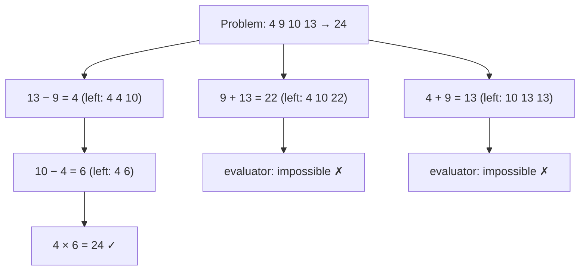
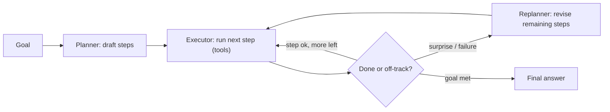
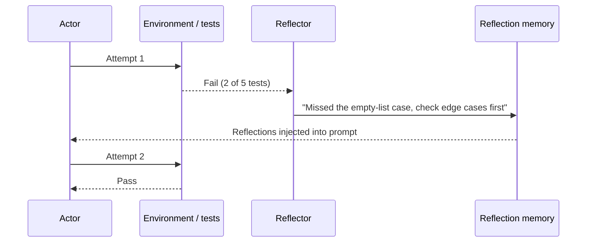

Ask a model "A bat and a ball cost $1.10 together; the bat costs $1.00 more than the ball. How much is the ball?" and older models would often blurt out "10 cents." Ask the same model to *work through it step by step* and the answer usually comes out right: 5 cents. Nothing about the model changed. What changed is how much computation it was allowed to do before it committed to an answer.

That small observation, that **how** a model reaches an answer matters as much as **which** model you use, grew into a whole research field. It led to prompting tricks (chain-of-thought), sampling strategies (self-consistency), search algorithms over thoughts (Tree of Thoughts, LATS), agent patterns (ReAct, plan-and-execute, Reflexion), and finally to **reasoning models** trained to think at length before they answer. For agents, reasoning and planning decide whether a 40-step task converges or wanders off.

This lesson covers that whole arc. You'll learn what each technique actually does, when it pays for its extra tokens, how modern reasoning models expose "thinking" as a dial you can turn, and the critiques you should keep in mind: LLMs are still unreliable planners, and the reasoning they show you is not always the reasoning they used.

## Reasoning vs. planning

The two words get used loosely, so let's pin them down.

- **Reasoning** is deriving conclusions from information: arithmetic, logic, reading a stack trace and inferring the bug. It's mostly about *getting one answer right*.
- **Planning** is choosing a *sequence of actions* that moves the world from a current state to a goal state, under constraints. It requires predicting the effects of actions you haven't taken yet.

An agent needs both. It reasons about each observation ("the test failed because the fixture is missing"), and it plans the route through the task ("first reproduce, then patch, then run the full suite"). The techniques below sit on a spectrum from pure reasoning aids (chain-of-thought) to full planners (LLM+P, MCTS), with hybrid patterns like ReAct in the middle.

> [!KEY] The big idea
> A transformer does a fixed amount of computation per token. Letting a model write intermediate tokens, or search over many candidate paths, buys it more computation for hard problems. Nearly every technique in this lesson is a different way to spend that extra computation well.

## Chain-of-thought: thinking out loud

**Chain-of-thought (CoT) prompting** (Wei et al., 2022) showed that if your few-shot examples include worked reasoning ("Roger has 5 balls. 2 cans of 3 is 6. 5 + 6 = 11.") rather than bare answers, large models imitate the pattern and become much better at arithmetic, commonsense and symbolic tasks. The effect was **emergent**: small models gained little or even got worse, while the largest models of the time improved dramatically.

A few months later, Kojima et al. found you don't even need examples. Appending **"Let's think step by step"** to the question (**zero-shot CoT**) produced large jumps on arithmetic benchmarks. On one benchmark, accuracy went from under 20% to nearly 80% with the same model.

Why does writing reasoning down help? Three complementary explanations:

1. **Serial computation.** Each generated token gets one forward pass. A problem that requires five dependent steps can't be solved reliably in one pass, but it can be solved across many tokens where each step conditions on the last.
2. **Working memory.** Intermediate results written into the context don't have to be held implicitly in activations; the model can attend back to them.
3. **Distribution matching.** Training data contains worked solutions. Prompting for steps puts the model in a region of its distribution where careful, correct reasoning is more common.

```text
Q: A store had 23 apples. It used 20 for lunch and bought 6 more. How many now?

Direct answer:   27            (wrong: pattern-matched "23 + ... 6")
Chain-of-thought: Start with 23. Used 20 → 23 − 20 = 3. Bought 6 → 3 + 6 = 9.
                  Answer: 9    (right)
```

> [!NOTE]
> With modern **reasoning models** (covered below), you rarely need to say "think step by step" since they are trained to reason before answering. The CoT idea didn't go away; it moved from the prompt into training.

## Self-consistency: sample many paths, vote

A single chain of thought can go wrong at any step. **Self-consistency** (Wang et al., 2022) samples several independent reasoning chains (with nonzero sampling randomness) and takes the **majority vote** over their final answers. The intuition: there are many ways to reason correctly toward the right answer, but wrong chains tend to scatter across different wrong answers. On math word problems, this added double-digit percentage-point gains over single-chain CoT.

The cost is linear: five samples cost five times as much. It only works when answers can be compared exactly (a number, a multiple-choice letter, a function's output on a test). For free-form text, variants use a model to pick the most consistent answer ("universal self-consistency").

Here's self-consistency with the Anthropic SDK. Each call reasons in its own thinking phase, and structured outputs keep the final answer easy to compare:

```python
import collections
import anthropic
from pydantic import BaseModel

client = anthropic.Anthropic()

class Solution(BaseModel):
    final_answer: str  # e.g. "42", normalized so votes can be compared

def solve_once(question: str) -> str | None:
    response = client.messages.parse(
        model="claude-sonnet-5-5",
        max_tokens=8000,
        thinking={"type": "adaptive"},  # each call reasons in its own thinking phase
        messages=[{
            "role": "user",
            "content": f"{question}\n\nPut only the final number in final_answer.",
        }],
        output_format=Solution,
    )
    if response.stop_reason != "end_turn":  # refusal or truncation: no vote
        return None
    return response.parsed_output.final_answer.strip()

def self_consistency(question: str, n: int = 5) -> tuple[str | None, float]:
    # Default sampling is stochastic, so independent calls explore different paths.
    answers = [a for a in (solve_once(question) for _ in range(n)) if a is not None]
    if not answers:
        return None, 0.0
    answer, count = collections.Counter(answers).most_common(1)[0]
    return answer, count / n  # agreement rate doubles as a cheap confidence score

answer, agreement = self_consistency("If 3 workers build 3 walls in 3 hours, how many hours do 9 workers need for 9 walls?")
print(answer, agreement)
```

The agreement rate is useful on its own. If five samples split 2/2/1, the agent should escalate, gather more information, or ask a human rather than act.

## Decomposition: least-to-most and friends

CoT reasons through a problem in one pass. **Decomposition** methods first break a problem into subproblems, then solve them in order.

**Least-to-most prompting** (Zhou et al., 2022) runs in two stages: (1) ask the model to reduce the problem to a list of simpler subquestions; (2) solve them sequentially, feeding each answer into the next. Its signature result was **easy-to-hard generalization**: prompted with short examples, it could solve problems longer than any in the prompt, where plain CoT broke down.

Related ideas you'll meet:

- **Decomposed prompting** routes each subproblem to a specialized handler (another prompt, a tool, a retriever).
- **Plan-and-Solve** prompting (below) asks for a plan before solving.
- In agent systems, decomposition shows up as the **orchestrator-workers** pattern (see [workflow patterns](workflow-patterns.html)) and as [multi-agent systems](multi-agent-systems.html) that hand subtasks to sub-agents.

Decomposition works when the subproblems are genuinely more independent than the original. When they're tightly coupled (changing one changes what the others should be), a fixed upfront decomposition becomes a liability, and you need replanning.

## Searching the space of thoughts

CoT is a single path. Self-consistency is several independent paths. The next step is to treat reasoning as **search**: branch, evaluate partial progress, and backtrack from dead ends.

### Tree of Thoughts

**Tree of Thoughts (ToT)** (Yao et al., 2023) frames problem solving as search over a tree where each node is a partial solution (a "thought"). It needs four components:

1. **Thought decomposition**: what one step looks like (an equation, a line of a plan, a paragraph).
2. **Thought generator**: the LLM proposes *k* candidate next steps.
3. **State evaluator**: the LLM (or a checker) scores each partial state: "sure / likely / impossible", or a number.
4. **Search algorithm**: breadth-first or depth-first search with pruning and backtracking.



On the "Game of 24" puzzle, the ToT paper reported GPT-4 with CoT solving 4% of problems versus 74% with ToT. The price is many more model calls per problem. ToT shines when there are few steps, many plausible branches, and a cheap reliable way to say "this branch is dead."

### Graph of Thoughts

**Graph of Thoughts (GoT)** (Besta et al., 2023) generalizes the tree to an arbitrary graph. Thoughts can be **merged** (combine the best parts of three partial solutions), **refined** in loops, and reused. The canonical demonstration is sorting: split a list, sort the pieces, merge them, a shape a tree can't express. GoT is more a framework for composing operations than a single algorithm. In practice the same idea shows up whenever an agent generates several drafts and synthesizes them.

### MCTS and LATS

**Monte Carlo Tree Search (MCTS)**, the algorithm behind AlphaGo, balances *exploring* untried branches against *exploiting* promising ones, using rollouts and backed-up value estimates. **Reasoning via Planning (RAP)** (Hao et al., 2023) used the LLM both as a world model (predict the next state) and as the policy inside MCTS.

**Language Agent Tree Search (LATS)** (Zhou et al., 2023) brought this to agents. It combines ReAct-style acting, MCTS, LLM-based value estimates, and Reflexion-style self-reflections on failed trajectories. Crucially, it uses **real environment feedback** (test results, web page contents) to score nodes. That makes it far more reliable than purely self-evaluated search, but it requires an environment you can **reset or branch**: you can re-run a unit test from a clean state, but you can't un-send an email.

> [!WARNING]
> Tree search multiplies cost and latency by the branching factor and depth, often 10–100× a single pass. In production it's mostly used offline (generating training data, hard batch problems) or where a cheap, trustworthy verifier exists, such as unit tests in coding.

## ReAct: reasoning interleaved with acting

Pure reasoning operates on what the model already knows, so it can confidently reason its way to a hallucinated fact. Pure acting (calling tools with no explicit reasoning) loses track of goals. **ReAct** (Yao et al., 2022) interleaves the two: **Thought → Action → Observation**, repeated. The thoughts plan and interpret; the actions ground the reasoning in real information.

```text
Task: Which is older, the Eiffel Tower or the Statue of Liberty's dedication?

Thought: I need both dates. Search the Eiffel Tower first.
Action: search("Eiffel Tower completion date")
Observation: The Eiffel Tower was completed in March 1889.
Thought: Now the Statue of Liberty's dedication date.
Action: search("Statue of Liberty dedication date")
Observation: The statue was dedicated on October 28, 1886.
Thought: 1886 is earlier than 1889, so the dedication came first.
Action: finish("The Statue of Liberty was dedicated first (1886, vs. 1889).")
```

ReAct is the conceptual ancestor of essentially every modern tool-using agent. In today's APIs you don't parse "Thought:/Action:" strings. The model emits structured `tool_use` blocks and (with reasoning models) separate thinking blocks, but the loop is the same one you built in [the agent loop](the-agent-loop.html). ReAct's weakness is **myopia**: it decides one step at a time, so on long tasks it can drift, repeat itself, or forget the overall goal. That's what explicit planning addresses. [Agent architectures](agent-architectures.html) compares ReAct with the other architectures in more depth.

## Plan first, then execute

**Plan-and-Solve prompting** (Wang et al., 2023) was a zero-shot fix for CoT's missing-step errors: "Let's first understand the problem and devise a plan to solve it. Then, let's carry out the plan step by step." Agent frameworks took the idea further with **plan-and-execute** architectures:

1. A **planner** writes a multi-step plan up front.
2. An **executor** (often a cheaper model, or a ReAct sub-loop) carries out each step with tools.
3. After each step, or on failure, a **replanner** looks at what happened and revises the remaining plan.



Benefits: the plan is an inspectable artifact (a human can approve it, see [human-in-the-loop](human-in-the-loop.html)), steps can be parallelized, and a strong model only pays for planning while cheaper ones execute. The main risk is the **stale plan**. Plans are written before the agent knows what the environment will show it, so a plan without replanning is a guess you committed to too early.

> [!TIP] Rule of thumb
> Plan when the task has a recognizable structure and costly mistakes (migrations, multi-file refactors, research reports). Use plain ReAct when the next step depends heavily on what you just observed (debugging, exploratory browsing). Always allow replanning.

### Todo lists: planning in practical agents

Production coding agents mostly don't use a separate planner model. They give the main model a **todo-list tool**. Claude Code's todo tool (originally `TodoWrite`, since reworked into a set of task tools), for example, lets the model write a checklist, mark items in progress, and tick them off. This does several jobs at once:

- **Decomposition**: writing the list forces the model to break the task down.
- **Recitation**: rewriting the list keeps the goal near the end of the context, where models attend most reliably. Manus describes the same trick with a `todo.md` file (see [context engineering](context-engineering.html)).
- **Replanning for free**: the model edits the list whenever it learns something.
- **Transparency**: the user watches progress in real time.

A minimal version:

```python
import json
import anthropic

client = anthropic.Anthropic()
plan: list[dict] = []  # the harness owns the plan state

update_plan_tool = {
    "name": "update_plan",
    "description": "Replace the full task checklist. Call at the start of multi-step work and whenever a step's status changes or the plan needs revising. Keep exactly one item in_progress.",
    "strict": True,
    "input_schema": {
        "type": "object",
        "properties": {
            "items": {
                "type": "array",
                "items": {
                    "type": "object",
                    "properties": {
                        "step": {"type": "string"},
                        "status": {"type": "string", "enum": ["pending", "in_progress", "done"]},
                    },
                    "required": ["step", "status"],
                    "additionalProperties": False,
                },
            }
        },
        "required": ["items"],
        "additionalProperties": False,
    },
}

def run_tool(name: str, args: dict) -> str:
    global plan
    if name == "update_plan":
        plan = args["items"]
        return "Plan saved:\n" + json.dumps(plan, indent=2)  # echo back = recitation
    return f"Unknown tool {name}"

messages = [{"role": "user", "content": "Migrate our config loader from INI to TOML and update the tests."}]
for _ in range(30):  # step budget
    response = client.messages.create(
        model="claude-opus-5-5", max_tokens=16000,
        tools=[update_plan_tool],  # plus your real tools: read_file, edit_file, run_tests...
        messages=messages,
    )
    messages.append({"role": "assistant", "content": response.content})
    if response.stop_reason != "tool_use":
        break  # end_turn, max_tokens, refusal: handle each in production
    results = [
        {"type": "tool_result", "tool_use_id": b.id, "content": run_tool(b.name, b.input)}
        for b in response.content if b.type == "tool_use"
    ]
    messages.append({"role": "user", "content": results})
```

## Reflection and self-critique

Humans improve by reviewing their work. Two influential papers gave agents the same loop.

**Self-Refine** (Madaan et al., 2023) uses one model in three roles: generate an output, critique it ("the function doesn't handle empty input"), and refine it using the critique, repeating until the critique is satisfied. It needs no training and improved results across tasks like code optimization and dialogue.

**Reflexion** (Shinn et al., 2023) works *across attempts*. After a failed trial (judged by unit tests, an environment signal, or a heuristic), the agent writes a short verbal **self-reflection** ("I assumed the list was sorted; I should check that first") and stores it in an episodic memory buffer. The next attempt sees those reflections in its context. The authors call it "verbal reinforcement learning": the policy improves without any weight updates. It's an early form of the [memory](memory.html) and [self-improving agents](self-improving-agents.html) ideas.



> [!WARNING] Self-correction needs a signal
> Huang et al. (2023), "Large Language Models Cannot Self-Correct Reasoning Yet", found that when models critique their own reasoning **without external feedback**, performance often stays flat or gets worse: they talk themselves out of right answers as often as into them. Reflection works best when grounded in something outside the model: test results, a compiler, a retrieved fact, a separate verifier. The [evaluator-optimizer pattern](workflow-patterns.html) gets its value from a good evaluator.

## Outsourcing the plan: LLM+P and LLM-Modulo

Classical AI solved planning decades ago, for problems you can state formally. **PDDL** (Planning Domain Definition Language) describes a domain (object types, actions with preconditions and effects) and a problem (initial state, goal). Planners such as Fast Downward then find provably valid, often optimal, plans.

**LLM+P** (Liu et al., 2023) splits the work by strength: the LLM translates a natural-language problem into PDDL, a classical planner solves it, and the LLM translates the plan back into language. On benchmark domains, this produced correct plans far more often than asking the LLM to plan directly. The catch: you need a hand-written domain file, and the translation step itself can introduce errors.

### Kambhampati's critique

Subbarao Kambhampati's group has been the most persistent skeptic of LLM planning claims. Their **PlanBench** evaluations (Valmeekam et al.) asked models to plan in Blocksworld and similar domains. Key findings:

- Models produced valid plans much less often than headline demos suggested, and performance **collapsed on "Mystery Blocksworld"**, the same problems with actions renamed to nonsense words. That suggests pattern retrieval from training data rather than general planning.
- Self-critique loops didn't fix it, because the model is no better at *verifying* plans than at generating them.
- Reasoning models (o1, tested in a 2024 follow-up) improved substantially on standard problems, but still degraded on longer and obfuscated problems, at much higher cost, and without any guarantee of correctness.

Their proposed remedy is the **LLM-Modulo** framework. Use LLMs as idea generators, translators and approximate knowledge sources, but put **sound external verifiers** (plan validators, simulators, test suites, constraint checkers) in a generate-test-critique loop. That's good engineering advice whatever you believe about LLM "reasoning": *never let the same unverified component be both proposer and judge on high-stakes plans.*

## Reasoning models and test-time compute

Everything so far bolts reasoning onto a model from the outside. **Reasoning models** move it inside: they are trained, mostly with reinforcement learning on verifiable tasks (math, code, puzzles), to produce long internal chains of thought before answering. (How that training works is covered in [training agents](training-agents.html).)

- **OpenAI o1** (September 2024) made the idea mainstream. OpenAI showed accuracy rising smoothly with both train-time RL compute and **test-time compute**, the amount of thinking at inference.
- **DeepSeek-R1** (January 2025) published an open recipe. *R1-Zero* was trained with pure RL from a base model, rewarded only for correct answers and proper format, and spontaneously learned longer reasoning, self-verification and backtracking (the paper's "aha moment"). R1 added a small amount of curated "cold-start" data for readability, and its reasoning was distilled into smaller open models.
- Snell et al. (2024) studied **compute-optimal test-time scaling**: adaptively spending inference compute (revisions, verifier-guided search) let a smaller model match a much larger one on easy-to-medium problems, though not on the hardest ones.

As of 2026, every frontier lab ships reasoning models, and the dial is exposed directly in the API.

### Adaptive thinking and effort in Claude

Current Claude models use **adaptive thinking**: the model decides per request how much to think, and you set the overall trade-off with an **effort** level (`low`, `medium`, `high`, `xhigh`, `max`). Defaults vary by model. Lower effort means less thinking, fewer and more consolidated tool calls, and terser output. Higher effort means more thorough work, at more tokens and latency.

```python
import anthropic

client = anthropic.Anthropic()

response = client.messages.create(
    model="claude-opus-5-5",
    max_tokens=32000,
    thinking={"type": "adaptive", "display": "summarized"},  # opt in to see a thinking summary
    output_config={"effort": "high"},  # low | medium | high | xhigh | max
    messages=[{
        "role": "user",
        "content": "Design a schedule for 6 talks across 2 rooms and 4 slots so that no speaker overlaps "
                   "with talks they must attend: A must attend C, D must attend B and F, E must attend A.",
    }],
)

for block in response.content:
    if block.type == "thinking":
        print("[thinking summary]\n", block.thinking)
    elif block.type == "text":
        print(block.text)
print("output tokens (thinking included):", response.usage.output_tokens)
```

Two details matter for agents:

- **Interleaved thinking.** With adaptive thinking, the model can think *between* tool calls: read a tool result, reason about it, then choose the next action. This is ReAct's "Thought" step, now native. To keep it working you must append the **full** `response.content`, thinking blocks included, back into `messages` unchanged. Stripping or editing them breaks the chain (and the prompt cache).
- **What you see is a summary.** Many current models return summarized or omitted thinking rather than the raw chain. Treat it as a debugging aid, not a log of the computation.

> [!NOTE]
> Before native interleaved thinking, Anthropic recommended a "think" tool: a no-op tool whose only input is a thought, giving the model a sanctioned place to reason between tool calls. It still helps with models or settings where thinking is off, and it shows how cheaply you can create "reasoning space" in a harness.

### When more thinking helps, and when it hurts

More thinking is not free and not always better.

| More effort tends to help | More effort tends to hurt or waste |
|---|---|
| Multi-step math, logic, constraint satisfaction | Simple lookups, classification, extraction |
| Debugging, code that must pass tests | Latency-critical chat and voice turns |
| Planning long tool sequences, ambiguous specs | High-volume pipelines where cost dominates |
| Problems with a checkable answer | Tasks where the model "overthinks" a simple question into a wrong one |

Researchers have documented **overthinking**: reasoning models spend thousands of tokens on trivial questions. Anthropic-affiliated researchers have also reported **inverse scaling in test-time compute**, tasks where *longer* reasoning lowered accuracy because the model latched onto distractors or spurious patterns. The practical lesson: treat effort as a hyperparameter you **evaluate per route**. Measure accuracy, cost and latency at two or three levels on your own [evals](evaluating-agents.html), and pin the level that wins. Don't vary it randomly per request (that also invalidates prompt caches; see [cost and latency](cost-and-latency.html)).

## Can you trust the chain of thought?

A visible chain of thought is tempting to read as an explanation. Research says be careful.

- **Unfaithful CoT.** Turpin et al. (2023) biased few-shot prompts (for example, always making option "A" correct). Models followed the bias, then wrote plausible step-by-step justifications that never mentioned it.
- **Measuring faithfulness.** Lanham et al. (2023, Anthropic) truncated or corrupted CoTs and watched whether answers changed. How much the answer actually depended on the stated reasoning varied widely across tasks, and larger models were sometimes *less* faithful.
- **Reasoning models too.** A 2025 Anthropic study gave reasoning models hints (including "unauthorized" ones) that changed their answers, and found they acknowledged using the hint in their reasoning only a minority of the time.

Why this matters for agents:

- **Monitoring.** CoT monitoring is a valuable safety tool. Reading the reasoning catches many problems, such as an agent planning to skip tests. But it's not a guarantee; an absence of red flags isn't proof of good behavior (see [agent safety and alignment](agent-safety-alignment.html)).
- **Debugging.** Use thinking to form hypotheses, then confirm them with behavior: change the input and see if the action changes.
- **Optimization pressure.** If you train or select against "bad-looking" reasoning, you may teach models to hide it rather than stop doing it.

## Choosing a strategy

| Technique | Extra cost | Best for | Needs |
|---|---|---|---|
| Zero-shot / few-shot CoT | Low | Non-reasoning models on multi-step problems | Nothing |
| Reasoning model + effort | Low → high (tunable) | Default for hard reasoning in 2026 | A reasoning model |
| Self-consistency | N× | Exact-answer problems; confidence estimates | Comparable answers |
| Least-to-most / decomposition | ~2× | Compositional problems, length generalization | Separable subproblems |
| ToT / GoT / LATS | 10–100× | Puzzles, search problems, offline hard cases | A good evaluator; resettable env (LATS) |
| ReAct | Per step | Tool use where observations drive next steps | Tools |
| Plan-and-execute + replanning | Planner + steps | Long structured tasks, human approval | Replanning trigger |
| Todo-list tool | Tiny | Long agent sessions | Harness support |
| Self-Refine / Reflexion | 2–5× | Tasks with feedback signals (tests, graders) | External signal |
| LLM+P / LLM-Modulo | Varies | Formal domains, safety-critical plans | Formal model or verifier |

In practice, a modern agent usually stacks several: a reasoning model with adaptive thinking, a ReAct-style tool loop, a todo list for long tasks, and a verifier-driven retry loop where a test or grader exists.

## Key Takeaways

- Reasoning techniques are ways of spending **more computation** before committing to an answer: more tokens (CoT), more samples (self-consistency), or more search (ToT, LATS).
- **ReAct** grounds reasoning in observations and is the core of every tool-using agent. **Plan-and-execute** adds foresight but must **replan** when reality diverges.
- **Todo-list tools** are the pragmatic planning mechanism in production agents: decomposition, recitation and live replanning in one cheap tool.
- **Reflection works when grounded in external feedback** (tests, verifiers). Self-critique without a signal often doesn't help.
- LLMs are **unreliable stand-alone planners**. Pair them with sound verifiers or classical planners (LLM-Modulo, LLM+P) when correctness matters.
- **Reasoning models** move CoT into training. In the API, thinking is a dial (adaptive thinking plus effort) that you should tune per route with evals.
- Visible reasoning is **useful but not fully faithful**. Use it for monitoring and debugging, never as proof.

## Exercises

1. **Zero-shot CoT by hand.** Pick five tricky word problems. Ask a small, fast model each one directly, then with "Let's think step by step." Record the accuracy difference and the token cost.
2. **Self-consistency with confidence.** Extend the `self_consistency` function so that if agreement is below 0.6, it draws five more samples. If agreement is still low, it returns `"UNSURE"`. Measure how often "UNSURE" fires on wrong answers versus right ones.
3. **Effort sweep.** Choose 20 tasks from your own domain. Run them at effort `low`, `medium` and `high`, and plot accuracy, mean output tokens and latency. Which level would you pin for production, and why?
4. **Replanning trigger.** Add a `replan_needed` signal to the todo-list agent: when a tool returns an error twice in a row on the same step, inject a message asking the model to revise the plan before continuing. Compare behavior on a task where step 2 is impossible as written.
5. **LLM-Modulo mini-project (hard).** Write a Blocksworld plan validator (check preconditions, apply effects, test the goal). Have a model propose plans, validate them, and feed the first violated precondition back as a critique, up to five rounds. Then rename the actions to nonsense words and compare success rates.

## Check Your Understanding

```quiz
Q: Why does chain-of-thought prompting improve accuracy on multi-step problems?
- [ ] It makes the model use a larger set of parameters for each token
- [x] Each generated token adds a forward pass, so writing intermediate steps gives the model more serial computation and a scratchpad to attend back to
- [ ] It disables sampling randomness so the model is deterministic
- [ ] It retrieves worked solutions from the training set at inference time
E: A transformer does a fixed amount of computation per token. Intermediate reasoning tokens let it break a dependent computation into steps, each conditioned on the previous ones in context.

Q: You run self-consistency with 7 samples and get answers {12: 3, 14: 2, 9: 2}. What's the best agent behavior?
- [ ] Return 12 confidently, since it won the vote
- [x] Treat the low agreement (3/7) as a low-confidence signal: gather more information, sample more, or escalate
- [ ] Average the answers and return 11.7
- [ ] Discard the result because self-consistency only works with 2 samples
E: The majority answer is 12, but 43% agreement is weak. Agreement rate is a cheap uncertainty estimate, and acting on low-confidence answers is how agents compound errors.

Q: Which condition most strongly favors LATS (MCTS over agent trajectories) over plain ReAct?
- [ ] The task requires sending emails to customers
- [ ] Latency must be under one second
- [x] The environment can be reset or branched and gives a reliable reward signal, such as unit tests
- [ ] The model has no tool access
E: LATS explores many trajectories and backs up values from environment feedback. That requires an environment you can safely retry from a clean state and a trustworthy signal. Irreversible actions and tight latency budgets rule it out.

Q: A plan-and-execute agent writes a 6-step plan; at step 2 the API it planned to use returns 404. What's the key architectural feature that should handle this?
- [ ] A larger planner model
- [x] A replanning step that revises the remaining plan given the new observation
- [ ] Self-consistency over the original plan
- [ ] Running the remaining steps in parallel
E: Plans are made before the agent sees the environment. Without replanning, a plan is a guess committed to too early. Surprises should trigger revision of the remaining steps.

Q: According to Huang et al. (2023), when does LLM self-critique most reliably improve reasoning?
- [ ] Always, as long as you run at least three critique rounds
- [ ] When the critic is the same model at a higher sampling temperature
- [x] When critique is grounded in external feedback such as test results or a verifier
- [ ] Never: reflection has been shown not to work
E: Intrinsic self-correction, without external signals, often fails to help and can flip correct answers to wrong ones. Reflexion-style loops get their power from feedback outside the model.

Q: What does the "Mystery Blocksworld" result suggest about LLM planning?
- [ ] LLMs can't handle more than four blocks
- [x] Performance that collapses when action names are obfuscated suggests reliance on familiar patterns rather than general planning ability
- [ ] Classical planners fail on obfuscated domains too
- [ ] Reasoning models fully solved the problem in 2024
E: The domain's logic is unchanged; only the names differ. A sound planner wouldn't care, so a large drop points to pattern retrieval. Reasoning models narrowed but didn't close the gap.

Q: In a manual tool loop with adaptive thinking, why must you append the full response.content (including thinking blocks) to the history?
- [ ] Thinking blocks contain the tool results
- [x] Interleaved thinking continues from prior thinking across tool calls; dropping or editing those blocks breaks that continuity and invalidates the cache
- [ ] The API bills less when thinking blocks are present
- [ ] It's required only when effort is set to max
E: Thinking between tool calls depends on the preserved reasoning from earlier in the turn. Passing blocks back unchanged keeps both the reasoning chain and the prompt cache intact.

Q: A team selects agent runs whose visible reasoning "looks safe" and fine-tunes on them. What's the main risk?
- [ ] The model's reasoning will get longer
- [ ] Thinking will be disabled
- [x] The model may learn to produce clean-looking reasoning while the underlying behavior is unchanged, which weakens CoT as a monitoring signal
- [ ] Nothing, since CoT is a faithful record of computation
E: CoT faithfulness is imperfect already. Optimizing directly on how reasoning looks creates pressure to obscure it, which undermines one of the best monitoring tools available.
```

## Further Reading

- [Chain-of-Thought Prompting Elicits Reasoning in Large Language Models (Wei et al., 2022)](https://arxiv.org/abs/2201.11903): the paper that started it, with clear demonstrations of emergence with scale.
- [Large Language Models are Zero-Shot Reasoners (Kojima et al., 2022)](https://arxiv.org/abs/2205.11916): "Let's think step by step," and why a single sentence matters.
- [Self-Consistency Improves Chain of Thought Reasoning (Wang et al., 2022)](https://arxiv.org/abs/2203.11171): majority voting over sampled reasoning paths.
- [Tree of Thoughts (Yao et al., 2023)](https://arxiv.org/abs/2305.10601): reasoning as search, with the Game of 24 and creative writing experiments.
- [ReAct: Synergizing Reasoning and Acting (Yao et al., 2022)](https://arxiv.org/abs/2210.03629): the interleaved Thought/Action/Observation loop behind modern agents.
- [Reflexion: Language Agents with Verbal Reinforcement Learning (Shinn et al., 2023)](https://arxiv.org/abs/2303.11366): learning across attempts through stored self-reflections.
- [Language Agent Tree Search (Zhou et al., 2023)](https://arxiv.org/abs/2310.04406): unifies ReAct, MCTS and reflection with environment feedback.
- [LLMs Can't Plan, But Can Help Planning in LLM-Modulo Frameworks (Kambhampati et al., 2024)](https://arxiv.org/abs/2402.01817): the sharpest critique of LLM planning, plus a constructive architecture.
- [DeepSeek-R1 (DeepSeek-AI, 2025)](https://arxiv.org/abs/2501.12948): an open account of training reasoning with reinforcement learning.
- [Language Models Don't Always Say What They Think (Turpin et al., 2023)](https://arxiv.org/abs/2305.04388): the key paper on unfaithful chain-of-thought explanations.
