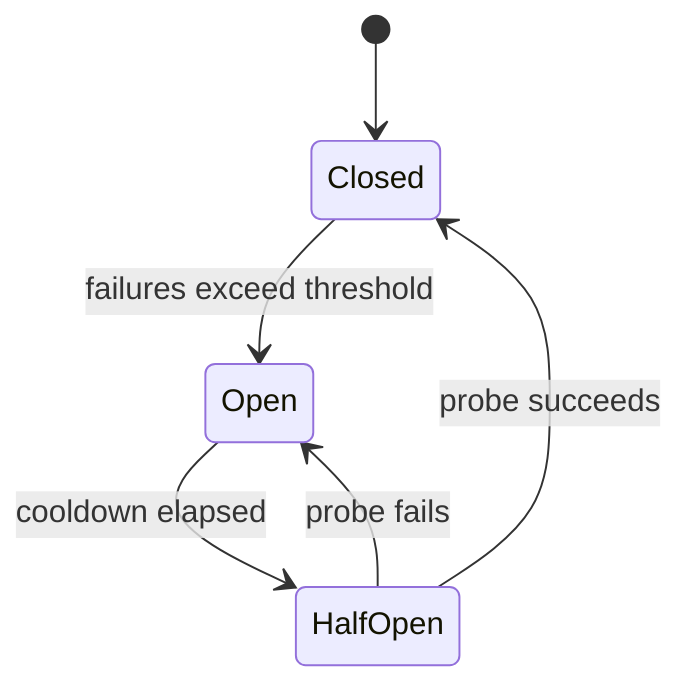
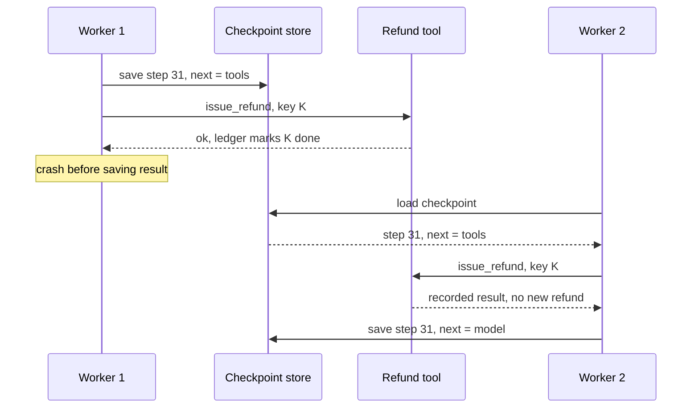
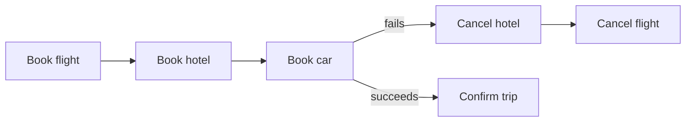

Picture a refund agent working through a customer's case. It has read the order history, checked the return policy, confirmed the item arrived back at the warehouse, and at step 31 of 40 it calls `issue_refund`. The payment goes through. Before the agent records the result, Kubernetes evicts its pod during a routine deploy. The job queue sees an unfinished task and hands it to a fresh worker, which starts over from step 1, reaches step 31 again, and refunds the customer a second time.

Nothing in that story is a model failure. The bug sits in the **harness**, the ordinary software around the model, and that is where most production agent incidents happen. This lesson builds a failure taxonomy and then works through the defenses layer by layer: retries, timeouts, idempotency, circuit breakers, fallbacks, validation, loop guards, budgets, and finally **durable execution**, which lets an agent resume after a crash without repeating its side effects.

## Why Agents Fail Differently

Unlike a millisecond-long stateless web request, an agent run is:

- **Long.** Over an hour-long run, a network blip, rate limit, deploy or OOM-kill is likely.
- **Stateful.** The conversation history *is* the agent's working memory. Lose it and you lose the progress and the money spent.
- **Side-effecting.** Re-running a refund is not harmless.
- **Nondeterministic.** A re-run step may choose different tools or arguments, so naive replay can take a different path.

Small error rates also [compound](when-to-use-agents.html): at 99% per-step reliability, a 50-step task succeeds only about 60% of the time (0.99⁵⁰ ≈ 0.605), whether the faults come from the model or the infrastructure.

> [!KEY] The big idea
> Treat every agent run as a long-lived distributed transaction that **will** be interrupted. Design so an interruption costs a retry, not a restart, and never a duplicated side effect.

## A Failure Taxonomy

Each class needs a different defense. **Loud** failures raise exceptions; **silent** ones return 200 OK and are still wrong.

| Failure class | Example | Primary defense |
|---|---|---|
| Transient API errors | 429, 500, 529 overloaded, connection reset | Retry with backoff + jitter; fallback |
| Permanent API errors | 400, 401, 403, 404 bad model ID, 413 | Fail fast; fix the request; alert |
| Tool failures | Downstream timeout, DB deadlock, sandbox crash | Tool timeout + retry; `is_error` result |
| Malformed / hallucinated args | Invented `order_id`, path outside workspace | `strict` tools; actionable errors |
| Loops & repetition | Same search 9 times; A→B→A→B | Loop detector; step budget |
| Context overflow | Window exceeded; recall degrades long before | [Context engineering](context-engineering.html) |
| Premature termination | `max_tokens` mid-tool-call; "done" too early; `refusal` | Handle every stop reason; verify |
| Wrong-but-confident | Plausible answer about the wrong customer | Verification; human review |
| Infrastructure crash | Worker OOM-killed, pod evicted | Checkpointing / durable execution |

The table runs from loud to silent, which is also the order of difficulty: retries handle the top rows almost completely, and nothing mechanical solves the bottom ones.

## Retries Done Right

### Which errors are retryable

Retry only when **waiting could change the outcome**:

| Status | Type | Retry? |
|---|---|---|
| 400 / 401 / 403 / 404 / 413 | invalid request, auth, permission, not found, too large | **No**: the request or credentials are wrong |
| 429 | `rate_limit_error` | **Yes**, honoring `retry-after`, except a spend-cap 429 |
| 500 | `api_error` | **Yes** |
| 529 | `overloaded_error` | **Yes** |
| — | Connection errors, timeouts | **Yes** |

A 429 caused by your organization's monthly **spend cap** has no `retry-after` header, and its error details name `enforced_spend_limit_reached`. Waiting won't clear it, so alert instead of retrying.

### Backoff, jitter, and one layer only

**Exponential backoff** doubles the wait after each failure (1 s, 2 s, 4 s…) up to a cap, which gives a struggling service room to recover. Backoff alone has a flaw: a thousand agents that failed together wait the same amount of time, retry together, and knock the service over again. This is the **thundering herd**. **Jitter** randomizes the delay to break that synchronization. "Full jitter" draws it uniformly from `[0, min(cap, base × 2^attempt)]`.

The Anthropic Python SDK already retries connection errors, 408, 409, 429 and ≥500 with exponential backoff (default `max_retries=2`). Problems start when teams add a wrapper around it, then a job-queue retry around that. Three layers of three attempts each make 27 attempts, and a multi-minute stall shows up as one "slow call." **Give each boundary exactly one retry owner.**

### A retry wrapper with typed exceptions

Here we disable SDK retries so this wrapper is the single owner, and add full jitter, `retry-after` handling and a total time budget:

```python
import logging
import random
import time

import anthropic

log = logging.getLogger("agent")
client = anthropic.Anthropic(
    max_retries=0,                                   # this wrapper owns retries
    timeout=anthropic.Timeout(600.0, connect=5.0),   # long reads OK; fail fast on connect
)

def is_retryable(err: Exception) -> bool:
    if isinstance(err, anthropic.APIConnectionError):  # network drop, DNS, APITimeoutError
        return True
    if isinstance(err, anthropic.APIStatusError):
        if err.status_code == 429:  # a spend-cap 429 won't clear by waiting
            return "enforced_spend_limit_reached" not in str(err.body)
        return err.status_code in (408, 409) or err.status_code >= 500  # incl. 529
    return False

def create_with_retry(*, max_attempts=6, base=1.0, cap=60.0, deadline_s=900.0, **params):
    start = time.monotonic()
    for attempt in range(max_attempts):
        try:
            return client.messages.create(**params)
        except Exception as err:
            if not is_retryable(err) or attempt == max_attempts - 1:
                raise  # permanent errors propagate immediately
            delay = random.uniform(0, min(cap, base * 2**attempt))  # full jitter
            response = getattr(err, "response", None)  # only status errors carry one
            if response is not None and (hint := response.headers.get("retry-after")):
                delay = max(delay, float(hint))
            if time.monotonic() - start + delay > deadline_s:
                raise  # respect the task's time budget, not just the attempt count
            log.warning("attempt %d failed (%s); retry in %.1fs", attempt + 1, err, delay)
            time.sleep(delay)
```

Log every retry: a rising retry rate in your [observability](observability.html) dashboards is often the first sign of an incident.

### Timeouts everywhere

A hung agent is worse than a failed one, because nothing alerts on it. The SDK's default request timeout is a generous 10 minutes, since deep-thinking responses can take minutes. **Stream** long generations so stalls show up as gaps between chunks, give **every tool** a timeout sized to it, and give the **whole task** a deadline. Treat a timeout as *ambiguous*: a timed-out `issue_refund` may have succeeded on the far side.

## Idempotency for Side-Effecting Tools

An operation is **idempotent** if doing it twice has the same effect as doing it once. `set_ticket_status(42, "closed")` is. `send_email` and `charge_card` are not. Retries and crash recovery give **at-least-once** execution (when unsure whether an action happened, do it again). Combined with idempotent operations, that yields **effectively-once** behavior.

The standard tool is an **idempotency key** identifying the *intent* to act. The first execution records the key and result, and repeats return the recorded result. Payment APIs like Stripe accept keys natively. For your own tools, a small ledger works:

```python
import hashlib
import json
import sqlite3

db = sqlite3.connect("side_effects.db", isolation_level=None)  # autocommit
db.execute("CREATE TABLE IF NOT EXISTS effects (key TEXT PRIMARY KEY, status TEXT, result TEXT)")

def idempotency_key(run_id: str, action: str, **intent) -> str:
    # Key on WHAT we're doing, not on tool_use.id: after a crash the model may
    # re-plan and emit the same logical call with a brand-new id.
    payload = json.dumps({"run": run_id, "action": action, **intent}, sort_keys=True)
    return hashlib.sha256(payload.encode()).hexdigest()

def issue_refund(run_id: str, order_id: str, amount_cents: int) -> str:
    key = idempotency_key(run_id, "refund", order_id=order_id)  # one refund per order per run
    row = db.execute("SELECT status, result FROM effects WHERE key = ?", (key,)).fetchone()
    if row and row[0] == "done":
        return row[1]  # already happened: return the recorded outcome
    if row is None:
        db.execute("INSERT INTO effects (key, status) VALUES (?, 'pending')", (key,))
    # `payments` stands in for your provider's client. Passing the SAME key downstream
    # closes the window between "provider refunded" and "we recorded done".
    result = payments.refund(order_id, amount_cents, idempotency_key=key)
    db.execute("UPDATE effects SET status = 'done', result = ? WHERE key = ?",
               (json.dumps(result), key))
    return json.dumps(result)
```

The decision that matters is **what goes into the key**. This key covers `(run, action, order_id)` and deliberately leaves out the amount, which encodes the business rule "one refund per order per run." Keys built from `tool_use_id` are too narrow, because a resumed model emits new IDs. Keys built from a fresh random UUID per call are useless, because every retry looks new.

> [!TIP] Rule of thumb
> Classify every tool as **read-only**, **naturally idempotent**, or **unsafe**, and record the label next to the tool definition so the harness can enforce it. Unsafe tools need an idempotency key, and often a [human approval](human-in-the-loop.html) gate as well.

## Containing Failure: Breakers, Fallbacks, Degradation

Retries handle short blips. When a dependency is down for minutes, retries make things worse: every agent hammers the failing service and burns its budget waiting.

### Circuit breakers

A **circuit breaker** tracks a dependency's recent failures. Once failures pass a threshold it **opens**, and calls fail immediately for a cooldown period. After the cooldown, one probe request is allowed through:



Put breakers around **tools**, not only the model API. When the CRM is down, an open breaker makes `crm_lookup` return an immediate `is_error` result ("CRM unavailable; proceed without account history or escalate") that the model can act on, instead of a 30-second timeout on every step.

### Model fallbacks

When the primary model returns persistent 529s, a **fallback** sends work to another model in the family, or to the same model on another platform (Amazon Bedrock, Google Cloud). The costs are real. **Prompt caches are model-scoped**, so a mid-conversation switch re-bills the whole history at full price. **Thinking blocks are tied to the producing model** on current Claude models, so earlier reasoning may be lost. And the fallback has **different capabilities**, so put it through your evals. Where possible, fall back at **task boundaries** by starting *new* tasks on the fallback.

### Graceful degradation and escalation

Design an explicit ladder so the system has more states than "works" and "crashed":

1. **Retry** transient errors.
2. **Fall back** to an alternative model or tool.
3. **Degrade** to reduced capability: read-only mode, drafts for human review instead of executed actions.
4. **Escalate** to a human with full context: what was tried, what failed, the partial results.
5. **Fail clearly** with a precise status (`budget_exhausted`, `tool_unavailable:crm`). Never fail with a confident fabrication.

## Validating Inputs and Outputs

**Tool inputs** can be *malformed* (wrong types, missing fields) or *hallucinated* (a well-formed `order_id` that doesn't exist). Defend syntactically with `"strict": True` tools ([structured outputs](structured-outputs.html)), then semantically in code: IDs exist, amounts are within policy, paths stay in the workspace, the user may touch the resource ([guardrails and sandboxing](guardrails-and-sandboxing.html)). On failure, return an **actionable** result such as `"No order 'A-991'. Use search_orders to find the ID."` with `is_error: true`. The model usually self-corrects. Cap the repairs: three straight failures signal deeper confusion.

**Outputs** fail most dangerously as **wrong-but-confident** results. The defenses, roughly from strongest to weakest:

1. **Ground-truth checks**: run the tests, re-read the record after the write, query the balance after the transfer.
2. **Invariant validators in code**: totals sum correctly, every claim cites a retrieved source, the output parses against its schema.
3. **A separate verifier pass**, ideally with a different prompt or model. This is the evaluator-optimizer pattern from [workflow patterns](workflow-patterns.html).
4. **Self-reflection** ("double-check your answer"). It's cheap, but models often confirm their own mistakes.

> [!WARNING]
> Watch for agents that "verify" by changing the check. A coding agent stuck on a failing test may edit the test. Keep verification artifacts out of the agent's write scope, or diff them before accepting the result.

## Guarding the Loop: Stop Reasons, Repetition, Budgets

**Handle every stop reason.** Many premature terminations happen because the harness ignores a `stop_reason` it didn't expect:

| `stop_reason` | Correct handling |
|---|---|
| `tool_use` | Execute; send all results back in one user message |
| `end_turn` | Run completion checks before declaring success |
| `max_tokens` | Output was cut off. A trailing `tool_use` may be incomplete, so **don't execute it**. Retry with a larger limit or count it as a failed attempt |
| `pause_turn` | A server-side tool loop paused; send the conversation back as-is |
| `refusal` | Don't retry blindly; route to a fallback or a human |

**Detect loops.** Fingerprint each call as `hash(tool_name, canonical_json(args))`: three identical fingerprints in a window is a loop, and alternating ones (A, B, A, B) are oscillation. Where state is observable (files changed, tests passing), N steps without change is *no progress*. On first detection, **nudge** with a text block after the tool results ("You've run this identical search three times; try something different"). On the second, **stop** and escalate.

**Enforce budgets** on four axes, checked before every model call: **steps** (set from the p99 of successful runs, plus margin), **tokens** (summed from `usage`), **wall-clock time** (a product requirement), and **dollars** (usage × price, the unit finance cares about; see [cost and latency](cost-and-latency.html)). When a budget runs out, end with an explicit status and save the partial work.

## Checkpointing and Durable Execution

The refund agent needed two fixes. **Checkpoint** state after every step so a new worker can resume where the old one stopped. Make side effects **idempotent** so the one step that does repeat is harmless.



### A checkpointed loop persisted to disk

This loop saves its full state atomically after every transition. Re-run it with the same `run_id` after a crash and it resumes. It reuses `create_with_retry`; `run_tool(block, run_id)` is your dispatcher, which validates inputs, applies timeouts, routes unsafe tools through the ledger, and returns a `tool_result` dict.

```python
import json
import os
from pathlib import Path

CKPT = Path("checkpoints")

def save(state: dict) -> None:
    path = CKPT / f"{state['run_id']}.json"
    tmp = path.with_suffix(".tmp")
    tmp.write_text(json.dumps(state))
    os.replace(tmp, path)  # atomic rename: never a half-written checkpoint

def run(run_id: str, task: str, max_steps: int = 40, max_usd: float = 5.0) -> dict:
    CKPT.mkdir(exist_ok=True)
    path = CKPT / f"{run_id}.json"
    state = json.loads(path.read_text()) if path.exists() else {
        "run_id": run_id, "status": "running", "next": "model", "step": 0,
        "usd": 0.0, "resumes": -1, "messages": [{"role": "user", "content": task}]}
    state["resumes"] += 1
    if state["resumes"] > 3:
        state["status"] = "poison"  # crashes every time it runs: quarantine for a human
    save(state)  # persist the resume count BEFORE work that might crash again
    while state["status"] == "running":
        if state["next"] == "tools":  # also the resume point after a mid-tool crash
            calls = [b for b in state["messages"][-1]["content"] if b["type"] == "tool_use"]
            state["messages"].append(
                {"role": "user", "content": [run_tool(b, run_id) for b in calls]})
            state["next"] = "model"
        elif state["step"] >= max_steps or state["usd"] >= max_usd:
            state["status"] = "budget_exhausted"
        else:
            resp = create_with_retry(model="claude-opus-5-5", max_tokens=16000,
                                     system=SYSTEM, tools=TOOLS, messages=state["messages"])
            state["step"] += 1
            state["usd"] += cost_usd(resp.usage)  # usage x price table (see cost lesson)
            state["messages"].append({"role": "assistant", "content": [
                b.model_dump(mode="json", exclude_none=True) for b in resp.content]})
            match resp.stop_reason:
                case "tool_use": state["next"] = "tools"
                case "pause_turn": pass  # server tool paused: call again with history as-is
                case "end_turn": state["status"] = "done"
                case "max_tokens": state["status"] = "truncated"  # never run partial tool calls
                case other: state["status"] = f"stopped:{other}"  # e.g. refusal
        save(state)
    return state
```

Properties worth noticing:

- **The step is the unit of atomicity.** A crash between the model's reply and `save` repeats that one model call on resume, at the cost of a few cents and possibly a different reply. Side effects happen only in the `tools` branch, behind the ledger, so a repeated step is safe.
- **`resumes` catches poison tasks**, like one whose huge tool output OOM-kills every worker.
- **Assistant content is stored exactly as returned**: current models need thinking blocks passed back unchanged, and append-only history keeps the cache warm.
- **In production**, use a database row with a version column (so two workers can't resume one run) and a lease or heartbeat (so a dead worker's runs get reassigned).

### Durable execution engines

What you just built by hand is a small version of **durable execution**: a programming model in which a function's progress is journaled automatically, so the function survives crashes, restarts and deploys and continues exactly where it stopped.

| Engine | Programming model | Where state lives |
|---|---|---|
| **Temporal** | Deterministic *workflows* orchestrate *activities* (side effects) with retry policies | Temporal cluster's event history |
| **Restate** | Durable handlers whose steps are journaled | Restate server's log |
| **DBOS** | `@DBOS.workflow()` functions composed of `@DBOS.step()` calls | Your Postgres database |
| **Inngest** | Event-triggered functions built from `step.run` blocks | Inngest service |
| **LangGraph checkpointers** | Graph state saved after each node, keyed by `thread_id` | SQLite, Postgres, etc. |

The mechanism is the same in all of them. Each step's **result is recorded**. On recovery the function **replays**: completed steps return their recorded results instantly, and execution goes live again at the first unrecorded step. For agents, the model call and each tool call become steps (activities, in Temporal's terms). Replay then reuses recorded model outputs, so recovery neither re-bills the model nor lets it wander down a different path through steps it already completed.

Three rules carry over to every engine:

- **Orchestration code must be deterministic.** No network calls, clocks or random numbers outside recorded steps, because replay must take the same path.
- **Steps still run at least once.** A worker can die after acting but before recording, so idempotency remains your job. Durable execution removes *restart from scratch*. It does not remove *tolerate a repeat*.
- **Keep the journal small and the retries single-owner.** Store large tool outputs in blob storage and journal a reference. Disable SDK retries inside steps and let the engine's retry policy own them, with permanent errors marked non-retryable.

### Sagas and compensation

Some tasks span systems that share no transaction, such as booking a flight, then a hotel, then a car. If the car fails, you can't roll back the first two the way a database would. A **saga** pairs each step with a **compensating action** that semantically undoes it, and runs the compensations in reverse when a later step fails:



Record each completed step and its compensation in the checkpoint so a crash *during* unwinding can resume, and make compensations idempotent too. Put **irreversible** steps (you can't unsend an email) **last**, behind validation or approval. Let **code** run compensations: the model may decide *that* the plan failed, but unwinding should be deterministic.

## Testing Reliability

Untested reliability features fail the first time production needs them. From cheapest to most realistic:

- **Recorded fixtures.** Record real API responses once (VCR-style) and replay them in unit tests, so harness logic (stop reasons, resume, budgets, loop detection) is deterministic and free to test. The model itself is your [eval suite](evaluating-agents.html)'s job.
- **Fault injection.** Wrap tools in a decorator that randomly raises connection errors, times out, or returns truncated JSON, and use a mock HTTP transport to serve 429s and 529s with `retry-after`. Run the evals with faults on: success should degrade gracefully, not collapse.
- **Chaos experiments.** Kill the worker (`kill -9`) at random steps while tasks run against sandboxed copies of real systems. Then assert that every task reaches a terminal state, that the side-effect ledger shows **exactly one** execution per intent, and that outcomes match uninterrupted runs.

Track reliability metrics beside quality: success rate, recovery rate under faults, retries per task, budget-exhaustion and escalation rates, and **duplicate side effects (always zero)**.

## Key Takeaways

- Agents are long-running, stateful, side-effecting and nondeterministic: design for interruption. Retry only what waiting can fix (429 except spend caps, 5xx including 529, connection errors), using backoff plus full jitter, honoring `retry-after`, with one retry owner per boundary.
- Idempotency keys built from the *intent*, not a `tool_use_id` or a random UUID, turn at-least-once execution into effectively-once side effects.
- Circuit breakers, fallbacks and a degradation ladder keep partial outages from becoming total ones. Model fallbacks cost you the cache, so switch at task boundaries.
- Validate tool inputs syntactically and semantically, return actionable `is_error` results, and verify outputs against ground truth.
- Handle every stop reason, fingerprint calls to catch loops, and enforce step, token, time and dollar budgets.
- Checkpointing and durable execution let agents resume after crashes. Idempotency makes the one repeated step safe, and sagas unwind multi-system work. Prove it all with fault injection and chaos tests.

## Exercises

1. **Classify.** For tools `search_kb`, `get_order`, `update_shipping_address`, `send_email` and `issue_refund`, label each read-only, naturally idempotent or unsafe, and design an idempotency key for each unsafe one.
2. **Retry math.** A service stacks the SDK's default retries, a 5-attempt wrapper, and a job queue that retries 3 times. Compute worst-case API attempts per model call, then redesign with one owner.
3. **Loop detector.** Add a `LoopDetector` to the checkpointed loop that fingerprints `(name, json.dumps(input, sort_keys=True))`. Nudge on the third identical call and set `status = "looping"` on the fifth. Test it with a fake search tool that always returns "no results."
4. **Crash test.** Give a mutating tool a 20% chance of calling `os._exit(1)`, and restart the process until the run completes. Use the ledger to verify that every refund happened exactly once. Then remove the ledger and observe the duplicates.
5. **Saga design.** An agent provisions a cloud project, a database, a DNS record and a welcome email. Specify the compensations, the irreversible steps, where approval goes, and what the checkpoint holds to resume mid-unwind.

<details class="solutions">
<summary>Hints and solution sketches</summary>

1. **Hint:** Ask "what happens if this runs twice?" If nothing changes, it's read-only or naturally idempotent. If the world changes twice, it's unsafe. Then key the unsafe ones on the business *intent*, not on `tool_use_id`.

    **Sketch:** `search_kb` and `get_order` are **read-only**. `update_shipping_address(order_id, address)` is **naturally idempotent**: setting the same address twice leaves the same state (watch for side effects such as a notification email on every update, which would make it unsafe). `send_email` is **unsafe**: key it on `(run_id, "send_email", recipient, purpose or ticket_id)`, deliberately leaving out the body, because a resumed model re-words the email. `issue_refund` is **unsafe**: key on `(run_id, "refund", order_id)` as in the lesson, or drop `run_id` if the rule is "one refund per order, ever." Both unsafe tools are candidates for an approval gate.

2. **Hint:** Layers multiply: attempts per layer = 1 + retries.

    **Sketch:** The SDK makes 1 + 2 = 3 attempts per call, the wrapper makes 5 SDK calls, and a queue that retries 3 times runs the job 1 + 3 = 4 times. Worst case: 3 × 5 × 4 = **60 API attempts** per model call (45 if you read "retries 3 times" as 3 runs in total), and each queue retry may also repeat every earlier step of the task. Redesign: `max_retries=0` on the client, one wrapper like `create_with_retry` as the only retry owner (full jitter, `retry-after`, a total deadline), and a queue that only re-delivers after a worker crash, resuming from the checkpoint rather than restarting. Permanent errors go to a dead-letter queue instead of being retried. Worst case is now the wrapper's 6 attempts.

3. **Hint:** Fingerprint from `state["messages"]` rather than an in-memory counter, so the detector still works after a resume. To test harness logic deterministically, script the fake model to repeat the same call; a real model may reword the query.

    **Sketch:** In the `tools` branch, call `verdict(state["messages"])` before running the tools. On `"looping"`, set `state["status"] = "looping"` and stop. On `"nudge"`, run the tools and append a text block after the tool results ("You've run this identical search three times; try a different query or report that nothing was found").

    ```python
    import json
    from collections import Counter

    class LoopDetector:
        def __init__(self, nudge_at: int = 3, stop_at: int = 5):
            self.nudge_at, self.stop_at = nudge_at, stop_at

        def verdict(self, messages: list) -> str | None:
            counts = Counter((b["name"], json.dumps(b["input"], sort_keys=True))
                             for m in messages if m["role"] == "assistant"
                             for b in m["content"] if b["type"] == "tool_use")
            worst = max(counts.values(), default=0)
            if worst >= self.stop_at:
                return "looping"
            return "nudge" if worst >= self.nudge_at else None
    ```

4. **Hint:** The dangerous window is *after* the provider acts but *before* the ledger and checkpoint record it, so put an `os._exit(1)` there. Make the fake payment provider log every real refund and honor idempotency keys, as Stripe does.

    **Sketch:** Drive it with `until python agent.py --run-id crash-1; do echo restarting; done`, and raise the `resumes > 3` poison limit for the test, or the run will likely be quarantined. Afterwards, `SELECT order_id, COUNT(*) FROM provider_refunds GROUP BY order_id HAVING COUNT(*) > 1` must return nothing, and every ledger key should be `done`. Then call the provider without the ledger and key: any crash after a refund but before the checkpoint saves the tool results makes the resumed worker re-run the whole `tools` branch, and duplicate refunds appear within a few runs.

    ```python
    import os
    import random
    import sqlite3

    pdb = sqlite3.connect("provider.db", isolation_level=None)
    pdb.execute("CREATE TABLE IF NOT EXISTS provider_refunds (key TEXT UNIQUE, order_id TEXT, cents INT)")

    def refund(order_id: str, amount_cents: int, idempotency_key: str | None = None) -> dict:
        key = idempotency_key or os.urandom(8).hex()  # no key: every call looks new
        pdb.execute("INSERT OR IGNORE INTO provider_refunds VALUES (?, ?, ?)",
                    (key, order_id, amount_cents))
        if random.random() < 0.2:
            os._exit(1)  # crash after the money moved, before anyone recorded it
        return {"order_id": order_id, "status": "refunded"}
    ```

5. **Hint:** Order the steps so the irreversible one comes last, and make every compensation "delete if it exists," so treating "already gone" as success keeps it idempotent.

    **Sketch:** Forward order: create project → create database → create DNS record → health checks (DB reachable, DNS resolves) → welcome email. Compensations, run in reverse: delete the DNS record (resolvers may cache it until its TTL expires), delete the database (snapshot first if it might hold data; respect deletion protection), delete the project. The **email is irreversible**, so it goes last, after validation. Its only "compensation" is a follow-up message. Approval goes before provisioning if cost or quota is significant, and before any compensation that destroys data. Create resources under deterministic names or idempotency keys derived from the request, so a crash between "created" and "recorded" can find the resource instead of orphaning it. The checkpoint holds the saga ID, the phase (`forward` or `unwinding`), each completed step with the resource IDs it returned and its compensation, which compensations have finished, and the failure cause. That is enough for a new worker to continue the unwind exactly where it stopped.

</details>

## Check Your Understanding

```quiz
Q: An agent's Messages API call fails with a 400 invalid_request_error. What should the harness do?
- [ ] Retry once after a short delay, since a 400 can follow a brief API-side glitch
- [ ] Switch to a fallback model and resend, since the primary may reject this input
- [x] Fail fast without retrying, log the request, and fix whatever produced it
- [ ] Back off for the retry-after duration, then resend the identical request
E: A 400 means the request itself is wrong, so resending it (to the same model or after any wait) gets the same answer, and a 400 carries no retry-after. Retry 429s (except spend-cap 429s), 5xx errors including 529, and connection errors.

Q: Why add jitter to exponential backoff?
- [ ] It gives the overloaded service a longer average pause before each retry
- [x] It desynchronizes clients that failed together so they don't retry in lockstep
- [ ] It lets a client skip the remaining backoff when a retry-after header arrives
- [ ] It lowers the number of attempts each client needs before a request succeeds
E: Without jitter, clients that failed at the same moment retry at the same moment and can overload the service again: the thundering herd. Full jitter actually shortens the average wait; its value is spreading retries out, not lengthening or reducing them.

Q: A refund tool's idempotency key is the model's tool_use_id. What goes wrong after a crash and resume?
- [ ] Nothing, because the resumed run replays the same tool_use_id from the checkpoint
- [x] A re-planned refund arrives under a new tool_use_id, so the ledger refunds again
- [ ] The key collides across runs, so a second customer's refund is wrongly skipped
- [ ] The API rejects the resumed request because the tool_use_id was already used
E: If the crash came before the assistant turn was saved, the model is called again and a re-planned call gets a fresh ID. Keys should identify the business intent (run + action + order) so a logically repeated action is recognized. tool_use_ids are unique, so collisions aren't the problem.

Q: Your agent runs on a durable execution engine such as Temporal. Which statement is true?
- [ ] Tools no longer need idempotency, since the engine records each completed activity
- [x] Completed steps replay from the journal, but a step can still run more than once
- [ ] Workflow code may call the model API directly, since replay reuses the response
- [ ] Model generations become deterministic, since the engine fixes the random seed
E: A worker can die after acting but before recording, so steps are at-least-once and side-effecting tools still need idempotency. Model calls belong in recorded activities, not in deterministic workflow code, and nothing makes the model itself deterministic.

Q: A response has stop_reason "max_tokens" and ends with a tool_use block. What's the safest handling?
- [ ] Run the tool if its input passes schema validation, since that shows it's complete
- [x] Don't run it, since its input may be cut off; retry with a higher limit or fail
- [ ] Send a user message saying "continue" so the model finishes the tool call input
- [ ] Run the tool, but return is_error so the model double-checks the arguments
E: The output was cut off, so the tool input may be incomplete. A truncated input can still be schema-valid (a cut-short path or amount), and running it even with an error flag still executes the side effect.

Q: Which defense is strongest against wrong-but-confident results?
- [ ] Asking the model to re-check its own answer before it reports the result
- [ ] Raising the effort setting so the model reasons longer before answering
- [x] Checking against ground truth, such as re-reading the record after a write
- [ ] Having the same model grade its output against a detailed rubric afterward
E: Self-reflection and self-grading reuse the same judgment that made the mistake, and more reasoning still can't see facts it doesn't have. Ground-truth checks are independent of the model.
```

## Further Reading

- [Exponential Backoff and Jitter (AWS Architecture Blog)](https://aws.amazon.com/blogs/architecture/exponential-backoff-and-jitter/): the classic simulation-backed comparison of jitter strategies.
- [CircuitBreaker (Martin Fowler)](https://martinfowler.com/bliki/CircuitBreaker.html): the clearest short explanation of the pattern.
- [Designing robust and predictable APIs with idempotency (Stripe)](https://stripe.com/blog/idempotency): idempotency keys, retries and failure windows from a payments company.
- [Saga pattern (microservices.io)](https://microservices.io/patterns/data/saga.html): compensating transactions, orchestrated and choreographed.
- [Temporal documentation](https://docs.temporal.io/): workflows, activities, retry policies and the determinism rules behind durable execution.
- [LangGraph (GitHub)](https://github.com/langchain-ai/langgraph): see its persistence and checkpointer docs for thread-based resume and human interrupts.
- [Claude API errors](https://platform.claude.com/docs/en/api/errors) and [rate limits](https://platform.claude.com/docs/en/api/rate-limits): authoritative error types, retryability and rate-limit headers.
