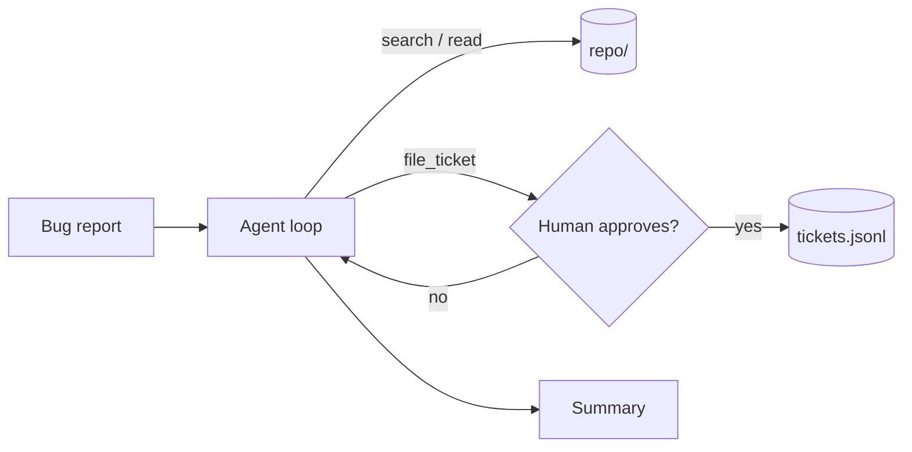

Reading framework comparisons only gets you so far. The differences that matter (how much loop you own, where state lives, how a human approves a risky action, what a trace looks like) only become clear when you build the *same* agent in each and feel where the seams are.

This lesson does exactly that. We define one small but realistic agent, a **repo triage agent** that investigates a bug report in a codebase and files a ticket, then build it four times: with the **Anthropic Tool Runner**, the **Claude Agent SDK**, the **OpenAI Agents SDK**, and **LangGraph**. Each version satisfies the same spec, so the diffs between them *are* the lesson.

> [!WARNING] APIs drift
> Every snippet here was checked against the official documentation and the installed packages in November 2026: `anthropic` 2.12, `claude-agent-sdk` 0.2.172, `openai-agents` 0.25, `langgraph` 1.2 with `langchain` 1.5. These libraries ship often, and several are pre-1.0. Treat the code as a map of the concepts, and check the current docs before you copy it into production.

## The Spec

The agent receives a report such as "Uploads sometimes hang forever. Why?" and must:

1. **Investigate read-only**: search and read the repository; never modify it.
2. **Use one custom tool with a side effect**: `file_ticket(title, body, severity)`, which writes to a ticket store.
3. **Gate the side effect** behind human approval; a declined ticket must not be retried.
4. **Stay bounded**: a step limit (and a cost cap where the SDK supports one).
5. **Be observable**: show which tools ran.

The tool *logic* is plain Python shared by every version, so each framework section shows only the framework:

```python
"""repo_tools.py: plain-Python tool logic shared by every framework version."""
import json
import re
import time
from pathlib import Path

REPO = Path("./repo").resolve()          # the codebase the agent may read
TICKETS = Path("./tickets.jsonl")        # where "filed" tickets go


def _safe(path: str) -> Path:
    p = (REPO / path).resolve()
    if not p.is_relative_to(REPO):
        raise ValueError(f"{path!r} is outside the repository")
    return p


def search_code(pattern: str, max_hits: int = 50) -> str:
    """Regex search over the repo's text files; returns 'path:line: text' lines."""
    rx, hits = re.compile(pattern), []
    for f in sorted(REPO.rglob("*.py")):
        for n, line in enumerate(f.read_text(errors="replace").splitlines(), 1):
            if rx.search(line):
                hits.append(f"{f.relative_to(REPO)}:{n}: {line.strip()}")
                if len(hits) >= max_hits:
                    return "\n".join(hits + ["... (more hits truncated)"])
    return "\n".join(hits) or "No matches."


def read_file(path: str) -> str:
    return _safe(path).read_text(errors="replace")[:20_000]


def file_ticket(title: str, body: str, severity: str) -> str:
    ticket = {"id": f"TKT-{int(time.time())}", "title": title, "body": body, "severity": severity}
    with TICKETS.open("a") as f:
        f.write(json.dumps(ticket) + "\n")
    return f"Filed {ticket['id']}"
```



## (a) Anthropic Tool Runner

The baseline is the SDK helper you met in [Build an Agent From Scratch](build-agent-from-scratch.html): plain functions decorated with `@beta_tool`, and a runner that owns the loop.

```python
from typing import Literal

import anthropic
from anthropic import beta_tool
from anthropic.lib.tools import ToolError

import repo_tools

SYSTEM = (
    "You are a repository triage agent. Investigate the user's report by searching and reading "
    "the code (read-only). If you find a real defect, file exactly one ticket with file_ticket, "
    "citing file paths and line numbers. Finish with a 3-5 sentence summary."
)
client = anthropic.Anthropic()


@beta_tool
def search_code(pattern: str) -> str:
    """Regex-search the repository's Python files. Use this first to locate relevant code.

    Args:
        pattern: A Python regular expression, e.g. 'def retry|backoff'.
    """
    return repo_tools.search_code(pattern)


@beta_tool
def read_file(path: str) -> str:
    """Read a file from the repository.

    Args:
        path: Path relative to the repository root.
    """
    try:
        return repo_tools.read_file(path)
    except (ValueError, OSError) as e:
        raise ToolError(f"Cannot read {path}: {e}")  # becomes an is_error tool_result


@beta_tool
def file_ticket(title: str, body: str, severity: Literal["low", "medium", "high"]) -> str:
    """File a bug ticket. Call at most once, only for a confirmed defect. Requires human approval.

    Args:
        title: One-line summary.
        body: Evidence (file:line references), impact and a suggested fix.
        severity: Impact level.
    """
    if input(f"\nFile ticket '{title}' ({severity})? [y/N] ").strip().lower() != "y":
        raise ToolError("A human declined to file this ticket. Do not retry; summarize instead.")
    return repo_tools.file_ticket(title, body, severity)


runner = client.beta.messages.tool_runner(
    model="claude-opus-5-5",
    max_tokens=16000,
    system=SYSTEM,
    tools=[search_code, read_file, file_ticket],
    messages=[{"role": "user", "content": "Uploads sometimes hang forever. Why?"}],
    max_iterations=20,
)
for message in runner:                       # each yielded item is one model response
    for block in message.content:
        if block.type == "tool_use":
            print(f"-> {block.name}({block.input})")   # tracing, minimal edition
        elif block.type == "text":
            print(block.text)
print("stop_reason:", message.stop_reason, "| usage:", message.usage.output_tokens, "output tokens")
```

**What you get:** schemas inferred from type hints and docstring `Args:` (the `Literal` becomes an `enum`), the tool loop with correct `tool_use_id` matching, exceptions mapped to `is_error` results, and a `max_iterations` cap. **What you still own:** the read tools themselves, the approval prompt (inside `file_ticket`), the conversation history across user turns, tracing beyond printing, and persistence. It runs anywhere Python runs and is the thinnest layer over the Messages API, so nothing is hidden.

## (b) Claude Agent SDK

The **Claude Agent SDK** (`pip install claude-agent-sdk`, Python and TypeScript) packages the harness behind Claude Code as a library. The Python package bundles the Claude Code CLI and drives it as a subprocess, so you inherit its agent loop, its built-in tools (`Read`, `Write`, `Edit`, `Bash`, `Grep`, `Glob`, `WebSearch`, `WebFetch` and more), context compaction, sessions, permissions, hooks and subagents. Authenticate with `ANTHROPIC_API_KEY` (cloud-provider credentials are also supported).

The smallest useful program needs no custom code at all:

```python
import asyncio
from claude_agent_sdk import ClaudeAgentOptions, ResultMessage, query

async def main() -> None:
    options = ClaudeAgentOptions(
        cwd="./repo",
        allowed_tools=["Read", "Grep", "Glob"],   # pre-approved
        permission_mode="dontAsk",                # anything else is denied, never prompted
    )
    async for message in query(prompt="Uploads sometimes hang forever. Why?", options=options):
        if isinstance(message, ResultMessage):
            print(message.result)

asyncio.run(main())
```

Because search and file reading are built in, the triage spec reduces to adding the ticket tool, policy and limits:

```python
import asyncio
import json
from typing import Any

from claude_agent_sdk import (
    AgentDefinition,
    AssistantMessage,
    ClaudeAgentOptions,
    ClaudeSDKClient,
    HookMatcher,
    PermissionResultAllow,
    PermissionResultDeny,
    ResultMessage,
    TextBlock,
    ToolUseBlock,
    create_sdk_mcp_server,
    tool,
)

import repo_tools

SYSTEM = (
    "You are a repository triage agent. Investigate the user's report by searching and reading "
    "the code (read-only). Delegate broad searches to the code-explorer subagent. If you find a real "
    "defect, file exactly one ticket with file_ticket, citing file paths and line numbers. "
    "Finish with a 3-5 sentence summary."
)


# 1. The one custom tool, served by an in-process MCP server.
@tool(
    "file_ticket",
    "File a bug ticket. Call at most once, only for a confirmed defect.",
    {
        "type": "object",
        "properties": {
            "title": {"type": "string"},
            "body": {"type": "string", "description": "Evidence (file:line), impact, suggested fix"},
            "severity": {"type": "string", "enum": ["low", "medium", "high"]},
        },
        "required": ["title", "body", "severity"],
    },
)
async def file_ticket(args: dict[str, Any]) -> dict[str, Any]:
    receipt = repo_tools.file_ticket(args["title"], args["body"], args["severity"])  # "Filed TKT-..."
    return {"content": [{"type": "text", "text": receipt}]}


tickets_server = create_sdk_mcp_server(name="tickets", version="1.0.0", tools=[file_ticket])


# 2. Hooks: deterministic policy and tracing around every tool call.
async def block_secret_files(input_data, tool_use_id, context):
    path = input_data["tool_input"].get("file_path", "")
    if path.endswith((".env", ".pem", "id_rsa")):
        return {
            "hookSpecificOutput": {
                "hookEventName": input_data["hook_event_name"],
                "permissionDecision": "deny",
                "permissionDecisionReason": "Secret files are off-limits.",
            }
        }
    return {}


async def audit_log(input_data, tool_use_id, context):
    print(f"[audit] {input_data['tool_name']} {json.dumps(input_data['tool_input'])[:120]}")
    return {}


# 3. Human approval for anything not pre-approved (here: only file_ticket).
async def approve(tool_name: str, tool_input: dict, context) -> PermissionResultAllow | PermissionResultDeny:
    print(f"\n{tool_name} wants to run with:\n{json.dumps(tool_input, indent=2)}")
    if input("Allow? [y/N] ").strip().lower() == "y":
        return PermissionResultAllow(updated_input=tool_input)
    return PermissionResultDeny(message="A human declined. Do not retry; summarize instead.")


options = ClaudeAgentOptions(
    model="claude-opus-5-5",
    cwd="./repo",                                   # the agent's working directory
    system_prompt=SYSTEM,
    tools=["Read", "Grep", "Glob", "Agent"],        # built-ins that exist at all (no Bash/Edit/Write)
    allowed_tools=["Read", "Grep", "Glob", "Agent"],  # pre-approved; file_ticket is NOT -> approve()
    mcp_servers={"tickets": tickets_server},        # exposes mcp__tickets__file_ticket
    can_use_tool=approve,
    permission_mode="default",
    agents={
        "code-explorer": AgentDefinition(
            description="Read-only code search specialist. Use for broad 'where is X handled?' questions.",
            prompt="Find the code relevant to the question. Report file:line references and a short explanation.",
            tools=["Read", "Grep", "Glob"],
            model="haiku",                          # cheaper model for the grunt work
        )
    },
    hooks={
        "PreToolUse": [HookMatcher(matcher="Read", hooks=[block_secret_files])],
        "PostToolUse": [HookMatcher(hooks=[audit_log])],
    },
    max_turns=30,
    max_budget_usd=2.00,
)


async def main() -> None:
    async with ClaudeSDKClient(options=options) as client:   # one session, multi-turn
        await client.query("Uploads sometimes hang forever. Why?")
        async for msg in client.receive_response():
            if isinstance(msg, AssistantMessage):
                for block in msg.content:
                    if isinstance(block, TextBlock):
                        print(block.text)
                    elif isinstance(block, ToolUseBlock):
                        print(f"-> {block.name}")
            elif isinstance(msg, ResultMessage):
                print(f"[{msg.subtype}] turns={msg.num_turns} cost=${msg.total_cost_usd or 0:.4f}")


asyncio.run(main())
```

The key ideas, mapped to the code:

- **Two tool layers.** `tools` decides which built-ins *exist* in the agent's context (here no `Bash`, `Edit` or `Write`, so the agent is read-only by construction). `allowed_tools` decides which calls are *pre-approved*. Anything else goes through the permission flow and, finally, your `can_use_tool` callback, which is where our human approves the ticket.
- **Custom tools are MCP tools.** `@tool` plus `create_sdk_mcp_server` runs an MCP server *in your process*. Tools are addressed as `mcp__{server}__{tool}`, so the ticket tool is `mcp__tickets__file_ticket`; that is the name to use in `allowed_tools`, hook matchers or deny rules. Return `"is_error": True` in the result to report a failure.
- **Hooks are deterministic policy.** A `PreToolUse` hook can deny, allow, or rewrite a call (`updatedInput`); `PostToolUse` sees results (good for audit logs). Unlike a system-prompt instruction, a hook cannot be talked out of its decision by a prompt injection.
- **Permission modes** set the default posture: `default` (ask for anything not pre-approved), `acceptEdits` (auto-approve file edits), `plan` (explore and plan, no execution), `dontAsk` (deny anything not pre-approved, never prompt), `bypassPermissions` (allow everything; sandboxed environments only) and `auto` (a model-based classifier approves or denies).
- **Subagents** (`agents=`) get their own context window, prompt, tool subset and model. The main agent delegates through the built-in `Agent` tool, which must be allowed. Only the subagent's final report returns, keeping the main context clean.
- **Bounds and sessions.** `max_turns` and `max_budget_usd` cap the run; the final `ResultMessage` carries `num_turns`, `total_cost_usd` and a `session_id` you can pass as `resume=` later. `ClaudeSDKClient` keeps one session open for multi-turn conversations.

> [!TIP] Where Claude Agent SDK fits
> It shines when your agent needs to *work on a computer*: files, shells, code, the web. You get Claude Code's tuned tools and context management for free. The cost is less control over the loop internals, a dependency on the CLI runtime, and Claude models only. If Anthropic should host the loop and sandbox too, look at Claude Managed Agents ([frameworks compared](agent-frameworks.html)).

## (c) OpenAI Agents SDK

The **OpenAI Agents SDK** (`pip install openai-agents`, imported as `agents`) is a lightweight, Python-first framework built on a few primitives: **Agents** (instructions + tools), **handoffs** (one agent passing control to another), **guardrails** (validation that runs alongside the agent), **sessions** (conversation memory) and built-in **tracing**. `Runner` executes the loop.

```python
import asyncio
from typing import Literal

from agents import (
    Agent,
    GuardrailFunctionOutput,
    InputGuardrailTripwireTriggered,
    RunContextWrapper,
    Runner,
    SQLiteSession,
    function_tool,
    input_guardrail,
    trace,
)

import repo_tools


@function_tool
def search_code(pattern: str) -> str:
    """Regex-search the repository's Python files. Use this first to locate relevant code.

    Args:
        pattern: A Python regular expression, e.g. 'def retry|backoff'.
    """
    return repo_tools.search_code(pattern)


@function_tool
def read_file(path: str) -> str:
    """Read a file from the repository.

    Args:
        path: Path relative to the repository root.
    """
    return repo_tools.read_file(path)   # exceptions are reported to the model as an error string


@function_tool(needs_approval=True)     # the run pauses with an interruption before this executes
def file_ticket(title: str, body: str, severity: Literal["low", "medium", "high"]) -> str:
    """File a bug ticket. Call at most once, only for a confirmed defect.

    Args:
        title: One-line summary.
        body: Evidence (file:line references), impact and a suggested fix.
        severity: Impact level.
    """
    return repo_tools.file_ticket(title, body, severity)


@input_guardrail
async def no_secret_hunting(ctx: RunContextWrapper, agent: Agent, user_input) -> GuardrailFunctionOutput:
    text = user_input if isinstance(user_input, str) else str(user_input)
    hit = any(w in text.lower() for w in ("password", "api key", ".env", "secret"))
    return GuardrailFunctionOutput(output_info={"matched": hit}, tripwire_triggered=hit)


ticket_writer = Agent(
    name="Ticket writer",
    handoff_description="Writes and files a ticket once a defect is confirmed.",
    instructions="Turn the investigation so far into one precise ticket and file it with file_ticket. "
                 "Cite file:line evidence. Then summarize in 3-5 sentences.",
    tools=[file_ticket],
)

investigator = Agent(
    name="Investigator",
    instructions="You triage bug reports for this repository. Search and read the code (read-only). "
                 "If you confirm a defect, hand off to the Ticket writer. Otherwise explain your findings.",
    tools=[search_code, read_file],
    handoffs=[ticket_writer],
    input_guardrails=[no_secret_hunting],
    # model=...  # omit to use the SDK's default model; any Responses-compatible or LiteLLM model works
)


async def main() -> None:
    session = SQLiteSession("triage-42", "sessions.db")      # conversation memory across runs
    try:
        with trace("repo-triage"):                           # groups spans in the tracing dashboard
            result = await Runner.run(investigator, "Uploads sometimes hang forever. Why?",
                                      session=session, max_turns=20)
            while result.interruptions:                      # human-in-the-loop approvals
                state = result.to_state()
                for item in result.interruptions:
                    if input(f"Approve {item.name}({item.arguments})? [y/N] ").strip().lower() == "y":
                        state.approve(item)
                    else:
                        state.reject(item, rejection_message="A human declined. Do not retry; summarize instead.")
                result = await Runner.run(investigator, state, session=session, max_turns=20)
    except InputGuardrailTripwireTriggered:
        print("Request blocked by guardrail.")
        return
    print(f"[{result.last_agent.name}] {result.final_output}")


asyncio.run(main())
```

Mapped to the spec:

- **Tools.** `@function_tool` builds a strict JSON Schema from type hints and the docstring. By default an exception inside a tool is returned to the model as an error message instead of crashing the run.
- **Handoffs as multi-agent.** The investigator lists `ticket_writer` in `handoffs`; the SDK exposes that as a tool (`transfer_to_...`), and when the model calls it, the ticket writer takes over the conversation. `result.last_agent` tells you who finished.
- **Approval as interruption.** `needs_approval=True` makes the run *pause* before the tool executes: `result.interruptions` lists pending calls, you `approve` or `reject` each on `result.to_state()`, and pass the state back to `Runner.run`. Because a `RunState` can be serialized (`to_json`), approval can happen later, in another process.
- **Guardrails.** An `@input_guardrail` runs on the user input (in parallel with the agent by default) and raises `InputGuardrailTripwireTriggered` if it trips. Real guardrails often run a small, fast model; ours is a keyword check for brevity.
- **State.** `SQLiteSession` stores conversation history so the next `Runner.run` with the same session continues the conversation. `max_turns` bounds the loop.
- **Tracing** is on by default: every run, model call, tool call, handoff and guardrail becomes a span, exported to OpenAI's traces dashboard unless you disable it or add your own processor.

Model choice: agents default to an OpenAI model, set by the SDK and overridable per agent. Other providers work through model adapters (for example LiteLLM, with model names like `litellm/anthropic/...`), though provider-specific features may not carry over.

## (d) LangGraph

**LangGraph** models an agent as an explicit **state machine**: nodes are functions that read and update a shared state, edges (including conditional ones) decide what runs next, and a **checkpointer** saves the state after every step. That makes it the most explicit of the four, and the strongest at durability and human-in-the-loop.

```python
from typing import Literal

from langchain_anthropic import ChatAnthropic
from langchain_core.messages import SystemMessage
from langchain_core.tools import tool
from langgraph.checkpoint.memory import InMemorySaver
from langgraph.graph import START, MessagesState, StateGraph
from langgraph.prebuilt import ToolNode, tools_condition
from langgraph.types import Command, interrupt

import repo_tools

SYSTEM = (
    "You are a repository triage agent. Investigate the user's report by searching and reading "
    "the code (read-only). If you find a real defect, file exactly one ticket with file_ticket, "
    "citing file paths and line numbers. Finish with a 3-5 sentence summary."
)


@tool
def search_code(pattern: str) -> str:
    """Regex-search the repository's Python files. Use this first to locate relevant code."""
    return repo_tools.search_code(pattern)


@tool
def read_file(path: str) -> str:
    """Read a file from the repository, given a path relative to the repository root."""
    return repo_tools.read_file(path)


@tool
def file_ticket(title: str, body: str, severity: Literal["low", "medium", "high"]) -> str:
    """File a bug ticket. Call at most once, only for a confirmed defect. Requires human approval."""
    decision = interrupt({"tool": "file_ticket", "title": title, "severity": severity})  # pauses the graph
    if decision != "approve":
        return f"A human declined to file this ticket ({decision}). Do not retry; summarize instead."
    return repo_tools.file_ticket(title, body, severity)


tools = [search_code, read_file, file_ticket]
model = ChatAnthropic(model="claude-opus-5-5", max_tokens=16000).bind_tools(tools)


def agent(state: MessagesState) -> dict:
    response = model.invoke([SystemMessage(SYSTEM), *state["messages"]])
    return {"messages": [response]}                     # reducer appends to the message list


builder = StateGraph(MessagesState)
builder.add_node("agent", agent)
builder.add_node("tools", ToolNode(tools, handle_tool_errors=True))  # exceptions -> error ToolMessages
builder.add_edge(START, "agent")
builder.add_conditional_edges("agent", tools_condition)  # tool calls -> "tools", otherwise -> END
builder.add_edge("tools", "agent")
graph = builder.compile(checkpointer=InMemorySaver())   # state saved after every step

config = {"configurable": {"thread_id": "triage-42"}, "recursion_limit": 40}
result = graph.invoke({"messages": [{"role": "user", "content": "Uploads sometimes hang forever. Why?"}]}, config)

while "__interrupt__" in result:                        # human-in-the-loop
    request = result["__interrupt__"][0].value
    answer = input(f"\nApprove {request}? [y / or type a reason to decline] ").strip()
    result = graph.invoke(Command(resume="approve" if answer.lower() == "y" else answer), config)

print(result["messages"][-1].text)
```

How it works:

- **State and reducers.** `MessagesState` holds a `messages` list whose reducer *appends* what each node returns. The `agent` node calls the model; `ToolNode` executes any tool calls in the last AI message. Pass `handle_tool_errors=True`: in current versions the default only converts argument-validation errors into error messages and re-raises anything else.
- **The loop is an edge.** `tools_condition` routes to `tools` when the last message has tool calls and to `END` otherwise; `tools → agent` closes the cycle. `recursion_limit` is the step cap.
- **Checkpoints are memory.** With a checkpointer, every `invoke` with the same `thread_id` continues the same conversation. Swap `InMemorySaver` for a SQLite or Postgres saver to survive restarts and inspect or rewind past states ("time travel").
- **`interrupt()` is human-in-the-loop.** Calling `interrupt(payload)` inside a node or tool pauses the graph and persists its state. The caller sees `__interrupt__` in the result, and resumes with `Command(resume=value)`, which becomes `interrupt()`'s return value.

> [!WARNING] Resuming re-runs the node
> On resume, LangGraph re-executes the interrupted node (here, the whole tool call) from the top, and `interrupt()` then returns the resume value. Code with side effects *before* the `interrupt()` runs twice, so put side effects after it, or make them idempotent.

For the common case you do not need to hand-build the graph. LangChain 1.x's `create_agent` (which replaced LangGraph's deprecated `create_react_agent`) builds this loop for you, and approval becomes middleware:

```python
from langchain.agents import create_agent
from langchain.agents.middleware import HumanInTheLoopMiddleware

agent = create_agent(
    model=ChatAnthropic(model="claude-opus-5-5", max_tokens=16000),
    tools=[search_code, read_file, file_ticket],   # file_ticket here without interrupt() inside
    system_prompt=SYSTEM,
    middleware=[HumanInTheLoopMiddleware(interrupt_on={"file_ticket": {"allowed_decisions": ["approve", "reject"]}})],
    checkpointer=InMemorySaver(),
)
# After it pauses: agent.invoke(Command(resume={"decisions": [{"type": "approve"}]}), config)
```

Tracing is not built into the library itself; set the LangSmith environment variables (or wire in OpenTelemetry or another callback handler) to record every node, model call and tool call.

## Side-by-Side Comparison

| | Anthropic Tool Runner | Claude Agent SDK | OpenAI Agents SDK | LangGraph |
|---|---|---|---|---|
| **The loop** | SDK helper over the Messages API | Claude Code's harness (bundled CLI subprocess) | `Runner` | Your graph (or `create_agent`) |
| **Tools** | `@beta_tool` functions | Built-in computer tools + in-process MCP | `@function_tool`, hosted tools, MCP | LangChain tools, `ToolNode` |
| **Custom-tool errors** | Exceptions → `is_error` | Exceptions → error result | Exceptions → error message | `handle_tool_errors=True` |
| **State / memory** | Yours (list of messages) | Sessions: resume, fork | Sessions (SQLite and others) | Checkpointers per `thread_id` |
| **Human-in-the-loop** | In-tool prompt or inspect each step | `can_use_tool`, permission modes, hooks | `needs_approval` → interruptions → `RunState` | `interrupt()` + `Command(resume=)`, HITL middleware |
| **Policy hooks** | Your code | `PreToolUse` / `PostToolUse` hooks | Guardrails (input, output, tool) | Nodes, middleware |
| **Multi-agent** | Build it yourself | Subagents | Handoffs, agents-as-tools | Subgraphs, supervisor patterns |
| **Tracing** | Inspect yielded messages | Message stream, hooks, OpenTelemetry | Built-in tracing | LangSmith or OpenTelemetry via env/config |
| **Bounds** | `max_iterations` | `max_turns`, `max_budget_usd` | `max_turns` | `recursion_limit` |
| **Models** | Claude | Claude | OpenAI by default; others via adapters | Any LangChain chat model |
| **Lines for this spec** | ~65 | ~120 (with subagent and hooks) | ~95 | ~65 |

Three patterns stand out:

1. **Approval is the same idea four times.** Every option pauses before a side effect and lets a human answer. They differ in *where the pause lives*: inside your function (Tool Runner), in a permission callback (Agent SDK), in a serializable run state (OpenAI), or in a persisted checkpoint (LangGraph). The more durable the pause, the longer a human can take to answer.
2. **Batteries versus control.** The Claude Agent SDK needed the least tool code because it ships tuned file and search tools; LangGraph needed the most wiring and gave the most control over every transition.
3. **Portability is real but partial.** The `repo_tools.py` logic moved between all four unchanged. What does not move is the harness: prompts tuned for one loop, hook and guardrail logic, and state formats.

## Choosing

- **Prototype on the Tool Runner** when you want to understand behavior with minimal magic, or ship a simple custom-tool agent.
- **Choose the Claude Agent SDK** when the agent operates on files, code, shells or the web and you want production-grade tools, permissions and context management immediately.
- **Choose the OpenAI Agents SDK** for lightweight multi-agent handoffs with guardrails and tracing out of the box, especially on OpenAI models.
- **Choose LangGraph** for long-running, durable, branching workflows where explicit state, checkpoints and resumable human approvals matter more than brevity.

Whatever you choose, keep tool logic in plain functions (as `repo_tools.py` does) so the framework stays a replaceable layer. The broader landscape and selection criteria are in [Frameworks & SDKs Compared](agent-frameworks.html); for approvals see [human-in-the-loop](human-in-the-loop.html), for tracing see [observability](observability.html), and for multi-agent designs see [multi-agent systems](multi-agent-systems.html).

## Key Takeaways

- Building one spec in several SDKs reveals the real differences: who owns the loop, where state lives, how approvals pause, and what you can trace.
- The Anthropic Tool Runner is a thin helper over the Messages API; you keep control and responsibility for everything except loop mechanics.
- The Claude Agent SDK gives you Claude Code's harness as a library: built-in computer tools, MCP custom tools, hooks, subagents, permission modes, sessions and cost caps.
- The OpenAI Agents SDK centers on agents, handoffs, guardrails, sessions and built-in tracing; tool approvals pause the run into a resumable `RunState`.
- LangGraph makes the loop an explicit graph with checkpointed state; `interrupt()` and `Command(resume=...)` give durable human-in-the-loop, but resumed nodes re-run from the top.
- Keep tool logic framework-free and pin versions: these APIs change frequently.

## Exercises

1. **Run them all.** Create a small `repo/` with a function that calls `requests.post` without a timeout. Run all four versions on the same report and compare the transcripts: number of steps, tools used, ticket quality and cost.
2. **Deny by policy.** In the Claude Agent SDK version, add a `PreToolUse` hook on `mcp__tickets__file_ticket` that denies `severity="high"` tickets unless the body contains a `file:line` reference. Check that the agent revises the ticket instead of giving up.
3. **Approve later.** In the OpenAI Agents version, serialize the `RunState` to a file when an interruption occurs, exit, and resume from the file in a second process after approval.
4. **Durable LangGraph.** Replace `InMemorySaver` with a SQLite checkpointer, kill the process while it waits for approval, restart, and resume the same `thread_id`.
5. **Port a framework.** Implement the spec in a fifth framework from [Frameworks & SDKs Compared](agent-frameworks.html), such as Pydantic AI or Google ADK, and add a column to the comparison table.

<details class="solutions">
<summary>Hints and solution sketches</summary>

1. **Hint:** Make the bug small and unambiguous, and fix everything except the framework: same report, same repo, and, where you can, the same model (route the OpenAI Agents SDK to Claude through an adapter, or note that its default model differs). Run each version a few times, because single runs vary. **Sketch:** A minimal repo is one file, for example `repo/uploads.py` with `def upload(path, url):` that opens the file and returns `requests.post(url, files={"file": f})` with no `timeout`. A good ticket cites `uploads.py` with the line number, explains that `requests` waits indefinitely without a timeout, and proposes `timeout=(connect, read)` plus retry handling. Count steps from the printed tool calls; read cost from `message.usage` (Tool Runner), `ResultMessage.total_cost_usd` (Claude Agent SDK), the run's usage or trace (OpenAI) and `usage_metadata` on AI messages (LangGraph). Expect similar tickets with different step counts: the Agent SDK version may delegate to the subagent, and the OpenAI version adds a handoff turn.
2. **Hint:** Register a second `HookMatcher` with `matcher="mcp__tickets__file_ticket"`, read the arguments from `input_data["tool_input"]`, and write the deny reason as an instruction for fixing the ticket. **Sketch:** Hooks run before the permission flow, so a denied ticket never reaches the human's `can_use_tool` prompt. Make the reason say that resubmitting with evidence is allowed, which distinguishes it from the human decline ("Do not retry"). To test, temporarily remove "citing file paths and line numbers" from `SYSTEM`, so a high-severity ticket without references is likely, and check the transcript for a denied call followed by a revised one.

    ```python
    import re

    FILE_LINE = re.compile(r"[\w./-]+\.\w+:\d+")  # e.g. uploads.py:3

    async def require_evidence(input_data, tool_use_id, context):
        args = input_data["tool_input"]
        if args.get("severity") == "high" and not FILE_LINE.search(args.get("body", "")):
            return {"hookSpecificOutput": {
                "hookEventName": input_data["hook_event_name"],
                "permissionDecision": "deny",
                "permissionDecisionReason": "High-severity tickets need a file:line reference in the body "
                                            "(e.g. uploads.py:3). Add the evidence and call file_ticket again.",
            }}
        return {}

    # hooks={"PreToolUse": [HookMatcher(matcher="Read", hooks=[block_secret_files]),
    #                       HookMatcher(matcher="mcp__tickets__file_ticket", hooks=[require_evidence])], ...}
    ```
3. **Hint:** Two processes need the same agent definitions (the state refers to agents and tools that must exist again on load) and the same `SQLiteSession`; only the run state and the pending approvals travel through the file. **Sketch:** Process 1 runs until `result.interruptions` is non-empty, writes `result.to_state().to_json()` to `state.json` (together with each pending item's name and arguments, so an approver can see them without loading the state) and exits. Process 2 builds the same `investigator` and `ticket_writer`, opens `SQLiteSession("triage-42", "sessions.db")`, restores the state with the SDK's `RunState` deserializer (check the human-in-the-loop docs for the exact helper in your version), calls `approve` or `reject` on each pending item, and calls `Runner.run(investigator, state, session=session, max_turns=20)`. Verify that exactly one ticket appears in `tickets.jsonl` and that a rejected ticket is not retried. This is how approvals that wait hours, or go through a web UI, are built.
4. **Hint:** Install `langgraph-checkpoint-sqlite`, compile the graph with a `SqliteSaver`, and on start-up check `graph.get_state(config).next`: it is non-empty if this thread is paused mid-run. **Sketch:** Run once, kill the process at the approval prompt, then start it again. The second process finds the paused thread and resumes with `Command(resume=...)`. Because `file_ticket` re-executes from the top on resume and its side effect comes after `interrupt()`, exactly one ticket is filed; that is the warning box from the lesson put to the test.

    ```python
    import sys

    from langgraph.checkpoint.sqlite import SqliteSaver

    config = {"configurable": {"thread_id": "triage-42"}, "recursion_limit": 40}
    with SqliteSaver.from_conn_string("checkpoints.db") as checkpointer:
        graph = builder.compile(checkpointer=checkpointer)
        if graph.get_state(config).next:  # paused run found for this thread: resume it
            answer = input("Resume: approve the pending ticket? [y / or type a reason] ").strip()
            result = graph.invoke(Command(resume="approve" if answer.lower() == "y" else answer), config)
        else:
            result = graph.invoke({"messages": [{"role": "user", "content": sys.argv[1]}]}, config)
        print(result.get("__interrupt__") or result["messages"][-1].text)
    ```
5. **Hint:** Reuse `repo_tools.py` unchanged and fill the new column row by row as you build: where the loop lives, how tools are declared, how errors, approvals and bounds are handled, and what tracing you get. **Sketch:** In Pydantic AI, an `Agent` with a Claude model, `instructions` and the three tools as typed functions; approval through its human-in-the-loop (deferred tool) support, bounds through its usage limits, tracing through OpenTelemetry or Logfire. In Google ADK, an `LlmAgent` with the tools; approval through its tool-confirmation support or a `before_tool_callback`, sessions through its session service, and the local dev UI for traces. Check the current docs for the exact names, since both evolve quickly. A strong answer fills every row with what you actually observed (including line count) and names one thing that was easier and one that was harder than in the four versions in this lesson.

</details>

## Check Your Understanding

```quiz
Q: In the Claude Agent SDK, what is the difference between the tools and allowed_tools options?
- [ ] tools lists the MCP tools; allowed_tools lists the built-in tools
- [x] tools sets which built-ins exist; allowed_tools pre-approves calls
- [ ] allowed_tools is a legacy alias of tools, kept for backward compatibility
- [ ] allowed_tools limits the subagents; tools limits the main agent
E: Availability and permission are separate layers. Leaving Bash out of allowed_tools does not remove it; it only means calls go through the permission flow. A tool can exist but still need approval, which is how file_ticket reaches the can_use_tool callback while Read, Grep and Glob run without prompts.

Q: An in-process MCP server named "tickets" exposes a tool "file_ticket". What name do you put in a hook matcher or allowed_tools to target it?
- [ ] tickets__file_ticket
- [ ] mcp__file_ticket__tickets
- [x] mcp__tickets__file_ticket
- [ ] mcp__sdk__tickets__file_ticket
E: MCP tools are namespaced as mcp__{server_key}__{tool_name}, where the server key is the name you give the server in mcp_servers. In-process servers get no extra "sdk" segment, and the server comes before the tool.

Q: In the OpenAI Agents SDK, a tool has needs_approval=True and the model calls it. What happens?
- [ ] The tool runs at once, and the approval is recorded in the trace for audit
- [ ] The SDK hands control to a human-review agent you must list in handoffs
- [x] The run pauses with interruptions you approve or reject, then resume
- [ ] The call is skipped and the model is told that approval is still pending
E: Approvals surface as result.interruptions. You approve or reject each on result.to_state() and pass the state back to Runner.run; because the RunState serializes, the decision can arrive later. Handoffs are agent-to-agent transfers, not an approval mechanism.

Q: A LangGraph tool sends an email and then calls interrupt() to ask for approval of a follow-up. After resuming, the user reports two identical emails. Why?
- [ ] The checkpointer replays every tool call in the thread when you resume
- [x] Resuming re-runs the interrupted node from the top, so the send repeats
- [ ] Command(resume=...) runs the tool a second time to verify the answer
- [ ] ToolNode retries any tool that raises GraphInterrupt, resending the email
E: interrupt() resumes by re-executing the node that paused; code before it runs again. The checkpointer restores saved state, it does not replay completed steps. Put side effects after the interrupt or make them idempotent.

Q: Why does the LangGraph version pass handle_tool_errors=True to ToolNode?
- [ ] It lets ToolNode run several tool calls from one message in parallel
- [ ] It is needed for interrupt() to pause the graph from inside a tool
- [x] Otherwise ordinary tool exceptions are re-raised and crash the run
- [ ] It makes ToolNode retry a failed tool until it finally succeeds
E: The default handler only converts argument-validation errors into error messages. Setting True turns any exception into an error ToolMessage the model can react to, matching the is_error pattern of the other SDKs. interrupt() works without it, and ToolNode runs parallel calls either way.

Q: Which statement best captures the trade-off between the Claude Agent SDK and LangGraph for this task?
- [ ] LangGraph cannot call Claude, so the real choice is about the model
- [ ] The Agent SDK cannot pause for human approval, while LangGraph can
- [x] The Agent SDK ships tools and a loop; LangGraph gives explicit control
- [ ] They are equivalent underneath, and only the surface API syntax differs
E: Both run Claude and both support approval (can_use_tool versus interrupt()). The difference is batteries and an opinionated runtime versus an explicit graph with checkpointed, durable state.
```

## Further Reading

- [Claude Agent SDK overview](https://code.claude.com/docs/en/agent-sdk/overview): capabilities, quickstart and links to the Python and TypeScript references.
- [Claude Agent SDK: custom tools](https://code.claude.com/docs/en/agent-sdk/custom-tools) and [hooks](https://code.claude.com/docs/en/agent-sdk/hooks): in-process MCP tools, naming, error handling and hook outputs.
- [Anthropic Python SDK](https://github.com/anthropics/anthropic-sdk-python): source for the Tool Runner and `@beta_tool`.
- [OpenAI Agents SDK documentation](https://openai.github.io/openai-agents-python/): agents, handoffs, guardrails, sessions, human-in-the-loop and tracing.
- [LangGraph documentation](https://docs.langchain.com/oss/python/langgraph/overview): graphs, persistence, interrupts and durable execution.
- [LangGraph interrupts](https://docs.langchain.com/oss/python/langgraph/interrupts): the exact pause and resume semantics, including the re-execution rule.
- [Building effective agents (Anthropic)](https://www.anthropic.com/engineering/building-effective-agents): when to reach for a framework at all.
