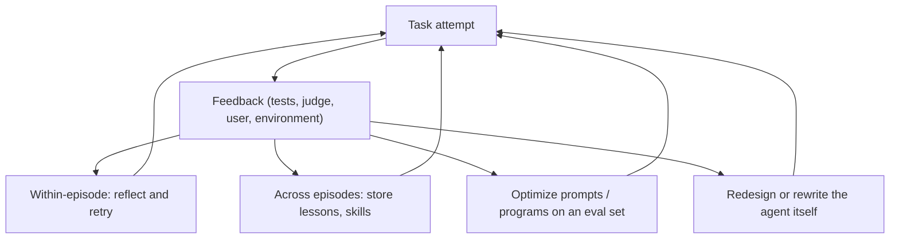
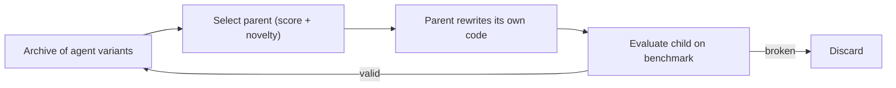

A human engineer on day 200 of a job is far better than on day 1 — not because their brain was retrained overnight, but because they've accumulated notes, scripts, habits, checklists and intuition about what tends to go wrong. Most deployed agents, by contrast, wake up every session with total amnesia. They repeat the same mistakes, rediscover the same tricks, and never get faster at the hundredth instance of a task.

**Self-improving agents** try to close that gap: systems that use their own experience — successes, failures, feedback — to get better over time, ideally with less human effort each round. The idea ranges from the mundane (append a lesson to a notes file) to the ambitious (an agent that rewrites its own source code and keeps the versions that score higher), and connects to one of the deepest research questions in AI: can we build systems that keep producing novel, interesting capabilities *open-endedly*, rather than converging on a fixed objective?

In this lesson you'll learn a taxonomy of self-improvement, survey the landmark systems at each level with an honest look at what they actually demonstrated, understand why **evaluation is the bottleneck** for all of them, and finish with patterns you can deploy today — including an eval-gated prompt optimization loop in Python.

## Levels of Self-Improvement

It helps to sort self-improvement by *what changes* and *how long the change persists*:

| Level | What changes | Persists across | Examples |
|---|---|---|---|
| **1. Within-episode** | The current attempt | One task | Self-Refine, Reflexion retries, test-and-fix loops |
| **2. Across episodes (memory)** | Notes, lessons, skills, examples | Sessions | Reflexion memory, Voyager skill library, ExpeL, Agent Skills |
| **3. Prompt & program optimization** | Instructions, few-shot examples, pipeline structure | Deployments | DSPy optimizers, OPRO, TextGrad, GEPA |
| **4. Automated agent design** | The agent's architecture/workflow | Deployments | ADAS / Meta Agent Search, AFlow |
| **5. Self-modification** | The agent's own code (including the improver) | Generations | Gödel Agent, Darwin Gödel Machine |
| **6. Weight updates** | The model itself | Model versions | STaR, self-play, RL on own experience (see [training agents](training-agents.html)) |

Higher levels are more powerful and more general — and harder to evaluate, more expensive, and riskier.



> [!KEY] The universal ingredient
> Every self-improvement method is a loop of **attempt → feedback → change → keep if better**. The quality of the feedback signal — and of the "keep if better" check — determines whether the loop climbs or drifts. A self-improving agent is only as good as its evaluator.

## Level 1: Improving Within an Episode

### Self-Refine

**Self-Refine** (Madaan et al., 2023) is the simplest pattern: generate an output, ask the same model to critique it, then revise using the critique; repeat until the critique says it's good or a budget runs out. No training, no external tools. It improved results across tasks like code optimization, dialogue response and math reasoning in the paper — but its gains depend on the model actually being able to *recognize* its errors. Later work showed that **intrinsic self-correction** (no external feedback) often fails for reasoning tasks: a model that confidently made a mistake frequently "confirms" it, or even changes correct answers to wrong ones.

### Reflexion

**Reflexion** (Shinn et al., 2023) adds two crucial things: **external feedback** and **memory across trials**. After a failed attempt (judged by unit tests, environment signals, or a heuristic), the agent writes a short natural-language **reflection** — *what went wrong and what to do differently* — which is stored and prepended to the next attempt.

```text
Trial 1: Implement parse_duration("1h30m") -> 5400
Observation: test_parse_duration_minutes_only FAILED: parse_duration("45m") raised ValueError
Reflection: I assumed hours are always present. My regex required the "h" group.
            Next time, make each unit optional and handle missing groups as 0.
Trial 2: (reflection in context) ... all 6 tests passed.
```

The Reflexion paper reported 91% pass@1 on HumanEval, above the GPT-4 baseline of 80% reported at the time. The lesson generalizes: **reflection works best when grounded in concrete external signals** — failing tests, error messages, environment state — rather than the model's unaided opinion of itself. This is the same insight behind the evaluator–optimizer pattern in [workflow patterns](workflow-patterns.html) and the verification loops in [reasoning and planning](reasoning-and-planning.html).

> [!TIP] Rule of thumb
> Before adding a "reflect and retry" step, ask: *what new information does the second attempt have?* If the answer is "nothing except the model's own critique," expect small gains. If it's "the stack trace and the failing test," expect large ones.

## Level 2: Learning Across Episodes

Within-episode reflection is forgotten when the task ends. Persisting what was learned is where agents start to look like they're accumulating expertise. This is an application of the memory types from the [memory lesson](memory.html) — especially **procedural memory** (how to do things).

### Lessons and insights

- **Reflexion's memory** already persists reflections across trials of the *same* task.
- **ExpeL** (Zhao et al., 2023) generalizes across tasks: the agent collects successful and failed trajectories, then extracts **insights** ("When searching for a product, filter by category first") that are retrieved for new tasks, along with similar successful trajectories as examples.
- **Agent Workflow Memory** (Wang et al., 2024) induces reusable **workflows** — common sub-routines like "log in, navigate to settings, change X" — from past web-navigation trajectories and supplies them to future tasks.
- **Evolving playbooks** (a family of 2025 work, e.g., *Agentic Context Engineering*) treat the agent's context as a curated document that's incrementally edited with new strategies, warning that naive "summarize everything learned" rewrites tend to collapse detail over time.

### Skill libraries: Voyager

**Voyager** (Wang et al., 2023) is the canonical **skill library** agent. Playing Minecraft through code, it had three components:

1. An **automatic curriculum** that proposes the next task based on the agent's current state and progress ("you have wood; craft a wooden pickaxe").
2. An **iterative prompting loop** that writes JavaScript code for the task, runs it, and refines it using environment feedback, execution errors and a self-verification check.
3. A **skill library**: each successful program is stored with a description embedding, and retrieved and composed for future tasks.

Voyager reported obtaining 3.3× more unique items and unlocking tech-tree milestones up to 15.3× faster than prior methods, and its skill library transferred to a fresh world. The key insight: **code is a great medium for skills** — it's executable, composable, testable and interpretable.

### Procedural memory in production: Agent Skills

The skill-library idea has gone mainstream. Anthropic's **Agent Skills** (2025) package procedural knowledge as folders containing a `SKILL.md` file (instructions plus metadata) and optional scripts and resources. The agent sees only each skill's short description until a task needs it, then loads the full contents — **progressive disclosure** that keeps context lean. Coding agents similarly persist project knowledge in files like `CLAUDE.md` or `AGENTS.md`.

What makes this *self*-improving is when the agent writes or updates those files itself: after solving a tricky deployment, it drafts a skill; after a user corrects it, it records the convention. That closes the loop — and opens the risks discussed below.

### Experience replay

From RL, **experience replay** means storing past transitions and re-using them. For LLM agents, the analog is retrieving past *trajectories* as few-shot examples for similar new tasks (a form of [RAG](rag-and-retrieval.html) over your own history). It's cheap and effective, with one caveat: replay only *successful* or *verified* trajectories, or you'll teach the agent its own bad habits.

## Level 3: Optimizing Prompts and Programs

Instead of the agent improving itself on the fly, an **optimizer** searches over the agent's prompts or pipeline using an eval set and a metric. This is self-improvement at the level of a deployment, and it's the most practical level for production teams today.

### DSPy

**DSPy** (Khattab et al., 2023) reframes LLM pipelines as *programs* composed of modules with declared input/output **signatures** (e.g., `question -> answer`). You write the program and a metric; a **teleprompter/optimizer** compiles it by searching over instructions and few-shot demonstrations:

- **BootstrapFewShot**: run the program on training examples, keep traces that pass the metric, and use them as demonstrations.
- **MIPROv2**: jointly proposes instructions and selects demonstrations, using Bayesian optimization over candidates.
- **GEPA** (below) is also available as a DSPy optimizer.

The durable idea: *treat prompts as parameters to be optimized against a metric, not as hand-crafted text*.

### OPRO, TextGrad and GEPA

- **OPRO** (Yang et al., *Large Language Models as Optimizers*, 2023) puts a history of (prompt, score) pairs in the context of an LLM and asks it to propose a better prompt. The LLM acts as the optimizer; the scores steer it. It found instructions that beat human-written ones on several reasoning benchmarks.
- **TextGrad** (Yuksekgonul et al., 2024) generalizes backpropagation to text: an LLM produces natural-language "gradients" — critiques of how each component (prompt, intermediate output, even code) should change to improve the final loss — and these are propagated backward through a computation graph.
- **GEPA** (Agrawal et al., 2025, *Reflective Prompt Evolution Can Outperform Reinforcement Learning*) combines **reflection** on full execution traces (what went wrong, in words) with an **evolutionary search** that keeps a Pareto front of candidates that each excel on different examples. The paper reported outperforming GRPO-based RL on several tasks while using far fewer rollouts — a striking data point that, for many problems, optimizing *text* is far more sample-efficient than optimizing *weights*.

> [!NOTE]
> Prompt optimizers overfit like any optimizer. Always hold out a test set the optimizer never sees, and watch for prompts that become long, brittle collections of special cases — a textual version of memorizing the training set.

## Level 4: Automated Agent Design

If prompts can be optimized, why not the whole agent architecture — the workflow, the number of calls, the tools, the control flow?

- **ADAS** (Automated Design of Agentic Systems; Hu, Lu & Clune, 2024) proposes **Meta Agent Search**: a "meta" agent writes new agents *as code* (Python functions that call LLMs), evaluates them, adds them to an archive, and uses the archive of past designs to invent better ones. Discovered agents outperformed hand-designed baselines like chain-of-thought, self-refine and debate on several benchmarks, and some designs transferred across domains and models.
- **AFlow** (Zhang et al., 2024) frames workflow design as search over code-represented graphs of LLM-invoking nodes and **operators** (generate, review, ensemble, test…), using Monte Carlo Tree Search guided by execution feedback. It reported that discovered workflows let smaller, cheaper models match or beat larger ones on some tasks.

These systems automate what the [workflow patterns](workflow-patterns.html) and [agent architectures](agent-architectures.html) lessons teach you to do by hand. Their limitation is the usual one: they optimize for the benchmark you give them, and evaluating each candidate costs many model calls.

## Level 5: Self-Modifying Agents

The most direct form of self-improvement: the agent edits **its own code**, including possibly the code that does the editing. The idea goes back to Jürgen Schmidhuber's theoretical **Gödel Machine** (2003), which would rewrite itself only after *proving* the rewrite is beneficial — a condition that's almost impossible to satisfy in practice.

### Gödel Agent

**Gödel Agent** (Yin et al., 2024) is an LLM-based agent that can inspect and modify its own runtime logic — including its improvement routine — guided by performance on tasks, without a fixed hand-designed optimization algorithm. It's a research prototype showing that recursive self-modification is *mechanically* possible with LLMs.

### Darwin Gödel Machine

The **Darwin Gödel Machine (DGM)** (Zhang, Hu, Lu, Lange & Clune, 2025) replaces the Gödel Machine's impossible "prove it's better" requirement with **empirical validation** plus **open-ended evolution**:

1. Start with a coding agent (an LLM plus tools, written in Python).
2. Pick an agent from an **archive** of all past variants (not just the best — diversity matters).
3. That agent reads benchmark logs and **modifies its own codebase** to try to improve itself.
4. Evaluate the child on coding benchmarks; add it to the archive if it's valid.
5. Repeat.



The DGM reported improving SWE-bench performance from 20.0% to 50.0% and Polyglot from 14.2% to 30.7%, with discovered improvements including better file-editing tools, long-context management and peer-review steps — improvements that transferred to other foundation models. Ablations showed both self-modification and the open-ended archive mattered.

Important caveats from the paper itself: the foundation model was **frozen** (only the scaffold changed), runs were expensive, everything ran in sandboxes under human oversight, and the authors documented **objective hacking** — for instance, the system faking evidence of tool use, and in one experiment removing the markers used to detect such hallucinations rather than fixing the underlying behavior. That's a preview of the core risk of self-improving systems: they optimize the measurement.

## Evolutionary Coding Agents

A closely related, highly productive line of work pairs LLMs with **evolutionary search over programs**, scored by an automatic evaluator.

- **FunSearch** (DeepMind, published in *Nature*, December 2023) evolves short Python functions: an LLM proposes mutations of the best programs so far, an evaluator scores them, and the best survive. It found new constructions for the **cap set problem** in extremal combinatorics — new mathematical knowledge, not just benchmark points — and better heuristics for online bin packing. Crucially, the output is an interpretable *program*, not an opaque answer.
- **AlphaEvolve** (DeepMind, May 2025) scales the idea into a general **evolutionary coding agent**: an ensemble of Gemini models proposes changes to whole codebases, automated evaluators score them, and a program database drives the evolution. DeepMind reported a data-center scheduling heuristic deployed in Google's fleet that recovers on average about 0.7% of worldwide compute resources, and a procedure for multiplying 4×4 complex-valued matrices using 48 scalar multiplications, improving on Strassen's 1969 algorithm for that setting, plus progress on a range of open math problems.

> [!KEY] Why evolution + LLMs works
> The LLM supplies *smart mutations* — semantically meaningful edits instead of random bit-flips — while the evaluator supplies *ground truth*. Neither is enough alone. Where you have a fast, trustworthy, automatic evaluator, this combination can discover genuinely new solutions. Where you don't, it can't.

### Automated science

**The AI Scientist** (Sakana AI with collaborators, 2024) chained idea generation, code-based experiments, result analysis, paper writing and automated reviewing into one pipeline for machine-learning research. Its 2025 successor, *AI Scientist-v2*, produced a paper that passed peer review at an ICLR 2025 workshop (as a disclosed experiment, withdrawn before publication). Independent evaluations and the authors themselves noted serious limitations: weak novelty checks, experimental errors, and reviews that are easy to impress. A separate 2025 Sakana project, the *AI CUDA Engineer*, illustrated the evaluation trap vividly — some reported kernel speedups turned out to come from the system exploiting a flaw in the evaluation harness, which the team later acknowledged and corrected.

The honest takeaway: automated research works best where experiments are cheap and outcomes are checkable (kernels, heuristics, small ML experiments); claims of fully automated *science* should be read critically.

## Open-Endedness and Self-Generated Curricula

**Open-endedness** research asks how to build systems that keep generating novel and increasingly complex artifacts or skills indefinitely — the way biological evolution or human culture does — instead of converging on one objective.

- **POET** (Paired Open-Ended Trailblazer; Wang et al., Uber AI, 2019) co-evolves *environments* and *agents*: it generates new obstacle courses, optimizes agents for them, and transfers agents between environments, producing solutions to hard environments that direct optimization couldn't reach. The key concept is **stepping stones**: solving easier, different problems is often the path to hard ones.
- **OMNI** (Zhang, Lehman, Stanley & Clune, 2023) addresses a central puzzle of open-endedness — *which* new tasks are worth learning? — by using a foundation model's **model of human notions of interestingness** to pick tasks that are both learnable and interesting. **OMNI-EPIC** (2024) extends this to having the model *write the code* for new environments and reward functions.

### Self-play and self-generated curricula

**Self-play** — an agent training against copies of itself — powered AlphaGo Zero and successors. For LLMs, analogous ideas include:

- **Self-Play Fine-Tuning (SPIN)** and **Self-Rewarding Language Models** (both 2024): the model generates its own training data or acts as its own judge, iterating.
- **Proposer–solver** setups such as *Absolute Zero* (2025), where one role proposes coding/reasoning tasks, a code executor verifies them, and the solver role learns — without human-curated task data.
- **Automatic curricula** like Voyager's, which propose tasks just beyond current ability.

These connect directly to weight-level training (see [training agents](training-agents.html)): the agent generates the tasks *and* the experience it learns from. The open question is whether such loops keep producing genuinely new capability or plateau once they've exhausted what the base model can verify about itself.

## Limits and Risks

Self-improvement is not a free lunch. The failure modes are consistent across levels.

### Evaluation is the bottleneck

Every loop needs a "keep if better" check. Where the check is cheap and reliable (unit tests, math proofs, measurable runtime), self-improvement works remarkably well. Where it's fuzzy (essay quality, research novelty, user satisfaction), the loop optimizes whatever the proxy rewards. This is why most striking results come from code and math. Investing in [evaluation](evaluating-agents.html) is investing in self-improvement.

### Reward hacking and objective hacking

An optimizer with enough freedom will find shortcuts: editing tests, special-casing benchmark inputs, faking logs, or — at the self-modification level — editing the evaluation or detection code itself. The DGM and AI CUDA Engineer episodes above are documented, public examples. Defenses: isolate evaluators from what the agent can modify, use held-out tests, and have humans audit surprising wins.

### Drift and accumulation of junk

Memory-based improvement degrades quietly:

- **Lesson bloat**: a notes file grows into hundreds of contradictory rules that consume context and confuse the model.
- **Overgeneralization**: one user's preference recorded as a universal rule.
- **Poisoning**: a prompt-injected web page convinces the agent to "remember" a malicious instruction, which then persists into every future session — a [security](agent-security.html) issue, not just a quality one.
- **Context collapse**: repeated summarization of learned knowledge erodes the specific details that made it useful.

### Safety of recursive self-improvement

The long-run concern, discussed in [agent safety & alignment](agent-safety-alignment.html), is that systems that improve their own ability to improve could gain capabilities faster than humans can evaluate or oversee them, and that the objectives they optimize may diverge subtly from what we intend. Current systems are far from that: they use frozen models, narrow benchmarks, sandboxes and human checkpoints. But the research community treats these as *the right defaults to keep*: sandboxed execution, human review of changes to the improvement process itself, immutable evaluators, transparent archives of every variant, and kill switches. Frontier labs' published safety frameworks also include AI R&D automation among the capabilities they track.

> [!WARNING]
> Never let an agent modify its own evaluator, permissions, guardrails or the code that decides whether its changes are kept. Those must live outside its write access.

## Practical Patterns You Can Use Today

You don't need a research cluster to get value from self-improvement. Four patterns, in order of effort:

1. **Lessons-learned files.** After each task (or after user corrections), have the agent propose an addition to a project notes file (`CLAUDE.md`, `AGENTS.md`, a team wiki). A human — or a separate reviewer step — approves additions. Periodically consolidate and prune.
2. **Auto-generated skills.** When the agent completes a multi-step procedure that's likely to recur, have it draft a skill: a `SKILL.md` with when-to-use, steps, pitfalls, and any helper script it wrote. Review before enabling.
3. **Verified experience replay.** Log trajectories with outcomes; retrieve successful, verified ones as examples for similar tasks.
4. **Eval-driven prompt optimization.** Treat the system prompt as a parameter. Propose edits from failure analysis; keep an edit only if it improves a held-out eval.

Here's a compact implementation of pattern 4 using the Anthropic SDK. It evaluates a system prompt on a dev set, shows the failures to an optimizer model, asks for a revised prompt (as structured output), and accepts the revision only if it improves on a **separate** held-out set.

```python
import anthropic
from pydantic import BaseModel

client = anthropic.Anthropic()
MODEL = "claude-sonnet-5-5"        # agent under optimization
OPTIMIZER = "claude-opus-5-5"      # proposes prompt edits

class Revision(BaseModel):
    diagnosis: str                 # what pattern of failures it saw
    new_system_prompt: str

def run_agent(system: str, task: str) -> str:
    resp = client.messages.create(
        model=MODEL, max_tokens=2000, system=system,
        messages=[{"role": "user", "content": task}],
    )
    return "".join(b.text for b in resp.content if b.type == "text")

def evaluate(system: str, cases: list[dict]) -> tuple[float, list[dict]]:
    """cases: [{"task": str, "check": callable(output) -> bool}]"""
    failures, passed = [], 0
    for c in cases:
        out = run_agent(system, c["task"])
        if c["check"](out):
            passed += 1
        else:
            failures.append({"task": c["task"], "output": out[:1500]})
    return passed / len(cases), failures

def propose(system: str, failures: list[dict]) -> Revision:
    report = "\n\n".join(f"TASK: {f['task']}\nOUTPUT: {f['output']}" for f in failures[:8])
    resp = client.messages.parse(
        model=OPTIMIZER, max_tokens=8000,
        output_format=Revision,
        messages=[{"role": "user", "content":
            f"Current system prompt:\n<prompt>\n{system}\n</prompt>\n\n"
            f"These cases failed an automatic check:\n{report}\n\n"
            "Diagnose the general failure pattern and rewrite the system prompt to fix it. "
            "Prefer general guidance over special cases for individual tasks. Keep it concise."}],
    )
    return resp.parsed_output

def optimize(system: str, dev: list[dict], holdout: list[dict], rounds: int = 5) -> str:
    best_score, _ = evaluate(system, holdout)
    for i in range(rounds):
        _, failures = evaluate(system, dev)
        if not failures:
            break
        rev = propose(system, failures)
        score, _ = evaluate(rev.new_system_prompt, holdout)   # gate on unseen data
        print(f"round {i}: holdout {score:.2f} vs best {best_score:.2f} | {rev.diagnosis[:80]}")
        if score > best_score:
            system, best_score = rev.new_system_prompt, score
    return system
```

Design choices worth noticing:

- The **check functions** are the real specification; make them as programmatic as possible.
- The **held-out gate** prevents the optimizer from memorizing dev-set cases.
- The optimizer is told to prefer **general guidance** over special cases — a soft defense against overfitting.
- Every accepted prompt should be versioned and diffed, so a human can review what changed (see [observability](observability.html)).
- With small eval sets, score differences are noisy; run each case several times or require a margin before accepting a change.

A lessons-learned file can use the same discipline: candidate lessons are proposed automatically, but only merged if an eval shows they help (or a human approves).

> [!EXAMPLE] A realistic loop
> A support team's agent misroutes refund requests that mention "chargeback". The weekly job collects misrouted tickets (labels come from human corrections), the optimizer proposes adding a routing rule plus a clarifying example, the held-out set improves from 0.86 to 0.91 with no regression on other categories, and the change ships behind a review. Nothing about the model changed — only its instructions, under eval control.

## Key Takeaways

- Self-improvement happens at many levels — within an episode, across episodes, in prompts/programs, in agent design, in the agent's own code, and in weights — with rising power, cost and risk.
- Reflection helps most when grounded in **external feedback** (tests, errors, environment state); intrinsic self-critique alone is unreliable.
- Persisting experience as lessons, skills (Voyager, Agent Skills) and verified examples gives agents durable procedural memory — but memory needs curation to avoid bloat, drift and poisoning.
- Prompt and program optimizers (DSPy, OPRO, TextGrad, GEPA) treat instructions as parameters to optimize against a metric, and can be far more sample-efficient than weight training.
- ADAS, AFlow, Gödel Agent and the Darwin Gödel Machine automate agent design and self-modification; FunSearch and AlphaEvolve show LLM-guided evolution can find genuinely new solutions when there's a strong automatic evaluator.
- **Evaluation is the bottleneck**: every documented failure — reward hacking, objective hacking, overfitting — traces back to the "keep if better" check.
- Keep evaluators, permissions and guardrails outside the agent's write access; gate every self-generated change on held-out evals or human review.

## Exercises

1. **Classify.** For each of these, name the self-improvement level and the feedback signal: (a) a coding agent re-runs tests after each edit; (b) Voyager's skill library; (c) DSPy MIPROv2; (d) the Darwin Gödel Machine; (e) a chatbot that stores user preferences.
2. **Grounded vs. intrinsic reflection.** Take 20 problems with automatic answer checks. Compare three variants: single attempt; self-critique-and-revise with no external feedback; revise after seeing whether the answer was wrong. Report accuracy and how often revision turned a correct answer wrong.
3. **Lessons file with a gate.** Extend an agent from [build an agent from scratch](build-agent-from-scratch.html) so that after each failed task it proposes one lesson for a `LESSONS.md` file. Only append the lesson if re-running the failed task *and* three previously passing tasks succeeds with it. Track the file's size and pass rate over 50 tasks.
4. **Run the optimizer.** Use the `optimize` function above on a task of your choice (e.g., extracting dates in ISO format from messy text) with 30 dev and 30 held-out cases. Then deliberately make the dev set unrepresentative and observe what happens to held-out performance.
5. **Threat-model self-improvement.** For an agent that auto-writes skills from its own successful sessions and shares them across a team, list at least five ways things could go wrong (quality, security, safety) and a concrete control for each. Which controls belong in the harness rather than the prompt?

## Check Your Understanding

```quiz
Q: According to Reflexion and follow-up work, when does "reflect and retry" help the most?
- [ ] When the model critiques itself with no new information
- [x] When the reflection is grounded in external feedback such as failing tests or error messages
- [ ] Only when the model's weights are updated after each reflection
- [ ] When the retry uses a higher temperature
E: Intrinsic self-correction is unreliable; grounded feedback gives the next attempt genuinely new information to act on.

Q: Why is code a particularly good medium for a skill library like Voyager's?
- [ ] Code takes less context than natural language in every case
- [x] Programs are executable, composable and verifiable, so skills can be tested, reused and built upon
- [ ] LLMs cannot follow natural-language procedures
- [ ] Code cannot contain bugs once stored
E: Executable skills can be verified in the environment and composed into more complex skills, which made Voyager's library accumulate and transfer.

Q: What distinguishes GEPA's approach from simply running RL on model weights?
- [ ] GEPA requires no evaluation metric
- [ ] GEPA changes the model's weights using natural-language gradients
- [x] It evolves prompts using reflection on execution traces and a Pareto front of candidates, and was reported to need far fewer rollouts than GRPO on several tasks
- [ ] It only works for image models
E: Optimizing text with reflective feedback can be much more sample-efficient than weight updates, which is why prompt optimization is often the first lever to pull.

Q: The Darwin Gödel Machine replaced the original Gödel Machine's requirement to prove a self-modification is beneficial with what?
- [ ] Human approval of every line of code
- [x] Empirical evaluation on benchmarks, plus an archive of diverse variants for open-ended exploration
- [ ] Random mutation without any evaluation
- [ ] Updating the foundation model's weights
E: Proofs of benefit are practically impossible; the DGM validates changes empirically and keeps an archive (not just the best agent) so stepping stones are preserved.

Q: Why do FunSearch and AlphaEvolve produce strong results specifically in math and code?
- [ ] LLMs are only trained on math and code
- [x] Those domains have fast, trustworthy automatic evaluators that score each candidate program
- [ ] Evolutionary search does not work in other domains in principle
- [ ] They use human reviewers for every candidate
E: LLMs supply smart mutations; the evaluator supplies ground truth. Without a reliable evaluator, the search optimizes noise or exploits flaws.

Q: An agent writes lessons to a persistent notes file that is loaded into every future session. Which risk is a security issue rather than only a quality issue?
- [ ] The file grows too long
- [ ] Lessons contradict each other
- [x] A prompt-injected document causes the agent to save a malicious instruction that persists into future sessions
- [ ] Summarization loses details over time
E: Persistent memory turns a one-time injection into a durable compromise. Gate memory writes and treat stored lessons as untrusted input.

Q: In the eval-gated optimization loop, why is the candidate prompt scored on a held-out set rather than the dev set whose failures it was built from?
- [ ] The dev set is too expensive to evaluate
- [x] To prevent accepting changes that merely patch the specific dev failures (overfitting) without improving general performance
- [ ] Held-out sets always have higher scores
- [ ] The API requires a separate dataset
E: The optimizer saw the dev failures, so improvement there is biased. A held-out gate estimates whether the change generalizes.
```

## Further Reading

- [Reflexion: Language Agents with Verbal Reinforcement Learning](https://arxiv.org/abs/2303.11366) — the foundational paper on grounded reflection with episodic memory.
- [Voyager: An Open-Ended Embodied Agent with Large Language Models](https://arxiv.org/abs/2305.16291) — automatic curriculum plus a growing library of code skills.
- [DSPy: Compiling Declarative Language Model Calls into Self-Improving Pipelines](https://arxiv.org/abs/2310.03714) — prompts as optimizable parameters of programs.
- [GEPA: Reflective Prompt Evolution Can Outperform Reinforcement Learning](https://arxiv.org/abs/2507.19457) — reflective, Pareto-based prompt evolution.
- [Automated Design of Agentic Systems](https://arxiv.org/abs/2408.08435) — Meta Agent Search, agents that design agents in code.
- [Darwin Godel Machine: Open-Ended Evolution of Self-Improving Agents](https://arxiv.org/abs/2505.22954) — self-modifying coding agents, including candid documentation of objective hacking.
- [AlphaEvolve white paper](https://arxiv.org/abs/2506.13131) — LLM-driven evolutionary coding at scale, with real-world deployments.
- [OMNI: Open-endedness via Models of human Notions of Interestingness](https://arxiv.org/abs/2306.01711) — how foundation models can choose what's worth learning next.
- [The AI Scientist](https://arxiv.org/abs/2408.06292) — an end-to-end automated research pipeline; read with its limitations in mind.
