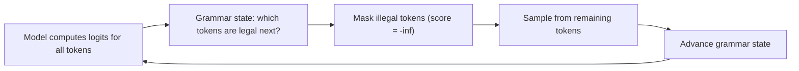
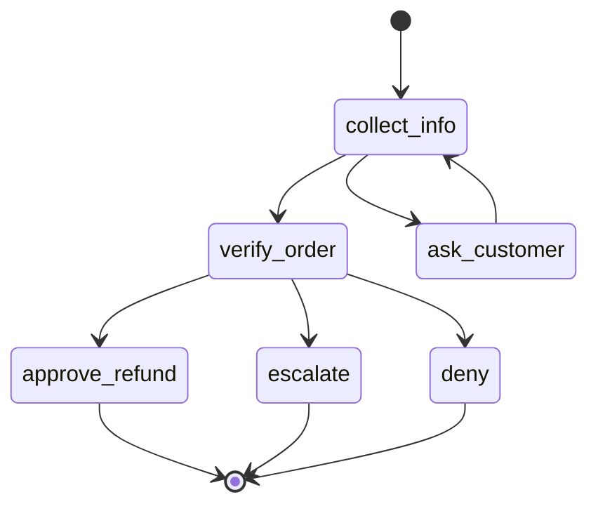

A team builds a ticket-triage agent. It reads each support ticket and replies with JSON — category, priority, a one-line summary — which code then routes to the right queue. In testing it's flawless. In production, at ten thousand tickets a day, a small fraction of responses start with "Sure! Here's the JSON:", or use `"priority": "high-ish"`, or omit a field, or get cut off mid-object. Each failure is a ticket silently dropped or misrouted. Fifty a day, every day.

**Structured outputs** fix this class of problem at its root. Instead of *asking* a model for JSON and hoping, you give the API a schema and the model's output is *guaranteed* to conform to it. That turns a language model from a text generator into something closer to a typed function: text in, validated object out. And once outputs are typed, you can build reliable control flow around them — routers, pipelines and state machines where the model makes judgments and ordinary code takes actions.

This lesson covers why structure matters, the spectrum of techniques from prompting to constrained decoding (and how the latter works under the hood), the Anthropic SDK's structured-output features with Pydantic, validation loops, the core extraction/classification/routing patterns, and how to design schemas that don't sabotage the model's reasoning.

## Why Agents Need Structure

Free-form text is great for humans and terrible for programs. Anywhere a model's output feeds code instead of a person, you want structure:

- **Parsing.** Extracting fields from invoices, contracts, emails or web pages into database rows.
- **Routing.** Deciding which handler, queue, model or sub-agent gets a request (see the routing pattern in [workflow patterns](workflow-patterns.html)).
- **Deterministic control flow.** Branching on the model's decision with an `if` or a dictionary lookup instead of a regex over prose.
- **Tool arguments.** Every tool call is structured output; [tool use](tool-use.html) is built on the same machinery.
- **Rendering and storage.** UIs, analytics and audit logs need fields, not paragraphs.
- **Evaluation.** Comparing `{"category": "billing"}` to a label is trivial; grading prose is not (see [evaluating agents](evaluating-agents.html)).

> [!KEY] The big idea
> Structured outputs let you split responsibilities cleanly: the model does what only it can do — interpret messy language and make judgment calls — and returns a typed decision; deterministic code does everything else. The schema is the contract between them.

## The Reliability Spectrum

There are four broad ways to get structured data from a model, in increasing order of guarantees:

| Technique | How | Guarantees | Typical failures |
|---|---|---|---|
| **Prompt-only** | "Respond only with JSON matching this format…" | None | Preambles, markdown fences, trailing commas, missing or invented fields, truncation |
| **JSON mode** | API flag that forces syntactically valid JSON | Parses as JSON | Wrong shape: missing fields, wrong types, unexpected keys |
| **Function-calling trick** | Define a tool whose input schema is your output; make the model call it | Usually matches schema | Model may not call the tool; arguments not strictly guaranteed unless strict |
| **Schema-constrained decoding** | API compiles your JSON Schema and constrains generation | Parses *and* matches the schema | Semantics still unchecked; truncation at max tokens; refusals |

Prompt-only JSON works surprisingly often with modern models, which is precisely the trap: "often" at scale means a steady stream of failures. Historically, practitioners layered on assistant-message prefills (starting the response with `{`), stop sequences, regex extraction and retry-on-parse-error loops. With schema-constrained decoding available, that whole stack is unnecessary — and on current Claude models prefill is rejected outright.

Schema guarantees still aren't the end of the story. A schema can guarantee `"total_usd"` is a number, not that it's the *right* number. Production systems pair constrained decoding with **semantic validation** in code, covered below.

## How Constrained Decoding Works

To understand what "guaranteed" means, recall how generation works (from [LLM fundamentals](llm-fundamentals.html)): at each step the model produces a score (logit) for every token in its vocabulary, one token is sampled, appended, and the process repeats.

**Constrained decoding** inserts a filter into that loop. Before sampling, it computes which tokens could legally come next given the schema and everything generated so far, and sets the scores of all other tokens to negative infinity. Illegal tokens become impossible to sample.



Take a tiny schema: an object with one field, `category`, whose value must be `"bug"` or `"billing"`. After the model has generated `{"category": "`, the only legal continuations are tokens that begin `bug` or `billing`. A token like `feature` is masked out, no matter how much the model "wanted" it. After `b`, both remain possible; after `bi`, only `billing` does.

Making this fast is the hard part:

- **Schemas become grammars.** A JSON Schema is compiled into a formal grammar. Many schemas compile to a regular language, which a **finite-state machine (FSM)** can track; recursive structures (a tree of comments with replies) need a **context-free grammar** and a pushdown automaton. This is one reason some APIs don't support recursive schemas.
- **Tokens don't align with characters.** Vocabulary entries are multi-character chunks like `":"`, `bill` or `ing"}`. The engine must know, for each grammar state, which of perhaps 100,000+ tokens keep the output valid. The approach popularized by the Outlines paper precomputes an index from FSM states to allowed token sets, so masking at generation time is a lookup rather than a scan. Newer engines (such as XGrammar and llguidance) extend these ideas to context-free grammars efficiently.
- **Compilation is cached.** Building the grammar for a new schema takes time, so providers compile once and cache. On Claude's API, the first request with a new schema incurs a one-time compilation cost; later requests with the same schema reuse a cache.

Constrained decoding has real limits worth knowing:

1. **It guarantees syntax, not truth.** The model can still put a wrong date in a correctly formatted date field.
2. **It can force low-probability paths.** If the model "wanted" to say something the schema doesn't allow — "this document isn't an invoice" — the mask forces it into the nearest legal output, which may be a confident-looking fabrication. Design schemas with an escape hatch (nullable fields, an `"other"` category, a `notes` field).
3. **Truncation and refusals still happen.** If output hits `max_tokens`, the object may be incomplete; if the model declines a request for safety reasons, the response may not match the schema. Always check `stop_reason`.
4. **Format can affect quality.** Research such as "Let Me Speak Freely?" (2024) reported that strict format restrictions can hurt performance on some reasoning tasks, though the size of the effect is debated and depends heavily on prompt and schema design. The practical lesson is the one in the "Reason before you commit" section below: don't make the model do its thinking inside a rigid format.

## Structured Outputs with the Anthropic SDK

Claude's API offers two complementary features (as of 2026):

- **JSON outputs** via `output_config.format`: the model's final text response is constrained to your JSON Schema.
- **Strict tool use** via `"strict": true` on a tool: the *arguments* of calls to that tool are constrained to its input schema.

The most convenient interface is `client.messages.parse()` with a **Pydantic** model. The SDK converts your model to a JSON Schema, sends it, and returns a validated instance:

```python
from typing import Literal
from pydantic import BaseModel, Field
import anthropic

client = anthropic.Anthropic()

class TicketTriage(BaseModel):
    category: Literal["billing", "bug", "how_to", "account_access", "other"]
    priority: Literal["low", "normal", "high", "urgent"] = Field(
        description="urgent = customer cannot use the product at all right now")
    summary: str = Field(description="One sentence, written for a support engineer")
    customer_email: str | None = Field(description="null if not present in the ticket")

ticket = """From: dana@example.org
Since this morning every login attempt says 'invalid token'. Our whole team
is locked out and we have a launch in two hours."""

response = client.messages.parse(
    model="claude-opus-5-5",
    max_tokens=16000,
    output_format=TicketTriage,
    messages=[{"role": "user", "content": f"Triage this support ticket.\n\n<ticket>\n{ticket}\n</ticket>"}],
)

if response.stop_reason != "end_turn":   # refusal or max_tokens: don't trust output
    raise RuntimeError(f"Unexpected stop_reason: {response.stop_reason}")
triage = response.parsed_output          # a validated TicketTriage instance
print(triage.category, triage.priority)  # account_access urgent
```

A few details make this work well:

- `Literal[...]` (or a Python `Enum`) becomes a JSON Schema `enum`, so the model can only choose from your categories.
- `Field(description=...)` text goes into the schema, where the model reads it. Field descriptions are prompts.
- `str | None` with no default makes the field **required but nullable**: the model must address it and can say "not present" explicitly instead of inventing a value.

If you're not using Pydantic, pass a raw schema on `messages.create`:

```python
import json

schema = {
    "type": "object",
    "properties": {
        "category": {"type": "string", "enum": ["billing", "bug", "how_to", "account_access", "other"]},
        "summary": {"type": "string"},
    },
    "required": ["category", "summary"],
    "additionalProperties": False,   # required for every object in the schema
}

response = client.messages.create(
    model="claude-opus-5-5",
    max_tokens=16000,
    output_config={"format": {"type": "json_schema", "schema": schema}},
    messages=[{"role": "user", "content": f"Triage this ticket:\n{ticket}"}],
)
text = next(b.text for b in response.content if b.type == "text")
data = json.loads(text)  # guaranteed to parse and match the schema (if stop_reason is end_turn)
```

**Schema support.** Constrained decoding supports the core of JSON Schema: basic types, `enum`, `const`, `anyOf`, `allOf`, `$ref`/`$defs`, common string formats (`date`, `date-time`, `email`, `uri`, `uuid`, and others), with `additionalProperties: false` on objects. As of 2026 it does not support recursive schemas, numeric bounds (`minimum`, `maximum`), string-length constraints or complex array constraints. The Python and TypeScript SDKs remove unsupported constraints from the schema they send and validate them client-side, so a Pydantic `Field(ge=0, le=100)` still gets checked — just not during decoding.

### Output format vs strict tools

| Use | When |
|---|---|
| `output_config.format` / `messages.parse` | You want the model's **final answer** as data: extraction, classification, a structured report at the end of an agent run |
| `"strict": true` tools | You want **tool arguments** guaranteed during an agent loop (bookings, database writes) |
| Both together | An agent that calls strict tools along the way and ends with a structured final report |

A common older pattern was to define a fake tool and force the model to call it just to get JSON out. With output formats available, use those instead; forced tool choice is rejected on the latest Claude models anyway.

## Validation and Retry Loops

Schema validity is necessary but not sufficient. Real data has **semantic** rules that a schema can't express or that constrained decoding doesn't enforce: line items should sum to the total, an end date should follow the start date, a referenced product ID should exist in your catalog.

The standard pattern is **validate, then retry with feedback**: check the parsed object in code, and if it fails, show the model exactly what's wrong and ask again — a bounded number of times.

```python
from datetime import date
from pydantic import BaseModel, Field

class LineItem(BaseModel):
    description: str
    amount_usd: float

class Invoice(BaseModel):
    vendor: str
    invoice_number: str | None = Field(description="As printed; null if absent")
    invoice_date: date | None = Field(description="null if absent")
    line_items: list[LineItem]
    total_usd: float = Field(description="The total as printed on the invoice")
    notes: str | None = Field(description="Anything unclear or inconsistent in the document")

def check_invoice(inv: Invoice) -> list[str]:
    problems = []
    items_sum = round(sum(i.amount_usd for i in inv.line_items), 2)
    if abs(items_sum - inv.total_usd) > 0.01 and not inv.notes:
        problems.append(f"Line items sum to {items_sum} but total_usd is {inv.total_usd}.")
    if inv.invoice_date and inv.invoice_date > date.today():
        problems.append(f"invoice_date {inv.invoice_date} is in the future.")
    return problems

def extract_invoice(document: str, max_attempts: int = 3) -> Invoice:
    feedback = ""
    for _ in range(max_attempts):
        response = client.messages.parse(
            model="claude-opus-5-5", max_tokens=16000, output_format=Invoice,
            messages=[{"role": "user", "content":
                f"Extract this invoice.\n<document>\n{document}\n</document>{feedback}"}],
        )
        if response.stop_reason != "end_turn":
            raise RuntimeError(f"Extraction stopped: {response.stop_reason}")
        invoice = response.parsed_output
        problems = check_invoice(invoice)
        if not problems:
            return invoice
        feedback = (
            f"\n\nA previous attempt produced:\n{invoice.model_dump_json()}\n"
            "It failed these checks:\n- " + "\n- ".join(problems) +
            "\nRe-read the document and correct any extraction errors. If the "
            "document itself is inconsistent, keep the printed values and explain in notes."
        )
    raise ValueError(f"Invoice failed validation after {max_attempts} attempts: {problems}")
```

Three design choices here matter:

1. **Specific feedback.** "Line items sum to 1,240.00 but total is 1,420.00" lets the model spot a transposed digit. "Invalid output, try again" doesn't.
2. **An honest escape hatch.** Some documents really are inconsistent. If your validator demands that totals match and gives the model no other way out, you've built a machine that pressures it into fabricating a number. The `notes` field lets it report the inconsistency instead — and the validator accepts that.
3. **A bound.** Retries cost money and latency, and repeated failure usually means the input is unusual. After a few attempts, route it to a human or a dead-letter queue (see [reliability](reliability.html)).

## Extraction and Classification Patterns

Most structured-output work is one of two shapes.

**Extraction** pulls facts out of unstructured input. Guidelines:

- Make every field that might be absent **nullable**, and say in its description that null means "not stated." Otherwise you'll get plausible inventions.
- For high-stakes fields, add a short **evidence** field with the exact quote the value came from. It makes outputs auditable and makes hallucinations easier to catch automatically (check that the quote appears in the source).
- Prefer **lists of small objects** (`line_items: list[LineItem]`) over parallel arrays (`descriptions: list[str]`, `amounts: list[float]`) that can drift out of alignment.
- Normalize formats in the schema: ISO dates, amounts as numbers with the currency in the field name.

**Classification** assigns labels. Guidelines:

- Use an **enum** with clear, mutually exclusive names, each defined in the description or prompt.
- Always include an **`"other"`** or **`"unclear"`** option. Without one, constrained decoding forces every out-of-distribution input into a wrong bucket.
- For multi-label problems, use `list[Literal[...]]`.
- Be skeptical of self-reported **confidence scores**. Numbers a model writes about its own certainty are often poorly calibrated. If you need confidence, measure agreement across several samples, or have code treat `"unclear"` as the low-confidence path.

## Enums for Routing

The simplest structured control flow is a **router**: the model classifies the request, and code dispatches on the result.

```python
class Route(BaseModel):
    intent: Literal["billing", "technical", "account", "sales", "other"]
    summary: str = Field(description="One-sentence restatement of what the user needs")

HANDLERS = {
    "billing": billing_agent.run,      # each handler is ordinary code or a specialized agent
    "technical": tech_support_agent.run,
    "account": account_agent.run,
    "sales": hand_off_to_sales,
    "other": human_queue.put,
}

route = client.messages.parse(
    model="claude-haiku-5-5",           # routing is a good job for a small, fast model
    max_tokens=16000,
    output_format=Route,
    messages=[{"role": "user", "content": message_text}],
).parsed_output
HANDLERS[route.intent](message_text, route.summary)
```

Because `intent` is an enum, the dictionary lookup can never miss. Adding a route means adding an enum value and a handler — a code change you can review and test, rather than a prompt tweak whose effects are hard to predict.

## State Machines: The LLM Decides, Code Executes

Routing makes one decision. Many business processes are a sequence of decisions with rules about what can follow what: a refund flow, an insurance claim, a loan application. For these, a powerful pattern is a **state machine** where:

- **Code owns the states and the legal transitions.**
- **At each state, the model chooses among the transitions that are legal *from that state*** — enforced by building the enum dynamically.
- **Code executes the action** associated with each transition, with its own validation and permissions.



```python
TRANSITIONS = {
    "collect_info": ["verify_order", "ask_customer"],
    "ask_customer": ["collect_info"],
    "verify_order": ["approve_refund", "escalate", "deny"],
}

def choose_transition(state: str, case_file: str) -> tuple[str, str]:
    allowed = TRANSITIONS[state]
    schema = {
        "type": "object",
        "properties": {
            "next_state": {"type": "string", "enum": allowed},  # only legal moves
            "reason": {"type": "string", "description": "One sentence for the audit log"},
        },
        "required": ["next_state", "reason"],
        "additionalProperties": False,
    }
    response = client.messages.create(
        model="claude-sonnet-5-5", max_tokens=16000,
        output_config={"format": {"type": "json_schema", "schema": schema}},
        system=REFUND_POLICY,  # the business rules the model judges against
        messages=[{"role": "user", "content": f"Current step: {state}\n\n{case_file}"}],
    )
    if response.stop_reason != "end_turn":
        return "escalate", f"model stopped with {response.stop_reason}"
    decision = json.loads(next(b.text for b in response.content if b.type == "text"))
    return decision["next_state"], decision["reason"]
```

The surrounding loop executes each state's action in code — `approve_refund` calls the payments service only after code re-checks the amount limit — and appends the outcome to the case file for the next decision.

This design trades some flexibility for a lot of control:

| | Open agent loop | LLM-decides / code-executes state machine |
|---|---|---|
| Flexibility | High: any tool, any order | Bounded to the designed graph |
| Predictability | Varies run to run | Every path is enumerable and testable |
| Auditability | Read the transcript | A log of (state, decision, reason) tuples |
| Guardrails | Mostly in tools and prompts | Structural: illegal transitions can't be generated |
| Best for | Open-ended tasks (research, coding) | Regulated, well-understood processes |

The two combine well: a state can itself invoke a small open-ended agent (say, "investigate the order history") whose result feeds the next structured decision. Choosing among these designs is the subject of [agent architectures](agent-architectures.html); frameworks like LangGraph make graph-shaped agents a first-class concept (see [agent frameworks](agent-frameworks.html)).

## Reason Before You Commit

Models generate output left to right, and a schema fixes the *order* of fields. If the first field is the decision, the model commits to it in its first few tokens, before it has written anything that might inform it. Two classic mitigations:

- **Field order:** put fields that require analysis (evidence quotes, extracted facts) *before* the fields that depend on them (the classification, the decision). Pydantic preserves declaration order in the schema.
- **A reasoning field:** historically, many schemas began with a free-text `reasoning` field so the model could think "on paper" before answering.

With models that have native **thinking** (Claude's adaptive thinking, and similar features from other providers), the model reasons in a separate thinking phase *before* it writes the constrained output, so the structured output itself can stay lean. That changes the advice:

- Let thinking do the deliberation. Raise `effort` for harder judgments rather than adding a long reasoning field.
- Anthropic's current guidance is to keep reasoning in thinking blocks rather than asking the model to reproduce it in output fields; on some current models, instructions to reproduce reasoning in the response can be declined. If you need reasoning for debugging, read the thinking blocks the API returns.
- Keep short, **purpose-specific** fields that serve your application: an `evidence` quote for auditing, a one-sentence `reason` for the audit log, `notes` for anomalies. These are part of the product, not a substitute for thinking.

For complex tasks, a **two-step** approach is often best: let the agent work freely — browse, call tools, reason, write prose — and then make a separate structured-output call that converts its final findings into your schema. The thinking happens without format pressure, and the structuring step is a simple extraction task.

> [!TIP] Rule of thumb
> Constrain the *interface*, not the *thinking*. Use schemas where code consumes the result; let the model reason in thinking blocks or free text first, and structure the conclusion.

## Schema Design Tips

Schemas are prompts and contracts at once. Good ones share a few traits:

- **Descriptive names and descriptions.** `refund_amount_usd` with "Amount to refund in US dollars; must not exceed the order total" beats `amt`.
- **Flat over deep.** Each level of nesting is another place to go wrong. Flatten where meaning allows.
- **Enums for anything with a fixed vocabulary**, with an `other`/`unclear` value and definitions for each label.
- **Nullable, not empty.** `null` for "not present" is unambiguous; `""` and `0` aren't.
- **Units and formats in names and types:** `duration_minutes`, `"format": "date"`.
- **No catch-all objects.** `dict[str, Any]` gives up every guarantee; if you don't know the shape, you probably need two steps.
- **One job per schema.** If a schema has 40 fields spanning extraction, classification and drafting, split it into stages that can be validated independently.
- **Stable and versioned.** Treat schemas like API contracts: version them, keep them stable (which also keeps compiled-grammar caches warm), and migrate deliberately.
- **Escape hatches.** Every forced choice should have a legitimate way to say "none of these" or "I'm not sure."

## Libraries and Other Providers

Structured outputs are now standard across providers and serving stacks. At a conceptual level:

- **OpenAI** offers JSON mode (valid JSON only) and Structured Outputs with `strict` JSON Schemas for both response formats and function arguments, with Pydantic/Zod parse helpers in its SDKs.
- **Google Gemini** accepts a response schema with a JSON MIME type for constrained output.
- **Instructor** is a popular Python library that wraps many providers' clients so you pass a Pydantic `response_model` and get validated objects back, with automatic retries that feed validation errors to the model.
- **Outlines** performs constrained generation (JSON Schema, regex, grammars) for open-weight models you run yourself.
- **XGrammar** and **llguidance** are fast grammar-constrained decoding engines; inference servers such as vLLM and SGLang use engines like these to offer structured outputs for self-hosted models.

APIs evolve quickly; check each project's current documentation for exact parameters. The concepts — schema as contract, constrained decoding for syntax, code for semantics — carry across all of them.

## Key Takeaways

- Structured outputs let the model make judgments and return typed decisions while deterministic code handles parsing, routing and actions.
- Prompt-only JSON and JSON mode reduce but don't eliminate failures; schema-constrained decoding guarantees output that parses and matches the schema.
- Constrained decoding works by masking tokens that would violate a grammar compiled from your schema; it guarantees syntax, not correctness, and needs escape hatches.
- With the Anthropic SDK, use `client.messages.parse(output_format=PydanticModel)` for final answers and `strict: true` for tool arguments, and always check `stop_reason`.
- Validate semantics in code and retry with specific feedback, a bounded number of times, while letting the model report genuine inconsistencies instead of fabricating.
- Enums power reliable routing; dynamic enums over legal transitions give you LLM-decides/code-executes state machines that are auditable and testable.
- Don't force reasoning into rigid formats: let thinking or a free-form first step do the deliberation, then structure the conclusion.

## Exercises

1. **Measure the gap.** Take 50 varied support messages and classify them three ways: prompt-only JSON, raw-schema `output_config`, and `messages.parse` with a Pydantic model. Count parse failures and schema violations for each. Then remove the `other` category and examine where out-of-scope messages land.
2. **Evidence fields.** Extend `TicketTriage` with an `evidence` field holding the exact quote that justifies `priority`. Write a check that the quote appears verbatim in the ticket, and report how often it fails.
3. **Validator pressure.** Feed `extract_invoice` a document whose printed total genuinely doesn't match its line items. Remove the `notes` escape hatch from the validator and observe what the model does across several runs. Restore it and compare. Write two sentences on what this teaches about validators.
4. **Build the refund state machine.** Implement the full loop around `choose_transition`: state actions in code, a case file that accumulates results, a step limit, and an audit log of `(state, next_state, reason)`. Write unit tests that mock the model's decisions to cover every path in the graph.
5. **Two-step vs one-step.** For a research question that needs several web searches, compare (a) one agent run that must end directly in a strict schema with (b) a free-form agent run followed by a separate extraction call. Compare accuracy and cost over ten questions.

<details class="solutions">
<summary>Hints and solution sketches</summary>

1. **Hint:** Separate the two failure types: a *parse failure* is `json.loads` raising; a *schema violation* parses but fails Pydantic validation (missing field, label outside the enum). Count each separately, and count non-`end_turn` stop reasons on their own. **Sketch:** Expect the two schema-based methods to show zero parse failures and zero schema violations on normally completed responses. Prompt-only may also come out clean on 50 messages with a modern model, but a clean 50 doesn't prove anything at 10,000 a day; look for markdown fences, preambles and off-list labels. With `other` removed, out-of-scope messages (spam, "thanks!", a job application) still get a confident label from the remaining categories, because the mask forces a legal value, which shows why every enum needs an escape hatch.
2. **Hint:** Put `evidence` *before* `priority` so the model quotes first and judges second, and normalize whitespace and case before comparing. **Sketch:** A failure means the model paraphrased or stitched fragments together instead of quoting; report the failure rate and read the failing examples. Fixes if it's high: say "copied verbatim, a single contiguous span" in the description, and route failures to a retry with feedback or to review.

    ```python
    from typing import Literal
    from pydantic import BaseModel, Field

    class TicketTriage(BaseModel):
        category: Literal["billing", "bug", "how_to", "account_access", "other"]
        evidence: str = Field(description="Exact quote from the ticket that justifies the "
                                          "priority, copied verbatim")  # before priority
        priority: Literal["low", "normal", "high", "urgent"]
        summary: str
        customer_email: str | None = Field(description="null if not present in the ticket")

    def evidence_ok(triage: TicketTriage, ticket: str) -> bool:
        norm = lambda s: " ".join(s.split()).lower()  # ignore whitespace and case differences
        return norm(triage.evidence) in norm(ticket)
    ```

3. **Hint:** Make the mismatch unambiguous (e.g. items sum to 1,240.00 but the printed total is 1,420.00), change only `check_invoice`'s `and not inv.notes` condition, and run each version several times. **Sketch:** Without the escape hatch, the model has no honest way to pass, so runs either exhaust the retries and raise `ValueError`, or "fix" the data by changing a line item or the total so the numbers sum: a fabricated value that passes validation. With `notes` restored, it keeps the printed values and explains the discrepancy, passing on the first attempt. Two sentences: a validator that demands something the source doesn't contain pressures the model to invent data. Every check needs a legitimate way to report "the input itself is inconsistent".
4. **Hint:** Inject the decision function (default `choose_transition`) and the action table, so tests can replace the model with a scripted list of decisions and the actions with stubs. **Sketch:** The loop below runs each state's action in code, appends the result to the case file, asks the model for the next legal state, logs `(state, next_state, reason)` and escalates on the step limit. Tests: script one path per terminal state (collect → verify → approve/escalate/deny), the clarification cycle (collect → ask → collect → verify → deny), and an endless ask/collect cycle that must end in `escalate` from the step limit; assert the final state and the audit trail for each.

    ```python
    TERMINAL = {"approve_refund", "escalate", "deny"}

    def run_case(case_file: str, actions: dict, decide=choose_transition, max_steps: int = 12):
        state, audit = "collect_info", []
        for _ in range(max_steps):
            case_file += f"\n[{state}] {actions[state](case_file)}"  # code runs the state's action
            if state in TERMINAL:
                return state, audit
            next_state, reason = decide(state, case_file)
            assert next_state in TRANSITIONS[state]  # defence in depth; the enum already ensures it
            audit.append((state, next_state, reason))
            state = next_state
        actions["escalate"](case_file)
        audit.append((state, "escalate", f"step limit of {max_steps} reached"))
        return "escalate", audit
    ```

5. **Hint:** Hold everything else constant (model, tools, effort, questions) and grade answers against reference answers you prepare in advance; sum `usage` across *all* calls, including the extraction call. **Sketch:** (a) puts the strict `output_config.format` on the agent's run, so its final turn must be schema-shaped; (b) lets it finish in prose and then calls `messages.parse` on the findings, possibly with a smaller model. Typically (b) is as accurate or more so, because the research and reasoning happen without format pressure and the extraction step is easy, at the cost of one extra, cheap call. (a) can be cheaper but risks committing to fields early or squeezing nuance (caveats, conflicting sources) into rigid fields. With only ten questions, report the differences as indicative, not conclusive.

</details>

## Check Your Understanding

```quiz
Q: What does schema-constrained decoding guarantee?
- [ ] That values are correct, since only schema-valid tokens can be sampled
- [x] That a normally completed response parses and matches the schema
- [ ] That the model won't refuse, because a refusal can't fit the schema
- [ ] That the output is complete, since the grammar must reach its end state
E: Masking guarantees syntax and shape for a response that finishes normally. It says nothing about whether values are true, and refusals and max_tokens truncation can still produce output that doesn't match, which is why you check stop_reason.

Q: How does a constrained decoder prevent the model from outputting "feature" when the enum allows only "bug" or "billing"?
- [ ] It samples freely, then retries the request until a valid value appears
- [ ] It maps the invalid value to the closest allowed one after generation
- [x] Before each sampling step it masks tokens that can't lead to a valid value
- [ ] It adds the allowed values to the prompt so the model is told to pick one of them
E: The grammar tracks which continuations are legal and sets the scores of illegal tokens to negative infinity, so "feature" can never be sampled. Retrying and post-hoc mapping are what prompt-only pipelines do; telling the model the values is prompting, not a guarantee.

Q: An extraction schema has a required, non-nullable field contract_end_date. Many contracts have no end date. What is the likely result?
- [x] The model writes plausible but invented dates for contracts that lack one
- [ ] The API rejects those requests because the field cannot be satisfied
- [ ] The model returns an empty string, the nearest thing to "no value"
- [ ] The response ends with a refusal since no truthful answer is allowed
E: Constrained decoding always forces some legal output, and for a required date field the legal outputs are dates, so the model fabricates one. An empty string isn't a valid date and the API doesn't detect "unanswerable"; make possibly-absent fields nullable and say what null means.

Q: Your validator checks that invoice line items sum to the total. Some real invoices have printing errors. What is the best design?
- [ ] Retry with specific feedback until the extracted numbers sum correctly
- [ ] Drop the check, since printing errors make it unreliable on real data
- [x] Keep the check, but accept a notes field explaining a real mismatch
- [ ] Have the model recompute the total from line items and store that one
E: A validator that demands consistency the document doesn't have pressures the model to fabricate; retrying "until it sums" is exactly that trap. An honest escape hatch keeps the check's value for catching extraction errors, with retries still bounded.

Q: When should you use strict tools rather than output_config.format?
- [ ] When the agent's final answer must be returned as schema-valid JSON
- [x] When arguments to tool calls made mid-loop must be schema-valid
- [ ] When the schema is recursive, since output formats reject recursion
- [ ] When you want the model forced to call a particular tool every turn
E: output_config.format constrains the final response; strict: true constrains a tool's arguments, and agents can use both. Strict tools don't add recursive-schema support, and forcing a specific tool via tool_choice is rejected on current Claude models.

Q: In an LLM-decides/code-executes refund state machine, how do you stop the model from jumping from collect_info straight to approve_refund?
- [ ] Add a firm system-prompt rule that verification must not be skipped
- [x] Build the next_state enum from only the moves legal in the current state
- [ ] Have code reject approve_refund and re-ask the model until a legal move comes back
- [ ] Ask for a reasoning field before next_state so the model checks policy
E: A per-state enum makes illegal transitions impossible to generate, a structural guarantee. Rejecting and re-asking also enforces the rule, but it wastes calls and only catches the error after the fact; prompt rules and reasoning fields are requests, not guarantees.

Q: Using a model with adaptive thinking, how should you get careful judgment on a structured classification?
- [ ] Put a long required reasoning field first and have the model show its work
- [x] Let the model think first, raising effort if needed, and keep fields lean
- [ ] Drop the enum so the model can explain borderline cases in free text
- [ ] Put the label first and a justification field after it for auditing
E: Native thinking happens before the constrained output, so a long reasoning field is unnecessary and current guidance is to keep reasoning in thinking blocks. The reasoning-field-first option was good advice for older models without thinking; answer-first commits before deliberating, and dropping the enum loses the guarantee.
```

## Further Reading

- [Anthropic: Structured outputs](https://platform.claude.com/docs/en/build-with-claude/structured-outputs) — JSON outputs and strict tool use, schema support and limitations.
- [Willard & Louf, Efficient Guided Generation for Large Language Models](https://arxiv.org/abs/2307.09702) — the Outlines paper: compiling regex and JSON Schema into FSMs and indexing the vocabulary for fast token masking.
- [Dong et al., XGrammar: Flexible and Efficient Structured Generation Engine for Large Language Models](https://arxiv.org/abs/2411.15100) — efficient context-free-grammar constrained decoding used in modern serving stacks.
- [Tam et al., Let Me Speak Freely? A Study on the Impact of Format Restrictions on Performance of Large Language Models](https://arxiv.org/abs/2408.02442) — evidence (and ongoing debate) on how format constraints affect reasoning quality.
- [OpenAI: Introducing Structured Outputs in the API](https://openai.com/index/introducing-structured-outputs-in-the-api/) — another provider's explanation of JSON mode vs schema-constrained outputs.
- [Instructor documentation](https://python.useinstructor.com/) — Pydantic-first structured outputs with validation-driven retries across many providers.
- [Outlines on GitHub](https://github.com/dottxt-ai/outlines) — constrained generation for open-weight models with JSON Schema, regex and grammars.
- [Pydantic documentation](https://docs.pydantic.dev/) — models, field descriptions, validators and JSON Schema generation.
