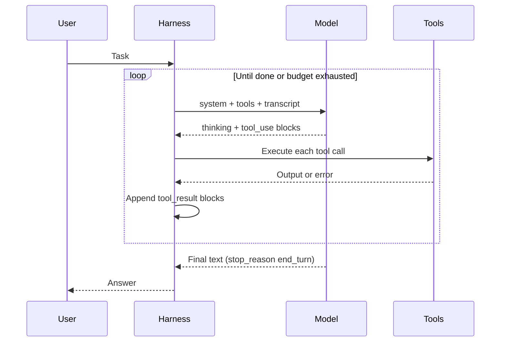

Strip away the frameworks, the marketing and the multi-agent diagrams, and almost every AI agent comes down to a loop of a couple dozen lines. Call the model. If it asks for a tool, run the tool and hand back the result. Repeat until it says it's done. That's the engine behind coding agents that fix bugs across a repository, research agents that read fifty sources, and support agents that issue refunds.

The loop is simple. Getting it *right* is not. When does it stop? What happens when a tool throws an exception? How do you keep a runaway agent from making 400 calls overnight? Which parts are the model's job and which are yours? This lesson answers those questions and ends with a compact loop you can run. The full production build, with streaming, context management and permissions, comes later in [build an agent from scratch](build-agent-from-scratch.html).

## Perceive, Think, Act

Classical agents run a **perceive–think–act** cycle: sense the environment, decide, act, and sense the consequences. An LLM agent does the same thing with API calls:

| Phase | Classical agent | LLM agent |
|---|---|---|
| **Perceive** | Read sensors | The harness puts the task and all tool results so far into the context window |
| **Think** | Run the decision procedure | The model reasons (optionally with explicit thinking) about what to do next |
| **Act** | Drive actuators | The model emits a tool call, which the harness executes |
| **Observe** | Sense the new state | The tool's output is appended to the transcript as the next percept |

The cycle repeats until the model decides it has met the goal and answers without requesting a tool, or until the harness stops it.



## The Core Loop

In pseudocode:

```text
messages = [user_task]
loop:
    response = model(system, tools, messages)
    messages.append(response)                 # the model's turn, including tool calls
    if response asks for no tools: return response.text
    results = [run(tool_call) for each tool_call in response]
    messages.append(results)                  # one turn holding every tool result
```

Three properties make this tiny loop powerful:

1. **The model chooses the path.** Nothing in the loop says "search, then read, then summarize." The model decides at each step based on what it has seen so far. This is what separates an agent from a [workflow](when-to-use-agents.html).
2. **The environment pushes back.** Every action produces an observation, so the model's next decision rests on reality rather than its assumptions.
3. **The transcript is the state.** Because the model is stateless, the growing message list *is* the agent's memory of this task.

## Anatomy of a Transcript

Let's watch a transcript grow, using the Anthropic Messages API format. The user asks: "Is the `requests` version pinned in this project, and is it the latest major version?"

**Call 1.** The harness sends the task:

```json
[
  {"role": "user", "content": "Is the requests version pinned in this project, and is it the latest major version?"}
]
```

The model replies with a short note and a tool call. Its `stop_reason` is `tool_use`:

```json
{"role": "assistant", "content": [
  {"type": "text", "text": "Let me check the dependency files."},
  {"type": "tool_use", "id": "toolu_01A", "name": "read_file", "input": {"path": "requirements.txt"}}
]}
```

**Call 2.** The harness appends that assistant message *unchanged*, runs the tool, and appends a `user` message containing a `tool_result` that references the call's `id`:

```json
{"role": "user", "content": [
  {"type": "tool_result", "tool_use_id": "toolu_01A", "content": "requests==2.31.0\nflask>=3.0\n"}
]}
```

The model now knows the pin. To answer the second half it might call a `web_search` tool, then finish:

```json
{"role": "assistant", "content": [
  {"type": "text", "text": "Yes. requirements.txt pins requests==2.31.0. According to the search results, the latest release is on the same major version (2.x), so..."}
]}
```

with `stop_reason` `end_turn`. The loop exits.

Rules that trip people up:

- **Tool results go in a `user` message.** The API alternates user and assistant turns, and tool output counts as input to the model.
- **Every `tool_use` needs a matching `tool_result`** with the same `tool_use_id`, in the very next user message. Missing or mismatched IDs cause API errors.
- **When the model makes several tool calls in one turn, return all the results together in one user message.** Splitting them across messages breaks the pairing and teaches the model to stop making parallel calls.
- **Append the assistant content unchanged**, including any `thinking` blocks. Current models need their thinking blocks passed back intact to continue reasoning coherently across tool calls.

## A ReAct-Style Trace

The **ReAct** pattern (Yao et al., 2022) describes this loop as Thought → Action → Observation. Here's what an agent investigating a failing deployment looks like, rendered in that style:

```text
Task: The nightly deploy failed. Find out why and suggest a fix.

Thought: Start with the most recent deploy log.
Action: get_deploy_logs({"pipeline": "nightly", "limit": 1})
Observation: Step "migrate" failed: relation "invoices_v2" already exists (exit 1)

Thought: A migration is trying to create a table that exists. Check which migration and
         whether it already ran.
Action: run_sql({"query": "SELECT version FROM schema_migrations ORDER BY version DESC LIMIT 3"})
Observation: 20261118_add_invoice_index, 20261117_create_invoices_v2, 20261110_users_email

Thought: 20261117 is recorded as applied, yet the deploy ran it again. Maybe there are two
         files with the same migration.
Action: search_files({"pattern": "create_invoices_v2", "path": "db/migrations"})
Observation: db/migrations/20261117_create_invoices_v2.sql
             db/migrations/20261121_create_invoices_v2.sql

Thought: A duplicate migration was added on 11/21 with a new timestamp. That's the cause.
Final: The deploy failed because db/migrations/20261121_create_invoices_v2.sql duplicates
       an already-applied migration (20261117). Delete the duplicate, or make it idempotent
       with CREATE TABLE IF NOT EXISTS, then re-run the pipeline.
```

Three things to notice. Each Thought is driven by the previous Observation. The agent tested a hypothesis ("maybe there are two files") instead of guessing. And it stopped as soon as it had enough evidence, which is good behavior you should reward in your prompts.

In modern APIs, the "Thought" lines are a mix of visible text and the model's internal **thinking**, and "Action" is a structured `tool_use` block rather than parsed text. The pattern is the same.

## Model vs. Harness: Who Does What

The most important architectural idea in this lesson is the division of labor:

| The model decides | The harness decides and enforces |
|---|---|
| Which tool to call next, with what arguments | Which tools exist and what they're allowed to do |
| How to interpret a tool result | How tool output is formatted, truncated or summarized |
| When the task is done | Hard limits: max steps, tokens, dollars, wall-clock time |
| When to ask the user a question | Which actions need human approval |
| How to recover from an error it sees | Retries for transient infrastructure errors |
| What to say in the final answer | What context goes into the next call (compaction, memory) |
| | Logging, tracing and audit |

> [!KEY] The big idea
> The model proposes; the harness disposes. Anything that *must* hold (a budget, a permission, a safety rule, a format) belongs in the harness as code, not in the prompt as a hope. Prompts steer behavior. Code guarantees it.

For example, "never delete files outside the project directory" in a system prompt is a request. A `delete_file` tool that resolves the path and refuses anything outside the project root is a guarantee. You want both (see [guardrails and sandboxing](guardrails-and-sandboxing.html)).

Try it yourself: step through the loop below and watch which component acts at each stage, and how the transcript grows.

<div class="widget" data-widget="agent-loop"></div>

## Stop Conditions and Termination

An agent loop has to end. There are two families of stopping: the model decides it's done, or the harness stops it.

### Model-driven stops: the stop reason

Every Messages API response includes `stop_reason`. A correct loop handles each value:

| `stop_reason` | Meaning | Loop action |
|---|---|---|
| `tool_use` | The model wants one or more tools run | Execute them, append results, continue |
| `end_turn` | The model finished its turn | Done: return the final text |
| `max_tokens` | Output hit your `max_tokens` cap mid-response | Treat as incomplete. Raise the cap, or stop and report; don't execute a truncated tool call |
| `pause_turn` | A long-running server-side tool turn paused | Append the assistant content and call again so it can resume |
| `refusal` | The model declined for safety reasons | Stop; surface it to the user or log it; don't retry blindly |
| `stop_sequence` | A custom stop sequence you set was produced | Handle per your design |

### Harness-driven stops: budgets and guards

Nothing guarantees a model converges. It can loop on a failing approach, keep "just checking one more thing," or wait for a condition that never comes. The harness must bound every run:

- **Max steps (iterations).** The simplest and most essential guard. Typical values range from about 10 for narrow tasks to hundreds for long coding sessions.
- **Token or cost budget.** Sum `response.usage` across calls and stop when you exceed a limit. This matters because a single step can be expensive when contexts are large.
- **Wall-clock timeout.** For both the whole run and each tool call. A hung `curl` shouldn't hang your agent.
- **Loop detection.** The same tool called with identical arguments three times in a row is a strong signal the agent is stuck. You can stop, or inject a message telling the model it's repeating itself.
- **Human interruption.** A way for a user or operator to cancel a run.

When the harness stops a run, fail *informatively*. Return what the agent accomplished, why it stopped, and the transcript for debugging, rather than a bare error.

> [!WARNING]
> An agent without a step or cost limit is a production incident waiting to happen. Every loop you write, even a quick prototype, should have a `max_steps` guard from the first line.

## Observations: Formatting Tool Results

The model's next decision can only be as good as what it observes. Tool results are prompts, and they deserve the same care:

- **Be concise.** A 2 MB log dumped into context costs money, pushes out useful information and dilutes attention. Truncate, paginate or summarize, and *say* that you did: `"[showing first 200 of 15,302 lines; use offset to see more]"`.
- **Be structured and consistent.** Stable formats (compact JSON, or labeled lines) are easier to parse than ad-hoc prose.
- **Include identifiers the model will need next.** If the next step needs an order ID, file path or line number, include it.
- **Prefer meaningful values to opaque ones.** `"status": "payment_failed: card expired"` beats `"status": 4`.
- **State empty results explicitly.** `"No files matched 'invoice_v3' in src/"` is far better than an empty string, which models can misread.

Tool design is covered in depth in [designing tools](designing-tools.html). The principle for now: **the observation is the agent's only window onto the world**, so make it clear.

## Errors Are Observations

Beginners often let tool exceptions crash the loop. Instead, return errors to the model as observations, marked with `is_error: true`:

```json
{"type": "tool_result", "tool_use_id": "toolu_07", "is_error": true,
 "content": "FileNotFoundError: src/config.yml does not exist. Files in src/: config.yaml, main.py"}
```

The model will typically recover on the next step, for example by reading `config.yaml`. That only works if the error is **actionable**: say what went wrong and, ideally, what would work instead. "Error" alone teaches nothing. "Invalid date '2026-13-01': month must be 1–12" lets the model fix its call.

There are two kinds of error to tell apart:

| Error type | Example | Who handles it |
|---|---|---|
| **Model-fixable** | Wrong path, bad argument, failed assertion, permission denied | Return to the model as `is_error` so it can adapt |
| **Infrastructure** | Rate limit, network blip, API 5xx | The harness retries with backoff, usually invisibly to the model |

The Anthropic SDK already retries transient API errors (connection errors, 429s and 5xx) with exponential backoff. Your own tools need the same discipline: retry transient failures in code, and surface meaningful failures to the model.

## Interleaved Thinking

With reasoning models, the "think" phase can be explicit. On current Claude models, thinking is **adaptive**: the model decides when and how much to reason, including *between* tool calls. After each observation it can think through what the result means before choosing the next action:

```text
[thinking] The test failed with KeyError: 'DATABASE_URL'. The settings module reads
           env vars at import time, and the test runner doesn't load .env. Two options:
           load .env in conftest.py, or set the var in the test config. The project
           already uses pytest-env according to pyproject.toml, so use that.
[tool_use] edit_file(pyproject.toml, ...)
```

This **interleaved thinking** is a large part of why modern agents recover from surprises much better than 2023-era ones. Two practical notes:

- Always pass thinking blocks back unchanged in the assistant message. Appending `response.content` as-is does this for you.
- Control the overall depth with `output_config={"effort": ...}`: lower for fast, routine loops and higher for hard debugging or planning.

## State: What the Loop Remembers

Within a single run, the **transcript is the state**. But real agents usually keep state in several places:

- **The transcript**: messages, tool calls and results. Short-term working memory.
- **The environment itself**: files written, tickets updated, branches created. Often the most reliable state, because it can be re-observed.
- **Harness variables**: step count, token spend, start time, approval decisions. Never shown to the model unless you choose to.
- **External memory**: notes, to-do lists or progress files the agent writes so it can resume later or survive context compaction (see [memory](memory.html)).

As runs get longer, the transcript outgrows the context window and has to be compacted or pruned. That's the subject of [context engineering](context-engineering.html).

## A Compact Agent Loop in Python

Here is a small but correct loop using the Anthropic Python SDK. It gives the model two read-only tools for exploring a project directory, handles every stop reason, returns errors as observations, and enforces a step limit.

```python
import pathlib
import anthropic

client = anthropic.Anthropic()          # reads ANTHROPIC_API_KEY
ROOT = pathlib.Path(".").resolve()       # the only directory the agent may read
MAX_STEPS = 20

TOOLS = [
    {"name": "list_dir",
     "description": "List entries in a project directory (relative path). Use '.' for the root.",
     "input_schema": {"type": "object", "properties": {"path": {"type": "string"}},
                      "required": ["path"]}},
    {"name": "read_file",
     "description": "Read a UTF-8 text file (relative path). Output is truncated at 20,000 characters.",
     "input_schema": {"type": "object", "properties": {"path": {"type": "string"}},
                      "required": ["path"]}},
]

def safe_path(rel: str) -> pathlib.Path:
    p = (ROOT / rel).resolve()
    if not p.is_relative_to(ROOT):                 # harness-enforced boundary
        raise PermissionError(f"{rel} is outside the project directory")
    return p

def run_tool(name: str, args: dict) -> str:
    if name == "list_dir":
        entries = sorted(e.name + ("/" if e.is_dir() else "") for e in safe_path(args["path"]).iterdir())
        return "\n".join(entries) or "(empty directory)"
    if name == "read_file":
        text = safe_path(args["path"]).read_text(encoding="utf-8")
        return text[:20_000] + ("\n[truncated]" if len(text) > 20_000 else "")
    raise ValueError(f"Unknown tool: {name}")

def run_agent(task: str) -> str:
    messages = [{"role": "user", "content": task}]
    for _ in range(MAX_STEPS):
        response = client.messages.create(
            model="claude-opus-5-5", max_tokens=16000, tools=TOOLS, messages=messages,
            system="You answer questions about the codebase in the current directory. "
                   "Read files before making claims about them. Be concise.",
        )
        messages.append({"role": "assistant", "content": response.content})  # unchanged

        if response.stop_reason == "end_turn":
            return "".join(b.text for b in response.content if b.type == "text")
        if response.stop_reason == "pause_turn":
            continue                                  # resume a paused server-side turn
        if response.stop_reason == "refusal":
            return "[The model declined this request.]"
        if response.stop_reason == "max_tokens":
            return "[Stopped: response hit max_tokens before finishing.]"
        if response.stop_reason != "tool_use":        # e.g. stop_sequence: nothing to run
            return f"[Stopped: unexpected stop_reason {response.stop_reason!r}.]"

        results = []                                  # stop_reason == "tool_use"
        for block in response.content:
            if block.type != "tool_use":
                continue
            try:
                output, is_error = run_tool(block.name, block.input), False
            except Exception as exc:                  # errors become observations
                output, is_error = f"{type(exc).__name__}: {exc}", True
            results.append({"type": "tool_result", "tool_use_id": block.id,
                            "content": output, "is_error": is_error})
        messages.append({"role": "user", "content": results})  # all results, one message
    return f"[Stopped: reached the {MAX_STEPS}-step limit without finishing.]"

if __name__ == "__main__":
    print(run_agent("What does this project do, and where is its entry point?"))
```

Here's what each piece does:

- **The `for` loop with `MAX_STEPS`** is the termination guarantee. The model gets at most 20 calls.
- **`messages.append(... response.content)`** keeps the model's turn exactly as returned, including any thinking blocks.
- **The stop-reason branches** cover every outcome. Only a `tool_use` turn reaches tool execution; anything unexpected stops informatively instead of sending an empty result message.
- **`safe_path`** is a harness-enforced permission, so the model can't read `/etc/passwd` however it's prompted.
- **`try/except`** turns failures into `is_error` observations the model can learn from within the run.
- **One user message with every result** keeps parallel tool calls correctly paired.

> [!TIP] Don't always hand-roll it
> The Anthropic SDK's **tool runner** (`client.beta.messages.tool_runner(...)` with `@beta_tool`-decorated functions) runs this loop for you, and agent SDKs add context management, permissions and more. Write the manual loop once so you understand it, then use the higher-level tools where they fit (see [SDK hands-on](sdk-hands-on.html) and [agent frameworks](agent-frameworks.html)).

## Common Loop Bugs

| Symptom | Likely cause | Fix |
|---|---|---|
| API error about missing `tool_result` | A `tool_use` wasn't answered, or results were split across messages | Return one result per `tool_use` id, all in one user message |
| Agent "forgets" its reasoning mid-task | Thinking blocks stripped or the assistant content modified | Append `response.content` unchanged |
| Runs forever or racks up huge bills | No step or cost limit | Add `max_steps`, token budgets and timeouts |
| Crashes on a bad file path | Exceptions not caught | Return errors as `is_error` observations |
| Agent claims success without evidence | Prompt doesn't require verification; no check in the harness | Instruct "verify before claiming", and check critical claims in code |
| Same call repeated endlessly | Unhelpful error messages, or a stuck strategy | Make errors actionable; detect repeats and intervene |
| Context overflows on long tasks | Raw, unbounded tool outputs | Truncate and paginate results; compact history |

## Key Takeaways

- Every agent is a **perceive–think–act loop**: call the model, run the requested tools, feed back the results, repeat.
- The **transcript is the state**. Append assistant content unchanged, and return every `tool_result` for a turn in **one** user message with matching `tool_use_id`s.
- **The model proposes, the harness disposes.** Budgets, permissions and safety rules belong in code.
- Handle **every stop reason** (`tool_use`, `end_turn`, `max_tokens`, `pause_turn`, `refusal`), and always enforce **step, cost and time limits**.
- **Errors are observations.** Return actionable errors with `is_error: true` so the agent can recover, and let the harness retry transient infrastructure failures.
- **Observation quality drives decision quality.** Keep tool results concise, structured and explicit.
- **Interleaved thinking** lets the model interpret each result before acting, which is a major source of modern agents' robustness.

## Exercises

1. **Trace it by hand.** Write out the full message list (JSON) for a three-step run in which the agent lists a directory, reads two files *in parallel* in one turn, then answers. Check that every `tool_use` id has a matching `tool_result`.
2. **Add a cost budget.** Extend the loop to sum `response.usage.input_tokens` and `response.usage.output_tokens` across calls and stop with an informative message once the total exceeds 200,000 tokens.
3. **Detect loops.** Add a guard that notices when the same tool is called with identical input three times in a row. Instead of stopping, inject a short note into the next tool result telling the model it's repeating itself. Does the agent change strategy?
4. **Make errors actionable.** Change `read_file` so that on `FileNotFoundError` it returns the closest matching filenames in that directory (hint: `difflib.get_close_matches`). Compare how many steps the agent needs to recover from a typo'd path before and after.
5. **Stretch: approval gate.** Add a `write_file` tool. Before executing it, have the harness print the proposed change and ask for `y/n` on stdin. On "n", return `is_error: true` with "User declined this change", and observe how the model adapts. Which stop conditions and guards does a write-capable agent need that a read-only one doesn't?

<details class="solutions">
<summary>Hints and solution sketches</summary>

1. **Hint:** Three model calls means three assistant messages; the parallel step is *one* assistant message with two `tool_use` blocks, answered by *one* user message with two `tool_result` blocks. **Sketch:** Seven messages in total, alternating user/assistant, with ids paired `toolu_01`→`toolu_01`, `toolu_02`→`toolu_02`, `toolu_03`→`toolu_03`. The last assistant turn has `stop_reason` `end_turn` and no `tool_use`.

    ```json
    [
      {"role": "user", "content": "What does this project do?"},
      {"role": "assistant", "content": [
        {"type": "tool_use", "id": "toolu_01", "name": "list_dir", "input": {"path": "."}}]},
      {"role": "user", "content": [
        {"type": "tool_result", "tool_use_id": "toolu_01", "content": "README.md\nmain.py\nsrc/"}]},
      {"role": "assistant", "content": [
        {"type": "tool_use", "id": "toolu_02", "name": "read_file", "input": {"path": "README.md"}},
        {"type": "tool_use", "id": "toolu_03", "name": "read_file", "input": {"path": "main.py"}}]},
      {"role": "user", "content": [
        {"type": "tool_result", "tool_use_id": "toolu_02", "content": "# tidy: cleans up Git branches..."},
        {"type": "tool_result", "tool_use_id": "toolu_03", "content": "import sys\n..."}]},
      {"role": "assistant", "content": [
        {"type": "text", "text": "It's a CLI that tidies Git branches; the entry point is main.py."}]}
    ]
    ```

2. **Hint:** Keep a running total in `run_agent`, update it right after each `messages.create`, and check it before executing more tools (if the model already finished, just return its answer). **Sketch:** Stop with a message that says how much was spent and why it stopped. If you later add prompt caching, also count `cache_read_input_tokens` and `cache_creation_input_tokens`, since `input_tokens` then covers only the uncached part.

    ```python
    TOKEN_BUDGET = 200_000

    def run_agent(task: str) -> str:
        messages = [{"role": "user", "content": task}]
        used = 0
        for step in range(MAX_STEPS):
            response = client.messages.create(...)  # same call as above
            used += response.usage.input_tokens + response.usage.output_tokens
            messages.append({"role": "assistant", "content": response.content})
            # ... end_turn / pause_turn / refusal / max_tokens branches as before ...
            if used > TOKEN_BUDGET:  # checked before running any more tools
                return (f"[Stopped: used {used:,} tokens, over the {TOKEN_BUDGET:,} budget, "
                        f"after {step + 1} model calls.]")
            # ... execute tools and append results as before ...
    ```

3. **Hint:** Normalize each call to a hashable key (tool name plus `json.dumps(input, sort_keys=True)`) and keep the last three in a `deque(maxlen=3)`. **Sketch:** When all three keys match, append a note to that call's `tool_result` content rather than stopping. Usually the model reacts by trying a different path, argument or tool; keep `MAX_STEPS` as the backstop in case it doesn't.

    ```python
    import json
    from collections import deque

    recent = deque(maxlen=3)  # create once per run, before the loop

    # inside the tool-execution loop, after computing `output` for `block`:
    key = (block.name, json.dumps(block.input, sort_keys=True))
    recent.append(key)
    if len(recent) == 3 and len(set(recent)) == 1:
        output += ("\n[Harness note: you have made this exact call 3 times in a row "
                   "and got the same result. Try a different approach.]")
    ```

4. **Hint:** Catch the error inside the tool, look in the parent directory, and re-raise with a better message; the loop's `try/except` already turns it into an `is_error` result. **Sketch:** Before, a typo like `src/confg.py` usually costs an extra `list_dir` call before the retry; after, the error says "Did you mean: config.py?" and the model typically fixes the path on the very next step, saving about one step per typo.

    ```python
    import difflib

    def read_file(rel: str) -> str:
        p = safe_path(rel)
        try:
            text = p.read_text(encoding="utf-8")
        except FileNotFoundError:
            names = sorted(e.name for e in p.parent.iterdir()) if p.parent.is_dir() else []
            close = difflib.get_close_matches(p.name, names, n=3)
            hint = f"Did you mean: {', '.join(close)}?" if close else f"Files here: {', '.join(names[:20])}"
            raise FileNotFoundError(f"{rel} does not exist. {hint}") from None
        return text[:20_000] + ("\n[truncated]" if len(text) > 20_000 else "")
    ```

5. **Hint:** Put the approval inside the tool's implementation so the model cannot skip it, and make a decline an ordinary error observation. **Sketch:** On "n" the model usually explains, asks what you'd prefer, or proposes a smaller change. A write-capable agent additionally needs: the path boundary enforced on writes too; a cap on file size and on the number of writes per run; an undo path (a Git checkpoint or backup before writing); verification after writing (re-read, run tests); and a stop condition for repeated declines, such as ending the run after two refusals rather than letting it retry variations of the same change.

    ```python
    class UserDeclined(Exception):
        pass

    def write_file(args: dict) -> str:
        path = safe_path(args["path"])  # same boundary as the read tools
        print(f"--- proposed write to {args['path']} ---\n{args['content'][:2000]}")
        if input("Apply this change? [y/n] ").strip().lower() != "y":
            raise UserDeclined("User declined this change")  # becomes is_error: true
        path.write_text(args["content"], encoding="utf-8")
        return f"Wrote {len(args['content'])} characters to {args['path']}"
    ```

</details>

## Check Your Understanding

```quiz
Q: The model returns three tool_use blocks in one response. How should the harness send the results back?
- [ ] Three user messages, one per result, in the order the calls appeared
- [x] One user message, three tool_result blocks, each with its tool_use_id
- [ ] One user message with a single tool_result that combines all outputs
- [ ] One assistant message that lists all three outputs after the calls
E: Results for one assistant turn go back together in a single user message, one tool_result per call, each paired with its tool_use_id. Separate messages break the pairing (and discourage parallel calls); a single combined result leaves two ids unanswered; and tool results are input to the model, so they never go in an assistant message.

Q: A tool raises FileNotFoundError. What is usually the best harness behavior?
- [ ] Retry the same call with exponential backoff until it succeeds
- [ ] Stop the run and report the exception so a developer can debug it
- [x] Return it as an is_error tool_result with an actionable message
- [ ] Drop the failed call and send only the results of calls that worked
E: Errors are observations. A clear, actionable error lets the model fix its call, for example by using the right filename. Backoff retries suit transient infrastructure errors, not a wrong path that will fail every time. Dropping the result leaves a tool_use unanswered, which the API rejects.

Q: Which of these belongs in the harness as code rather than only in the system prompt?
- [ ] Guidance on which tool to try first for each common kind of task
- [x] A spending cap, and a ban on writes outside the project directory
- [ ] The agent's tone of voice and how much detail it puts in answers
- [ ] A description of the user's goal and what a good result looks like
E: Anything that must hold regardless of what the model does (budgets, permissions, safety boundaries) should be enforced in code. Tool hints, tone and goals steer behavior, so they belong in the prompt. Prompts steer; code guarantees.

Q: The response has stop_reason "max_tokens" and its last block is a partially generated tool call. What should the loop do?
- [ ] Run the call if its input parses as JSON, since the arguments may be done
- [ ] Treat the turn as end_turn and return whatever text the model produced
- [x] Treat it as incomplete: don't run it; raise the cap, or stop and report
- [ ] Delete the partial tool_use block, then continue the loop as normal
E: max_tokens means the output was cut off, so even input that happens to parse may be missing fields or content. The loop should raise max_tokens and retry, or stop informatively. Returning the text as final hides an unfinished turn.

Q: Why must the assistant's content be appended to the transcript exactly as returned?
- [ ] Prompt caching only works when every assistant message is byte-identical
- [x] Tool_use ids must match results, and thinking blocks must stay intact
- [ ] The API rejects any assistant turn whose text differs from what it sent
- [ ] Edited text makes the model lose track of which user it is talking to
E: The pairing between tool_use and tool_result depends on the ids, and current models rely on their own thinking blocks being returned unchanged across tool calls. Caching benefits from a stable prefix, but that's a cost effect, not the reason the content must be preserved.

Q: Which observation format is likely to help the agent most?
- [ ] An empty string, which is the cheapest thing to send
- [ ] The full 3 MB raw log, so nothing is missing
- [x] "No matches for 'invoice_v3' in src/ (214 files)"
- [ ] {"status": 4}, a compact machine-readable code
E: Explicit, concise, informative observations prevent misreadings and wasted steps. Empty strings and opaque codes invite confusion, however cheap or compact they are, and giant dumps waste context and dilute attention.

Q: An agent keeps calling search_files with the same arguments. What is the most robust response?
- [ ] Raise max_tokens so the model has room to plan its way out of the loop
- [ ] Add "never repeat a tool call" to the system prompt and rerun the task
- [x] Detect repeats in the harness and stop or nudge, plus a step limit
- [ ] Switch to a larger model, which is less likely to get stuck in loops
E: A prompt rule or a stronger model may reduce looping, but neither guarantees it stops. Loop detection plus hard budgets in the harness keeps a stuck agent from burning time and money, and a nudge often gets it to change strategy.
```

## Further Reading

- [ReAct: Synergizing Reasoning and Acting in Language Models (Yao et al., 2022)](https://arxiv.org/abs/2210.03629): the paper behind the Thought/Action/Observation loop.
- [Building Effective Agents (Anthropic, 2024)](https://www.anthropic.com/engineering/building-effective-agents): why the simple loop with good tools usually beats elaborate frameworks.
- [Tool use overview (Claude docs)](https://platform.claude.com/docs/en/agents-and-tools/tool-use/overview): the authoritative reference for tool_use and tool_result message formats.
- [Adaptive thinking (Claude docs)](https://platform.claude.com/docs/en/build-with-claude/adaptive-thinking): how thinking and effort work across tool calls.
- [Anthropic Python SDK](https://github.com/anthropics/anthropic-sdk-python): source, examples and the tool runner helper.
- [SWE-agent: Agent-Computer Interfaces Enable Automated Software Engineering (Yang et al., 2024)](https://arxiv.org/abs/2405.15793): shows how much observation and action design matters inside the loop.
- [How we built our multi-agent research system (Anthropic, 2025)](https://www.anthropic.com/engineering/multi-agent-research-system): production lessons on loops, stopping, and tool-call budgets at scale.
