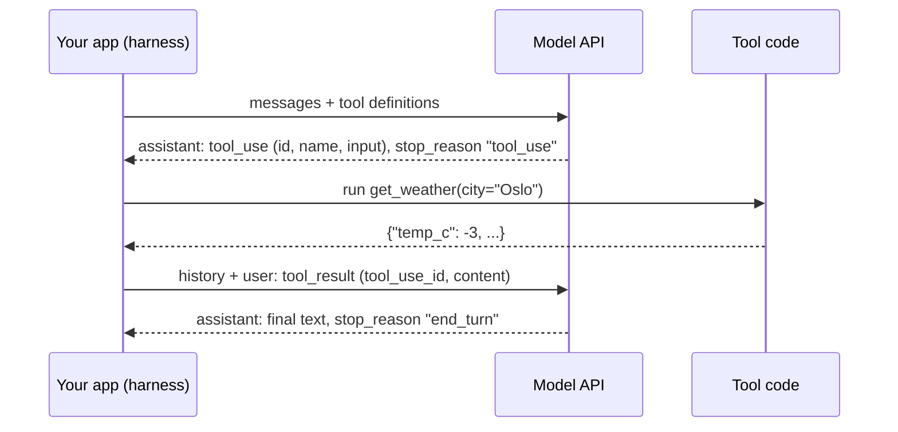

A language model, by itself, can only do one thing: produce text. It can't check the weather, query a database, send an email or run code. And yet agents do all of those things every day. The bridge is **tool use** (also called **function calling**): you describe some functions to the model, the model replies with a structured request to call one, your code runs it, and you hand the result back. Repeat until the job is done.

That simple handshake is the most important mechanism in this entire course. Everything an agent does in the world — browsing, coding, booking, researching — happens through it. If [the agent loop](the-agent-loop.html) is the heartbeat of an agent, tool calls are its hands.

In this lesson you'll learn exactly what happens in a tool call, byte by byte: how tools are defined with JSON Schema, how the request/response cycle works, how to handle multiple calls at once and errors gracefully, what "strict" mode guarantees, the different kinds of tools (including ones that run on the provider's servers), and the bugs that bite almost everyone the first time. You'll finish with a complete, runnable agent in Python.

## The Core Idea: The Model Asks, Your Code Acts

Think of the model as a very capable manager who can't leave their office. They can't do anything physically, but they can write precise work orders: "Call the weather service for Oslo and tell me what it says." You — the program around the model, usually called the **harness** — read the work order, do the work, and slide the result back under the door.

Concretely:

1. You send the model a conversation **plus a list of tool definitions** (name, description, parameter schema).
2. If the model decides a tool would help, it stops generating prose and emits a **structured tool call**: the tool's name and a JSON object of arguments.
3. Your code validates the arguments, **executes the real function**, and sends the output back as a **tool result**.
4. The model reads the result and either calls more tools or writes its final answer.

```text
User: Should I bring a jacket to Oslo today?
Model → tool call: get_weather({"city": "Oslo, Norway"})
Harness runs get_weather → {"temp_c": -3, "conditions": "snow", "wind_kph": 18}
Model: Yes — it's -3 °C and snowing in Oslo, with a cold wind. Bring a warm,
       waterproof jacket.
```

Two consequences of this design are worth internalizing early:

- **The model never executes anything.** It only *proposes*. Your harness decides whether to run the call, can modify or refuse it, and controls credentials, sandboxes and approvals. That is where safety lives (see [guardrails and sandboxing](guardrails-and-sandboxing.html)).
- **The model only knows what you tell it.** It chooses tools based on their names, descriptions and schemas, and it knows the outcome only through the result you send back. Writing those well is a skill in its own right — the subject of [designing tools](designing-tools.html).

> [!KEY] The big idea
> Function calling is a protocol, not magic: the model emits a structured request, the harness executes it and returns the result as a new message. Everything else — parallel calls, errors, server tools, tool runners — is a variation on that handshake.

## How Models Learn to Call Functions

Early experiments made models call tools by prompting them to write something like `ACTION: search[query]` and then parsing it with regular expressions. It worked, sometimes. Modern function calling is far more reliable because it is **trained in**.

Under the hood, the API renders your tool definitions into the model's context in a format the model was trained on (Anthropic's docs describe tool definitions as being placed into a special system prompt, which is why tools count toward your input tokens). When the model decides to use a tool, it emits the call in a learned, structured format, and the API parses that into a clean `tool_use` object for you. You never see the raw format.

The model learns this through several kinds of training (the [training agents](training-agents.html) lesson goes deeper):

- **Supervised fine-tuning on tool-use transcripts.** Demonstrations of when to call which tool with which arguments, and how to use the results. Research such as *Toolformer* (2023) showed models can even bootstrap this by labeling where API calls would have helped, and *Gorilla* trained models to call real APIs from their documentation.
- **Reinforcement learning in environments.** The model attempts multi-step tasks with real or simulated tools and is rewarded for actually succeeding. This is what teaches judgment: when *not* to call a tool, how to recover from an error, when to stop.
- **Constrained decoding (optionally).** For "strict" tools, the provider restricts which tokens the model may generate so the arguments are guaranteed to match your schema. More on this below and in [structured outputs](structured-outputs.html).

Benchmarks such as the Berkeley Function Calling Leaderboard and τ-bench measure how well models pick tools, fill arguments and complete multi-turn tool tasks; see [benchmarks](benchmarks.html).

## Defining a Tool with JSON Schema

A tool definition has three parts: a **name**, a **description**, and an **input schema** written in **JSON Schema**, a standard vocabulary for describing the shape of JSON data.

```json
{
  "name": "get_weather",
  "description": "Get the current weather for a city. Use this when the user asks about current conditions or temperature somewhere. Returns temperature in Celsius, a short conditions string and wind speed. Does not provide forecasts.",
  "input_schema": {
    "type": "object",
    "properties": {
      "city": {
        "type": "string",
        "description": "City name, optionally with country, e.g. 'Oslo, Norway'"
      },
      "include_wind": {
        "type": "boolean",
        "description": "Whether to include wind speed. Defaults to true."
      }
    },
    "required": ["city"]
  }
}
```

The JSON Schema features you'll use most:

| Keyword | Meaning | Example |
|---|---|---|
| `type` | `object`, `string`, `integer`, `number`, `boolean`, `array`, `null` | `"type": "integer"` |
| `properties` | The fields of an object, each with its own schema | `{"city": {...}}` |
| `required` | Which properties must be present | `["city"]` |
| `enum` | A fixed set of allowed values | `["celsius", "fahrenheit"]` |
| `description` | Human-language explanation of a field — the model reads this | `"ISO date, e.g. 2026-11-22"` |
| `items` | The schema for each element of an array | `{"type": "string"}` |
| `additionalProperties` | Whether unlisted fields are allowed | `false` |

The **description** fields do far more work than beginners expect. The model decides *whether* to call a tool almost entirely from its name and description, and fills arguments using the property descriptions. A vague description ("Gets weather") produces vague behavior. Good descriptions say what the tool does, when to use it, what it returns, and what it doesn't do.

## The Request/Response Cycle

Here is the full cycle between your application, the API and your tool code:



When the model wants a tool, the response's `stop_reason` is `"tool_use"` and its `content` contains one or more `tool_use` blocks, often after a short text block:

```json
{
  "role": "assistant",
  "stop_reason": "tool_use",
  "content": [
    {"type": "text", "text": "Let me check the weather in Oslo."},
    {
      "type": "tool_use",
      "id": "toolu_01A09q90qw90lq917835lq9",
      "name": "get_weather",
      "input": {"city": "Oslo, Norway"}
    }
  ]
}
```

You reply with a **user** message containing a `tool_result` block whose `tool_use_id` matches the call's `id`:

```json
{
  "role": "user",
  "content": [
    {
      "type": "tool_result",
      "tool_use_id": "toolu_01A09q90qw90lq917835lq9",
      "content": "{\"temp_c\": -3, \"conditions\": \"snow\", \"wind_kph\": 18}"
    }
  ]
}
```

Note the roles. The tool result goes in a *user* turn because, from the model's point of view, it is information arriving from the outside world. And the API is **stateless**: on every request you resend the full history, including the assistant's `tool_use` turn, so the model can match each result to the call that produced it.

Try it yourself: step through the anatomy of a tool call, from definition to final answer, and see which side produces each block.

<div class="widget" data-widget="tool-call-anatomy"></div>

## A Complete Working Example

Let's build a small agent with two tools: a (fake) weather lookup and a safe calculator. This is a manual loop, so every part of the protocol is visible.

```python
import ast
import json
import operator
import anthropic

client = anthropic.Anthropic()  # reads ANTHROPIC_API_KEY from the environment
MODEL = "claude-opus-5-5"

TOOLS = [
    {
        "name": "get_weather",
        "description": (
            "Get current weather for a city. Use when the user asks about current "
            "conditions or temperature. Returns JSON with temp_c, conditions and "
            "wind_kph. Does not provide forecasts."
        ),
        "strict": True,  # guarantee arguments match the schema
        "input_schema": {
            "type": "object",
            "properties": {
                "city": {"type": "string", "description": "City, e.g. 'Oslo, Norway'"},
            },
            "required": ["city"],
            "additionalProperties": False,
        },
    },
    {
        "name": "calculate",
        "description": (
            "Evaluate an arithmetic expression exactly. Use for any arithmetic "
            "instead of computing in your head. Supports numbers, + - * / ** and "
            "parentheses. Returns the numeric result as a string."
        ),
        "strict": True,
        "input_schema": {
            "type": "object",
            "properties": {
                "expression": {"type": "string", "description": "e.g. '(21 - 4) * 9 / 5'"},
            },
            "required": ["expression"],
            "additionalProperties": False,
        },
    },
]
```

Now the tool implementations. The calculator walks the parsed syntax tree instead of calling `eval`, because tool inputs are untrusted model output.

```python
FAKE_WEATHER = {
    "oslo": {"temp_c": -3, "conditions": "snow", "wind_kph": 18},
    "lisbon": {"temp_c": 17, "conditions": "sunny", "wind_kph": 9},
}

def get_weather(city: str) -> str:
    key = city.split(",")[0].strip().lower()
    if key not in FAKE_WEATHER:
        known = ", ".join(sorted(FAKE_WEATHER))
        raise LookupError(f"No data for '{city}'. Cities available: {known}.")
    return json.dumps(FAKE_WEATHER[key])

OPS = {ast.Add: operator.add, ast.Sub: operator.sub, ast.Mult: operator.mul,
       ast.Div: operator.truediv, ast.Pow: operator.pow, ast.USub: operator.neg}

def _eval(node):
    if isinstance(node, ast.Constant) and isinstance(node.value, (int, float)):
        return node.value
    if isinstance(node, ast.UnaryOp) and type(node.op) in OPS:
        return OPS[type(node.op)](_eval(node.operand))
    if isinstance(node, ast.BinOp) and type(node.op) in OPS:
        left, right = _eval(node.left), _eval(node.right)
        if isinstance(node.op, ast.Pow) and abs(right) > 100:
            raise ValueError("Exponent too large (max 100).")  # avoid 9**9**9
        return OPS[type(node.op)](left, right)
    raise ValueError("Only numbers, + - * / ** and parentheses are allowed.")

def calculate(expression: str) -> str:
    return str(_eval(ast.parse(expression, mode="eval").body))

HANDLERS = {"get_weather": get_weather, "calculate": calculate}
```

Finally, the loop. It runs every `tool_use` block in a response, sends **all** results back in **one** user message, reports failures with `is_error`, and handles every stop reason.

```python
def run_tool(block) -> dict:
    """Execute one tool_use block and wrap the outcome as a tool_result."""
    if block.name not in HANDLERS:
        return {"type": "tool_result", "tool_use_id": block.id,
                "content": f"Unknown tool '{block.name}'.", "is_error": True}
    try:
        output = HANDLERS[block.name](**block.input)
        return {"type": "tool_result", "tool_use_id": block.id, "content": output}
    except Exception as exc:  # report failures to the model instead of crashing
        return {"type": "tool_result", "tool_use_id": block.id,
                "content": f"Error: {exc}", "is_error": True}

def ask(question: str, max_steps: int = 10) -> str:
    messages = [{"role": "user", "content": question}]
    for _ in range(max_steps):
        response = client.messages.create(
            model=MODEL, max_tokens=16000, tools=TOOLS, messages=messages,
        )
        # Always append the full content (text, thinking and tool_use blocks).
        messages.append({"role": "assistant", "content": response.content})

        if response.stop_reason == "tool_use":
            results = [run_tool(b) for b in response.content if b.type == "tool_use"]
            messages.append({"role": "user", "content": results})  # one message
        elif response.stop_reason == "end_turn":
            return "".join(b.text for b in response.content if b.type == "text")
        elif response.stop_reason == "pause_turn":
            continue  # server-side tool paused; resend history to resume
        elif response.stop_reason == "max_tokens":
            raise RuntimeError("Output truncated; raise max_tokens.")
        elif response.stop_reason == "refusal":
            return "The model declined this request."  # never run its tool calls
        else:  # e.g. stop_sequence; looping on with an assistant turn last would fail
            raise RuntimeError(f"Unexpected stop_reason: {response.stop_reason}")
    raise RuntimeError(f"No final answer after {max_steps} steps.")

print(ask("Is it warmer in Lisbon or Oslo right now, and by how many °F?"))
```

A typical run:

```text
Step 1  Model → get_weather({"city": "Lisbon, Portugal"})
              → get_weather({"city": "Oslo, Norway"})        (parallel)
        Harness → two tool_results in one user message
Step 2  Model → calculate({"expression": "(17 - (-3)) * 9 / 5"})
        Harness → "36.0"
Step 3  Model: Lisbon is warmer: 17 °C and sunny vs -3 °C and snowing in
        Oslo, a difference of 20 °C, which is 36 °F.
```

Notice the model converted a temperature *difference* correctly (multiply by 9/5, no +32) and used the calculator rather than doing arithmetic in its head, because the description told it to.

## Parallel Tool Calls

In step 1 above, the model asked for two weather lookups in a single response. This is **parallel tool use**: when calls are independent, a model may emit several `tool_use` blocks at once. It saves round trips — two lookups cost one model turn instead of two.

The rules:

- **Run them all** (concurrently if they're independent and safe, e.g., with `asyncio.gather` or a thread pool).
- **Return every result in a single user message**, one `tool_result` per `tool_use_id`. Splitting results across multiple messages is a common bug that teaches the model, over the conversation, to stop making parallel calls.
- **Put the `tool_result` blocks first** in that message's content. If you want to add text (say, a note from the user), put it after the results.
- **Every call needs a result**, even if you decided not to run it. Return an `is_error` result such as "Skipped: user declined this action."

If parallel calls are unsafe in your harness (two tools that mutate the same resource), you can request at most one call per turn with `"disable_parallel_tool_use": true` inside `tool_choice`. Usually it's better to keep parallelism and serialize only the unsafe tools in your executor.

## Controlling Tool Use: tool_choice and Strict Mode

### tool_choice

The `tool_choice` parameter controls whether the model may use tools:

| Value | Behavior |
|---|---|
| `{"type": "auto"}` | The model decides (default) |
| `{"type": "none"}` | The model may not call tools this turn (e.g., force a final summary) |

Older APIs also offered *forcing* options — "must call some tool" (`any`) or "must call this specific tool". As of 2026, the latest Claude models reject forced tool choice with an error; other providers still offer equivalents. The modern approach is to steer with instructions ("Use the `get_weather` tool to answer") and, since `auto` never *guarantees* a call, check whether a `tool_use` block came back and re-prompt if it didn't. If you were forcing a tool only to get JSON out, use [structured outputs](structured-outputs.html) instead.

### Strict mode

By default, a model's tool arguments are almost always valid but not *guaranteed* to be: a field might be missing, or `"passengers": "two"` might appear where an integer was expected. Setting `"strict": true` on a tool turns on **schema-constrained decoding** for its arguments: the provider masks out any token that would violate the schema, so the input is guaranteed to parse and validate.

Strict mode has requirements: every object must set `"additionalProperties": false` and declare `required` fields, and some JSON Schema features (for example numeric bounds like `minimum`) aren't supported in the constrained grammar — the Python and TypeScript SDKs strip unsupported constraints from what they send and validate them client-side. A new schema also incurs a one-time compilation cost, after which it is cached. The [structured outputs](structured-outputs.html) lesson explains how constrained decoding works.

> [!TIP] Rule of thumb
> Turn on `strict` for tools whose arguments feed directly into code that would break on bad input (bookings, database writes, payments). Even then, validate semantics yourself: a schema can guarantee a date is a string in date format, not that it's in the future.

## Handling Errors with is_error

Tools fail: the city isn't found, the API times out, the user lacks permission. The worst thing a harness can do is crash the loop or return an empty string. The best thing is to tell the model what went wrong in words it can act on, with `"is_error": true`:

```json
{
  "type": "tool_result",
  "tool_use_id": "toolu_01A09q90qw90lq917835lq9",
  "content": "No data for 'Olso'. Cities available: lisbon, oslo.",
  "is_error": true
}
```

Given that, a model will usually correct itself ("Olso" → "Oslo") on the next step. Good error messages say what failed, why, and what would work instead; the [designing tools](designing-tools.html) lesson covers writing them. Three distinctions to keep straight:

- **Tool errors** (the function failed) → `is_error: true` result, loop continues.
- **Invalid input** (schema or semantic validation failed) → also an `is_error` result explaining the problem; don't run the tool.
- **API errors** (rate limits, network, authentication) → these happen *between* you and the API, not inside a tool. Retry with backoff in your client code (see [reliability](reliability.html)); the model never sees them.

## Three Kinds of Tools

So far, every tool has been one *you* defined and executed. There are actually three kinds, distinguished by **who defines the schema** and **who executes the call**.

| Kind | Who defines it | Who executes it | Examples |
|---|---|---|---|
| **Client tools** (user-defined) | You (JSON Schema) | Your harness | `get_weather`, `search_orders`, `create_ticket` |
| **Server tools** | The provider | The provider's servers | Web search, web fetch, code execution |
| **Anthropic-defined client tools** | Anthropic (schema built into the model) | Your harness | Bash, text editor, computer use, memory |

**Server tools** run inside the API call. You declare them and the provider handles execution and returns the results inline:

```python
response = client.messages.create(
    model="claude-opus-5-5",
    max_tokens=16000,
    tools=[
        {"type": "web_search_20260209", "name": "web_search"},
        {"type": "web_fetch_20260209", "name": "web_fetch"},
        {"type": "code_execution_20260521", "name": "code_execution"},
    ],
    messages=[{"role": "user", "content": "What changed in the latest Python release?"}],
)
```

The response contains `server_tool_use` blocks and their result blocks (for example `web_search_tool_result`) alongside the text — you don't send results back for these. Because the provider runs its own sampling loop, a long server-tool turn can end with `stop_reason: "pause_turn"`; you resend the conversation (with that assistant turn appended) and the server resumes. The example loop above already handles this. Server tools and your own client tools can be mixed in one request.

**Anthropic-defined client tools** are a middle ground. Claude has been trained on their exact interfaces — a `bash` tool that takes a `command`, a text editor with `view`/`create`/`str_replace`/`insert` commands, a computer-use toolset with screenshot, click and type actions, and a memory tool that reads and writes files in a `/memories` directory. You declare them by `type` and `name` with no schema, and your harness executes the actions — in a sandbox you control:

```python
tools = [
    {"type": "bash_20250124", "name": "bash"},
    {"type": "text_editor_20250728", "name": "str_replace_based_edit_tool"},
]
```

Since the model's training is built around these specific interfaces, they tend to work better than a home-made equivalent with the same purpose. The flip side: commands and paths they produce are untrusted model output, so run them in an isolated environment with an allowlist, timeouts and path confinement. The [coding agents](coding-agents.html) and [computer-use agents](computer-use-agents.html) lessons go deeper.

> [!NOTE]
> Tool `type` strings carry a date (`web_search_20260209`) because tool interfaces are versioned. Check the current docs for the newest version; old versions keep working for a while after new ones ship.

## The SDK Tool Runner

Writing the loop by hand is the best way to learn it. In practice, the SDKs provide a **tool runner** that runs the loop for you. In the Python SDK (beta as of 2026), you decorate ordinary typed functions with `@beta_tool`; the schema is generated from the signature and docstring:

```python
import ast
import anthropic
from anthropic import beta_tool

client = anthropic.Anthropic()

@beta_tool
def get_weather(city: str) -> str:
    """Get current weather for a city. Returns JSON with temp_c, conditions, wind_kph.

    Args:
        city: City name, optionally with country, e.g. 'Oslo, Norway'.
    """
    return '{"temp_c": -3, "conditions": "snow", "wind_kph": 18}'

@beta_tool
def calculate(expression: str) -> str:
    """Evaluate an arithmetic expression exactly. Use for any arithmetic.

    Args:
        expression: Arithmetic using numbers, + - * / ** and parentheses.
    """
    return str(_eval(ast.parse(expression, mode="eval").body))  # _eval from above

runner = client.beta.messages.tool_runner(
    model="claude-opus-5-5",
    max_tokens=16000,
    tools=[get_weather, calculate],
    messages=[{"role": "user", "content": "How cold is Oslo in °F?"}],
)
for message in runner:   # yields each assistant message as the loop runs
    print(message.stop_reason)
# or: final = runner.until_done()
```

The runner calls the API, executes requested tools, sends results back and stops when the model stops calling tools. It isn't a black box: each iteration yields the assistant message before its tools run, so you can log, inspect or intercept calls (for example, to require human approval). Reach for the manual loop when you need control the runner doesn't expose or want to avoid a beta dependency. The [SDK hands-on](sdk-hands-on.html) lesson covers the runner and agent SDKs in depth.

> [!NOTE] The runner and message threads
> In recent SDK releases (Python `anthropic` 2.2.0 and later), the tool runner uses **message threads** by default where the platform supports them: the API keeps the conversation for a few minutes, so each follow-up request sends only the new `tool_result` blocks instead of the whole transcript. This keeps requests small and time to first token steady; it doesn't change pricing. Two consequences: `system` and `tools` can't change mid-run (create a new runner instead), and if you inspect raw requests you'll see a `thread` field and only the newest messages. Pass `thread=False` to `tool_runner(...)` to turn it off. Your manual loop needs none of this — it re-sends the full history, which is always valid.

## The Same Idea Across Providers

Every major model provider implements the same handshake with different field names. Learn the concept once and the rest is vocabulary:

| Concept | Anthropic Messages API | OpenAI (Chat Completions / Responses) | Google Gemini API |
|---|---|---|---|
| Declare tools | `tools=[{name, description, input_schema}]` | `tools=[{"type": "function", ...}]` with a `parameters` JSON Schema | `tools=[{function_declarations: [...]}]` with `parameters` |
| Model requests a call | `tool_use` content block (`id`, `name`, `input` object) | `tool_calls` on the message (arguments as a **JSON string**) / `function_call` items | `functionCall` part (`name`, `args`) |
| Return a result | `tool_result` block in a user message, matched by `tool_use_id` | `role: "tool"` message with `tool_call_id` / `function_call_output` item | `functionResponse` part |
| Control | `tool_choice` | `tool_choice`, `parallel_tool_calls` | function-calling config (mode) |
| Schema guarantee | `strict: true` | `strict: true` | schema-constrained modes |

Small differences matter in practice. For example, OpenAI returns arguments as a JSON-encoded string you must parse (and handle parse failures for, if not using strict mode), while Anthropic returns a parsed object. Gemini's Python SDK can optionally execute Python functions for you automatically. APIs evolve quickly, so check each provider's current docs before relying on details.

Above the provider level, the **Model Context Protocol (MCP)** standardizes how tools are *served* to any compatible agent, so one tool server works with many hosts and models — see [protocols: MCP and A2A](protocols-mcp-a2a.html).

## Common Bugs (and Fixes)

Nearly everyone hits some of these. Most produce a 400 error; a few silently degrade behavior.

| Bug | Symptom | Fix |
|---|---|---|
| Not appending the assistant's `tool_use` turn before sending results | 400: tool_result with no matching tool_use | Append `response.content` in full, then the results |
| Appending only the text blocks of the assistant turn | Lost tool calls or thinking; errors or confused model | Append the whole `content` list unchanged |
| Mismatched or missing `tool_use_id` | 400 error | Echo each `block.id` exactly; return a result for every call |
| Results for parallel calls in separate user messages | Model stops parallelizing; sometimes errors | One user message containing all results |
| Text placed before `tool_result` blocks in the user message | 400 error | Results first, then any text |
| Raising exceptions out of the loop on tool failure | Agent crashes on the first bad input | Catch, return `is_error: true` with a helpful message |
| Ignoring `max_tokens` with a pending tool call | Truncated, partial arguments executed | Check `stop_reason`; retry with a higher limit, don't run the call |
| Running tool calls from a `refusal` turn | Executing a cut-off or declined request | Never execute tools when `stop_reason` is `"refusal"` |
| No step limit | Runaway loops and cost | Bound steps, tokens and time |
| Trusting tool input blindly | Path traversal, injection, unintended deletes | Validate inputs; sandbox execution; gate side effects |
| Dumping huge outputs into results | Context bloat, higher cost, worse focus | Truncate, paginate, summarize (see [designing tools](designing-tools.html)) |
| Changing the tool list mid-conversation | Prompt cache invalidated, higher latency | Keep tools stable; load extras with tool search |

## Key Takeaways

- Function calling is a handshake: the model emits a structured `tool_use` request; your harness executes it and returns a `tool_result`. The model never runs anything itself.
- Models call tools reliably because they're trained to, through fine-tuning on tool transcripts and reinforcement learning in tool environments.
- Tools are defined with a name, a description and a JSON Schema; descriptions drive both *whether* and *how* the model calls a tool.
- Run every call in a response and return all results in one user message, results first, each matched by `tool_use_id`.
- Report tool failures with `is_error: true` and an actionable message; keep API errors in your retry logic.
- Use `tool_choice` `auto`/`none` and steer with instructions; use `strict: true` when arguments must match the schema exactly.
- Distinguish client tools (you define and run), server tools (the provider runs) and Anthropic-defined client tools (trained-in schemas you run in your sandbox).
- The tool runner removes loop boilerplate; the concepts map directly onto other providers' function-calling APIs.

## Exercises

1. **Add a tool.** Extend the example with a `convert_units(value, from_unit, to_unit)` tool using an `enum` for units. Ask "How many miles is 42.195 km?" and confirm the model chooses your tool over `calculate`. Then tweak the descriptions to make it choose the other one, and explain why it changed.
2. **Break it on purpose.** Modify the loop to send each parallel result in its own user message, and separately to omit the assistant turn. Record the exact errors, then fix them. Write a one-line rule for each.
3. **Error recovery.** Make `get_weather` fail randomly 30% of the time with a timeout error. Compare a run where failures return `is_error` with a helpful message against one where they return an empty string. Count steps and final-answer quality across ten runs each.
4. **Human approval.** Add a `send_email(to, subject, body)` tool. Before executing it, print the arguments and ask for `y/n` on the terminal; on `n`, return an `is_error` result saying the user declined. Observe how the model responds to a declined action.
5. **Port it.** Re-implement the weather-plus-calculator agent on another provider's function-calling API, using their current quick-start docs. List every structural difference you had to handle (argument encoding, result roles, IDs, parallel-call behavior).

<details class="solutions">
<summary>Hints and solution sketches</summary>

1. **Hint:** The model picks between overlapping tools almost entirely from their descriptions, so the "when to use" sentence is the lever. **Sketch:** Add the tool and handler below; the answer is 42.195 km ≈ **26.2188 mi**. Because the description says "use this for any unit conversion instead of calculate", the model picks it. To flip the choice, change `calculate`'s description to "Use for all numeric work, including unit conversions" and narrow `convert_units` to "Only for conversions the user explicitly asks to be done with this tool" (or delete its "instead of calculate" line). The choice changes because the descriptions are the only information the model has about which tool fits.

    ```python
    TO_METERS = {"km": 1000, "mi": 1609.344, "m": 1, "ft": 0.3048}

    TOOLS.append({
        "name": "convert_units",
        "description": ("Convert a length between units. Use this for any unit conversion "
                        "instead of calculate. Returns the converted value with its unit."),
        "strict": True,
        "input_schema": {
            "type": "object",
            "properties": {"value": {"type": "number"},
                           "from_unit": {"type": "string", "enum": list(TO_METERS)},
                           "to_unit": {"type": "string", "enum": list(TO_METERS)}},
            "required": ["value", "from_unit", "to_unit"],
            "additionalProperties": False,
        },
    })
    HANDLERS["convert_units"] = lambda value, from_unit, to_unit: (
        f"{value * TO_METERS[from_unit] / TO_METERS[to_unit]:.4f} {to_unit}")
    ```

2. **Hint:** Use the Lisbon-vs-Oslo question, which reliably triggers two parallel calls, and copy the error messages verbatim from the exceptions the SDK raises. **Sketch:** Omitting the assistant turn gives a 400 `invalid_request_error`: the `tool_result` refers to a `tool_use_id` that doesn't appear in the previous assistant message. Splitting parallel results into separate user messages either produces a 400 about a `tool_use` without its `tool_result` in the very next message, or, where the API tolerates it, silently teaches the model to stop calling tools in parallel (see the Common Bugs table). Record what you actually observe. Rules: "Always append `response.content` unchanged before sending results" and "Return every result for a turn in one user message, results first, one per `tool_use_id`."
3. **Hint:** Raise the error inside `get_weather` so `run_tool` handles it; for the comparison, make a variant of `run_tool` that returns `"content": ""` without `is_error`. **Sketch:** With two lookups per run, about half of all runs (1 − 0.7² = 51%) see at least one failure. With helpful errors, the model typically retries the failed city and still answers correctly, costing about one extra step per failure. With empty strings, it tends to say data is unavailable, guess the temperature, or answer about only one city, so steps may be fewer but answer quality drops. Report both mean steps and the number of correct final answers out of ten.

    ```python
    import random

    def get_weather(city: str) -> str:
        if random.random() < 0.3:
            raise TimeoutError("Weather service timed out after 5 s. This is usually "
                               "transient; retrying the same call is safe.")
        key = city.split(",")[0].strip().lower()
        ...  # rest unchanged
    ```

4. **Hint:** Put the approval inside the handler; an exception there already becomes an `is_error` result through `run_tool`. **Sketch:** Add a matching `TOOLS` entry (strict, with `to`, `subject` and `body` required). On "n", the model usually acknowledges the decline and asks what to change, offers a revised draft, or ends without sending; it shouldn't retry the same email unchanged, and the error message says so. If it does retry, that's a prompt or tool-description fix.

    ```python
    def send_email(to: str, subject: str, body: str) -> str:
        print(f"To: {to}\nSubject: {subject}\n\n{body}")
        if input("Send this email? [y/n] ").strip().lower() != "y":
            raise PermissionError("The user declined to send this email. Do not retry "
                                  "it unchanged; ask the user what they want instead.")
        return f"Email sent to {to}."  # a real implementation would call your mail API

    HANDLERS["send_email"] = send_email  # plus a matching entry in TOOLS
    ```

5. **Hint:** Walk through the comparison table row by row and note where your port needed different code, not just different names. **Sketch:** Typical differences for OpenAI's Chat Completions API: tools are wrapped as `{"type": "function", "function": {..., "parameters": schema}}`; the stop signal is `finish_reason == "tool_calls"` rather than `stop_reason == "tool_use"`; arguments arrive as a **JSON string** you must `json.loads` (and handle parse errors without strict mode); the system prompt is a message in the list rather than a separate parameter; and each result is its own `role: "tool"` message with `tool_call_id`, so one message per result is correct there, unlike Anthropic's single user message. There's no `is_error` flag, so you describe the failure in the content. Parallel calls can be turned off with `parallel_tool_calls`. Gemini uses `functionCall`/`functionResponse` parts with `args` as an object. APIs evolve, so confirm each detail against the current docs.

</details>

## Check Your Understanding

```quiz
Q: When a model "calls" get_weather, what actually happens?
- [ ] The model sends an HTTP request straight to the weather service you described
- [x] It emits a tool_use request; your harness runs it and returns the result
- [ ] The provider runs every tool you define on its servers, mid-response
- [ ] The model writes the call as text, and you parse it with a regex
E: For client tools, the model only proposes a call. Your harness executes it and sends back a tool_result. Server tools like web search are the exception: the provider executes those. Regex-parsed text actions were the early, pre-function-calling approach; modern APIs return a parsed tool_use block.

Q: The model returns three tool_use blocks in one response. How should you send the results?
- [ ] Three user messages, one per result, in the order the calls finish
- [x] One user message, three tool_result blocks, each with its tool_use_id
- [ ] One tool_result block holding all three outputs, joined in order
- [ ] One user message with a short text note first, then all three of the results
E: All results for a turn go back in a single user message, one tool_result per tool_use_id, with the results placed before any text. Text before the results is a 400 error, and one combined block leaves two ids unanswered.

Q: Your database tool throws a timeout exception. What is the best way to handle it?
- [ ] Let the exception end the loop so that a human can investigate it
- [ ] Return an empty result so the model isn't distracted by the error
- [x] Return is_error true with an actionable note, e.g. "narrow the dates"
- [ ] Retry it in the harness until it works, hiding the failure from the model
E: An informative error result lets the model adapt: retry, narrow the query or try another approach. Crashing or returning nothing removes that option. Silent retries suit transient API errors, but a query that times out every time needs the model to change it.

Q: Why does the tool_result go in a message with role "user"?
- [ ] Because a human user has to approve every tool result before it's sent
- [x] Tool output is new outside information, and turns alternate with the model
- [ ] Because the API only accepts structured content blocks in user messages
- [ ] Because the end user's credentials were used to run the tool on their behalf
E: The conversation alternates between the model (assistant) and everything outside it (user). Tool output is external input, so it arrives in a user turn. Assistant messages carry structured blocks too (tool_use, thinking), so it isn't about block types.

Q: What does "strict": true on a tool guarantee?
- [ ] The model will call that tool at least once before ending its turn
- [ ] The tool's output will be valid JSON when it's sent back as a result
- [x] The model's arguments for the tool will conform to its JSON Schema
- [ ] The arguments will be semantically valid, e.g. a date in the future
E: Strict mode constrains generation so arguments match the schema's structure and types. It doesn't force a call, says nothing about your tool's output, and can't check whether the values make sense; validate semantics yourself.

Q: Which of these is a server tool, executed by the provider rather than your harness?
- [ ] The Anthropic-defined bash tool
- [ ] A get_weather function you wrote
- [x] The provider's web search tool
- [ ] The Anthropic-defined text editor
E: Web search, web fetch and code execution run on the provider's infrastructure. Bash and the text editor are tempting because Anthropic defines them, but they're client-executed: you run them in your own sandbox.

Q: A response comes back with stop_reason "max_tokens" and a tool_use block at the end. What should you do?
- [ ] Run it if the input parses, since the arguments are probably complete
- [x] Don't run it; the arguments may be cut off, so retry with more tokens
- [ ] Send an is_error tool_result for that call, then carry on with the loop
- [ ] Set tool_choice to none and ask the model to finish without tools
E: Hitting the token limit can cut a tool call's arguments off mid-generation, and input that happens to parse can still be missing fields. Running a possibly-partial call is risky; retry the turn with more room rather than papering over it.
```

## Further Reading

- [Anthropic: Tool use overview](https://platform.claude.com/docs/en/agents-and-tools/tool-use/overview) — the official reference for client, server and Anthropic-defined tools.
- [Anthropic: Advanced tool use](https://www.anthropic.com/engineering/advanced-tool-use) — tool search, programmatic tool calling and tool-use examples for larger tool sets.
- [OpenAI: Function calling guide](https://platform.openai.com/docs/guides/function-calling) — the same handshake in OpenAI's APIs, including strict mode and parallel calls.
- [Google: Gemini function calling](https://aistudio.google.com/docs/function-calling) — function declarations, calling modes and automatic function calling.
- [Schick et al., Toolformer: Language Models Can Teach Themselves to Use Tools](https://arxiv.org/abs/2302.04761) — influential early work on training models to decide when to call APIs.
- [Patil et al., Gorilla: Large Language Model Connected with Massive APIs](https://arxiv.org/abs/2305.15334) — training models to call real APIs from documentation; origin of the Berkeley Function Calling Leaderboard.
- [Yao et al., τ-bench: A Benchmark for Tool-Agent-User Interaction in Real-World Domains](https://arxiv.org/abs/2406.12045) — evaluates multi-turn tool use with policies and simulated users.
- [JSON Schema: Getting started](https://json-schema.org/learn/getting-started-step-by-step) — a gentle introduction to the schema language behind every tool definition.
