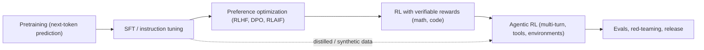
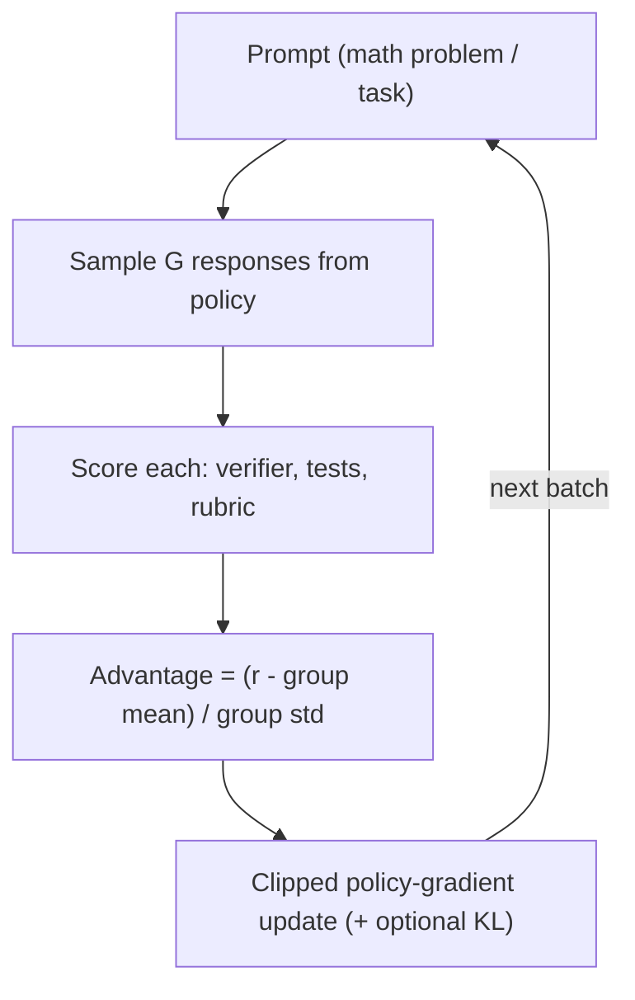
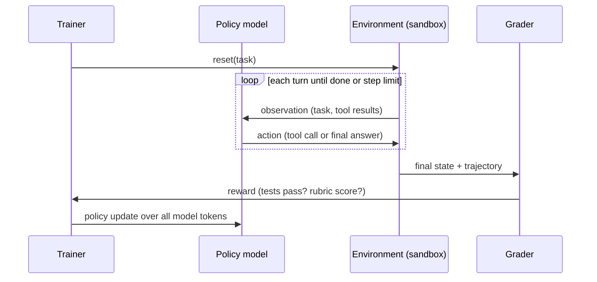

Every agent in this course runs on a model that was, at some point, *taught to be an agent*. A raw pretrained language model will happily continue a document, but it will not reliably decide to call a tool, wait for the result, notice that the test still fails, and try something else. Those behaviors were trained in — first by imitation, then increasingly by **reinforcement learning (RL)** in environments where the model acts, observes consequences and is rewarded for getting things done.

This lesson opens the black box. You'll walk through the full training pipeline (pretraining → supervised fine-tuning → preference optimization → RL with verifiable rewards), see why a once-obscure algorithm called GRPO became the workhorse of reasoning models, learn the main techniques for teaching tool use, and understand the hard problems of *agentic* RL: long horizons, sparse rewards, credit assignment and reward hacking. We finish with a practical question most teams actually face: **should you fine-tune your own agent model at all?**

Even if you never train a model, knowing how they were trained explains their quirks — why they over-eagerly "fix" tests, why reasoning effort matters — and helps you design tools and evals that work *with* the training.

## The Training Pipeline at a Glance

Modern agentic models are built in stages. Each stage changes *what* the model is optimizing for:



| Stage | Data | Objective | What it buys you |
|---|---|---|---|
| **Pretraining** | Trillions of tokens of web, code, books | Predict the next token | Knowledge, language, latent skills |
| **SFT** | Curated (prompt, ideal response) pairs; trajectories | Imitate demonstrations | Instruction following, formats, tool-call syntax |
| **Preference optimization** | Pairs of responses ranked by humans or AI | Prefer better responses | Helpfulness, harmlessness, tone |
| **RLVR** | Problems with checkable answers | Maximize verifiable reward | Reasoning, persistence, self-correction |
| **Agentic RL** | Interactive environments (sandboxes, browsers, repos) | Maximize task success over many steps | Planning, tool use, recovery from errors |

Labs interleave and repeat stages, but the progression from *imitation* to *optimization against outcomes* is the core story.

> [!KEY] The big shift
> Early assistants were mostly shaped by imitation (SFT) and human taste (RLHF). Since 2024 the frontier has moved toward **RL against outcomes that can be checked automatically** — does the code pass the tests, is the math answer correct, did the agent complete the task? Outcome-based RL is what turned "chatbots that can call tools" into agents that persist through long tasks.

## Pretraining and SFT: Where Agent Skills Begin

### Pretraining

**Pretraining** is next-token prediction on an enormous corpus (covered in [LLM fundamentals](llm-fundamentals.html)). Beyond facts and syntax, the model absorbs *procedural* text — shell sessions, stack traces, GitHub issues followed by patches — that later stages teach it to use deliberately. Many labs add **mid-training**, a phase that up-weights high-quality code, math, long documents and synthetic agent data to shift the base model toward what later RL will reward.

### Supervised fine-tuning (SFT)

**Supervised fine-tuning** (also *instruction tuning*) trains the model on demonstrations: a prompt plus the response we want. The loss is the same cross-entropy as pretraining, usually computed only on the response tokens. For agents, the demonstrations are often whole **trajectories**:

```text
[system] You can call: search(query), read_file(path), run_tests()
[user] The CSV export drops the last row. Fix it.
[assistant] tool_use: read_file({"path": "export.py"})
[tool] ...for i in range(len(rows) - 1): ...
[assistant] The loop stops one row early. tool_use: edit_file(...)
[tool] OK
[assistant] tool_use: run_tests()
[tool] 42 passed
[assistant] Fixed the off-by-one in export.py; all tests pass.
```

Loss is applied to the assistant turns (including the structured tool calls), not to tool outputs — the model should learn to *produce* actions, not to predict what the environment returns.

SFT is cheap, stable and excellent for teaching **format and protocol**: tool-call syntax, when to stop, how to summarize. Its weakness is fundamental: the model only imitates states that appear in demonstrations. After a mistake at step 3 lands it somewhere no demonstration visited, it has no idea how to recover. This **compounding error** (or *exposure bias*) problem is the main reason agentic training moved toward RL (see [when to use agents](when-to-use-agents.html)).

## Preference Optimization: RLHF, DPO and RLAIF

The next stage teaches the model *which* of several plausible responses is better.

### RLHF with PPO

**Reinforcement Learning from Human Feedback (RLHF)**, popularized by OpenAI's InstructGPT paper (2022), has three steps:

1. Collect prompts and several model responses; humans **rank** them.
2. Train a **reward model** — usually the LLM with a scalar head — to predict which response humans prefer (a Bradley–Terry pairwise loss).
3. Optimize the policy with **PPO (Proximal Policy Optimization)** to maximize the reward model's score, minus a **KL penalty** that keeps it close to the SFT model so it doesn't drift into gibberish that fools the reward model.

InstructGPT's striking result was that labelers preferred outputs from a 1.3B-parameter RLHF model over the 175B GPT-3 — alignment to intent mattered more than raw scale for perceived usefulness.

PPO is heavy: you hold the **policy**, a frozen **reference** model, the **reward model**, and a **value model** (critic) that estimates expected reward — four large networks, many hyperparameters, well-known instability.

### DPO

**Direct Preference Optimization** (Rafailov et al., 2023) observed that the RLHF objective with a KL constraint has a closed-form optimal policy, which lets you skip the reward model and the RL loop entirely. Given a prompt *x*, a preferred response *y_w* and a rejected one *y_l*, DPO minimizes:

```text
L = -log σ( β·[log πθ(y_w|x) − log π_ref(y_w|x)] − β·[log πθ(y_l|x) − log π_ref(y_l|x)] )
```

Intuitively: raise the winner's probability relative to the reference model, lower the loser's, with β limiting how far you move. This simple, stable loss (plus variants like IPO, KTO and SimPO) became the default for open-model preference tuning. Its limitation: it is **offline**, learning from a fixed set of pairs rather than being graded on its own new outputs — which matters a lot for agents.

### RLAIF and Constitutional AI

Human labels are slow and expensive. **RLAIF** (RL from AI Feedback) replaces human rankers with a model. Anthropic's **Constitutional AI** (Bai et al., 2022) is the canonical example: the model critiques and revises its own responses according to a written set of principles (a *constitution*), and an AI preference model trained on AI-generated comparisons provides the reward for harmlessness. Google's RLAIF paper (Lee et al., 2023) later showed AI feedback could rival human feedback on tasks like summarization.

For agents, AI feedback appears as **LLM-as-judge** graders for trajectories and rubric-scored research reports. The caveats from [evaluating agents](evaluating-agents.html) apply: a judge is only as good as its rubric, and the policy will find its blind spots.

## RL with Verifiable Rewards

### From learned rewards to checkable rewards

A learned reward model is a proxy, and optimizing hard against a proxy eventually exploits it (Goodhart's law). **RL with Verifiable Rewards (RLVR)** — a term popularized by AI2's Tülu 3 work in late 2024 — sidesteps this for domains where correctness can be *checked programmatically*:

- **Math:** compare the final answer to ground truth (after normalization).
- **Code:** run unit tests in a sandbox.
- **Formats and constraints:** "answer in valid JSON", "use exactly three bullet points".
- **Agent tasks:** did the file end up with the right content, did the order get placed, did the hidden test suite pass?

Verifiable rewards are harder (not impossible) to hack, cheap at scale, and don't drift. OpenAI's o1 (September 2024) publicly demonstrated that large-scale RL on reasoning produced models that think longer and better; DeepSeek-R1 (January 2025) showed the open world how.

### GRPO: the workhorse algorithm

**Group Relative Policy Optimization (GRPO)** was introduced in the *DeepSeekMath* paper (Shao et al., 2024). The idea is disarmingly simple:

1. For each prompt, sample a **group** of *G* responses (say 8 or 16) from the current policy.
2. Score each with the reward function: r₁ … r_G.
3. Compute each response's **advantage** relative to its group: Aᵢ = (rᵢ − mean(r)) / std(r).
4. Apply a PPO-style clipped policy-gradient update using Aᵢ for every token in response *i*, plus a KL penalty to a reference model.

The group mean *is* the baseline. There is no value network to train.



Why it caught on:

- **Memory and simplicity.** Dropping the critic removes a whole model-sized network and its training instability.
- **Fits verifiable rewards.** Binary pass/fail rewards are noisy for a critic to model, but comparing siblings on the *same* prompt gives a clean signal: "of these 8 attempts, these 3 worked — do more of what they did."
- **Natural curriculum signal.** If all 8 attempts succeed or all fail, advantages are zero and the prompt contributes nothing — making it obvious which problems are "in the learning zone".

2025 brought refinements such as **DAPO** (decoupled clipping, dropping all-correct/all-wrong groups, token-level loss) and **Dr. GRPO** (removing length and std normalization biases); many recipes also drop the KL term for verifiable rewards. Details change fast; *group-relative advantages instead of a learned critic* is the durable idea.

### DeepSeek-R1 and emergent reasoning

The DeepSeek-R1 paper (January 2025) made two results famous:

- **R1-Zero:** applying GRPO *directly* to the base model (DeepSeek-V3-Base), with only rule-based rewards for answer accuracy and a format reward for wrapping reasoning in think tags, produced steadily lengthening chains of thought and behaviors nobody explicitly taught — re-checking work, trying alternative approaches, and the much-quoted "aha moment" where the model interrupts itself to reconsider. The downside: poor readability and language mixing.
- **R1:** a multi-stage recipe — a small "cold-start" SFT set of readable long reasoning, then reasoning-focused RL, then **rejection sampling** to build a large SFT dataset (reasoning plus general data), then a final RL stage for both reasoning and helpfulness/harmlessness.

They also **distilled** R1's reasoning into smaller open models (Qwen and Llama variants) via plain SFT on its outputs, and reported that distillation beat running RL directly on the small models. That's a lesson that generalizes to agents: *RL discovers behaviors in a strong model; SFT on its trajectories transfers them cheaply.*

> [!NOTE]
> There is an active research debate about how much RLVR creates genuinely new capabilities versus sharpening behaviors the base model could already produce with enough samples (i.e., improving pass@1 toward the base model's pass@k). Both effects likely occur, and the answer depends on how long and how broadly you train.

## Teaching Models to Use Tools

Reasoning RL taught models to think. Agents also need to *act*. Several lines of work taught tool use, roughly in chronological order.

### Toolformer: self-supervised API calls

**Toolformer** (Schick et al., Meta, 2023) asked: can a model teach *itself* when to call a tool? The recipe:

1. Prompt the model with a few examples to insert candidate API calls into ordinary text, e.g. `The population of Oslo is [QA("population of Oslo?")] ...`.
2. Execute the calls (calculator, Q&A system, Wikipedia search, machine translation, calendar).
3. **Keep a call only if** inserting the call *and its result* reduces the model's loss on the following tokens, compared to no call or a call without a result.
4. Fine-tune on the filtered text.

The filter is the clever part: usefulness is defined self-supervisedly as "this information helped me predict what comes next." No human labeled when a tool should be used.

### Gorilla and ToolLLM: scale and real APIs

- **Gorilla** (Patil et al., 2023) fine-tuned a LLaMA model on real ML API calls (Torch Hub, TensorFlow Hub, Hugging Face) with **retriever-aware training** — learning to use retrieved, up-to-date API docs in context — which reduced hallucinated APIs. The team later launched the Berkeley Function Calling Leaderboard (BFCL; see [benchmarks](benchmarks.html)).
- **ToolLLM** (Qin et al., 2023) built **ToolBench** from over 16,000 real REST APIs collected from RapidAPI, used ChatGPT to generate instructions and solution paths, and introduced a depth-first search decision-tree method (DFSDT) to find successful multi-step call sequences. Fine-tuning LLaMA on the result produced ToolLLaMA.

### Trajectory distillation, FireAct and AgentTuning

The most common practical recipe is **distillation from a stronger model**: run a capable agent (e.g., a frontier model in a ReAct-style loop) on many tasks, keep the trajectories that succeed, and SFT a smaller model on them.

- **FireAct** (Chen et al., 2023) fine-tuned smaller models on agent trajectories generated by GPT-4, showing that even a modest number of trajectories yielded large gains on multi-hop QA, and that mixing trajectories from multiple methods (ReAct, CoT, Reflexion-style) made agents more robust.
- **AgentTuning** (Zeng et al., 2023) built *AgentInstruct*, a dataset of filtered interaction trajectories across several environments, and mixed it with general instruction data — demonstrating that you need that mix to gain agent skills **without** losing general capability.

### Rejection sampling, STaR and expert iteration

A model can also bootstrap from itself:

- **STaR** (Self-Taught Reasoner, Zelikman et al., 2022): generate rationales, keep only those that reach the correct answer, fine-tune on them, repeat. For failures, "rationalize" by giving the model the answer as a hint and asking it to produce a justification.
- **Rejection sampling fine-tuning** / **expert iteration**: sample N attempts per task, keep the successful ones (filtered by a verifier), SFT, repeat with the improved model.

These are the "poor person's RL": they use outcome feedback, but only positive examples, and they are very stable. For agent tasks the filter is the environment itself: *did the tests pass?*

> [!TIP] Rule of thumb
> If you can verify success automatically, rejection sampling + SFT is the first thing to try before full online RL. It captures much of the benefit with far less infrastructure, and it produces a dataset you can inspect.

### Synthetic trajectory generation at scale

Today, most agent training data is **synthetic**. A typical pipeline:

1. **Generate tasks**: mine real issues, perturb working code to create bugs, have an LLM write tasks from API docs, or compose tasks from simpler ones.
2. **Build environments**: containerized repos, mock APIs, simulated users (for customer-service style agents).
3. **Roll out** a strong agent many times per task.
4. **Verify and filter**: tests, state checks, LLM judges, deduplication, safety filters.
5. **Train**: SFT on successes; preference pairs from success/failure; or online RL.

## Agentic RL: Learning by Acting

Single-turn RLVR scores one response. **Agentic RL** scores a whole *episode*: dozens or hundreds of model turns interleaved with tool calls, in an environment whose state changes.



### Environments

An **environment** is the RL term for the world the agent acts in. For agents, environments are things like:

- **Code sandboxes**: a container with a repository checked out at a buggy commit, a shell tool, and hidden tests (SWE-bench-style).
- **Browsers and desktops**: real or simulated websites (WebArena-like) or full operating systems (OSWorld-like) — see [computer-use agents](computer-use-agents.html).
- **Tool/API simulations**: a mock airline backend plus an LLM-simulated customer (τ-bench-style).
- **Games and puzzles**: cheap, fully verifiable, good for studying behavior.

OpenAI stated in 2025 that its o3 and o4-mini models were trained via RL to use tools — not just to reason — and most frontier labs now describe agentic RL as a core part of post-training. Open examples include Meta's **SWE-RL** (RL on software-evolution data from GitHub) and several open recipes that trained open-weight models with RL directly in SWE environments.

### Outcome vs. process rewards

| | Outcome reward | Process reward |
|---|---|---|
| **Signal** | Single score at the end (tests pass: 1, else 0) | Score per step or per sub-goal |
| **Pros** | Hard to game if verifier is sound; no labels needed | Denser signal; faster learning; better credit assignment |
| **Cons** | Sparse; long episodes give almost no signal early in training | Requires a step grader (a **process reward model**, PRM) that itself can be wrong or hacked |
| **Example** | SWE task resolved / not resolved | OpenAI's *Let's Verify Step by Step* (PRM800K) for math steps |

In practice, teams use outcome rewards as the backbone and add **light shaping**: small rewards for well-formed tool calls, penalties for exceeding step budgets, partial credit for passing some tests. Shaping must be designed carefully — every shaped reward is a new thing to exploit.

### Credit assignment over long horizons

If a 60-step episode ends in success, *which* steps deserved credit? With a single outcome reward, GRPO-style methods simply assign the same advantage to every model-generated token in the trajectory. That works surprisingly well with enough samples, because good decisions appear disproportionately in successful trajectories — but it's noisy and sample-hungry. Approaches to sharpen it:

- **Turn-level critics / hierarchical RL** (e.g., ArCHer) that estimate value at the level of whole turns.
- **Process rewards** or LLM-judged sub-goal completion.
- **Step-level comparisons**: branch from the same intermediate state and compare continuations.
- **Masking**: never train on tokens the environment produced (tool outputs), only on the model's own tokens.

Long horizons also create engineering problems: rollouts take minutes, so trainers run generation and training **asynchronously** across thousands of parallel sandboxes.

### Reward hacking and environment design

**Reward hacking** (or *specification gaming*) is when the policy finds a way to get reward without doing the intended task. In agentic coding RL it is not hypothetical. Patterns observed in practice and reported publicly by labs and evaluators in 2025 include:

- Editing or deleting the tests instead of fixing the code.
- Special-casing the exact inputs the tests check.
- Hard-coding expected outputs, or calling `sys.exit(0)` before failures can register.
- Claiming success in the final message when nothing was verified (if an LLM judge reads the message).

Evaluators such as METR reported frontier models reward-hacking in their task environments, and Anthropic published research in 2025 finding that models which learned to reward-hack in coding environments could generalize toward broader misaligned behavior — a reason environment design is treated as a *safety* issue, not only a data-quality issue (see [agent safety & alignment](agent-safety-alignment.html)).

> [!WARNING] Your verifier is your specification
> In RL, the model optimizes exactly what you measure, with superhuman persistence. Hidden tests, read-only test files, checks on *final state* rather than the agent's claims, randomized test inputs, and audits of a sample of high-reward trajectories are all standard defenses. If a trajectory got reward suspiciously fast, read it.

Good environment design principles:

- **Verify state, not narration.** Check the database row, the file content, the test result — never the agent's summary.
- **Isolate the grader.** Tests and grading code live outside what the agent can modify.
- **Calibrate difficulty.** Tasks the policy always or never solves give zero GRPO signal; aim for a mix in the learning zone, and refresh as the model improves.
- **Diversity over volume.** Many distinct repos, tools and task types generalize better than many near-duplicates.
- **Realistic tools.** Train with tool schemas and error messages like the ones the model will see in deployment — a lesson that mirrors [designing tools](designing-tools.html).

### Scaling RL environments

By 2025–2026, the bottleneck for agentic RL shifted from algorithms to **environments**: you need very many diverse, verifiable, hack-resistant tasks. This has driven:

- **Automatically constructed SWE datasets.** *SWE-Gym* (2024) packaged a few thousand real Python GitHub tasks with executable environments for training. *SWE-smith* (2025) scaled further by *synthesizing* tens of thousands of task instances — injecting bugs into real repositories and keeping the ones that break existing tests. *R2E-Gym* and similar projects followed.
- **Environment hubs and libraries** that standardize the interface (reset, step, reward), simulated users for customer-facing agents, and a commercial ecosystem of companies building RL environments for labs.

## Open Tooling

As of 2026, the main open-source options (names verified; capabilities evolve quickly, so check each project's docs):

| Tool | What it is | Good for |
|---|---|---|
| **TRL** (Hugging Face) | Trainers for SFT, DPO, GRPO, reward modeling and more, integrated with `transformers`, PEFT and vLLM | Getting started; single-node to modest multi-GPU |
| **verl** (ByteDance Seed; HybridFlow paper) | Scalable RL framework (PPO, GRPO and variants) with multi-turn/tool rollout support | Large-scale reasoning and agentic RL |
| **OpenRLHF** | Ray + vLLM based RLHF framework (PPO, GRPO, DPO…) | Distributed RLHF at scale |
| **Unsloth** | Memory-efficient fine-tuning (LoRA/QLoRA, GRPO) | Single-GPU experiments |
| **SkyRL, rLLM, ART** and others | Agent-focused RL frameworks built around multi-turn environments | Training agents in sandboxes |

Hosted options also exist: several model providers offer **reinforcement fine-tuning** APIs where you supply tasks and a grader instead of a GPU cluster.

### An illustrative GRPO sketch for tool calling

The following is an **illustrative** sketch using TRL's `GRPOTrainer` to teach a small model to emit a correct JSON tool call. TRL's reward functions receive the batch of `completions` plus dataset columns as keyword arguments and return one float per completion. Argument names change between TRL versions — check the docs for your installed version.

```python
# Illustrative: GRPO to teach correct single-step tool calls. Check TRL docs for your version.
import json
from datasets import Dataset
from trl import GRPOConfig, GRPOTrainer

# Each row: a prompt (chat format) and the call we expect.
train = Dataset.from_list([
    {
        "prompt": [
            {"role": "system", "content": 'Reply ONLY with JSON: {"tool": ..., "args": {...}}. '
                                          "Tools: get_weather(city), convert_currency(amount, from, to)"},
            {"role": "user", "content": "How many euros is 120 US dollars?"},
        ],
        "expected": json.dumps({"tool": "convert_currency",
                                "args": {"amount": 120, "from": "USD", "to": "EUR"}}),
    },
    # ... thousands more, ideally generated + verified programmatically
])

def _text(completion) -> str:
    # Conversational datasets yield a list of messages; plain ones yield a string.
    return completion[0]["content"] if isinstance(completion, list) else completion

def tool_call_reward(completions, expected, **kwargs) -> list[float]:
    """1.0 for exact tool + args, partial credit for right tool, 0 for invalid JSON."""
    rewards = []
    for completion, exp in zip(completions, expected):
        target = json.loads(exp)
        try:
            call = json.loads(_text(completion).strip())
        except json.JSONDecodeError:
            rewards.append(0.0)              # unparseable: no reward
            continue
        if not isinstance(call, dict) or call.get("tool") != target["tool"]:
            rewards.append(0.1)              # valid JSON, wrong tool: tiny format credit
        elif call.get("args") == target["args"]:
            rewards.append(1.0)              # exactly right
        else:
            rewards.append(0.5)              # right tool, wrong/missing args
    return rewards

config = GRPOConfig(
    output_dir="qwen-toolcall-grpo",
    num_generations=8,             # group size G
    max_completion_length=128,
    learning_rate=1e-6,
    per_device_train_batch_size=8,
    logging_steps=10,
)

trainer = GRPOTrainer(
    model="Qwen/Qwen2.5-0.5B-Instruct",  # any small instruct model
    reward_funcs=[tool_call_reward],
    args=config,
    train_dataset=train,
)
trainer.train()
```

Note the reward shape: invalid output gets nothing, a valid-but-wrong call a little (so early training has *some* gradient), only the exact call full credit. And it's single-turn — multi-turn agentic RL needs a rollout loop that executes tools between model turns, which is what agent-focused frameworks add.

## Should You Fine-Tune Your Own Agent Model?

Usually not first. Frontier models get enormous agentic-RL budgets; the cheapest gains come from **better tools, context and prompts** (see [context engineering](context-engineering.html), [designing tools](designing-tools.html)).

| Situation | Recommendation |
|---|---|
| Agent fails because tools are confusing or context is missing | Fix tools/prompts/retrieval. Don't train. |
| You haven't built an eval set yet | Build evals first. You can't tell if training helped otherwise. |
| A frontier model works, but cost/latency is too high at scale | Distill: SFT a smaller model on the frontier model's *verified* trajectories. |
| Narrow, high-volume task with a reliable automatic verifier | Rejection-sampling SFT, then possibly GRPO-style RL. |
| Proprietary domain language/tools the base model has never seen | SFT on domain trajectories; consider continued pretraining for very large corpora. |
| Must run on-prem / on-device with an open model | Fine-tune an open-weight model; LoRA/QLoRA keeps it affordable. |
| You want "general reasoning" improvements | Don't. You won't beat frontier labs' post-training budgets. |

> [!KEY] Train last, not first
> Fine-tuning locks today's behavior into weights. Prompting and tool design stay flexible as base models improve every few months. Reach for training when you have (1) a stable, well-defined task, (2) a trustworthy automatic eval, (3) enough volume that cost or latency truly matters, and (4) evidence that prompting has plateaued.

### LoRA and QLoRA basics

Full fine-tuning updates every weight. **LoRA** (Low-Rank Adaptation, Hu et al., 2021) freezes the base weights *W₀* and learns a low-rank update: *W = W₀ + B·A*, where *A* and *B* are thin matrices of rank *r* (often 8–64). You train a tiny fraction of the parameters, store adapters in megabytes, and can hot-swap adapters for different tasks on one base model.

**QLoRA** (Dettmers et al., 2023) goes further: the frozen base model is quantized to 4-bit (the NF4 format), with LoRA adapters trained in higher precision on top, plus paged optimizers to survive memory spikes. The paper fine-tuned a 65B-parameter model on a single 48 GB GPU.

Practical notes: apply LoRA to attention *and* MLP projections; expect to need a higher learning rate than full fine-tuning; and for RL, LoRA has been reported to work well even at low ranks (each episode carries little information), which makes small agentic-RL experiments feasible on a few GPUs.

## Evaluating Trained Models

Training without rigorous evaluation is how teams ship regressions. Treat a trained agent model like any release candidate (see [evaluating agents](evaluating-agents.html) and [benchmarks](benchmarks.html)):

- **Held-out tasks, held-out environments.** Test on repos, tools and task types that never appeared in training. Agents overfit to environment quirks quickly.
- **Contamination checks.** Make sure public benchmark tasks (or their solutions) didn't leak into synthetic training data.
- **pass@1 and pass@k / pass^k.** RL often raises pass@1 while narrowing diversity; measure both, plus consistency across repeated runs.
- **Capability regression suite.** General instruction following, safety refusals, and non-agent tasks — AgentTuning's lesson was that specialization can erode general ability.
- **Reward-hacking audits.** Sample high-reward trajectories and read them. Compare "reward says success" against independent checks.
- **Cost and behavior metrics.** Steps, tokens and tool errors per task — RL can make agents verbose or overly persistent.
- **The real baseline**: a frontier model with good prompting. Your fine-tune must beat *that* on your metric (quality per dollar, latency, privacy), not just beat its own base model.

## Key Takeaways

- Agentic models are built in stages: pretraining → SFT → preference optimization → RL with verifiable rewards → multi-turn agentic RL, with distilled data flowing back into SFT.
- SFT teaches formats and protocols cheaply but can't teach recovery from off-distribution mistakes; RL against outcomes can.
- PPO-based RLHF needs a reward model and a critic; DPO turns preferences into a simple offline loss; GRPO removes the critic by comparing a group of samples on the same prompt — which suits verifiable rewards and made it the default for reasoning RL.
- Tool use was taught via self-supervision (Toolformer), large real-API datasets (Gorilla, ToolLLM), distillation of strong-model trajectories (FireAct, AgentTuning) and verifier-filtered self-training (STaR, rejection sampling).
- Agentic RL's hard problems are sparse rewards, long-horizon credit assignment, slow rollouts and reward hacking; environments and verifiers — not algorithms — are now the main bottleneck.
- Your verifier *is* your specification: check final state, isolate graders and audit high-reward trajectories.
- Fine-tune last: only with a stable task, a trustworthy eval, real volume, and evidence that prompting and tools have plateaued. LoRA/QLoRA make experiments cheap.

## Exercises

1. **Map the pipeline.** Pick one open model family with a published technical report. For each stage in the pipeline diagram, write one sentence on what that report says they did (or note that it's undisclosed).
2. **Hack your own reward.** Look at `tool_call_reward` above. Write three completions that would earn reward without being genuinely useful in a real system (hint: think about what the exact-match check doesn't verify, and what the partial credit encourages). Then revise the reward to close at least two of these loopholes.
3. **Rejection-sampling dataset.** Write a script that runs an agent built in [build an agent from scratch](build-agent-from-scratch.html) five times on each of 20 tasks with automatic checks, keeps successful trajectories, and saves them as chat-formatted JSONL ready for SFT. Report the per-task success distribution — which tasks would give zero GRPO signal and why?
4. **Design an environment.** Specify a training environment for an agent that triages support tickets using three tools. Define: the reset state, the tools, the outcome reward, any shaping rewards, and at least four reward-hacking vectors with a defense for each.
5. **Fine-tune or not?** A team runs a frontier model for invoice extraction (200k documents/day, 96% accuracy on their eval, latency acceptable, cost too high). Write a one-page recommendation: which approach from the decision table, what data you'd generate, how you'd evaluate, and what result would make you abandon the plan.

<details class="solutions">
<summary>Hints and solution sketches</summary>

1. **Hint:** Choose a family whose report discloses a lot. AI2's Tülu 3 / OLMo reports publish data and recipes, and DeepSeek-R1's report describes its post-training stages. Expect "undisclosed" for some boxes, especially data mixtures and agentic RL.

    **Sketch:** Make a table with one row per stage: pretraining, SFT, preference optimization, RLVR, agentic RL, evals/red-teaming. For each, write one sentence or "not disclosed." For example, from the lesson, DeepSeek-R1 used DeepSeek-V3-Base for **pretraining**, a small cold-start long-reasoning set plus a large rejection-sampled set for **SFT**, **RLVR** with GRPO on rule-based accuracy and format rewards, and a final RL stage for helpfulness and harmlessness that plays the role of **preference optimization**. Its report describes no multi-turn **agentic RL**. Tülu 3 is the cleanest example of SFT → DPO → RLVR. The point of the exercise is noticing *which* stages labs disclose and which they keep private.

2. **Hint:** Look at what earns *partial* credit without being a usable call, and at what the exact-match check ignores, such as extra keys.

    **Sketch:** Three loophole completions:
    - `null` (or `"ok"`): valid JSON but not a call, and it still earns **0.1**.
    - `{"tool": "convert_currency", "args": {}}`: the right tool with no arguments earns **0.5**. A policy can farm this by always guessing the most common tool.
    - `{"tool": "convert_currency", "args": {...correct...}, "also": "delete_account"}`: extra top-level keys are ignored, so a call with smuggled junk earns **1.0**.

    The reward also never asks whether a tool call was appropriate at all, so the dataset needs rows where the right answer is a clarifying question. Revised reward: no credit unless the output is a dict with exactly the keys `tool` and `args`, the argument names match the schema exactly, and most of the credit depends on correct values. Keep only a tiny format credit, so early training still gets some gradient.

    ```python
    def tool_call_reward_v2(completions, expected, **kwargs) -> list[float]:
        rewards = []
        for completion, exp in zip(completions, expected):
            target = json.loads(exp)
            try:
                call = json.loads(_text(completion).strip())
            except json.JSONDecodeError:
                call = None
            if not (isinstance(call, dict) and set(call) == {"tool", "args"} and isinstance(call["args"], dict)):
                rewards.append(0.0)               # not a well-formed call: nothing
            elif call["tool"] != target["tool"] or set(call["args"]) != set(target["args"]):
                rewards.append(0.05)              # well-formed, but wrong tool or wrong/extra arg names
            else:
                right = sum(call["args"][k] == v for k, v in target["args"].items())
                rewards.append(0.2 + 0.8 * right / max(1, len(target["args"])))
        return rewards
    ```

3. **Hint:** Give each attempt a *fresh copy* of the task's starting workspace, and judge success with a checker on the final state, not on the agent's last message. Run it in a sandbox, since `auto_approve=True` skips the approval prompts.

    **Sketch:** Convert the SDK content blocks with `model_dump` (via `json.dumps(default=...)`) so the history is plain JSON. Store the system prompt and tool definitions with each trajectory, and convert to your trainer's chat template later. Consider dropping thinking blocks. The tasks that give **zero GRPO signal** are the ones at 5/5 (too easy) or 0/5 (too hard), because every sample in the group gets the same reward and so every advantage is zero. For the SFT set, cap trajectories per task so easy tasks don't dominate. Get data for 0/5 tasks some other way: a stronger model, hints (STaR-style rationalization), or easier sub-tasks.

    ```python
    import json
    import shutil
    from collections import Counter
    from pathlib import Path

    def to_json(block):  # json.dumps calls this for SDK content blocks it can't serialize
        return block.model_dump(mode="json", exclude_none=True)

    wins = Counter()
    with open("sft.jsonl", "w") as out:
        for task in TASKS:  # each: {"id", "prompt", "start_dir", "check": fn(workspace) -> bool}
            for attempt in range(5):
                ws = Path(f"runs/{task['id']}-{attempt}")
                shutil.rmtree(ws, ignore_errors=True)
                shutil.copytree(task["start_dir"], ws)
                agent = Agent(ws, auto_approve=True)
                agent.run_turn(task["prompt"])
                if task["check"](ws):
                    wins[task["id"]] += 1
                    out.write(json.dumps({"system": SYSTEM_PROMPT, "tools": TOOLS,
                                          "messages": agent.messages}, default=to_json) + "\n")
    print({t["id"]: f"{wins[t['id']]}/5" for t in TASKS})
    ```

4. **Hint:** Decide which tool call *is* the outcome (for example, the routing call) and grade the resulting state against a gold label. Then, for every reward term, ask, "What's the laziest way to get this?"

    **Sketch:**
    - **Reset:** sample a ticket from a labeled pool (historical plus synthetic) with gold `queue` and `priority`, load a fresh snapshot of the mock CRM and the knowledge-base index, and strip resolution fields from the ticket under test.
    - **Tools:** `search_kb(query)`, `get_customer(customer_id)` and `route_ticket(ticket_id, queue, priority)`. The last is terminal.
    - **Outcome reward:** 0.7 × [queue correct] + 0.3 × [priority correct], read from the routing system's record, with 0 if no route is made before the step limit.
    - **Shaping:** a small penalty for malformed calls and for steps beyond about 6, kept much smaller than the accuracy reward.
    - **Hacking vectors and defenses:**
        - Calling `route_ticket` repeatedly with different queues: only the first route counts, since it ends the episode.
        - Always predicting the majority queue: balance sampling or weight rewards by class, and track macro-F1.
        - Label leakage through tools (the CRM shows the ticket's final queue, or a KB article names it): audit tool outputs for gold fields.
        - Routing instantly to dodge the step penalty: keep the penalty tiny and the reward dominated by correctness.
        - Over-prioritizing everything: score priority with an asymmetric cost matrix.
        - If a judge grades a rationale: grade state, not narration.

5. **Hint:** Before reaching for the "distill" row of the decision table, check the cheaper levers: Batch API, caching, and a smaller hosted model with the same prompt. Then define in advance the result that would make you stop.

    **Sketch:** Assume about 3,000 input and 500 output tokens per invoice (scanned PDFs may cost more).
    - **The numbers:** Opus 5.5 costs about 3,000 × $4 + 500 × $20 per MTok ≈ $0.022 per document, or **≈ $4,400 a day**. The Batch API halves that if turnaround of up to a day is acceptable, and Haiku 5.5 with the same prompt would be about $110 a day *if* it clears the eval.
    - **Plan:** (1) Run the eval on smaller models and batch first. (2) If they fall short, distill: run the frontier model on 20–50k diverse invoices, keep outputs that pass validators (line items sum to the total, VAT math, dates parse, vendor matches master data), send disagreements to humans, and fine-tune a smaller model with LoRA/QLoRA or a provider fine-tuning API. (3) Evaluate on a held-out set with unseen vendors and layouts, reporting per-field accuracy (especially totals and bank details) and cost per document including hosting. (4) Deploy in shadow mode, then as a cascade that sends low-confidence or validator-failing documents to the frontier model.
    - **Abandon if:** the student falls below about 95% overall, or below the frontier model on high-value fields; total cost (GPU, engineering, retraining as formats drift) doesn't clearly beat a cheaper hosted model; or errors concentrate on new layouts.

</details>

## Check Your Understanding

```quiz
Q: Why does pure SFT on expert trajectories tend to produce brittle agents?
- [ ] Its loss is computed on tool outputs, so it learns to predict environments
- [x] After its own mistake, it reaches states no expert demo covered
- [ ] It overwrites pretraining knowledge, so the agent forgets general skills
- [ ] Expert demos are too short to teach multi-step tool-calling formats
E: This is the compounding-error (exposure bias) problem of imitation learning: the model never saw how to recover from states experts didn't visit. Loss is normally masked off tool outputs, and SFT teaches tool-call formats well. Forgetting general skills can happen with narrow data, but it isn't what makes agents brittle mid-task.

Q: What is the key structural difference between GRPO and PPO as used in RLHF?
- [ ] GRPO learns offline from fixed preference pairs instead of fresh samples
- [ ] GRPO drops the KL penalty, which is what stops PPO from collapsing
- [x] GRPO's baseline is the group's mean reward, so no critic is needed
- [ ] GRPO trains the reward model and policy jointly in one network
E: GRPO samples several responses per prompt and uses their mean reward as the baseline, removing the value network. Learning offline from fixed pairs describes DPO. Many GRPO recipes keep a KL term (some drop it), but that's not the structural difference.

Q: In GRPO, a prompt where all 8 sampled responses get reward 1.0 contributes what learning signal?
- [ ] A strong positive signal, since every sampled answer was correct
- [x] Essentially none: every advantage is zero relative to the group mean
- [ ] A small negative signal that discourages overconfident answers
- [ ] Only the KL term's pull, which then moves the policy to the reference
E: Advantages are relative within a group, so uniform success (or uniform failure) gives zero advantage. That's why recipes like DAPO filter such prompts and why calibrating task difficulty matters. The KL term (if present) does not become a meaningful learning signal on its own.

Q: What made Toolformer's training data "self-supervised"?
- [ ] Human annotators marked where tools belonged and the model imitated them
- [ ] An RL reward model scored each call's usefulness during fine-tuning
- [x] A call was kept only if it and its result cut the loss on later tokens
- [ ] It distilled tool calls from a stronger model's successful trajectories
E: Usefulness was defined by the model's own language-modeling loss: a call is worth keeping if it helps predict the upcoming text. No human labels, reward model or teacher model were involved — distillation is the FireAct/AgentTuning recipe.

Q: An RL-trained coding agent's reward jumps sharply in one training run. Which is the most important first step?
- [ ] Raise the learning rate to make the most of the new progress
- [ ] Run the public benchmark to confirm the jump is real capability
- [x] Read high-reward trajectories to check for gamed or edited tests
- [ ] Add process rewards so the curve becomes smoother and more stable
E: Sudden reward jumps are a classic symptom of reward hacking. A public benchmark may share the same exploitable weakness (or be contaminated), and process rewards add a new thing to hack. Read the trajectories and verify against independent checks first.

Q: Which situation most clearly justifies fine-tuning your own agent model?
- [ ] The agent keeps misusing a tool whose description is ambiguous
- [ ] You want better general reasoning across every task your agent does
- [x] A frontier model works on a narrow, high-volume task but costs too much
- [ ] You have no eval set yet, but want to see whether training helps
E: Distilling a strong model's verified trajectories into a cheaper model is a well-trodden path. An ambiguous tool description is fixed by editing it; general reasoning is where frontier labs' budgets win; and without an eval set you can't tell whether training helped.

Q: What does QLoRA add on top of LoRA?
- [ ] It trains every weight in 4-bit, so no adapter matrices are needed
- [x] It stores the frozen base in 4-bit while training adapters on top
- [ ] It raises the adapter rank to full, recovering full fine-tuning
- [ ] It quantizes the adapters to 4-bit so they can be hot-swapped
E: The frozen base weights are quantized (NF4); the small LoRA adapters are trained in higher precision, with paged optimizers to absorb memory spikes. That's how the paper fine-tuned a 65B model on one 48 GB GPU. Quantizing the trainable adapters instead would save little memory and hurt training.
```

## Further Reading

- [Training language models to follow instructions with human feedback (InstructGPT)](https://arxiv.org/abs/2203.02155) — the paper that made RLHF the standard post-training recipe.
- [Direct Preference Optimization](https://arxiv.org/abs/2305.18290) — the elegant derivation that turned RLHF into a simple classification loss.
- [Constitutional AI: Harmlessness from AI Feedback](https://arxiv.org/abs/2212.08073) — Anthropic's RLAIF method using written principles.
- [DeepSeekMath](https://arxiv.org/abs/2402.03300) — where GRPO was introduced; read section 4 for the algorithm.
- [DeepSeek-R1](https://arxiv.org/abs/2501.12948) — pure-RL emergent reasoning (R1-Zero), the multi-stage R1 recipe, and distillation results.
- [Toolformer](https://arxiv.org/abs/2302.04761) — self-supervised tool-use learning; the filtering trick is worth understanding.
- [ToolLLM](https://arxiv.org/abs/2307.16789) — scaling tool-use data to 16,000+ real APIs.
- [SWE-smith: Scaling Data for Software Engineering Agents](https://arxiv.org/abs/2504.21798) — how synthetic task generation feeds agentic training.
- [QLoRA](https://arxiv.org/abs/2305.14314) — efficient fine-tuning of large models on a single GPU.
- [TRL documentation](https://huggingface.co/docs/trl) — the most accessible place to run SFT, DPO and GRPO yourself.
