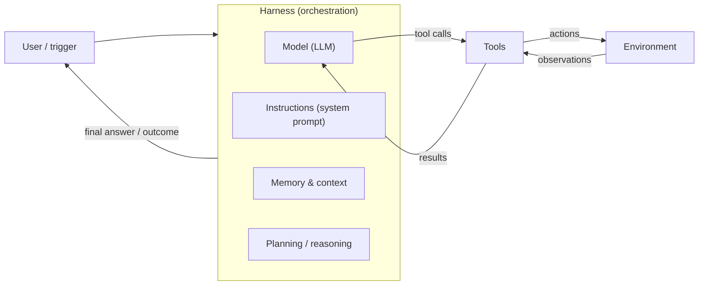

Ask ten people what an "AI agent" is and you'll get ten answers. To one it's a chatbot with a nicer name. To another it's software that books your flights while you sleep. To a vendor it's whatever they're selling this quarter. The word is everywhere, and that makes it close to useless unless we pin it down.

This lesson pins it down. We'll start with the classical definition that AI researchers have used for decades, then sharpen it into the modern, practical definition used by people who build LLM agents for a living. Then we'll take an agent apart to see its components, place real systems on an **autonomy spectrum**, and compare agents with their cousins: chatbots, copilots, RPA bots and workflows. By the end you'll be able to look at any product labelled "agentic" and say what it actually is.

That matters for a practical reason. Whether something is an agent decides how you build it, how you test it, what it costs, and what can go wrong. A one-shot chatbot that gives a bad answer wastes a minute. An agent that takes a bad action, such as deleting a branch, emailing a customer or spending money, can do real damage. Knowing which one you're dealing with is the first engineering decision.

## The Classical Definition

The textbook that shaped a generation of AI researchers, Stuart Russell and Peter Norvig's *Artificial Intelligence: A Modern Approach* (first edition 1995), is organized entirely around agents. Its definition is deliberately broad:

> An **agent** is anything that can be viewed as perceiving its **environment** through **sensors** and acting upon that environment through **actuators**.

A thermostat qualifies: it senses temperature and switches a heater. So does a robot vacuum, a chess program, and you. The definition is a *lens*, not a category with sharp edges. The question isn't "is this thing an agent?" but "is it useful to analyze this thing as an agent?"

Three more classical ideas carry straight into modern LLM agents:

- **Percept sequence.** An agent acts on everything it has perceived so far, not just the latest input. For an LLM agent, the percept sequence is the **transcript**: the user's request plus every tool result it has seen.
- **Agent function vs. agent program.** The *function* is the abstract mapping from percept sequences to actions. The *program* is the code that implements it on a real machine. For an LLM agent, the model plus the code around it is the program.
- **Rational agent.** A rational agent picks the action expected to maximize its **performance measure**, given what it has perceived and what it already knows. Rationality isn't omniscience. An agent that makes a reasonable decision on incomplete information is rational even if the outcome is bad.

Russell and Norvig also describe a task with **PEAS**: **P**erformance measure, **E**nvironment, **A**ctuators, **S**ensors. PEAS still works as a design checklist. For a coding agent:

| PEAS element | Coding agent |
|---|---|
| Performance measure | Tests pass, the change is minimal and readable, no regressions |
| Environment | A repository, a shell, a test runner, the issue tracker |
| Actuators | Tools that edit files, run commands, open pull requests |
| Sensors | Tools that read files, search code, show command output |

They also give a ladder of agent designs, from **simple reflex agents** (if condition then action), through **model-based** agents (keep internal state about the world), **goal-based** agents (choose actions that reach a goal) and **utility-based** agents (trade off competing goals), to **learning agents** that improve with experience. A modern LLM agent is goal-based and keeps internal state (its context window) almost by default. That's a big part of why LLMs made agents practical.

### Environment properties

The classical framework also classifies environments, and the classification predicts how hard a task will be for an agent:

- **Fully vs. partially observable.** Can the agent see everything relevant? A codebase is partially observable: the agent has to *choose* which files to read.
- **Deterministic vs. stochastic.** Does the same action always give the same result? Web pages change, and flaky tests fail at random.
- **Episodic vs. sequential.** Do earlier actions affect later ones? Agent tasks are almost always sequential, which is why errors compound (see [when to use agents](when-to-use-agents.html)).
- **Static vs. dynamic.** Does the world change while the agent thinks? A live customer chat or a stock price is dynamic.
- **Single- vs. multi-agent.** Are other agents, human or AI, acting in the same environment?

> [!TIP] Rule of thumb
> The more partially observable, stochastic, sequential and dynamic an environment is, the more you need a real agent and the harder it is to make one reliable. A fully observable, deterministic, episodic task usually doesn't need an agent at all.

## The Modern Definition: LLMs Using Tools in a Loop

The classical definition counts thermostats, so on its own it can't tell an agent from a chatbot. Practitioners building on large language models have settled on something much more specific. Anthropic's widely cited essay *Building Effective Agents* (December 2024) draws the key line:

- **Workflows** are "systems where LLMs and tools are orchestrated through predefined code paths."
- **Agents** are "systems where LLMs dynamically direct their own processes and tool usage, maintaining control over how they accomplish tasks."

The same essay describes agents, in practice, as "typically just LLMs using tools based on environmental feedback in a loop." By 2025 the shortest version, "an LLM agent runs tools in a loop to achieve a goal", had become close to a consensus definition among practitioners.

Unpack that and you get three necessary ingredients:

1. **An LLM** as the decision-maker. It reads the situation and decides what to do next.
2. **Tools**: functions the LLM can ask to have run, such as search, read a file, run a test or send an email. Tools are the agent's actuators *and* its sensors (see [tool use](tool-use.html)).
3. **A loop with feedback.** The tool's result goes back to the model, which decides the next step. The loop continues until the model decides the goal is met, or until a guardrail stops it (see [the agent loop](the-agent-loop.html)).

> [!KEY] The big idea
> What makes something an agent is **who controls the control flow**. In a workflow, your code decides the sequence of steps. In an agent, the model decides, one step at a time, based on what it observes. Everything else, from memory and planning to multi-agent setups, is elaboration on that core.

This definition also explains why agents are both powerful and risky. Because the model chooses the path, an agent can handle situations its designers never anticipated. For the same reason, you can't list in advance every path it might take. That's why evaluation, observability and guardrails matter so much more for agents than for ordinary software.

## Anatomy of an Agent

The core is simple, but production agents have recognizable parts. Here is the anatomy most practitioners would agree on:



| Component | What it is | Analogy | Where to learn more |
|---|---|---|---|
| **Model** | The LLM that reads context and decides the next action | The brain | [LLM fundamentals](llm-fundamentals.html) |
| **Instructions** | System prompt: role, goals, constraints, style, when to stop | The job description | [Prompting for agents](prompting-for-agents.html) |
| **Tools** | Typed functions the model can call: APIs, code execution, browsers, other agents | Hands and eyes | [Tool use](tool-use.html), [Designing tools](designing-tools.html) |
| **Memory** | What persists: the transcript (short-term), plus stores the agent can read and write across sessions (long-term) | Working memory and a notebook | [Memory](memory.html), [RAG](rag-and-retrieval.html) |
| **Planning** | Breaking goals into steps, reasoning before acting, revising plans after surprises | Thinking before doing | [Reasoning and planning](reasoning-and-planning.html) |
| **Environment** | The world the agent acts in: a filesystem, a browser, a CRM, a codebase | The workplace | [Computer-use agents](computer-use-agents.html) |
| **Harness** | The code that runs the loop: calls the model, executes tools, enforces limits, manages context, asks humans for approval | The manager and the safety rails | [Build an agent from scratch](build-agent-from-scratch.html) |

Two of these deserve extra emphasis because beginners underrate them.

**The harness does more work than you'd think.** The model only produces text, and some of that text is structured requests to call tools. The harness actually runs the tools, decides what goes into the next context window, enforces step and cost budgets, catches errors, and enforces permissions. Two agents built on the *same* model can differ enormously in quality because of their harnesses. Claude Code, Cursor and Codex are, to a large degree, different harnesses wrapped around frontier models.

**Context is the agent's whole world.** A model has no memory between calls. Everything it "knows" about the current task is whatever the harness put into its context window for this step. Deciding what goes in (and what stays out) is a discipline of its own: [context engineering](context-engineering.html).

## Properties of Agency

In 1995, Michael Wooldridge and Nicholas Jennings proposed a "weak notion of agency" that the multi-agent systems community used for decades. Their four properties, plus goal-directedness, still make a good rubric for how agentic a system really is:

- **Autonomy.** It operates without a human directing every step and has some control over its own actions and internal state. *Test:* how many decisions does it make between human touchpoints?
- **Goal-directedness.** It works toward an objective rather than just answering the latest message. *Test:* if you give it a goal, does it keep going until that goal is met?
- **Reactivity.** It perceives changes in its environment and responds in time. *Test:* when a tool returns an error or a surprising result, does it adapt?
- **Proactivity.** It takes the initiative, doing things that weren't explicitly requested but serve the goal. *Test:* does it run the tests without being told, or check an assumption before relying on it?
- **Social ability.** It interacts with other agents and humans, asking clarifying questions, delegating, negotiating. *Test:* can it ask you when it's genuinely stuck, or coordinate with sub-agents? (See [multi-agent systems](multi-agent-systems.html).)

These are matters of degree. A good modern coding agent scores high on all five. A customer-service bot that can only look up order status scores high on reactivity and low on everything else.

## The Autonomy Spectrum

"Agent or not?" is less useful than "*how much* autonomy, and where?" There's no single industry standard here. Several taxonomies have been proposed, often modelled on the SAE levels for self-driving cars. The five-level version below captures the distinctions that matter in practice:

| Level | Name | Who decides the steps? | Who executes actions? | Example |
|---|---|---|---|---|
| 0 | **Chatbot** | Human | Human | Ask a question, get an answer, copy it somewhere |
| 1 | **Copilot** | Human | Human, with AI suggestions | Inline code completion; "draft a reply" buttons |
| 2 | **Workflow** | Developer (fixed code path) | System, with LLM steps | Ticket → classify → draft response → human review |
| 3 | **Semi-autonomous agent** | Model | Model, with human approval at checkpoints | A coding agent that asks before running commands or pushing |
| 4 | **Autonomous agent** | Model | Model; humans set goals and review outcomes | A background agent that takes an issue and opens a PR hours later |

Try it yourself: drag the slider to see how responsibility, risk and oversight shift between human and machine at each level.

<div class="widget" data-widget="autonomy-spectrum"></div>

A few things are worth noticing:

- **Autonomy is per action, not per product.** Claude Code can be configured to read files freely but ask before editing, or to run fully unattended in a sandbox. The same system sits at different levels depending on its **permissions**. Good agent design picks the autonomy level *per tool* based on how reversible the action is (see [human-in-the-loop](human-in-the-loop.html)).
- **Higher isn't automatically better.** Level 4 is the right choice only when the task is valuable, errors are recoverable or caught downstream, and you trust the agent's track record on this kind of work. Plenty of excellent products are deliberately Level 2.
- **Autonomy should be earned.** Teams typically start an agent at Level 3, collect traces, measure where it fails, and loosen the controls as evidence accumulates.

## Agents vs. Chatbots, Copilots, RPA and Workflows

These terms get blurred constantly. Here is the cleanest way to tell them apart:

| | Chatbot | Copilot | RPA bot | LLM workflow | Agent |
|---|---|---|---|---|---|
| **Core behavior** | Answers messages | Suggests while a human works | Replays scripted UI/API steps | Runs a fixed pipeline with LLM steps | Pursues a goal, choosing its own steps |
| **Who controls flow** | Human (turn by turn) | Human | Script author | Developer's code | The model |
| **Takes actions in the world** | Rarely | Through the human | Yes, but only scripted ones | Yes, at predefined points | Yes, chosen dynamically |
| **Handles novel situations** | Conversationally | Somewhat | No: breaks when the UI changes | Only within designed branches | Yes, within its tools and judgment |
| **Predictability** | High | High | Very high | High | Lower |
| **Typical failure** | Wrong answer | Bad suggestion accepted | Brittle selector breaks | Bad input to a step | Wrong path, loops, harmful action |
| **Example** | FAQ assistant | Code autocomplete | Copying invoice fields into an ERP | Summarize → classify → route emails | Fix a failing test across a repo |

**Robotic Process Automation (RPA)** deserves a note because it's the most common source of agent-washing. RPA tools such as UiPath and Automation Anywhere record and replay deterministic sequences of clicks and keystrokes. They're valuable, but they have no judgment: if a button moves, the bot breaks. An LLM agent can *read* the screen and work out where the button went (see [computer-use agents](computer-use-agents.html)). The two are increasingly combined, with RPA for the stable, high-volume path and an agent for the exceptions.

**Workflows vs. agents** is the distinction that matters most for builders, and it isn't a value judgment. Workflows are cheaper, faster, and easier to test. Anthropic's own advice is to find the simplest solution that works and add complexity only when needed. The [next](when-to-use-agents.html) lesson in this module is entirely about that decision, and [workflow patterns](workflow-patterns.html) covers the workflow toolbox.

## Agents in Action: Three Examples

Definitions click when you watch an agent work. Here are three realistic traces. They're simplified, but every step is the kind of thing real agents do.

### A coding agent fixing a bug

The user says: "The `/export` endpoint returns 500 for users with no orders. Fix it."

```text
Thought: I should find the export handler first.
Action: grep({"pattern": "def export", "path": "src/"})
Observation: src/api/export.py:42: def export_orders(user_id):
Action: read_file({"path": "src/api/export.py"})
Observation: ... total = sum(o.amount for o in orders) / len(orders) ...
Thought: len(orders) is 0 for users with no orders, so this divides by zero.
         I'll reproduce it with a test before fixing.
Action: write_file({"path": "tests/test_export.py", "content": "...test_export_no_orders..."})
Action: run({"cmd": "pytest tests/test_export.py -q"})
Observation: FAILED test_export_no_orders - ZeroDivisionError
Action: edit_file({"path": "src/api/export.py", "old": "/ len(orders)", "new": "/ len(orders) if orders else 0"})
Action: run({"cmd": "pytest -q"})
Observation: 214 passed
Final: Fixed a ZeroDivisionError in export_orders for users with no orders; added a regression test. All tests pass.
```

Notice the properties of agency. It's goal-directed (keeps going until the tests pass), proactive (writes a reproduction test without being asked), and reactive (uses the failure output to confirm its hypothesis). Its environment gives it a cheap, objective success signal, which is why coding is one of the strongest agent use cases (see [coding agents](coding-agents.html)).

### A research agent

The user asks: "Compare the three most-cited approaches to retrieval for long documents published since 2023, with sources."

The agent plans sub-questions, runs a dozen web searches, fetches and skims papers, notices that two sources disagree on a benchmark result, searches again to resolve the disagreement, and writes a cited report. It might spin up parallel **sub-agents**, one per approach, and merge their findings. The number of steps couldn't have been predicted in advance, which is exactly the situation agents are for (see [research agents](research-agents.html)).

### A customer-support agent

A customer writes: "I was charged twice for order #8812."

The agent looks up the order, sees two charges, checks the refund policy, finds that duplicate charges qualify for an automatic refund under $500, issues the refund through a tool that requires the amount to match a duplicate charge exactly, and replies with a confirmation. If the amount had been over $500, the policy (enforced by the tool, not just the prompt) would have routed it to a human. Support agents combine conversation with actions, and the design work is mostly in deciding *which* actions to give them and with what limits (see [conversational and voice agents](conversational-voice-agents.html)).

> [!EXAMPLE] Same model, different level
> All three examples could run on the same underlying model. What differs is the tools, the instructions, the harness, and the autonomy level. That's why "which model?" is only one of many questions in agent design, and often not the most important one.

## Misconceptions and Agent-Washing

### Common misconceptions

- **"An agent is a smarter chatbot."** The difference isn't intelligence. It's control flow and the ability to act. A brilliant model that only answers questions isn't an agent. A mediocre model in a tool loop is one, just not a good one.
- **"Agents are autonomous, so they don't need humans."** Most valuable production agents are deliberately *semi*-autonomous. Humans set goals, approve high-stakes actions and review results.
- **"More agents are better."** Multi-agent systems can help with parallelizable work, but they multiply cost and coordination failures. Anthropic reported that its multi-agent research system used roughly 15× the tokens of a chat interaction (single agents, about 4×). Use them when the value justifies it.
- **"Agents are always the advanced, correct choice."** For well-defined tasks, a workflow is usually cheaper, faster and more reliable. Reaching for an agent first is one of the most common mistakes.
- **"The model is the agent."** The model is one component. The harness, the tools and the context strategy often matter as much.
- **"Agents learn from experience automatically."** By default an LLM agent's weights don't change between runs. Anything it "learns" has to be written to memory explicitly or folded in by retraining (see [self-improving agents](self-improving-agents.html)).

### Agent-washing

**Agent-washing** is relabelling existing products, such as chatbots, RPA scripts or simple LLM features, as "agents" without adding real agentic capability. In June 2025 the analyst firm Gartner called this out by name. It estimated that only about 130 of the thousands of vendors claiming agentic products offered genuinely agentic features, and predicted that over 40% of agentic AI projects would be cancelled by the end of 2027 because of cost, unclear value or weak risk controls. Those figures are forecasts and estimates, but the pattern they describe is real.

Questions that cut through the marketing:

1. **Who decides the next step?** If every path is hard-coded, it's a workflow, which is fine but not an agent.
2. **What can it actually do?** List its tools. No tools, no agency.
3. **What happens when something unexpected occurs?** Ask for a trace of it recovering from an error.
4. **What are its permissions and limits?** A serious agent product has clear answers about approvals, budgets and audit logs.
5. **How is it evaluated?** Ask for task-level success rates on realistic tasks, not anecdotes (see [evaluating agents](evaluating-agents.html)).

## Why Now?

The idea of software agents is decades old (the [next lesson](history-of-agents.html) tells that story). LLM agents took off in 2023–2025 because several things converged:

1. **General-purpose reasoning in one model.** Earlier agents needed a hand-built world model for each domain. LLMs bring broad knowledge and flexible reasoning to any domain that can be described in text.
2. **Reliable tool use.** Models are now explicitly trained to emit well-formed tool calls and to use the results. Early 2023 experiments like AutoGPT showed the idea but broke constantly. Models trained on agentic tasks fixed much of that brittleness.
3. **Reasoning models and test-time compute.** Models that think before acting (2024 onward) plan better, catch their own mistakes and recover from errors more often.
4. **Long context.** Context windows grew from a few thousand tokens to hundreds of thousands and, as of 2026, around a million for frontier models. An agent can now hold a long task's history in view.
5. **Standard plumbing.** The Model Context Protocol (MCP, November 2024) and similar standards made it cheap to connect agents to tools and data (see [protocols](protocols-mcp-a2a.html)).
6. **Falling costs.** The price of a given level of capability has dropped steeply year over year, which makes many-step loops affordable.

One measurement captures the trend. In March 2025, METR published research tracking the length of tasks (measured in how long they take skilled humans) that frontier AI agents can complete with 50% reliability. It found that this length had been doubling roughly every seven months for several years. Extrapolations are uncertain, but the direction explains why agents moved from demos to daily tools for millions of developers and knowledge workers in 2025–2026. The [future of agents](future-of-agents.html) lesson looks at where that might lead.

## Key Takeaways

- Classically, an **agent** perceives its environment through sensors and acts on it through actuators. A **rational agent** acts to maximize expected performance given what it has perceived.
- In modern practice, an **LLM agent** is a model using tools in a loop, where the **model directs its own process**. In a **workflow**, your code fixes the path.
- An agent has a **model, instructions, tools, memory, planning, an environment, and a harness**. The harness and the context strategy matter as much as the model.
- Agency comes in degrees: **autonomy, goal-directedness, reactivity, proactivity and social ability**.
- The **autonomy spectrum** runs from chatbot to copilot, workflow, semi-autonomous agent and autonomous agent. Choose the level per action, based on reversibility and trust.
- Agents trade predictability for flexibility. Use them where that trade pays off, and beware of **agent-washing** dressed up as capability.

## Exercises

1. **PEAS it.** Write a PEAS description for a travel-booking agent. Which environment properties (observable, deterministic, sequential, dynamic, multi-agent) make it hard?
2. **Classify five products.** Pick five AI products you use or have seen marketed as agents. For each, answer: who controls the control flow, what tools does it have, and where does it sit on the autonomy spectrum? Did any turn out to be agent-washed?
3. **Design the autonomy.** For a support agent with the tools `lookup_order`, `issue_refund`, `update_address`, `close_account` and `send_email`, choose an autonomy level per tool (act freely, act then notify, or ask first) and justify each choice in terms of reversibility and cost of error.
4. **Workflow or agent?** "Every morning, summarize yesterday's sales numbers and post them to Slack." Would you build this as a workflow or an agent? Rewrite the task so the answer flips.
5. **Stretch.** Read Wooldridge and Jennings' four properties of agency and Anthropic's workflow-vs-agent definition. Write a one-paragraph argument for which one is more useful to an engineer deciding how to *test* a system, and why.

## Check Your Understanding

```quiz
Q: According to Anthropic's distinction, what most fundamentally separates an agent from a workflow?
- [ ] Agents use larger, more capable models
- [ ] Workflows cannot call tools
- [x] In an agent, the model dynamically decides the sequence of steps; in a workflow, code paths are predefined
- [ ] Agents always involve multiple LLMs collaborating
E: Workflows can use tools and big models too. The defining difference is control flow: who decides what happens next. In an agent it's the model, step by step, based on feedback.

Q: A system receives support emails, classifies them with an LLM, drafts a reply with a second LLM call, and queues the draft for a human. Where does it best fit?
- [ ] Level 0 chatbot
- [x] Level 2 workflow
- [ ] Level 3 semi-autonomous agent
- [ ] Level 4 autonomous agent
E: The steps are fixed by the developer (classify, then draft, then human review). The LLM never chooses what to do next, so it's a workflow, a perfectly good design for this task.

Q: Why is a codebase described as a "partially observable" environment for a coding agent?
- [ ] The code is encrypted
- [x] The agent can't see everything at once and must choose what to read, so it acts on incomplete information
- [ ] Tests are non-deterministic
- [ ] Other developers may change the code
E: Partial observability means the agent's percepts don't reveal the full state. A coding agent has to decide which files to open, and it can be wrong about parts of the code it hasn't read.

Q: Two teams build agents on the same frontier model, and one is far more reliable. What is the most likely explanation?
- [ ] One team got a better random seed
- [x] Differences in the harness, tools, instructions and context management
- [ ] The models must actually be different versions
- [ ] Reliability depends only on the user's prompt
E: The model is one component. Tool design, context strategy, error handling, guardrails and prompts often account for large quality differences between agents on the same model.

Q: Which is the best example of "proactivity" in an agent?
- [ ] Answering a question accurately
- [ ] Retrying a tool call that returned a timeout
- [x] Writing and running a regression test without being asked, because it serves the goal of a correct fix
- [ ] Refusing an unsafe request
E: Proactivity means taking initiative toward the goal beyond what was literally requested. Retrying after an error is reactivity: responding to a change in the environment.

Q: A vendor's "AI agent" turns out to replay a recorded sequence of clicks and adds an LLM-generated summary at the end. What is this most accurately called?
- [ ] An autonomous agent
- [ ] A multi-agent system
- [x] An RPA workflow with an LLM step, marketed as an agent (agent-washing)
- [ ] A copilot
E: The control flow is scripted and the LLM never decides the next action. Labelling it an agent without real agentic capability is what Gartner calls agent-washing.

Q: Why should autonomy usually be chosen per tool rather than per product?
- [ ] APIs require separate permission tokens per tool
- [x] Actions differ in reversibility and cost of error, so a read can be autonomous while a payment needs approval
- [ ] Models perform better with fewer tools
- [ ] It reduces token usage
E: Reading a file is harmless and easy to repeat; deleting data or moving money isn't. Matching oversight to each action's risk gets most of the speed of autonomy with far less risk.
```

## Further Reading

- [Building Effective Agents (Anthropic, 2024)](https://www.anthropic.com/engineering/building-effective-agents): the canonical practitioner essay on workflows vs. agents. Short, concrete, and widely cited.
- [Artificial Intelligence: A Modern Approach (Russell & Norvig)](https://aima.cs.berkeley.edu/): the textbook that framed all of AI around agents; chapter 2 covers agents and environments.
- [Cognitive Architectures for Language Agents (Sumers et al., 2023)](https://arxiv.org/abs/2309.02427): connects LLM agents to decades of cognitive-architecture research with a clean component taxonomy.
- [A Survey on Large Language Model based Autonomous Agents (Wang et al., 2023)](https://arxiv.org/abs/2308.11432): a broad survey of LLM agent construction, applications and evaluation.
- [How we built our multi-agent research system (Anthropic, 2025)](https://www.anthropic.com/engineering/multi-agent-research-system): a real production agent, including its token-cost trade-offs.
- [Measuring AI Ability to Complete Long Tasks (METR, 2025)](https://arxiv.org/abs/2503.14499): the "task-length doubling" study behind much of the why-now discussion.
- [Gartner press release on agentic AI and agent-washing (June 2025)](https://www.gartner.com/en/newsroom/press-releases/2025-06-25-gartner-predicts-over-40-percent-of-agentic-ai-projects-will-be-canceled-by-end-of-2027): the source of the agent-washing estimates quoted above.
