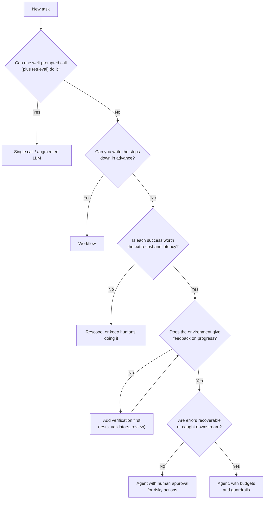

The most valuable skill in agent engineering may be knowing when *not* to build one. Agents are flexible and impressive, and in the right place they do work no other software can. They're also slower, more expensive, harder to test and less predictable than the alternatives. Plenty of agent projects fail not because the agent was badly built, but because a deterministic pipeline or a single well-prompted call would have done the job better.

Anthropic's *Building Effective Agents* (December 2024), written from experience with dozens of teams building on its models, opens with advice worth memorizing: find the simplest solution possible, and only increase complexity when needed. This lesson turns that advice into a framework. We'll climb the ladder of complexity one rung at a time, do the math on why long agent runs fail, weigh cost and latency, and finish with a checklist you can apply to any proposal.

## The Ladder of Complexity

Think of LLM systems as a ladder. Each rung adds capability *and* cost, latency, and unpredictability. Start at the bottom, and climb only when the rung below demonstrably can't do the job.

| Rung | What it is | Who controls flow | Example |
|---|---|---|---|
| **1. Single LLM call** | One prompt, one response, maybe with examples or retrieved context | Your code (trivially) | Classify a ticket; summarize a document; extract fields |
| **2. Augmented LLM** | One model call that can use retrieval, a few tools or memory | Mostly your code; the model may make a tool call or two | Answer a question with a docs search; look up an order |
| **3. Workflow** | Several LLM calls and tools arranged in a fixed structure by your code | Your code | Draft → critique → revise; route a ticket to a specialized prompt; summarize sections in parallel and merge |
| **4. Agent** | The model directs its own sequence of tool calls in a loop until done | The model | Fix a failing test across a repo; research a question across many sources |
| **5. Multi-agent system** | Multiple agents coordinating, often an orchestrator plus workers | Models, at several levels | Broad research fanned out to parallel sub-agents |

Anthropic's essay names the building block at rung 2 the **augmented LLM**, and describes common workflow shapes for rung 3: **prompt chaining**, **routing**, **parallelization**, **orchestrator-workers** and **evaluator-optimizer**. They're covered in depth in [workflow patterns](workflow-patterns.html). Rung 5 has its own lesson, [multi-agent systems](multi-agent-systems.html).

> [!KEY] The big idea
> Workflows give you **predictability and consistency** for well-defined tasks. Agents give you **flexibility and model-driven decision-making** for open-ended ones. The right question isn't "can an agent do this?" but "what is the *lowest* rung that does this reliably?"

A useful test is whether you can draw the flowchart. If you can write down the steps in advance, even with branches, you probably want a workflow. Agents earn their keep when **the number and order of steps can't be predicted**, because they depend on what is discovered along the way.

## Four Decision Criteria

Before committing to an agent, run the idea through four questions.

### 1. Complexity and open-endedness

Is the path to a solution genuinely unpredictable?

- *Open-ended:* "Find out why checkout latency doubled last week." The investigation depends on what the metrics, logs and recent deploys reveal.
- *Not open-ended:* "When an invoice arrives, extract the vendor, amount and due date, and post them to the ERP." The steps are known. Use a workflow.

Agents also shine when tasks vary a lot from instance to instance, so that a workflow would need dozens of branches to cover them.

### 2. Value

Is a successful outcome worth what the agent costs in tokens, time and engineering? Agents use many more tokens than single calls. Anthropic reported that, in its research product, agents typically used about 4× more tokens than chat interactions and multi-agent setups about 15× more. That's fine for a task worth tens or hundreds of dollars of human time, like debugging a production incident or writing a research brief. It isn't fine for a task worth a fraction of a cent, run millions of times a day.

### 3. Viability

Can current models actually do this, with the tools you can give them? Check that:

- The agent can **observe** what it needs (APIs, files, screens) and **act** where it needs to.
- There's a **feedback signal** in the environment (tests, validators, search results) so it can tell whether it's making progress.
- The task is within the demonstrated range of current models. Prototype a handful of real instances before committing.

### 4. Cost of error and recoverability

What happens when the agent gets it wrong, and it *will* sometimes get it wrong?

- **Reversible, low-stakes, caught downstream:** a draft PR that a human reviews, a research summary a person will read. Good territory for agents.
- **Irreversible or high-stakes:** wiring money, deleting data, sending messages to customers, changing production infrastructure. Use an agent only with strong guardrails, human approval for those actions, or not at all (see [human-in-the-loop](human-in-the-loop.html)).

> [!TIP] Rule of thumb
> The best agent use cases combine **high value per task**, **open-ended paths**, a **built-in feedback signal**, and **cheap, recoverable errors**. Coding fits all four: fixes are valuable, debugging is unpredictable, tests give feedback, and version control makes everything reversible. That's no coincidence. It's why coding became the breakout agent use case.

## The Math of Compounding Errors

Here's the most important quantitative idea in agent design. Suppose each step of a task succeeds independently with probability *p*. A task that needs *n* steps to all go right then succeeds with probability:

```text
P(success) = p^n
```

The numbers fall fast:

| Per-step success *p* | 5 steps | 10 steps | 20 steps | 50 steps |
|---|---|---|---|---|
| 0.99 | 95% | 90% | 82% | 61% |
| 0.95 | 77% | 60% | **36%** | 8% |
| 0.90 | 59% | 35% | 12% | 0.5% |

An agent that's right 95% of the time *per step* (which sounds excellent) completes a 20-step task only about 36% of the time. That's the **compounding errors** problem, and it's why Anthropic notes that the autonomy of agents means higher costs and the potential for compounding errors.

Try it yourself: adjust per-step reliability, the number of steps and the recovery rate, and see how end-to-end success changes.

<div class="widget" data-widget="compounding-errors"></div>

### Why the simple model is too pessimistic, and how to exploit that

The `p^n` model assumes every error is fatal and undetected. Good agents break that assumption, and that's precisely where their value comes from. If an error is **detected and corrected** with probability *r*, the effective per-step failure rate falls from *(1 − p)* to *(1 − p)(1 − r)*:

```text
p = 0.95, no recovery (r = 0):    per-step failure 5%   → 20 steps: 0.95^20 ≈ 36%
p = 0.95, recovery r = 0.8:       per-step failure 1%   → 20 steps: 0.99^20 ≈ 82%
```

Same model, same task: success goes from about a third to over four-fifths, purely because the agent can **notice and fix its mistakes**. That's what feedback loops buy you, and it's the main lever you control:

- **Give the environment a voice.** Tests, linters, type checkers, schema validators and "read back what you wrote" all turn silent errors into visible observations.
- **Make errors actionable** so recovery attempts succeed (see [the agent loop](the-agent-loop.html)).
- **Shorten the chain.** Fewer, more capable tools mean fewer steps. A tool that does "search and return the relevant snippet" beats three tools chained together.
- **Checkpoint long tasks.** Break them into verified milestones so a late error doesn't waste early work.
- **Add human checkpoints** at the riskiest steps.

> [!NOTE]
> Real errors aren't independent: one wrong assumption early can poison everything after it, and some steps are much harder than others. Treat `p^n` as an intuition pump about *direction and scale*, not a precise forecast. The way to get real numbers is to measure task-level success on realistic tasks (see [evaluating agents](evaluating-agents.html) and [reliability](reliability.html)).

## Cost and Latency Trade-offs

Agents cost more and take longer than workflows for structural reasons.

**Latency.** Each step is a model call plus tool execution, and steps are mostly sequential. With, say, 6 seconds per model call and 2 seconds per tool, a 20-step agent takes around 160 seconds. A three-call workflow for the same task might take 15 seconds. For a background coding task, nobody minds. For a live chat or voice interface, it's disqualifying (see [conversational and voice agents](conversational-voice-agents.html)).

**Tokens.** The model is stateless, so every step resends the system prompt, the tool definitions and the whole growing transcript. Input tokens therefore grow roughly with the *square* of the number of steps. A worked example:

```text
Transcript starts at 5,000 tokens and grows by 3,000 tokens per step; 20 steps.
Total input  = sum over steps of the context size
             = 20 × 5,000 + 3,000 × (0 + 1 + … + 19) = 100,000 + 570,000 = 670,000 tokens
Total output ≈ 20 steps × 500 tokens = 10,000 tokens

At $4 / M input and $20 / M output (Claude Opus 5.5 list prices, late 2026):
  ≈ $2.68 input + $0.20 output ≈ $2.88 per task, before caching
A single call for a comparable classification-style task: ~5,000 in + 1,000 out ≈ $0.04
```

That's roughly a 70× difference. **Prompt caching** narrows it a lot, because most of each step's input is a prefix the previous step already sent, and cached reads are billed at a small fraction of the normal input price. A cheaper model tier for sub-tasks narrows it further. But agents remain fundamentally more expensive per task, which is fine when the task is worth it. The [cost and latency](cost-and-latency.html) lesson covers optimization in depth.

**Engineering and operating cost.** Agents also need more investment around the model: evaluation suites that measure success rates over repeated runs, tracing to debug long trajectories, sandboxes and permission systems, and ongoing monitoring. A workflow's failure is usually traceable to one step. An agent's failure might be a subtle bad decision at step 7 of 34 (see [observability](observability.html)).

## Good Fits and Poor Fits

| Usually a good fit for an agent | Usually a poor fit (use a call or workflow) |
|---|---|
| Debugging and fixing code, with tests as feedback | High-volume classification, extraction or tagging |
| Multi-source research and synthesis with citations | Fixed ETL pipelines and document processing with known steps |
| Investigating incidents across logs, metrics and deploys | Real-time, latency-critical responses (sub-second UX) |
| Customer support that needs lookups plus bounded actions | Tasks with a single right sequence that rarely changes |
| Data analysis where the next query depends on the last result | Irreversible, high-stakes actions with no human review |
| Operating legacy software with no API (computer use) | Tasks where no feedback signal exists to check progress |
| Long-tail requests too varied to enumerate as branches | Simple Q&A that retrieval plus one call answers well |

Real systems often **mix rungs**. A support product might use a cheap single-call router for 80% of tickets (password resets, order status), a workflow for refunds, and an agent only for the messy long tail that needs investigation. Agents can also call workflows as tools, and workflows can contain a bounded agent step. The question is always which rung fits each *part* of the problem.

> [!EXAMPLE] Same domain, three rungs
> **Expense reports.** Extracting fields from a receipt: a single call with structured output. Checking policy compliance and routing for approval: a workflow (extract → check rules → route). Investigating a suspicious pattern across six months of a team's expenses, cross-referencing calendars and vendor records: an agent, because what you look at next depends on what you find.

## Anti-Patterns

The same mistakes show up again and again in agent projects:

1. **Agent-first thinking.** Starting with "let's build an agent" instead of "what's the simplest thing that works?" Prototype at the lowest rung and climb only when you hit a demonstrated limit.
2. **Framework before understanding.** Reaching for a heavy framework before understanding the underlying calls. Anthropic suggests starting with direct API calls, since many patterns take only a few lines of code, and making sure you understand what any framework does underneath (see [agent frameworks](agent-frameworks.html)).
3. **Autonomy without feedback.** Giving an agent a long task in an environment with no way to check progress. Without a feedback signal, the compounding-errors math works fully against you.
4. **Unbounded loops.** No step, token or time limits. One stuck run can cost more than a month of normal traffic.
5. **Prompt-only safety.** Relying on "please don't delete anything" instead of permissions, sandboxes and approval gates (see [guardrails and sandboxing](guardrails-and-sandboxing.html)).
6. **Too many tools.** Dozens of overlapping tools confuse the model and lengthen trajectories. Fewer, well-designed tools beat many thin wrappers (see [designing tools](designing-tools.html)).
7. **Multi-agent by default.** Splitting work across many agents because it looks sophisticated. That multiplies cost and coordination failures, and it only pays off for genuinely parallelizable, high-value work.
8. **Demo-driven development.** Judging an agent by a few impressive runs. Agents are stochastic, so measure success rates across many realistic tasks before shipping.
9. **Automating the wrong process.** Wrapping an agent around a broken or undocumented human process. If people can't say what "done" looks like, an agent can't either.

## A Decision Checklist

Use this flowchart as a first pass, then the checklist below to pressure-test the answer.



**Checklist before building an agent:**

- [ ] I tried (or reasoned carefully about) a single call and a workflow, and can name the specific way each falls short.
- [ ] The number or order of steps truly depends on what's discovered along the way.
- [ ] A successful run is worth well over its expected token, latency and engineering cost.
- [ ] The agent can observe what it needs and has tools for the actions it must take, and no more.
- [ ] There's a feedback signal (tests, validators, search results, a human reviewer) that reveals mistakes.
- [ ] Irreversible or high-stakes actions are gated by code-level permissions or human approval.
- [ ] Every run has hard limits on steps, tokens and time.
- [ ] I have, or will build, an evaluation set of realistic tasks to measure success rates over repeated runs.
- [ ] I know what "done" looks like, and so will the agent.

If you can't tick most of these boxes, step down a rung. You can always climb later, once you have the evals and evidence that justify it.

## Key Takeaways

- Start with the **simplest solution**: single call → augmented LLM → workflow → agent → multi-agent. Climb only when the lower rung demonstrably falls short.
- **Workflows** suit well-defined tasks that need predictability. **Agents** suit open-ended tasks whose steps can't be known in advance.
- Judge proposals on **complexity, value, viability and cost of error**.
- Reliability **compounds**: 95% per step is about 36% over 20 steps. **Detection and recovery** (tests, validators, actionable errors) change the math dramatically.
- Agents cost more and take longer because of sequential steps and a transcript resent at every step. **Caching**, model tiering and shorter chains help, but the task has to be worth it.
- Most production systems **mix rungs**, with cheap paths for the common case and an agent for the long tail.
- Avoid the classic anti-patterns: agent-first thinking, unbounded loops, prompt-only safety, tool sprawl, multi-agent by default, and demo-driven development.

## Exercises

1. **Run the numbers.** An agent averages 30 steps per task with 97% per-step success. What is its end-to-end success rate under the simple model? What recovery rate *r* would it need to reach 90% end-to-end?
2. **Ladder a product.** Choose a domain you know (HR onboarding, sales ops, IT helpdesk). List five tasks in it and assign each to the lowest rung that would handle it reliably. Justify each in one sentence.
3. **Cost it out.** Redo the worked cost example for a 40-step task whose transcript starts at 8,000 tokens and grows by 2,000 per step. Then assume 90% of each step's input is served from cache at one-twentieth of the base input price. How much does caching save?
4. **Find the feedback signal.** For three proposed agents (a contract-review agent, a marketing-copy agent, a cloud-cost optimizer), identify the feedback signal each could use to catch its own mistakes. Where none exists, propose one.
5. **Stretch: design review.** Your company wants an "autonomous procurement agent" that finds vendors, negotiates by email and issues purchase orders up to $50,000. Write a one-page design review that applies the four criteria and the checklist, identifies the riskiest steps, and proposes a scoped-down v1 with an autonomy level per action.

## Check Your Understanding

```quiz
Q: A team must extract the same six fields from 2 million PDFs a month. Which approach best fits?
- [x] One structured-output call per document, in a simple workflow
- [ ] An agent per document that decides how best to read each one
- [ ] A workflow plus a reviewer agent that double-checks every file
- [ ] A cheap-model agent per document, to keep the per-file cost low
E: The task is well-defined, extremely high-volume and low-value per item. The lowest rung that works (one call with structured output) wins on cost, latency and predictability. A cheaper model doesn't fix the problem with the agent options: they add steps and unpredictability the task doesn't need.

Q: Under the simple compounding model, roughly what end-to-end success does a 20-step task have at 95% per-step success?
- [ ] About 95%
- [ ] About 75%
- [x] About 36%
- [ ] Well under 10%
E: 0.95^20 ≈ 0.36. 75% is a common guess from treating the failures as adding up linearly, but per-step reliability multiplies, so even 95% per step compounds into frequent failure over long tasks.

Q: Which change most directly improves an agent's end-to-end success without changing the model?
- [ ] Removing the step limit so the agent gets more chances to finish
- [x] Adding tests and validators so it can spot and fix its own mistakes
- [ ] Splitting the task across several agents that each do fewer steps
- [ ] Adding more specialized tools so it always has the exact one it needs
E: Detection and recovery reduce the effective per-step failure rate, for example from 5% to 1% with 80% recovery, which turns about 36% success into about 82% over 20 steps. Splitting across agents adds coordination failures, extra overlapping tools lengthen trajectories, and removing the step limit just lets failures run longer.

Q: According to Anthropic's framing, when do agents tend to be the right choice over workflows?
- [ ] When a task needs several LLM calls and a few different tools
- [x] When the steps needed can't be predicted or hard-coded in advance
- [ ] When the task is high-stakes and so needs the most capable model
- [ ] When the task has many branches that you can list in advance
E: Workflows can make many calls, use many tools and handle many known branches. Agents fit when the path itself depends on what's discovered, so it can't be written down ahead of time. High stakes argue for *more* control, not less.

Q: Why do an agent's input-token costs grow faster than linearly with the number of steps?
- [ ] Providers charge a higher input rate once a context passes a size limit
- [x] The growing transcript is resent each call, so the total is ~quadratic
- [ ] Each step's thinking tokens are billed again as input on every call
- [ ] Tool definitions are re-added to the prompt once per tool call made
E: Each call includes everything so far. Summing a context that grows linearly gives roughly quadratic total input, which prompt caching mitigates. Tool definitions are sent once per request, not once per call made, and their size doesn't grow with steps.

Q: Which proposal shows the "autonomy without feedback" anti-pattern?
- [ ] A coding agent that runs the full test suite after each edit it makes
- [ ] A research agent whose final report is checked by a human analyst
- [x] An agent that rewrites marketing pages and publishes them unchecked
- [ ] A support agent that must get approval for refunds of over $500
E: With no signal to detect mistakes and no review before an irreversible publish, errors compound silently. The other options include tests, review or approval gates.

Q: A support product handles 80% of tickets with simple lookups and 20% with messy investigations. What is usually the best architecture?
- [ ] One agent for all tickets, so every customer gets consistent handling
- [x] A cheap router or workflow for common cases, an agent for the rest
- [ ] A fixed workflow with a branch added for each investigation type
- [ ] An agent for all tickets, run on a small model to keep costs down
E: Mixing rungs puts each part of the problem on the lowest rung that handles it, keeping cost and latency low for common cases while still covering the hard ones. Messy investigations are exactly the cases you can't enumerate as branches in advance.
```

## Further Reading

- [Building Effective Agents (Anthropic, 2024)](https://www.anthropic.com/engineering/building-effective-agents): the source of the workflow-vs-agent framing, the augmented LLM, and the five workflow patterns.
- [How we built our multi-agent research system (Anthropic, 2025)](https://www.anthropic.com/engineering/multi-agent-research-system): real token-cost multipliers and when multi-agent setups pay off.
- [Measuring AI Ability to Complete Long Tasks (METR, 2025)](https://arxiv.org/abs/2503.14499): how task length relates to agent success rates, with a careful methodology.
- [SWE-bench (Jimenez et al., 2023)](https://arxiv.org/abs/2310.06770): a benchmark built around a strong feedback signal (hidden tests), which illustrates why coding suits agents.
- [Gartner on agentic AI project cancellations and agent-washing (June 2025)](https://www.gartner.com/en/newsroom/press-releases/2025-06-25-gartner-predicts-over-40-percent-of-agentic-ai-projects-will-be-canceled-by-end-of-2027): an industry view of why many agent projects fail on value and cost.
- [Claude pricing](https://platform.claude.com/docs/en/about-claude/pricing): current per-token prices and prompt-caching multipliers for your own cost estimates.
- [Tool use overview (Claude docs)](https://platform.claude.com/docs/en/agents-and-tools/tool-use/overview): what the augmented LLM building block looks like in practice.
