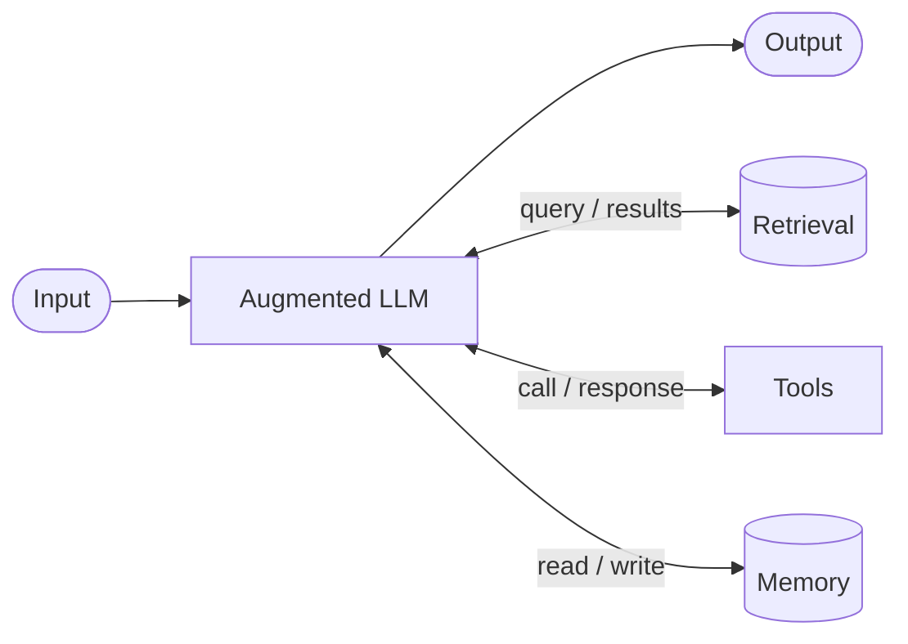
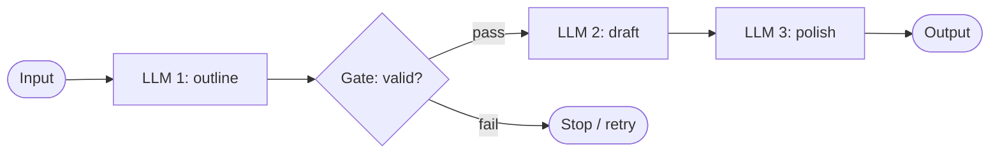
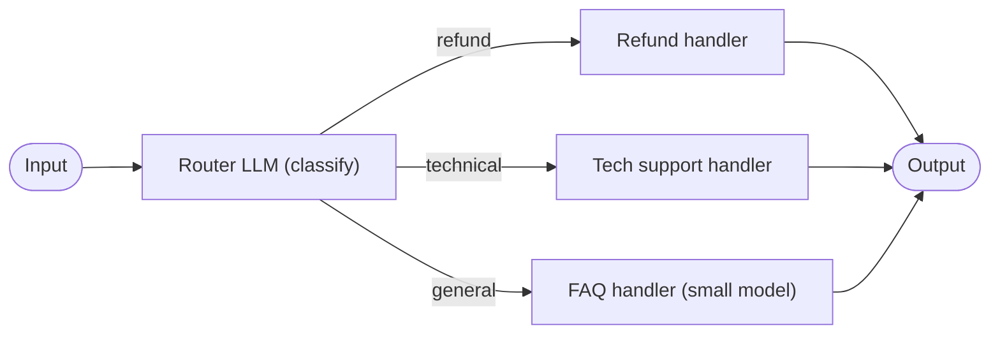
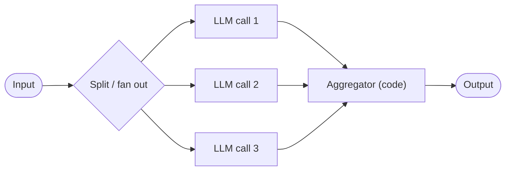
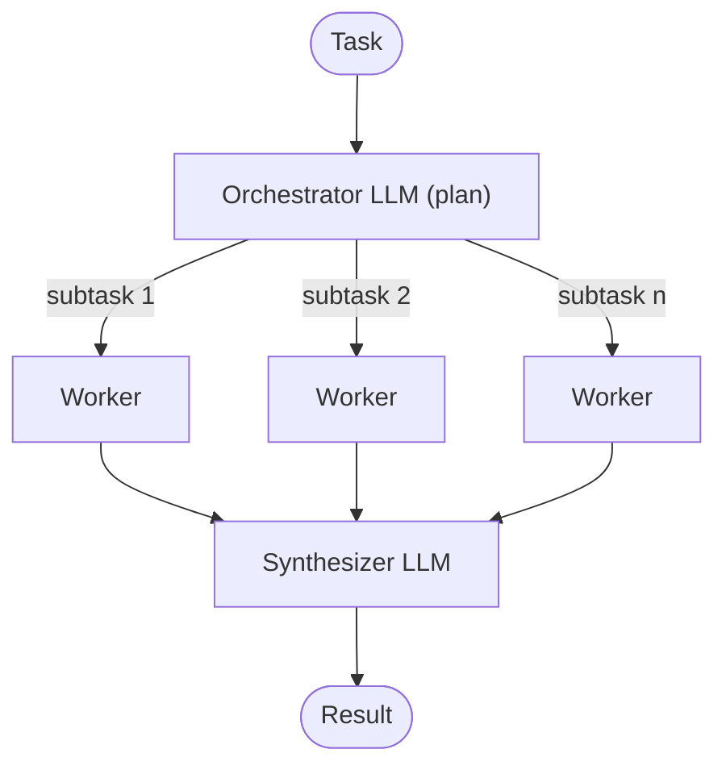
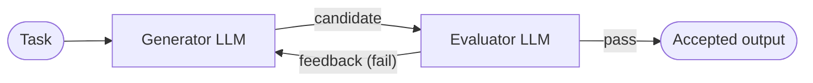
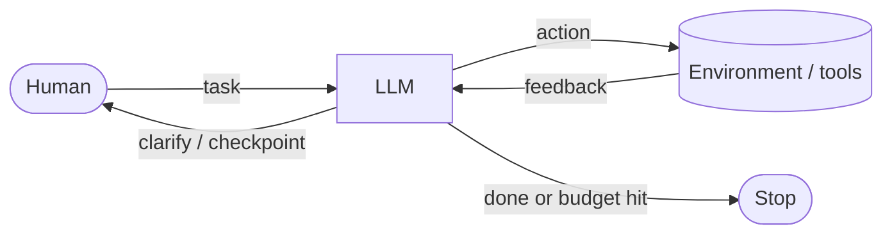
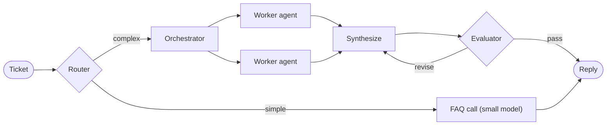

Most of the LLM systems that work reliably in production are not open-ended autonomous agents. They are **workflows**: a handful of model calls wired together by ordinary code, each call doing one well-scoped job. A support system that classifies a ticket and then hands it to one of four specialized prompts. A report generator that writes an outline, checks it, then drafts each section in parallel. A translator that drafts, critiques its own draft, and revises. None of these let the model decide what happens next, and that is exactly why they are fast, cheap and debuggable.

In December 2024 Anthropic published "Building Effective Agents", a short essay distilled from dozens of customer deployments. Its central claim was that the teams who succeeded were not using elaborate frameworks: they were using **simple, composable patterns**. This lesson teaches those patterns one by one: what each looks like, when to use it, a concrete example, working Python, and the trade-offs. At the end we look at the fully autonomous agent, the pattern you reach for only when the others run out, and at how the patterns combine.

## Workflows vs. Agents

Anthropic draws a useful line between two kinds of **agentic systems**:

- A **workflow** is a system where LLMs and tools are orchestrated through **predefined code paths**. You, the developer, decide the control flow. The model fills in the content.
- An **agent** is a system where the LLM **dynamically directs its own process and tool usage**, deciding what to do next, how many steps to take, and when it is done.

This is a spectrum rather than a binary (see [What Is an AI Agent?](what-is-an-agent.html)), but the distinction matters for engineering. A workflow's behavior is bounded by its code: you can enumerate the paths, unit-test each step, and predict its cost. An agent's behavior is bounded only by its tools, its budget and its judgment. As [When to Use Agents](when-to-use-agents.html) argued, autonomy buys flexibility at the price of latency, cost and compounding errors.

> [!KEY] Start simple
> Find the simplest solution that works, and add complexity only when it demonstrably improves outcomes. Often that is a single well-prompted LLM call with retrieval and good examples. Workflows are the next step up; autonomous agents are the step after that.

Try it yourself: explore each pattern's shape, and see how data flows through it, before reading the details.

<div class="widget" data-widget="pattern-explorer"></div>

All the code below shares two tiny helpers so each pattern stays short:

```python
from typing import TypeVar
import anthropic
from pydantic import BaseModel

client = anthropic.Anthropic()          # reads ANTHROPIC_API_KEY
MODEL = "claude-opus-5-5"
FAST = "claude-haiku-5-5"               # cheaper model for simple steps
T = TypeVar("T", bound=BaseModel)

def llm(prompt: str, system: str = "", model: str = MODEL) -> str:
    """One plain LLM call; returns the text of the reply."""
    resp = client.messages.create(
        model=model, max_tokens=16000,
        system=system or anthropic.omit,    # omit the field when no system prompt
        messages=[{"role": "user", "content": prompt}],
    )
    return "".join(b.text for b in resp.content if b.type == "text")

def llm_json(prompt: str, schema: type[T], system: str = "", model: str = MODEL) -> T:
    """One LLM call whose output is validated against a Pydantic model."""
    resp = client.messages.parse(
        model=model, max_tokens=16000,
        system=system or anthropic.omit,
        messages=[{"role": "user", "content": prompt}],
        output_format=schema,
    )
    return resp.parsed_output
```

Note that `llm_json` uses **structured outputs** ([lesson](structured-outputs.html)). Almost every pattern below depends on one step producing machine-readable output that code can branch on, so reliable JSON is the glue that holds workflows together.

## The Augmented LLM

Every pattern is built from the same brick: an **augmented LLM**, meaning a model enhanced with three capabilities:

- **Retrieval**: it can pull in relevant information (search, a vector store, a database) rather than relying on its weights. See [RAG & Retrieval](rag-and-retrieval.html).
- **Tools**: it can take actions and fetch live data through function calls. See [Tool Use](tool-use.html).
- **Memory**: it can read and write information that persists beyond the current context window. See [Memory](memory.html).



Modern models decide for themselves when to search, which tool to call and what to remember. The engineering work is in tailoring these capabilities to your use case and giving the model a clean, well-documented interface to them (the subject of [Designing Tools](designing-tools.html)). One standard way to plug capabilities in is the [Model Context Protocol](protocols-mcp-a2a.html).

A single augmented call with the SDK's tool runner:

```python
from anthropic import beta_tool

@beta_tool
def lookup_order(order_id: str) -> str:
    """Look up an order's status. Call this whenever the user mentions an order number.

    Args:
        order_id: The order identifier, e.g. "A-1042".
    """
    return '{"order_id": "A-1042", "status": "shipped", "eta": "2026-11-25"}'  # stub

runner = client.beta.messages.tool_runner(
    model=MODEL, max_tokens=16000,
    tools=[lookup_order, {"type": "web_search_20260209", "name": "web_search"}],
    messages=[{"role": "user", "content": "Where is order A-1042?"}],
)
print(runner.until_done().content[-1].text)
```

Every box labelled "LLM" in the diagrams below can be one of these: a call that may itself use tools and retrieval.

## Prompt Chaining

**Prompt chaining** decomposes a task into a fixed sequence of steps, where each LLM call processes the output of the previous one. Between steps you can insert **programmatic gates**: plain code checks that verify the intermediate output and stop, retry or branch if it is not acceptable.



**When to use it:** the task cleanly decomposes into fixed subtasks, and you are willing to trade latency for accuracy. Each call gets an easier job, a shorter prompt and a focused instruction set, so it does that job better than one giant prompt doing everything at once.

**Example:** generating marketing copy, checking it meets constraints, then translating it. Or: write an outline, verify the outline covers the required points, then write the document.

```python
class Outline(BaseModel):
    title: str
    sections: list[str]

def write_brief(topic: str, must_cover: list[str]) -> str:
    # Step 1: outline (structured, so the gate can inspect it)
    outline = llm_json(f"Outline a 1-page brief on: {topic}. Use 3-6 sections.", Outline)

    # Gate: deterministic check, no LLM needed
    text = " ".join(outline.sections).lower()
    missing = [m for m in must_cover if m.lower() not in text]
    if missing:
        raise ValueError(f"Outline missing required topics: {missing}")

    # Step 2: draft from the validated outline
    draft = llm(f"Write the brief '{outline.title}' with sections: {outline.sections}")

    # Step 3: polish with a narrow instruction
    return llm(f"Tighten this for executives; keep every fact, cut 30% of words:\n\n{draft}")
```

**Trade-offs:**

- (+) Each step is independently testable and its prompt can be tuned in isolation.
- (+) Gates catch errors early, before they compound through later steps.
- (+) You can use different models per step (a cheap model for formatting, a strong one for reasoning).
- (−) Latency adds up: three sequential calls take roughly three times as long as one.
- (−) Information can be lost between steps if you pass only summaries. Pass what the next step actually needs.

> [!TIP] Gates should be cheap and deterministic where possible
> Length limits, required keywords, schema validation, a regex, a compile step, a unit test. Reserve LLM-as-judge gates for properties code cannot check, and remember they cost a call and can be wrong.

## Routing

**Routing** classifies an input and directs it to a specialized follow-up path. It lets you separate concerns: each downstream prompt (or model, or tool set) is optimized for one category, without that optimization degrading performance on the others.



**When to use it:** inputs fall into distinct categories that are better handled separately, and classification can be done accurately, by an LLM or by a traditional classifier.

**Examples:**

- Customer service: route refund requests, technical issues and general questions to different prompts, tools and escalation policies.
- **Model routing**: send easy questions to a small, fast model and hard ones to a frontier model. This is one of the most effective cost levers available ([Cost & Latency](cost-and-latency.html)).

```python
from typing import Literal

class Route(BaseModel):
    category: Literal["refund", "technical", "general"]
    reasoning: str

HANDLERS = {
    "refund":    ("You process refunds. Policy: 30 days, receipt required. Never promise exceptions.", MODEL),
    "technical": ("You are a senior support engineer. Ask for logs before guessing.", MODEL),
    "general":   ("You answer general questions briefly and link to the FAQ.", FAST),
}

def handle_ticket(ticket: str) -> str:
    route = llm_json(
        f"Classify this support ticket:\n\n{ticket}", Route,
        system="Categories: refund (money back, cancellations), technical (bugs, errors), general (everything else).",
        model=FAST,                          # classification is easy; use the cheap model
    )
    system, model = HANDLERS[route.category]
    return llm(ticket, system=system, model=model)
```

**Trade-offs:**

- (+) Specialized prompts outperform one prompt that tries to cover everything.
- (+) Big cost savings when most traffic can go to a cheaper path.
- (−) Misroutes are silent failures: a technical question answered by the FAQ handler looks like a bad answer, not an error. Log the router's decision and evaluate it as its own classifier, with a confusion matrix.
- (−) Ambiguous inputs that span categories need a fallback (a "general" route with access to everything, or a clarifying question).

## Parallelization

**Parallelization** runs several LLM calls simultaneously and aggregates their outputs programmatically. It comes in two flavors:

- **Sectioning**: split a task into *independent* subtasks that run in parallel.
- **Voting**: run the *same* task several times to get diverse outputs, then aggregate (majority vote, threshold, best-of).



**When to use it:** subtasks are independent and can run concurrently for speed, or you want multiple perspectives or attempts for higher confidence. A subtle but important insight from Anthropic's essay: for complex tasks with several considerations, LLMs generally do better when **each consideration is handled by a separate call**, giving focused attention to each.

**Sectioning examples:**

- **Guardrails in parallel**: one call answers the user while another screens the input for policy violations. This tends to work better than asking a single call to do both.
- **Multi-aspect evaluation**: score a response for accuracy, tone and safety in three separate calls.

**Voting examples:**

- Review code for vulnerabilities with several differently-prompted reviewers; flag the code if any of them finds a problem.
- Content moderation where you tune the threshold (2 of 3 votes) to balance false positives and negatives.
- **Self-consistency**: sample several reasoning paths and take the majority answer, a classic technique from the [reasoning](reasoning-and-planning.html) literature.

```python
import asyncio

aclient = anthropic.AsyncAnthropic()

async def acall(prompt: str, system: str = "") -> str:
    resp = await aclient.messages.create(
        model=MODEL, max_tokens=16000, system=system or anthropic.omit,
        messages=[{"role": "user", "content": prompt}],
    )
    return "".join(b.text for b in resp.content if b.type == "text")

# Sectioning: independent aspects reviewed concurrently
async def review(doc: str) -> dict[str, str]:
    aspects = {
        "accuracy": "Check every factual claim. List any that look wrong.",
        "clarity":  "Identify confusing sentences and suggest rewrites.",
        "risk":     "Flag legal or reputational risks.",
    }
    results = await asyncio.gather(*(acall(doc, system=s) for s in aspects.values()))
    return dict(zip(aspects, results))

# Voting: differently-framed reviewers, flag if ANY says vulnerable
async def is_vulnerable(code: str) -> bool:
    lenses = ["injection flaws", "authentication and authorization bugs", "unsafe deserialization"]
    votes = await asyncio.gather(*(
        acall(f"Review for {lens}. Answer only VULNERABLE or SAFE.\n\n{code}") for lens in lenses
    ))
    return any("VULNERABLE" in v.upper() for v in votes)
```

> [!NOTE] Where does diversity come from?
> Current Claude models do not accept a `temperature` parameter, so for voting you should not rely on sampling noise alone. Make the voters *genuinely different*: different instructions or lenses, different context slices, or different models. Correlated voters that make the same mistake add cost without adding confidence.

**Trade-offs:**

- (+) Sectioning cuts wall-clock latency to roughly the slowest branch.
- (+) Voting raises reliability on high-stakes binary decisions.
- (−) Token cost multiplies by the number of branches.
- (−) The aggregation step is where bugs hide: decide in advance how to merge conflicting outputs.
- (−) Watch your rate limits when fanning out widely.

## Orchestrator-Workers

In **orchestrator-workers**, a central LLM (the **orchestrator**) dynamically breaks a task into subtasks, delegates them to **worker** LLM calls, and synthesizes their results.



It looks like parallelization, but the key difference is that **the subtasks are not predefined**. The orchestrator decides how many there are and what each one is, based on the specific input.

**When to use it:** complex tasks where you cannot predict the subtasks in advance. Examples:

- A coding change that touches an unknown number of files; the orchestrator decides which files need edits and what each edit is.
- A research question where the orchestrator decides which sources or angles to investigate.

```python
class Subtask(BaseModel):
    id: str
    instruction: str          # self-contained: a worker sees only this
    output_format: str

class Plan(BaseModel):
    subtasks: list[Subtask]

async def orchestrate(task: str) -> str:
    plan = llm_json(
        f"Break this task into 2-6 independent subtasks a worker can do without "
        f"seeing the others. Make each instruction fully self-contained.\n\nTask: {task}",
        Plan,
    )
    results = await asyncio.gather(*(
        acall(f"{s.instruction}\n\nReturn: {s.output_format}") for s in plan.subtasks
    ))
    joined = "\n\n".join(f"## {s.id}\n{r}" for s, r in zip(plan.subtasks, results))
    return llm(f"Task: {task}\n\nWorker results:\n{joined}\n\nSynthesize a single coherent answer.")
```

The single most important line in that code is the instruction to make each subtask **self-contained**. Workers see none of the orchestrator's context, so vague delegation ("research the second part") produces duplicated or irrelevant work. We will return to this at length in [Multi-Agent Systems](multi-agent-systems.html), where orchestrator-workers grows into fully agentic subagents.

**Trade-offs:**

- (+) Adapts to the input: a simple task gets two subtasks, a complex one gets six.
- (+) Workers can run in parallel and each has a clean, focused context.
- (−) Plan quality caps result quality. A bad decomposition cannot be rescued by good workers.
- (−) Harder to test than fixed workflows, because the shape of the run varies.
- (−) Synthesis must reconcile overlaps and contradictions between workers.

## Evaluator-Optimizer

In **evaluator-optimizer**, one LLM call generates a response while another evaluates it and provides feedback, in a loop, until the output passes or a budget runs out.



**When to use it:** you have clear evaluation criteria, and iterative refinement provides measurable value. Two signs of a good fit: (1) a human's written feedback would demonstrably improve the output, and (2) an LLM can produce that kind of feedback. It is the same loop a writer goes through with an editor.

**Examples:**

- Literary translation, where nuance the translator missed on the first pass can be pointed out by a critic.
- Complex search tasks that require several rounds of searching and analysis; the evaluator decides whether more searching is warranted.
- Code generation where the evaluator is (partly) *not an LLM at all*: a compiler and a test suite.

```python
class Verdict(BaseModel):
    passed: bool
    feedback: str            # concrete, actionable issues; empty if passed

def refine(task: str, criteria: str, max_rounds: int = 4) -> str:
    candidate = llm(task)
    for _ in range(max_rounds):
        verdict = llm_json(
            f"Criteria:\n{criteria}\n\nCandidate:\n{candidate}\n\n"
            "Does the candidate meet ALL criteria? If not, list specific fixes.",
            Verdict,
            system="You are a strict reviewer. Do not rewrite; only judge and explain.",
        )
        if verdict.passed:
            return candidate
        candidate = llm(
            f"Task: {task}\n\nPrevious attempt:\n{candidate}\n\n"
            f"Reviewer feedback:\n{verdict.feedback}\n\nProduce an improved version."
        )
    return candidate   # budget exhausted: return best effort (and log it!)
```

**Trade-offs:**

- (+) Measurably better quality on tasks with checkable criteria.
- (+) Separating the generator and evaluator roles avoids the "grading your own homework" leniency of a single prompt that both writes and critiques.
- (−) Cost and latency multiply with rounds; always cap them.
- (−) An LLM evaluator can be miscalibrated: too lenient (accepts junk) or too picky (never converges). Calibrate it against human judgments, as covered in [Evaluating Agents](evaluating-agents.html).
- (−) Oscillation: the generator can flip-flop between two versions. Passing the full history of feedback helps.

> [!TIP] Ground the evaluator whenever you can
> The best evaluators are external signals: tests passing, a schema validating, a fact found in a retrieved source. An LLM judging an LLM is the fallback, not the first choice. Research such as Self-Refine showed iterative self-feedback can help, but gains are much more reliable when feedback is grounded in real execution.

## The Autonomous Agent

When none of the fixed shapes fit, because you genuinely cannot predict the number of steps or the path through the problem, you move to an **autonomous agent**: an LLM using tools in a loop, based on environmental feedback, until it decides the task is done (or hits a stopping condition you set).



Agents begin with a command from, or an interactive discussion with, a human. Once the task is clear they plan and operate independently, getting **ground truth from the environment** at each step (tool results, test output, page contents) to assess progress. They may pause for human feedback at checkpoints or when blocked ([Human-in-the-Loop](human-in-the-loop.html)). They need **stopping conditions**, such as a maximum number of iterations, to keep control.

**When to use it:** open-ended problems where the number of steps is unpredictable and a fixed path cannot be hard-coded, and where you have enough trust in the model's decisions to let it operate. Canonical examples are [coding agents](coding-agents.html) that resolve a GitHub issue across many files, and [computer-use agents](computer-use-agents.html).

The implementation is surprisingly short. It is the [agent loop](the-agent-loop.html), which the tool runner gives you for free:

```python
@beta_tool
def run_tests(path: str) -> str:
    """Run the test suite under `path` and return a summary of failures."""
    ...

@beta_tool
def edit_file(path: str, old: str, new: str) -> str:
    """Replace the exact string `old` with `new` in the file at `path`."""
    ...

runner = client.beta.messages.tool_runner(
    model=MODEL, max_tokens=16000,
    tools=[run_tests, edit_file],
    max_iterations=30,          # stopping condition: bound cost and time
    messages=[{"role": "user", "content": "Make the failing tests in ./billing pass."}],
)
final = runner.until_done()
```

The simplicity is deceptive. Almost all the engineering effort goes into the tools and their documentation (Anthropic reported spending more time optimizing tools than the overall prompt for its SWE-bench agent), into sandboxing ([Guardrails & Sandboxing](guardrails-and-sandboxing.html)), and into evaluation.

**Trade-offs:**

- (+) Handles problems no fixed workflow can.
- (−) Higher cost and latency, and the potential for compounding errors over many steps.
- (−) Requires extensive testing in sandboxed environments plus appropriate guardrails.

## Comparing the Patterns

| Pattern | Who decides the steps? | Typical calls | Latency | Best for | Main risk |
|---|---|---|---|---|---|
| Single augmented call | — | 1 (+ tool calls) | Lowest | Most tasks; start here | Prompt does too much |
| Prompt chaining | Code (fixed sequence) | 2–5 sequential | Sum of steps | Decomposable, fixed tasks | Info lost between steps |
| Routing | Code (after classification) | 2 | Low | Distinct input categories | Silent misroutes |
| Parallelization | Code (fixed fan-out) | N parallel | Max of branches | Independent aspects, voting | Aggregation bugs, N× cost |
| Orchestrator-workers | LLM plans, code executes | 2 + N | Medium | Unpredictable subtasks | Bad decomposition |
| Evaluator-optimizer | Code loop, LLM verdict | 2 per round | High | Clear criteria, iterative gains | Non-convergence |
| Autonomous agent | LLM, every step | Unbounded (capped) | Highest | Open-ended, path unknown | Compounding errors |

A useful way to read this table: going down the rows, you hand more control flow to the model. Each step down should be justified by an evaluation showing the simpler pattern falls short.

## Combining Patterns

The patterns are building blocks, not a menu where you pick one. Real systems nest them. A few common compositions:

- **Route, then chain**: a router picks the category, and each category runs its own prompt chain.
- **Chain with a parallel step**: outline → draft each section in parallel (sectioning) → merge → evaluator-optimizer loop on the merged draft.
- **Orchestrator whose workers are agents**: the orchestrator plans, and each worker is itself an autonomous tool-using loop. This is the architecture of most [deep research agents](research-agents.html).
- **Agent with workflow tools**: an autonomous agent whose tools are themselves deterministic workflows (a `generate_report` tool that internally runs a fixed chain). This keeps the agent's action space small and each action reliable.
- **Guardrail sectioning around anything**: an input screen running in parallel with the main path, and an output check after it.



> [!EXAMPLE] A realistic composition: contract review
> 1. **Routing**: classify the contract type (NDA, MSA, employment) with a small model.
> 2. **Sectioning**: in parallel, extract parties and dates, check each clause against the playbook for that contract type, and screen for unusual indemnities.
> 3. **Chaining with a gate**: if any clause is flagged "high risk", run a deeper analysis step; otherwise skip it.
> 4. **Evaluator-optimizer**: draft the summary memo, have an evaluator verify every claim cites a clause number, and revise until it does.
>
> Every step is a fixed code path. There is no autonomous agent anywhere, and yet the system adapts substantially to its input.

### Frameworks: helpful, but know what's underneath

Frameworks such as LangGraph, the Claude Agent SDK, the OpenAI Agents SDK, CrewAI and many others make these patterns easier to start with ([Agent Frameworks](agent-frameworks.html)). Anthropic's advice is to start by using LLM APIs directly, since many patterns take only a few lines, and if you do use a framework, make sure you understand the code underneath. Extra abstraction layers can obscure the actual prompts and responses, making systems harder to debug, and make it tempting to add complexity a simpler setup would not need.

### Three principles for whichever pattern you choose

1. **Simplicity**: keep the design as simple as the task allows.
2. **Transparency**: make the system's steps visible: log every call, show plans, keep traces ([Observability](observability.html)).
3. **A well-crafted agent-computer interface (ACI)**: invest as much in tool design and documentation as you would in a human-facing UI.

## Key Takeaways

- **Workflows** use code-defined control flow; **agents** let the model direct its own process. Both are built from the **augmented LLM** (retrieval + tools + memory).
- **Prompt chaining** trades latency for accuracy by giving each call one job; **programmatic gates** catch errors between steps.
- **Routing** sends each input to a specialized path or a cheaper model; evaluate the router as a classifier because misroutes fail silently.
- **Parallelization** comes as **sectioning** (independent subtasks) or **voting** (same task, diverse attempts); make voters genuinely different.
- **Orchestrator-workers** fits when subtasks cannot be predicted; self-contained delegation instructions are critical.
- **Evaluator-optimizer** fits when criteria are clear and feedback helps; ground the evaluator in real signals and cap the rounds.
- Use an **autonomous agent** only when the path is genuinely unpredictable, and give it stopping conditions, sandboxing and evaluations.
- Patterns compose. Move down the autonomy ladder only when an evaluation shows the simpler design falls short.

## Exercises

1. **Pattern spotting.** For each task, name the pattern you would start with and why: (a) summarizing 500 customer reviews into themes, (b) answering HR policy questions where 80% are about vacation days, (c) converting a legacy Java service to Python, (d) writing a product description that must be under 50 words and mention three features.
2. **Add a gate.** Extend `write_brief` so that if the gate fails, it retries the outline step once with the missing topics named explicitly, before raising. Log how often the retry is needed over 20 runs.
3. **Measure routing.** Build a labelled set of 30 support tickets across the three categories. Run `handle_ticket`'s router on them, compute accuracy and a confusion matrix, then improve the router's system prompt and re-measure.
4. **Ground the evaluator.** Rewrite `refine` for code generation: the generator writes a Python function, and the evaluator first runs a provided set of `assert` tests (in a sandbox) and only calls the LLM reviewer if all tests pass. Compare rounds-to-success with the pure-LLM evaluator.
5. **Design challenge.** Sketch, as a mermaid diagram, a pipeline that combines at least three patterns for "turn a 2-hour meeting transcript into decisions, action items with owners, and a follow-up email." Justify each pattern and identify where you would put human review.

## Check Your Understanding

```quiz
Q: What is the defining difference between a workflow and an agent in Anthropic's framing?
- [ ] Workflows use tools; agents do not
- [x] In a workflow, code defines the control flow; in an agent, the LLM dynamically decides its own steps
- [ ] Workflows use small models; agents use frontier models
- [ ] Agents always involve multiple LLMs, workflows only one
E: Both can use tools and any model. The distinction is who controls the path: predefined code paths (workflow) versus the model directing its own process and tool usage (agent).

Q: Your support bot handles billing, technical and sales questions, and improving the technical prompt keeps hurting billing answers. Which pattern most directly addresses this?
- [ ] Evaluator-optimizer
- [ ] Voting
- [x] Routing
- [ ] Prompt chaining
E: Routing separates concerns: each category gets its own specialized prompt, so optimizing one path no longer degrades the others.

Q: How does orchestrator-workers differ from sectioning-style parallelization?
- [ ] Orchestrator-workers runs sequentially; sectioning runs in parallel
- [x] In orchestrator-workers the subtasks are decided by an LLM at runtime; in sectioning they are predefined in code
- [ ] Sectioning requires multiple models; orchestrator-workers uses one
- [ ] There is no difference; they are synonyms
E: Both can fan out in parallel. The key difference is flexibility: the orchestrator determines how many subtasks there are and what they are based on the specific input.

Q: You run three identical prompts in a voting setup and they almost always agree, even when wrong. What is the most likely fix?
- [ ] Add more identical voters
- [ ] Switch to prompt chaining
- [x] Make the voters genuinely diverse, with different instructions, lenses, context or models
- [ ] Lower the vote threshold to 1 of 3
E: Correlated voters share failure modes, so adding more of them adds cost without confidence. Diversity in framing or model decorrelates their errors.

Q: Which is the best signal that evaluator-optimizer will pay off for a task?
- [ ] The task is latency-sensitive
- [x] Clear criteria exist, and written feedback would demonstrably improve a first draft
- [ ] The inputs fall into several distinct categories
- [ ] The number of steps is unpredictable
E: Evaluator-optimizer works when evaluation criteria are clear and iterative refinement adds measurable value, much like a writer revising with an editor's notes.

Q: What is a "programmatic gate" in prompt chaining?
- [ ] A rate limiter between API calls
- [ ] A special API parameter that blocks unsafe output
- [x] A code check on an intermediate output that decides whether the chain continues, retries or stops
- [ ] A human approval step
E: Gates are ordinary code (schema validation, keyword checks, tests) that verify intermediate results, catching errors before they compound through later steps.

Q: A team jumps straight to an autonomous multi-tool agent for a task that always follows the same four steps. What is the main problem?
- [ ] Agents cannot call more than three tools
- [x] They pay extra latency, cost and unpredictability for flexibility the task does not need; a prompt chain would be simpler and more reliable
- [ ] Autonomous agents cannot run fixed sequences
- [ ] The task requires voting
E: When the path is known in advance, encoding it in code is cheaper, faster, easier to test and less error-prone than letting the model rediscover it every run.
```

## Further Reading

- [Building Effective Agents (Anthropic)](https://www.anthropic.com/engineering/building-effective-agents) — the source of these patterns; short, practical and still the best introduction.
- [Anthropic Cookbook: agent patterns](https://github.com/anthropics/anthropic-cookbook/tree/main/patterns/agents) — reference notebooks implementing each workflow pattern.
- [Writing effective tools for agents (Anthropic)](https://www.anthropic.com/engineering/writing-tools-for-agents) — how to build the agent-computer interface that every pattern depends on.
- [Self-Consistency Improves Chain of Thought Reasoning (Wang et al., 2022)](https://arxiv.org/abs/2203.11171) — the research basis for voting over multiple reasoning paths.
- [Self-Refine: Iterative Refinement with Self-Feedback (Madaan et al., 2023)](https://arxiv.org/abs/2303.17651) — an early, influential study of generate-critique-revise loops.
- [LangGraph](https://www.langchain.com/langgraph) — a popular framework whose docs express these same workflow patterns as graphs (APIs evolve; check current docs).
